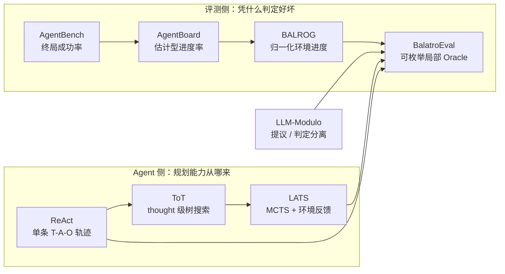

# Agent 规划 · 文献地图

> 这批文献（7 篇，标签 `Agent规划`，目录 `papers/Agent规划/`）解答的是同一个问题的两面：**Agent 的"规划"能力到底由什么提供**，以及**我们凭什么判定一次决策是好是坏**。对 BalatroEval 来说，前者决定被测系统长什么样，后者决定指标怎么定义——两者不能混着谈。

## 一、七篇的坐标

| # | 论文 | 年份 | 核心机制 | 一句话结论 | 在 BalatroEval 里的角色 |
|---|---|---|---|---|---|
| 1 | [[papers/Agent规划/2210.03629/NOTES\|ReAct]] | 2023 | Thought–Action–Observation 交错 | 把 thought 当作"不产生观测的动作"，轨迹因此成为可审计的过程单位 | 决策 Trace 的字段来源 |
| 2 | [[papers/Agent规划/2305.10601/NOTES\|ToT]] | 2023 | thought 级树搜索 + LM 自评 | 决策粒度从 token 抬到 thought，搜索才可行；但评估器一旦假阴性就会剪掉正解 | 区分"测试时搜索 / 状态评估器 / 局部 Oracle" |
| 3 | [[papers/Agent规划/2310.04406/NOTES\|LATS]] | 2024 | MCTS + LM 价值 + 环境反馈 + 反思 | model-free 搜索把"环境可回滚"从实现细节变成算法前提 | 环境规格表 + 预算冻结的三个旋钮 |
| 4 | [[papers/Agent规划/2402.01817/NOTES\|LLM-Modulo]] | 2024 | LLM 提议 + 硬 critic 判定 | LLM 只被允许"提出"，不被允许"通过"；soundness 只能继承自形式化验证器 | "模型提出动作、环境判定"的原则背书 |
| 5 | [[papers/Agent规划/2308.03688/NOTES\|AgentBench]] | 2024 | 8 环境 × 统一接口 + 归一化总分 | 不存在通用 Agent 能力标量，能力是"环境 × 技能"矩阵；长程失败表现为卡进循环 | 通用 Agent Benchmark 的反面参照 |
| 6 | [[papers/Agent规划/2401.13178/NOTES\|AgentBoard]] | 2024 | 人工 subgoal + 正则 → 进度率 | 进度率是"估计型"过程指标，分辨率被 subgoal 数（3–6 档）硬性卡死 | 估计型过程指标的下界基线 |
| 7 | [[papers/Agent规划/2411.13543/NOTES\|BALROG]] | 2025 | 6 个游戏环境 + 0–100 归一化 | 统一的是接口与报告，不是动作空间；加图可能更差；无步级最优性判定 | 最重要的游戏 Agent Benchmark 对照 |

## 二、两条主线

**主线 A：规划被一层层外化。**
ReAct 把推理写进上下文（外化为轨迹）→ ToT 把轨迹变成树（外化为搜索）→ LATS 把搜索接到真实环境上（外化为"可回滚的试错"）→ LLM-Modulo 干脆承认模型不会规划，把判定权交给外部验证器（外化为"提议 / 裁决"分工）。四步走下来，"规划"从模型的内生能力，变成了**系统属性**：模型 + 搜索算法 + 验证器 + 环境。这条线对 BalatroEval 的直接后果是：**被测对象必须写清楚是哪一套系统，否则"模型 A 比模型 B 强"无法解释**。

**主线 B：评测的判定粒度在变细，但每一步都付了代价。**
AgentBench 判终局（sound 但粒度粗）→ AgentBoard 用人工 subgoal 造出连续进度（有粒度但估计性、分辨率被 $K$ 卡死）→ BALROG 用环境内置成就与人类生存曲线归一化（可比但"像不像人"不等于"对不对"）→ BalatroEval 想做的是**可枚举的局部 Oracle**：在给定状态与合法动作集上判定最优/可接受。前三种都是"用某个标尺去近似正确性"，第四种是"直接算正确性"，代价是必须把环境压缩到可枚举、可重放的程度。

**主线 C：公平性是一个必须显式设计的量。**
LATS 的成本表只统计"成功时"的 token；ToT 的成功率随算力从 33% 变到 74%；AgentBench 用固定轮数把"能力"与"预算"混在一起；BALROG 的等权平均让最难的环境只占 1/6 权重。共同的教训：**只报成功率等于让被测方自选预算**。BalatroEval 必须同时报 `llm_tokens`、`env_calls`、搜索宽度 $k$ 与深度 $n$。

## 三、可以直接落地的五条

1. **Trace 的字段**（来自 ReAct）：`t / thought / action / legal_actions / observation / state_hash / score / oracle / budget`。thought 允许为空（否则测不到"何时该思考"）；`observation` 与 `state_hash` 必须分开记（否则"模型看错"与"环境没说清"不可分辨）。
2. **Oracle 只出现在评分侧**（来自 ToT + LATS）：把 Oracle 当价值函数交给 Agent，测的就不是规划能力，而是"带完美启发式的搜索"。Oracle 回答"这一步好不好"，不回答"下一步怎么走"。
3. **环境规格要写成表**（来自 LATS）：`snapshot()/restore()`、固定种子、`legal_actions(state)`、`env_calls` 计数。把"能否回溯"从幸运前提变成可控自变量——同一模型在"允许回溯 / 禁止回溯"两档下跑，差值就是回溯能力的定价。
4. **非法动作与格式错误必须分开**（来自 AgentBench + BALROG）：BALROG 的兜底动作会把"格式失败"伪装成"策略失败"；AgentBench 把 IF 与 IA 分开是个好习惯。BalatroEval 应把动作标成三类：不在枚举集内 / 合法但当前不可执行 / 合法且可评分。
5. **模态是实验因子，不是附属条件**（来自 BALROG）：同模型纯文本与图文两种观察下分数可以反向变化，Balatro 又恰好是"卡牌图像 + 数值文本"，两档都要跑并分别报告。

## 四、还缺什么

- **反思类方法**（Reflexion 一类）：本批只有 LATS 内部的反思消融，缺少"反思 vs 搜索"的等预算对照。
- **带工具/代码执行的 Agent 评测**：SWE-bench 一类，与游戏环境是两种不同的可验证性来源。
- **真实网页/办公环境**：WebArena、Mind2Web 一类，用来检验"可重放"与"真实性"的权衡。
- **过程级监督**：如何把 Trace + Oracle 标签变成训练信号，目前七篇里只有 ReAct 的 bootstrapping 碰到边。

> 引用与数字均以各篇 arXiv TeX 源为准；笔记里标注了"未能从原文核实"的地方，是原文本身缺项（多为随机种子、方差、图表编号），不是转述误差。
