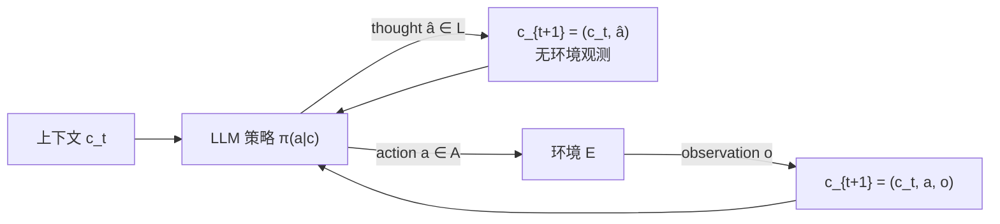

---
aliases:
  - "ReAct: Synergizing Reasoning and Acting in Language Models"
  - "ReAct"
---
# ReAct: Synergizing Reasoning and Acting in Language Models

> 论文研究让 LLM 交错生成推理轨迹与任务动作：推理帮助模型归纳、跟踪和更新行动计划并处理异常，动作则让模型与知识库或环境交互以获取证据。在 HotpotQA 与 FEVER 上，ReAct 通过调用一个简单的 Wikipedia API 缓解了思维链推理中常见的幻觉与错误传播，生成的解题轨迹比无推理基线更可解释。在 ALFWorld 与 WebShop 两个交互式决策基准上，仅给一两个上下文示例，ReAct 就比模仿学习与强化学习基线分别高出 34% 与 10% 的绝对成功率。

## 一句话定位

把"思考"当成一种**不改变环境、只改变上下文**的动作塞进动作空间，从而让一个冻结的 LLM 在同一条轨迹里交替完成推理与环境交互——本文的真正贡献不是"让模型更聪明"，而是定义了后来所有 LM Agent 评测都在用的**过程单位：交错的 Thought–Action–Observation 轨迹**。

## 问题与动机

### 三条互不重叠的研究线各自缺一半

- **纯推理线（CoT）**：模型用内部表示生成推理链，不接触外部世界。原文的定性判断是 CoT "is a static black box … not grounded in the external world"，因此无法 reactive 地推理、无法更新知识，于是产生事实幻觉与误差沿链条传播 [§1](papers/Agent规划/2210.03629/2210.03629.pdf)。这不是"推理能力不足"，而是**推理过程没有可写入的证据通道**。
- **纯行动线（Act-only / WebGPT 类）**：把多模态观测转文本、让 LM 产出领域动作、再由控制器执行。原文指出这类方法"do not employ language models to reason abstractly about high-level goals or maintain a working memory"，唯一的例外 Inner Monologue 只做"重述空间事实"这种受限语言推理 [§1](papers/Agent规划/2210.03629/2210.03629.pdf)。
- **结构性缺口**：两条线各自的失败模式恰好互补——CoT 幻觉多但推理结构好，Act 有据可查但不会规划。原文在第 3 节用人工标注把这种互补性量化了（见下表 2：CoT 的失败 56% 是幻觉，ReAct 的失败 47% 是推理错误、23% 是检索无用）[§3.3](papers/Agent规划/2210.03629/2210.03629.pdf)。**这就是本文的动机落点：不是提升单点能力，而是让两种失败模式互相抵消。**

### 切入点：动作空间做并集，而不是做流水线

ReAct 没有引入新模型、新训练目标或新控制器，只改 prompt 的**结构**：把动作集合扩成 $\hat{\mathcal{A}} = \mathcal{A} \cup \mathcal{L}$，其中 $\mathcal{L}$ 是语言空间。这一个改动同时带来三个可测的好处：推理可被人读（可解释性）、动作有外部证据（可信度）、轨迹可被人工局部编辑（可控性）[§2](papers/Agent规划/2210.03629/2210.03629.pdf)。

## 方法与机制

### 1. 形式化：上下文是唯一的隐状态

原文的设定很朴素，但正是这个朴素设定决定了后续所有 Trace 的定义 [§2](papers/Agent规划/2210.03629/2210.03629.pdf)：

- 时刻 $t$ 智能体从环境收到观测 $o_t \in \mathcal{O}$，按策略 $\pi(a_t \mid c_t)$ 取动作 $a_t \in \mathcal{A}$；
- 上下文 $c_t = (o_1, a_1, \cdots, o_{t-1}, a_{t-1}, o_t)$；
- 关键机制：语言动作（thought）$\hat{a}_t \in \mathcal{L}$ **不作用于外部环境，因此不产生观测**，只做上下文更新

$$c_{t+1} = (c_t, \hat{a}_t)$$

也就是说，模型没有隐藏状态可供写入；**所有"记忆"都必须以文本形式落回 $c_t$**。这解释了为什么 ReAct 的轨迹天然就是一个可审计的数据结构：不存在"模型心里想了但没说出来"的部分可以推卸责任。

### 2. 两种编排密度：dense 与 sparse

同一个循环，在两个任务族里被故意用成两种密度 [§2](papers/Agent规划/2210.03629/2210.03629.pdf)：

- **推理主导任务**（HotpotQA / FEVER）：强制交替，"multiple thought-action-observation steps"，即每步动作前都有 thought，形成密轨迹。
- **动作主导任务**（ALFWorld / WebShop）：thought 只出现在"最相关的位置"，"we let the language model decide the asynchronous occurrence of thoughts and actions for itself"。稀疏性由模型自己决定，而不是由人排班。

这个设计选择很重要：它说明 ReAct 论文里"循环"的**节拍不是算法规定的，而是提示与任务共同诱导的**。后文所有把 ReAct 当"固定 while 循环"来实现的工作，其实都丢掉了这一层自由度。

### 3. 四类 thought 的功能分类（可操作的部分）

原文并没有给 thought 下形式定义，而是按**功能**列举：分解目标与制定计划、注入常识、从观测中抽取要点、跟踪进度并切换子目标、处理异常并调整计划 [§2](papers/Agent规划/2210.03629/2210.03629.pdf)。第 3.2 节进一步把它落成 HotpotQA 上的 6 类具体句式（分解问题 / 抽信息 / 常识 / 算术 / 改写检索式 / 汇总答案）[§3.2](papers/Agent规划/2210.03629/2210.03629.pdf)。这套分类是本文最被低估的贡献：**它把"推理"从不可观测的能力变成了可枚举的标签**，后面的失败分析才能做（表 2 的 47% 推理错误就是在这些标签上归因的）。

### 4. 三个任务的动作空间（决定了"环境反馈"的粒度）

| 环境 | 动作集合 | 观测形态 | 来源 |
|---|---|---|---|
| HotpotQA / FEVER | `search[entity]`、`lookup[string]`、`finish[answer]` | 页面前 5 句 / 含目标串的下一句 / 相似实体提示 | [§3.1](papers/Agent规划/2210.03629/2210.03629.pdf) |
| ALFWorld | 文本家务指令（`go to coffeetable 1`、`take paper 2`、`use desklamp 1`） | 房间与容器状态文本 | [§4](papers/Agent规划/2210.03629/2210.03629.pdf) |
| WebShop | `search[query]`、`choose[product/option]`、`buy` | 搜索结果页 / 商品页 / 选项页 | [§4](papers/Agent规划/2210.03629/2210.03629.pdf) |

注意 Wiki API 是**故意做弱**的：它只能按精确条目名取一小段，"significantly weaker than state-of-the-art lexical or neural retrievers"，目的是逼模型用语言推理来决定检索什么 [§3.1](papers/Agent规划/2210.03629/2210.03629.pdf)。这一点对评测设计有直接借鉴意义：**动作集设计本身就是在设定难度**。

### 5. 组合策略：把"何时该查、何时该想"外化成规则

第 3.2 节给了两条互补的回退规则 [§3.2](papers/Agent规划/2210.03629/2210.03629.pdf)：

- ReAct → CoT-SC：ReAct 在给定步数内没给出答案就回退到 21 次 CoT 采样多数投票（HotpotQA 上限 7 步、FEVER 5 步；原文脚注称，最终答对的轨迹里步数达到上限的仅占 0.84% 与 1.33%，所以这个上限几乎不损伤上限性能）。
- CoT-SC → ReAct：当 $n$ 个 CoT 样本的多数答案出现次数少于 $n/2$（内部知识不够自信）时回退到 ReAct。

这条规则的含义是：**"是否需要外部信息"被实现为一个可计算的置信度判据，而不是模型的自我报告**。这是全文最工程化、也最容易被忽略的一处设计。

## 实验设置与关键结果

### 设置要点

- 基座：PaLM-540B，few-shot in-context，HotpotQA 6 例、FEVER 3 例（原文脚注：更多示例不带来提升）；附录补充 GPT-3（text-davinci-002，greedy）[§3.2](papers/Agent规划/2210.03629/2210.03629.pdf) [§A.1](papers/Agent规划/2210.03629/2210.03629.pdf)。
- 对照构造方式很干净：**从同一条 ReAct 轨迹里删组件**得到 baseline——删 thought 得 Act-only，删 action/observation 得 CoT [§3.2](papers/Agent规划/2210.03629/2210.03629.pdf)。这保证了 baseline 与主方法共享示例来源，是一个值得抄的消融范式。
- ALFWorld：134 个未见评估局；每类任务用 3 条标注轨迹，通过"2 条的组合排列"造 6 组 prompt 以测稳健性 [§4](papers/Agent规划/2210.03629/2210.03629.pdf)。
- WebShop：500 条测试指令，指标为平均得分（满足属性比例）与成功率 [§4](papers/Agent规划/2210.03629/2210.03629.pdf)。

### 表 1：知识密集任务（PaLM-540B）

| Prompt 方法 | HotpotQA (EM) | FEVER (Acc) |
|---|---|---|
| PaLM（标准） | 28.7 | 57.1 |
| CoT | 29.4 | 56.3 |
| CoT-SC | 33.4 | 60.4 |
| Act | 25.7 | 58.9 |
| **ReAct** | 27.4 | **60.9** |
| CoT-SC → ReAct | 34.2 | **64.6** |
| ReAct → CoT-SC | **35.1** | 62.0 |
| 监督式 SoTA（参照） | 67.5 | 89.5 |

数据来自 [§3.3](papers/Agent规划/2210.03629/2210.03629.pdf) 表 1。三个必须读出来的事实：(a) 单用 ReAct 在 HotpotQA 上**低于** CoT（27.4 vs 29.4），只在 FEVER 上反超（60.9 vs 56.3）；(b) 组合后才全面领先；(c) 与监督式 SoTA 差距仍在 30 个点以上，原文自己承认 "all prompting methods are still significantly far from domain-specific state-of-the-art"。

### 表 2：HotpotQA 人工失败模式（各 50 条对/错轨迹，共 200 条）

| 类型 | 子类 | ReAct | CoT |
|---|---|---|---|
| 成功 | 正确推理与事实 | 94% | 86% |
| 成功 | 幻觉（假阳性） | 6% | 14% |
| 失败 | 推理错误（含陷入重复） | 47% | 16% |
| 失败 | 检索结果错误 | 23% | — |
| 失败 | 幻觉 | 0% | 56% |
| 失败 | 标签歧义 | 29% | 28% |

数据来自 [§3.3](papers/Agent规划/2210.03629/2210.03629.pdf) 表 2。这张表是全文最有信息量的结果：**ReAct 把幻觉压到 0%，代价是把失败集中转移到"推理/检索"两类可诊断的错误上**。原文还点出一个 ReAct 特有故障——模型重复生成先前的 thought 与 action 跳不出循环，作者怀疑与 greedy decoding 有关 [§3.3](papers/Agent规划/2210.03629/2210.03629.pdf)。

### 表 3：交互式决策任务

ALFWorld 分类成功率（%）：

| 方法 | Pick | Clean | Heat | Cool | Look | Pick 2 | All |
|---|---|---|---|---|---|---|---|
| Act（best of 6） | 88 | 42 | 74 | 67 | 72 | **41** | 45 |
| ReAct（avg） | 65 | 39 | 83 | 76 | 55 | 24 | 57 |
| ReAct（best of 6） | **92** | 58 | **96** | 86 | **78** | **41** | **71** |
| ReAct-IM（best of 6） | 62 | **68** | 87 | 57 | 39 | 33 | 53 |
| BUTLER（best of 8） | 46 | 39 | 74 | **100** | 22 | 24 | 37 |

WebShop：

| 方法 | Score | SR |
|---|---|---|
| Act | 62.3 | 30.1 |
| **ReAct** | **66.6** | **40.0** |
| IL | 59.9 | 29.1 |
| IL+RL | 62.4 | 28.7 |
| 人类专家 | 82.1 | 59.6 |

数据来自 [§4](papers/Agent规划/2210.03629/2210.03629.pdf)。归因要点：(a) ReAct 六组 prompt 全部优于 Act，相对增益 33%–90%、均值 62%，且最差的一组（48%）仍高于两个 baseline 的最好一组——这排除了"挑 prompt 挑出来的"这一解释；(b) 与 Inner-Monologue 式密集反馈（ReAct-IM）比，71 vs 53，说明**增益来自"高层目标分解 + 常识推断物品位置"，不是来自"把观测复述一遍"**；(c) WebShop 上 one-shot Act 已与 IL/IL+RL 持平，稀疏 thought 再带来约 10 个点 SR 提升，但人类专家仍高 20 个点。

### 微调后的规模效应

用 3,000 条答对的 ReAct 轨迹做 bootstrapping 微调后：PaLM-8B + ReAct 微调**超过所有 PaLM-62B prompting 方法**，PaLM-62B + ReAct 微调**超过所有 PaLM-540B prompting 方法**；而微调 PaLM 或 CoT 明显更差，原文解释是前者"教模型背（可能幻觉的）事实"，后者"教模型如何（推理并）行动"，后者才是可迁移技能 [§3.3](papers/Agent规划/2210.03629/2210.03629.pdf)。注意反直觉之处：**同样的 8B/62B 模型上，prompt 版 ReAct 是四种方法里最差的**（因为小模型同时学推理和行动太难），只有微调后才翻身。

## 阅读重点

### 1. Thought–Action–Observation 循环如何定义 Agent 交互？

机制上，它把"交互"拆成两类信息流，并用**是否产生观测**作为唯一判据：$a \in \mathcal{A}$ 走环境通道，产生 $o \sim \mathcal{E}(\cdot \mid s, a)$ 并改变世界状态；$\hat{a} \in \mathcal{L}$ 走上下文通道，只改变 $c_{t+1}$。于是策略的输入永远是同一格式的文本串 $c_t$，而循环的"一步"由**谁产生了外部后果**来界定。

这带来一个常被忽略的后果：ReAct 里不存在"环境状态"这一显式变量，状态只能通过文本观测被间接表示。所以它的正确性完全依赖"观测是否被忠实写进上下文"——这也正是 23% 检索失败能直接毁掉推理的原因 [§3.3](papers/Agent规划/2210.03629/2210.03629.pdf)。相比之下，真正带状态的 Agent 可以把状态快照与文本观测分开存放，从而区分"模型读错了"和"环境没说清"。

### 2. Trace 为什么成为过程分析的基本单位？

因为这篇论文的**全部实验操作都以轨迹为原子**：baseline 是从轨迹里删组件构造的（删 thought → Act，删 action/observation → CoT）；失败归因是逐条轨迹人工标注的（表 2）；可解释性论证是"人读得懂轨迹"；连人在回路干预也是**直接编辑轨迹中的一句 thought**，从而让模型在 17 步之后改变行为并完成任务 [§A.3](papers/Agent规划/2210.03629/2210.03629.pdf)。

换句话说，Trace 在这里同时承担四种角色：模型输入、评估样本、归因对象、干预界面。只有当一个单位同时能做这四件事时，"过程分析"才不是修辞。这也解释了为什么只报最终准确率的评测无法复用 ReAct 的结论——**它把可诊断性建立在数据结构上，而不是建立在指标上**。

### 3. 环境反馈如何约束下一步决策？

约束方式是**软约束**：观测被拼接进 $c_t$，模型在下一个 token 上条件化于它，但没有任何机制强制动作合法或强制模型引用观测。原文的证据显示这种软约束既有效又脆弱：

- 有效：在 FEVER 上，一次 `search` 就能推翻模型先验（"The observation says that it is in the western part of the North Atlantic Ocean, so it is not in the Pacific Ocean." 这类 thought 直接导向 `Finish[REFUTES]`）[§D.1](papers/Agent规划/2210.03629/2210.03629.pdf)。
- 脆弱：检索到无用信息时（占错误 23%）"derails the model reasoning and gives it a hard time to recover"，且模型会陷入重复生成同一 thought/action 的死循环 [§3.3](papers/Agent规划/2210.03629/2210.03629.pdf)。

所以严格说，ReAct 的反馈不是"约束"，而是"提示"：它提高下一步正确动作的概率，但不排除错误动作。**要把它变成硬约束，必须由外层程序（动作合法性检查、状态机、预算）来兜底**——这是把它工程化时的第一课。

## 与 BalatroEval 的连接

ReAct 给 BalatroEval 的直接遗产是 Trace 的**字段设计**，而不是它的 prompt。Balatro 是确定性可重放、每步动作集可枚举的环境，这让我们可以在 ReAct 的四元组上补齐两样 ReAct 时代拿不到的东西：**状态快照**与**Oracle 标签**。

建议的决策 Trace（每条 = 一次 `step`）：

| 字段 | 类型 | 作用 | 与 ReAct 的差异 |
|---|---|---|---|
| `t` | int | 步序，用于对齐重放 | 同 |
| `thought` | str \| null | 允许为空（稀疏 thought），保留"模型自行决定是否思考"的自由度 | 同 |
| `action` | 枚举 id | 从**当步合法动作集**中取，附带 `legal_actions` 快照 | ReAct 无合法性约束 |
| `observation` | str | 环境返回的文本化结果 | 同 |
| `state_hash` | str | 动作执行后的状态指纹，用于确定性重放校验 | ReAct 无 |
| `score` | float | 当步得分/累计得分（Balatro 的 chips×mult 与回合分） | ReAct 无中间分 |
| `oracle` | {best, acceptable, suboptimal} | 局部 Oracle 对 `(state, action)` 的判定 | ReAct 无 |
| `budget` | {llm_calls, env_calls, tokens} | 搜索/推理预算计数 | ReAct 无 |

三条设计原则，都由 ReAct 的教训推出：

1. **thought 必须允许为空**。ReAct 在决策任务里让模型自己决定 thought 的稀疏性 [§2](papers/Agent规划/2210.03629/2210.03629.pdf)；如果在 BalatroEval 里强制每步都写 thought，我们就把"何时需要推理"这个被测能力从评测里删掉了。
2. **`observation` 与 `state_hash` 必须分开记**。ReAct 的脆弱性来自观测即状态（23% 检索失败直接毁掉推理）；Balatro 有确定状态，可以让"模型看错"与"环境没说清"成为两个可分辨的失败类。
3. **`action` 必须是枚举 id 而非自由文本**。这是 ReAct 做不到的（它的动作是自由文本 API 调用），也是 BalatroEval 能算 Oracle 的前提：只有动作集可枚举，"最优/可接受"才可判定。

此外，ReAct 的"删组件造 baseline"做法值得照搬到 BalatroEval：同一条 trace 去掉 thought 即得 Act-only 对照，去掉 action/observation 即得 CoT 对照，**样本完全配对**，比跨模型比较干净得多。

## 局限与可批判点

- **prompt 长度是硬上限**。原文结论段自认："complex tasks with large action spaces require more demonstrations to learn well, which unfortunately can easily go beyond the input length limit of in-context learning" [§6](papers/Agent规划/2210.03629/2210.03629.pdf)。这直接限制了它在大动作空间环境（如 Balatro 的完整牌型/小丑牌组合）中的可用性。
- **不学习**。除第 3.3 节的微调实验外，agent 不会从自己的失败中更新任何东西；同一个重复生成错误会在不同 episode 里重复出现。
- **没有预算意识**。步数上限（7/5）是人手设的，thought 的 token 成本从未被计量或对齐，因此"ReAct 比 Act 好"这一比较**不是在等算力下做的**。这是与 ToT/LATS 比较时最容易踩的坑。
- **样本量与统计**。ALFWorld 134 局、WebShop 500 条、HotpotQA/CoT-SC 比较仅 100 条规模；原文未报告随机种子、重复次数或置信区间（我在 TeX 源中未找到 seed/variance 相关段落），因此表 1 中 27.4 vs 29.4 这类 2 个点的差距不宜当作稳定结论——原文自己也只是说 "slightly lags behind"。
- **基座单一且昂贵**。主实验全部 PaLM-540B；GPT-3 补充实验只在 HotpotQA 500 条子集与 ALFWorld 134 局上做 [§A.1](papers/Agent规划/2210.03629/2210.03629.pdf)。
- **人工研究的规模**。表 2 每类 50 条、由作者标注，没有报告标注者间一致性；"幻觉 0%" 这种极端数字应理解为该样本下的观测，而非总体比例。
- **可解释性主张偏强**。轨迹可读 ≠ 轨迹忠实（faithful）。原文用"人能读懂并据此编辑"作为可信度证据 [§A.3](papers/Agent规划/2210.03629/2210.03629.pdf)，但这只证明 thought 有因果作用，不证明它完整反映了模型的决策依据。

## 开放问题

1. **thought 的最小充分集是什么？** ReAct 按功能列了 6 类句式，但没有回答"哪些 thought 是必要的"。在 Balatro 这种状态可完全观测的环境里，可以做"逐类删除 thought 模板"的消融，得到一张 thought 类型 × 增益的表。
2. **观测噪声与推理鲁棒性的定量关系？** 23% 检索失败是一个点估计。若能在受控环境里连续调节观测质量（例如按概率把观测替换为无关文本），可以画出"反馈质量–成功率"曲线，这比任何 prompt 变体都更能说明 ReAct 的适用边界。
3. **循环退化的成因？** 原文归因于 greedy decoding [§3.3](papers/Agent规划/2210.03629/2210.03629.pdf)，但没有实验。在确定性环境里可以精确检测"状态重复访问但动作未变"，从而把退化与采样策略解耦。
4. **Trace 能否作为训练信号？** 原文只做了答案正确性过滤的 bootstrapping（3,000 条），没有用失败轨迹。失败轨迹上的"哪一步错"标注（配合 Oracle）可能是更高效的监督。

## 关联笔记

- [[papers/Agent规划/2305.10601/NOTES|ToT]]：把 ReAct 的单条轨迹换成 thoughts 树，用自评做启发式搜索；对照点在于 ReAct 无回溯、无前瞻。
- [[papers/Agent规划/2310.04406/NOTES|LATS]]：把 ReAct 的动作空间直接作为 MCTS 的边，节点里带上观测；它是 ReAct 的"搜索化"版本，也是本文"无预算意识"批评的直接回应。
