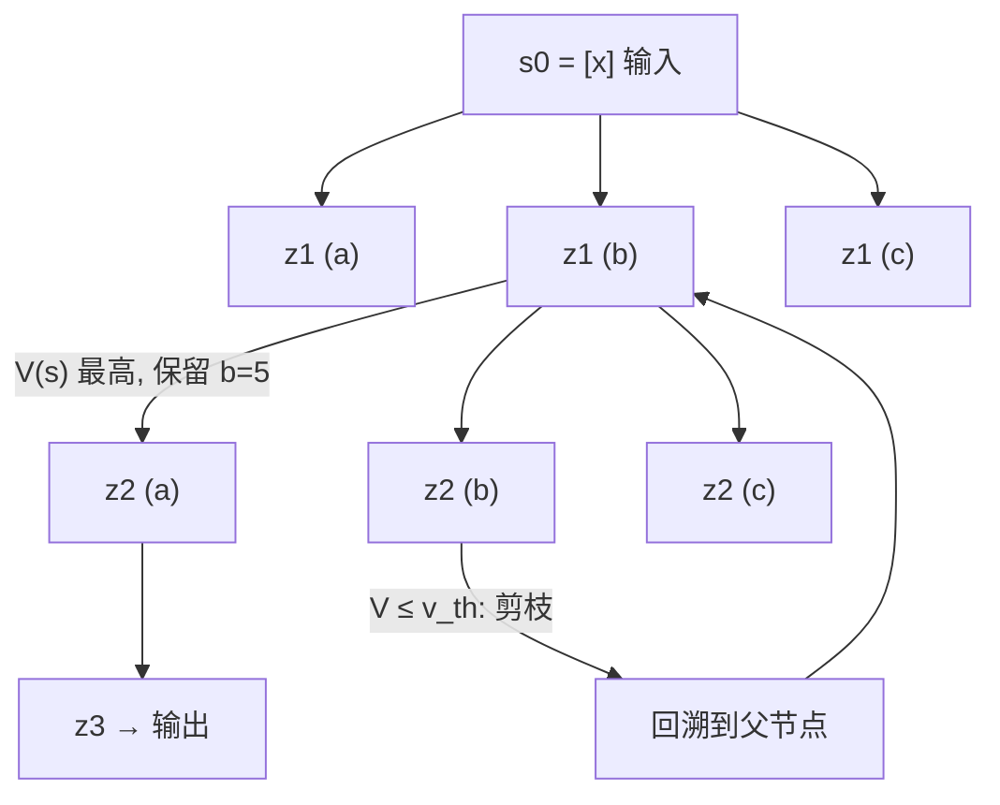

---
aliases:
  - "Tree of Thoughts: Deliberate Problem Solving with Large Language Models"
  - "Tree of Thoughts"
---
# Tree of Thoughts: Deliberate Problem Solving with Large Language Models

> LLM 的推理仍被限制在 token 级、从左到右的决策过程中，在需要探索、战略前瞻或早期决策至关重要的任务上会力不从心。论文提出 Tree of Thoughts（ToT）：把连贯的文本单元（thought）当作搜索节点，让模型在多条推理路径上自我评估、前瞻与回溯，从而做出更具全局性的选择。在 24 点游戏、创意写作与迷你填字三个需要非平凡规划或搜索的任务上均有显著提升；例如 24 点游戏中 GPT-4 配合思维链只解出 4%，ToT 达到 74%。

## 一句话定位

把 LLM 的**决策粒度从 token 抬到"thought"**，从而让树搜索变得可行（深度小、分支语义化、可评估），并用 LM 自身的"价值判断/投票"充当搜索启发式——即把"经典 AI 的启发式搜索"里的启发式函数换成一个语言模型，训练成本为零。

## 问题与动机

### 被点名批评的两个缺陷

原文没有泛泛地说"LLM 不会规划"，而是把缺陷拆成局部与全局两条，且都能对应到机制层面 [§3](papers/Agent规划/2305.10601/2305.10601.pdf)：

- **局部**："they do not explore *different* continuations within a thought process"——自回归解码在每一步只走一条路，一旦选错，后面的 token 全部条件化在这个错误前缀上。
- **全局**："they do not incorporate any type of planning, lookahead, or backtracking"——没有前瞻就无法评估当前选择，没有回溯就无法撤销选择。

CoT-SC 看似缓解了第一条（采样 $k$ 条链再投票），但原文明确指出它的问题：**链内没有局部探索**，且"most frequent"只在输出空间有限时可用（多选 QA）[§2](papers/Agent规划/2305.10601/2305.10601.pdf)。也就是说，$\arg\max_y \#\{i \mid y^{(i)}=y\}$ 这个聚合算子要求答案可枚举，对"写一篇连贯文章"这种任务直接失效。

### 理论外衣：System 1 / System 2 与 Newell 的问题空间

原文的动机叙述有两层，第二层才是真正指导设计的 [§1](papers/Agent规划/2305.10601/2305.10601.pdf) [§3](papers/Agent规划/2305.10601/2305.10601.pdf)：

- 认知科学层：token 级贪心 ≈ System 1，需要 System 2 式的"维持多个备选 + 评估现状 + 前瞻/回溯"。
- 人工智能层（更关键）：Newell–Shaw–Simon 把解题视为**在组合问题空间中的树搜索**，节点是部分解、边是算子，走哪条边由启发式决定。这个框架直接给出了 ToT 的四个待填空位：thought 怎么切、候选怎么生成、状态怎么评估、用什么搜索算法。

## 方法与机制

### 1. 状态与形式化

原文把任意问题写成树上的一次搜索 [§3](papers/Agent规划/2305.10601/2305.10601.pdf)：

$$s = [x, z_{1\cdots i}]$$

其中 $x$ 是输入，$z_{1\cdots i}$ 是到目前为止的 thought 序列。注意这个状态是**纯文本前缀**，没有别的隐变量；这一点在后面讨论"回溯代价"时非常关键。与 §2 的形式化对照：IO 是 $y \sim p_\theta^{IO}(y\mid x)$，CoT 是逐步采样 $z_i \sim p_\theta^{CoT}(z_i \mid x, z_{1\cdots i-1})$ 再出 $y$——ToT 只是把"采样一条"换成"生成 $k$ 条、评估、保留 $b$ 条"。

### 2. 四个设计维度（本文的方法论骨架）

ToT 不是一个具体算法，而是四个可独立替换的槽位 [§3](papers/Agent规划/2305.10601/2305.10601.pdf)：

**(1) Thought 分解。** 粒度要满足一对矛盾约束："small enough so that LMs can generate promising and diverse samples … yet big enough so that LMs can evaluate its prospect"。原文给的三个实例（原文 Table 1 的 task overview）是：Game of 24 → 一行等式（3 步）；Creative Writing → 一段写作计划（1 步）；Crosswords → 一个单词（5–10 步，变长）。**同一框架下粒度差了一个数量级，这本身就是"粒度必须按任务设计"的证据。**

**(2) Thought 生成器 $G(p_\theta, s, k)$。** 两种策略，适用条件不同 [§3](papers/Agent规划/2305.10601/2305.10601.pdf)：

- **采样（sample）**：$z^{(j)} \sim p_\theta^{CoT}(z_{i+1}\mid s)$，$j=1\cdots k$。适合 thought 空间富（整段文字），i.i.d. 采样保证多样性。
- **提议（propose）**：$[z^{(1)},\cdots,z^{(k)}] \sim p_\theta^{propose}(z_{i+1}^{(1\cdots k)}\mid s)$，一次生成 $k$ 个候选。适合 thought 空间受限（一个词、一行等式），同一上下文里连续提议可避免重复。

**(3) 状态评估器 $V(p_\theta, S)$。** 这是全文的技术核心，因为它是"启发式"这个位置上的新东西——原文强调传统启发式要么是程序写死的（DeepBlue），要么是学出来的（AlphaGo），这里提出第三条路：让 LM 显式推理 [§3](papers/Agent规划/2305.10601/2305.10601.pdf)：

- **独立打分（value）**：$V(p_\theta,S)(s) \sim p_\theta^{value}(v\mid s)$，输出 1–10 标量或 sure/likely/impossible 分类。评估依据是"少量前瞻模拟 + 常识"，例如"5,5,14 能否凑 24"或"1 2 3 太小凑不到 24"。原文明确降低了对评估器的要求："Such valuations do not need to be perfect, and only need to be approximately helpful"。
- **互比投票（vote）**：$V(p_\theta,S)(s) = \mathbf{1}[s=s^*]$，其中 $s^* \sim p_\theta^{vote}(s^*\mid S)$。适用于"成功难以直接打分"的场景（如文章连贯性），本质是把"下一步探索哪个状态"cast 成多选 QA。

**(4) 搜索算法。** 原文只用了两个简单算法，把 A\*、MCTS 明确留作未来工作 [§3](papers/Agent规划/2305.10601/2305.10601.pdf)：

BFS（算法 1）——每层保留得分最高的 $b$ 个状态：

$$S'_t = \{[s, z] \mid s \in S_{t-1},\, z \in G(p_\theta, s, k)\},\qquad S_t = \arg\max_{\substack{S \subset S'_t \\ |S| = b}} \sum_{s\in S} V_t(s)$$

DFS（算法 2）——沿最有希望的分支走到 $t > T$ 或评估器判定"不可能"（$V(p_\theta,\{s'\})(s) \le v_{th}$）时**剪枝并回溯到父状态**。

### 3. "搜索"在这里到底改变了什么

把三件事放在一起看，才能理解为什么 Game of 24 会有 4% → 74% 这种量级的差：

1. **深度塌缩**：token 树的深度是几百（一句话的 token 数），thought 树只有 3（Game of 24）。深度一塌，回溯才经济。
2. **前缀可评估**：一行等式"13-9=4 (left 4 4 10)"是**语义完整**的，LM 能对它做算术前瞻；而"13-9="这半截 token 前缀没有可评估的语义。
3. **错误可撤销**：CoT 一旦生成前三个 token 错了任务就失败——原文错误分析给出量化：约 60% 的 CoT 样本在**第一步之后**（等价于前三个词）就已经失败 [§4.1](papers/Agent规划/2305.10601/2305.10601.pdf)。ToT 把"生成即承诺"改成"生成即可撤销"。

## 实验设置与关键结果

### 设置要点

- 基座：GPT-4 Chat Completion，采样温度 0.7，实验时间 2023-05-05 至 05-16 [§4](papers/Agent规划/2305.10601/2305.10601.pdf)。GPT-3.5 结果在附录 B.2。
- 三个**新造**任务，理由是"现有任务 GPT-4 已经做得很好、不需要搜索"：Game of 24、Creative Writing、5×5 Mini Crosswords [§4](papers/Agent规划/2305.10601/2305.10601.pdf)。
- 评价方式差异很大：Game of 24 有程序化判定（等式合法且用尽四个数）、Crosswords 有字母/词/局三级判定、Creative Writing 无 ground truth 只能用 GPT-4 打分 + 作者盲评。**这一点决定了三个任务的结论强度完全不同**（见后文批判）。

### Game of 24 结果（100 道难题，索引 901–1000）

| 方法 | 成功率 |
|---|---|
| IO prompt | 7.3% |
| CoT prompt | 4.0% |
| CoT-SC（k=100） | 9.0% |
| **ToT（b=1）** | **45%** |
| **ToT（b=5）** | **74%** |
| IO + Refine（k=10） | 27% |
| IO（best of 100） | 33% |
| CoT（best of 100） | 49% |

数据来自 [§4.1](papers/Agent规划/2305.10601/2305.10601.pdf)。ToT 配置：3 步 thought，BFS 保留 $b=5$，每步用"propose prompt"提候选，评估用 sure/maybe/impossible，每个 thought 采样 3 次取值 [§4.1](papers/Agent规划/2305.10601/2305.10601.pdf)。

**必须一起读的两行**：CoT（best of 100）= 49% 与 ToT（b=5）= 74%。前者是"同一算力下无搜索的采样上界"（100 条独立链），后者只用约 5.5k completion token（见下表）。原文自己做了这个对齐：把 IO/CoT 的 best-of-$k$ 视为"访问 $k$ 个节点"，与 ToT 访问的节点数比较，结论是"best of 100 CoT … still much worse than exploring more nodes in ToT (b>1)" [§4.1](papers/Agent规划/2305.10601/2305.10601.pdf)。

### Mini Crosswords 结果（20 局，三级成功率 %）

| 方法 | Letter | Word | Game |
|---|---|---|---|
| IO | 38.7 | 14 | 0 |
| CoT | 40.6 | 15.6 | 1 |
| **ToT** | **78** | **60** | **20** |
| + best state（Oracle 取最好状态） | 82.4 | 67.5 | 35 |
| − prune（去掉剪枝） | 65.4 | 41.5 | 5 |
| − backtrack（去掉回溯） | 54.6 | 20 | 5 |

数据来自 [§4.3](papers/Agent规划/2305.10601/2305.10601.pdf)。ToT 配置：DFS，最多 10 个中间步、搜索上限 100 步，thought 受限为"不得改动已填的字" [§4.3](papers/Agent规划/2305.10601/2305.10601.pdf)。

**这张表的三个读法**（比 Game of 24 信息量大得多）：

1. `+best state` 从 60% 词级升到 67.5%、局级从 4/20 升到 7/20，说明**搜索找到了正确状态，但输出启发式没选出来**——瓶颈不在搜索而在"最后挑哪个"。
2. `− prune` 反而在 4/20 局里**找到过**正确解（其中 3 局是带剪枝的版本 100 步内解不出的）。原文直说："sometimes when the crosswords game is actually solved, the state evaluator might still deem some words as 'impossible' and prune"，举例 GPT-4 把 "agend"（agendum 的古体）当成 "agenda" 的拼写错误 [§4.3](papers/Agent规划/2305.10601/2305.10601.pdf)。**即评估器的知识缺口会剪掉正确分支——这是自评式搜索的固有风险，而不是调参问题。**
3. `− backtrack`（只填最有希望的线索、最多 20 步、允许覆盖）只有 20% 词级，说明**回溯本身贡献了主要增益**，不能靠"多填几次"替代。

### Creative Writing 结果（100 个输入）

| 方法 | GPT-4 连贯性均分（1–10） | 人类偏好 |
|---|---|---|
| IO | 6.19 | — |
| CoT（先计划再写） | 6.93 | 21/100 胜过 ToT |
| **ToT**（5 计划投票 + 5 成文投票） | **7.56** | **41/100 胜过 CoT** |
| IO + refine | 7.67 | — |
| ToT + refine | 7.91 | — |

数据来自 [§4.2](papers/Agent规划/2305.10601/2305.10601.pdf)。人类盲评 100 对中 38 对被判"差不多连贯"。这里有个值得记住的现象：**迭代精修（refine）在开放写作上比 ToT 更划算**（IO 从 6.19 直接到 7.67，超过 ToT 的 7.56），原文因此把"精修"称为 ToT 框架里的第三种 thought 生成方式 [§4.2](papers/Agent规划/2305.10601/2305.10601.pdf)。

### 成本（附录 B.3）

| 任务/方法 | 生成/提示 token | 单例成本 | 成功率 |
|---|---|---|---|
| Game of 24 · IO（best of 100） | 1.8k / 1.0k | \$0.13 | 33% |
| Game of 24 · CoT（best of 100） | 6.7k / 2.2k | \$0.47 | 49% |
| Game of 24 · ToT | 5.5k / 1.4k | \$0.74 | 74% |
| Creative Writing · IO | 0.9k / 0.4k | \$0.06 | — |
| Creative Writing · CoT | 0.9k / 0.4k | \$0.07 | — |
| Creative Writing · ToT | 4k / 2.9k | \$0.32 | — |

数据来自 [§B.3](papers/Agent规划/2305.10601/2305.10601.pdf)。原文的总结是"could require 5-100 times more generated tokens than CoT"，并给出总花费参考：Game of 24 + Creative Writing 主实验约 \$106。

### 换个更弱的模型会怎样（附录 B.2）

| 任务 | GPT-4 | GPT-3.5 |
|---|---|---|
| Game of 24 · IO | 7.3% | 6% |
| Game of 24 · CoT | 4.0% | 3% |
| Game of 24 · ToT | **74%** | **19%** |
| Creative Writing · IO / CoT / ToT | 6.19 / 6.93 / 7.56 | 4.47 / 5.16 / 6.62 |

数据来自 [§B.2](papers/Agent规划/2305.10601/2305.10601.pdf)。更关键的交叉实验：GPT-4 生成 + GPT-3.5 评估 = 64%，GPT-3.5 生成 + GPT-4 评估 = 31%，原文据此判断"the game's bottleneck is thought generation" [§B.2](papers/Agent规划/2305.10601/2305.10601.pdf)。**这个结论对评测设计极其重要：搜索的上限由生成器决定，评估器只是把已有的正确候选挑出来。**

## 阅读重点

### 1. 从 token 级生成转向 thought 级搜索，机制上改变了什么？

改变的不是"模型能力"，而是**决策问题的形状**。三个量同时变化：

- 分支因子从"词表大小 × 每步可能 token"变成"$k$ 个语义候选"。token 级的分支几乎无限且大部分无意义（"13-9=" 后面接什么都合法），thought 级的分支只有几个且都可判断价值。
- 深度从"序列长度"降到"推理步数"（Game of 24 是 3）。深度是回溯成本的指数项，这一步塌缩是整个方法可行的前提。
- 每个节点变成**可被语言评估的语义单元**。这是最重要的一点：$V(s)$ 之所以能存在，是因为 $s$ 是一句完整的话而不是半个 token。原文对 thought 粒度的双约束（小到能采样、大到能评估）正是对这个前提的直接表述 [§3](papers/Agent规划/2305.10601/2305.10601.pdf)。

代价也随之而来：thought 边界是**人工按任务设计的**（表 1 三种任务三种粒度），不是学出来的。所以 ToT 的"通用性"是框架层面的通用，不是零配置的通用。

### 2. 搜索依赖哪些状态评估与回溯能力？

拆成四项能力，缺一不可：

- **评估能力（heuristic）**：把状态映射成可比较的标量或序。ToT 用 value（独立打分）或 vote（互比）。原文对它的要求很低（"approximately helpful"），但 Crosswords 的 `− prune` 结果给出了反例：**评估器一旦在"可解"状态上判"不可能"，搜索就永久丢失该分支**。所以真实要求不是"平均准"，而是"不能有系统性假阴性"——这是一个比原文表述更强的条件。
- **剪枝决策**：DFS 用阈值 $v_{th}$ 把"不可能"的子树整棵砍掉。剪枝是效率来源，也是正确性风险来源。
- **状态恢复（回溯）**：ToT 的状态是文本前缀，回溯就是把上下文截回父节点，成本近似为零。**这是"纯语言状态"带来的隐性红利**：如果状态里含有不可逆的环境副作用（例如 Balatro 里已经打出的牌），回溯就必须依赖环境快照，代价结构完全不同。
- **输出选择**：搜索结束后挑哪个节点当答案。Crosswords 的 `+best state` 说明这一步独立于搜索，且可以是瓶颈。

原文自己也承认这套启发式"比程序规则灵活、比学习模型省样本"，但没有回答"评估器与被评估对象同源"（同一个 LM）会带来什么系统性偏差——Crosswords 里 GPT-4 不认识 "agend" 就是这种同源偏差的具体表现。

### 3. Game of 24 的成功率提升说明了什么，又不能说明什么？

**能说明**：

- 在**有程序化判定、且评估器可以做局部前瞻**的任务上，测试时搜索能把一个"会算 100 以内加减、但一开口就错"的模型从 4% 拉到 74%。这证明瓶颈是**决策顺序**而非算术能力。
- 搜索的收益不是"多采样"能替代的：best-of-100 CoT 只有 49%，而 ToT（b=5）约 5.5k token 就到 74% [§4.1](papers/Agent规划/2305.10601/2305.10601.pdf) [§B.3](papers/Agent规划/2305.10601/2305.10601.pdf)。
- 增益可归因到具体组件：`− prune`、`− backtrack` 在 Crosswords 上分别掉到 41.5% 与 20% 词级，说明搜索结构而非提示词是主因 [§4.3](papers/Agent规划/2305.10601/2305.10601.pdf)。

**不能说明**：

- **不能说明模型"更会推理"**。同一套 ToT 换 GPT-3.5 只有 19% [§B.2](papers/Agent规划/2305.10601/2305.10601.pdf)；交叉实验指出瓶颈在生成。所以 74% 是"GPT-4 的生成能力 + 搜索的筛选能力"的联合产物，不能单独记在推理账上。
- **不能说明它比精修更好**。Game of 24 里 IO+Refine 只到 27%，但注意 Refine 用的是 ground-truth 反馈（原文明确说 "it uses groundtruth feedback signals about equation correctness"）[§4.1](papers/Agent规划/2305.10601/2305.10601.pdf)；而在 Creative Writing 上 Refine 直接超过 ToT。**结论高度依赖任务是否有可判定的中间信号。**
- **不能说这个数字可外推到 24 点游戏总体**。测试集是从 4nums.com 按人类解题时长排序后取的 901–1000 号难题（共 1362 局），是**故意挑的难集**；且只有 100 局，原文未报告随机种子或置信区间。74% 与 49% 的差距在 100 样本上大致稳健，但 45%（b=1）与 49%（CoT best-of-100）之间的比较不宜过度解读。
- **不能说 thought 分解是自动的**。3 步等式是人工设计的；换任务就要重新设计粒度，这一点在跨任务比较里被框架的"通用性"叙述掩盖了。

## 与 BalatroEval 的连接

ToT 对 BalatroEval 最重要的作用不是"提供一个 agent 架构"，而是**逼我们把三件容易混为一谈的东西分开**：

| 概念 | 在 ToT 里的位置 | 在 BalatroEval 里的位置 | 关键区别 |
|---|---|---|---|
| 测试时搜索（test-time search） | BFS/DFS 展开的节点数 $b$、$k$、$T$ | Agent 侧行为，消耗 LLM 预算 | 由被测方自由使用，**必须计入预算并报告** |
| 状态评估器（$V$） | LM 自评/投票，启发式，允许出错 | 由 Agent 自己实现，属于被测能力 | 与 Oracle 无关，允许错 |
| 局部 Oracle | 不存在（Game of 24 只有终局判定） | 由环境侧计算，$(\text{state},\text{action}) \mapsto \{\text{best},\text{acceptable},\text{suboptimal}\}$ | **评测方持有，Agent 不可见** |

三条直接可用的结论：

1. **绝对不要把 Oracle 当作 ToT 的 $V$ 交给 Agent。** 一旦这么做，测的就不再是"模型的规划能力"，而是"带完美启发式的搜索"——Crosswords 的 `+best state` 那一行已经展示了会发生什么：搜索本身能找到正确状态，只是选不出来。用 Oracle 替代 $V$ 等于把 ToT 里最脆弱、也最像人的那部分（评估）直接删掉。ToT 的启发式"need not be perfect"是它的设计前提 [§3](papers/Agent规划/2305.10601/2305.10601.pdf)，Oracle 恰恰是"perfect"，两者不可互换。
2. **Oracle 也不等于规划器。** Oracle 只回答"这一步好不好"，不回答"接下来怎么走"。ToT 里真正决定走法的是搜索算法 + 评估器 + 生成器的组合。BalatroEval 若用 Oracle 指标（最优动作命中率、可接受动作率）作为**结果指标**是合理的；若把它当作**过程指标**去替代搜索质量，就会得到"Oracle 很强，所以 Agent 很强"的循环论证。
3. **预算必须显式冻结才能比较。** ToT 的成本表（\$0.13 / \$0.47 / \$0.74 与 33% / 49% / 74%）说明同一个模型在不同算力下的成功率可以差 2 倍以上。BalatroEval 若要比较"是否会用搜索"，应固定 `llm_calls`（或 token）上限，并同时报告节点展开数与成功率；只报成功率等于让搜索预算自由漂移。

另外，ToT 的"删组件造 baseline"（`− prune`、`− backtrack`、`+best state`）在 Balatro 上可以做得更细：因为 Balatro 的决策序列可重放，我们能对**同一局**做"允许回溯 / 不允许回溯"的配对实验，这是原文做不到的（它的任务无法从中间状态重开）。

## 局限与可批判点

- **只有三个任务，且都是新造的**。原文自认："this work only explores three relatively simple tasks that challenges GPT-4"，并承认"Deliberate search such as ToT might not be necessary for many existing tasks that GPT-4 already excels at" [§6](papers/Agent规划/2305.10601/2305.10601.pdf)。样本规模分别是 100 局 / 100 例 / 20 局，其中 Crosswords 只有 20 局，`+best state` 的 35% 与 20% 之差只有 3 局。
- **评价标准强度不一**。Game of 24 与 Crosswords 有程序化判定，Creative Writing 只有 GPT-4 自评 + 作者盲评；用 GPT-4 给 GPT-4 的产物打分存在自偏好风险，原文只用"5 次采样标准差约 0.56"来论证稳定性 [§4.2](papers/Agent规划/2305.10601/2305.10601.pdf)，没有做跨模型评分校准。
- **成本高且以美元计**。原文自认比采样方法贵，且"5-100 倍生成 token"是量级估计 [§6](papers/Agent规划/2305.10601/2305.10601.pdf) [§B.3](papers/Agent规划/2305.10601/2305.10601.pdf)。
- **评估器与生成器同源**。评估完全依赖同一个 LM 的知识边界，Crosswords 的 "agend" 案例证明这会剪掉正确分支；原文把它归为"评估器不完美"，但没有给出缓解方案。
- **无统计报告**。三个任务均未报告随机种子、重复次数、置信区间（我在 TeX 源中未找到 seed/variance 相关段落）；Creative Writing 的人类研究还把"38 对判为差不多"从分母里实质性地软化掉了结论。
- **"通用性"名不副实**。thought 分解、生成策略、评估策略、搜索算法四个槽位在三个任务里被填了三种不同组合，等于每个任务都需要人工设计；原文称这是"modularity"，但也可以读成"没有默认配置"。
- **未涉及学习**。全部实验用 off-the-shelf LM，未做任何训练；原文把"用 ToT 式高层反事实决策做微调"列为未来方向 [§6](papers/Agent规划/2305.10601/2305.10601.pdf)。

## 开放问题

1. **评估器的假阴性率能否被度量？** Crosswords 已经提供了一个天然实验台：对每个被剪枝的状态做一次完整 rollout，就能算出"误剪率"。这个量比成功率更能说明搜索的可靠性，也是 BalatroEval 里 Oracle 能直接提供的量。
2. **thought 粒度能否自动选择？** 现在靠人。若把粒度本身作为一个决策（在"生成更细的 thought"与"生成更粗的 thought"之间搜索），就是层级式 ToT——原文只在讨论里暗示过 depth vs thought length 的权衡 [§3](papers/Agent规划/2305.10601/2305.10601.pdf)。
3. **搜索与精修如何统一？** Creative Writing 上 Refine 胜过 ToT，说明"改写已有状态"和"探索新状态"是两类不同算子。原文把它称作第三种 thought 生成方式，但没有做系统比较。
4. **在有外部反馈的环境里，$V$ 应该看什么？** 本文的 $V$ 只看文本状态；LATS 的答案是"看环境反馈之后再打分"。两者的差别正是这两篇论文之间的主要接口。

## 关联笔记

- [[papers/Agent规划/2210.03629/NOTES|ReAct]]：ToT 的"无环境反馈"正是 ReAct 的强项；ReAct 的"无回溯"正是 ToT 要补的洞。
- [[papers/Agent规划/2310.04406/NOTES|LATS]]：把 ToT 的 BFS/DFS 换成 MCTS，并把节点扩成 $[x, a_{1..i}, o_{1..i}]$，用环境反馈改进 $V$。
