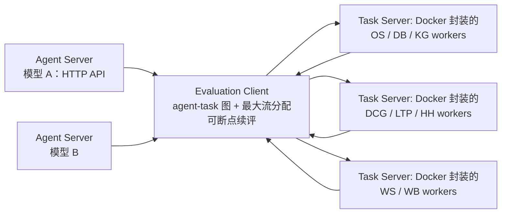

---
aliases:
  - "AgentBench: Evaluating LLMs as Agents"
  - "AgentBench"
---
# AgentBench: Evaluating LLMs as Agents

> 大语言模型（LLM）作为代理的潜力最近得到了广泛的认可。因此，迫切需要在交互式环境中对具有挑战性的任务进行定量\textit\{将LLM评估为代理}。我们提出了AgentBench，这是一个由8个不同环境组成的多维基准测试，用于评估LLM-as-Agent的推理和决策能力。\
> 我们对\num基于API和开源（OSS）LLM的广泛测试表明，虽然顶级商业LLM在复杂环境中表现出强大的代理能力，但它们与许多不超过70B的OSS竞争对手之间在性能上存在显着差异。我们确定了环境和LLM中失败的典型原因，表明糟糕的长期推理、决策和指令遵循能力是开发可用LLM代理的主要障碍。改进指令遵循和对高质量多轮对齐数据的训练可以提高代理性能。与现有假设不同，代码训练对不同代理任务存在矛盾影响。\
> AgentBench的数据集、环境和集成评估包将于https://github.com/THUDM/AgentBench发布。

## 一句话定位

第一个把"LLM 当 Agent"做成**可横向比较表格**的通用基准：8 个真实场景环境 × 29 个模型，用统一交互协议 + 归一化加权总分 + 五类失败原因分类，把"模型能不能干活"拆成"哪个环境不行、以什么方式不行"（[§1](papers/Agent规划/2308.03688/2308.03688.pdf)）。

## 问题与动机

**为什么需要新基准。** 论文对既有评测手段做了三段否定 [§1](papers/Agent规划/2308.03688/2308.03688.pdf)：

1. **文本游戏**（TextWorld、Jericho、LIGHT）动作空间封闭且离散，且主要测常识 grounding——LLM 的真实用途（操作 Shell、写 SQL、浏览网页）完全不在其中。
2. **具身模拟器**（NetHack、MineDojo、iGibson 等）虽然复杂，但都是多模态的，对当时只有文本接口的 LLM 构成工程门槛；而且它们"不能准确反映 LLM 的实际使用场景"。
3. **单环境基准**无法给出跨应用场景的总览，而 AutoGPT / BabyAGI 一类系统的热潮恰恰需要一张横向对照表。

**本文的赌注。** 它不去争"什么算 Agent"，而是直接选定 8 个真实任务域，把它们统一改写成"纯文本、多轮、可自动判定"的交互环境。多轮性是关键约束：论文明确说所有数据集"estimated solving rounds for each individual problem range from 5 to 50" [§4.1](papers/Agent规划/2308.03688/2308.03688.pdf)。

**三条贡献**（[§1](papers/Agent规划/2308.03688/2308.03688.pdf)）：8 环境 / 3 类 grounding 的基准（8 个中 5 个为首次构建）；29 个模型的系统评测与失败归因；一个 Server-Client 架构的评测工具链。

## 方法与机制（核心）

### 一、把"Agent 评测"写成 POMDP，但只用来描述

论文把交互式评测形式化为一个部分可观测马尔可夫决策过程 $(\mathcal{S}, \mathcal{A}, \mathcal{T}, \mathcal{R}, \mathcal{U}, \mathcal{O})$：状态空间 $\mathcal{S}$、动作空间 $\mathcal{A}$、转移函数 $\mathcal{T}:\mathcal{S}\times\mathcal{A}\to\mathcal{S}$、奖励函数 $\mathcal{R}$、任务指令空间 $\mathcal{U}$、观测空间 $\mathcal{O}$；被测 LLM 记为 $\mathcal{M}$ [§2](papers/Agent规划/2308.03688/2308.03688.pdf)。

这个形式化的用处是**界定接口**而不是求解：$\mathcal{U}$ 对应每轮注入的指令与环境反馈，$\mathcal{O}$ 对应环境返回的文本，$\mathcal{R}$ 只在 DCG 与 WebShop 里被当作分数使用。**论文没有做任何策略学习或奖励优化**——$\mathcal{R}$ 在其余 6 个环境里要么不存在，要么退化为 0/1 成功率。

### 二、统一交互协议：把 CoT 压进单轮

这是本基准最容易被忽略、但对可比性影响最大的设计 [§4.1](papers/Agent规划/2308.03688/2308.03688.pdf)：

* **对话结构**：只有 user（指令 + 环境反馈）与 agent 两个角色，交替进行；轨迹记为 $(u_0,a_0,\cdots,u_k,a_k)$，推理时输入 $(u_0,a_0,\cdots,u_k)$。
* **单轮内 Thought+Action**：prompt 格式改编自 ReAct，但把 Thought 与 Action 放在**同一轮**里输出，任务指令通常附一个简短 CoT 示例。
* **只用最原始的 CoT**：明确不使用 ensemble、Reflexion 式反思、ToT 式搜索——理由是"无多次试验、无重复生成、无复杂策略，是部署 LLM agent 最容易、最便宜、最常见的方式"。
* **上下文截断**：取最小的 $r$，使 $(u_0,a_r,u_{r+1},\cdots,u_k)$ 的 token 数 $\le 3500$，然后在 $u_0$ 后追加 `[NOTICE] 2r messages are omitted.`；token 估算规则是"长度为 $n$ 的词占 $\lceil n/6\rceil$ 个 token，非空字符占 1 个"。
* **贪心解码**：所有任务 `temperature=0`，以"确保可复现"。

这五条合起来定义了一个**能力下界**：测的是"一次性写对 prompt、单轮内想清楚、且不做任何搜索"的 Agent。这一点在解读结果时至关重要（后文局限一节会回到它）。

### 三、评测矩阵：8 环境 × 3 类 grounding × 5 种指标

8 个环境按"接地方式"分三组，5 个为首次构建 [§3](papers/Agent规划/2308.03688/2308.03688.pdf)、[图 2](papers/Agent规划/2308.03688/2308.03688.pdf)：

| 环境                            | 接地   | 任务形态                                  | 指标            | 平均轮数 | Test（题数/预期轮数） |
| ----------------------------- | ---- | ------------------------------------- | ------------- | ---- | ------------- |
| Operating System (OS)         | Code | Ubuntu Docker 里执行 bash，回答确定性问题或完成一串操作 | SR            | 8    | 144 / 1200    |
| Database (DB)                 | Code | 真实 SQL 接口上的多轮查询                       | SR            | 5    | 300 / 1500    |
| Knowledge Graph (KG)          | Code | Freebase 上的多工具 KBQA                   | F1            | 15   | 150 / 2250    |
| Digital Card Game (DCG)       | Game | THUAC 2021 简化卡牌游戏 _Aquawar_，回合制对战     | Reward        | 30   | 20 / 600      |
| Lateral Thinking Puzzle (LTP) | Game | 海龟汤，只能问 yes/no/irrelevant             | Game Progress | 25   | 50 / 1250     |
| House Holding (HH)            | Game | ALFWorld 家务指令                         | SR            | 35   | 50 / 1750     |
| Web Shopping (WS)             | Web  | WebShop 模拟电商                          | Reward        | 5    | 200 / 1000    |
| Web Browsing (WB)             | Web  | Mind2Web 通用网页操作                       | Step SR       | 10   | 100 / 1000    |

（数据取自 [表 2](papers/Agent规划/2308.03688/2308.03688.pdf)。Test 合计 $144+300+150+20+50+50+200+100=1014$，与正文"Test 1,014"一致；Dev 合计 269，与正文一致。）

三个 metric 的细节值得单独记。DCG 的 reward 是显式的加权和：

$$
\mathbf{reward} = 0.7 \times \mathbf{metric}_{\text{winrate}} + 0.3 \times \mathbf{metric}_{\text{damagerate}}
$$

其中两项分别对应胜率与伤害率。LTP 的 Game Progress 是把谜底拆成若干 key point（由 `gpt-3.5-turbo` 预先总结成 `answer_keys`），按命中比例计分；WB 用的是 Step SR（逐步成功率）而非终局 SR——论文只给了指标名与定义出处，没有解释为何选它（合理推测是网页任务允许部分完成，但这一点**未能从原文核实**）。

**三个接地的差异是有意设计的**：Code 组要求"外部工具的正确调用"，Game 组要求"规则理解 + 策略"，Web 组要求"在真实页面结构上做定位与操作"。论文的意图是让不同能力短板分别暴露，而不是让一个能力主导总分。

### 四、总分怎么算：先归一化再加权

这是本基准方法论上最实质的一步 [§4.1](papers/Agent规划/2308.03688/2308.03688.pdf)。问题很直白：各任务分数尺度差异极大（Web Shopping 普遍很高、Lateral Thinking 普遍很低），**直接平均会被高分任务淹没**。解法是两步：

1. 每个任务的分数先按"所有被测模型在该任务上的平均分"归一化到 1；
2. 用"所有被测模型在该任务上平均分的倒数"作为固定权重 $w_t$，总分是各任务分数与权重乘积的平均。

$$
S_{\text{OA}}(m) \;=\; \frac{1}{8}\sum_{t=1}^{8} w_t\, s_{m,t},
\qquad
w_t \;=\; \Big(\tfrac{1}{|M|}\textstyle\sum_{m'\in M} s_{m',t}\Big)^{-1}
$$

论文给出的权重（`Weight$^{-1}$`）是：OS 10.8、DB 13.0、KG 13.9、DCG 12.0、LTP 3.5、HH 13.0、WS 30.7、WB 11.6 [表 2](papers/Agent规划/2308.03688/2308.03688.pdf)。注意 LTP 权重最低（3.5），说明所有模型在它上面平均只拿到约 3.5 分——它是**最难**的环境；WS 权重最高（30.7），是**最容易**的环境。这一步的隐含假设是"平均分低 = 任务难 = 应该被放大"，这既公平也可批判（见局限）。

### 五、工具链：把环境隔离做成工程约束

评测 8 个异构环境的现实问题是"配置冲突"和"等待浪费"。论文的解法是三层解耦 [§4.1](papers/Agent规划/2308.03688/2308.03688.pdf)、附录 A：

* **Task Server / Agent Server / Evaluation Client** 三个组件通过 HTTP 通信，可分别部署在不同机器；
* 每个任务封装成 **Docker 镜像**，挂载代码路径即可运行；每个任务切成独立 worker，环境互不污染；
* Evaluation Client 把"agent–task"分配建成流网络，用 **Edmonds–Karp**（复杂度 $O(|V||E|^2)$）求最大流来分配评测三元组，支持多 agent 多任务并发与**断点续评**。

### 六、五类终止原因：把"失败"变成可分类的观测量

论文把每条轨迹的结束方式归为五类 [§2](papers/Agent规划/2308.03688/2308.03688.pdf)，这是它最重要的分析工具，也是后面"长程失败"论证的支点：

| 类别                           | 含义                                                 | 主要归因          |
| ---------------------------- | -------------------------------------------------- | ------------- |
| Completed                    | 任务正常结束                                             | ——            |
| Context Limit Exceeded (CLE) | 交互历史超过模型上下文（只出现在 2,048 长度的 `text-davinci-002/003`） | 模型上下文容量       |
| Invalid Format (IF)          | 不遵守输出格式                                            | 指令遵循能力        |
| Invalid Action (IA)          | 格式对但动作非法                                           | 动作空间理解 / 指令遵循 |
| Task Limit Exceeded (TLE)    | 达到最大轮数仍未解决，或连续多轮重复生成                               | 多轮推理与决策能力     |

论文对 IF/IA 与 TLE 的归因是分开的：前者"主要由指令遵循差导致"，后者"往往指示某些任务上的多轮能力弱" [§2](papers/Agent规划/2308.03688/2308.03688.pdf)。这个区分让"模型不行"变成可定位的诊断。

## 实验设置与关键结果

### 设置

* **模型**：共 29 个（`\num` 宏定义为 29），分 API 商用 10 个与开源 19 个（开源一律 $\le$ 70B）[§4.1](papers/Agent规划/2308.03688/2308.03688.pdf)、[表 1](papers/Agent规划/2308.03688/2308.03688.pdf)。
* **规模**：Dev 269 题、Test 1,014 题，对应约 3k 与 11k 次推理调用——论文特意说明这与 MMLU 所需调用量相当，即"广度换来的代价被控制在可接受范围" [§4.1](papers/Agent规划/2308.03688/2308.03688.pdf)。
* **注意版本**：本库 TeX 版的 [表 3](papers/Agent规划/2308.03688/2308.03688.pdf) 已包含 `claude-3`(opus) 与 `glm-4`，说明是 ICLR 之后的更新版；具体 arXiv 版本号未在源码中标注。

### 主结果（OA = 加权归一化总分）

| 类型    | 模型                 | OA       | OS       | DB       | KG       | DCG      | LTP      | HH       | WS       | WB       |
| ----- | ------------------ | -------- | -------- | -------- | -------- | -------- | -------- | -------- | -------- | -------- |
| API   | `gpt-4`            | **4.01** | **42.4** | 32.0     | **58.8** | **74.5** | **16.6** | **78.0** | 61.1     | **29.0** |
| API   | `claude-3` (opus)  | 3.11     | 22.9     | **51.7** | 34.6     | 44.5     | 14.3     | 70.0     | 27.9     | 26.0     |
| API   | `glm-4`            | 2.89     | 29.2     | 42.3     | 46.3     | 34.1     | 14.2     | 34.0     | 61.6     | 27.0     |
| API   | `claude-2`         | 2.49     | 18.1     | 27.3     | 41.3     | 55.5     | 8.4      | 54.0     | 61.4     | 0.0      |
| API   | `claude` (v1.3)    | 2.44     | 9.7      | 22.0     | 38.9     | 40.9     | 8.2      | 58.0     | 55.7     | 25.0     |
| API   | `gpt-3.5-turbo`    | 2.32     | 32.6     | 36.7     | 25.9     | 33.7     | 10.5     | 16.0     | **64.1** | 20.0     |
| API   | `text-davinci-003` | 1.71     | 20.1     | 16.3     | 34.9     | 3.0      | 7.1      | 20.0     | 61.7     | 26.0     |
| API   | `claude-instant`   | 1.60     | 16.7     | 18.0     | 20.8     | 5.9      | 12.6     | 30.0     | 49.7     | 4.0      |
| API   | `chat-bison-001`   | 1.39     | 9.7      | 19.7     | 23.0     | 16.6     | 4.4      | 18.0     | 60.5     | 12.0     |
| API   | `text-davinci-002` | 1.25     | 8.3      | 16.7     | 41.5     | 11.8     | 0.5      | 16.0     | 56.3     | 9.0      |
| OSS-L | `llama-2-70b`      | 0.78     | 9.7      | 13.0     | 8.0      | 21.3     | 0.0      | 2.0      | 5.6      | 19.0     |
| OSS-L | `guanaco-65b`      | 0.54     | 8.3      | 14.7     | 1.9      | 0.1      | 1.5      | 12.0     | 0.9      | 10.0     |
| OSS-M | `codellama-34b`    | **0.96** | 2.8      | 14.0     | 23.5     | 8.4      | 0.7      | 4.0      | 52.1     | 20.0     |
| OSS-M | `vicuna-33b`       | 0.73     | 15.3     | 11.0     | 1.2      | 16.3     | 1.0      | 6.0      | 23.9     | 7.0      |
| OSS-M | `wizardlm-30b`     | 0.46     | 13.9     | 12.7     | 2.9      | 0.3      | 1.8      | 6.0      | 4.4      | 1.0      |
| OSS-M | `guanaco-33b`      | 0.39     | 11.1     | 9.3      | 3.2      | 0.3      | 0.0      | 6.0      | 6.2      | 5.0      |
| OSS-S | `vicuna-13b`       | 0.93     | 10.4     | 6.7      | 9.4      | 0.1      | 8.0      | 8.0      | 41.7     | 12.0     |
| OSS-S | `llama-2-13b`      | 0.77     | 4.2      | 11.7     | 3.6      | **26.4** | 0.0      | 6.0      | 25.3     | 13.0     |
| OSS-S | `openchat-13b`     | 0.70     | 15.3     | 12.3     | 5.5      | 0.1      | 0.0      | 0.0      | 46.9     | 15.0     |
| OSS-S | `wizardlm-13b`     | 0.66     | 9.0      | 12.7     | 1.7      | 1.9      | 0.0      | 10.0     | 43.7     | 12.0     |
| OSS-S | `vicuna-7b`        | 0.56     | 9.7      | 8.7      | 2.5      | 0.3      | 6.4      | 0.0      | 2.2      | 9.0      |
| OSS-S | `codellama-13b`    | 0.56     | 3.5      | 9.7      | **10.4** | 0.0      | 0.0      | 0.0      | 43.8     | 14.0     |
| OSS-S | `codellama-7b`     | 0.50     | 4.9      | 12.7     | 8.2      | 0.0      | 0.0      | 2.0      | 25.2     | 12.0     |
| OSS-S | `koala-13b`        | 0.34     | 3.5      | 5.0      | 0.4      | 0.1      | 4.4      | 0.0      | 3.9      | 7.0      |
| OSS-S | `llama-2-7b`       | 0.34     | 4.2      | 8.0      | 2.1      | 6.9      | 0.0      | 0.0      | 11.6     | 7.0      |
| OSS-S | `codegeex2-6b`     | 0.27     | 1.4      | 0.0      | 4.8      | 0.3      | 0.0      | 0.0      | 20.9     | 11.0     |
| OSS-S | `dolly-12b`        | 0.14     | 0.0      | 0.0      | 0.0      | 0.1      | 1.2      | 0.0      | 0.4      | 9.0      |
| OSS-S | `chatglm-6b`       | 0.11     | 4.9      | 0.3      | 0.0      | 0.0      | 0.0      | 0.0      | 0.5      | 4.9      |
| OSS-S | `oasst-12b`        | 0.03     | 1.4      | 0.0      | 0.0      | 0.0      | 0.0      | 0.0      | 0.3      | 1.0      |

（[表 3](papers/Agent规划/2308.03688/2308.03688.pdf)，Test set。粗体为原表标注的该列最佳，本笔记只保留最关键几列的粗体。）要点：`gpt-4` 在 8 个环境中拿下 6 个最佳；HH 成功率 78.0%，论文据此称其在该场景"具备实用可用性" [§4.2](papers/Agent规划/2308.03688/2308.03688.pdf)。OSS 与 API 的平均 OA 是 **0.51 vs 2.32**——同一个数字也是 `gpt-3.5-turbo` 的 OA，容易误读。

### 失败类型分布（跨全部模型平均，%）

|               | OS   | DB   | KG   | DCG  | LTP  | HH   | WS   | WB   |
| -------------- | ---- | ---- | ---- | ---- | ---- | ---- | ---- | ---- |
| Completed      | 75.0 | 37.9 | 30.1 | 51.2 | 14.0 | 13.1 | 54.9 | 56.6 |
| CLE            | 0.1  | 0.7  | 2.0  | 0.0  | 3.5  | 0.7  | 0.0  | 0.0  |
| Invalid Format | 0.0  | 53.3 | 0.0  | 38.5 | 0.0  | 0.0  | 17.2 | 0.0  |
| Invalid Action | 0.9  | 0.0  | 0.0  | 10.2 | 0.0  | 64.1 | 0.0  | 8.4  |
| TLE            | 23.9 | 8.0  | 67.9 | 0.0  | 82.5 | 22.1 | 27.8 | 35.0 |

（[表 4](papers/Agent规划/2308.03688/2308.03688.pdf)。）这张表信息量极大：**TLE 是主导失败原因**（KG 67.9%、LTP 82.5%）；DB 的失败一半以上是格式错（53.3%），说明 SQL 任务的瓶颈在"按格式输出"而非"写对 SQL"；HH 的失败 64.1% 是非法动作，即 LLM 生成了动作空间之外的动作——这直接指向"动作集是否被正确约束"这一设计问题。

### 长程失败的第一个量化证据

论文在附录里做了一次很关键的轨迹分析 [附录 Detailed Analysis](papers/Agent规划/2308.03688/2308.03688.pdf)：

* TLE 轨迹平均 **25.5 轮**，远多于成功轨迹的 7.95 轮；
* 完成任务的轨迹：轮数中位数 6.0、平均 7.95、中间 50% 落在 4–9 轮；token 中位数 1850、平均 2220.1、中间 50% 落在 761–2709；
* 在 TLE 轨迹中，**超过 90%** 的轨迹在最后 10 轮内存在两条回复的 ROUGE-L $\ge 0.8$，即模型在原地打转。

论文为此定义了重复率

$$
P(n,t)=\frac{\#\{(r_1,\dots,r_m)\in T \mid \exists\, i,j:\ m-n<i<j\le m \ \wedge\ \mathrm{RougeL}(r_i,r_j)\ge t\}}{\#T}
$$

其中 $T$ 是所有以 TLE 结束的回复序列集合，$r_k$ 是第 $k$ 轮回复。之所以要看"最后 $n$ 轮"而不是"最后两轮"，是因为模型可能在 4 个状态间循环（进屋→开抽屉→关抽屉→离开），只在最后 5 轮才看得到完全重复。这个细节说明作者意识到"重复"不能只用相邻两轮判定 [附录 Detailed Analysis](papers/Agent规划/2308.03688/2308.03688.pdf)。

### 三条归因结论

1. **代码训练的"双刃剑"**：`codellama` 系列在 WS 上明显强于 `llama-2`，但在 DCG 与 OS 上反而更弱。论文的解释是 WS 的一 shot prompt 给出了明确的购物流程模板，照着走就能得分；DCG 要求评估双方状态、设计反制策略，"没有简单流程模板可依" [§4.3](papers/Agent规划/2308.03688/2308.03688.pdf)。
2. **高质量对齐数据有效**：`vicuna-13b`（ShareGPT 数据对齐）优于同底座从头对齐的 `llama-2-13b`，且与 3 倍大的 `codellama-34b` 相当（OA 0.93 vs 0.96）[§4.3](papers/Agent规划/2308.03688/2308.03688.pdf)。
3. **`llama-2-13b` 与 `llama-2-70b` 表现相近**（0.77 vs 0.78），作者归因于 70B 预训练不足（同为 2T token，按 scaling law 应更多）与指令对齐不足；并说明已重跑确认 [§4.3](papers/Agent规划/2308.03688/2308.03688.pdf)。

## 阅读重点

### 1. 多环境评测如何组织？

组织方式可以拆成**四层对齐 + 一层不齐**，理解这个结构才能理解分数的含义。

* **任务层**：8 个环境各自独立，源码级实现不同（Ubuntu Docker / 真 SQL / Freebase 工具集 / 卡牌对战引擎 / 海龟汤主持系统 / ALFWorld / WebShop / Mind2Web）。环境内部怎么做判定由各任务自己决定，论文把构造细节全部下放到附录。
* **接口层（这一层是统一的）**：所有环境都必须把状态压成**文本观测**，都必须接受**单轮 Thought+Action** 的输出格式，都共享同一条 3500-token 截断与 `[NOTICE]` 提示规则。统一接口是它能横比的前提。
* **指标层（这一层不统一，只做归一化）**：5 种指标并存（SR / F1 / Reward / Game Progress / Step SR）。论文不去强行统一指标，而是承认尺度差异，用"按模型池平均分归一 + 倒数平均分加权"把不同尺度拼成一个 OA。这是"广度优先"基准的标准妥协。
* **调度层（统一）**：S/C 三层解耦 + Docker 隔离 + 最大流分配 + 断点续评，解决的是"异构环境怎么并发跑"的工程问题，而不是评测效度问题。
* **不齐的一层是难度**：8 个环境的难度差异极大（LTP 全员平均 3.5 分 vs WS 30.7 分），归一化只能让总分不被高分任务主导，**不能**让"某环境 1 分"和"另一环境 1 分"变得等价。

一句话：它用**统一接口 + 归一化总分**换取了广度，代价是每个环境内部的评测深度被压缩（见下一个问题）。> 2. 任务成功率、环境差异和模型能力之间是什么关系？

> 三者的关系不是"能力强 → 成功率高"这么简单，论文的数据给出四层结构：

* **同一模型跨环境方差极大，且方向不一致。** `gpt-4` 在 HH 是 78.0，在 LTP 只有 16.6；`claude-3`(opus) 在 DB 是全场最高 51.7，在 OS 只有 22.9（低于 `gpt-3.5-turbo` 的 32.6）；`gpt-3.5-turbo` 在 WS 是全场最高 64.1，在 HH 只有 16.0。这说明**不存在一个"通用 agent 能力"标量**，能力是"环境×技能"的矩阵。
* **排名随环境翻转，OA 只是把翻转平均掉。** `claude-2` 的 WB 是 0.0（API 组里唯一一个彻底归零的格子），但它在 DCG 是 55.5；`llama-2-13b` 的 DCG 是 26.4，比 `gpt-3.5-turbo` 的 33.7 只差 7 个点，却在 OS 上只有 4.2（对 32.6）。任何"某模型第 N 名"的说法都只在 OA 这个聚合尺度上成立。
* **环境难度是被显式标定的。** 权重 3.5（LTP）到 30.7（WS）就是难度标定；论文用"所有模型平均分"当难度代理，好处是自动、坏处是**依赖模型池**——换一批模型，难度标定就变了（这也是为什么论文要把权重值写死在表里"供后续研究固定使用"）。
* **成功率对样本量极其敏感。** DCG 的 Test 只有 20 题（600 预期轮），一格之差就是 5 个百分点；HH 与 LTP 各 50 题。在 20 题的尺度上，`claude-2` 的 55.5 与 `claude-3` 的 44.5 之差（11 个百分点 ≈ 2 题）不足以支撑排名断言。论文没有给置信区间，这是读表时必须自己打折的地方。

### 3. 长程任务的错误累积如何体现？

论文没有做"逐步正确率 → 终局成功率"的显式分解，也没有逐步 oracle，所以"错误累积"只能从三个侧面观察：

* **侧面一：TLE 占比与轮数。** TLE 在 LTP 达 82.5%、KG 67.9%、WB 35.0%；TLE 轨迹平均 25.5 轮，而成功轨迹平均 7.95 轮。也就是说失败轨迹不是"早早放弃"，而是"跑满预算还没到头"——这是长程失败最直接的症状。
* **侧面二：重复（循环）而非发散。**>90% 的 TLE 轨迹在最后 10 轮内出现 ROUGE-L $\ge 0.8$ 的成对回复。这说明模型进入的是**吸引子状态**（在几个状态间循环），而不是"越走越偏"。从机制上看，这比"随机游走"更糟：随机游走至少还有探索，循环则连探索都停了。
* **侧面三：上下文被截断后的信息丢失。** 交互超过 3500 token 就丢弃早期消息并插入 `[NOTICE] 2r messages are omitted.`。对平均需要 30–35 轮的环境（DCG/HH），这意味着**长任务的中段信息会被系统性删掉**，模型"忘记目标"有一部分是协议造成的，而非模型能力。CLE 只在 2,048 上下文的老模型上出现（占比 0–3.5%），说明这个设计把大部分"上下文溢出"转化成了"静默遗忘"。

需要明确标注的是：**论文没有提供"每步合法/最优率"这一层数据**，因此"早期一步错导致雪崩"与"从头到尾都乱走"在 AgentBench 的观测粒度下**不可区分**。这正是 BalatroEval 想做的东西。

## 与 BalatroEval 的连接

> 以下为项目内部设定，不是论文结论。

AgentBench 是 BalatroEval 最直接的"反面参照"：它示范了通用 Agent Benchmark 的标准做法，也正好暴露了这套做法在"决策能力"上的盲区。

| 维度    | AgentBench                 | BalatroEval（计划）                        | 差异的实质                    |
| ----- | -------------------------- | -------------------------------------- | ------------------------ |
| 覆盖策略  | 8 环境 × 窄样本（单环境 20–300 题）   | 单游戏 × 海量可枚举状态                          | 广度换深度 vs 深度换分辨率          |
| 判定对象  | 终局成功/失败（或终局 reward）        | 每步动作集上的"最优/可接受"                        | 从"是否到达"到"每步是否合理"         |
| 判定器性质 | 环境自定义（SR/F1/GP），部分含启发式     | 可计算的局部 Oracle                          | AgentBench 的判定**不可枚举到步** |
| 动作空间  | 各环境自定义，IA 只能事后统计           | 每步可枚举，可判定"合法但次优"                       | 把"非法动作率"细化成"决策质量分布"      |
| 确定性   | 仅 `temperature=0`；环境随机性未讨论 | 确定性可重放 + 固定种子                          | 可重放是过程分析的前提              |
| 过程记录  | 轨迹（对话历史），用于事后分类            | Trace：Thought/Action/Observation/快照/分数 | AgentBench 的轨迹不绑定状态快照    |
| 预算控制  | 固定最大轮数（隐式预算）               | 显式控制搜索预算                               | 论文未报告"预算–成功率"曲线          |
| 指标类型  | 全部是"结果型 + 粗粒度过程型"          | 区分估计型过程指标 vs 可枚举 Oracle 指标             | 这是 BalatroEval 的方法论增量    |

**可以直接借用的四点：**

1. **五类终止原因的分类法**（Completed / CLE / IF / IA / TLE）几乎是免费的诊断层。对 BalatroEval 尤其重要的是把 **IF（格式错）与 IA（非法动作）分开**——因为在可枚举动作集的环境里，"格式错"是纯粹的接口摩擦，若混进"决策错误"会污染结论。BalatroEval 可进一步把 IA 拆成"动作不在枚举集内"与"动作合法但当前不可执行（如无足够金币）"。
2. **归一化加权总分的思路**可以移植，但对象要换：单游戏不需要跨环境归一，需要的是**跨阶段归一**（前期/中期/Boss 战/经济决策），否则"总分会掩盖某一阶段崩盘"这个 AgentBench 已经踩过的坑会重演。
3. **`temperature=0` + 明确记录截断策略**这两条工程纪律。AgentBench 把 `[NOTICE] 2r messages are omitted.` 写进 prompt 的做法值得学：它让"信息被删"成为**可观测**的事件。BalatroEval 若因上下文限制丢历史，也应显式标注，否则无法区分"模型忘了"与"协议删了"。
4. **"平均分即难度"的教训**：AgentBench 用模型池平均分定义权重，导致权重随模型池漂移。BalatroEval 若要做难度分层，应使用**与模型无关**的难度度量（例如 Oracle 下的最优解分布、随机基线胜率），而不是被测模型的平均表现。

**必须与 AgentBench 划清界限的三点：**

1. **AgentBench 的"成功"不蕴含"决策正确"。** 一个模型可能靠试错撞对，也可能靠格式合规拿到部分分；BalatroEval 的 Oracle 能直接给出"这一步是否可接受"，这是 AgentBench 结构上做不到的。
2. **AgentBench 的单环境结论不可靠**（DCG 20 题），因此不能用它的"环境排名"去论证"某类游戏更难"。BalatroEval 若要主张"某类局面更难"，必须靠可枚举的状态空间做分层统计，而不是靠几十条轨迹。
3. **AgentBench 只测"最朴素 agent"**（单轮 CoT、无反思、无搜索）。它的结论不能推广到"LLM 不能做长程决策"，只能推广到"以最便宜方式部署时不行"。BalatroEval 若要比较不同 Agent 框架，必须把"框架"作为自变量显式控制——这正是 BalatroEval"控制搜索预算以保证公平比较"的动机所在。

## 局限与可批判点

1. **单环境样本量过小。** DCG 的 Test 只有 20 题、HH 与 LTP 各 50 题（[表 2](papers/Agent规划/2308.03688/2308.03688.pdf)），一格差异就是 2–5 个百分点；论文未报告任何置信区间或多次运行方差，因此**单环境排名不可作为结论**，只能用来看量级。
2. **指标定义在正文与表格之间不一致。** [§3.2](papers/Agent规划/2308.03688/2308.03688.pdf) 说 DCG 报告"win rate"，而 [表 2](papers/Agent规划/2308.03688/2308.03688.pdf) 的 Metric 行写的是"Reward"；附录给出的定义是 $\mathbf{reward}=0.7\times\text{winrate}+0.3\times\text{damagerate}$。读者若不看附录会误判主表数字的含义。
3. **总分权重的定义方式不可迁移。** $w_t$ 来自"被测模型的平均分"，属于数据依赖的量；论文把具体数值（3.5–30.7）写进表里以求固定，但这只是把漂移冻结，不是消除。任何新增模型的复评都必须重算权重才能对话，否则 OA 不可比。
4. **"复现性"只覆盖了采样温度。** `temperature=0` 保证同一后端 greedy 解码一致，但环境侧随机性（DCG 的对手策略、WebShop 的商品库与页面扰动、Mind2Web 的页面快照）与 API 模型的**静默版本更新**都未讨论；论文给了模型版本号（如 `gpt-4` 0613）算是缓解，但没有重放机制。
5. **固定最大轮数把"能力"与"预算"混在一起。** TLE 的定义依赖预设轮数上限，而论文没有报告"放宽轮数后成功率如何变化"的曲线。因此"TLE 高"既可能意味着模型不行，也可能意味着预算给少了——两种情况无法区分。
6. **3500-token 截断对长任务是系统性伤害。** 平均需要 30–35 轮的环境（DCG/HH）在 3500 token 下必然丢失中段历史；`[NOTICE]` 让这件事可见，但不消除偏差。这会让长程任务的成功率被低估，且低估幅度随任务长度变化。
7. **只评测最朴素 agent，结论外推需谨慎。** 论文明确排除 ensemble / reflection / search [§2](papers/Agent规划/2308.03688/2308.03688.pdf)，这是一个合理的"控制变量"选择，但摘要与结论里"poor long-term reasoning... are the main obstacles"的表述容易被读成对 LLM 能力的一般性判断。
8. **失败归因是相关性而非因果。** "TLE ↔ 弱多轮能力""IF ↔ 弱指令遵循"都是基于分布的解释，论文没有做干预实验（例如给更强的格式约束后 IF 是否下降、成功率是否上升）。唯一接近干预的是"代码训练"的跨模型对比，而它本身混入了预训练数据、规模、对齐策略等多个变量。
9. **LTP 的自动评测比人宽松。** 附录自述自动评测在 Single Game Accuracy 与 Query Relevance 上"有时比人类评测更宽容"，尤其在开源模型上 [附录](papers/Agent规划/2308.03688/2308.03688.pdf)。这意味着 LTP 一列的分数有系统性上偏，而它恰好是权重最低（3.5）的环境，对 OA 影响被压低——这一点论文没有讨论。

## 开放问题

* **如何在不放弃广度的前提下获得"每步可判定"？** AgentBench 的答案是放弃（只判终局），BalatroEval 的答案是收缩到单环境换取 Oracle。是否存在中间形态（例如每个环境提供一个"合法动作检查器"，只判合法性不判最优）？这是通用基准可以低成本升级的方向。
* **预算–成功率曲线长什么样？** 固定最大轮数是当前所有 Agent benchmark 的隐含假设。若把轮数从 5 扫到 50，TLE 会如何转化为成功？没有这条曲线，"长程能力"就无法与"预算"分离。
* **难度标定能否与模型解耦？** 用"所有模型平均分"当难度是循环定义（难度由被测者定义）。可枚举环境可以用"随机策略基线"或"最优策略下的分支因子"来定义难度，这是 BalatroEval 相对通用基准的一个方法论优势。
* **失败归因能否做成干预实验？** 例如在 DB 上给出更强的格式约束模板，看 IF 下降多少、成功率上升多少——这能验证"指令遵循是瓶颈"这一因果假设，而不只是相关性。
* **轨迹能否用于过程级监督？** AgentBench 只把轨迹用于事后统计（TLE/重复率）。把轨迹与状态快照对齐、标注每步的可接受性，就能得到过程级训练与评测信号——这是从"排行榜"走向"诊断工具"的关键一步，也是 BalatroEval Trace 设计的出发点。
* **环境随机性与重放如何标准化？** 一个确定性可重放的 Agent 基准需要固定 RNG、记录环境版本、并提供状态快照回放；AgentBench 只做到了"固定模型版本 + 贪心解码"，这一半。

## 关联笔记

* \[\[papers/Agent规划/2402.01817/NOTES|LLM-Modulo]]——提供本笔记反复用到的判据：**只有外部 sound 验证器才能把"通过"变成"正确"**。AgentBench 的终局 SR 是"环境判定"，因此它是 sound 的（相对任务定义），但**粒度只到终局**；LLM-Modulo 则论证了为什么必须把判定下沉到约束级。两篇合读可以定位 BalatroEval 的坐标：判定要 sound（学 LLM-Modulo），过程要可观测（超 AgentBench）。
* 待补：WebShop、ALFWorld、Mind2Web、InterCode（同期工作）、AgentBoard / 后续过程级 Agent 评测工作。

---

**Cool Papers · Kimi 解析**

> 来源：[https://papers.cool/arxiv/2308.03688](https://papers.cool/arxiv/2308.03688)

## Q1: 这篇论文试图解决什么问题？

这篇论文介绍了AGENTBENCH，这是一个多维度的、不断发展的基准测试，旨在评估大型语言模型（LLMs）作为智能代理在交互环境中处理复杂任务的能力。随着LLMs（如GPT-4）在理解和执行指令方面的能力不断增强，有必要对它们在实际应用场景中的性能进行系统性的评估。AGENTBENCH通过在8个不同的交互环境中测试27个基于API和开源的LLMs，揭示了顶级商业LLMs在复杂环境中的表现与开源竞争对手之间的显著性能差距。研究还指出了LLMs在长期推理、决策制定和指令遵循能力方面的不足，并提出了通过在代码和高质量多轮对齐数据上进行训练来提高代理性能的建议。此外，论文还发布了与AGENTBENCH相关的数据集、环境和综合评估包。

## Q2: 有哪些相关研究？

这篇论文提到了以下几类相关研究：

1. **LLMs的评估**：研究了自监督（Liu et al., 2021）LLMs（Brown et al., 2020; Chowdhery et al., 2022; Zhang et al., 2022; Scao et al., 2022; Zeng et al., 2022; Touvron et al., 2023）的一般能力，特别是那些经过聊天对齐的模型（Ouyang et al., 2022; Anthropic, 2023a; OpenAI, 2023）。这些研究刷新了人们对深度学习系统的认识，并显著超越了传统NLP评估的范围。

2. **LLM-as-Agent**：在LLM时代之前，基于BERT（Devlin et al., 2019）和强化学习的文本游戏环境（如TextWorld (Côté et al., 2019), Jericho (Hausknecht et al., 2020), 和LIGHT (Urbanek et al., 2019)）在语言代理研究中占主导地位。随着LLMs的出现，LLM代理的研究开始蓬勃发展，特别是在Chain-of-Thought (Wei et al., 2022b)提出之后。ReAct (Yao et al., 2023b) 是将CoT推理和动作结合在代理任务中的先驱工作。

3. **在执行环境中评估LLMs**：随着LLMs在现实世界挑战中的能力不断增强，也有趋势在执行环境中评估它们，而不仅仅是静态数据集。除了文本游戏（例如ALFWorld (Shridhar et al., 2020b)），另一个主要研究方向是代码执行。APPS (Hendrycks et al., 2021a), HumanEval (Chen et al., 2021) 和MBPP (Austin et al., 2021) 开创了评估代码LLMs功能正确性的工作，而不是文本相似性。这种范式后来被后续工作广泛认可和采用。

4. **交互式编码与执行反馈**：InterCode (Yang et al., 2023) 发布了一个框架，允许评估模型与Bash和SQL环境之间的交互，这与AGENTBENCH中的OS和DB任务相似。

这些研究为AGENTBENCH提供了背景和基础，同时也展示了LLMs在代理任务和执行环境中的评估是一个不断发展的领域。

## Q3: 论文如何解决这个问题？

论文通过以下步骤解决评估LLMs作为代理的问题：

1. **定义LLM-as-Agent的评估框架**：论文首先定义了LLM-as-Agent的交互评估，将其视为部分可观察的马尔可夫决策过程（POMDP），并引入了Chain-of-Thought (CoT)和其他推理策略。

2. **构建AGENTBENCH基准**：开发了一个包含8个不同环境的多维基准测试，这些环境分为三类：代码基础环境（如操作系统、数据库、知识图谱）、游戏基础环境（如数字卡牌游戏、横向思维谜题、家务环境）和网络基础环境（如网络购物、网络浏览）。这些环境旨在模拟真实世界的交互场景，以评估LLMs在不同领域的能力。

3. **评估27个LLMs**：对27个不同的LLMs进行了广泛的测试，包括基于API的商业模型和开源模型。使用统一的评估工具包，通过HTTP协议与模型服务器交互，简化了评估过程。

4. **分析性能差距**：通过测试，论文揭示了顶级商业LLMs与开源竞争对手之间的性能差距，并指出了LLMs在长期推理、决策制定和指令遵循能力方面的不足。

5. **提出改进方向**：论文建议通过在代码和高质量多轮对齐数据上进行训练来提高LLMs作为代理的性能。同时，提出了一个集成的评估工具包，以便研究社区更容易地进行LLM-as-Agent的评估。

6. **发布资源**：为了促进研究和进一步的开发，论文发布了AGENTBENCH的数据集、环境和评估工具包，以便研究社区可以访问和利用这些资源。

通过这些步骤，论文不仅提供了一个全面的评估框架，还为LLMs在实际应用中的性能提供了深入的见解，并为未来的研究和开发提供了宝贵的资源。

## Q4: 论文做了哪些实验？

论文中进行的实验主要包括以下几个方面：

1. **构建AGENTBENCH基准**：作者设计了一个包含8个不同环境的多维基准测试，这些环境覆盖了代码、游戏和网络交互等多种场景。这些环境旨在评估LLMs在执行指令、编码、知识获取、逻辑推理和常识理解等方面的能力。

2. **评估27个LLMs**：作者对27个不同的LLMs进行了评估，这些模型包括API-based商业模型和开源模型。评估过程中，作者使用了统一的评估工具包，通过HTTP协议与模型服务器进行交互，以适应不同的LLMs。

3. **性能分析**：通过在AGENTBENCH上运行这些模型，作者分析了它们在不同任务上的表现。这包括了对模型在成功完成任务、遵循指令、执行动作等方面的能力进行评估。作者还特别关注了模型在长期推理、决策制定和指令遵循方面的能力。

4. **失败原因分析**：作者识别了模型在执行任务时失败的典型原因，包括上下文限制超出、格式无效、动作无效、任务限制超出等。这些分析帮助揭示了现有LLMs在作为智能代理时的主要障碍。

5. **模型比较**：通过比较不同LLMs在AGENTBENCH上的表现，作者揭示了商业模型与开源模型之间的性能差距，并讨论了可能的原因和改进方向。

6. **策略影响分析**：作者分析了代码训练和高质量对齐数据训练对LLMs性能的影响。例如，他们发现在Web购物任务中，经过代码训练的模型（如Codellama系列）表现优于未经过代码训练的模型（如Llama-2系列）。

7. **自我修正能力**：作者还研究了模型在执行任务时的自我修正能力，特别是在数据库任务中，模型如何根据环境反馈调整其SQL语句。

这些实验为理解LLMs在实际应用中的性能提供了宝贵的见解，并为未来的研究和模型改进提供了方向。

## Q5: 有什么可以进一步探索的点？

论文中提出了几个可以进一步探索的点：

1. **改进LLMs的长期推理和决策制定能力**：尽管顶级商业LLMs在复杂环境中表现出一定的能力，但在长期推理、决策制定和指令遵循方面仍有显著的不足。未来的研究可以探索如何通过改进模型架构、训练策略或引入额外的知识源来增强这些能力。

2. **提高开源LLMs的性能**：与商业模型相比，开源LLMs在AGENTBENCH上的表现较差。研究者可以探索如何通过优化模型设计、训练过程或资源分配来提升开源模型的性能。

3. **多模态和多任务学习**：AGENTBENCH展示了LLMs在多种环境中的表现。未来的研究可以探索如何使LLMs更好地处理多模态输入（如文本、图像、声音）以及在多个任务之间进行有效切换。

4. **自我修正和适应性**：论文中提到了LLMs在自我修正方面的能力。研究者可以进一步研究如何设计模型以更好地从错误中学习并适应不断变化的任务需求。

5. **交互式学习环境**：AGENTBENCH提供了一个交互式学习环境，研究者可以探索如何利用这种环境来训练和评估LLMs，以及如何通过交互式学习来提高模型的泛化能力。

6. **模型解释性和透明度**：为了更好地理解和信任LLMs的决策过程，研究者可以探索如何提高模型的解释性和透明度，使得模型的推理过程更加可解释。

7. **安全性和伦理性**：随着LLMs在代理任务中的应用越来越广泛，研究者需要考虑如何确保这些模型的安全性和伦理性，避免潜在的滥用和偏见问题。

8. **跨领域和跨语言的评估**：AGENTBENCH主要针对英文环境。未来的研究可以探索如何将这种评估框架扩展到其他语言和文化背景，以及如何评估LLMs在跨领域任务中的表现。

这些探索点为LLMs的研究提供了丰富的方向，有助于推动智能代理技术的发展和应用。

## Q6: 总结一下论文的主要内容

这篇论文介绍了AGENTBENCH，这是一个多维度的、不断发展的基准测试，旨在评估大型语言模型（LLMs）作为智能代理在交互环境中处理复杂任务的能力。以下是论文的主要内容总结：

1. **背景与动机**：随着LLMs在理解和执行指令方面的能力不断增强，有必要对它们在实际应用场景中的性能进行系统性的评估。

2. **AGENTBENCH基准**：作者设计了一个包含8个不同环境的多维基准测试，这些环境模拟了真实世界的交互场景，如操作系统、数据库、知识图谱、数字卡牌游戏、横向思维谜题、家务环境、网络购物和网络浏览。

3. **模型评估**：对27个不同的LLMs进行了广泛的测试，包括基于API的商业模型和开源模型。评估结果显示，顶级商业LLMs在复杂环境中的表现优于开源竞争对手。

4. **性能分析**：通过分析模型在不同任务上的表现，作者揭示了LLMs在长期推理、决策制定和指令遵循能力方面的不足。

5. **改进建议**：提出了通过在代码和高质量多轮对齐数据上进行训练来提高LLMs作为代理的性能的建议。

6. **工具与资源发布**：为了促进研究和进一步的开发，作者发布了与AGENTBENCH相关的数据集、环境和综合评估包。

7. **相关研究**：论文讨论了LLMs的评估、LLM-as-Agent的研究、在执行环境中评估LLMs的趋势，以及交互式编码与执行反馈的相关工作。

8. **实验与分析**：通过在AGENTBENCH上运行模型，作者分析了模型的性能，并探讨了模型在不同任务上的表现差异。

9. **未来方向**：论文提出了未来研究的方向，包括改进LLMs的推理和决策能力、提高开源模型的性能、多模态和多任务学习、自我修正能力、交互式学习环境、模型解释性和透明度、安全性和伦理性，以及跨领域和跨语言的评估。

总的来说，这篇论文为LLMs作为智能代理的评估提供了一个全面的框架，并为未来的研究和模型改进提供了宝贵的见解和资源。
