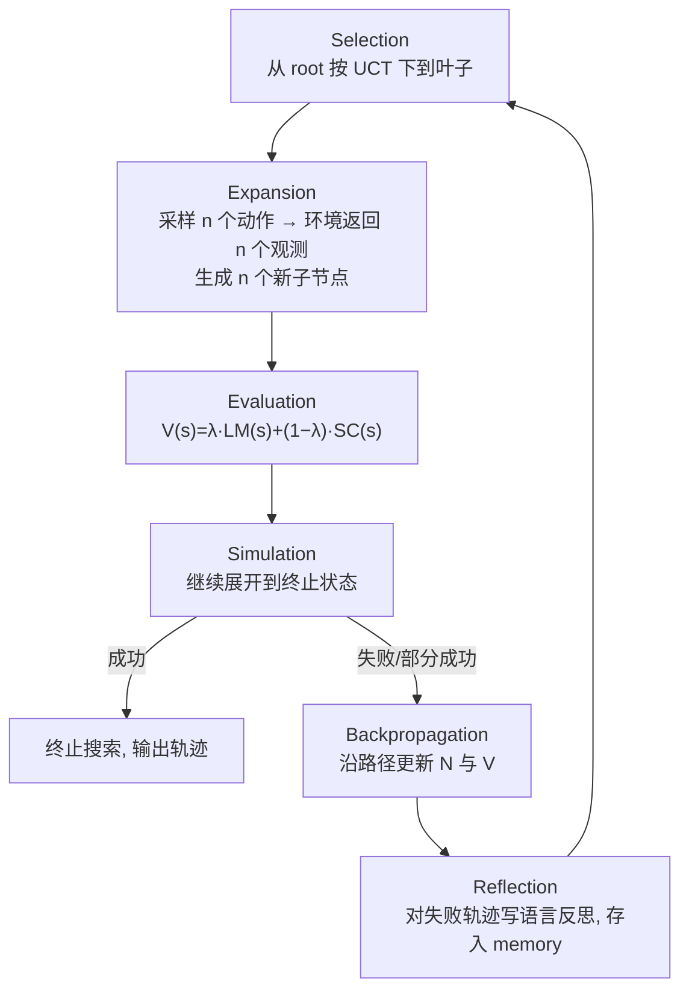

---
aliases:
  - "Language Agent Tree Search Unifies Reasoning Acting and Planning in Language Models"
  - "LATSURAPLM"
---
# Language Agent Tree Search Unifies Reasoning Acting and Planning in Language Models

> 论文提出 LATS（Language Agent Tree Search），第一个把推理、行动与规划统一起来的通用框架：它把蒙特卡洛树搜索嵌入 LM Agent 的决策循环，用 LM 自身充当价值函数与反思器，并引入外部环境反馈，使探索与决策更有依据。在编程、交互式问答、网页导航与数学等任务上验证了通用性：GPT-4 在 HumanEval 上取得 92.7% 的 pass@1；GPT-3.5 在 WebShop 上取得 75.9 的平均得分，与基于梯度的微调方法相当。

## 一句话定位

把 ReAct 的一条轨迹展开成 MCTS 树：**节点里同时存动作和观测**，用 LM 自评 + 自一致性当价值函数，用失败轨迹的语言反思当"语义梯度"——从而在**不需要世界模型、不需要训练**的前提下，把"推理/行动/规划"塞进同一个搜索循环。

## 问题与动机

### 三条被点名的现存缺陷

原文在 §3.1 末尾用一个三分法界定了所有前作的短板，每一条都对应一类机制缺失 [§3.1](papers/Agent规划/2310.04406/2310.04406.pdf)：

- **Flexibility（灵活性）**：CoT 与 ReAct 都是自回归地采一条，neglect alternative continuations from specific states——即使某个中间状态明显走错了，也没有机制换路。
- **Sensibility（感知力）**：CoT / ToT / RAP 只依赖模型内部表示，"cannot consider external observations"，于是幻觉与误差传播无法被外部证据纠正，且这构成了**性能天花板**。
- **Adaptability（适应性）**：现有规划方法（ToT 用 BFS/DFS，RAP 用 MCTS 但需要 LM 当世界模型）无法把环境反馈纳入规划，agent 是静态的、不能从试错里学到东西。

RAP 与 LATS 的差别被反复强调：RAP 也用了 MCTS，但"it is constrained to tasks where the LM can become a world model and accurately predict states" [§3.1](papers/Agent规划/2310.04406/2310.04406.pdf)。**这一句是全文的技术分水岭**：LATS 用真实环境代替学习出的动力学模型。

### 一个反直觉的动机证据

原文没有只靠"应该更好"来立论，而是给了一个负面结果：把现有方法简单拼起来（ToT/RAP 加 ReAct 式的观测）在 HotPotQA 上**反而不如纯推理版本**——ToT(ReAct) 0.39、RAP(ReAct) 0.54，而纯推理的 ToT 0.55、RAP 0.60 [§5.1](papers/Agent规划/2310.04406/2310.04406.pdf)。原文的结论是"adaptation of search algorithms to decision-making scenarios is non-trivial" [§5.1](papers/Agent规划/2310.04406/2310.04406.pdf)。

这条证据很有价值：它说明**搜索算法 + 环境观测 ≠ 更好的 agent**，必须重新设计节点、价值函数与反思的接口——这正是 §4 要解决的问题。

## 方法与机制

### 1. 问题设定与"可回退"这个前提

基础设定沿用 ReAct 的形式：$\hat{A} = A \cup Z$，$A$ 是环境动作、$Z$ 是语言推理；动作产生观测、thought 不产生 [§4.1](papers/Agent规划/2310.04406/2310.04406.pdf)。但原文在 §3.1 就插入了一个关键限定：

> "we focus on decision-making tasks *where reverting between iterations is feasible*." [§3.1](papers/Agent规划/2310.04406/2310.04406.pdf)

这不是脚注式的免责声明，而是**算法的成立条件**。MCTS 需要反复从任意节点重新展开，因此必须能把环境恢复到该节点对应的状态。原文的处理方式是：由于节点是 $s=[x, a_{1\cdots i}, o_{1\cdots i}]$（纯文本），恢复状态 = 把这段文本重新喂回去；在交互环境里则依赖环境的 reset/replay 能力 [§4.2](papers/Agent规划/2310.04406/2310.04406.pdf) [§B](papers/Agent规划/2310.04406/2310.04406.pdf)。

### 2. MCTS 的三个公式（沿用经典形式）

选择用 UCT，平衡利用与探索 [§3.2](papers/Agent规划/2310.04406/2310.04406.pdf)：

$$\mathrm{UCT}(s) = V(s) + w\sqrt{\frac{\ln N(p)}{N(s)}}$$

其中 $N(s)$ 是节点访问次数、$V(s)$ 是子树期望回报、$w$ 是探索权重、$p$ 是父节点。回传用增量平均：

$$V(s) = \frac{V_{\text{old}}(s)\,(N(s)-1) + r}{N(s)}$$

LATS 把 $N$、$V$ 都记进树里，节点"explicitly stored in memory"，构成一个**外部长期记忆结构** [§4.2](papers/Agent规划/2310.04406/2310.04406.pdf) [§A](papers/Agent规划/2310.04406/2310.04406.pdf)。这一步的意义常被低估：树本身就是跨 episode 的经验存储，而不是临时搜索栈。

### 3. 六个操作的循环

原文用一张图（Fig. 2）把循环拆成六步，并明确"performed in succession until the task is successfully completed or a computational limit is reached after sampling $k$ trajectories" [§4.2](papers/Agent规划/2310.04406/2310.04406.pdf)：

四个设计细节值得逐个说清：

**(a) 价值函数是复合的，且必须"在观测之后"算。** 原文明确提出与 ToT 的差别 [§4.2](papers/Agent规划/2310.04406/2310.04406.pdf)：

$$V(s) = \lambda \cdot \mathrm{LM}(s) + (1-\lambda)\cdot \mathrm{SC}(s)$$

- $\mathrm{LM}(s)$：让 $p_\theta$ 对状态做推理并要求以分数结尾，"repurpose $p_\theta$ into a value function"。
- $\mathrm{SC}(s)$：自一致性启发式——同一状态多次采样得到的动作若一致，则该状态更可信。
- 关键差别："Our key distinction from ToT is that we obtain this value **after** obtaining the environmental feedback"。理由也给了：没有外部反馈时 LM 很难改进自己的回答（引用了 LM 无法自纠的实证结果）。

超参：$w=1$；$\lambda = 0.5$（HotPotQA、Game of 24），$\lambda = 0.8$（Programming、WebShop）[§A](papers/Agent规划/2310.04406/2310.04406.pdf)。

**(b) 反思是"跨 episode 的记忆"，不是树内的一次回传。** 遇到不成功的终止节点后，$p_\theta$ 被喂进轨迹与最终奖励，产出一段语言反思，总结推理/行动错在哪、应该怎么做；**失败轨迹与反思一起存入 memory，在后续迭代里作为 agent 和价值函数的额外上下文** [§4.2](papers/Agent规划/2310.04406/2310.04406.pdf)。原文的措辞很精确：这提供了"a semantic gradient signal more useful than a scalar value"，且不用付优化的代价。

这里有个容易被误读的点：反思**不改变树的拓扑**，它改变的是下一轮的策略分布与打分口径。所以 LATS 同时有两套学习通道——树内的 $V$ 更新（数值）与 memory 的反思（语义）。

**(c) Simulation 在编程任务里被跳过。** HumanEval 上每个动作就是一个完整解，于是"直接使用通过测试的比例作为回传奖励"，$k=8$、生成 4 个测试、每次扩展采 $n=5$ 个解 [§5.2](papers/Agent规划/2310.04406/2310.04406.pdf)。这是全文唯一一处"把搜索退化成一层"的实例，也说明 LATS 的六步并非刚性流水线。

**(d) 预算即旋钮。** $n$（每次扩展的子节点数）与 $k$（总轨迹数）是显式的成本旋钮，附录明确指出"setting $n=1$ makes the method as efficient as ReAct with multiple trials or CoT-SC" [§B](papers/Agent规划/2310.04406/2310.04406.pdf)。这一点直接决定了它能否被公平评测（见后文）。

## 实验设置与关键结果

### 设置要点

- 四个领域：编程（HumanEval 164 题、MBPP 397 题子集）、HotPotQA（100 题，oracle 反馈）、WebShop（50 条指令）、Game of 24（50 局）[§5](papers/Agent规划/2310.04406/2310.04406.pdf) [§D](papers/Agent规划/2310.04406/2310.04406.pdf)。
- HotPotQA 用**oracle 设定**：环境在收到答案时告知正确与否，所有方法共享这一信号，原文说明这是为了"focus our evaluation on how well the agent incorporates external feedback" [§5.1](papers/Agent规划/2310.04406/2310.04406.pdf)。
- 统一 $n=5$、$k=50$（HotPotQA）、$k=30$（WebShop、Game of 24）、$k=8$（HumanEval），最大深度 $d=7$（HotPotQA）、$d=8$（编程）、$d=15$（WebShop）、$d=5$（Game of 24）[§A](papers/Agent规划/2310.04406/2310.04406.pdf) [§D](papers/Agent规划/2310.04406/2310.04406.pdf)。注意原文对 HotPotQA 深度前后不一致：消融段说主实验用 $d=7$（沿用 ReAct），而附录环境细节写 "maximum depth limit of 6" [§C](papers/Agent规划/2310.04406/2310.04406.pdf) [§D](papers/Agent规划/2310.04406/2310.04406.pdf)。

### HotPotQA 结果（GPT-3.5，EM）

| 类别 | 方法 | EM |
|---|---|---|
| 纯推理 | Base LM | 0.32 |
| 纯推理 | CoT | 0.34 |
| 纯推理 | CoT-SC | 0.38 |
| 纯推理 | ToT | 0.55 |
| 纯推理 | RAP | 0.60 |
| 纯推理 | **LATS (CoT)** | **0.62** |
| 有环境 | ReAct | 0.32 |
| 有环境 | ReAct (best of $k$) | 0.38 |
| 有环境 | Reflexion | 0.51 |
| 有环境 | ToT (ReAct) | 0.39 |
| 有环境 | RAP (ReAct) | 0.54 |
| 有环境 | **LATS (ReAct)** | **0.63** |
| 有环境 | LATS ($n=3$) / ($n=10$) | 0.58 / 0.65 |
| 有环境 | **LATS (CoT + ReAct)** | **0.71** |

数据来自 [§5.1](papers/Agent规划/2310.04406/2310.04406.pdf)。四个读点：(a) ReAct 0.32 → LATS(ReAct) 0.63，接近翻倍，这是摘要与引言里"doubles the performance of ReAct"的来源；(b) 简单把搜索算法搬到有观测的设定会**掉点**（ToT 0.55 → ToT(ReAct) 0.39；RAP 0.60 → RAP(ReAct) 0.54），这是全文最有说服力的对照；(c) $n$ 从 3 增到 10 单调提升（0.58 → 0.63/0.65），说明增益来自**展开更多节点**而非某个 prompt 技巧；(d) 混合策略（先 CoT、失败再 ReAct）最好。

### 编程结果（Pass@1）

| 方法 | HumanEval (GPT-3.5) | HumanEval (GPT-4) | MBPP (GPT-3.5) |
|---|---|---|---|
| CoT | 46.9 | — | 54.9 |
| ReAct | 56.9 | — | 67.0 |
| Reflexion | 68.1 | 91.0 | 70.0 |
| ToT | 54.4 | — | 65.8 |
| RAP | 63.1 | — | 71.4 |
| **LATS (ReAct)** | **83.8** | **92.7** | **81.1** |
| Base LM | — | 80.1 | — |

数据来自 [§5.2](papers/Agent规划/2310.04406/2310.04406.pdf)。一个必须注意的脚注：部分 baseline 用的是 HumanEval 的 161 题，LATS 用全部 164 题，原文称"find minimal performance differences"并同时报告两套设置 [§5.2](papers/Agent规划/2310.04406/2310.04406.pdf)。**GPT-4 上 92.7 vs Reflexion 91.0 只差 1.7 个点，而 GPT-3.5 上差 15.7 个点**——这说明搜索的收益在基座变强时被大幅压缩。

### WebShop 结果（50 条指令，$k=30$）

| 方法 | Score | SR |
|---|---|---|
| ReAct | 53.8 | 28.0 |
| ReAct (best of $k$) | 59.1 | 32.0 |
| Reflexion | 64.2 | 35.0 |
| **LATS (ReAct)** | **75.9** | **38.0** |
| IL | 59.9 | 29.1 |
| IL + RL | 62.4 | 28.7 |
| Fine-tuning | 67.5 | **45.0** |
| Expert（人类） | 82.1 | 59.6 |

数据来自 [§5.3](papers/Agent规划/2310.04406/2310.04406.pdf)。摘要说"gradient-free performance comparable to gradient-based fine-tuning"，准确说法应是：**score 超过微调（75.9 vs 67.5），但成功率明显低于微调（38.0 vs 45.0）**。两个指标指向不同结论，这是引用该结果时最容易出错的一处。原文还报告了一个负面观察：Reflexion 与 ReAct(best of $k$) 在这里几乎一样（64.2 vs 59.1），说明"生成的反思往往很笼统、不能提供有用反馈，agent 容易卡在局部最优" [§5.3](papers/Agent规划/2310.04406/2310.04406.pdf)。

### Game of 24 结果（GPT-3.5，50 局）

| 方法 | 成功率 |
|---|---|
| CoT | 0.08 |
| Reflexion | 0.12 |
| ToT | 0.20 |
| RAP | 0.40 |
| **LATS (CoT)** | **0.44** |

数据来自 [§5.4](papers/Agent规划/2310.04406/2310.04406.pdf)。注意这个 0.44 与 ToT 原论文的 74%（GPT-4、100 局、$b=5$）**不可直接比较**：基座不同、局数不同、题集是否同为 901–1000 原文未明说（仅称"follow the setup from Yao et al."）。同表还给出 $\lambda=1$（去掉自一致性项）时降到 0.40，用于支持复合价值函数的必要性 [§D](papers/Agent规划/2310.04406/2310.04406.pdf)。

### 消融结果（HotPotQA，EM，$n=5$、$k=50$）

| 变体 | EM | 相对 LATS |
|---|---|---|
| ToT (ReAct) | 0.39 | −0.24 |
| RAP (ReAct) | 0.54 | −0.09 |
| LATS（去掉 LM 启发式） | 0.37 | −0.26 |
| LATS（DFS 替代 MCTS） | 0.42 | −0.21 |
| LATS（去掉反思） | 0.58 | −0.05 |
| **LATS (ReAct)** | **0.63** | — |
| LATS ($w=0.5$) | 0.55 | −0.08 |
| LATS ($w=2.0$) | 0.63 | 0 |
| LATS ($d=4$) | 0.58 | −0.05 |

数据来自 [§5.4](papers/Agent规划/2310.04406/2310.04406.pdf) [§C](papers/Agent规划/2310.04406/2310.04406.pdf)。归因很清楚：

- **LM 价值函数是最大贡献项**（−0.26）。原文解释：没有它，唯一的信号是"完成的轨迹上的稀疏二元奖励" [§C](papers/Agent规划/2310.04406/2310.04406.pdf)。
- **MCTS 本身贡献其次**（换成 DFS −0.21），说明"选择 + 回传"两个操作不可省。
- **反思只贡献 0.05**，且原文自己指出这与 Reflexion 相对 ReAct 的 0.19 增益有重叠——即"能被反思解决的问题"与"能被搜索解决的问题"高度重合 [§5.4](papers/Agent规划/2310.04406/2310.04406.pdf)。这是一个诚实且重要的结论：**反思的边际价值在有了搜索之后大幅缩水**。

### 成本与样本复杂度

| 方法 | 性能 | 样本复杂度 | token 消耗 |
|---|---|---|---|
| ReAct (best $k=250$) | 0.42 | $O(k)$ | — |
| CoT-SC ($n=1,k=250$) | 0.40 | $O(k)$ | — |
| LATS ($n=1,k=50$) | 0.48 | $O(k)$ | — |
| ToT (ReAct, $n=5,k=50$) | 0.49 | $O(kn)$ | 210,215 |
| RAP (ReAct, $n=5,k=50$) | 0.54 | $O(kn)$ | 176,500 |
| **LATS ($n=5,k=50$)** | **0.63** | $O(kn)$ | **173,290** |

数据来自 [§5.4](papers/Agent规划/2310.04406/2310.04406.pdf)。节点数（成功时平均展开数）：$k=10$ 时 33.97 / 31.53 / 28.42，$k=30$ 时 47.54 / 37.71 / 34.12，$k=50$ 时 84.05 / 70.60 / 66.65（依次为 ToT / RAP / LATS）[§C](papers/Agent规划/2310.04406/2310.04406.pdf)。原文据此称"on average, LATS requires 3.55 fewer nodes than RAP and 12.12 fewer nodes than ToT"——我核对了三个 $k$ 的差值（RAP：3.11/3.59/3.95，均值 3.55；ToT：5.55/13.42/17.40，均值 12.12），**数字自洽**。

## 阅读重点

### 1. MCTS、价值估计、语言模型反思如何组合？

三者各自解决一个不同的问题，且**接口设计才是本文的技术贡献**：

- **MCTS 解决"在多条候选轨迹间分配预算"**。它提供的是选择机制（UCT）与信用分配机制（沿路径回传），而不是"更多采样"。这解释了为什么 LATS 与"ReAct best of $k$"的差距（0.63 vs 0.38）远大于单纯增加采样的收益。
- **价值估计解决"中间状态没有奖励"**。环境奖励只在终止时给出且是二元的，搜索若只靠它等于盲搜。LATS 的复合价值 $V=\lambda\,\mathrm{LM}+(1-\lambda)\,\mathrm{SC}$ 把"LM 对状态的判断"和"同状态多采样的动作一致性"拼在一起，两者都是无训练的。
- **反思解决"数值信号太稀"**。它把失败轨迹转成一段可读的教训写进 memory，下一轮的 agent 与价值函数都条件化于它。原文把它定位为"semantic gradient"而非梯度更新——没有参数变化，只有上下文变化。

组合的关键在于**时序**：先扩展并拿到环境观测，再算价值（与 ToT 相反），最后在终止且失败时产生反思。这个顺序让"价值"是被外部证据污染过的价值，从而避免了 ToT 式纯内部自评的盲点。消融也印证了顺序的重要性：去掉 LM 价值掉 0.26，换成 DFS（等于去掉选择与回传、只保留展开与剪枝）掉 0.21。

### 2. 环境可回滚和状态可重放为什么重要？

因为**LATS 是 model-free 的**：它不像 RAP 那样训练一个能"预测下一状态"的世界模型，而是直接让真实环境返回观测 [§4.2](papers/Agent规划/2310.04406/2310.04406.pdf)。这个选择的代价是：每一次"回到某个节点重新试另一个动作"都必须让环境真的回到那个状态。

于是可回滚性从"实现细节"变成了**算法的前置条件**，原文在正文与附录各说了一次，并在附录把可回滚环境列为：HumanEval、WebShop、ALFWorld、ToolBench，还给出了一个颇有攻击性的判断——"leveraging the reversion property is not a shortcoming but rather *a feature that has not been explicitly given notice* by the LM decision-making community" [§B](papers/Agent规划/2310.04406/2310.04406.pdf)。

三个层次的含义值得分开：

- **物理层**：环境能否 reset 到某个历史状态。不能 reset 的环境（真实世界的下单、真实浏览器会话）无法用 LATS。
- **语义层**：即使能 reset，重放是否**确定**。若环境有随机性（商品库存变化、搜索结果随时间变），"同一节点重放"会得到不同观测，UCT 的 $V$ 估计就被噪声污染，搜索的因果解释也随之失效。
- **成本层**：重放不是免费的。原文附录提到环境查询有成本但"trivial for the environments we study"，并指出这仍比"用 LM 当世界模型"便宜 [§B](papers/Agent规划/2310.04406/2310.04406.pdf)。这个论断只在 API 型环境成立；在需要重跑长流程的环境里，重放成本可能超过推理成本。

### 3. 搜索成本如何影响 Agent 评测？

三点，且第三点最容易被忽略：

- **复杂度层面**：LATS 与 ToT/RAP 同为 $O(kn)$，没有算法级的成本劣势；优势在于"成功时展开更少节点"（同一 $k$ 下少 3.55 / 12.12 个节点）。
- **对照层面**：预算必须在方法间对齐。本文的对照里 ReAct 是 best of $k=250$、LATS 是 $k=50$；HotPotQA 上 ReAct（0.42，250 次）仍输给 LATS（0.48，50 次）——**这个对照反而是对 LATS 有利的（更少预算更高性能），是全文最干净的比较**。但反过来，纯推理方法的对照没有给出同等 token 的基线，只能靠 ToT/RAP 的数字间接推断。
- **计量口径层面**：成本表统计的是"**成功时**的 token 与节点数"。原文自己在正文里承认这个口径对 LATS 有利："The token cost gap will be even larger when taking failed trajectories into account, since our method has a higher success rate and reaches the computational budget limit less often" [§5.4](papers/Agent规划/2310.04406/2310.04406.pdf)。这句话逻辑上成立，但意味着这张成本表不是全成本；做横向比较时应改用"每题的期望总成本 = 成功率 × 成功成本 + 失败率 × 预算上限"。

对评测者而言，这三点合起来是一个方法论提醒：**一个会搜索的 agent 与一个不搜索的 agent，其"能力"差异与"预算"差异是纠缠的**。只报成功率，等于默认让被测方自选预算。

## 与 BalatroEval 的连接

LATS 给 BalatroEval 提供的不是 agent 方案，而是**两条评测设计的前提条件**。Balatro 恰好满足它们，这是它作为测试床的核心优势。

### (1) "环境是否支持重放"：从假设变成一个可报告的指标

LATS 把可回滚性当前提 [§B](papers/Agent规划/2310.04406/2310.04406.pdf)；BalatroEval 应把它变成环境规格的一部分，并逐项记录：

| 能力 | LATS 的要求 | BalatroEval 的规格 | 对评测的影响 |
|---|---|---|---|
| 状态快照 / 恢复 | 必需（MCTS 回到任意节点） | `snapshot()` / `restore(id)` | 不支持则搜索类 agent 无法参与，或只能退化为 $n=1$ |
| 确定性重放 | 隐含（否则节点价值不可比） | 固定种子 + 完整动作序列可复现 | 保证"同一 trace 重放得同一分数" |
| 每步合法动作集可枚举 | 未要求（ReAct 动作是自由文本） | `legal_actions(state)` | 才能定义分支因子与 Oracle |
| 环境调用可计数 | 附录提及但不计量 | 每次 `step`/`reset` 计数 | 用于把"重放成本"计入预算 |

这张表的意义在于：**LATS 把"能回滚"当成幸运的前提，BalatroEval 可以把它当成可控的自变量**——同一模型在"允许回溯"与"禁止回溯"两种环境配置下跑，就能直接测出"回溯能力"值多少分。这在 LATS 的四个环境里都做不到（它们只能全开或全关）。

### (2) "搜索能力是否公平比较"：三个必须冻结的量

LATS 的成本分析暴露了三个会破坏公平性的旋钮，BalatroEval 应显式固定：

- **$k$（轨迹数）与 $n$（每次扩展子节点数）**：二者共同决定树的规模。原文 $n$ 从 3→10 带来 0.58→0.65 的提升 [§5.1](papers/Agent规划/2310.04406/2310.04406.pdf)，若不冻结，"模型更强"与"搜得更多"无法区分。
- **环境调用次数**：LATS 是 model-free 的，所以它的"思考"要花真实环境调用；而 ToT 类方法的环境调用为 0。**同一个 token 预算下，两类方法的实际算力完全不同**。BalatroEval 应同时报 `llm_tokens` 与 `env_calls` 两个数。
- **反馈质量**：HotPotQA 上所有方法都拿到了 oracle 正确性反馈 [§5.1](papers/Agent规划/2310.04406/2310.04406.pdf)。这在真实任务里不成立，但它让"如何利用反馈"成为唯一变量。BalatroEval 的对应做法是：**给出"有 Oracle 反馈 / 无 Oracle 反馈"两档**，前者测"利用反馈的能力"，后者测"自主判断的能力"，并明确标注哪一档对应现实部署。

### (3) 与 ToT 笔记的接口：Oracle ≠ 价值函数

我在 [[papers/Agent规划/2305.10601/NOTES|ToT]] 里强调过：不要把局部 Oracle 当作 $V$ 交给 agent。LATS 给出了这一告诫的实证版本——**LM 价值函数被去掉后掉 0.26，而 DFS（无选择无回传）只掉 0.21**，说明"评估质量"是搜索性能的第一因。若把 Oracle 当 $V$，Agent 的搜索会变成"用完美启发式做的搜索"，测出来的既不是模型的评估能力，也不是模型的规划能力，而是"搜索算法本身有多强"。

BalatroEval 的正确用法是：Oracle 只出现在**评分侧**（给 trace 打 `best/acceptable/suboptimal` 标签），不出现在**Agent 侧**。这样 LATS 式的搜索仍然必须自己估计价值，而我们可以事后用 Oracle 判断它的估计错在哪一步。

## 局限与可批判点

- **成本**。原文自认第一局限是"higher computational cost compared to simpler prompting methods like ReAct or Reflexion" [§6](papers/Agent规划/2310.04406/2310.04406.pdf)，并建议"用于困难任务或性能优先于效率的场合"。
- **可回退假设**。第二局限是"assumes the ability to revert to earlier states"，原文承认"may not be universally applicable in all possible environments" [§6](papers/Agent规划/2310.04406/2310.04406.pdf)。附录虽列举了若干可回退环境，但**没有讨论非确定性环境**（重放得到不同观测）这一更麻烦的情形。
- **HotPotQA 的 oracle 反馈偏高估**。所有方法都能拿到答案正确性，这与真实部署差距很大；原文限定这是为了研究"如何利用反馈"，但摘要/引言里的"doubles ReAct"并未带这个限定词。
- **样本规模小且集中**。HotPotQA 100 题、WebShop 50 条指令、Game of 24 50 局；WebShop 的 38.0 vs 45.0（对微调）之差在 50 条指令上只有 3–4 条样本的差别，不宜当作稳定结论。
- **无统计报告**。全文未报告随机种子、重复次数或置信区间（我在 TeX 源中未找到 seed/variance 相关段落），而 LATS 本身是随机搜索算法，$k$ 较小时方差不可忽略。
- **超参逐环境手调**。$\lambda$ 在 0.5/0.8 之间按环境切换、$w$ 与 $d$ 也被单独消融 [§A](papers/Agent规划/2310.04406/2310.04406.pdf) [§C](papers/Agent规划/2310.04406/2310.04406.pdf)；这意味着复现时需要每个环境重新调参，与"无需训练"的卖点形成隐性成本。
- **"first framework" 的主张有争议**。RAP 是同期工作且同样用 MCTS；原文的区分是"RAP 需要 LM 当世界模型" [§3.1](papers/Agent规划/2310.04406/2310.04406.pdf)，这个区分成立，但"first"的措辞在同期工作并存的情况下难以严格验证。
- **两项指标结论不一致时未充分讨论**。WebShop 上 score 超微调、SR 输微调，摘要只提 score；这类选择性表述在引用时需格外小心。
- **源文件存在排版遗留**。TeX 源中 §1 有两段内容高度重复的"我们提出 LATS"段落（一段以 "To overcome these challenges" 开头，另一段以 "To help address these issues" 开头），且后者仍保留了旧版数字（94.4），属修订遗留；正式引用应以 92.7 与当前段落为准。

## 开放问题

1. **非确定性环境下 $V$ 的方差如何控制？** 若同一节点重放得到不同观测，UCT 的访问计数与均值就不再是无偏估计。可以引入"重放一致率"作为一个环境指标，超过阈值才允许用树搜索——这是 BalatroEval 的确定性设定天然能回答、而 LATS 未能回答的问题。
2. **反思与搜索的替代关系有多强？** 消融显示反思只值 0.05，而 Reflexion 相对 ReAct 值 0.19。若把预算的一半从搜索挪到反思，会怎样？原文没有做这个等预算的交叉实验。
3. **$n$ 与 $k$ 的最优配比是否与任务深度相关？** 原文只做了 $n\in\{3,5,10\}$、$k\in\{10,30,50\}$ 的稀疏网格，且没有区分"宽而浅"与"窄而深"两种搜索形态的适用条件。
4. **价值函数能否脱离 LM 自评？** 若用一个小模型专门训练成 $V$（类似 AlphaGo 的价值网络），是否比 prompt 式自评更稳？原文用"避免训练成本"回避了这个问题，但在有大量可重放轨迹的环境里，训练 $V$ 的数据其实是可以自动生成的。

## 关联笔记

- [[papers/Agent规划/2210.03629/NOTES|ReAct]]：LATS 以 ReAct 的动作空间与提示为基座，把它从"单条轨迹"扩成"树"。
- [[papers/Agent规划/2305.10601/NOTES|ToT]]：LATS 的 BFS/DFS 被换成 MCTS，$V$ 从"纯内部自评"改成"看到观测之后再自评"。
