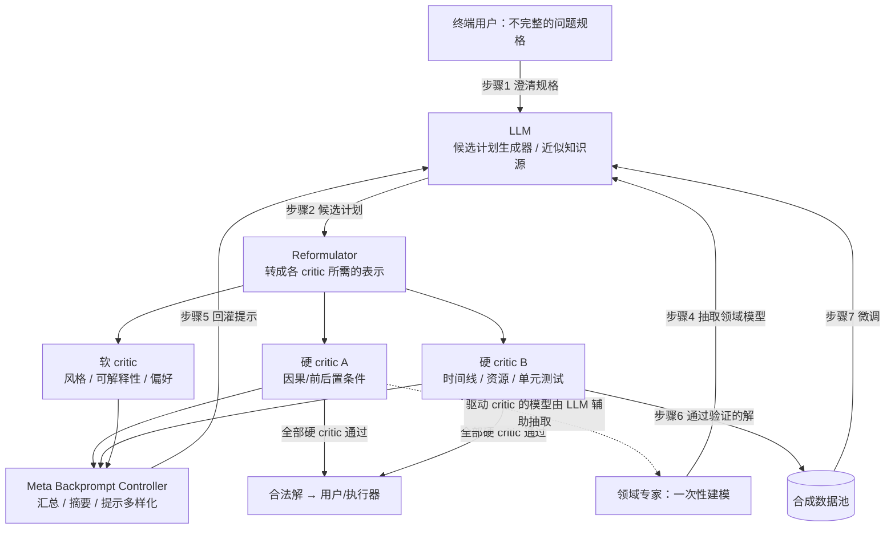

---
aliases:
  - "LLMs Can't Plan, But Can Help Planning in LLM-Modulo Frameworks"
  - "LCTPCHPLMF"
---
# LLMs Can't Plan, But Can Help Planning in LLM-Modulo Frameworks

> 这是一篇立场论文。作者认为关于「LLM 能否规划」的两种极端都站不住：自回归 LLM 本身无法完成规划或自我验证，但也不应被降格为格式翻译器。论文主张把 LLM 视为通用的近似知识源，与基于模型的外部验证器组成 LLM-Modulo 框架——LLM 生成候选计划、领域模型、规格补全与修复建议，硬验证器负责判定，两者在多轮双向交互中收敛；论文还讨论了如何借助 LLM 获得驱动验证器的模型，以及该框架相对「流水线式神经符号」的优势。

## 一句话定位

一篇 ICML 2024 position paper：它不提出新算法，而是给出**一条责任划分判据**——LLM 负责"提出"（生成候选计划、抽取领域模型、翻译格式、澄清规格），外部符号验证器负责"判定"（soundness 只由硬 critic 继承），二者用 Generate-Test-Critique 循环耦合成 LLM-Modulo 架构（[§3](papers/Agent规划/2402.01817/2402.01817.pdf)）。

## 问题与动机

论文要同时打掉两个方向的错误论断，并解释"为什么文献里会出现相反的论断"。

**错误一：过度乐观（LLM 能规划、能自验证）。** ReAct、Reflexion、Tree of Thoughts、Voyager 一类的系统被解读为"LLM 在做系统搜索 / 自我纠错"。论文的反驳是机制层面的：自回归模型生成每个 token 的代价是常数时间，而"某定理是否被一阶逻辑 KB 蕴含"是半可判定问题——如果 LLM 真在做原则性推理，被问到这类问题时它的耗时应当变化，但它不会 [§1](papers/Agent规划/2402.01817/2402.01817.pdf)。因此 LLM 在计算形态上只是一个"巨型伪 System 1"，即一个**非可靠（non-veridical）的外部记忆**（[图 1](papers/Agent规划/2402.01817/2402.01817.pdf)）。

**错误二：过度悲观（LLM 只配当格式翻译器）。** 把自然语言问题翻成 PDDL 再丢给经典求解器的单向流水线（LLM→solver）被论文讥为"白白得了 neuro-symbolic 的名号"，因为 LLM 的近似知识、类比能力完全没被用上，而 solver 的表达力与搜索复杂度限制却被全盘继承 [§1](papers/Agent规划/2402.01817/2402.01817.pdf)。

**误读的三个来源（这是全文最有信息量的诊断）。**

1. **把"规划知识"当成"可执行计划"。** 规划 = 领域知识（动作、前后置条件、HTN recipe、历史案例）+ 把这些知识装配成可执行计划的推理。论文称前者为 knowledge acquisition，后者才是 planning/reasoning；大量"LLM 会规划"的证据实际上只证明了前者，因为任务里 **subgoal 交互被消掉了**（单子目标、世界是 ergodic 的、或交互由人类在循环里兜底）[§2.3](papers/Agent规划/2402.01817/2402.01817.pdf)。
2. **把外部验证器的功劳记在 LLM 头上。** ToT 的"树"实质是**问题特定的 prompt 多样化手段**，不是搜索树的展开；它的正确性保证来自外部验证器（24 puzzle 可用算术验证），而 LLM 自己的 critique 常常"quite off the mark" [§2.3](papers/Agent规划/2402.01817/2402.01817.pdf)。
3. **把人类 back-prompting 的功劳记成 self-critique。** 迭代提示之所以看起来有效，是因为人（或 simulator）在循环里不断把错误信息喂回去；一旦把这一步换成 LLM 自我批评，收益消失 [§2.2](papers/Agent规划/2402.01817/2402.01817.pdf)。

**把"规划"拆成两半（本笔记据 §2.3 整理的记号）。** 设一个规划任务为 $(D, s_0, g)$，其中 $D$ 是领域知识（动作及其前置/效果、HTN recipe、历史案例），$s_0$ 是初始状态，$g$ 是目标。论文的论点可以写成：

$$
\underbrace{\text{LLM 擅长}}_{ \text{近似检索}} \; D \quad\text{vs.}\quad \underbrace{\text{LLM 不擅长}}_{ \text{需要处理子目标/资源交互}} \; \pi = (a_1,\dots,a_n)\ \text{s.t.}\ \pi \text{ 在 } D \text{ 下可执行且达成 } g
$$

LLM 能把 $D$ 说得头头是道（"婚礼要先订场地再发请柬"），但把 $D$ 装配成 $\pi$ 需要处理子目标之间的交互（订场地的时间会挤掉试菜的时间），而这类交互恰恰是近似检索最抓不住的部分。论文的实证支撑是：把动作/对象名混淆（$D$ 的语义被抽掉、只剩结构）后，标准规划器完全不受影响，LLM 却掉到 0–4% [§2.3](papers/Agent规划/2402.01817/2402.01817.pdf)。这说明 LLM 依赖的是 $D$ 的**语义表面**，不是 $D$ 的**结构约束**。

**为什么自验证在原理上就靠不住。** 通常的论证是"验证比生成容易"（复杂性理论直觉），但论文指出：如果 LLM 干的是近似检索，任务的计算复杂度与它的表现无关；除非训练数据里既有"正确数据"也有"**纠错数据**"，否则没有先验理由相信它的批评哪怕近似相关 [§2.2](papers/Agent规划/2402.01817/2402.01817.pdf)。

## 方法与机制（核心）

### 总览

LLM-Modulo 的名字取自 SAT-Modulo Theories：把"猜"和"验"分层，让一个不可靠但覆盖面极广的提议器，去驱动一组各自只对一个约束负责的可靠判定器。整个架构是一个 **Generate–Test–Critique 循环**：LLM 读入问题规格产出候选计划；一批 critic（硬/软）分别从自己的视角判定；所有批评汇入 Meta（Backprompt）Controller，被压缩、编排、多样化后作为下一轮提示回灌给 LLM；只有当**所有硬 critic 都签核**时，当前候选才作为合法解返回给用户或执行器（[§3](papers/Agent规划/2402.01817/2402.01817.pdf)，[图 3](papers/Agent规划/2402.01817/2402.01817.pdf)）。

### 组件一：critic bank —— 硬约束与软约束必须分开

critic 被显式分成两类，这是整个架构 soundness 的来源：

- **硬约束（hard critics）**：正确性判定，包括因果正确性、时间线正确性、资源约束正确性、单元测试。对 PDDL 问题可直接用 VAL，而 VAL 依赖的领域模型本身可以借助 LLM 抽取获得 [§3.1](papers/Agent规划/2402.01817/2402.01817.pdf)。
- **软约束（soft critics）**：风格、可解释性、偏好一致性等无法形式化的"好形态"。论文允许软 critic 由 LLM/VLM 担任，并明确写"LLM 不能承担带 soundness 保证的硬 critic 角色"，只有在**不要求 soundness** 的前提下才可能用判别式训练让 LLM 学验证 [§3.1](papers/Agent规划/2402.01817/2402.01817.pdf)。

关键机制细节：**critic 不必是声明式模型，也可以是程序化 simulator**（Voyager 一类系统就是靠 simulator 兜底）；并且 critic 可以是**建设性的（constructive）**——由 partial planner 在模型或其松弛上给出"往哪个方向改"的具体建议。这使"修复"也能外包给符号侧，而 LLM 只负责提出可被检验的东西 [§3.1](papers/Agent规划/2402.01817/2402.01817.pdf)。

反馈粒度被明确分为三档：`No, try again` / `No, try again, here is one thing wrong` / `No, try again, here are all the things wrong`。这三档的区别在原文中被保留为设计空间，而不是被固定成某一档 [§3.1](papers/Agent规划/2402.01817/2402.01817.pdf)。

**soundness / completeness 的归属（全文最重要的一句话）。** 系统的 soundness 继承自硬 critic 的 soundness；系统的 completeness 取决于 LLM 能否生成所有潜在相关候选 [§3](papers/Agent规划/2402.01817/2402.01817.pdf)。用形式化说法：

$$
\text{Sound}(\text{LLM-Modulo}) \;=\; \text{Sound}(\text{hard critics}), \qquad
\text{Complete}(\text{LLM-Modulo}) \;\propto\; \text{Coverage}(\text{LLM 的候选生成})
$$

这条分解解释了后面所有实验现象：验证器再强，也只能把"已提出的候选"筛干净，无法补出没被提出的候选。

### 组件二：Meta（Backprompt）Controller —— 把多源批评编译成一次提示

它接收全部 critic 的输出，把"处理过的版本"作为下一轮提示喂回 LLM。处理策略是一个从弱到强的谱系 [§3.2](papers/Agent规划/2402.01817/2402.01817.pdf)：

1. 简单轮询选取提示；
2. 借助 LLM 把多源批评摘要成一段一致反馈（软/硬 critic 混合时尤其需要，否则反馈互相冲突）；
3. **提示多样化（prompt diversification）**：故意从隐式搜索空间的不同区域诱发候选，用来提升 completeness。论文在此点名 ToT——它本质上就是这一档的一个问题特定实例（人为设计的 prompt 多样化），而不是搜索算法 [§3.2](papers/Agent规划/2402.01817/2402.01817.pdf)。

### 组件三：LLM 的四个角色（不是"翻译器"）

[§3.4](papers/Agent规划/2402.01817/2402.01817.pdf) 把 LLM 的职责清点为四条，这是全文对"LLM 到底该干什么"最凝练的回答：

| 角色 | 干什么 | 对应图中的步骤 |
|---|---|---|
| 候选计划生成 | 读规格 + 读 critic 回灌的批评，猜下一个候选 | 步骤 2 |
| Reformulator | 把中心候选计划转写成各 critic 各自的形式（时间线视图、因果链视图等），语法正确性可用嵌套的 LLM-Modulo 再校验 | 步骤 2→3 |
| 规格补全 | 与终端用户协作把不完整的问题规格补全 | 步骤 1 |
| 模型抽取 / critic 实现 | 与领域专家一起把 PDDL 模型、reward model、或程序化 critic 抽出来；甚至帮忙**枚举该有哪些 critic** | 步骤 4 |

论文对 reformulator 单独加了一句限定：只做语法重写是对 LLM 的"严重低估"（severely limited role），但反过来说，这条角色本身确实只需要格式转换能力 [§3.1](papers/Agent规划/2402.01817/2402.01817.pdf)。

### 组件四：把通过验证的解变成训练数据（步骤 6–7）

这一步容易被忽略，但它是本文对"LLM 能不能自我改进"这一问题的回答。论文的论证链是：既然 LLM 不能自验证，那么"自己生成 → 自己批评 → 自己微调"的 EM 式自举就不成立（§2.2 的推论）[§2.2](papers/Agent规划/2402.01817/2402.01817.pdf)；而 LLM-Modulo 的系统**带有 sound critic**，所以它产出的解天然是一个"经过检验的合成数据语料"，比 LLM 自己造的数据更适合微调——原文的措辞是这类计划"will constitute a better corpus of synthetic data for any fine tuning phase" [§3](papers/Agent规划/2402.01817/2402.01817.pdf)。**原文只承诺到"数据更好"这一层**，没有承诺微调后能获得可靠的自我验证能力（这一更强的主张只出现在仓库里被注释掉的工作稿中，不作为证据）。

需要注意一个诚实性问题：微调之后，LLM 产出的计划**不再保留 soundness**（它又变回了近似检索），只是更容易"猜中"能被 critic 接受的候选。所以这条回路不改变架构的 soundness 归属，只改变 completeness 一侧的命中率。

### 与既有系统的位置关系（§5 的自评）

论文把同类系统分成"承认外部验证器"与"不承认外部验证器"两类，这个划分本身就是它的立场表达 [§5](papers/Agent规划/2402.01817/2402.01817.pdf)：

| 系统 | 生成侧 | 判定侧 | 论文的评价 |
|---|---|---|---|
| FunSearch | 专门微调过的 LLM | 外部符号评估器 | 与 LLM-Modulo 同构；作者明确说外部验证器是避免幻觉的关键 |
| AlphaGeometry | 微调 LLM | 符号评估器 | 同上，Generate-Test-Critique |
| SayCan | LLM 提议技能 | simulator 过滤 | 最早的"LLM + 模拟器过滤"实例 |
| ReAct / Reflexion / Voyager | LLM | simulator / OS | 判定侧确实存在，但**论文认为这些工作没承认**功劳在 simulator，而把能力归给了 LLM |
| LLM→PDDL→solver 流水线 | LLM 仅翻译 | 经典 solver | 被判为"过度悲观"的一端，放弃了 LLM 的知识面 |

这张表里最锋利的判断是最后一列第三、四行：**判定侧的存在与否不是分歧点，是否承认判定侧才是**。这也是本文作为 position paper 最像"评论"而不是"技术报告"的地方。

### 设计取舍：为什么用 critic 而不用 planner，为什么把人赶出内循环

三条刻意的设计决定 [§3](papers/Agent规划/2402.01817/2402.01817.pdf)：

- **对接 critic 而非 solver。** 如果 LLM 只是 solver 的前端，它就得承受 solver 的表达力与搜索复杂度问题（可能因无限分支连一个候选都产不出）；对接 critic 则允许 LLM 直接"猜"出满足约束的候选。
- **承认 LLM 的输出面比"计划"宽。** 候选计划、领域模型、问题归约策略、规格细化，都是 LLM 可以给近似答案的对象。
- **人类只出现在"每领域一次"和"每问题一次"的位置。** 领域专家参与建模，终端用户参与补规格；人类**不进入规划内循环**（不做迭代提示）。理由有两条：复杂问题上人工代价不可承受；迭代提示有 Clever Hans 效应（人不断纠正，等于人替模型做了推理）[§3](papers/Agent规划/2402.01817/2402.01817.pdf)。

### 为什么这不是"把 LLM 硬塞进规划"——表达力论证

论文正面回答"已有形式化规划器，何必 LLM-Modulo"：传统规划架构为了可判定性，对问题表达力施加**先验限制**（PDDL 的不同表达力层级）；LLM-Modulo 不设这种限制，代价是放弃"全局保证"而只要求"每个 critic 从自己角度给 no-objection 证书"。论文把这种形态类比为 NASA 的深空网络规划与火星车任务规划——实际工程中就是靠人机"集体黑板"逐项签核，而非靠一个全局最优求解器 [§3.5](papers/Agent规划/2402.01817/2402.01817.pdf)。同一节也承认：当问题确实能被组合求解器解掉时，直接用它可能"orders of magnitude"更省资源——但这个量级没有给出任何测量 [§3.5](papers/Agent规划/2402.01817/2402.01817.pdf)。

## 实验设置与关键结果

本文是 position paper，**没有新做的实验**；证据全部来自作者团队已发表/在投的工作，被引用而非重跑。因此读这一节时应把它当作"证据汇编"，而非独立复现。

### 证据一：自主模式下 LLM 生成的计划不可执行（PlanBench，自然语言提示）

| 域 / 设置 | GPT-4 | GPT-4o | GPT-4-Turbo | Claude-3-Opus | LLaMA-3 70B | Gemini Pro |
|---|---|---|---|---|---|---|
| Blocksworld 一 shot | 206/600 (34.3%) | 170/600 (28.33%) | 138/600 (23%) | 289/600 (48.17%) | 76/600 (12.6%) | 68/600 (11.3%) |
| Blocksworld 零 shot | 210/600 (34.6%) | 213/600 (35.5%) | 241/600 (40.1%) | 356/600 (59.3%) | 205/600 (34.16%) | 3/600 (0.5%) |
| Mystery BW 一 shot | 26/600 (4.3%) | 5/600 (0.83%) | 5/600 (0.83%) | 8/600 (1.3%) | 15/600 (2.5%) | 2/500 (0.4%) |
| Mystery BW 零 shot | 1/600 (0.16%) | 0/600 (0%) | 1/600 (0.16%) | 0/600 (0%) | 0/600 (0%) | 0/500 (0%) |

（[表 1](papers/Agent规划/2402.01817/2402.01817.pdf)。Mystery BW 是 `Blocksworld` 的动作/对象名被混淆后的版本，Gemini Pro 一行在原文中按 500 例统计。）

三个可直接读出的事实：零 shot 普遍不差于一 shot（说明 few-shot 示例的收益很弱）；把名字混淆后全线崩到 0–4%（而标准规划器对这种改名完全不敏感，说明 LLM 在做的是**计划文本的近似检索**而非规划）；Gemini Pro 的零 shot 3/600 (0.5%) 与一 shot 68/600 (11.3%) 是表中最反常的一格。

### 证据二：外部验证器回灌能救回多少（Blocksworld / Logistics）

| 域 | 验证器 | 回灌轮数 | 成功率 |
|---|---|---|---|
| Blocksworld | VAL | ≤15 轮 | 82% |
| Logistics | VAL | ≤15 轮 | 70% |
| Mystery BW | VAL | ≤15 轮 | ≈10% |

（[§4](papers/Agent规划/2402.01817/2402.01817.pdf)，数据引自 Valmeekam et al. 2023 的 §5.2 与 Table 4。）Mystery BW 只到 ≈10% 是全文最关键的负面证据：**验证器的判定能力没有变化，变化的是 LLM 提出候选的能力**——瓶颈在生成侧。论文还补了一句限定：即便在 Mystery BW，凡是被返回的计划都必然通过了 VAL，因此"correct by its model"。

### 证据三：TravelPlanner 上的 LLM-Modulo 化

基准本身最难的一格是 GPT-3.5-Turbo 上最好的提示策略只有 **0.7%** 通过率；把硬约束（预算等）与常识约束（景点多样性等）都实现成 critic 后，**10 轮回灌上限、且用较弱的 GPT-3.5-Turbo**，通过率提升到基线的 **6 倍** [§4](papers/Agent规划/2402.01817/2402.01817.pdf)。同节报告的三个附带结论更值得记：LLM 能实现硬 critic 与若干常识 critic 的函数；LLM 能稳定充当 reformatter（自由文本→critic 可解析的结构化计划）；**critic 清单本身可以由 LLM 在少量人工监督下枚举出来**。

> 未采用的数据：仓库 `source/travel-planner-table.tex` 里有一张更细的表（例如 GPT-3.5-Turbo 上 LLM-Modulo[All] Final Pass 5.0 vs Direct 0.0，GPT-4-Turbo 上 20.6 vs Direct 4.4），但该表在 `main.tex` 中被注释掉、未编入 PDF。故这些数字**不能算作原文结论**，只能当作工作稿痕迹。

### 三条证据的强度并不相同

| 证据 | 支撑的论断 | 强度 | 理由 |
|---|---|---|---|
| 表 1（PlanBench 自然语言提示） | 自主模式下 LLM 不能生成可执行计划 | 中 | 数字完整、多模型多设置；但无人类基线、无置信区间，且与正文 12% 的表述不一致 |
| VAL 回灌（BW 82% / Logistics 70% / Mystery 10%） | 外部验证器 + LLM 提议可大幅提升 | 中偏强 | 有对照（回灌轮数）与负对照（Mystery BW），是最接近"机制验证"的一组 |
| TravelPlanner 6× | 架构可迁移到柔性约束域 | 弱 | 只有倍数、无绝对数与置信区间，且详细表未编入正文；基线 0.7% 极低，倍数放大了小绝对增益 |

读这篇论文时最该警惕的就是把第三条当作"LLM-Modulo 在开放域有效"的证明——6 倍的基线是 0.7%，绝对增益的量级仍是"个位数百分比"级别。

## 阅读重点

### 1. LLM 生成候选与外部验证器之间如何分工？

分工的判据只有一条：**LLM 只被允许"提出"，从不被允许"通过"**。具体切法有三层。第一层是**产出物不同**：LLM 产出可被检验的对象（候选计划、领域模型草稿、规格补全、格式重写），critic 产出不可协商的判定（pass / fail + 违反项）。第二层是**知识类型不同**：LLM 提供的是"近似正确的领域知识"（动作用什么、常见 recipe 长什么样、用户大概想要什么），这类知识错一点无妨，因为下游会被逐条检查；critic 提供的是"针对单一约束的可靠判定"，它不需要知道别的东西，因此可以做到 sound。第三层是**修复责任不同**：论文特意保留 constructive critic（基于 partial planner 或模型松弛给具体修改方向），使得"往哪改"也可以由符号侧给出，LLM 退化为"按提示再猜一次"。这种切法的直接后果是：LLM 的能力上限不再是"会不会规划"，而是"能不能在提示空间里命中一个可通过检验的候选"——这也正是 completeness 被归给 LLM 的原因 [§3](papers/Agent规划/2402.01817/2402.01817.pdf)。

反过来说，分工的失败模式也被写清楚了：如果让 LLM 兼任 critic，它就同时成了提议者和裁判，架构退化成 §2.2 批判的 self-critique 循环，soundness 归零 [§2.2](papers/Agent规划/2402.01817/2402.01817.pdf)。

**机制走查（按 §3.1 的三档反馈推演，记号为本文所加）。** 设当前候选计划为 $\pi_t$，硬 critic 为 $V$，反馈为 $f_t$。循环体是：

$$
\pi_{t+1} = \mathrm{LLM}\big(u,\ \mathrm{MC}(f_1,\dots,f_t)\big), \qquad
f_t = V(\pi_t),\qquad
\text{终止条件：} \forall c \in \mathcal{C}_{\text{hard}},\ c(\pi_t)=\texttt{pass}
$$

- 若 $f_t$ 是最弱档（"重来"），LLM 只能靠提示多样化换一个采样区域，等价于无信息的重新采样；
- 若 $f_t$ 指出一处违反，LLM 获得的是一个**局部约束**（例如某动作前置条件不满足），它需要自己推断"改哪个动作"——这一步仍是猜测，但搜索空间被大幅裁剪；
- 若是 constructive critic，$f_t$ 直接给出子计划建议，LLM 退化为"把建议缝进计划并保持格式合法"。

这三档的差别正是这套架构的可调旋钮：critic 越"啰嗦"，LLM 需要的推理越少，但 critic 本身要写的能力越强。**论文没有给出三档之间的对照实验**——它只报告了图着色上"LLM 自我批评不优于基线、甚至更差（因为系统认不出偶然正确的解，会把它改坏）"这一结论 [§2.2](papers/Agent规划/2402.01817/2402.01817.pdf)。换言之，反馈信息量的价值在本文中是**设计假设**，不是被测量过的量；这一点在把 LLM-Modulo 用作评测协议（例如 BalatroEval 的 Observation 字段设计）时必须自己补实验。

> 仓库内的 `main.tex` 有一段被注释掉的草稿，声称"最小信息量的 try-again 反馈与带具体违反项的反馈效果接近，且 top-k 采样+外部验证器与任何迭代回灌都竞争力相当"。这段文字**不在 PDF 里**，因此不作为本笔记的证据；但它是理解作者意图的重要旁证。

### 2. 规划、执行和验证分别由谁负责？

| 环节 | 责任方 | 原文依据 |
|---|---|---|
| 问题规格补全 | 终端用户 + LLM | 步骤 1，[§3.3](papers/Agent规划/2402.01817/2402.01817.pdf) |
| 领域模型 / critic 获取 | 领域专家 + LLM（人签核） | 步骤 4，[§3.3](papers/Agent规划/2402.01817/2402.01817.pdf) |
| 候选计划**生成**（"规划"的提议面） | LLM | 步骤 2，[§3.4](papers/Agent规划/2402.01817/2402.01817.pdf) |
| 候选计划**裁决**（"规划"的判定面） | 硬 critic 全体；全部通过才算解 | [§3.1](papers/Agent规划/2402.01817/2402.01817.pdf) |
| 批评的汇总与回灌 | Meta Controller（可用 LLM 摘要，但编排逻辑在外） | [§3.2](papers/Agent规划/2402.01817/2402.01817.pdf) |
| **执行** | 框架**之外**：解被"返回给终端用户或执行器" | [§3.1](papers/Agent规划/2402.01817/2402.01817.pdf) |
| 合成数据 / 微调 | 通过验证的解 → 数据池 → 微调 LLM | 步骤 6–7，见 `source/fine-tuning-and-synthetic-data-section.tex`（该节在 PDF 中被注释掉） |

最值得注意的是"执行"这一格：论文把执行完全排除在架构之外，只写解被交给 end-user 或 executor，**没有讨论执行监控、失败回滚、在线重规划**；唯一的例外是一个脚注，说 replanning 场景可以让循环从外部给定的候选计划起步 [§3](papers/Agent规划/2402.01817/2402.01817.pdf)。这意味着 LLM-Modulo 是一个**离线规划**框架，不是闭环控制系统。

另外，论文对"agentic LLM 热潮"有一句很硬的判断：那主要是把"acting"误当成了"planning"——LLM 能调用外部服务（AutoGPT / LangChain）不等于它发起的动作序列会到达目标状态，后者只能靠真正的规划能力保证 [§5](papers/Agent规划/2402.01817/2402.01817.pdf)。

### 3. 哪些错误可以由外部符号验证器捕获？

**能捕获（有明确判据、且判定对模型 sound）：**

- **不可执行**：违反动作前置条件、效果不一致——VAL 直接读模型判定 [§3.1](papers/Agent规划/2402.01817/2402.01817.pdf)。
- **目标未达成**：计划跑完但终态不含目标文字。
- **时间线冲突**：并发/时序约束被违反（hard critic 的一个独立维度）。
- **资源约束越界**：预算、容量类约束（TravelPlanner 的 budget critic 即此类的实例化）。
- **语法/格式错**：reformulator 输出不符合目标表示，可用嵌套的 syntax critic 检查 [§3.1](papers/Agent规划/2402.01817/2402.01817.pdf)。
- **单元测试式断言**：任意可写成可执行断言的检查。

**不能捕获（这是本文最容易被误读的地方）：**

- **模型本身的错**。原文的措辞极精确："if a plan is returned, it must have passed muster with VAL, and is thus guaranteed correct **by its model**" [§4](papers/Agent规划/2402.01817/2402.01817.pdf)。验证器保证的是"相对于模型的正确"，模型错了它一样签核。
- **规格不完整 / 未形式化的偏好**。规格缺项由用户补，软约束由 LLM/VLM 当 critic，这两类都没有 soundness。论文把 soft critic 留给 LLM，等于把"无法验证的部分"交回给不可靠组件——这是架构层面的一个已知缺口，而不是疏忽 [§3.1](papers/Agent规划/2402.01817/2402.01817.pdf)。
- **候选根本没被生成**。Mystery BW ≈10% 就是这一类的实证：验证器能判"错"，但无法让 LLM 提出"对"的候选 [§4](papers/Agent规划/2402.01817/2402.01817.pdf)。
- **"看起来合理但会出事"的计划**。论文用旅行规划书被 LLM 自动生成、读者照做后失望的新闻作为例子：这类错误在缺少 critic 时连"错"都定义不出来 [§2.3](papers/Agent规划/2402.01817/2402.01817.pdf)。

一句话概括：**符号验证器捕获的是"相对给定模型/规格的局部违规"，捕获不了"模型与规格本身的错"，也捕获不了"没被提出来的解"。**

## 与 BalatroEval 的连接

> 以下为项目内部设定，不是论文结论。

**这篇论文与 BalatroEval 的关系是"原则背书 + 一个必须警惕的反面"。**

背书部分：BalatroEval 要立的规矩"模型负责提出动作，环境负责判定"，正是 LLM-Modulo 的分工判据。把 Balatro 的规则引擎（出牌合法性、牌型/倍率结算、Boss blind 限制、经济与商店约束）实现成硬 critic，就得到本文意义上的 sound 判定器；LLM 只负责在给定局面下提议动作，不参与"这一步好不好"的裁决。这样一来，BalatroEval 的评测结论不依赖模型的自评，也就绕开了 §2.2 对 self-critique 的全部批评。

需要警惕的反面：BalatroEval 的"局部 Oracle"比本文的 hard critic **更强也更强硬**。本文的 critic 只判定"这个候选是否违反某约束"，是**通过/不通过**二值；而 BalatroEval 计划给出"给定状态与动作集，判定最优或可接受动作"，这是在**动作集上做排序/打分**，属于本文没有讨论的能力（本文的 critic 只有 constructive 变体才给方向，且不保证最优）。这带来两个设计后果：

1. **Oracle 的正确性必须相对"规则 + 目标函数"定义，不能相对"人类高手直觉"。** 本文的教训是 soundness 只能继承自形式化对象；如果 BalatroEval 的 Oracle 用启发式规则（例如"保留小丑牌槽位""优先清盲注"）来判定"可接受"，那它就不是硬 critic，而是一个被抬高的软 critic，必须在指标命名上与"可枚举 Oracle 指标"区分开。这正对应 BalatroEval 要区分"估计型过程指标"与"可枚举 Oracle 指标"的动机。
2. **本文的 completeness 归因直接适用于 Balatro 的搜索预算控制。** 既然"系统的完备性取决于提议器的覆盖"，那么控制搜索预算（每步可尝试的候选数 K、可选分支数）就是控制 completeness 的唯一手段，也必须在跨模型比较时固定——否则比较的其实是预算而不是能力。这一条与 BalatroEval"控制搜索预算以保证公平比较"的设定完全同构。

另外两点可借用的机制：本文的 **Meta Controller 三档反馈粒度**（重来 / 指出一处 / 指出全部）可以直接映射成 BalatroEval Trace 里 Observation 字段的信息量等级，用来做"反馈信息量 → 决策质量"的消融；本文的**reformulator** 角色则对应 BalatroEval 需要模型把"意图"转成合法动作字符串的那一步——按本文的判断，这一步只该被当作格式转换来评测（失败率单列），不该混进"决策能力"。

组件级对照：

| LLM-Modulo | BalatroEval 中的对应物 | 差异 |
|---|---|---|
| LLM 候选生成器 | 被测 Agent 的 Thought→Action | 本文一轮一整个计划；Balatro 一步一动作，长度量级不同 |
| 硬 critic（pass/fail） | 规则引擎：动作合法性、结算正确性 | 基本同构，可直接继承 |
| 局部 Oracle（最优/可接受动作判定） | —— | 本文**没有**这一层；这是 BalatroEval 的增量 |
| 软 critic（LLM/VLM） | 人类高手启发式 / 风格评分 | 只能算"估计型指标" |
| Meta Controller | 反馈注入器（Oracle 反馈 / 失败原因） | 本文用于驱动搜索；BalatroEval 用于控制信息条件 |
| 步骤 6–7 合成数据 | Trace 语料 → 微调 / ICL 检索 | 本文强调数据必须过 sound critic 才可用 |
| 执行 | 游戏引擎逐步推进（含随机性） | 本文不碰执行；BalatroEval 必须处理重放与随机种子 |

这张表最有价值的一行是"局部 Oracle"：它标出了 BalatroEval 相对本文框架的**理论增量**——本文只能回答"这个计划是否合法"，BalatroEval 还想回答"这一步是否好"，后者需要额外的目标函数定义，而这正是"可枚举 Oracle 指标"与"估计型过程指标"必须分开的原因。

最后一条边界：LLM-Modulo 是离线规划框架，**没有执行监控与重规划**；Balatro 是长程、状态会漂移（牌堆、经济、Boss 效果）的序列决策，BalatroEval 若要在每一步都用 Oracle，本质上更接近"逐步 critic 的在线规划"，是本文架构的一个未讨论的变体。这一点应在论文里显式声明为 BalatroEval 的扩展，而不是声称"实现了 LLM-Modulo"。

## 局限与可批判点

1. **立场论文，无独立实验。** 全部量化证据来自作者团队自己的既有工作（Valmeekam 2023、Stechly 2023/2024、Guan 2023、TravelPlanner 改编），存在自引与选择性取样风险；论文没有做任何"LLM-Modulo vs 纯 solver""LLM-Modulo vs 纯 LLM"的对照实验。
2. **soundness 的传递链条有一环没被保证。** 架构 soundness 继承自硬 critic，硬 critic 依赖领域模型，领域模型由 LLM 抽取 + 人签核。链条最后一步（人签核的可靠性）没有任何量化或流程保证，而 Mystery BW 的 ≈10% 说明"模型对了也未必救得回来"。
3. **表述前后不自洽的一处数字。** §2.1 说"最好的 LLM（GPT-4）平均只有约 12% 的计划可执行且达成目标"，而表 1 里 GPT-4 在 Blocksworld 上是 34.6%（零 shot）。原文没有解释这两个数为何不同（表题注明是自然语言提示，推测设置不同），读者不应把 12% 当作表 1 的汇总。
4. **效率论证没有任何测量。** "组合求解器可能 orders of magnitude 更省资源"这句只有定性；整套架构的回灌轮数、token 成本、critic 调用成本都没有报告，而 15 轮 × 每轮一次 LLM 调用 × 一次 VAL 调用的实际开销在工程上很关键。
5. **软 critic 的循环依赖。** 无法形式化的部分交给 LLM 判定，等于把不可验证的判断放回不可靠组件；论文承认这点，但没有给出"软 critic 何时可信"的判据。§2.3 自己也批评过"在无形式验证器的任务上谈 self-critique 收益是无法评估的"，这条批评同样适用于它自己的软 critic。
6. **"人类不在内循环"的代价被低估。** 论文以 Clever Hans 效应为由把人赶出内循环，但 §2.3 又说现有 LLM 规划成功案例大多靠人兜底；把这条路径排除后，LLM-Modulo 在真实开放任务上的可行性完全依赖"能否一次性抽出足够好的模型与 critic"，这一点没有实证。
7. **执行侧缺席。** 见上文；一个不含执行监控的规划框架，对 agent 场景的适用性有限。
8. **"critic bank" 的工程成本被一句脚注轻轻带过。** 原文承认"验证器可能很复杂，也可能需要写一个 simulator——但总得有人去写那个 simulator" [§2.3](papers/Agent规划/2402.01817/2402.01817.pdf)，却没有对"写 critic 的边际成本"与"直接写 solver 的成本"做任何比较。对一个主张"表达力换保证"的框架来说，这是最实质的未答问题。
9. **术语与论证有循环风险。** "LLM 只是近似知识源"这一结论，部分是从"LLM 在混淆名字的域上崩溃"推出来的；而"混淆名字崩溃"也可以被解释为分布外泛化失败，而非"没有在做规划"。两种解释对架构建议的影响不同（前者要求换架构，后者可能只需更好的数据），论文没有区分。
10. **没有讨论 critic 顺序、短路与预算分配。** 硬 critic 越多，每轮调用成本越高；哪些先跑、哪些可短路，直接影响可用性，而论文的图把 critic bank 画成并行广播。

## 开放问题

- **如何为"硬 critic 的 soundness"提供可审计证据？** 例如 critic 与模型的一致性测试、模型抽取阶段的形式化校验。本文只把这一步留给人。
- **如何度量 critic bank 的覆盖度？** 如果某个约束没有对应的 critic，系统会在"看起来通过"的状态下返回错误解，而这种失败在本文框架内不可观测。
- **回灌预算与通过率的关系曲线是什么形状？** 15 轮达到 82%、10 轮达到 6× 都只是单点，缺少"轮数–收益"曲线与边际收益递减点，而这恰好是"控制搜索预算公平比较"需要的量。
- **多个 critic 冲突时如何仲裁？** Meta Controller 只负责"编译成一致反馈"，没有优先级、投票或不可满足性诊断机制；如果硬 critic 集合本身互斥（模型写错导致），循环会永久不收敛。
- **能否从 Trace 里学 critic？** 论文只提"用通过的解做合成数据微调生成器"，没有提"用失败轨迹训练判别器"，后者在工程上可能收益更高。
- **软 critic 与硬 critic 的边界能否随领域演进而移动？** 即某些今天只能靠 LLM 判的软约束，能否被逐步形式化成硬约束；这是把 LLM-Modulo 从"愿景"变成"可积累工程"的关键。

## 关联笔记

- [[papers/Agent规划/2308.03688/NOTES|AgentBench]]——同属"把 LLM 放进环境里评测"的问题域，但取向相反：AgentBench 只测端到端成功率与失败类型，不设外部 sound 判定器；本文则论证"没有 sound 判定器就无法保证正确性"。两篇合读可以看出"基准的判定粒度"与"结论可推广性"之间的张力。
- 待补：PlanBench / Valmeekam et al. 2023（本文证据一、二的原始出处）；Stechly et al. 2023（图着色迭代提示）；Guan et al. 2023（LLM 辅助 PDDL 模型抽取）。
