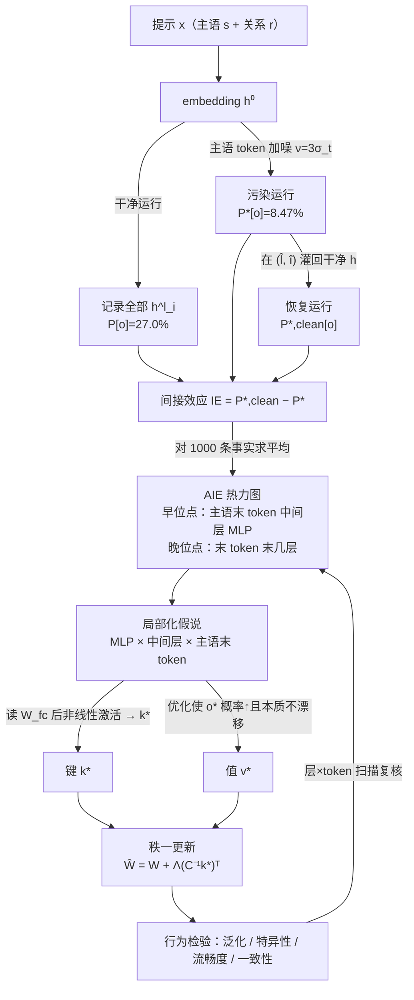

---
aliases:
  - "Locating and Editing Factual Associations in GPT"
  - "LEFAG"
  - "ROME"
created: 2026-11-17
---
# Locating and Editing Factual Associations in GPT

> 本文追问一个具体问题：GPT 把「Space Needle 在西雅图」这类事实**存在哪里**。作者先用因果中介分析（causal mediation analysis）做**因果追踪**：把主语 token 的 embedding 加噪破坏、再逐个位置恢复干净的隐状态，看哪个状态能把正确答案救回来。结果指向一个此前未被发现的「早位点」——主语最后一个 token 上、中间若干层的 **MLP 模块**。随后作者把这个发现翻到权重侧：把 MLP 的 $W_{proj}$ 当作线性联想记忆，用**秩一更新**（ROME）写入一对新的（键，值），在 zsRE 上与微调/超网络持平，在作者自建的反事实数据集 CounterFact 上同时拿到泛化与特异性——而所有基线都至少牺牲其中一项。

## 一句话定位

NeurIPS 2022 的一篇「定位 + 干预」双联论文，是**事实知识局部化**这条线的奠基工作：上半篇给出可复用的定位工具 causal tracing（三跑 + 间接效应），下半篇把定位结论当作假设、用 ROME 的秩一权重写入去**反向验证**它——因此它的贡献不只是「能改事实」，而是「能在指定层、指定 token 上改，且改完的行为分布与因果追踪预测的一致」。它为后来的 MEMIT（大规模多事实编辑）与整套「MLP 即键值记忆」的叙事提供了直接的实证起点。

## 问题与动机

**问题一：自回归 GPT 的事实存储位置基本没有被查过。** 论文开篇就点明这个空白：BERT 一类的 masked LM 已有大量工作（Petroni 的 LAMA 探针、Geva 等把 MLP 看作键值记忆、Dai 等的 knowledge neurons），但 GPT 有单向注意力和生成能力这两个架构差异，因此「BERT 上的结论能否直接搬过来」并不成立 [§1](papers/可解释性/2202.05262/2202.05262.pdf#section=1)。为什么重要：如果事实是**局部**的，那么模型编辑、知识更新、幻觉归因都可以变成外科手术；如果是弥散在整个网络里的，这些任务只能退化成昂贵的再训练。

**问题二：既有的「知识在哪里」的证据大多是相关性，不是因果。** 探针分类器（probing）能从表示里读出属性，但论文在相关工作里直接指出这类方法的根本瓶颈：它们**与网络的行为脱钩**——探针能解码出「这个位置知道主语是国家」，并不代表模型在预测时真的用了这条信息 [§5](papers/可解释性/2202.05262/2202.05262.pdf#section=5)。梯度显著性（integrated gradients）同样不可靠：附录的对照显示 IG 对局部特征很敏感，但给不出本文这种「全局逻辑」层面的图景 [§A.1.4](papers/可解释性/2202.05262/2202.05262.pdf#section=A.1.4)。所以需要一个**干预式**的判据。

**问题三：模型编辑的评价本身失真。** 已有编辑方法（FT、FT+L、KE、MEND）在 zsRE 上分数很好看，但论文指出两个被掩盖的失效模式：**(F1)** 过拟合到那句反事实陈述、换个说法就不认；**(F2)** 欠拟合，把不相关的主语也一起改了（bleedover）。更根本的是评测集的问题——Hase 等已观察到标准编辑基准常常只测「模型本来就打分很高」的提议，因此**低估了难度**；zsRE 的 specificity 又是从一大片可能事实里随机采样，而泄漏最容易发生在**相邻主语**上，所以那个指标几乎不敏感 [§4.1](papers/可解释性/2202.05262/2202.05262.pdf#section=4.1)、[§4.2](papers/可解释性/2202.05262/2202.05262.pdf#section=4.2)。

**动机与切入点（一句话）**：先用因果干预把「哪一层、哪个 token、哪个模块」钉死，再用**只改这一处权重**的极简编辑去验证这个钉子是否钉对了——如果定位是对的，那么最小干预就应该同时获得泛化与特异性。这个「定位 → 最小干预 → 用行为反证定位」的闭环，就是全文的方法论骨架。

## 方法与机制（核心）

### 总览

全文可以读成一次「同一枚硬币的两面」的实验设计：**正面是激活（activations）上的干预，反面是权重（weights）上的干预**，两者必须给出同一张地图才算成功。

正面（[图 1](papers/可解释性/2202.05262/2202.05262.pdf#figure=1)）把 transformer 的内部计算画成一张**隐状态网格**：横轴是层、纵轴是 token。对一条事实提示（例：`The Space Needle is in downtown ___`，答案 `Seattle`），先跑一遍**干净运行**记录全部 $h^{l}_i$；再跑一遍**污染运行**，在 embedding 层就给主语那几个 token 加高斯噪声，于是模型答错；最后跑**污染+恢复运行**，在某个 $(\hat l,\hat i)$ 处强行把干净状态灌回去，看正确答案的概率能回来多少。回来得多，说明这一个状态就是信息流的关键节点。把这件事对 1000 条事实、对网格上每个位置都做一遍，就得到一张「平均间接效应」热力图（[图 2](papers/可解释性/2202.05262/2202.05262.pdf#figure=2)），图上出现两个热点：靠近输出的**晚位点**（意料之中），以及主语最后一个 token 上中间层的**早位点**（新发现）。

反面（[图 4](papers/可解释性/2202.05262/2202.05262.pdf#figure=4)）把这个发现当假设来用：既然早位点的 MLP 在「读出主语属性」，那就把该层 MLP 的第二层权重 $W_{proj}$ 当成一张**线性联想记忆表**，只用一次秩一更新写入一对新的键值 $(k_*,v_*)$。若事实真的存在这里，这次极小的权重改动就应该**既**在新说法下被召回（泛化）、**又**不污染相邻主语（特异性）。第 4 节的层×token 扫描（[图 5](papers/可解释性/2202.05262/2202.05262.pdf#figure=5)）正是这个闭环的收口：把 ROME 依次施加在每一个 (层, token) 组合上，泛化与特异性的峰值恰好落在因果追踪指出的早位点中间层（第 18 层附近）。

### 模块一：把 transformer 写成一张「隐状态网格」

因果追踪能成立，前提是模型的计算图能被写成一条条**相加的残差通路**——只有这样，「某个隐状态」才是一个可以被单独替换的节点。论文给出的分解是（注意力串在 MLP 之后，与 GPT-3 一致；GPT-J 那种并行结构的变体同样适用）：

$$
h^{l}_i = h^{l-1}_i + a^{l}_i + m^{l}_i
$$

$$
a^{l}_i = \mathrm{attn}^{l}\left(h^{l-1}_1, \dots, h^{l-1}_i\right), \qquad
m^{l}_i = W_{proj}^{l}\,\sigma\!\left(W_{fc}^{l}\,\gamma\!\left(a^{l}_i + h^{l-1}_i\right)\right)
$$

符号逐一交代：$l\in[1,L]$ 是层号，$i\in[1,T]$ 是 token 位置，$h^{l}_i\in\mathbb{R}^{H}$ 是第 $l$ 层第 $i$ 个 token 的隐状态；$a^{l}_i$ 是该层注意力的**加性贡献**，$m^{l}_i$ 是该层 MLP 的加性贡献；$\gamma$ 是归一化非线性（LayerNorm），$\sigma$ 是整流非线性（GELU）；$W_{fc}^{l}$ 是第一层（把 $H$ 维升到更宽），$W_{proj}^{l}$ 是第二层（再压回 $H$ 维）。由于自回归，$a^{l}_i$ 只能看 $\le i$ 的位置——这就是「网格上半三角为空」的含义。

这个写法带来一个关键的**可干预性**：因为每一项都是相加进去的，把 $h^{l}_i$ 换成别的值，就等价于「在这一点截断并改写这条通路」，后续层照常往下算。于是整张网格就是一个 Pearl 意义上的**因果图** [§2](papers/可解释性/2202.05262/2202.05262.pdf#section=2)。

### 模块二：三次运行与两个效应量（因果追踪的核心）

这是本文最重要的工具，值得把每一步的物理意义讲清楚。

- **干净运行**：喂入事实提示 $x$，记录所有 $\{h^{l}_i\}$。此时正确答案 $o$ 的概率记为 $\mathbb{P}[o]$。
- **污染运行**：在 embedding 之后立刻对**属于主语的那些位置**做 $h^{0}_i := h^{0}_i + \epsilon$，$\epsilon\sim\mathcal{N}(0;\nu)$，然后让网络正常往下跑。$\nu$ 取 token embedding 经验标准差的 3 倍（GPT-2 XL 上 $\nu=3\sigma_t$；GPT-J 用 $0.025$、GPT-NeoX 用 $0.03$ 以匹配各自的 embedding 量级）。物理意义是**只把「主语是谁」这条信息抹掉，其余语法与上下文保持完好**，于是模型会给出错误答案，得到 $\mathbb{P}_*[o]$。在 1000 条已知事实上，污染把正确 token 的平均概率从 $27.0\%$ 压到 $8.47\%$。
- **污染+恢复运行**：仍从噪声 embedding 出发，但在指定的 $(\hat l,\hat i)$ 处 hook 住网络、强制输出干净值 $h^{\hat l}_{\hat i}$，其余一切照旧。记此时概率为 $\mathbb{P}_{*,\text{clean}\,h^{l}_i}[o]$。

由此定义**总效应**与**间接效应**：

$$
\mathrm{TE} = \mathbb{P}[o] - \mathbb{P}_*[o], \qquad
\mathrm{IE} = \mathbb{P}_{*,\text{clean}\,h^{l}_i}[o] - \mathbb{P}_*[o]
$$

直觉上：TE 是「这条事实被破坏了多少」，IE 是「**只把这一个状态修好**，能挽回多少」。若某个状态是信息流的必经节点，单点修复就能挽回大部分；若它只是旁支，修复它几乎无济于事。对样本取平均即得 ATE 与 AIE。作者明确说明**没有**采用直接效应（DE，走其它通路的效应），因为它噪声太大、信息量低，这与 Vig 等的观察一致 [§2.1](papers/可解释性/2202.05262/2202.05262.pdf#section=2.1)。

这里有一个容易忽略但很关键的实验设计细节：**恢复单个 MLP 或单个注意力查表几乎没有效果**，因此在对 MLP/注意力做分解时，作者恢复的是连续 10 层的一段贡献（区间 $[l_*-4,\dots,l_*+5]$，边界截断），再把结果画在区间的中心层 $l_*$ 上 [§A.1.2](papers/可解释性/2202.05262/2202.05262.pdf#section=A.1.2)。这本身就是一个关于机制的结论：**决定性信息是跨层累积的，不是某一层单独持有的**。

### 模块三：切断 MLP 的「路径特定效应」——把 MLP 从相关变成因果

上面的分解只告诉你「MLP 贡献大」，但存在一个混淆解释：MLP 段之所以看起来重要，可能只是因为它**承接**了前层注意力的成果。论文的解法是对计算图做第二次修改（[图 3](papers/可解释性/2202.05262/2202.05262.pdf#figure=3)），分三步：

1. 先在**污染输入**下记录每个 MLP 模块的贡献 $m^{l}_i$，得到一个基线值；
2. 修改计算图：把 token $i$ 处所有 MLP 计算**切断**并冻结在这个基线的污染值上，使它们不受后续「灌入干净 $h^{l}_i$」的影响；
3. 在这个被改造的图上重新测 AIE。

这在因果推断里就是**路径特定效应**（path-specific effect）：被测量的只剩下那些**绕开 MLP** 的通路 [§2.2](papers/可解释性/2202.05262/2202.05262.pdf#section=2.2)。结果非常干净：切断 MLP 后，**低层**状态的因果效应基本消失（它们原本的效应是「借道」后面 MLP 才能兑现的），而**高层**状态的效应几乎不受影响；同样的操作施加在注意力上却看不到这种断层。这一对比把结论从「MLP 有相关性」推到「中层 MLP 的计算在召回事实时**不可或缺**」。

### 模块四：结果怎么读——两个位点，各司其职

[图 2](papers/可解释性/2202.05262/2202.05262.pdf#figure=2) 是全文的核心证据图。GPT-2 XL（1.5B，48 层）上，**ATE = 18.6%**，其中相当大一部分由少数强因果状态承担：**主语最后一个 token 的第 15 层 AIE = 8.7%**。把 $a$ 与 $m$ 分开看：**MLP 在早位点的峰值 AIE = 6.6%**，而同一位置注意力只有 **1.6%**；反过来，注意力的重要性集中在**预测前的最后一个 token**（晚位点）。附录给出更细的三组数字：恢复单个状态的最大值 19.5%（按层聚合后在第 15 层附近达 15.0%）；恢复 10 层 MLP 段的最大值 23.6%（聚合峰值在主语末 token、中心第 17 层，15.0%）；恢复 10 层注意力段的最大值 19.4%（聚合峰值在末 token、中心第 32 层，16.5%）[§A.1](papers/可解释性/2202.05262/2202.05262.pdf#section=A.1)。

论文特别强调哪一半是新的：**晚位点有强因果状态毫不意外**（它离输出最近，几乎等于在改写答案），真正的新发现是**早位点的存在**——在「读主语」的那一刻，中间层已经完成了事实召回。这也解释了为什么第 4.3 节的编辑扫描会以早位点为目标。

稳健性方面，附录做了三项检查：把污染范围从主语扩到主语之后的若干 token，结论基本不变；噪声必须足够大（若取 $\sigma=\sigma_t$，总效应太小、轨迹不可辨），用均匀噪声则效应弱于高斯；把各向同性高斯换成匹配 embedding 协方差的 $\mathcal{N}(\mu_t,\Sigma_t)$ 同样可行 [§A.1.4](papers/可解释性/2202.05262/2202.05262.pdf#section=A.1.4)。跨模型上，GPT-J（28 层）与 GPT-NeoX（44 层）的轨迹形态与 GPT-2 XL 相似（早位点 MLP + 晚位点注意力），差别是 Eleuther 系模型在早位点**低层**的注意力更突出——作者的解释是层数更少，必须在头一两层就把主语「取过来」[§A.1.3](papers/可解释性/2202.05262/2202.05262.pdf#section=A.1.3)。

### 模块五：局部化假说——沿三个维度同时收紧

由轨迹得到一个可证伪的机制主张（[§2.3](papers/可解释性/2202.05262/2202.05262.pdf#section=2.3)）：中层 MLP 接收「主语是什么」的输入，输出「关于该主语的记忆属性」；这些输出在中间层累积，再由高层注意力**拷贝**到最后一个 token 上用于预测。于是事实关联被定位在三个维度的交点上：**(i) MLP 模块**、**(ii) 中间某几层**、**(iii) 主语最后一个 token 的处理过程**。

假说里还有一个更强的、反直觉的推论：受 Zhao 等「transformer 层序可交换而行为变化很小」的启发，作者**猜想**中层不存在「某一层专门存某类事实」的细分——任何事实都可以等价地存在中层任意一个 MLP 里。这条猜想后面被第 4.3 节的层扫描间接支持（效果在中层是一个平台而非尖峰），也是 MEMIT 能一次改多层的前提。

### 模块六：ROME 的代数基础——把 $W_{proj}$ 当线性联想记忆

现在转到权重侧。起点是 Geva 等的观察：MLP 的两层可以看成**键值记忆**，第一层神经元构成「键」，第二层据此取回「值」。但本文要的是比「逐神经元」更强的版本：把 $W_{proj}$ 整体视为一张**线性联想记忆表**（linear associative memory）。

物理意义先讲：一个线性算子 $W$ 若要对一组键 $K=[k_1\mid k_2\mid\dots]$ 输出对应的值 $V=[v_1\mid v_2\mid\dots]$，就是在解 $WK\approx V$；最小二乘意义下的最优解由 Moore–Penrose 伪逆给出 $W=VK^{+}$。现在要**插入**一对新键值 $(k_*,v_*)$ 而**尽量不扰动**已有记忆，就是解一个带等式约束的最小二乘：

$$
\text{minimize}\ \ \lVert \hat{W}K - V\rVert \quad\text{s.t.}\quad \hat{W}k_* = v_*
$$

它的闭式解（Bau 等在卷积网络上用优化求解，全连接层可以直接写出代数解）是：

$$
\hat{W} = W + \Lambda\left(C^{-1}k_*\right)^{T}, \qquad
\Lambda = \frac{v_* - Wk_*}{\left(C^{-1}k_*\right)^{T}k_*}, \qquad C = KK^{T}
$$

符号含义：$W$ 是原始 $W_{proj}$；$C=KK^T$ 是键的二阶矩（**无中心化协方差**），作者用 10 万个从 Wikipedia（2020-05-01 快照）采样的 MLP 激活 $k$ 预先估好并缓存；$C^{-1}k_*$ 给出「在已有记忆张成的空间里，为容纳这个新键需要挪动的方向」；$\Lambda$ 是一个与**残差** $v_*-Wk_*$ 成正比的向量——即「新键在旧表上读出来的值」与「我们希望它读出的值」之差。整项 $\Lambda(C^{-1}k_*)^T$ 是一个**秩一矩阵**，这就是 ROME（Rank-One Model Editing）名字的来源。

推导本身是经典的「带线性等式约束的最小二乘」，附录用拉格朗日量走了一遍：对 $\hat W$ 求导得 $\hat W KK^T = VK^T + \Lambda k_*^T$，与无约束正规方程 $WKK^T=VK^T$ 相减，大部分项抵消，剩下 $(\hat W - W)KK^T = \Lambda k_*^T$，再用 $C=KK^T$ 的对称性得到上式；$\Lambda$ 由把解代回约束 $\hat W k_*=v_*$ 定出 [§A.6](papers/可解释性/2202.05262/2202.05262.pdf#section=A.6)。**关键在于**：全部计算只需 $k_*$、$v_*$、$C$ 三个量，因此一次编辑是闭式的、秒级的。

### 模块七：Step 1 —— 用什么当「键」$k_*$

键必须代表**主语**，而且必须取在因果追踪指出的那个位置：$l^*$ 层、主语**最后一个 token**、**MLP 内部非线性之后**的值（即 $\sigma(W_{fc}\cdot)$ 的输出，[图 4d](papers/可解释性/2202.05262/2202.05262.pdf#figure=4)）。为什么是「非线性之后」而不是隐状态 $h^{l}_i$：$h^{l}_i$ 是残差流，混杂了位置、句法、前文等大量与本事实无关的成分；而 $\sigma(W_{fc}\cdot)$ 是这一层 MLP 实际用来索引记忆表的键，更纯净。

再者，键不能只取一次，因为同一主语出现在不同前缀下时该位置的状态会漂移。于是对一个小集合的前缀文本取平均：

$$
k_* = \frac{1}{N}\sum_{j=1}^{N} k(x_j + s), \qquad
k(x) = \sigma\!\left(W_{fc}^{l^*}\,\gamma\!\left(a^{l^*}_{[x],i} + h^{l^*-1}_{[x],i}\right)\right)
$$

其中 $x_j$ 是随机采样的前缀、$s$ 是主语、$i$ 是 $s$ 的最后一个 token 下标。**这里源文件内部有个不一致，需要如实记录**：正文说「生成 50 条长度 2–10 的随机 token 序列」，附录则说采样 20 条（10 条长度 5 + 10 条长度 10）[§3.1](papers/可解释性/2202.05262/2202.05262.pdf#section=3.1)、[§A.7](papers/可解释性/2202.05262/2202.05262.pdf#section=A.7)。附录另给了这步的消融：不用前缀时 Score 从 $89.2$ 掉到 $86.1$；把前缀加长到 50 或把数量翻到 60，几乎无提升（$89.3$ / $89.2$）。也就是说**前缀的作用是必要的鲁棒化，但边际收益很快饱和**。

### 模块八：Step 2 —— 用什么当「值」$v_*$（以及为什么需要 KL 项）

$v_*$ 不是一个可以「读出来」的量：我们要写入的是**新的**关系 $(r,o^*)$，它在模型里本来不存在。因此 $v_*$ 只能**优化**出来：

$$
v_* = \arg\min_{z}\ \mathcal{L}(z), \qquad
\mathcal{L}(z) = \frac{1}{N}\sum_{j=1}^{N}\underbrace{-\log \mathbb{P}\!\left(o^* \mid x_j + p\,;\, G(m^{l^*}_{i}:=z)\right)}_{\text{(a) 抬高 } o^* \text{ 的概率}} \;+\; \underbrace{D_{\mathrm{KL}}\!\left(\mathbb{P}(x\mid p'\,;\,G(m^{l^*}_{i'}:=z)) \,\Big\|\, \mathbb{P}(x\mid p'\,;\,G)\right)}_{\text{(b) 抑制「本质漂移」}}
$$

记号说明：$G(m^{l^*}_{i}:=z)$ 表示「把第 $l^*$ 层、第 $i$ 个 token 的 MLP 输出替换成 $z$ 之后的那个模型」；$p$ 是用于查询新事实的提示；$p'$ 形如「{subject} is a」，用于探测模型对主语**本质属性**的理解；$i'$ 是 $p'$ 中主语末 token。

两项的物理意义完全不同，缺一不可：

- 项 (a) 是「**说得出来**」——让网络在被替换了这一个向量后输出 $o^*$。只优化这一项会得到一个「只对这一句提示有效」的向量。
- 项 (b) 是「**别把主语搞坏**」——$p'$ 这类提示几乎不携带关系信息，因此对它的预测分布在编辑前后应当保持一致；用 KL 把它钉住，等于要求 $z$ 只改变「职业」这一属性，而不改变模型对「这个人是谁」的其余认知。作者称其为控制 **essence drift**（本质漂移）。

有一个必须强调的界限（论文原文明确写了）：**这一步并不改动任何权重**，它只是在找「当我们把这层 MLP 的输出设为 $z$ 时，$z$ 应该长什么样」。权重只在 Step 3 改一次。

### 模块九：Step 3 —— 插入，以及全部超参

拿到 $(k_*,v_*)$ 后，直接套用模块六的解更新 $W_{proj}$：

$$
\hat W^{l^*}_{proj} = W^{l^*}_{proj} + \Lambda\left(C^{-1}k_*\right)^{T}
$$

干预点固定在**第 18 层**：附录给出的理由是它位于 MLP 因果效应的中心，且从「切断 MLP」那张图看，第 18 层大致是 MLP 输出从「当键用」切换到「当值用」的分界 [§A.7](papers/可解释性/2202.05262/2202.05262.pdf#section=A.7)。超参：$v_*$ 用 Adam，学习率 $0.5$、权重衰减 $1.5\times10^{-3}$，KL 项系数 $\lambda=1\times10^{2}$，最多 20 步、损失降到 $5\times10^{-2}$ 即早停；$C$ 用 10 万个 $k$ 向量估计。GPT-2 XL 上一次完整编辑约 **2 秒**（NVIDIA A6000）；作为对比，KE/MEND 这类超网络推理只要约 100 ms，但要付出数小时到数天的额外训练开销。

### 模块十：对照组实验——「知道」与「说出」是两套机制

附录里有一个设计得极漂亮的反证实验，用来检验「中层 MLP = 事实召回、高层注意力 = 词序生成」这个分工 [§A.5](papers/可解释性/2202.05262/2202.05262.pdf#section=A.5)。作者构造 **AttnEdit**：对第 33 层（注意力因果轨迹的中心）**所有头**的 $W^Q_i,W^K_i,W^V_i$ 做带 $L_\infty$ 约束的微调（$\epsilon=0.001$，由网格搜索选定，刻意压低以避免靠增加 bleedover 刷分）。结果：两种编辑**都能**在原始改写提示下把假事实「吐」出来，但 AttnEdit **无法泛化到改述**，而 ROME 可以。这个对比的意义是把「编辑成功」拆成两层：**在输出端做手脚可以让模型说出目标词，但那不是知识被改写，只是词被改掉**——这正是论文反复区分的「knowing vs saying」。

### 模块十一：把数字串起来——一次编辑到底发生了什么

把前面几步的实测数字接起来，可以看清这条方法链的「信噪比」：

1. 干净运行：$\mathbb{P}[\text{Seattle}] = 27.0\%$；
2. 污染主语 embedding 后：$\mathbb{P}_*[\text{Seattle}] = 8.47\%$，于是 $\mathrm{TE} = 27.0 - 8.47 = 18.53$ 个百分点（正文报的 ATE 18.6% 与此一致）；
3. 在主语末 token 恢复**一个**干净状态，最好情况把概率救到 19.5%，即 $\mathrm{IE} \approx 11.0$ 个百分点——**约占总效应的 59%**。这个比例是「单点修复能挽回六成」的意思，也是「事实召回高度局部化」这句话真正的量化含义（该比例为本笔记据 [§A.1](papers/可解释性/2202.05262/2202.05262.pdf#section=A.1) 的数字直接相除得到，原文未这样表述）；
4. 到权重侧，同样的位置（第 18 层、主语末 token）成为秩一写入的落点，写入后 ES = 100.0、NS = 75.4 —— 即「几乎总能说出新事实，且四分之三的邻近主语不受污染」。

再补一个几何直觉，解释为什么更新方向是 $C^{-1}k_*$ 而不是直接 $k_*$。若所有已有键两两正交且同长度，则 $C=KK^T$ 是对角阵，$C^{-1}k_*\propto k_*$，更新就是把「新值」原样叠加到那个方向，互不干扰。但真实键是**高度相关**的（同一实体在不同上下文下的键、以及共享语义的实体之间的键都相近），直接沿 $k_*$ 写入会顺带改动那些与 $k_*$ 相似的键所对应的值——这正是 CounterFact 里 NS 掉下去（bleedover）的机制。$C^{-1}$ 的作用是**去相关**：把 $k_*$ 投影到「已有键张成的空间的正交补」方向上，从而把对旧记忆 $WK\approx V$ 的扰动压到最小。所以这条公式可以读成一句话：**沿「最不打扰别人的方向」，走「刚好能读出 $v_*$ 的步长」**。这也解释了为什么同样的秩一更新若施加在别的层（[图 5](papers/可解释性/2202.05262/2202.05262.pdf#figure=5)）会同时损伤泛化与特异性——那里的键分布并没有「一个主语对应一条记忆」的干净结构。

## 实验与对比

### 实验设置

- **模型**：GPT-2 XL（1.5B，48 层）与 GPT-J（6B，28 层）；因果追踪另在 GPT-NeoX（20B）与 GPT-2 Medium/Large 上复核。
- **数据**：① zsRE 的评测切片，10,000 条，每条含一句事实陈述、改述提示、一句不相关事实（沿用 MEND/KE 的划分；ROME 无需训练，故训练集弃用）；② 作者自建的 **CounterFact**，21,919 条记录、20,391 个主语、749 个宾语、645 条/关系，其中改述提示 42,876 条（2 条/记录）、邻域提示 82,650 条（10 条/记录）、生成提示 62,346 条（3 条/记录）[表 2](papers/可解释性/2202.05262/2202.05262.pdf#table=2)。它的构造逻辑值得记住：反事实 $(s,r,o^*)$ 由 ParaRel 条目派生，$o^*$ 从不带该谓词的其它元组里加权采样，因此**模型在编辑前对它的打分很低**；邻域提示则用 WikiData SPARQL 查询「与 $s$ 共享同一谓词且同宾语 $o^c$ 的其它实体」，即**在隐空间里离 $s$ 最近、最容易被泄漏污染**的主语 [§A.2](papers/可解释性/2202.05262/2202.05262.pdf#section=A.2)。
- **指标**：zsRE 用 Efficacy / Paraphrase / Specificity。CounterFact 用 ES/EM（疗效及其幅度）、PS/PM（泛化）、NS/NM（特异性，测 $\mathbb{P}[o^c]>\mathbb{P}[o^*]$）、GE（流畅度，bi/tri-gram 熵的加权平均）、RS（一致性，生成文本与参考文本的 TF-IDF 余弦），并以 ES、PS、NS 的**调和平均 S** 作为综合分——调和平均的用意是：任何一项塌陷都会把总分拖下去，无法用一项的高分掩盖另一项的失败。
- **基线**：FT（Adam + 早停，只改一层 $W_{proj}$；GPT-2 XL 选第 1 层、GPT-J 第 21 层，学习率 $5\times10^{-4}$、损失 0.03 早停）、FT+L（$L_\infty$ 约束在 $\epsilon=5\times10^{-4}$ / GPT-J $5\times10^{-5}$，第 0 层）、KE、MEND（各另训 zsRE 与 CF 两个定制版本）、KN（Dai 等的 knowledge neurons，先粗筛约 1000 个神经元再细筛到 $\le 10$ 个）。

### 表 1：zsRE（GPT-2 XL）

| Editor | Efficacy ↑ | Paraphrase ↑ | Specificity ↑ |
|---|---|---|---|
| GPT-2 XL（未编辑） | 22.2 (±0.5) | 21.3 (±0.5) | 24.2 (±0.5) |
| FT | 99.6 (±0.1) | 82.1 (±0.6) | 23.2 (±0.5) |
| FT+L | 92.3 (±0.4) | **47.2** (±0.7) | 23.4 (±0.5) |
| KE | 65.5 (±0.6) | 61.4 (±0.6) | 24.9 (±0.5) |
| KE-zsRE | 92.4 (±0.3) | 90.0 (±0.3) | 23.8 (±0.5) |
| MEND | 75.9 (±0.5) | 65.3 (±0.6) | 24.1 (±0.5) |
| MEND-zsRE | 99.4 (±0.1) | **99.3** (±0.1) | 24.1 (±0.5) |
| **ROME** | **99.8** (±0.0) | 88.1 (±0.5) | **24.2** (±0.5) |

结论要分两半看：**插入一条能被复述的关联对 ROME 不难**（Efficacy 99.8，全表最高），但**改述鲁棒性不及两个专门在 zsRE 分布上训练过的超网络**（88.1 vs KE-zsRE 90.0 / MEND-zsRE 99.3）。同时作者提醒：这张表的 Specificity 几乎都在 24 左右，**它不是一个敏感指标**，因为负样本是从一大片可能事实里随机抽的；真正容易泄漏的是相邻主语，那要等 CounterFact 才测得出 [表 1](papers/可解释性/2202.05262/2202.05262.pdf#table=1)。

### 表 4：CounterFact 主结果（节选 S / ES / PS / NS / GE / RS）

| 模型 | Editor | S ↑ | ES ↑ | PS ↑ | NS ↑ | GE ↑ | RS ↑ |
|---|---|---|---|---|---|---|---|
| GPT-2 XL | 未编辑 | 30.5 | 22.2 | 24.7 | 78.1 | 626.6 | 31.9 |
| GPT-2 XL | FT | 65.1 | 100.0 | 87.9 | **40.4** | 607.1 | 40.5 |
| GPT-2 XL | FT+L | 66.9 | 99.1 | **48.7** | 70.3 | 621.4 | 37.4 |
| GPT-2 XL | KN | **35.6** | **28.7** | **28.0** | 72.9 | **570.4** | **30.3** |
| GPT-2 XL | KE | 52.2 | 84.3 | 75.4 | **30.9** | **586.6** | 31.2 |
| GPT-2 XL | KE-CF | **18.1** | 99.9 | 95.8 | **6.9** | **383.0** | **24.5** |
| GPT-2 XL | MEND | 57.9 | 99.1 | 65.4 | **37.9** | 624.2 | 34.8 |
| GPT-2 XL | MEND-CF | **14.9** | **100.0** | **97.0** | **5.5** | **570.0** | 33.2 |
| GPT-2 XL | **ROME** | **89.2** | 100.0 | 96.4 | **75.4** | 621.9 | **41.9** |
| GPT-J | 未编辑 | 23.6 | 16.3 | 18.6 | 83.0 | 621.8 | 29.8 |
| GPT-J | FT | **25.5** | **100.0** | 96.6 | **10.3** | **387.8** | **24.6** |
| GPT-J | FT+L | 68.7 | 99.6 | **47.9** | 78.6 | **622.8** | 35.5 |
| GPT-J | MEND | 63.2 | 97.4 | **53.6** | 53.9 | 620.5 | 32.6 |
| GPT-J | **ROME** | **91.5** | 99.9 | **99.1** | **78.9** | 620.1 | **43.0** |

（粗体表示该列的最优值或明确失败值，取自原表着色；完整 10 列数据见 [表 4](papers/可解释性/2202.05262/2202.05262.pdf#table=4)。测试集规模：GPT-2 XL 7,500 条、GPT-J 2,000 条。）

**最突出的两个数字**：GPT-2 XL 上 S 从次优 66.9（FT+L）提到 **89.2**（+22.3）；GPT-J 上从 68.7 提到 **91.5**（+22.8）。更有说服力的是**失效模式的分布**：FT 在 GPT-J 上 Efficacy 100.0 但 NS 只有 10.3（近九成邻域提示被带跑），MEND-CF 的 PS 高达 97.0 而 NS 塌到 5.5——这正是论文命名的 (F2) 与 (F1)；KE-CF/MEND-CF 的 GE 掉到 383.0/570.0，说明它们靠「反复吐目标词」刷疗效分。ROME 是唯一在 ES、PS、NS 三项上同时处于高位的编辑方法。

### 其他证据

- **层×token 扫描**（[图 5](papers/可解释性/2202.05262/2202.05262.pdf#figure=5)）：把 ROME 依次施加在每个 (层, token) 组合上，泛化与特异性在**主语最后一个 token、中间层**双双达峰，泛化峰值在第 18 层；编辑更早或更晚的 token 都会损伤泛化或特异性之一。
- **生成样例**：把「Pierre Curie 的工作领域是医学」写入 GPT-2 XL 后，FT 与 ROME 能在改述下稳定说「医生」；FT+L、KE、MEND 会随措辞在「医学」与「物理」间摇摆，KE 还会陷入复读「medicine」；特异性上，FT/KE/MEND 把无关的 Robert Millikan 也改成了生物学家/医学家，ROME 保持不变 [§4.4](papers/可解释性/2202.05262/2202.05262.pdf#section=4.4)。
- **人工评测**：15 名志愿者、50 条事实、ROME vs FT+L 配对比较。评委认为 ROME 的生成**与插入事实更一致**的可能性是 FT+L 的 **1.8 倍**；但认为 ROME **更流畅**的可能性低 **1.3 倍**——即 ROME 引入了其它指标没捕捉到的流畅度损失 [§4.5](papers/可解释性/2202.05262/2202.05262.pdf#section=4.5)。

## 归因分析

把 S 的 +22 分归因到具体设计，论文提供的证据链是这样的：

1. **增益主要来自「编辑位置选对了」，而不是更新公式更精巧。** 最硬的证据是层×token 扫描：同一套 ROME 公式，只把干预点挪到别的 (层, token) 上，泛化/特异性立刻掉下去，峰位与因果追踪的早位点重合。这是「定位 → 干预」闭环里最有说服力的一环，也解释了对比方法为什么系统性失败——FT 在 GPT-2 XL 上选第 1 层、FT+L 选第 0 层、GPT-J 的 FT 选第 21 层，这些位置是按邻域分数网格搜出来的，而不是按因果结构选的。
2. **键的选取方式（主语末 token、MLP 非线性之后、多前缀平均）贡献了鲁棒性。** 消融：去掉前缀平均，S 从 89.2 掉到 86.1（−3.1）。
3. **「改动 MLP 权重」而非「改动注意力权重」是可泛化的前提。** AttnEdit 在改写提示上也能复述假事实，但改述下完全失效；这排除了「ROME 的优势只是因为改动量小」的解释。
4. **特异性来自秩一约束的「最小扰动」性质**：更新只沿 $C^{-1}k_*$ 一个方向、幅度由残差 $\Lambda$ 决定，因此对其它键 $WK\approx V$ 的破坏被压到最小；FT 则无此约束（NS 40.4），FT+L 的 $L_\infty$ 约束虽然保住了邻域，却把泛化压死（PS 48.7）。
5. **诚实边界**：论文**没有**给出 KL 项 (b) 的消融、也没有给出 $C$ 估计样本量（10 万）的敏感性分析，因此「essence drift 项到底贡献多少分」在原文中**未明确说明（Not explicitly specified in text）**。同理，$v_*$ 优化步数/早停阈值的选择依据也未做消融。

## 局限与未来工作

论文在 [§4.6](papers/可解释性/2202.05262/2202.05262.pdf#section=4.6) 与 [§6](papers/可解释性/2202.05262/2202.05262.pdf#section=6) 中明确列出：

- **一次只能改一条事实**，ROME 的定位是「理解知识存储机制的工具」，不是可落地的大规模训练/更新方法；扩展到多事实同时编辑是后续工作 MEMIT 的主题。
- **关联是有方向的**：「西雅图的地标是 Space Needle」与「Space Needle 在西雅图」是两条独立存储，改一条不会自动改另一条，两条都要改就得编辑两次。
- **只验证了事实型关联**，逻辑知识、空间知识、数值知识都没有考察。
- **表示属性的向量空间结构仍不清楚**（原文：our understanding … remains incomplete）。
- **一个反噬性风险**：即使成功改写了某条存储的关联，模型仍会「猜」出没有证据支撑、很可能为假的新事实——这会限制 LLM 作为事实来源的可用性。

## 与其他工作的关系

- **[[papers/可解释性/2404.15255/NOTES|activation patching]]**：本文的三跑设计（clean / corrupted / corrupted-with-restoration）就是激活修补的方法论祖先。那份 tutorial 把「换掉某个激活、看指标恢复多少」系统化为可操作流程，而本文是它在「事实召回」上的第一个大规模应用，并额外引入了**路径特定效应**（切断 MLP）这一层。
- **[[papers/可解释性/2211.00593/NOTES|IOI]]**：同样的干预哲学，但粒度不同——IOI 在**注意力头**层面用 path patching 拆出一个 26 头电路，本文在**MLP 层**层面定位事实召回，并进一步走到权重侧做写入。两者合起来说明「电路级」与「记忆级」是两种互补的定位单位。
- **[[papers/可解释性/2309.08600/NOTES|SAE]]** 与 **[[papers/可解释性/2209.10652/NOTES|Toy Models]]**：ROME 的核心假设是「MLP 的 $W_{proj}$ 是一张线性联想记忆表，键值对互不干扰」；Toy Models 恰恰说明在**叠加（superposition）**下这种「干净键值」图景会失效——特征多于维度时必然互相干扰。SAE 走的是另一条路：不假设单神经元/单键可解释，而是学一个过完备字典把激活分解成稀疏特征。本文的秩一编辑在单事实尺度上有效，但在叠加严重处必然出现 bleedover，这正是后续工作想解决的张力。
- **[[papers/可解释性/2501.16496/NOTES|Open Problems]]**、**[[papers/可解释性/2611.08438/NOTES|State of MI]]**：这两篇把「定位—验证」这类工作放进可解释性的方法论评估框架里；ROME 常被当作「干预式证据优于相关性证据」的正面案例，也被当作「单点编辑能否推广到机制级理解」的质疑对象。
- **[[papers/可解释性/2601.22594/NOTES|Neuron Basis]]**：那篇主张「电路在神经元基下是稀疏的」；本文的键值视角隐含「MLP 神经元即记忆槽」的假设，两者对「神经元是不是正确的分析单位」给出了不同答案，可对照阅读。
- **[[papers/可解释性/2504.13151/NOTES|MIB]]**：把「编辑/定位这类干预实验」标准化成基准，正是本文这种「自建 CounterFact 才能测出泄漏」的做法在评测层面的延续。
