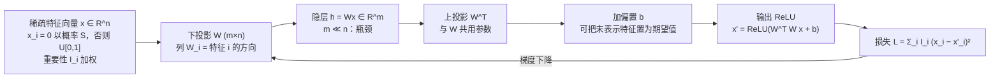

---
aliases:
  - "Toy Models of Superposition"
  - "TMS"
created: 2026-11-17
---
# Toy Models of Superposition

> 神经网络常把许多不相关的概念塞进同一个神经元（polysemanticity），这让「神经元 = 特征」的可解释性假设大面积失效。本文造了一个最小玩具模型：稀疏特征经一个 $m$ 维线性下投影、再经 $W^T$ 上投影与 ReLU 输出重建，重建损失按特征重要性加权。在这样的模型里，只要特征足够稀疏，模型就会主动用**几乎正交的非基方向**多存特征——这就是 superposition。作者进一步证明 superposition 的出现是一条**相变线**（有相图、有一阶相变证据）、其特征方向会自发排成**均匀多胞体**（digon / 三角形 / 五边形 / 四面体 / 方反棱柱），并给出与对抗样本、学习动力学、privileged basis 下多语义神经元的联系。
>
> 引用说明：本文是 Transformer Circuits Thread 的 HTML 文章，**章节与图均无编号**，因此本笔记的引用直接指向本地 PDF，不做锚点猜测（`agentero` 也未对该 PDF 生成 layout 索引）。

## 一句话定位

一篇「把 polysemanticity 从观察提升为可复现现象」的基础论文：它用**两个只差一个 ReLU** 的玩具模型（linear vs. ReLU-output）证明 superposition 不是玄学而是**稀疏性驱动的最优解**，并把「一个神经元里装了几个特征」这件事量化成可画相图、可对应多胞体几何的对象。

## 问题与动机

**现象层面。** 在作者研究的模型里，一部分神经元确实干净地对应特征（如 InceptionV1 的 curve detector），但在大语言模型里「神经元对应干净特征」反而罕见；同一层里常常既有 monosemantic 神经元，也有 polysemantic 神经元。为什么有时对齐、有时不对齐？这个问题不解决，circuit analysis（把权重看成特征之间的连线）就只在「恰好干净」的那部分网络上成立。

**为什么重要。** 论文把可解释性目标压缩成一条依赖链：要能被人类理解，表示必须**可分解**（decomposable，特征之间互不干扰）；要能**找到**分解，特征最好由方向表示（linear representation hypothesis）；而一旦 superposition 存在，「用神经元枚举特征」「用余弦相似度找方向」「用 Gram-Schmidt 逐个剥离方向」这些基本操作全部失效。论文在战略部分把这一点说得最直接：**能枚举全部特征 ≈ 能对模型行为下全称判断**，而这正是安全论证最想要的原始能力。

**前人方案的根本瓶颈。** superposition 在此之前只是**猜想**（由 polysemantic 神经元反推出来的解释），没有任何受控实验证明「神经网络真的会这么做」，更没有一个能说明「什么时候会、什么时候不会」的理论。压缩感知、disentanglement、神经科学里的 distributed / population code 都触及同一现象，但都不是在「神经网络被梯度下降训练」这个设定下给出的机制性结论。作者的原话是：此前没有 feature superposition 在神经网络中被**无歧义地**展示过（最接近的是 Cheung et al. 的 model-level superposition），见[原文引言与 Related Work](papers/可解释性/2209.10652/2209.10652.pdf)。

**本文的切入点（两个对抗力量）。** 论文把所有观察归到两个相互拉扯的力上：

- **Privileged basis**：只有部分表示有「特权基」（例如后面接了激活函数的层），它打破旋转对称性，**鼓励**特征落到基方向上（= 对应神经元）。
- **Superposition**：线性表示可以存比维度更多的特征，代价是干扰（interference），这**推着**特征离开基方向。

polysemanticity 就是这两股力量拉锯后我们看到的残局：既然特征数多于维度，特征**不可能**全部对齐基方向。论文对 superposition 给出的形式化定义很干脆——设特征 $i$ 的表示方向为 $W_i$（$W$ 的第 $i$ 列），若 $W^T W$ **不可逆**，则这个线性表示处于 superposition；若 $W^T W$ 可逆，则没有 superposition（[§ Definitions and Motivation](papers/可解释性/2209.10652/2209.10652.pdf)）。

**三层假设的排序（全文的骨架）。** 论文把「表示有多好」拆成四级递进属性，前两级被认为是普遍的，后两级只是偶发：

| 层级 | 属性 | 内容 | 论文的态度 |
|---|---|---|---|
| 1 | Decomposability | 激活可分解为彼此独立的特征 | 最重要，也是最该争取的 |
| 2 | Linearity | 特征 = 方向，$x = \sum_i x_{f_i} W_{f_i}$ | 神经网络的天然格式 |
| 3 | Non-superposition | $W^TW$ 可逆 | 只在部分 regime 成立 |
| 4 | Basis-aligned | 所有 $W_i$ 是 one-hot（或稀疏） | 需要 privileged basis，且常不成立 |

## 方法与机制（核心）

### 总览

整个论文只用了一个极小的自编码器家族，把「大模型存不下所有特征」这件事压缩成一条**信息瓶颈 + 稀疏先验**的最小可解问题。数据侧：想象一个理想的、完全解纠缠的大模型，它的激活是 $x\in\mathbb{R}^n$，每一维就是一个特征；每个特征以概率 $S$ 取 $0$（这就是稀疏性），非零时在 $[0,1]$ 上均匀取值；每个特征还带一个重要性 $I_i$，作为损失里的权重。模型侧：先做一个线性下投影 $h = Wx \in \mathbb{R}^m$（$m \ll n$），$W$ 的第 $i$ **列**就是特征 $i$ 在低维空间里的方向；再用同一个矩阵的转置上投影回 $n$ 维，$x' = W^T h + b$；最后在输出端加一个 ReLU（这是与线性基线**唯一的区别**）。损失是按重要性加权的均方误差 $L=\sum_i I_i(x_i - x'_i)^2$。

这条流水线的妙处在于：**它把「模型有没有 superposition」变成一个可以直接看的矩阵**。因为 $W$ 与 $W^T$ 绑定，特征 $i$ 与特征 $j$ 的干扰就是 $W_i \cdot W_j$；于是 $W^TW$ 这个 $n\times n$ 矩阵的对角线告诉你「特征被表示得多强」（$\|W_i\|^2$），非对角线告诉你「特征之间互相串了多少」。整篇论文的实验，本质上都是在不同的 $(S, I_i, n, m)$ 组合下观察 $W^TW$ 长什么样。

这里必须强调一个设计细节，否则后面的所有结论都显得莫名其妙：**为什么上投影要用 $W^T$ 而不是另一个自由矩阵？** 论文给了两条理由。其一是**消歧**：如果上下投影各自自由，那么「哪个方向对应哪个特征」就没有唯一定义（可以把 $W$ 乘任意可逆矩阵、反向乘到上投影上，模型行为完全不变）。绑定成 $W^T$ 之后，特征方向被唯一确定，可视化才有意义。其二是**数学上自然**：$W^T$ 在 $W$ 近似正交时就是 $W^{-1}$，符合压缩感知里「测量矩阵近似正交」的直觉。此外偏置 $b$ 不是可有可无的装饰——它承担两个功能：把「不打算表示的特征」直接置为其期望值（省掉重建误差），以及**把小的正干扰压到零以下**，从而让干扰变成「免费」的负干扰（见下文数学分析）。

### 模块一：实验设定背后的三条假设

论文明确列出建模时所依赖的三条关于真实特征的假设，这三条正是决定相图坐标轴的东西：

1. **Feature Sparsity**：特征稀有。视觉里大多数位置没有水平边缘、没有狗头；语言里大多数 token 不指代某个人、不是某个从句。这决定了 $x_i$ 以概率 $S$ 取零的生成方式。
2. **More Features Than Neurons**：潜在有用特征的数量远超神经元数量（每个被写进文字的人都可能是一个特征，而模型的神经元数远小于此）。这是 superposition 存在的**结构性前提**。
3. **Features Vary in Importance**：特征对任务的贡献不同。这引入 $I_i$，也是相图另一个坐标轴。

论文还诚实地标注了两处任意选择：非零值取 $[0,1]$ 均匀分布是任意的（指数分布、幂律分布同样自然）；并且「重要性谱」在实践中可能是一条无限长、渐近趋于零的曲线，只是计算上不这么做。

### 模块二：两个只差一个 ReLU 的模型

| | 下投影 | 重建 | 说明 |
|---|---|---|---|
| Linear Model | $h = Wx$ | $x' = W^T W x + b$ | 已充分理解，**不会**出现 superposition，等价于 PCA |
| ReLU Output Model | $h = Wx$ | $x' = \operatorname{ReLU}(W^T W x + b)$ | 只多了一个输出非线性，行为发生质变 |

线性模型为什么不可能 superposition，论文给了两条互补的解释。浅的一条是「线性模型本质上做 PCA，只能存前 $m$ 个主成分」；深的一条借 Saxe et al. 对线性网络学习动力学的闭式解，把损失拆成两个相互竞争的力：

$$
L \;\sim\; \underbrace{\sum_i \big(1 - \|W_i\|^2\big)^2}_{\text{feature benefit：表示更多特征带来的收益}} \;+\; \underbrace{\sum_{i\neq j} (W_i \cdot W_j)^2}_{\text{interference：非正交嵌入带来的串扰}}
$$

**物理意义**：第一项奖励「让每个特征的方向长度接近 1」（真正把它表示出来）；第二项惩罚「任意两个特征方向不正交」。在 $m$ 维空间里，正交方向最多 $m$ 个，所以一旦表示超过 $m$ 个特征，第二项必然为正；而在**线性**重建下，正干扰没有任何办法被消掉，于是解必然停在「只表示 $m$ 个」。注意论文还给了个漂亮的对照：这里的干扰是 $\sum_{i\ne j}|W_i\cdot W_j|^2$，压缩感知里的 coherence 是 $\max_{i\ne j}|W_i\cdot W_j|$，两者是同一个向量的 $L_2$ 与 $L_\infty$ 范数。

ReLU 输出模型则不一样：**ReLU 让负干扰免费**。如果两个特征的方向是反平行的（$W_i \cdot W_j < 0$），当一个特征激活时，它在另一个特征上的串扰是负的，被 ReLU 截断成 0，不会造成损失。更进一步，一个足够负的偏置 $b_i$ 可以把「小的正干扰」也压到零以下，等于人为把它变成负干扰。这两条机制合起来，解释了为什么实验里学到的解**优先只保留负干扰**。

### 模块三：数学分解——损失按稀疏模式展开，$L_0$ 与 $L_1$ 是主角

要点是先讲清楚「为什么可以只看单特征激活的项」。损失是对数据分布求期望：

$$
L=\int \big\| I\big(x-\operatorname{ReLU}(W^TWx+b)\big)\big\|^2\,dp(x),\qquad x_i=0\ \text{w.p.}\ S
$$

由于各维独立、每维以概率 $S$ 取零，把期望按「有几个特征非零」展开，就是一个二项式

$$
L=\sum_{k=0}^{n}\binom{n}{k}(1-S)^{k}S^{\,n-k}L_k
$$

其中 $L_k$ 是「输入恰好有 $k$ 个特征非零」时的损失。**当 $S\to 1$（高度稀疏）时，$L_0$ 和 $L_1$ 主导整个损失**，这就是为什么后面的理论分析可以只盯这两项，也是为什么相变能用极简闭式解刻画。

- $L_0$（全零输入）：此时 $x'=\operatorname{ReLU}(b)$，理想输出是 0，所以 $L_0=\sum_i \operatorname{ReLU}(b_i)^2$——纯粹是**对正偏置的惩罚**。
- $L_1$（单特征激活）：设只有特征 $i$ 激活、值为 $a_i$，则 $x'=\operatorname{ReLU}(a_i W^TW_i+b)$。理想情况是 $x'$ 只在第 $i$ 维为 $a_i$、其余为 $0$。展开后它同时包含**收益项**（$\|W_i\|^2$ 接近 1，特征被完整表示）与**干扰项**（$W_j\cdot W_i\neq 0$，$j\ne i$，别人的维度被点亮）。

论文在此处有一个关键的观察：$L_1$ 的结构与线性情形**几乎同构**，但有两处本质差异——ReLU 永远不会让误差变大，且负偏置可以在「不表示某特征」时把它按期望值抵扣掉，等于免费。原文随后把这一项与**化学里的 Thomson 问题**联系起来：如果假设所有特征重要性相同、有固定数量特征满足 $\|W_i\|=1$、其余为 0、且 $b_i=0$，那么收益项变成常数，只剩干扰项——问题退化成「在 $m$ 维球面上摆放 $n$ 个点，最小化一个略 unusual 的能量函数」。这个类比不是修辞，后面几何章节的每一条水平线都能在 Thomson 问题的解里找到对应物。

至于 $k\ge 2$ 的项，论文没有显式写出，但给了机制性说明：多个特征同时激活会产生**叠加的**干扰，所以真正被训练出来的解倾向于把特征组织成**稀疏的干扰图**（每个特征只和少数几个特征互相干扰），这样既降低了叠加干扰的概率，又让 $L_1$ 在总损失里的权重相对上升。

### 模块四：基本结果——从 PCA 到反平行对，再到五边形

最早的实验故意做得极小：$n=20$ 个特征、$m=5$ 个隐维、重要性 $I_i = 0.7^{\,i}$（从最重要到最不重要）。可视化只需要两个量：$\|W_i\|$（特征被表示得多强，$\approx 1$ 表示完全表示、$\approx 0$ 表示没表示）与 $\sum_{j\ne i}(\hat{W}_i\cdot W_j)^2$（特征 $i$ 是否与别人共用维度；为 $0$ 表示正交，$\ge 1$ 表示存在一组别的特征能把 $W_i$ 方向激活得和特征 $i$ 自己一样强）（[§ Demonstrating Superposition](papers/可解释性/2209.10652/2209.10652.pdf)）。

结论按稀疏度排出清晰的序列：

- **线性模型**：无论稀疏度如何（足够优化时解不依赖 $S$），永远只学最重要的 $m=5$ 个特征，彼此正交——就是 PCA。
- **ReLU 输出模型 + 稠密特征（$1-S=1.0$）**：行为与线性模型一致，仍然只学前 $m$ 个。
- **稀疏度上升**：开始出现 superposition，且**先动最不重要的特征**，最重要的特征最后才被迫共享维度。早期 superposition 的形态是**反平行对（antipodal pair）**：$W_j = -W_i$，两个特征挤进一个维度。
- **高稀疏**：全部特征都进入 superposition，还继续往里塞；此时开始出现**正干扰**与**负偏置**。

把规模放大到 $n=80$、$m=20$（重要性随之调成 $I_i=0.9^{\,i}$ 以补偿特征变多），图像在定性上完全一致，只是被「缩放」了。

### 模块五：相变——三选一的分岔与一阶不连续

单个特征在训练后只有三种命运：(1) 完全不被表示；(2) 被表示，但在 superposition 里；(3) 被表示，且独占一个维度。这三者之间的切换看起来很**陡**。为了排除「多个特征同时变化」的干扰，论文设计了最小可隔离实验：$n=2$、$m=1$，特征 1 重要性固定为 1.0，横轴扫特征 2 的相对重要性 $0.1\to 10$，纵轴扫稀疏度 $1.0\to 0.01$；每个格点训练 **10** 个模型、取平均并丢掉损失最大的那个以降噪。

同时构造一个「玩具模型的玩具模型」求闭式解（[§ Superposition as a Phase Change](papers/可解释性/2209.10652/2209.10652.pdf)）。$2$ 个特征塞进 $1$ 维只有三种自然方案：

$$
W=[1,\,0]\quad(\text{放弃特征 2}),\qquad W=[0,\,1]\quad(\text{放弃特征 1}),\qquad W=[1,\,-1]\quad(\text{superposition})
$$

第三种方案的代价写得很清楚：它保住了两个特征各自的单独重建，但**失去了表示 $[1,1]$ 这个组合的能力**（两个特征同时激活时，$h=0$，信息彻底丢失）。对三种方案分别写出损失（重要性、稀疏度的函数）并比较，就得到理论相图；把三条损失曲线放在一起可以看到**交叉（crossover）**，最优损失对参数的导数在交叉点不连续——这就是**一阶相变**的解析证据。经验相图与理论相图吻合。

同样的实验在 $n=3$、$m=2$ 上重复（此时仍只有一个「多余特征」，即第 3 个）。这次理论侧要考虑四种自然方案，论文用一个很聪明的描述方式——**问「$W$ 忽略了哪个方向」**：

| 方案 | 含义 | 结果 |
|---|---|---|
| $W\perp[0,0,1]$ | 不表示多余特征 | 只有前两个被表示 |
| $W\perp[1,0,0]$ | 放弃前两个之一，把维度让给多余特征 | 重要性极端时出现 |
| $W\perp[0,1,1]$ | 多余特征与前两个之一组成反平行对 | superposition 方案 A |
| $W\perp[1,1,0]$ | 前两个组成反平行对，多余特征拿独占维度 | superposition 方案 B |
| $W\perp[1,1,1]$ | 三个全部联合 superposition | **论文明确未考虑** |

这张表本身就说明了 superposition 的「内部结构」：它不是一个状态，而是**一组互相竞争的几何方案**。

### 模块六：均匀 superposition 的几何——多胞体从哪来

**均匀设定**：所有特征重要性、稀疏度都相同，取 $n=400$、$m=30$（论文说明只要 $n\gg m$，具体数值不敏感；隐维加倍只是把学到的特征数加倍）。所有特征重要性取 1（等比缩放不改变最优解）。度量「模型学了多少特征」用 Frobenius 范数 $\|W\|_F^2$：因为被表示的特征 $\|W_i\|^2\simeq1$、未表示的 $\simeq0$，这个和就约等于「学到的特征数」。它还是基无关的，所以在稠密（$S=0$）无特权基的情况下依然可读（[§ The Geometry of Superposition](papers/可解释性/2209.10652/2209.10652.pdf)）。于是定义

$$
D^{*} \;=\; \frac{m}{\|W\|_F^2}\quad(\text{dimensions per feature，每个特征分到几个维度})
$$

$D^{*}=1$ 是没有 superposition，$D^{*}=1/2$ 是两个特征共享一维，越小 superposition 越重。

实验最反直觉的发现是这条曲线**「粘」在 $1$ 和 $1/2$ 上**：稀疏度连续变化，$D^{*}$ 长时间停在一半，然后突然跳。作者自己说这**隐约像分数量子霍尔效应**的图。$1/2$ 平台对应精确的几何构型：特征两两成反平行对，一维塞两个。

**从平均量到单特征量。** 为了看清平台下面到底是什么，定义特征 $i$ 的维度占比

$$
D_i \;=\; \frac{\|W_i\|^2}{\sum_j \big(\hat{W}_i\cdot W_j\big)^2}
$$

分子是「这个特征被表示得多充分」，分母是「有多少特征共享它所在的那个方向」（把每个特征投影到 $\hat W_i$ 上求和）。反平行对里每个成员的 $D_i = 1/(1+1)=1/2$，未被表示的特征 $D_i=0$。经验上，当特征被「高效打包」时，所有 $D_i$ 之和恰好等于嵌入维数。

把每个特征的 $D_i$ 画成散点，就会看到一串**离散的水平线**：

| $D_i$ | 几何构型 | 特征数 / 维数 |
|---|---|---|
| $1$ | 独占维度 | 1 / 1 |
| $3/4$ | 四面体（tetrahedron） | 4 / 3 |
| $2/3$ | 三角形（triangle） | 3 / 2 |
| $1/2$ | 反平行对（digon） | 2 / 1 |
| $2/5$ | 五边形（pentagon） | 5 / 2 |
| $3/8$ | 方反棱柱（square antiprism） | 8 / 3 |
| $0$ | 未被表示 | — |

论文特别注明：如果稠密区里基方向与其它方向不可区分，本来还该有一条 $1$ 的线。这些数值全部满足「特征数 = 顶点数、维数 = 空间维数」，因为 $D_i$ 的定义就是「顶点数/维数」的倒数。

**为什么恰好是这些构型？** 三条线索串起来：

1. **Thomson 问题**。前面已经说明：均匀重要性下，模型就是在球面上摆点、最小化一个广义 Thomson 能量。四面体、方反棱柱都是 Thomson 问题的解（方反棱柱不如立方体有名，但在分子几何里正是因为它作为 Thomson 解出现）。
2. **非均匀多胞体的「线分裂」**。三角双锥（triangular bipyramid）是**非**均匀多胞体，所以不会出现一条 $3/5$ 的线；实际看到的是 $2/3$（三角形）与 $1/2$（反平行对）**共存**。
3. **Tegum product（正交积）**。这是解释「为什么 3D 解会出现在高维问题里」的关键工具：把一个多胞体嵌到两个正交子空间里做乘积，就得到新多胞体。三角双锥 = 三角形 ⊗ 反平行对，于是观测到 $3\times\tfrac23$ 的特征加 $2\times\tfrac12$ 的特征，而不是 $6\times\tfrac35$；五角双锥 = 五边形 ⊗ 反平行对，于是 $5\times\tfrac25 + 2\times\tfrac12$，而不是 $7\times\tfrac37$；八面体 = 三个反平行对的乘积，因为 $3/6=1/2$，所以线不变。

Tegum 结构的深层含义是**正交因子之间零干扰**：这意味着模型偏好「把特征分成互不干扰的正交块」，而不是让一堆特征互相干扰——这与前面「$k\ge2$ 的叠加干扰很糟」的分析严格呼应。论文由此推测：高维 Thomson 解可能大多是 1D/2D/3D 解的 tegum 乘积，这就是为什么我们在这个高维问题里反复看到 3D 构型。

### 模块七：多胞体 ↔ 低秩矩阵的一一对应

这一小节是全文的「数学粘合剂」，值得单独讲。取 $W\in\mathbb{R}^{n\times m}$，则 $W^TW$ 是一个 $n\times n$、对称、半正定、秩至多 $m$ 的矩阵；反过来，任何这样的矩阵都能写成某个 $W$ 的 $W^TW$。把 $W$ 的 $n$ 个**列**看成 $\mathbb{R}^m$ 里的 $n$ 个点，那么：

- 对角线 $(W^TW)_{ii}=\|W_i\|^2$ = 点到原点的距离平方；
- 非对角线 $(W^TW)_{ij}=W_i\cdot W_j$ = 两点的内积，也就是**几何形状**直接决定的量。

于是「superposition 的策略」与「多胞体」是同一件事的两面：把 3 个特征塞进 2 维的每一种策略对应一个三角形，每一个三角形也对应一种策略；三个同等重要的特征，最优策略自然就是**正三角形**。

反方向更有意思：一个秩为 $n-1$ 的 $W^TW$，可以由「它没有表示哪个方向」来刻画。若要求 $W^TW$ 在约束下尽量接近单位阵（即尽量少干扰），那么最该放弃的方向就是那个**全稠密方向** $(1,1,\dots,1)$。把 $n$ 维空间的基向量投影到与 $(1,1,\dots,1)$ 正交的子空间，得到的正是**正 $n-1$ 单纯形**。论文把这称为「**最小可能的 superposition**」——这也解释了为什么对称、等权的特征最容易形成正多胞体。

### 模块八：非均匀 superposition——形变、跳变与相关系数

现实里的特征不可能等权等稀疏，所以这一节才是通往真实模型的桥。论文给出三条主结论，逐条做了实验。

**(a) 单个特征被扰动 → 多胞体连续形变，直到临界点跳变。** 实验用 $n=5$、$m=2$、$I=1$、激活密度 $1-S=0.05$，均匀时解是**正五边形**。只把其中一个特征的稀疏度调稀或调密，五边形会被「拉」：让它更密（更常激活，黄色），其它点被它**推开**，它占更大角度；让它更稀（蓝色），它占的空间变小，其它点向它靠拢。当稀疏度稀到约**其它点的 $2.5$ 倍**以下时，发生相变：五边形**塌成两个反平行对**，那个点落到零（不再被表示）。论文进一步把不同几何的解都画出来，看到每种几何对应一条自己的损失曲线，相变点正是两条曲线的**交叉点**——这直接确认了它是**真正的一阶相变**。

这一节还藏着一个很实用的实现细节：解里的点**不在单位圆上**。原因是模型会用一点负偏置切掉噪声，再用 $\|W_i\| = 1/(1-b_i)$ 把增益补回来；所以「离单位圆多远」可以读作**正干扰有多强**。另外作者坦白：$m=2$ 的优化对梯度下降极不友好（比 $m=3$ 还难），要拿到干净结果必须多次重启、取损失最低的解；但「坏」解反而有用——把次优解画在散点图上，正好能看到不同几何的损失曲线。

**(b) 相关特征偏好正交，形成「局部几乎正交基」。** 相关特征集被实现为「共现束」：整束要么同时为零、要么同时非零（想象「毛/耳朵/眼睛」vs「角/窗/门」）。实验规模从小到大：2 组×2 个（$n=4$，$m=2$）时，两组各自占据一条正交方向；3 组×2 个（$n=6$，$m=2$）时正交装不下，模型改让相关的两个**并排**（偏好正干扰而非负干扰）；到 2 组×10 个（$n=20$，$m=10$）时出现很漂亮的结构——**整体在 superposition，但每一束内部近似完全正交**，$W^TW$ 呈现块对角。论文称其为 local (almost-)orthogonal basis，并指出如果这在真实网络里成立，就意味着「在足够窄的子分布上可以假设没有 superposition」，从而**有理由**用 PCA 这类原本在 superposition 下不成立的方法。

**(c) 相关特征会被「塌缩」成主成分——superposition 与 PCA 是互补策略。** 如果两个相关特征 $a,b$ 只够表示一个，模型表示的是它们的**主成分**（$a+b$ 方向，一个更「值钱」的稀疏变量），丢掉第二主成分（$a-b$ 方向）。实验：6 个特征组成 3 对相关对，稀疏时是六边形（相关对相邻），随密度上升逐步塌缩，极稠密时解**等价于 PCA**。于是得到一张权衡图：**特征越相关越该用 PCA，特征越稀疏越该用 superposition**；两者都成立时出现混合策略。

**(d) 反相关特征偏好负干扰。** 反相关集实现为「一次只能激活一个」，此时模型偏好它们互相干扰、最好是**反平行**（负干扰免费，且不会同时激活）。

综合起来是一个「偏好序」：相关特征最理想是**正交且落在不同 tegum 因子**里；做不到就**并排**（吃正干扰）；再做不到就**塌缩成主成分**。这个偏好序还回答了一个很实际的问题：**不同模型里 polysemantic 神经元的「分组」不会是随机的**，因为相关结构强烈决定谁和谁被塞在一起——所以「跨模型比较分组」不能简单当作检测 polysemantic 神经元的手段。

### 模块九：学习动力学——能级式跳变与几何变换

虽然本文重点是训练好的模型，作者还是留了一节讲训练过程，因为这两条现象都带有「离散性」：

- **离散的「能级」跳变**：在 $n$ 大、等权等稀疏的设定下，盯住每个特征的 $D_i$ 随训练步数变化，会看到个别特征的维度占比在几个离散值之间**跳变并互换位置**，同时损失曲线上出现相应的**突然下降**（第一次跳变小、第二次跳变大）。作者由此怀疑：**大模型里看似平滑的损失下降，可能由无数次这样的特征构型切换叠加而成**（与 induction head 相变、模算术相变、grokking 同源）。
- **学习 = 一串独立的几何变换**：$m=3$ 时可以直接把特征嵌入画成三维多面体。取 $n=6$、两组各 3 个相关特征（$2\times3$），训练过程分成清晰的三段，每段对应一个几何动作：**① 两组相互推开**（初始权重接近零）；**② 每组各自展开成一个三角形**；**③ 两个三角形相对旋转成反棱柱**——而三角形反棱柱等价于**八面体**，且反平行对是**跨组**配对的。损失曲线上的每个 regime 都能对上一次几何动作。作者补充：这条轨迹只是若干吸引轨迹之一，分岔点在步骤 ③ 之前（取决于步骤 ② 结束时模型离哪种几何更近）。这条观察与「两层网络早期先学线性近似」的理论结果、以及 Saxe et al. 关于层级特征「分裂」的分析相呼应。

### 模块十：与对抗样本的联系

推理很短但很有力（[§ Relationship to Adversarial Robustness](papers/可解释性/2209.10652/2209.10652.pdf)）。没有 superposition 时，特征 0 的端到端权重是干净的：

$$
(W^TW)_0 = (1,\,0,\,0,\,0,\dots)
$$

有 superposition 时，它必然带上干扰项：

$$
(W^TW)_0 = (1,\,\epsilon,\,-\epsilon,\,\epsilon,\,0,\dots)
$$

这些 $\epsilon$ **纯粹是 superposition 的产物**，却给了对手攻击「最重要特征」的抓手——而且这个漏洞**在无限数据极限下依然存在**，因为最优解本身就要 superposition。

实验方法有个坑值得记下来：作者最初用梯度下降造 $L_2$ 对抗样本（攻击范数上限取平均输入范数的 $0.1$），但在极稀疏数据上 ReLU 有 99% 时间处于零区，**梯度掩蔽（gradient masking）**导致攻击几乎无效。改用**解析攻击**才work：对每个特征算最优 $L_2$ 攻击方向 $\lambda (W^TW)_i/\|(W^TW)_i\|_2$，再取其中对模型伤害最大的一个。

结果：**superposition 一形成，对抗脆弱性陡增（超过 3 倍）**，并且脆弱性曲线**紧贴「每维特征数」$1/D^{*}$（即 $D_i$ 的倒数）**走。反过来做对抗训练确实能压低 superposition，但要把攻击放大到输入 $L_2$ 范数的 **80%** 才能完全消除，作者认为这不令人满意，于是没继续。

论文对这条联系保持克制：对抗样本有不需要 superposition 的解释（如 Gilmer et al.），但如果是「superposition 极大主义者」，几乎可以一路推下去——superposition 解释了对抗样本为何存在；预测「对抗鲁棒模型性能更差」（要鲁棒就得放弃 superposition、少表示特征）；预测「更鲁棒的模型可能更可解释」；甚至能解释对抗样本的**可迁移性**（因为特征分组受相关/反相关结构支配，不同模型会学到相似的配对）。这些都被明确标为**推测**。

### 模块十一：特权基下的 superposition——神经元层面的相变

前面所有模型都**没有**特权基：对任意正交矩阵 $O$，令 $W'=OW$，则 $(OW)^T(OW)=W^TW$，模型行为完全相同。所以之前的 $W$ 本身不可解释，只能看 $W^TW$。要谈「神经元」，必须打破这个对称性。论文给了最简单的做法——在隐层加 ReLU（[§ Superposition in a Privileged Basis](papers/可解释性/2209.10652/2209.10652.pdf)）：

$$
h=\operatorname{ReLU}(Wx),\qquad x'=\operatorname{ReLU}(W^Th+b)
$$

此时 $W$ 直接把「特征」映到「基对齐的神经元」，**$W$ 本身可读**：行是特征、列是神经元，每个神经元就是一列权重。可视化也从矩阵换成**堆叠条形图**：每个神经元一根柱子，柱子里每一块是一个权重，高度是绝对值、颜色是特征，所以「polysemantic 神经元」在图上就是**一根柱子里有多于一种颜色**。

实验用 $n=10$、$m=5$、$I_i=0.75^{\,i}$，稀疏度扫过 6 个点。因为小模型难优化，每个配置训练 **1000** 个模型、取损失最低的那个。得到的 regime 序列（$1-S$ 为激活密度）非常整齐：

| 激活密度 $1-S$ | 结构 | 现象 |
|---|---|---|
| $\approx 0.5$ | 全 monosemantic | 每个特征独占一个神经元 |
| $\approx 0.2$ | 3 个特征进 2 个神经元 | 最重要的 3 个仍有专属神经元；后 3 个用两个神经元的**二进制码**表示（$(1,1)$ 那个特征与其它正交，另两个构成反平行对） |
| $\approx 0.15$ | 5 个特征进 3 个神经元 | 2 个 monosemantic + 3 个 polysemantic，编码没有简单解释 |
| $\approx 0.12$ | 6 个特征进 4 个神经元 | 1 个 monosemantic；一个神经元似乎专门区分「重要/不重要」，重要特征用另外三个神经元里的**两个**编码，不重要特征只用一个 |
| $\approx 0.08$ | 8 个特征进 5 个神经元 | 全 polysemantic；上一行编码的延伸：要么三个神经元、要么一个神经元来区分具体特征 |
| $\approx 0.04$ | 每个特征 = 一对神经元 | 10 个特征下这是能形成的最密编码 |

结论有三层：(1) **monosemantic 与 polysemantic 神经元可以在同一个模型、同一层共存**；(2) 随稀疏度上升存在一个「**神经元层面的相变**」，与前面特征层面的相变镜像；(3) polysemantic 解**高度结构化**——特征对应神经元**集合**（monosemantic 只是集合大小为 1 的特例）。

**这个模型的致命弱点（作者自己点出）。** 隐层 ReLU 在这里**没有任何好处**，它只是限制了编码方式，所以模型一有机会就绕开它：给 bias 就把所有偏置调成正的，把神经元推进线性区；去掉 bias 但给足够多特征，就用「对很多特征取平均」来**模拟**一个 bias。也就是说，模型只有在被逼到墙角时才用 ReLU，这让它的结论可信度打折。这也是下一节换模型的原因。

### 模块十二：在 superposition 中做计算（以及非对称 superposition 模体）

前面只证明「能存能取」，这一节要证明「**能在 superposition 状态下算**」（[§ Computation in Superposition](papers/可解释性/2209.10652/2209.10652.pdf)）。任务选 $y=\operatorname{abs}(x)$，因为它有一个极简的 ReLU 实现：

$$
\operatorname{abs}(x)=\operatorname{ReLU}(x)+\operatorname{ReLU}(-x)
$$

输入改成非零时在 $[-1,1]$ 上均匀取值（否则取绝对值没意义），模型改成上下投影**不再绑定**：

$$
h=\operatorname{ReLU}(W_1x),\qquad y=\operatorname{ReLU}(W_2^Th+b)
$$

因为要求算绝对值，模型**必须**用隐层 ReLU，正好绕开了上一节「模型逃避非线性」的问题。

**先验证它能学会。** $n=3$、$m=6$：无 superposition 时，一个特征需要两个神经元（$h$ 里一个 $\operatorname{ReLU}(x_i)$ 的「正侧」、一个 $\operatorname{ReLU}(-x_i)$ 的「负侧」），再把两者相加。模型学到的正是这个构造（差一个输入/输出权重的缩放自由度）。

**再验证它能带着 superposition 算。** $n=100$、$m=40$、$I_i=0.8^{\,i}$，稀疏度扫 5 档。稠密时所有神经元 monosemantic；中等稀疏时绝大部分神经元仍然 monosemantic，只有少数（且对应**低重要性**特征，排在右边）高度 polysemantic；越稀疏 polysemantic 越多、越重，最终全部高度 polysemantic。**关键结论**：隐层 ReLU 是算绝对值**必需**的，而梯度下降在「每个神经元都混了多个特征」的情况下依然找到了能用的近似解——这就是「computation in superposition」。

中间 regime 还有两个细节，作者特意指出它们**与真实大模型观察到的现象同构**：

- 表示**最重要**特征的那批神经元倾向 monosemantic，polysemantic 集中在低重要性一侧（视觉模型里「大部分神经元很纯、少数神经元在另一个尺度上表示额外特征」的现象与此相似）。
- 很多神经元有一个**主特征**（权重较大）加若干**次特征**（权重较小）。如果只看这个神经元激活最强的样本，它看起来几乎只对主特征响应；但看低幅激活就会发现问题——这**恰好**对应语言模型里「最强激活处看着可解释、细查发现还响应别的模式」的观察。

**非对称 superposition 模体（本文最精细的机制发现）。** 取一个只做少量 superposition 的模型，把它拆成两块：大部分权重就是老老实实实现绝对值（或绝对值的一侧）；剩下的是**两处**「非对称 superposition + 抑制」的实例，每处占两个神经元。

先用公式讲清楚「非对称」是什么。普通 superposition 是**对称**的：$W_1=[1,-1]$ 存两个特征，$W_2=[1,1]$ 读出来，两个特征互相干扰的程度一样。非对称版本是**幅度不等 + 读数取倒数**：设

$$
W_1=[2,\,-\tfrac12],\qquad W_2=\Big[\tfrac12,\,2\Big]
$$

则

$$
x_1'=\tfrac12\big(2x_1-\tfrac12 x_2\big)=x_1-\tfrac14 x_2,\qquad
x_2'=2\big(2x_1-\tfrac12 x_2\big)=4x_1-x_2
$$

也就是说：**特征 1 对特征 2 的干扰很重（系数 4），特征 2 对特征 1 的干扰很轻（系数 $-\tfrac14$）**，正好是「单向欺负」。为什么要这么设计？因为正干扰很贵（会把别人的维度点亮），负干扰便宜（被 ReLU 截掉）。于是模型再拿**另一个神经元**在「本来会出现正干扰」的那种输入下**重度抑制**特征 1——把「贵的正干扰」翻译成「便宜的负干扰」。论文说这套「非对称 superposition + 抑制」基本解释了这个模型的全部结构，剩下少量权重解释不了，作者猜测是「小的条件偏置」。

### 模块十三：战略图景——「解决 superposition」意味着什么

这一节不谈模型，谈**这门研究为什么值得做**，也是后来 SAE 路线的直接思想来源（[§ The Strategic Picture of Superposition](papers/可解释性/2209.10652/2209.10652.pdf)）。

**定义**：任何能让我们**枚举特征**（等价地，把 superposition 的激活「展开」成大模型的稀疏激活）的方法，都叫「superposition 的一个解」。这个定义之所以合理，是因为它与一长串可解释性目标等价或必要：把激活空间**分解**（打败维数灾难）、用**纯特征**描述激活、理解**权重/电路**（circuit analysis 只在权重连接非多语义神经元时才成立）。论文还强调：受害的不只是高级方法，**最朴素的方法也会坏**——比如「算输入与欺骗行为样本的余弦相似度」，在 superposition 下会被无关特征的高相似度误导；又比如 Gram-Schmidt 式「识别一个方向再减掉」的迭代剥离，在有 superposition 时**不能**简单减掉，因为方向之间不正交。

**三条出路**：

| 路线 | 做法 | 论文指出的难点 |
|---|---|---|
| ① 造没有 superposition 的模型 | 隐层激活加 $L_1$ 正则（$\lambda\|h\|_1$）在玩具模型里立刻有效，可解释为「杀掉重要性低于阈值且未基对齐的特征」 | 模型从 superposition 里**获益很大**（特征越稀疏，每神经元能塞的越多；语言模型里「只出现百万分之一 token 的人」都是特征），所以代价可能很高 |
| ② 事后找超完备基 | 把激活当成稀疏编码问题解，找特征方向 | 不知道要用多少个特征；解不再嵌在「表面计算结构」（神经元/注意力头）里，只给出「虚拟神经元」；规模恐怖（百万神经元 × 十亿 token，还要上千倍超完备分解）；最要命的是**干扰不再帮你**——训练时干扰在推模型减少 superposition，事后解码时这个推力没有了 |
| ③ 混合 | 先让模型少一点 superposition，再解码；或改架构让超完备基更好找 | 论文只作展望 |

路线 ① 里有一段很精彩的「FLOPs vs 神经元」论证：superposition 相当于用 $n$ 个神经元模拟 $kn$ 个神经元的模型，但**神经元不是根本约束，FLOPs 才是**。MoE 正是改变「FLOPs–神经元」对应关系的一族模型（专家块只在少数时候激活），它把「神经元稀疏」变成**免费的 FLOPs**。极端设想下（只为核心激活付算力），把多语义神经元拆成专用神经元**不额外花钱**，此时 superposition 不再最优。论文说自己初步实验（比较「每次激活带来的损失下降」）也显示 superposition 在这些指标上并非最优，只是**渐近**地追平专用维度。

**两个额外考虑**：相变本身是**希望**——既然 superposition 与无 superposition 是两个相，就存在一个「完全不存在 superposition」的 regime，问题只是代价；而无 superposition 的模型可以作为**ground truth** 去研究正常模型里的 superposition（现在研究它最大的障碍就是不知道真实特征是什么）。另一面是**局部基不够**——如果最终目标是对模型安全下全称判断，就需要覆盖**全分布（含分布外）**的机制性说明，局部正交基给不了。

## 实验与对比

这篇论文没有 baseline 竞赛，它的「实验」是**受控的玩具模型扫描 + 闭式解对照**。因此下表的重点不是「比谁高」，而是「哪个旋钮导致哪个现象」。

**设置一览**

| 实验 | 规模 | 关键旋钮 | 目的 |
|---|---|---|---|
| 基本结果 | $n=20,m=5,I_i=0.7^i$；放大版 $n=80,m=20,I_i=0.9^i$ | 稀疏度 $S$、有无输出 ReLU | 证明 superposition 存在且随稀疏度增长 |
| 相图 | $n=2,m=1$；$n=3,m=2$ | 重要性 $0.1\to10$、稀疏度 $1.0\to0.01$；每点 10 次取最优 | 证明相变、给出一阶相变证据 |
| 均匀几何 | $n=400,m=30,I_i=1$ | 稀疏度 | $D^{*}$ 的「粘性」平台与多胞体 |
| 非均匀 | $n=5,m=2,I=1,1-S=0.05$ | 单个特征稀疏度 | 五边形形变与「五边形→双 digon」相变 |
| 相关特征 | $n=4,m=2$；$n=6,m=2$；$n=20,m=10$；6 特征 3 对 | 相关结构、稀疏度 | 局部正交基、塌缩到主成分 |
| 特权基 | $n=10,m=5,I_i=0.75^i$ | 稀疏度（6 档） | 神经元层面相变（每档 1000 次取最优） |
| 计算 | $n=3,m=6$；$n=100,m=40,I_i=0.8^i$ | 稀疏度（5 档） | 在 superposition 中算绝对值、非对称模体 |
| 对抗 | 同基本模型 | 稀疏度 | 脆弱性 $\sim 1/D^{*}$ |

**关键数字**

| 量 | 数值 | 出处/条件 |
|---|---|---|
| $D^{*} = m/\|W\|_F^2$ 的平台 | 粘在 $1$ 与 $1/2$ | 均匀 superposition，$n=400,m=30$ |
| 五边形→双 digon 的临界稀疏度 | 约为其它点的 $1/2.5$（即稀约 2.5 倍） | $n=5,m=2$，单点稀疏度扫描 |
| 对抗脆弱性增幅 | $>3\times$ | 相对无 superposition 模型，$L_2$ 攻击上限 0.1 倍平均输入范数；彻底消除需 80% 范数攻击 |
| 压缩感知下界（附录定理 1） | $m=\Omega(k\log(n/k))$ | 若玩具模型能 $\epsilon$-恢复所有稀疏 $x$ 且 $W_1$ 满足 RIP |
| 代入 $k=O((1-S)n)$ 后 | $m=\Omega\big(-n(1-S)\log(1-S)\big)$ | 特征数对 $m$ **线性**，被稀疏度调制 |

**结论（量化地讲）**

1. 只要 $1-S$ 从 1.0 降到 0.5 附近，ReLU 输出模型的行为就从「PCA 式」切换到「开始塞多余特征」；在 $n=20,m=5$ 的设定下，稠密时只表示 5 个特征，高稀疏时 20 个特征**全部**进入 superposition。
2. 特征维度的取值是**离散的 6 个分数**（不是连续谱），与 Thomson 问题/均匀多胞体的解一一对应；$D^{*}$ 因此在 $1$ 与 $1/2$ 附近形成平台，其中 $1/2$ 平台跨越很宽的稀疏度区间——这解释了为什么「反平行对」是最常见的结构。

## 归因分析

这篇论文的「消融」不是常规意义上的 ablation table，而是**逐项去掉关键组件**，每次只动一处：

| 设计 | 去掉/改动后 | 结果 | 结论 |
|---|---|---|---|
| 输出 ReLU | 换成线性输出（Linear Model） | superposition **完全消失**，退化为 PCA，且解不依赖稀疏度 | 单个非线性是「superposition 是否存在」的开关 |
| 特征稀疏性 $S$ | 稠密（$S=0$） | ReLU 模型与线性模型行为一致，不 superposition | 稀疏性是**必要条件**；它同时降低干扰代价（少同时激活）并给非线性留出滤波空间 |
| 偏置 $b$ | 置零（理论分析中 $b_i=0$） | 无法把小的正干扰压成负干扰，$L_0$ 惩罚项消失但 $L_1$ 干扰项变贵 | 负偏置是「正干扰→负干扰」转换器，是高稀疏区出现正干扰后仍能继续打包的关键 |
| 上下投影绑定 $W^T$ | （论文未做此项消融，只论证必要性） | — | 绑定是为消歧与可视化服务的设计选择，论文未给定量消融 |
| 隐层 ReLU（特权基模型） | 允许 bias | 模型把 bias 调成正的、神经元回到线性区 | 该模型的 ReLU 会被**绕开**，这是它的主要弱点，也是换到绝对值任务的原因 |
| 绝对值任务 | 换成「只存不读」的重建任务 | 无法比较不同稀疏度下的损失 | 论文脚注明确：superposition 随稀疏度变化，不同稀疏度的损失**不可比**（在测不同任务） |
| 对抗训练 | 加入解析 $L_2$ 攻击 | superposition 下降，但需 80% 范数攻击才完全消除 | 从「脆弱性」反推「superposition 是原因」的**反向干预**证据 |
| 相关性结构 | 把独立特征改成共现/互斥束 | 从「六边形」变成块对角 + 塌缩到主成分 | 相关性是与稀疏性**正交**的第二个决定因素 |

三条最硬的归因链可以这么记：

1. **superposition ← 稀疏性 + 输出非线性 + 偏置**：三者缺一，要么不出现（去 ReLU、去稀疏），要么无法进入高稀疏区（去偏置）。
2. **superposition 的具体形状 ← 干扰的符号**：负干扰免费、正干扰昂贵 $\Rightarrow$ 反平行对优先、tegum 分解（正交因子间零干扰）优先、非对称模体（单向欺负 + 抑制）作为「正干扰的补丁」。
3. **维度占比的离散值 ← 球面摆点问题**：一旦均匀重要性 + 单位范数 + 零偏置，损失退化为广义 Thomson 问题，最优解只能是多胞体顶点集，于是 $D_i$ 只能是「顶点数/维数」的倒数。

## 局限与未来工作

**论文自己承认的局限（严格按原文）**

1. **几何结论可能只是这个玩具模型的怪癖**。原文说这部分「too elegant to be true」，有很大可能至少部分是该玩具模型特有的。作者对可推广性做了分级：superposition 的存在、monosemantic/polysemantic 共存、与对抗样本的联系「可能」推广；几何与学习动力学的结果「**不确定性大得多**」。
2. **特权基模型会被绕过**。隐层 ReLU 在该模型中没有收益，模型会用正 bias 或「对多特征取平均来模拟 bias」来规避；只有在绝对值任务里 ReLU 是必需的。
3. **损失不可比**。想量化「superposition 让模型多算了多少」时做不到，因为改变稀疏度就是在改任务，损失不在同一把尺子上（脚注 17）。
4. **优化困难**。$m=2$ 的拟合比 $m=3$ 更难；小模型（$m=5$）需要训练 1000 次取最优才能看出结构；非均匀实验要靠多次重启 + 取最优。
5. **特征的三个候选定义都不完美**。作者列了「任意函数」「人类可理解属性」「足够大模型会专门分配神经元」三种，最终采用第三种，但承认它略带循环、且对「只在 superposition 里被观察到的特征」无用。
6. **相变的一阶性是在玩具模型里确认的**，且「phase change」在这里用的是「不连续变化」的广义含义，而非热力学极限下的严格意义（脚注 13）。
7. **对真实模型的推断只能是「与观察一致」**。作者用三条经验现象做校验（polysemantic 神经元存在；同层混合；InceptionV1 里 polysemantic 比例随深度上升，与「高层特征更稀疏」一致；Transformer 第一层 MLP 神经元极其 polysemantic，与「同 token 多语言歧义这类特征极稀疏」一致），但这只是**一致性**，不是证明。

**论文列出的开放问题（原文 Open Questions）**

- 有没有**统计检验**能抓出 superposition？
- 能不能**控制**相图，让特征不掉进 superposition 区？（$L_1$ 正则、对抗训练、换激活函数都被点名）
- 有没有更一般的**闭式解**？论文只在 $n=2,m=1$ 有进展（Tom McGrath 的评论进一步推进）。
- 这些玩具模型到底有多真实？怎么判断？
- 能不能**估计真实模型的特征重要性曲线与稀疏度曲线**？论文认为这是最关键的未知量。
- **规模变大后 superposition 会消失吗**？还是保持固定比例、甚至变大？
- 我们测的是不是**最有原则的量**？superposition/polysemanticity 最合理的定义是什么？
- 如果 $X\%$ 的神经元可解释、$1-X\%$ 不可解释，我们到底理解了多少？
- 压缩感知的相变与这里的特征/神经元相变有没有真实联系？
- superposition 与非鲁棒特征的关系？
- 附录还讨论了**非线性压缩**（用 $\lfloor Zx\rfloor + y$ 这类量化把两维压成一维），并论证它「需要先解压才能算」「难学」「需要的神经元多到不划算」，但仍留了可能性。

## 与其他工作的关系

**思想来源与对照**

- **压缩感知 / sparse recovery**：这是最近的亲戚，但论文列了四条**关键差异**——(1) 压缩感知用通用优化算法，这里只能用一个线性层 + 一个非线性；(2) 稀疏度量不同（非零个数 vs 每维为零的概率）；(3) 压缩感知要求测量矩阵满足 RIP/incoherence 等结构，**这里的嵌入矩阵是学出来的**，而且它会主动忽略很多输入维让其余维更好恢复；(4) 特征有不同重要性，模型会**故意**牺牲不重要特征换取重要特征的精度。方法论上的收获是：压缩感知的**下界**可以当成本文模型的**上界**用（附录定理 1）。
- **Disentanglement（$\beta$-VAE / InfoGAN / FactorVAE）**：目标其实是在隐空间上强加 privileged basis。本文的解释是：disentanglement 之所以难，很可能**正是因为** superposition——而且 VAE/GAN 常假设隐变量高斯，稀疏隐变量极不高斯，但中心极限定理会让「多变量叠加」看起来越来越高斯，所以生成模型的隐空间**可能反而逼出** superposition。
- **神经科学的 distributed / population code**：论文指出「distributed representation」有两种含义被混用——(1) 独立特征被独立表示（= 本文的 decomposability）；(2) 用少于刺激数的神经元编码更多刺激（= 本文的 superposition）。本文的关键增量是把**特征共现概率**当成核心量：只有在「同时最多激活一个刺激」时，极端 superposition 才没有代价；需要同时表示所有刺激的网络（如感受野要表示白噪声）则不划算。
- **Cheung et al. 的 model-level superposition**：能不能用一组参数存多个独立模型（动机是灾难性遗忘），与本文的 feature-level superposition 是不同层次但同源的问题。

**在库内的位置（后续脉络）**

- 本文是**稀疏自编码器（SAE）路线**的直接理论起点：论文最后把「事后找超完备基」列为三条出路之一，并把它描述成一个极大规模的稀疏编码问题——这正是 [[papers/可解释性/2309.08600/NOTES|SAE 可解释特征]] 与 [[papers/可解释性/2406.04093/NOTES|SAE 规模化]] 要做的事。回到本文读它们会很清楚：SAE 就是「用 $L_1$ 让瓶颈稀疏、从而把 $W^TW$ 的干扰展开成超完备字典」，而本文预测的两个难点（该用多少特征、干扰不再帮你）在 2406.04093 里以「$L_0$/重建前沿」「死特征」的形式重新出现。
- 与 [[papers/可解释性/2202.05262/NOTES|ROME]]、[[papers/可解释性/2211.00593/NOTES|IOI 电路]] 的关系是**互为正反面**：那两篇的成功都建立在「找到基对齐的方向/头」上，而本文正好解释了**为什么这种成功只是局部的**（只有在特征碰巧基对齐、或稀疏到能形成可读结构时才成立）。
- 与 [[papers/可解释性/2404.15255/NOTES|activation patching]] 的关系是方法论上的：patching 假设「激活的某个分量承载某个可命名的变量」，本文说明这个假设在 superposition 下会**系统性地**失效（一个分量 = 多个特征的线性组合），所以 patching 的定位结论需要额外论证。
- 与 [[papers/可解释性/2501.16496/NOTES|Open Problems in MI]] 的接口很直接：本文列的那串开放问题（统计检验、控制相图、估计重要性/稀疏度曲线、规模外推）基本就是那份 open problems 清单里「superposition 与特征」条目的前身。
- 与 [[papers/可解释性/2601.22594/NOTES|Circuits Are Sparse in Neuron Basis]] 构成一组张力：本文说特征常不对齐神经元基，后者主张电路在神经元基里是稀疏的——两者并不矛盾，差别在「看的是特征还是电路」，但正是值得对照读的一对。
