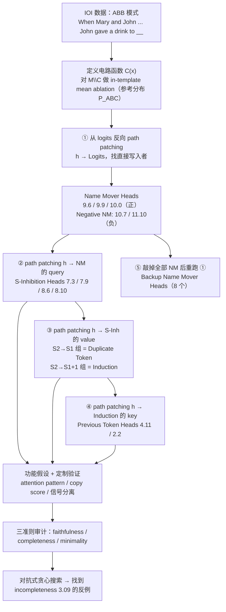

---
aliases:
  - "Interpretability in the Wild: a Circuit for Indirect Object Identification in GPT-2 small"
  - "Interpretability in the Wild"
  - "IOI circuit"
created: 2026-11-17
---
# Interpretability in the Wild: a Circuit for Indirect Object Identification in GPT-2 small

> 机械可解释性（mechanistic interpretability）此前的两端都够不着「真实行为」：一端是在极小模型/玩具任务上把电路拆到参数级，另一端是在大模型上说一些无法证伪的高层描述。本文选了 GPT-2 small 上一个语法清楚、可写出人类算法的自然语言任务——indirect object identification（IOI），用因果干预把「Mary 从 IO 位置流向 next-token 预测」这条路拆了出来：**26 个 attention head，占全部 (head, token position) 对的 1.1%，分 7 类**，每类对应上述算法的某一步。方法侧的核心贡献是 **path patching**：只把发送者 head 到一组接收者节点之间的直接路径换成另一条输入的激活，从而把「直接影响」与「经由其它 head 的间接影响」分开。评估侧提出三条定量准则——**faithfulness / completeness / minimality**——并诚实地报告：前两条在随机与按类采样下通过，但对抗式贪心搜索能找到 incompleteness 高达 3.09（原 logit difference 的 87%）的反例；minimality 则显示每个部件至少贡献 1% 的 $F(M)$。作者的结论是：对大模型的机械理解可行，但「通过若干条准则」不等于「解释正确」。

## 一句话定位

一篇 ICLR 2023 的里程碑式 circuit 论文：它把「逆向工程一个真实语言行为」从口号变成可复现的流程——**mean-ablation 定义电路 → 从 logits 反向 path patching 逐层追信息流 → 用 attention pattern/OV 投影提出功能假设 → 用针对性因果实验验证 → 用三条准则做定量审计**，最终在 GPT-2 small 上给出一个 26 head、7 类、可读且大体可信的 IOI 电路（[图 2](papers/可解释性/2211.00593/2211.00593.pdf#figure=2)，[§3](papers/可解释性/2211.00593/2211.00593.pdf#3)）。

## 问题与动机

**问题一：可解释性研究缺一个「既真实又可读完」的中间地带。** 论文开篇的判断是，当时的工作要么在小模型/合成任务上做到极细（例如 induction head 一类算法任务），要么在大模型上给出「某层某方向很重要」这类粗颗粒描述；两者都回避了同一个问题——**一个自然语言行为在真实模型里到底由哪些部件、以什么顺序实现**。IOI 被选中的理由很具体：它语法清楚、GPT-2 small 做得很好（100,000 条样本上平均 logit difference 3.56，99.3% 的样本把 IO 排在 S 前面，IO 的平均概率 49%），而且存在一个人类可写出的三步算法（[§2](papers/可解释性/2211.00593/2211.00593.pdf#2)）：

1. 找出句中此前出现过的所有名字（Mary, John, John）；
2. 删掉重复出现的名字（John）；
3. 输出剩下的那个名字（Mary）。

**问题二：没有「解释正确性」的判据。** 一个电路可以在 IOI 上跑出和原模型差不多的分数却完全走另一条路（例如两个并联的等价子电路只找到一个）；也可以把无关节点全塞进来而仍然「faithful」。论文因此在方法之外单列一套准则（faithfulness / completeness / minimality），并强调这套准则的作用不是给论文盖章，而是**主动去找自己解释的反例**（[§1](papers/可解释性/2211.00593/2211.00593.pdf#1)，[§4](papers/可解释性/2211.00593/2211.00593.pdf#4)）。

**问题三：attention pattern 好看不等于有因果作用。** 只用注意力权重讲故事是被明确批评过的做法（attention is not explanation）。本文的立场是：attention pattern 只用来**生成假设**，任何功能主张都必须由干预实验（knockout / patching）来兑现——这也是全文实验密度远高于同类工作的原因（[§3](papers/可解释性/2211.00593/2211.00593.pdf#3)）。

**由此得到的三个贡献。**（1）在 GPT-2 small 上端到端定位并验证 IOI 电路（[图 2](papers/可解释性/2211.00593/2211.00593.pdf#figure=2)、[§3](papers/可解释性/2211.00593/2211.00593.pdf#3)）；（2）提出 path patching 这一「只切断直接路径」的干预技术，并顺带发现三类反直觉现象——**冗余补偿（Backup Name Mover Heads）**、**照常工作但被挪作他用的已知结构（Induction Heads 在这里传位置信号而非预测下一个词）**、**稳定地往错误方向写的 head（Negative Name Mover Heads）**；（3）给出可操作的三准则审计流程，并公开自己的失败（[§4.1](papers/可解释性/2211.00593/2211.00593.pdf#4.1)）。

## 方法与机制（核心）

### 总览

整篇论文的流程可以读成一条**从 logits 往回退、每退一步就做一次因果验证**的流水线。它有三块地基：用 mean ablation 把「电路」变成一个可计算的函数 $C(x)$（否则「这个子图表现如何」无从定义）；用 path patching 把「直接影响」从「经由其它 head 的间接影响」里剥离出来（否则每一层都会看到一堆虚假的重要 head）；用 attention pattern 与 OV 投影生成功能假设，再用定制实验（copy score、prefix matching、信号分离）去验证假设。三块地基之上是审计层：faithfulness 看电路能不能替代模型，completeness 看电路漏没漏掉并联通路，minimality 看电路里有没有混进无关节点。

### 地基一：用 knockout 定义电路函数

论文把模型看成计算图 $M$（节点是 head、MLP、embedding 等在 forward pass 中的项，边是 residual、attention、projection），**电路 $C$ 就是 $M$ 的子图**；节点取 (head, token position) 对，粒度比 Olah 的「特征是节点」更粗（[§2.1](papers/可解释性/2211.00593/2211.00593.pdf#2.1)）。要让「$C$ 在该任务上表现如何」有意义，就得把 $M\setminus C$ 关掉，这一步叫 knockout。

最朴素的关法是 **zero ablation**（输出置 0），论文明确说这在本任务上噪声很大：0 是个任意值，后续节点很可能把前一层输出的均值当作隐式 bias 用。因此改用 **mean ablation**——用某个参考分布上的平均激活替换掉该节点：

$$
C(x)\ \text{的定义：对每个}\ (h,\text{IND}) \in M\setminus C,\ \text{把其激活替换为}\ \mathbb{E}_{x'\sim \mathcal{D}_{\text{ref}}}[a_{h,\text{IND}}(x')]
$$

参考分布 $\mathcal{D}_{\text{ref}}$ 不是 $\mathbb{P}_{\text{IOI}}$ 而是 $\mathbb{P}_{\text{ABC}}$：同样的模板、同样的语法结构，但三个名字换成三个互不相同的随机名（A、B、C）。选择理由很关键——若用 $\mathbb{P}_{\text{IOI}}$ 求均值，「名字重复」这类**在该分布内恒定、却正是任务所需**的信息不会被消掉，knockout 就等于没敲干净。此外均值按**模板内、同 token position** 计算，避免把「名字」和「动词」的激活混在一起（[§2.1](papers/可解释性/2211.00593/2211.00593.pdf#2.1)）。这条设计直接决定后文所有数字的含义：本文解释的是「**随分布变化的、关于名字身份的信息流**」，而不是「为什么这些 head 会看名字」——后者在 $\mathbb{P}_{\text{ABC}}$ 下是常量，被 mean ablation 一并保留了。

行为度量有两个：logit difference（IO 与 S 的 logit 之差，正值表示押对）与 IO probability（IO 的绝对概率）。前者是主指标，后者用来防止解释只对某一个指标成立：

$$
F(C) \triangleq \mathbb{E}_{X\sim \mathbb{P}_{\text{IOI}}}\big[\, f(C(X);X) \,\big],\qquad f=\text{logit difference(IO},S)
$$

### 地基二：path patching —— 只换「直接路径」上的激活

普通 activation patching 的做法是：在目标输入 $x_{\text{orig}}$ 上跑前向，把某个节点的激活换成源输入 $x_{\text{new}}$ 的对应值，看输出怎么变。它的问题在本任务里很致命：一个 head 的影响会**穿过后面所有 head**，于是「重要」会沿着层数扩散，你无法区分「它自己写作 logits」和「它改了某个下游 head 的输入」。

path patching 的解法是**冻结中间人**。给定发送者 head $h$、接收者集合 $R$（可以是 logits 前的 residual 末端，也可以是某些 head 的 $Q/K/V$）、目标输入 $x_{\text{orig}}$、源输入 $x_{\text{new}}$，它跑四遍前向（[§3.1](papers/可解释性/2211.00593/2211.00593.pdf#3.1)，附录 B 给出完整伪代码与四遍前向的示意图）：

| 前向 | 内容 | 作用 |
|---|---|---|
| A / B | 分别在 $x_{\text{new}}$、$x_{\text{orig}}$ 上跑，存下所有激活 | 拿到两套激活 |
| C | 在 $x_{\text{orig}}$ 上跑，**除 $h$ 之外所有 head 的输出冻结为 $x_{\text{orig}}$ 的值**，$h$ 换成 $x_{\text{new}}$ 的值；MLP 与 LayerNorm 沿路重算；同时把 $R$ 处的「若不被冻结本应是多少」记录下来 | 只让 $h\to R$ 这条直接路径携带新信息 |
| D | 在 $x_{\text{orig}}$ 上正常重算，但把 $R$ 的激活替换为前向 C 记录的值 | 让下游（$R$ 之后）照常反应，读出最终 logits |

冻结中间 head 这一步等价于**删掉所有形如 $h\to p\to r$ 的间接路径**（$p$ 是别的 attention head），因此前向 D 的 logit difference 变化量就是 $h\to R$ 这条直接路径的因果效应。MLP 与 LayerNorm 不冻结、始终重算，所以严格说这套技术刻画的是「attention head 之间」的信息流（[§3.1](papers/可解释性/2211.00593/2211.00593.pdf#3.1)）。### 逐类拆解：7 类 head 各自做什么

论文的写法是「先找直接影响者，再用 attention pattern 猜功能，最后用定制实验验证」。下面按发现顺序走一遍；head 编号记作 `层.头`。

**① Name Mover Heads：把名字搬到输出。** 对每个 END 位置的 head 做 $h\to\text{Logits}$ 的 path patching，只有少数几层有大幅效应：patching **9.6、9.9、10.0** 会让 logit difference 明显下降（正向贡献），patching **10.7、11.10** 会明显上升（负向贡献）（[图 3](papers/可解释性/2211.00593/2211.00593.pdf#figure=3)a-b，[§3.1](papers/可解释性/2211.00593/2211.00593.pdf#3.1)）。三个正向 head 的行为特征很干净：

- **注意力**：在 $\mathbb{P}_{\text{IOI}}$ 上对 IO token 的平均注意力为 **0.59**；
- **写什么**：注意力概率与「输出在 $W_U[N]$ 方向上的投影」（$N\in\{\text{IO},\text{S}\}$）正相关，$\rho>0.81$（$N=500$）；
- **copy score**：把第一层 MLP 后名字位置的 residual 乘上该 head 的 $W_{OV}$、再乘 $W_U$ 并做最终 LayerNorm，看输入名字是否落在 top-5 logits——三个 head 的 copy score **均 >95%**，而平均 head **<20%**（$N=1000$）。

于是它们的功能可以说清楚：**读谁就复制谁**（value 通路做 identity，query 决定读谁）。这也解释了为什么后面只需追它们的 query。

**② Negative Name Mover Heads：往反方向搬。** 10.7、11.10 具备与 Name Mover 相同的一切性质，除了两点：写的方向与名字相反；用 $-W_{OV}$ 算出的 **negative copy score 达 98%**（平均 head 为 12%）。作者的解释是推测性的——模型可能在「对冲」，避免对 IO 给出过高概率而在错误时吃到过大的交叉熵（[§3.1](papers/可解释性/2211.00593/2211.00593.pdf#3.1)）。

**③ S-Inhibition Heads：压住 S，让 Name Mover 只剩 IO 可选。** Name Mover 的 value 是复制、key 在句首不含任务信息，所以唯一能承载「选谁」的是 **END 位置的 query**。对 $h\to$ Name Mover 的 query 做 path patching，得到 **7.3、7.9、8.6、8.10** 四个 head（[图 4](papers/可解释性/2211.00593/2211.00593.pdf#figure=4)）。把四个一起 patch 后，Name Mover 对 S1 的注意力上升、对 IO 的注意力下降——所以叫 S-Inhibition：它们的净效果是**抑制对 S 的注意力**。它们自己偏爱 S2（四个 head 从 END 到 S2 的平均注意力 0.51），写出的东西被拆成两个信号（[§3.2](papers/可解释性/2211.00593/2211.00593.pdf#3.2)）：

- **token signal**：S 这个名字的值 → 让 Name Mover 躲开该 token 的所有出现位置；
- **position signal**：S1 的位置 → 让 Name Mover 躲开该位置，不管那里是什么 token。

用「只保留一种信号、把另一种反相」的构造数据集做 patching 可以分离两者：**两者都起作用，position signal 更强**，并且两者相加足以解释 Name Mover 对 IO 与 S1 注意力差的全部均值。注意这里的因果方向很微妙：S-Inhibition **输出** S1 的位置信息，却**不直接 attend S1**，所以位置信息必须由别的 head 通过 value composition 喂进来——这就引出下一层。

**④ Duplicate Token Heads 与 ⑤ Induction Heads：位置信号的来源。** 对 S2 位置的每个 head 做 $h\to$ S-Inhibition 的 value 的 path patching，得到 4 个显著 head，按 attention pattern 分成两拨：

| 组 | head | attention | 机制 | 功能 |
|---|---|---|---|---|
| Duplicate Token Heads | 0.1、0.10、3.0 | S2 → S1 | 检测「当前 token 此前出现过」，把**上次出现的位置**写进 residual | 提供 S1 位置 |
| Induction Heads | 5.5、5.8、5.9、6.9 | S2 → S1+1 | 经典 induction：`[A][B]…[A]` → 预测 `[B]`，靠 Previous Token Head 写入 `[B]` 处的 `[A]` 信息做 key composition | 同样指向 S1，并携带「S 重复了」这一事实 |

验证手段是分布外测试：在无语义的随机 token 序列上，Duplicate Token Heads 对「当前 token 的上一次出现」给出强注意力；Induction Heads 同时表现出 **prefix-matching** 与 **copying**（沿用 Olsson 等的判据）。这里有个值得记住的结论：**induction head 在这个电路里被挪作他用**——它不是用来预测下一个词，而是把「S 重复」这件事编码成位置信号交给 S-Inhibition（[§3.3](papers/可解释性/2211.00593/2211.00593.pdf#3.3)）。

**⑥ Previous Token Heads：给 induction 供 key。** 对 $h\to$ Induction Heads 在 S1+1 处的 key 做 path patching，找到 **4.11 与 2.2** 两个主要 head，它们主要看前一个 token，正好符合「把 `[A]` 的信息写到 `[B]` 位置」的角色（附录 D）。作者也试过 Olsson 等描述的 query composition，但在 S2 处没找到显著效应。

**位置信号的因果闭环。** 把 Duplicate/Induction 的输出从「位置信号被改动」的数据集 patch 进来，logit difference 的下降幅度达到 patch S-Inhibition 时的 **至少 88%**；而只换 S1/S2 的 token、保持位置不变，下降 **不到 8%**。这条对比是「位置信号确实由这两类 head 提供并被 S-Inhibition 复制」最硬的证据。

**⑦ Backup Name Mover Heads：敲掉主力后顶上来的替补。** 把三个 Name Mover 一起敲掉，电路居然还工作，logit difference **只掉 5%**。重跑 $h\to\text{Logits}$ 的 path patching 后，一批此前不显眼的 head 变成了主要正向贡献者。作者按「不属于任何其它类、敲掉后效应 >2%」的标准**任意**取了 8 个：**9.0、10.1、10.10、10.6、10.2、11.9、11.2、9.7**，并观察到四种行为：4 个像 Name Mover；2 个（10.2、11.9）对 S1 与 IO 同等待遇并都复制；11.2 更看 S1、偏向写 $W_U[S]$；9.7 看 S2 且负向写（附录 F）。作者猜测这种补偿来自训练时的 dropout（模型被优化成对部件失效有鲁棒性），但明确说**机制尚不清楚**（[§3.4](papers/可解释性/2211.00593/2211.00593.pdf#3.4)）。这一节也是 completeness 准则的动机来源：**一次性的 knockout 会漏掉并联冗余**。

### 三准则：把「解释对不对」变成可测的量

设 $K\subseteq C$ 是被敲掉的节点集合。三个分数都以同一个 $F$ 为度量（[§4](papers/可解释性/2211.00593/2211.00593.pdf#4)）：

$$
\text{faithfulness}=\big|F(M)-F(C)\big|,\qquad
\text{incompleteness}(K)=\big|F(C\setminus K)-F(M\setminus K)\big|,\qquad
\text{minimality}(v)=\big|F\big(C\setminus(K\cup\{v\})\big)-F(C\setminus K)\big|
$$

- **faithfulness**：电路单独跑能不能替代模型。本文 $|F(M)-F(C)|=0.46$，相对 $F(M)=3.56$ 是 **13%**，即电路拿到 **87%** 的性能。
- **completeness**：不只要求 $C\approx M$，还要求**在任意敲除下** $C$ 与 $M$ 同步变化。反例的构造极清楚：若 $M$ 有两个并联的等价子电路 $C_1,C_2$，只找到 $C_1$ 也是 faithful 的，但取 $K=C_1$ 时 $F(C_1\setminus K)$ 归零而 $F(M\setminus K)$ 仍然工作，incompleteness 立刻暴露。$K$ 的搜索空间是 $2^{|C|}$，故用三种采样：均匀随机、整类 head、贪心逐节点最大化 incompleteness。
- **minimality**：对每个 $v$ 都要**存在**一个 $K$ 使 $v$ 的边际贡献足够大（这是存在性命题，只需给出证书，不必穷举）。实践上取 $K$ 为 $v$ 所属的整个类；若不够再单独调（附录 K 列出每个 $v$ 用的 $K$）。

## 实验与对比

**设置。** IOI 数据集由 15 个模板生成（100 个单 token 英文名 × 20 个地点 × 20 个物品），同时覆盖 `ABBA` 与 `BABA` 两种名字排布；主分布 $\mathbb{P}_{\text{IOI}}$ 用于测量，参考分布 $\mathbb{P}_{\text{ABC}}$（三个互不相同的随机名）用于 mean ablation 与 patching 的源端。所有 patching 实验平均 $N>200$ 对句子，copy score 用 $N=1000$，注意力-投影相关用 $N=500$。指标为 logit difference 与 IO probability（[§2](papers/可解释性/2211.00593/2211.00593.pdf#2)、[§4](papers/可解释性/2211.00593/2211.00593.pdf#4)）。

**主结果：电路拿到了模型 87% 的行为。**

| 指标 | 全模型 $M$ | 本文电路 $C$ | 差距 |
|---|---|---|---|
| 平均 logit difference $F$ | 3.56 | 3.10 | 0.46 = $F(M)$ 的 13% |
| faithfulness $|F(M)-F(C)|$ | — | **0.46**（相对值 13%） | 电路保留 **87%** 性能 |

**completeness：两条采样"放过"，贪心"抓住"。** 按均匀随机抽 $K$、按整类 head 取 $K$ 时，incompleteness 都很小，看起来电路是完整的；但用贪心逐节点优化 $K$ 后，incompleteness 最高达到 **3.09，即原 logit difference 的 87%**，且这些 $K$ 通常**没有语义可读性**（横跨多个类）。作者没有掩饰这一点：这是电路失败的地方，也是后续工作最该攻的地方（[§4.1](papers/可解释性/2211.00593/2211.00593.pdf#4.1)，[图 6](papers/可解释性/2211.00593/2211.00593.pdf#figure=6)）。

**与 naive circuit 的对照（三准则的相对价值）。** 基线电路 = Name Mover + S-Inhibition + 2 个 Induction + 2 个 Duplicate + Previous Token，**不含** Backup 与 Negative Name Mover。它的 faithfulness 是 **0.1**，比完整电路还好——单看 faithfulness，它会「赢」。但 (a) 在随机采样与按类采样下，$F(M\setminus K)$ 明显高于 $F(C\setminus K)$，incompleteness 立刻变大；(b) 用贪心优化后两个电路的 incompleteness 都很大，说明**最坏情况下的 completeness 是本文电路也没过的高标准**。这条对照是全文方法论的支点：**faithfulness 可以靠取巧拿到，completeness 才能分出电路质量**（[§4.3](papers/可解释性/2211.00593/2211.00593.pdf#4.3)，[图 6](papers/可解释性/2211.00593/2211.00593.pdf#figure=6)b）。

**minimality：每个部件都至少值 1%。** 对电路里每个 $v$ 都给出证书集 $K$（多数取 $v$ 所属类），使 minimality score 至少为 $F(M)$ 的 **1%**；各 head 的重要性差异很大，但没有任何节点被判为无关。作者同时承认：低贡献 head 的**个体**效应很小，这与「按类解释」的粒度是一致的——它们作为一组的效应才重要（[§4.2](papers/可解释性/2211.00593/2211.00593.pdf#4.2)，[图 7](papers/可解释性/2211.00593/2211.00593.pdf#figure=7)）。

**下游用法：用电路知识造对抗样本。** 既然模型靠「重复检测」区分 S 与 IO，那就让 IO 也重复：`John and Mary went to the store. Mary had a good day. John gave a bottle of milk to __`。结果见表 1——模型只有 1.23 的 logit difference，并且 **23.4%** 的样本把 S 排在 IO 前面。控制组（中间句写 S，S 出现三次）反而更强。这组数字的含义是：**一个正确的机制解释应该能预测模型在哪里坏**（[§4.4](papers/可解释性/2211.00593/2211.00593.pdf#4.4)）。

| 分布 | logit difference | IO probability | S logit > IO 的比例 |
|---|---|---|---|
| $\mathbb{P}_{\text{IOI}}$ | 3.55 | 0.49 | 0.7% |
| 多加一次 S（自然句） | 3.64 | 0.59 | 0.4% |
| 多加一次 IO（自然句，对抗） | **1.23** | **0.36** | **23.4%** |

## 归因分析

**性能与可信度分别归因于什么。** 87% 的 faithfulness 来自一个很具体的结构：三类「搬名字」的 head（Name Mover / Negative / Backup）在 END 位置把名字写入 residual，两类「判重」的 head（Duplicate Token / Induction + Previous Token）把 S 重复的事实编码成位置与 token 信号，中间由 4 个 S-Inhibition head 通过 query 调制注意力。消融证据是分层的：

1. **敲掉 Name Mover 三件套只掉 5%** → 说明冗余（Backup）是模型的原生性质，不是解释者漏看；这也直接说明「faithfulness 高」不能证明「找全了」。
2. **patch S-Inhibition → NM query** 让 NM 对 S1 的注意力上升 → 证明「NM 选择 IO」不是 NM 自己算出来的，而是上游决定的。
3. **位置信号 vs token 信号**：位置信号效应更大，且 Duplicate/Induction 的 patch 能复现 S-Inhibition patch 效应量的 **≥88%**，而换 token 只有 **<8%** → 把「谁提供位置信号」钉死在 Duplicate/Induction 上。
4. **贪心 completeness 的失败**不能归因于某一个头，而是**整类解释粒度的上限**：一旦允许跨类组合 $K$，模型里就存在电路没覆盖的替代通路（很可能包含 MLP 与 LayerNorm，本文全程不干预它们）。

**方法侧归因：哪些设计真的不可替代。**（i）**mean ablation 而非 zero ablation**：0 是分布外的任意值，会污染下游，论文明确说 zero ablation 结果噪声大；mean ablation（且按模板/token 位置求均值）是后面所有数字可信的前提。（ii）**path patching 而不是 activation patching**：若不冻结中间 head，「重要 head」会随层数扩散，第 3 类的 4 个 S-Inhibition head 根本不会以这么干净的形式出现。（iii）**P_ABC 作为源分布**：源句子与目标句子只差「名字是否重复」，因此 patching 暴露的恰好是任务相关计算；若用随机文本作源，patched 激活会离分布太远。（iv）**attention 只用来提假设**：copy score、prefix-matching、信号分离这些定制实验，是把「看起来像」变成「干预下成立」的关键。

## 局限与未来工作

作者在 [§5](papers/可解释性/2211.00593/2211.00593.pdf#5) 里自己列了四条，其中两条是硬伤：

1. **仍有不理解的部件**：S-Inhibition 的 attention pattern 为什么落在 S2（即「为什么这 4 个 head 偏看 S2」）没有被解释——这类「分布内恒定」的现象恰好被 mean ablation 的设计排除在解释范围之外；MLP 与 LayerNorm 的作用也没有解释。MLP 的实验只做到「逐个敲掉影响不大，但第一层之后的 MLP 全敲掉模型就做不了任务」，说明它们不可或缺却未被刻画（附录 J）。
2. **规模**：GPT-2 small 参数量与当时的 SOTA 差几个数量级。作者对 GPT-2 medium 做了初步分析，发现也存在一撮直接影响 logits 的 head，但**并非都看 IO/S**，行为比 small 更复杂、更分散——即「电路可读」这件事未必随规模保持。
3. **准则没有阈值**：三准则都只给出分数，没有导出「通过/不通过」的 $\varepsilon$ 与 $A$；论文自己的措辞是电路「fails to pass the most challenging tests」，而不是「pass 了全部测试」。
4. **对抗样本的两个弱点**：这些例子足够简单，不用电路知识也可能被手工发现；而且模型在这些句子上的行为机制（例如 S-Inhibition 也会 attend 第二个 IO）超出了本文的分析范围（[§4.4](papers/可解释性/2211.00593/2211.00593.pdf#4.4)）。

**未来方向**（作者明确指出）：把方法扩到更大模型与更多任务；刻画 MLP 与 LayerNorm；对 S-Inhibition 的注意力模式给出机制解释；把「贪婪搜索出的 incompleteness 反例」当作诊断工具来改进解释。**未明确说明的部分**：训练超参、算力、以及 head 分类阈值（除 Backup 的 2% 与「4 个/2 个」这类描述外）在正文中没有系统交代（Not explicitly specified in text）。

## 与其他工作的关系

- **与 induction heads 一脉（Olsson 等）**：本文复用了 prefix-matching + copying 的判定方法，但结论是「已知结构可以被挪作他用」——Induction Heads 在这里输出的是位置信号而非下一个 token 的预测。
- **与 causal mediation / activation patching 一脉**：本文的 path patching 是 Vig 等把因果中介分析引入 LM 之后的推广（只保留直接路径），也是后来被广泛使用的 [[papers/可解释性/2404.15255/NOTES|activation patching]] 方法谱系里「更细粒度」的那一支；区别在于后者通常 patching 单点激活，前者 patching 特定路径并冻结中间 head。
- **与 ROME / 因果追踪**：[[papers/可解释性/2202.05262/NOTES|ROME]] 关心「事实写在哪」，本文关心「信息怎么在 token 位置之间流动」；两者共享「用干预而非相关性定位」的方法论，但 ROME 的粒度是 MLP 层与 key/value，本文的粒度是 (head, position)。
- **与 features/SAE 路线**：[[papers/可解释性/2309.08600/NOTES|SAE features]] 走的是「把激活分解成稀疏、单义的方向」，本文走的是「在组件层找稀疏子图」。两者是互补的两个坐标轴：本文的节点是 head 而非 feature，这也意味着它对「head 内部在算什么」不发表意见（论文明确说自己的电路定义比 Olah 的 feature-level 定义更粗）。[[papers/可解释性/2209.10652/NOTES|Toy Models of Superposition]] 则提供了另一侧的解释：为什么单神经元不可读——这正是本文绕开神经元层、直接在 head 层做电路的部分理由。
- **与 MI 评测基准/方法论**：IOI 电路后来成为 circuit discovery 方法的标准测试床；[[papers/可解释性/2504.13151/NOTES|MIB]] 一类基准把「电路是否忠实」变成可比较的分数，[[papers/可解释性/2601.22594/NOTES|Circuits Sparse in Neuron Basis]] 则从「神经元基是否稀疏」的角度回应本文这类 head 级电路的粒度问题。[[papers/可解释性/2501.16496/NOTES|Open Problems in MI]] 与 [[papers/可解释性/2601.14004/NOTES|Survey: Actionable MI]] 都把「解释的评估标准」列为未解问题，本文的三准则正是这类讨论的早期范本；[[papers/可解释性/2611.08438/NOTES|MI for AI Safety]] 关心的「解释能否用于安全审计」，在本文这里对应「用电路知识造对抗样本」这一小节。
