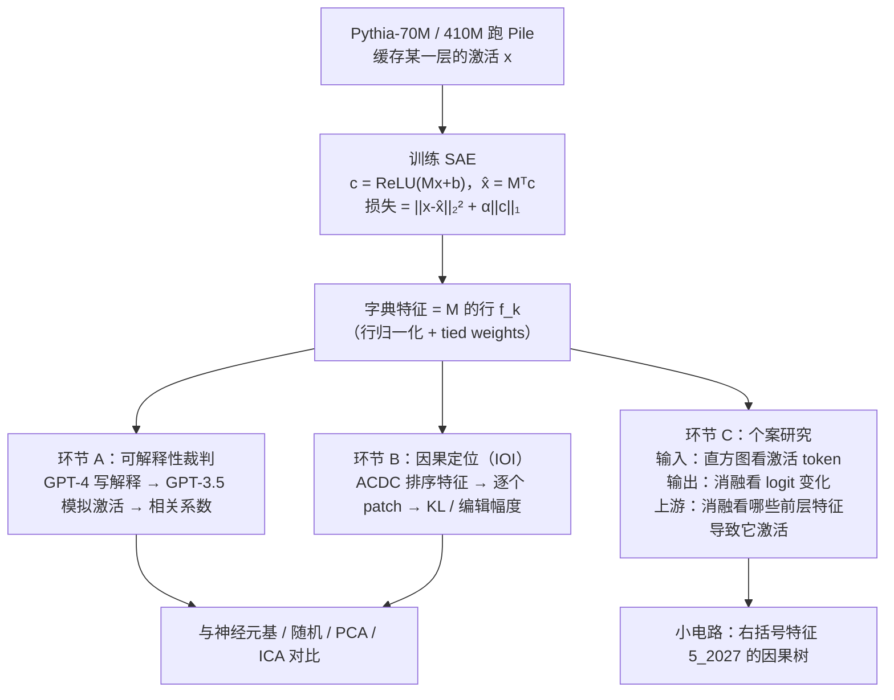

---
aliases:
  - "Sparse Autoencoders Find Highly Interpretable Features in Language Models"
  - "SAFHIFLM"
  - "SAE interpretable features"
created: 2026-11-17
---
# Sparse Autoencoders Find Highly Interpretable Features in Language Models

> 论文要解决的是「神经元不可读」这件事的**成因与出路**。神经元是多义的（polysemantic）：同一个神经元在语义无关的多种上下文里激活，于是我们无法用一句人话概括它。作者采纳 superposition 假说——模型为了表示比维度更多的特征，把特征分配到激活空间中一组**过完备、非正交**的方向上，而不是对齐到神经元基。既然特征是「稀疏激活的方向」，那么反问题就是**稀疏字典学习**：用稀疏自编码器（sparse autoencoder, SAE）重建语言模型（Pythia-70M/410M）的内部激活，把权重矩阵的行当作字典特征。评测不看重建误差，而看**可解释性**：用 GPT-4 为特征写解释、用 GPT-3.5 模拟该特征在新文本上的激活，二者相关系数即 autointerpretability score。结论有三层：（1）SAE 特征在残差流上比神经元基、随机方向、PCA、ICA 都更可解释，且优势随层数加深而衰减（第 4 层已与 ICA 相当，最后一层几乎无优势）；（2）在 IOI（indirect object identification）任务上，用 ACDC 排序后 patch 少量 SAE 特征就能达到与 patch 大量 PCA 分量相同的 KL，且编辑幅度更小；把稀疏系数设为 $\alpha=0$（非稀疏字典）就没有这个优势；（3）个案分析给出单义特征（撇号、句号、换行、右括号）并展示「输入—输出—上游」三向因果分析能自动画出小电路。局限也写得很直白：重建损失不为 0（Pythia-70M 第 2 层残差流换成重建后 Pile perplexity 25→40），MLP 子层上大量 dead features，方法目前只对残差流稳健。

## 一句话定位

一篇把「superposition → 稀疏字典学习 → 可扩展的可解释性度量」串成完整证据链的 ICLR 2024 论文：它不主张 SAE 特征就是「真实特征」，而是主张在**同一把尺子（autointerpretability score）**下，SAE 学到的稀疏方向比神经元、随机方向、PCA、ICA 更单义，并且这些方向在因果干预（IOI 的 activation patching）中更「省」——更少的 patch 数、更小的编辑幅度就能把模型行为改到位（[图 1](papers/可解释性/2309.08600/2309.08600.pdf#figure=1)，[§2](papers/可解释性/2309.08600/2309.08600.pdf#2)）。

## 问题与动机

**问题一：单元选错了，后面全是错的。** 机械可解释性的第一步是「把网络拆成可单独分析的单元」。以神经元为单元有过成功案例，但神经元经常多义：同一个方向在不同上下文里承担不同功能。更糟的是，对 transformer 的残差流这种激活类型，**没有理由期待特征会对齐到神经元基**——残差流是所有层读写共享的「总线」，方向由训练自由组合（[§1](papers/可解释性/2309.08600/2309.08600.pdf#1)）。

**问题二：polysemanticity 不是 bug，是 superposition 的必然结果。** 论文接受 Toy Models of Superposition 的解释：如果一个层要表示的特征数多于维度数，且特征足够稀疏，模型就会用一组过完备的非正交方向来编码它们，代价是特征之间有干扰。这条假说给出一个可操作的反问题：**若能找到一组方向，使每个激活向量都是它们的稀疏线性组合，这组方向就可能是模型真正在用的特征**——这正是经典的 sparse dictionary learning（[§1](papers/可解释性/2309.08600/2309.08600.pdf#1)，[§2](papers/可解释性/2309.08600/2309.08600.pdf#2)）。

**问题三：既有替代方案各自缺一块。** 论文的比较对象不是随便挑的：**supervised probe** 能找到「你事先想到要问的那个特征」，但需要先知道要找什么，难以规模化；**PCA/ICA** 是无监督的线性分解，但它们的成分不是「稀疏激活」的，一个成分往往在半个空间上都激活；**神经元基**最自然但最多义。作者的切入点是：用无监督、可扩展、只需未标注激活的 SAE，同时拿到「稀疏」与「可解释」两个性质（[§1](papers/可解释性/2309.08600/2309.08600.pdf#1)、[§3.1](papers/可解释性/2309.08600/2309.08600.pdf#3.1)）。

**核心贡献（一到两句话）。** 在 Pythia-70M/410M 的残差流（及部分 MLP）上训练 tied-weight、ReLU 隐层、$\ell^1$ 稀疏惩罚的自编码器，用 **autointerpretability score** 做可扩展的裁判，证明学到的字典特征比四类基线更可解释，并用两组下游实验（IOI 的因果定位、概念级个案分析）证明这些方向**确实是模型计算中可被单独编辑的单位**（[图 1](papers/可解释性/2309.08600/2309.08600.pdf#figure=1)）。

需要先记住一个诚实的边界：本文的「可解释」是**度量意义**上的——它衡量的是「一个语言模型根据少量激活样本写出的解释，能否预测该特征在别处的激活」。这不是「人类真的看懂了」的充分条件，后文的局限与讨论都围绕这条边界展开。

## 方法与机制（核心）

### 总览

整条流水线是「采样激活 → 训练稀疏字典 → 用自动化裁判打分 → 用因果干预验证」，四个环节各有明确的分工与陷阱（[图 1](papers/可解释性/2309.08600/2309.08600.pdf#figure=1)，[§2](papers/可解释性/2309.08600/2309.08600.pdf#2)）：

### 环节一：稀疏字典学习到底在优化什么

**物理意义。** 假设每个激活向量 $\mathbf{x}_i$ 都是若干「真实特征」$\mathbf{g}_j$ 的稀疏线性叠加，但我们不知道 $\mathbf{g}_j$。SAE 学一组字典向量 $\{\mathbf{f}_k\}$，使得 $\mathbf{x}_i$ 能被**少数几个** $\mathbf{f}_k$ 近似重构。若 superposition 假说成立，学到的 $\mathbf{f}_k$ 就近似于 $\mathbf{g}_j$，而且是「单义」的方向。用 $\ell^1$ 而不是 $\ell^0$ 是因为前者可微、可优化，且理论上/经验上都能恢复生成数据的真实特征（[§2](papers/可解释性/2309.08600/2309.08600.pdf#2)）。

**结构。** 单隐层自编码器，隐层宽度 $d_{\text{hid}}=R\cdot d_{\text{in}}$，$R$ 控制字典相对于模型维度的过完备倍率；隐层用 ReLU；**编码器与解码器权重互为转置**（tied weights），且 $M$ 的行做归一化：

$$
\mathbf{c}=\mathrm{ReLU}(M\mathbf{x}+\mathbf{b}),\qquad
\hat{\mathbf{x}}=M^\top\mathbf{c}=\sum_{k=0}^{d_{\text{hid}}-1} c_k\,\mathbf{f}_k
$$

$$
\mathcal{L}(\mathbf{x})=\underbrace{\|\mathbf{x}-\hat{\mathbf{x}}\|_2^2}_{\text{重建损失}}+\underbrace{\alpha\|\mathbf{c}\|_1}_{\text{稀疏损失}}
$$

符号含义：$M\in\mathbb{R}^{d_{\text{hid}}\times d_{\text{in}}}$ 的**每一行就是一个字典特征** $\mathbf{f}_k$，$\mathbf{c}$ 是稀疏码（每个 token 的激活向量用哪些特征、各用多少），$\alpha$ 控制稀疏强度。两个细节很关键：

- **tied weights** 的理由是「检测特征的方向」与「写出特征的方向」应当是同一个（否则你无法确定该解释编码器方向还是解码器方向），顺带省一半显存；作者也承认在 MLP 数据上 tied weights 会掉性能。
- **行归一化**防止模型通过放大 $\mathbf{f}_k$ 的模长来降低 $\|\mathbf{c}\|_1$——不归一化的话，稀疏惩罚可以被「把特征向量做大、把系数做小」这一招绕过去。

**训练配置。** 数据是 Pythia-70M/410M 在 Pile 上跑出的激活，缓存某一层后作为数据集；Adam，学习率 1e-3，5–50M 个激活向量，训练 1–3 轮，单张 A40 上一小时内完成（附录 B）。残差流维度分别为 512（70M）与 1024（410M）。主实验用 $\alpha=8.6\times10^{-4}$（残差流）与 $3.2\times10^{-4}$（MLP）、$R=2$（[图 2](papers/可解释性/2309.08600/2309.08600.pdf#figure=2) 的字典）。**算力成本是本文卖点之一**：SAE 训练只需未标注激活，比预训练原模型低几个数量级。

**稀疏度–可解释性权衡（本文最重要的负结果之一）。** 扫 $\alpha$ 时会得到一条**平滑**的「平均激活特征数 vs 未解释方差」曲线，**没有拐点（knee）**。作者由此给出一个相当克制、也相当重要的判断：这暗示**不存在唯一正确的稀疏基**——不同 $\alpha$ 只是同一 decomposition 的不同取舍点，说「找到了模型的真特征」需要额外证据（附录 B）。这条观察后来成为「SAE 特征是否唯一/是否真实」争论的起点之一。

### 环节二：autointerpretability —— 把「可解释」变成可扩展的分数

要让「SAE 比 PCA 更可解释」这句话可比较，必须有一把能自动打分的尺子。论文沿用 OpenAI 的自动化解释流程（附录 A 给出五步）：

1. 取 OpenWebText 前 50,000 行、每行 64 token 的片段，测量特征在每个 token 上的激活，并重标定到 0–10 的整数；
2. 取激活最高的 20 个片段，把其中 5 个连同逐 token 激活一起交给 **GPT-4**，让它写一句「这个特征在什么时候激活」的解释；
3. 让 **GPT-3.5**（因为公开 API 里只有它返回 logprobs）依据这句解释，在另外 5 个高激活片段 + 5 个随机片段上**模拟**逐 token 激活；
4. 计算模拟激活与真实激活的相关系数，即该特征的 **autointerpretability score**（落在 $[-1,1]$）；
5. 若 50,000 个片段里非零变化的片段少于 20 个，该特征直接跳过（太稀疏，测不了）。

两个方法学细节值得记住：其一，只用随机片段打分对稀疏特征不公平（64×10=640 个 token 里很可能一个高激活都没有），所以主结果用 **top-random 混合打分**；其二，这把尺子的分辨率有限——它衡量的是「LLM 写的解释能否预测激活」，而不是「解释是否符合人类直觉」，且已有证据表明 LLM 在找「围绕前后 token 的模式」时本身就吃力（[§3.2](papers/可解释性/2309.08600/2309.08600.pdf#3.2)）。

### 环节三：对照设计（怎样才算公平比较）

被比较的五类「字典」是：**默认基（神经元基）**、**随机方向**、**PCA**（在线估计，用与 SAE 等量的数据）、**ICA**（收敛慢，只用 2GB 数据：残差流约 4M 激活、MLP 约 1M）、以及 **SAE 自己**。为了让比较不因「激活形态」而偏袒 SAE，作者做了两处对齐：

- 对神经元基与随机方向，把负激活截断为 0，使所有特征的激活都非负——与 SAE 的 ReLU 输出形态一致；
- 造了 **Top-K 版 PCA/ICA**：每个数据点只保留最相关的 K 个方向、其余置零，K 取「$R=1$、$\alpha=8\times10^{-4}$ 的 SAE 字典的平均激活特征数」。这消除了「PCA 方向在半个空间上都激活、SAE 只在超平面一侧激活」这一结构性差异。

每个字典取 150 个特征算平均分（[图 2](papers/可解释性/2309.08600/2309.08600.pdf#figure=2)）。**诚实说明**：这张对比图的逐层数值只以图形式给出，正文与附录没有列表格；可核对的数字是下面实验一节里 [表 1](papers/可解释性/2309.08600/2309.08600.pdf#table=1) 的 5 个样例分数，以及「优势随层数衰减、第 4 层与 ICA 相当、最后一层几乎无优势」这一趋势描述（Not explicitly tabulated in text）。

## 实验与对比

论文用三层递进的证据：**（A）可解释性分数**证明方向更单义；**（B）IOI 因果定位**证明方向是计算单位；**（C）个案研究**证明方向可读、可编辑、可串成电路。

### A. 可解释性：SAE > 神经元/PCA/ICA，但优势随深度衰减

在残差流上，每个字典取 150 个特征算 top-random 平均分，SAE 显著高于**默认（神经元）基、随机方向、PCA、ICA**。两个限定条件必须一起记：优势在浅层最大，到第 4 层已与 ICA 相当，最后一层几乎看不出差别；Top-K 版 PCA/ICA（K 对齐 SAE 的平均激活特征数）只解释了改善的一小部分，说明差距不是「激活形态」造成的假象（[§3.2](papers/可解释性/2309.08600/2309.08600.pdf#3.2)，[图 2](papers/可解释性/2309.08600/2309.08600.pdf#figure=2)）。

作者对「深层优势消失」给出两种解释：一是 SAE 在深层确实变差；二是**自动解释这件事在深层变难**——深层特征更抽象、更依赖前层，且它们最好的解释往往是「对输出有什么影响」，而当前协议不给 GPT 模型看输出变化（[§3.2](papers/可解释性/2309.08600/2309.08600.pdf#3.2)）。这条自我批评比结果本身更有用：它说明后面 §5 手工做「输出侧分析」不是锦上添花，而是在补协议缺的那一半。

**可核对的样例（第 1 层残差流按字典序前 5 个特征）。** 分数跨正负，负分意味着 GPT-4 写的解释在随机片段上做出了比「常数预测」更差的预测：

| 特征 | GPT-4 生成解释 | autointerpretability score |
|---|---|---|
| 1-0000 | parts of individual names, especially last names | 0.33 |
| 1-0001 | actions performed by a subject or object | **−0.11** |
| 1-0002 | instances of the letter `W` and words beginning with `w` | 0.55 |
| 1-0003 | the number `5`，同时对姓名/名词有中等偏低激活 | 0.57 |
| 1-0004 | legal terms and court case references | 0.19 |

其余可核对数字（附录 C/E）：字典**小于**模型基（$R<1$）时特征同样更可解释，说明优势不是「过完备」带来的；平均分与激活分布的**偏度/峰度**只有弱相关——正文写的是 0.19 与 0.24，而同节表格给的是 0.20 与 0.15，两处数值不一致（原文如此）；MLP 子层上「很多特征比神经元可解释，但 dead features 极多，$R=2$ 时可能不到一半特征活跃」。

### B. IOI：更少的 patch 就能把行为改到位

设置：Pythia-410M 第 11 层残差流；字典在 Pile 前 10,000 条（约 7M 激活）上训练（任务无关）。做法是把 SAE 的 activation patching 写成「按特征编辑残差流」：

$$
\mathbf{x}'_i=\mathbf{x}_i+\sum_{j\in F}\big(\bar{c}_{i,j}-c_{i,j}\big)\mathbf{f}_j
$$

其中 $\bar{\mathbf{c}}$ 是**反事实目标句**（把 IO 换成另一个名字，如 Bob→Vanessa）在该层编码出的特征系数，$\mathbf{c}$ 是原句的系数，$F$ 是被干预的特征子集。度量是 patched 后的 logits $\mathbf{z}$ 与目标句 logits $\mathbf{y}$ 的 $\mathrm{KL}(\mathbf{z}\|\mathbf{y})$——KL 越小，说明这几个特征把「IO 被换掉」这件事复现得越全。

$F$ 的选法不是手挑，而是把特征当作「扁平计算图」的独立节点，跑 **ACDC（Automated Circuit Discovery）Algorithm 4.1**，在 50 条 IOI 样本上平均，得到特征的贡献排序，然后取前 $k$ 个（[§4.1](papers/可解释性/2309.08600/2309.08600.pdf#4.1)）。

结论（[§4.2](papers/可解释性/2309.08600/2309.08600.pdf#4.2)）：随 $k$ 增加，SAE 的 KL 下降曲线在**更少的 patch 数**下就达到 PCA 的水平；同时「平均编辑幅度 vs KL」的 Pareto 前沿也更好（同样彻底度下改动更小）。两个对照是这条结论的命门：

- **把 $\alpha$ 设为 0（非稀疏字典）就没有优势** → 收益可以归因于「稀疏」，而不是「自编码器」这个壳；
- **$\alpha$ 越大，重建精度越低**，表现为曲线的 KL 下界（floor）更高 → 稀疏度与保真度之间确实有取舍，不能只要稀疏。

### C. 个案研究：输入、输出、上游三向可读

- **输入侧（单义性）**：特征 556 的激活直方图里绝大多数是撇号，低激活端是其它标点；三个撇号特征分别对应 `'ll`、`n't` 等不同上下文，说明「一个概念可以被拆到多个特征」。对照神经元基：残差流里最像撇号的那一维（第 21 维）是高激活时才像撇号、中低激活段混合了别的东西——这就是多义性的具体长相（[§5.1](papers/可解释性/2309.08600/2309.08600.pdf#5.1)）。
- **输出侧（因果效果）**：消融撇号特征（less-than-rank-one：只把激活压到不再激活为止）后，logit 下降最多的是 `s`——与「撇号之后常接 s（所有格/缩写）」完全一致；有 12k 个 logit 被负向影响，图里按 0.1 阈值截断（[§5.2](papers/可解释性/2309.08600/2309.08600.pdf#5.2)）。
- **上游侧（自动画电路）**：以第 5 层「右括号」特征 $5_{2027}$ 为目标（unembed 它的 top token 全是右括号变体），采样 20 个激活在 $[M/2,M]$ 的上下文，逐个消融上一层特征，看目标特征激活下降多少，再递归回溯，得到因果树；树里能看到 0\_3662 与 1\_333 都检测 `(`、余弦相似度 0.8（[§5.3](papers/可解释性/2309.08600/2309.08600.pdf#5.3)）。

**一个额外的实验线索（不在当前正文中）。** 仓库的 TeX 源码里还有一节「用字典特征做概念擦除」的实验：在 Pythia-410M 的 `Gender by Name` 任务上做单秩（full-rank）特征投影消融，与 **LEACE**、**difference-in-means** 投影比较「擦除后模型还能否预测性别/代词」以及用 Pile 上的 KL 衡量的副作用。该节在 `iclr_main.tex` 中被 `\iffalse` 关闭，因此本文正文没有它的数字，但它的结论与正文一致：单个字典特征就能在早期层取得更低的任务准确率与更小的 KL，说明这些方向更接近模型内部的**功能单元**而不是任意线性组合（源码 `sections/aidan_concept_editing_results.tex`）。读这份仓库版时不要把这一节当成已发表结论引用。

**这条证据链的共同前提（读数字前必须知道）。** 其一，所有分数都是**平均分**：150 个特征、字典序前 5 个样例、单次 GPT-4/GPT-3.5 调用，没有报告种子方差与置信区间以外的统计检验（图里只画 95% CI），因此「SAE 比 PCA 高」是分布层面的结论，不能推到单个特征。其二，字典是在 **Pile 的一段激活**上训练的（IOI 那节只用前 10,000 条），而评测文本来自 **OpenWebText**，两者分布不完全一致；这对所有方法公平，但也意味着分数里的「域外噪声」无法剥离。其三，模型规模只有 70M 与 410M（410M 有 24 层、残差流 1024 维），因此「优势随层数衰减」这一趋势是否在大模型上同样成立，本文无法回答。

## 归因分析

**哪一处设计贡献了哪个结论。**

| 结论 | 归因到的设计 | 反向证据 |
|---|---|---|
| 特征更单义 | $\ell^1$ 稀疏惩罚 + ReLU + 行归一化，使每个 token 只用少数方向 | $\alpha=0$ 的字典在 IOI 上没有优势；随机方向/神经元基分数更低 |
| 优势不是激活形态造成的 | Top-K PCA/ICA 对照、负激活截断对齐 | Top-K 只解释一小部分差距 |
| 特征是可编辑的计算单位 | 按特征方向做 patching/消融，而不是按维度 | 消融撇号特征只打掉 `s` 的 logit，不是全面崩坏 |
| IOI 定位更「省」 | ACDC 在特征图上排序（等价于把「特征」当节点做电路搜索） | 换 PCA 分量做同样排序，需要更多 patch 达到同样 KL |
| 可解释性分数可信 | top-random 混合打分 + 跳过样本不足的特征 | random-only 分数显著更低，说明 top 片段确实提供了信息 |

**一个容易被误读的归因**：本文没有证明「SAE 特征 = 模型真实特征」。作者用的是「下游行为可被少量特征解释」这一较弱但可检验的主张，并在结论里明确说这条路线指向的是 **enumerative safety** 的长期目标而非已达成（[§6.3](papers/可解释性/2309.08600/2309.08600.pdf#6.3)）。

## 局限与未来工作

作者自陈的局限（[§6.2](papers/可解释性/2309.08600/2309.08600.pdf#6.2)）：

1. **重建不完美 = 信息丢失**。损失不可能为 0，说明字典没覆盖该层全部信息。硬数字：把 Pythia-70M 第 2 层残差流替换成 SAE 重建后，Pile 上的 perplexity 从 **25 升到 40**。改进方向是换 SAE 架构，或者干脆**不最小化重建损失、而最小化「替换激活后模型输出的变化」**。
2. **只对残差流稳健**。MLP 子层上会学到大量 dead features，训练流程无法稳健地学到过完备基；注意力子层更难（特征在哪个位置维度上都不清楚）。
3. **字典不唯一**。$\alpha$ 扫描是平滑曲线、没有拐点，因此「某一个稀疏度就是正确分解」缺乏依据；作者建议把相邻层的字典、模型权重纳入训练。
4. **评测依赖 LLM**。autointerpretability score 用的是 GPT-4 写解释、GPT-3.5 模拟，受这两者能力限制；作者自己指出当前协议不给模型看输出变化，而深层特征恰恰最需要这一信息。

**未来工作**：把「特征级因果依赖」跨层串起来，目标是得到一个「因果依赖稀疏」的观察视角；把方法扩到 attention/MLP 的专门架构；验证「行为只依赖少量特征」这一发现在其它任务上是否成立。**未明确说明**：不同层的完整分数表、GPT-4/GPT-3.5 的完整 prompt 文本、以及随机种子的方差分析（Not explicitly specified in text）。

## 与其他工作的关系

- **与 superposition 理论**：[[papers/可解释性/2209.10652/NOTES|Toy Models of Superposition]] 解释了「为什么会有多义性」，本文是它的实证对应物——把「特征是一组过完备的非正交方向」当作可优化的反问题来解。后续 [[papers/可解释性/2406.04093/NOTES|SAE scaling]] 把这套做法推到更大模型与更大字典，并系统化了「稀疏度—重建—可解释性」的三角权衡；[[papers/可解释性/2501.16496/NOTES|Open Problems in MI]] 则把本文这类结果收进「特征是否可辨识」的开放问题清单。
- **与 IOI 电路**：本文的 IOI 实验直接建立在 [[papers/可解释性/2211.00593/NOTES|IOI circuit]] 之上，但粒度不同——那边是 head 级 circuit，这边是**特征级**定位，且刻意做到「训练字典时不看任务」。两者可以拼起来看：head 级电路回答「信息怎么流」，特征级字典回答「流的是什么」。[[papers/可解释性/2404.15255/NOTES|activation patching]] 是本文 §4 所用干预范式的系统化整理。
- **与 ROME 一类定位工作**：[[papers/可解释性/2202.05262/NOTES|ROME]] 用因果干预定位「事实存在哪一层 MLP」，本文把同一套逻辑下沉到「哪个特征方向」，并强调**不需要事先知道要找什么**（这正是它相对 supervised probe 的优势）。
- **与基准/评测**：[[papers/可解释性/2504.13151/NOTES|MIB]] 把 IOI 这类任务做成 circuit 忠实度的可比基准，本文的 ACDC 排序与 KL 曲线是这类评测的早期形态；[[papers/可解释性/2601.22594/NOTES|Circuits Sparse in Neuron Basis]] 从「神经元基是否也能稀疏」反过来挑战 SAE 的必要性，恰好回应本文「神经元多义」的前提；[[papers/可解释性/2601.14004/NOTES|Survey: Actionable MI]] 与 [[papers/可解释性/2611.08438/NOTES|MI for AI Safety]] 关心的「解释能否用于下游（编辑、审计）」，对应本文的概念消融与按特征 patching 两条证据线。
