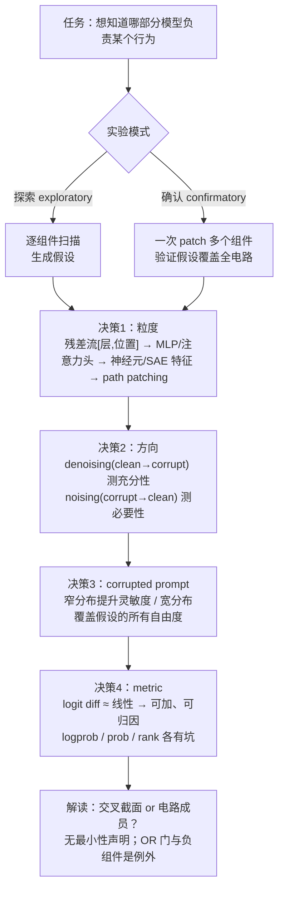

---
aliases:
  - "How to use and interpret activation patching"
  - "HUIAP"
created: 2026-11-17
---
# How to use and interpret activation patching

> 这是一篇**方法论/最佳实践 note**，不是新方法论文：activation patching（又名 Causal Tracing / Resample Ablation / Interchange Intervention / Causal Mediation Analysis）已被大量机械可解释性工作当作主力工具，但「怎么 patch、patch 完怎么读」长期靠口传。作者把散落的经验整理成三条主线：**哪些 patching 实验能提供哪类证据**（探索 vs 确认、粒度、denoising vs noising、corrupted prompt 怎么选）、**结果该怎么解释**（充分 vs 必要、AND 与 OR 电路的陷阱、prompt 分布的适用边界）、以及**度量怎么选**（logit difference 为什么最受信任，logprob / probability / 准确率各自的坑）。
>
> 一句话结论：**用 patching 而不是 ablation；denoising 与 noising 不对称、不可互推；度量优先选在 logits 上连续且近似线性的量。**

## 一句话定位

一篇把 activation patching 从「技巧」升级为「有语义的实验设计」的操作手册：它给出**每个设计选择的语义后果**——换一个 patch 方向，你测的就是另一件事（充分性 vs 必要性）；换一个 metric，你看到的曲线形状就变；换一个 corrupted prompt，你追踪的就是另一条自由度。

## 问题与动机

**具体问题（分条）**

1. **同一技术，四个名字，语义漂移。** Causal Tracing、Resample Ablation、Interchange Intervention、Causal Mediation Analysis 指的基本是同一件事（把一次前向的某些内部激活替换成另一次前向缓存的激活），但不同论文用不同名字、不同方向、不同粒度，导致「某组件很重要」这句话在不同论文里含义不同（[§1.1](papers/可解释性/2404.15255/2404.15255.pdf#1.1)）。作者甚至建议**别再用 Causal Tracing 这个名字**，因为它既指 ROME 式的高斯噪声 patch，也指一般意义上的 clean→corrupt patch（[§2.5 脚注](papers/可解释性/2404.15255/2404.15255.pdf#2.5)）。
2. **零消融（zero ablation）默认是错的工具。** 把激活置零会把模型推出分布，得到的效果里混着「该组件被破坏」和「模型见到没见过的激活」两件事。patching 用**别的激活**替换而不是抹掉，因此可以做「只改一个自由度、控制其余」的精确实验（[§1.2](papers/可解释性/2404.15255/2404.15255.pdf#1.2)）。
3. **「显著」二字没有统一含义。** 实践中人们说「这个头很重要」，可能指「去掉它行为就崩」（必要）、也可能指「把它换回来行为就恢复」（充分）。这两件事**既不互补也不互推**，但文献里经常混用（[§3](papers/可解释性/2404.15255/2404.15255.pdf#3)）。
4. **度量常被当后处理。** 大多数 patching 图的形状其实由 metric 决定：概率型 metric 在 logits 上是指数的，会把层与层之间的差异压成「阈值附近的尖峰」；离散 metric（准确率、rank）会把「很多组件各贡献一点」的情形读成「只有一个组件重要」（[§4](papers/可解释性/2404.15255/2404.15255.pdf#4)）。

**为什么重要。** patching 是circuit 发现的主力工具，而 circuit 结论会被下游当作「机制性证据」使用（例如「事实回忆发生在中层 MLP」）。如果方向、粒度、metric 三处任一处理不当，得到的不是「噪声大一点」的结果，而是**系统性偏向某类电路**的结果——AND 型电路会被 denoising 漏掉，OR 型电路会被 noising 漏掉（[§2.4](papers/可解释性/2404.15255/2404.15255.pdf#2.4)）。

**前人方案的根本瓶颈。** 在本文之前，这套经验只存在于博客、课程（ARENA）与术语表里；论文层面的表述要么是「我们用 patching 找到了电路 X」（把方法当既定），要么是 causal scrubbing 这类**只讲确认阶段**的框架。缺的是中间那层：**在探索阶段，你每做一个选择，就在给自己限定能看见什么**。

**名字为什么会漂移（历史脉络）。** 四个名字对应四条来源不同的文献线：Causal Tracing 来自 ROME 的事实回忆研究（原文里它特指「干净输入 + 高斯噪声」这一种 corrupt 方式）；Resample Ablation 强调的是「用重采样得到的激活替换」（把 corruption 理解为对分布的重新采样）；Interchange Intervention 来自因果推断传统，把两次前向看成一次交换干预，用 source / destination（原文用 base）这套词汇；Causal Mediation Analysis 则是社会科学里「中介效应」分析的直系移植。同一操作在四个社群里被独立发明，于是各自的默认方向、默认度量、默认解释都不一样——这正是本文要写下来的直接原因：**如果不把词汇统一，读者无法判断两篇论文说的「重要」是不是同一件事**。

## 方法与机制（核心）

### 总览

论文把 patching 拆成一条**六步流水线**，每一步都是一个会改变结论语义的岔路口。以 ROME 的事实回忆问题为例（「The Colosseum is in」→「Rome」）：(1) 选一对只差一个关键事实的 prompt（「The Colosseum is in」vs「The Louvre is in」，控制住语言、句式、任务类型，只改地标）；(2) 选要 patch 的激活（例如所有 MLP 的输出）；(3) 跑 source prompt 并存下这些激活；(4) 跑 destination prompt，把选中的激活替换成缓存值；(5) 看输出怎么变（Rome 与 Paris 的 logit 差变了多少）；(6) 对所有感兴趣的激活重复（扫层、扫位置）。

这条流水线的关键洞察是：**模型的激活里同时编码了很多位信息**（这是一句英语、地标是斗兽场、这是一句关于地点的事实陈述）。零消融只要碰到与**任何**一位相关的激活就会有效果，所以它无法回答「哪一部分负责哪一位」。patching 的价值就是把「改哪一位」变成实验者**可选**的变量：

| 换成什么 source | 追踪的是哪一位信息 |
|---|---|
| 「Il Colosseo è dentro」（意大利语） | 模型在哪里表示 prompt 的**语言** |
| 「The Louvre is in」 | 模型的**地标识别与事实回忆**机制 |
| 「The Colosseum is in the city of」vs「…in the country of」 | 模型如何决定回忆实体的**哪个属性** |

（以上三例出自 [§1.3](papers/可解释性/2404.15255/2404.15255.pdf#1.3)。）

于是整篇 note 可以看成**三个正交决策轴**加上一个解读层：

下面逐个决策展开。

### 决策一：探索模式还是确认模式

两种模式的**实验结构完全不同**，混用是最常见的错误来源（[§2.1](papers/可解释性/2404.15255/2404.15255.pdf#2.1)）。

- **探索（exploratory）**：一次 patch **一个**组件，在层/位置/组件类型上扫一遍，目的是「找出哪些部分可能参与」，产出**假设**。此时你需要的是**灵敏度**：希望每个真参与的组件都能在图上冒出来，宁可多一些假阳性。
- **确认（confirmatory）**：一次 patch **很多**组件，检验「我假设的这组组件是否已经足够/必要」，典型代表是 Causal Scrubbing。此时你需要的是**特异性**：希望这个检验能证伪错误假设。

这个区分解释了后文所有「该选哪个」的建议：**窄 prompt + denoising 适合探索，宽 prompt + noising 适合确认**（[§2.6](papers/可解释性/2404.15255/2404.15255.pdf#2.6)）。

### 决策二：patch 什么粒度，以及 path patching

粒度是一个从粗到细的阶梯，每上一级都要付「更多实验次数」的代价（[§2.2](papers/可解释性/2404.15255/2404.15255.pdf#2.2)）：

| 粒度 | patch 的对象 | 说明 |
|---|---|---|
| 粗 | 残差流 at [层, 位置] | 最常用起点，一次 patch 影响所有下游 |
| 中 | MLP 输出 at [层, 位置] | 组件级 |
| 中 | 注意力头输出 at [层, 头, 位置] | 组件级，需按头切开 |
| 细 | 单个神经元 | 需要 MLP 的基对齐假设 |
| 细 | 单个 SAE 特征 | 需要先训练 SAE，且特征方向未必与计算对齐 |
| 特 | **path**（两组件之间的连线） | 只让 patch 影响**一个**目标组件 |

**path patching 为什么必要。** 默认 patching 有个结构性缺陷：patch 任意一个组件，都会通过残差流影响它**所有**下游。于是两种截然不同的结构在图上长得一模一样：

- **mediation（中介）**：A 通过 B 影响 C，即 $A \to B \to C$；
- **amplification / calibration（放大/校准）**：A **直接**影响 C，同时 B 读取 A 的信号并去增强或抵消 A 对 C 的作用，即 $A \to C$ 且 $A \to B \to C$。

在默认组件 patching 里，两者都表现为「A 有效果、B 有效果」；但在 path patching 里，**只有第二种存在 A→C 的直接连接**。这是把「电路图」从「相关组件集合」升级为「有向图」的关键一步。

**经验法则**：从低粒度（残差流）开始 → 逐步提高粒度 → 最后用 path patching 测组件间交互。大模型上可以用 **attribution patching** 及其改进版 **AtP\*** 作为快速近似来加速这个流程（论文点名引用，但未展开其机制）。

**粒度改变的不只是分辨率，还有「组件」的定义。** 这一点容易被忽略：patch「残差流 at [层, 位置]」时，你测的是「到这一层为止被写进残差流的全部信息的和」，它是一个**标量摘要**；patch「某个注意力头」时，你测的是这个头写入的那个**特定子空间**；patch「某个 SAE 特征」时，你测的是字典里一个**假设的方向**——而最后这一级已经引入了一个额外假设（这个方向真的对应模型在用的那个变量，参见 superposition 的问题）。粒度越细，结论越像机制，但对「细粒度单元是否真的对应机制单元」的依赖也越强。这也是论文把「从粗到细」列为顺序而非只列选项的原因：粗粒度结论不依赖任何字典假设，可以作为细粒度结论的**校验基线**。

### 决策三：denoising 还是 noising（本文最核心的一节）

两种方向的定义必须精确记住（[§2.3](papers/可解释性/2404.15255/2404.15255.pdf#2.3)，原文表；注意 source/destination 与 Transformer attention 里的同名词**无关**）：

| 技术 | source（缓存） | source 跑什么输入 | destination（被覆盖） | destination 跑什么输入 | 观察什么 |
|---|---|---|---|---|---|
| **Denoising**（clean → corrupt） | clean 激活 | clean tokens | corrupt 激活 | corrupt tokens | **什么能恢复**行为 |
| **Noising**（corrupt → clean） | corrupt 激活 | corrupt tokens | clean 激活 | clean tokens | **什么会破坏**行为 |

**语义差别（务必分清）**：

$$
\text{Denoising} \;\Rightarrow\; \text{充分性（sufficient to restore）},\qquad
\text{Noising} \;\Rightarrow\; \text{必要性（necessary to maintain）}
$$

论文的措辞是：denoising 说明被 patch 的组件构成电路的**一个横截面（cross-section）**；noising 说明这些组件是电路的**成员**。这两个结论**不等价**：一个横截面不必包含全部成员，一个成员也不必单独能恢复行为。

**AND / OR 反例（用真值表把它算清楚）。** 设三个组件 A、B、C 嵌在大网络里，只有 C 连到输出；clean 时 $A=B=1$，corrupt 时 $A=B=0$；单组件 patching 一次只把一个组件换回 clean 值。

*AND 电路 $C=A\wedge B$：*

| 操作 | 结果状态 $(A,B)$ | $C=A\wedge B$ | 是否改变输出 |
|---|---|---|---|
| denoise A | $(1,0)$ | $0$ | 无（B 仍 corrupt） |
| denoise B | $(0,1)$ | $0$ | 无 |
| **denoise C** | — | $1$ | **恢复** |
| **noise A** | $(0,1)$ | $0$ | **破坏** |
| **noise B** | $(1,0)$ | $0$ | **破坏** |
| **noise C** | — | $0$ | **破坏** |

*OR 电路 $C=A\vee B$：*

| 操作 | 结果状态 $(A,B)$ | $C=A\vee B$ | 是否改变输出 |
|---|---|---|---|
| **denoise A** | $(1,0)$ | $1$ | **恢复** |
| **denoise B** | $(0,1)$ | $1$ | **恢复** |
| **denoise C** | — | $1$ | **恢复** |
| noise A | $(0,1)$ | $1$ | 无（B 仍 clean） |
| noise B | $(1,0)$ | $1$ | 无 |
| **noise C** | — | $0$ | **破坏** |

结论：**AND 结构下 noising 一次扫出全部三个组件，denoising 只找到 C；OR 结构下正好相反——denoising 一次扫出全部，noising 只找到 C。** 所以「哪个方向更好」没有普适答案：它取决于你研究的电路是**串行依赖**（AND 型，例如后一个注意力头依赖前一个头的输出）还是**并行冗余**（OR 型，例如冗余备份头）。这正是论文强调「两个方向不是镜像对称」的具体含义。

**混合电路与「两方向协议」。** 真实电路很少是纯 AND 或纯 OR，几乎总是混在一起：IOI 里既有串行依赖（前一层的头给后一层的头递送位置信息），又有并行冗余（name mover 与 backup name mover）。于是就有一个直接的实践结论——**两个方向都要跑，把两张图当作互补证据来读**：denoising 图回答「信息在哪一层被写进残差流」（横截面），noising 图回答「哪些组件是电路中不可缺的成员」（成员表）；两者重叠处通常才是电路主干的候选。这正是论文总结里那句「这两个方向*不*对称，务必清楚一次 patching 结论意味着什么」的操作化版本。

**为什么灵敏度会不对称（讲解性形式化）。** 记组件集合为 $S$，denoising 检验的是「把 $S$ 换回 clean 之后行为是否恢复」，noising 检验的是「把 $S$ 换成 corrupt 之后行为是否被破坏」。用概率写成

$$
\text{denoising 有效} \iff P\big(\text{行为}\mid S\leftarrow\text{clean}\big)\ \text{高},\qquad
\text{noising 有效} \iff P\big(\text{行为}\mid S\leftarrow\text{corrupt}\big)\ \text{低}
$$

这两个条件在逻辑上**互不蕴含**：充分不必必要（$S$ 里可以塞多余组件），必要不必充分（$S$ 可以只是若干共同原因之一）。再叠加电路的组合结构就得到灵敏度差异：只要 $S$ 里**任一**必要组件被污染，noising 就会看到效果，所以 noising 容易「过度报警」（灵敏度高、特异性低）；而 denoising 必须让 $S$ 构成一个完整横截面才有效，所以它容易漏（灵敏度低）。这解释了论文「窄 prompt 提高 denoising 灵敏度、降低 noising 灵敏度」这条经验规则——窄变化把差异集中到少数自由度上，相当于人为提高了 $S$ 与真实横截面的重合概率。

> 说明：原文 OR 电路那一段把结论写成了「noising … only denoising C restores the output … Denoising found only one of the circuit components」，与本段自身的推导相反，应是笔误；上表按 AND/OR 逻辑给出正确结论，并补全了真值表（真值表为讲解性展开，非原文内容）。

### 决策四：与 ablation 及其它 patch 变体的关系

论文把「单 prompt 类」技术也纳入 patching 的家族，并给了一张合并对比表（[§2.5](papers/可解释性/2404.15255/2404.15255.pdf#2.5)）：

| 技术 | source（缓存） | source 输入 | destination（被覆盖） | destination 输入 | 观察 |
|---|---|---|---|---|---|
| Denoising / clean→corrupt | clean 激活 | clean tokens | corrupt 激活 | corrupt tokens | 什么恢复行为 |
| Noising / corrupt→clean（Resample Ablation） | corrupt 激活 | corrupt tokens | clean 激活 | clean tokens | 什么破坏行为 |
| **Zero ablation** | 全零 | 无 | clean 激活 | clean tokens | 什么破坏行为 |
| **Mean ablation** | 数据集均值 | 无 | clean 激活 | clean tokens | 什么破坏行为 |
| **Gaussian noise patching**（ROME 的 Causal Tracing） | clean 激活 | clean tokens | 「干净输入 + 高斯噪声」得到的 corrupt 激活 | clean token embedding + 噪声 | 什么恢复行为 |

几点判断：

- **mean ablation 比 zero ablation 更有原则**：激活等于零没有任何特殊含义，而数据集均值至少是「这个位置在没有相关信息时的典型值」。
- **高斯噪声 patching 已经不太流行**，因为它对噪声强度极敏感：论文脚注引用 Zhang 2023——噪声只要比 ROME 用的略低一点，模型就能无视污染、直接答对，corruption 失效。
- **推荐 corrupted-prompt 类方法**（denoising / noising）有两条理由：
  1. **精确控制**：可以只改一个特征、控制其余，从而**追踪 clean 与 corrupt 之间的差异**。论文的例子很锋刃：「Angela Merkel is the leader of」→ Germany vs「Joe Biden is the leader of」→ America，patching 会找到处理「Merkel vs Biden」的组件，但**找不到**对这些差异无所谓的组件——比如「答案是一个国家」电路、「政治领袖」电路。这些组件确实参与任务，只是对这对 prompt 的差异不敏感。
  2. **分布偏移更小**：与消融相比，patching 注入的是真实激活，模型更不容易被推到分布外（causal scrubbing 与其它工作也指出过这一点）。

### 决策五：corrupted prompt 怎么选（决定你「看得见什么」）

这是最容易被忽略、但论文着墨最多的一节（[§2.6](papers/可解释性/2404.15255/2404.15255.pdf#2.6)）。以 IOI 的例句「John and Mary went to the store. John gave a bottle of milk to」为例，不同的 corruption 追踪**不同的自由度**：

| Corruption | 例子 | 追踪到的性质 |
|---|---|---|
| 无（clean） | John and Mary … John … | — |
| 只替换一个/多个名字的值，保持语法结构 | John and **Alice** … John …；**Alice** and Mary … Alice …；**Alice** and **Bob** … Alice … | 模型在哪里表示**名字的值** |
| 交换直接/间接宾语，名字与位置都不变 | John and Mary … **Mary** … | 间接宾语的**值与位置** |
| 交换名字位置，但谁当主语/间接宾语不变 | **Mary and John** … Mary … | 间接宾语的**值**（位置固定） |
| 把某个名字换成会破坏行为的值 | John and Mary … **Alice** … | IOI 设定的细节（例如「名字被重复」这件事本身） |
| 改掉所有名字 | **Alice and Bob** … **Charlie** … | 用于**找全并确认**所有相关组件 |

选择规则被总结成两句：

- **探索**用**窄**变化：有助于缩小「这个组件在追踪什么」，同时能提高 denoising 的灵敏度（通常偏低）、降低 noising 的灵敏度（通常偏高）。
- **确认**用**宽**分布：让**假设电路的所有变量**都被扰动，然后 noising 掉所有非电路组件，检查行为是否仍然成立。

**怎么把「窄」和「宽」都做到：corruption 矩阵。** 上表的六种 corruption 其实是一个二维网格上的采样：一维是「改什么自由度」（名字的值 / 名字的位置 / 谁当宾语 / 语法结构），另一维是「改多少」（一个 / 一部分 / 全部）。可行的做法是**按自由度逐个建一组窄 corruption**（每个只动一个自由度），用它做探索、把每个组件对号入座；最后再建一个**把所有自由度一起扰动的宽 corruption**，用它做确认。论文的 IOI 例子正好演示了这个过程：先分别换值、换位置、换角色，最后「改掉所有名字」用于找全与确认。只做宽 corruption 的问题是：你无法解释「为什么这个组件有响应」，只能知道它有响应；只做窄 corruption 的问题是：你得不出任何关于电路完整性的结论。

### 解读：Nobel Peace Prize 走查（为什么 denoising 只找到一个组件）

论文用一个假想电路把「充分/必要」的差别落到具体机制上（[§3.1](papers/可解释性/2404.15255/2404.15255.pdf#3.1)，电路见[图 1](papers/可解释性/2404.15255/2404.15255.pdf#figure=1)）：模型把「Nobel Peace」补成「Prize」，电路是

- **L0H0**：一个 previous-token head，把「Nobel」的 embedding 复制到「Peace」的位置；
- **L1N42**：一个神经元，把 Nobel 与 Peace 混合后的表示映射到「Prize」的 logit；
- 其余组件无关。

用随机英文词作 corrupted prompt 做标准 patching，结果不对称：

- **noising（corrupt→clean）**：L0H0 输出、L1N42 输出、以及 Nobel/Peace 两个 embedding 都是必要组件；
- **denoising（clean→corrupt）**：只有 L1N42 的输出能恢复行为。

**为什么？** 因为 head 输出与「Peace」embedding 之间是**AND**关系：只把其中一个换回 clean，另一个仍然是 corrupt 的「随机词」版本，电路依旧不通。而单独 denoise L1N42 就能恢复，背后是一条极其重要的直觉：

> **patch 第 $N$ 层的组件 A 时，A 已经看到了第 $0$ 到 $N-1$ 层所有组件的 clean 版本。** 所以如果第 $N-1$ 层有一个重要组件 B，只要它被 A **中介**（A 读到了 B 的 clean 输出），那么不 denoise B 也能恢复行为。

这条直觉同时解释了 denoising 的**盲区**（会漏掉被中介的上游组件）与它的**能力**（能定位「信息在哪一层被写进残差流」）。

**用 path patching 把交互钉死。** 想确认 Peace embedding 到底是 L0H0 的输入、L1N42 的输入、还是两者都是，就只 patch 对应的路径：denoising「Nobel → L0H0」与「Peace → L1N42」这两条路径就足以恢复；等价地，noising 掉**除**这三条之外的所有路径（「Nobel→L0H0」「L0→L1N42」「Peace→L1N42」）也不会破坏行为。注意数量差：**denoising 只需恢复 2 条路径（一个横截面），noising 需要保留 3 条（完整电路）**。再进一步——从「Nobel Y」分布 noising「Nobel→L0H0→L1N42」，从「X Peace」分布 noising「Peace→L1N42」——本质上就是 **Causal Scrubbing**。

### 解读的边界：四个必须写进论文的限制

论文把这些列为「概念与陷阱」（[§3.2](papers/可解释性/2404.15255/2404.15255.pdf#3.2)）：

1. **灵敏度与 prompt 选择**：正向 patching 结果的含义**只能是**「我找到了处理 clean 与 corrupt 差异的激活」，而不是「我找到了处理这个任务的激活」。必须穷举任务的所有自由度，必要时用多组 corrupt prompt。
2. **作用域**：patching 永远只对 **prompt 分布**作断言，对分布外行为不作断言。
3. **没有最小性**：这里的「电路」只被检验为**充分**，论文不声称找到了**最小**组件集合。
4. **备份行为 / OR 门**：有些组件平时不干活，主组件被破坏时才顶上（Hydra effect）。IOI 里 ablation 掉 name mover head 后会激活 backup name mover。这让「name mover 很重要」在消融图上看起来**不重要**。好消息是备份是**有损**的：原件贡献 $+X$，备份只补 $0.7X$（Hydra 论文的测量），所以原件仍能被看到（还剩 $0.3X$）。
5. **负组件**：有些注意力头**持续压低**性能（noising 它们反而提升性能）。这会系统性高估电路质量——你可能只找到了「一半正组件 + 全部负组件被排除」，却看起来「完全恢复甚至超额恢复」。论文明确说这是**未解决问题**；ACDC 提出用 KL 散度作为度量来惩罚任何方向的偏离，代价是会跟踪大量我们不关心的变化。

### 度量：为什么最信任 logit difference

**先说结论**：论文建议**同时实现多个 metric**（算 metric 比前向便宜得多），如果它们一致，证据就比任何单指标强；如果不一致，作者**个人最信任 logit difference（等价于 logprob difference）**（[§4](papers/可解释性/2404.15255/2404.15255.pdf#4)）。

**logit difference 的四个优势**（[§4.1](papers/可解释性/2404.15255/2404.15255.pdf#4.1)）：

1. **可特异性**：只比较你关心的两个 token（Mary vs John），于是「同时抬高 Mary 和 John 的组件」被自动控制掉。
2. **对残差流近似线性**：transformer 的残差流与输出都是**组件之和**，而 logit difference 对应残差流上的一个方向（模掉 layer norm），所以每个组件对 LD 的贡献近似**可加**。这就是 direct logit attribution / logit lens 能成立的原因。
3. **「软」**：即使输出 token 的排名没变，也能看到局部效应——这对探索阶段分配「部分功劳」是必需的（准确率做不到）。
4. **接近机制本身**：论文给了一个很漂亮的论证——

> 一个组件很容易把 LD 改变一个**绝对量**（例如 $+1$ LD），但很难改变一个**相对量**（LD $\times 1.5$），也很难让概率改变一个固定量（prob $+0.20$）。

具体例子：某组件对重复出现的名字恒定输出 $-1$ logit（prompt 是「John and Mary … John …」），于是它恒定给 Mary 贡献 $+1$ LD，在 LD 这把尺子上得分 1。但如果改用概率作 metric，同一个组件的得分会**随基线变化**（取决于其它 patch 把概率推到了哪里）。所以 logits/LD 更接近 transformer 内部真正发生的加法过程。

### 度量的坑：一张对照表

论文按「是否离散」「是否在 logits 上指数」两个维度组织这些坑（[§4.2](papers/可解释性/2404.15255/2404.15255.pdf#4.2)），并给出[图 2](papers/可解释性/2404.15255/2404.15255.pdf#figure=2)（GPT-2 medium 上同一次 patching 实验用不同 metric 画出的曲线）作为直观证据：

| Metric | 定义 | 优点 | 坑 | 图 2 中的表现 |
|---|---|---|---|---|
| **Logit difference** | $\text{logit}(y^+)-\text{logit}(y^-)$ | 特异、近似线性、可归因、软 | **假阳性**：因为它是**差**，可能由「正确答案变好」或「错误答案变差」驱动 | — |
| **Logprob** | $\log p(y^+)$ | 符合「模型表现好不好」的直觉 | **饱和**（正确答案登顶后不再有意义地增长）；**不特异**（无法区分「同时抬高 John 和 Mary」与「只抬高 Mary」）；**抑制**（可以通过压低别人来抬高，机制不同却混在一起） | 绿线在**第 17 层之后饱和** |
| **Probability** | $p(y^+)$ 或概率差 | 直观 | 在 logits 上**指数**：同一个 $+2$ logit 的组件，可能造成 1 个百分点、也可能 40 个百分点的概率变化，全看基线；并继承饱和与不特异 | 橙线在**第 17 层附近**由 logit 差的小幅上升换来概率的**跳变**，**第 18 层之后**饱和 |
| **Binary / discrete**（accuracy、top-k、rank） | 对每个样本取离散判定再平均 | 确认阶段「准确率**就是**我们关心的量」 | 会把「多个组件各贡献一点」读成「都不重要」；也会把「恰好跨过阈值的那一个」读成「唯一重要」 | 红线在**第 15 层附近**因跨过 rank 1/0 阈值而**乱跳**，对其余变化不敏感 |
| **Logits**（直接取答案 logit） | $\text{logit}(y^+)$ | 常常与 logprob 吻合而不带饱和问题 | **基线任意**（所有 logit 同加常数不改变输出）；会误抓「对很多 logit 都有贡献」的组件；需保证残差流与 logits 均值为零（TransformerLens 默认） | — |
| **KL 散度**（荣誉提名） | 全输出分布 vs 基线 | 比较**完整输出**而非单一任务 | 会惩罚任何偏离，包括我们不关心的变化 | — |

**LD 假阳性的机制值得单独记**：corrupted 模型本来就把高概率压在**错误**答案上，所以**任何无差别伤害模型的 patch**（把分布推向均匀）都会压低错误答案的 logprob、于是抬高 LD。对策是**回看单个答案的 logits/logprobs**，确认效果确实来自「正确方向」。

**内部量也可以当 metric**：name mover head 对间接宾语的注意力、某个关键神经元或 SAE 特征的激活、在某个 probe 方向上的投影。这类 metric 的问题是它假定了「你已经知道该看哪个内部量」，适合**确认**而非探索；反过来它也有一个独特优势：它把「模型内部发生了什么」直接放进证据链，而不是只依赖输出端的间接读数。

### 怎么组织一次完整的 patching 研究

论文没有给实验清单，但它散落各处的建议可以拼成一条可复用的工作流（[§5](papers/可解释性/2404.15255/2404.15255.pdf#5) 的收尾建议是这条流程的骨架）：

1. **先明确模式**：这一步是探索（找假设）还是确认（验假设）。这决定后面所有默认值——探索用窄 prompt、逐组件、连续 metric；确认用宽 prompt、成组 patch、允许离散 metric。
2. **从粗粒度扫到细粒度**：残差流 → 组件（MLP / 注意力头）→ 神经元或 SAE 特征；需要判断「谁直接影响谁」时才上 path patching。大模型上用 attribution patching / AtP\* 加速粗筛。
3. **两个方向都跑**，denoising 与 noising 各出一张图，作为「横截面」与「成员表」互相校验。
4. **多把尺子同时算**：论文的措辞是「值得实现多个 metric 并逐一简要分析」——因为算一个 metric 比一次前向便宜得多，而不同 metric 会照亮不同的部分；若全部一致，证据强度超过任何单一 metric；若不一致，优先相信 logit difference。
5. **把结果组织成一张大表**：一行 = 一次 patching 实验（组件坐标、方向、prompt 分布），一列 = 一个 metric，再从这张表出所有图。论文明确推荐这种数据结构，理由是它让「同一批实验的不同读数」并排放置，metric 之间的分歧会立刻暴露，而不是被埋在两张不同风格的图里。
6. **写结论时限定作用域**：说清「在什么 prompt 分布上、用哪个方向、哪个 metric、是否声称最小性」。

第 5 条看似琐碎，实际上是对本文核心论点（metric 决定解读）的工程回应：只要你把 metric 当成数据表的一列而不是事后追加的作图参数，就很难不知不觉地被某一把尺子带走。

## 实验与对比

**必须说明：这篇 note 没有系统性实验，也没有 baseline 比较。** 它唯一的实证展示是[图 2](papers/可解释性/2404.15255/2404.15255.pdf#figure=2)：在 GPT-2 medium 上做一次 patching 实验，把同一个 patching 结果用四种 metric（logit difference、logprob、probability、rank）画出来，用来说明「metric 选择如何改变曲线形状」。论文末尾另有一张**无编号、无 caption 的截图**（工具界面示意）。

因此「实验与对比」这一节只能整理**逻辑上的对照**，不是性能对比：

| 对照 | 一侧 | 另一侧 | 论文给出的判断 |
|---|---|---|---|
| patching vs ablation | 替换为真实激活 | 置零 / 置均值 | 优先 patching：可精确控制、分布偏移小 |
| denoising vs noising | 测充分性 | 测必要性 | **不对称、不可互推**；取决于电路是 AND 还是 OR |
| 窄 prompt vs 宽 prompt | 提高 denoising 灵敏度、降低 noising 灵敏度 | 覆盖假设的全部自由度 | 探索用窄、确认用宽 |
| 粗粒度 vs 细粒度 | 残差流（快、模糊） | 头/神经元/SAE 特征/path（慢、精确） | 由粗到细，最后 path patching |
| 组件 patching vs path patching | 只能看到「有影响」 | 能区分 mediation 与 amplification | 需要判断直接连接时必须用 path patching |
| 连续 metric vs 离散 metric | 可分配部分功劳 | 阈值效应 | 探索优先连续（LD/logprob） |

**图中的具体数字（唯一可引用的量化观察）**：绿线（logprob）在第 17 层后饱和；橙线（probability）在第 17 层附近出现跳变、第 18 层后饱和；红线（rank）在第 15 层附近因跨阈值而跳变。这些数字说明的不是模型性质，而是**同一批激活在不同尺子下读数不同**——正是本文的核心论点。

**这张图该怎么读（方法论含义）**：四条曲线描述的是**同一次扫描**（同一模型、同一组 patch），唯一的差别是读数方式。如果只看到红线，你会得出结论「只有第 15 层附近有个关键转折」；只看橙线，结论会变成「第 17 层是分水岭、之后饱和」；看绿线，则会得到「效应在第 17 层后不再增长」。三条结论互不相容，却都来自同一批激活。所以论文的建议不是「选一条更好的曲线」，而是「把它们并排放」。反过来也有一个正面用法：如果某个组件在 LD 上有效果但在 logprob 上完全没有，通常说明它的贡献被别的组件（例如同时抬高两个候选的组件）抵消了——这本身就是一条关于电路结构的信息。

## 归因分析

本文没有 ablation study，但它的每一条建议都可以读成「某个设计选择 → 某个后果」的因果声明。整理成表：

| 设计选择 | 若不这么做会发生什么 | 依据 |
|---|---|---|
| 用 patching 而非 zero ablation | 效果里混入分布外伪影；无法隔离「改的是哪一位信息」 | [§1.2](papers/可解释性/2404.15255/2404.15255.pdf#1.2)、[§2.5](papers/可解释性/2404.15255/2404.15255.pdf#2.5) |
| 同时跑 denoising 和 noising | 只跑一个方向时，AND 型或 OR 型电路会被**系统性漏掉**一半组件 | [§2.4](papers/可解释性/2404.15255/2404.15255.pdf#2.4) |
| 用窄 prompt 做探索 | denoising 灵敏度低（本来就不高）会漏掉真组件；noising 灵敏度过高会引入大量假阳性 | [§2.6](papers/可解释性/2404.15255/2404.15255.pdf#2.6) |
| 用宽 prompt 做确认 | 假设电路的某些变量没被扰动，noising 检验就变成空检验 | [§2.6](papers/可解释性/2404.15255/2404.15255.pdf#2.6) |
| 用 path patching 判交互 | mediation 与 amplification 无法区分，电路图会退化成一个组件集合 | [§2.2](papers/可解释性/2404.15255/2404.15255.pdf#2.2) |
| 用 LD 而非 prob 做探索 | 概率是指数的，会把「层间渐进变化」压成「阈值附近的一根尖峰」，从而误判「只有这一层重要」 | [§4.2](papers/可解释性/2404.15255/2404.15255.pdf#4.2)、[图 2](papers/可解释性/2404.15255/2404.15255.pdf#figure=2) |
| 多 metric 交叉验证 | 单 metric 的系统性偏差无法被发现（尤其 LD 的「伤害模型即抬分」假阳性） | [§4](papers/可解释性/2404.15255/2404.15255.pdf#4) |
| 把「电路」说明为「充分」而非「最小」 | 会被误读为「已找到全部且不可再减」 | [§3.2](papers/可解释性/2404.15255/2404.15255.pdf#3.2) |

最硬的一条归因链是 **denoising/noising 的不对称 ← 电路拓扑（AND/OR）**：这不是「经验上两边结果不同」，而是可以从真值表**推出来**的必然结论。这也是本文最容易被低估的贡献。

## 局限与未来工作

**论文明确承认的局限**

1. **负组件问题未解决**。存在持续压低性能的注意力头时，「恢复了多少性能」无法可靠判断电路质量；KL 散度是候选补救，但代价是跟踪大量无关变化（[§3.2](papers/可解释性/2404.15255/2404.15255.pdf#3.2)）。
2. **作用域局限**。patching 只对 prompt 分布作断言，无法对分布外行为说话；论文把这一点外链到「activation patching 教不了我们什么」的讨论（[§3.2](papers/可解释性/2404.15255/2404.15255.pdf#3.2)）。
3. **无最小性**。只检验充分性，不检验最小性；「电路」的定义本身与备份行为（OR 门）不兼容。
4. **备份行为使重要性被低估**。因为有损备份（$0.7X$），主组件的效应会被削弱但通常仍可见；这只是「通常」，不是保证。
5. **高斯噪声 patching 对噪声强度敏感**，corruption 可能失效（脚注引 Zhang 2023）。
6. **度量没有「正确」答案**。论文只给偏好（LD 最受信任）与工作流建议（多 metric + 一张大表，每列一个 metric、每行一次 patching 实验），没有给出理论上的最优度量。

**论文未明确讨论的**（Not explicitly specified in text）

- 统计显著性与置信区间怎么做（patching 结果通常只给点估计与图）。
- patch 位置在 token 维度上的对齐问题（不同长度 prompt 之间如何对齐位置）——本文的例子都假设位置可对齐。
- SAE 特征作为 patch 单元时的具体困难（特征方向未必与计算方向一致、特征可能不完整）——只提了一句「可以 patch 单个 SAE 特征」。
- 如何把 patching 结论组合成端到端可验证的电路（这是 causal scrubbing 的方向，本文只作指引）。

## 与其他工作的关系

**方法论谱系**

- **ROME / Causal Tracing**：本文反复以它为例，既借用它的「Colosseum → Rome」案例，也批评它的 Gaussian noise corruption。ROME 的贡献是把这个技术带入事实回忆研究，本文的贡献是把这个技术的**语义**讲清楚（参见 [[papers/可解释性/2202.05262/NOTES|ROME]]）。
- **IOI**：本文的 corrupted-prompt 讨论几乎全部围绕 IOI 例句展开，且明确指出 IOI 里存在 backup name mover（OR 门）与负组件——这两点正是 IOI 论文里最常被引用的「电路不干净」的证据（参见 [[papers/可解释性/2211.00593/NOTES|IOI 电路]]）。
- **Causal Scrubbing**：被本文定位为「确认阶段」的代表，也是 path patching 的加强版（要求连**信息内容**都对上）。本文对它的态度是：确认用它，探索用逐组件扫描。
- **ACDC**：提出用 KL 散度处理负组件问题，本文转述但未采纳为默认建议。
- **Hydra effect**：提供了「备份是有损的、约 $0.7X$」这一关键量化，本文用它解释「为什么主组件在消融下仍然可见」。
- **Attribution patching / AtP\***：被点名为大模型上加速 patching 的近似方法；本文未展开其近似误差。
- **ARENA 课程与术语表**：本文把自己定位为这些教学材料的「论文版补充」。

**与库内其它笔记的关系**

- 与 [[papers/可解释性/2209.10652/NOTES|Toy Models of Superposition]] 构成**必要对照**：patching 的每个结论都隐含「某个激活分量 = 某个可命名的变量」，而 superposition 说明这个假设会**系统性失效**（一个分量是多特征的线性组合）。所以读 patching 结果时，必须同时问「这个组件是否多语义」。
- 与 [[papers/可解释性/2406.04093/NOTES|SAE 规模化]] 的关系是「工具互补」：本文把「patch 单个 SAE 特征」列为最高粒度选项，而 SAE 那篇正是为了让这个选项可用（提供可解释、单语义的特征字典）。两者合起来才是完整故事：**SAE 给出「有哪些特征」，patching 给出「这些特征在哪个计算环节被用到」**。
- 与 [[papers/可解释性/2504.13151/NOTES|MIB 基准]] 的关系是「评估化」：本文指出 patching 结论依赖 metric 与 prompt 分布，MIB 这类基准正是试图把这些选择固定下来做可比评测。
- 与 [[papers/可解释性/2501.16496/NOTES|Open Problems in MI]] 的接口：本文列出的「负组件」「无最小性」「作用域仅限分布」基本就是那份清单里「电路评估」条目的具体化。
