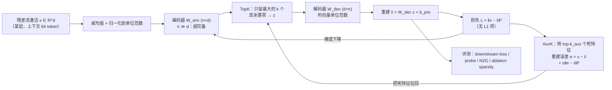

---
aliases:
  - "Scaling and evaluating sparse autoencoders"
  - "SESA"
created: 2026-11-17
---
# Scaling and evaluating sparse autoencoders

> Anthropic 之外的另一个 SAE 主力路线（OpenAI Superalignment 团队）。论文要解决的不是「SAE 能不能找到特征」，而是「**SAE 能不能被可靠地训大、并且被公正地评价**」。方法侧两处改动：用 **TopK / $k$-sparse 激活**替代 $L_1$ 惩罚，从而直接指定 $L_0$、消除 activation shrinkage、改善稀疏-重建前沿；用**绑定初始化 + AuxK 辅助损失**把死特征从「无缓解时高达 90%」压到最大模型（16M latents）的 **7%**。在这些基础上得到关于 latents 数 $n$、稀疏度 $k$、主体模型规模 $L_s$ 的干净缩放律，并提出四个评价特征质量的指标（downstream loss、probe loss、explainability、ablation sparsity）。最后在 GPT-4 激活上训了一个 **1600 万 latents、400 亿 token** 的 SAE。
>
> 一句话：这是把 SAE 从「能跑」推进到「能 scale、能量化、能比较」的论文——**它的主要贡献是一套工程与度量标准，而不是某个新奇的解释结论**。

## 一句话定位

SAE 规模化的**基线论文**：它把「$L_1$ 惩罚 + ReLU」换成「TopK + AuxK」，使稀疏度成为可直接设定的旋钮，从而第一次能把 SAE 的损失写成 $L(n,k)$ 的解析形式，并给出一整套「特征质量」的可测量定义。

## 问题与动机

**SAE 路线当时的具体困境（分条）**

1. **$L_1$ 需要调 $\lambda$，而且 $\lambda$ 与 $L_0$ 的对应关系随规模漂移。** 这使得「在同等稀疏度下比较两个 SAE」这件事本身非常昂贵：每个规模、每个 $n$ 都要重新扫 $\lambda$。论文引用的既有做法（Bricken 等、Cunningham 等、Templeton 等）都是在这个约束下做的。
2. **$L_1$ 不是 $L_0$ 的好代理，而且会系统性压缩激活。** $L_1$ 是所有正激活之和，它把「稀疏」实现为「把所有正激活往零拉」（这是 Lasso 的经典性质，Tibshirani 1996）。后果是：即使给定正确的稀疏**掩码**，把非零值放大一点还能进一步降低重建误差——也就是说 SAE 学到的激活值**偏小**，下游使用时（例如用激活大小判断特征强度）会失真。
3. **死特征（dead latents）。** 大 SAE 里相当比例的 latent 在训练某处彻底停止激活，既浪费容量又拉高 MSE。论文给的对照极有说服力：Templeton 等训的 3400 万 latent SAE 只有 1200 万活着；而本文自己的消融显示，**不加任何缓解时死特征可达 90%**。
4. **「稀疏-重建前沿」本身不是目标，而且会被钻空子。** 论文在评测章节开头就点明：无限宽、$k=1$ 的 SAE 可以通过在 $\mathbb{R}^d$ 里稠密铺满 latents 做到完美重建，但完全无结构、毫无用处。所以必须有**面向用途**的指标。
5. **既有的「恢复了多少损失」指标太宽松。** 常用做法是拿「把激活置零」的下游损失当基线，报告恢复了其中多少比例；但把残差流置零会让下游损失爆炸，于是**即使解释得很差也能拿高分**（论文脚注给了自己 16M SAE 的这个指标：**98.2%**——正好说明该指标不具区分度）。

**为什么重要。** 如果 SAE 的特征质量无法测量，那么「SAE 找到了可解释特征」就只是一个定性说法，无法回答「把 SAE 放大 10 倍是否值得」「$k$ 该取多少」「不同激活函数哪个好」。本文的四个指标就是要把这些问题变成可画曲线的问题。

**前人方案的根本瓶颈。** 之前的工作要么在**小模型、小 SAE** 上做（因此无法回答缩放问题），要么把稀疏-重建前沿当作目标（因此无法回答「特征好不好」）。本文的切入点是：**先把稀疏度变成可控变量，再去研究它和规模的关系**——只有 $L_0$ 可以被直接设定，$L(n,k)$ 这样的联合缩放律才有意义。

## 方法与机制（核心）

### 总览

整篇论文的流水线极其简单，复杂度全在「怎么让它稳定地变大」上。输入是语言模型（GPT-2 small 与一系列 GPT-4 架构的模型）某一层残差流的激活 $x\in\mathbb{R}^{d}$；先减去 $d_{model}$ 维上的均值、再归一化到单位范数（重建误差也在这个归一化空间里算）；编码器给出稀疏潜码 $z\in\mathbb{R}^n$（$n$ 远大于 $d$，即超完备）；解码器把 $z$ 映回 $\hat x$；损失是重建 MSE（TopK 版本不再有 $L_1$ 项）。训练中还有一路**只在死特征上算的辅助损失**（AuxK），专门把「已经死掉的」latents 拉回来。

三个设计选择决定了后面所有结论：

- **TopK 激活**：$z=\operatorname{TopK}(W_{enc}(x-b_{pre}))$，只保留最大的 $k$ 个，其余置零。于是**每个 token 恰好 $k$ 个活跃 latent**，$L_0=k$ 是超参数而不是涌现量。
- **绑定初始化 + AuxK**：编码器初始化为解码器的转置（方向一致），加上 AuxK，死特征从 90% 量级降到个位数百分比。
- **四个评测维度**：downstream loss（重建是否抓住了**对行为有用**的特征）、probe loss（是否恢复了**我们相信存在**的特征）、explainability（激活模式是否有**既必要又充分**的简单解释）、ablation sparsity（消融单个 latent 是否只影响**少数** logits）。

**位置选择**：GPT-4 系列取网络 $\frac56$ 深度处的层，GPT-2 small 取第 8 层（$\frac34$ 深度）。理由是这一层既包含较多特征、又不专门服务于 next-token 预测（附录对层位置做了扫描，见后文）。上下文长度统一 **64 token**。

**评价口径**：所有 MSE 都做**归一化**——除以「总是预测均值激活」这个基线的重建误差。这个约定很重要，否则不同层、不同模型的 MSE 无法横向比较。

### 模块一：基线 ReLU SAE 与 $L_1$ 的两个罪名

基线的编解码器与损失是（[§2.2](papers/可解释性/2406.04093/2406.04093.pdf#2.2)）：

$$
z=\operatorname{ReLU}\!\big(W_{enc}(x-b_{pre})+b_{enc}\big),\qquad
\hat x=W_{dec}z+b_{pre},\qquad
\mathcal{L}=\|x-\hat x\|_2^2+\lambda\|z\|_1
$$

逐符号解释：$W_{enc}\in\mathbb{R}^{n\times d}$ 是编码器（$n$ 个 latent 各自一个读取方向），$b_{pre}\in\mathbb{R}^d$ 是「前置偏置」——它同时充当解码器的输出偏置，这一点是刻意的（相当于把数据中心化后再重建）；$b_{enc}\in\mathbb{R}^n$ 是每个 latent 自己的阈值；$W_{dec}\in\mathbb{R}^{d\times n}$ 的每一列是该 latent 的写入方向。

$L_1$ 的两个问题分别对应两项：

- **调参问题**：$\lambda$ 与实际的 $L_0$ 之间没有解析关系，而且这个映射随 $n$、随训练进度漂移。想比较「$n=2^{15}$ 与 $n=2^{17}$、同样 $L_0=128$」的两个 SAE，就得为每个 $n$ 单独扫一遍 $\lambda$。
- **shrinkage 问题**：$\|z\|_1=\sum_i z_i$ 对**每个**正激活都施加向零的梯度，与「这个 latent 该不该激活」无关。于是激活值被系统性压低。

这两点在 [§5.1](papers/可解释性/2406.04093/2406.04093.pdf#5.1) 被**定量测量**，方法很巧：固定编码器给出的稀疏掩码，只优化非零激活值去最小化 MSE（带非负约束的投影梯度下降；论文指出这与 $k$-SVD、relaxed Lasso、ITI 是同一类做法）。如果 $L_1$ 造成了收缩，那么这个「细化（refinement）」步骤应当**系统性把激活调大**。结果正是如此：ReLU 模型的细化**平均偏向正值**，TopK 模型**没有这种偏向**且细化幅度更小。附带发现：两种模型经过细化后 MSE 与下游交叉熵都会改善——也就是说**TopK 也没有完全消除「激活值不是最优」的问题**，只是不再有系统性偏低。

### 模块二：TopK 激活——把稀疏度变成旋钮

$$
z=\operatorname{TopK}\!\big(W_{enc}(x-b_{pre})\big),\qquad \mathcal{L}=\|x-\hat x\|_2^2
$$

（代码里还额外套了一个 ReLU 保证非负，但论文说训练曲线**不可区分**，因为对合理的 $k$，最大的 $k$ 个激活几乎总是正的。）

四条好处，逐条对应一个具体收益：

1. **去掉 $L_1$**，因此没有 shrinkage（上面已给实证）。
2. **直接设定 $L_0$**：$L_0=k$ 是硬约束，模型比较与快速迭代都变简单；而且 TopK 可以与任意激活函数组合（这一点在后面的 Multi-TopK、test-time JumpReLU 里被用到）。
3. **在稀疏-重建前沿上更好**，而且**这个优势随规模变大**（[图 2](papers/可解释性/2406.04093/2406.04093.pdf#figure=2)）：固定 $n=32768$ 时 TopK 优于 ReLU 与 ProLU、与 Gated 相当；固定 $L_0=128$ 时 TopK 的缩放律**更陡**（即 $n$ 增大带来的收益更大）。注意非 TopK 方法无法设定精确 $L_0$，论文用 log-log 空间的分段线性插值来对齐比较点。
4. **提升随机激活样本的单语义性**：因为 TopK 把小激活**硬截断**为零，随机抽到的激活样本更可能是「这个特征真的在起作用」，而不是「它在微弱地漏电」。

第 4 点的机制值得展开，因为它解释了后面 N2G 指标的结果：ReLU SAE 的 latent 有一层「长尾」的弱正激活，这些弱激活对应的输入往往与该特征的主模式无关（只是干扰），于是「随机取一个正激活去看它是什么」会看到大量噪声样本。TopK 把长尾全部切掉，随机样本的纯度自然提高。

### 模块三：死特征——两个必要配方

死特征的定义沿用 Templeton 等：**连续 1000 万 token 没有激活**即视为死。不加缓解时死特征比例可达 90%（[§2.4](papers/可解释性/2406.04093/2406.04093.pdf#2.4)）。论文找到两个必要成分：

1. **绑定初始化（tied initialization）**：编码器方向初始化为解码器方向的转置，即每个 latent 的「读方向」和「写方向」初始时相同（方向均匀随机采样，只初始化时绑定，**不**共享参数）。直觉是：一开始 $W_{enc}=W_{dec}^T$ 让编码器给出的潜码与解码器能用的方向一致，避免早期大量 latent 因方向错配而永远拿不到梯度。消融显示**这一项单独就能显著改善 MSE**；而本文那套精细的编码器幅度初始化方案在**使用**绑定初始化时**没有效果**、单独使用时**略有害**（附录「Training ablations」）。
2. **AuxK 辅助损失**：取主模型的重建误差 $e=x-\hat x$，再用**当前死掉的 latents 中 top-$k_{aux}$ 个**去重建这个误差：

$$
\hat e=W_{dec}z^{(aux)},\qquad \mathcal{L}_{aux}=\|e-\hat e\|_2^2,\qquad
\mathcal{L}_{total}=\mathcal{L}+\alpha\,\mathcal{L}_{aux}
$$

默认 $k_{aux}=512$（约 $d_{model}/2$ 的 2 的幂）、$\alpha=1/32$。**为什么几乎不花钱**：编码器前向可以复用（在系统层面，编码器前向本就是剩余的主要稠密开销），所以整个辅助损失只增加约 **10%** 计算。工程细节：AuxK 在大规模下偶尔 NaN，论文的做法是**检测到 NaN 就把它置零**，避免整个训练崩掉。

效果：最大的 1600 万 latent SAE 只有 **7%** 死特征；论文说 AuxK 到训练结束时「几乎消除了所有死特征」（附录），而两者的组合（AuxK + 绑定初始化）是死特征比例在早期尖峰之后**随训练持续下降**的原因。

### 模块四：缩放律——$L(C)$ 与 $L(N)$ 是两件不同的事

这是全文最容易读错的一节，值得慢讲。作者区分两条「训练到什么程度」的路线（[§3.1](papers/可解释性/2406.04093/2406.04093.pdf#3.1)）：

**(a) 训到「给定算力下的最优 MSE」，不管是否收敛，记 $L(C)$。** 这是从语言模型预训练借来的做法（Kaplan 等、Hoffmann 等）。结论：MSE 随算力呈幂律，但**最小的那几个模型偏离趋势**。

**(b) 训到收敛（在某个 $\epsilon$ 内），记 $L(N)$。** 这给出「不计算力成本时该方法能达到的最好重建」。

论文对 (a) 提出了一个很重要、也很容易被忽略的批评：**跨 $n$ 比较 MSE 不公平**。因为 $n$ 越大，latents 构成的信息瓶颈越松，低 MSE 更容易达到；而 SAE 真正要的产物是 **latents**，不是重建预测（语言模型只关心 token 预测，SAE 不是）。所以论文说这条路「arguably unprincipled」，实际实践中应该训到 $L(N)$ 与 $L(C)$ 之间的某个中间 token 预算。

配套的三条经验规律：

- **最大可收敛学习率 $\propto 1/\sqrt{n}$**；且 $L(N)$ 的最优学习率约为 $L(C)$ 最优学习率的 **$1/4$**。
- **收敛所需 token 数**约为 $\Theta(n^{0.6})$（GPT-2 small）与 $\Theta(n^{0.65})$（GPT-4）。论文明确说这个趋势**必然会在某处失效**：如果 token 预算持续亚线性增长，每个 latent 分到的梯度信号会趋近于零。脚注补充：由于这套初始化在无限宽极限下「初始化即最优」，指数允许比 1 略小一点点，但这个效应随 $n$ 增长很慢，在现实规模下不是主因。
- **不可约损失项**：拟合 $y=\alpha x^\beta+e$ 时必须带 $e$，否则拟合质量明显变差。作者一开始并不认为该有非零的不可约损失（毕竟任意大的 SAE 理论上能完美重建），他们的假设是：**激活由不同结构程度的成分谱构成**，越无结构的成分指数越差；极端情况下其中一部分就是无结构高斯噪声。他们做了合成实验支持这一点：在 768 维**纯高斯噪声**数据上训 $k=32$ 的 SAE，得到 $L(N)$ 指数约 **$-0.04$**，而在同维度的 GPT-2 small 激活上约 **$-0.26$**——噪声确实几乎不可压缩。

**联合缩放律 $L(n,k)$。** 这是本文最「可复用」的产出。因为重建在 $k\to d_{model}$ 时变得平凡，该律只在**小 $k$** 区间成立。GPT-4 SAE 上的拟合形式与系数为（[§3.1.4](papers/可解释性/2406.04093/2406.04093.pdf#3.1.4)）：

$$
L(n,k)=\exp\!\big(\alpha+\beta_k\log k+\beta_n\log n+\gamma\log k\log n\big)+\exp\!\big(\zeta+\eta\log k\big)
$$

$$
\alpha=-0.50,\quad \beta_k=0.26,\quad \beta_n=-0.017,\quad \gamma=-0.042,\quad \zeta=-1.32,\quad \eta=-0.085
$$

怎么读这个式子：第一项是「可约损失」，它是 $n$ 与 $k$ 的幂律乘积，$\beta_n<0$ 表示 $n$ 越大损失越低、$\beta_k>0$ 表示 $k$ 越小损失越高；**$\gamma<0$ 是关键**——它意味着 $n$ 的指数随 $k$ 增大而变得更负，也就是**缩放律在高 $k$ 时更陡**（把 SAE 做大在高稀疏度下收益更大）。第二项是「不可约损失」，只依赖 $k$；$\eta<0$ 表示**$k$ 越大不可约损失越低**（更宽的瓶颈能拟合更多无结构成分）。

**主体模型规模 $L_s(N)$。** 固定 $k$ 时，**主体模型越大，达到同样 MSE 需要的 SAE 越大，且指数更差**（[§3.2](papers/可解释性/2406.04093/2406.04093.pdf#3.2)）。这条结论对「SAE 能否跟上模型规模」是个坏消息，也是后来「SAE 是否值得」争论的一个技术源头。

### 模块五：四个评测指标——把「特征好不好」变成可测量的量

论文明确说：优化稀疏-重建前沿不是终点（而且这个前沿在极限下会退化），所以要用**面向用途**的指标（[§4](papers/可解释性/2406.04093/2406.04093.pdf#4)）。

**(1) Downstream loss。** 做法：前向时把残差流替换成 SAE 重建值 $\hat x$，看下游预测受影响多少；指标用 **KL 散度**与**交叉熵差**（delta cross-entropy：因为完美重建也仍有非零交叉熵，所以减去「完美自编码器」的交叉熵）。两条结论：

- TopK 在 downstream loss 上的优势**比在 MSE 上更大**（即「同样 MSE 下 TopK 的下游损失更低」）。
- 固定 $L_0$、只变 $n$ 时，**MSE 与 KL、与 delta 交叉熵都呈干净的幂律关系**。论文提醒这个干净关系在「测试时改 $k$」时会破，是一个例外。

**关于绝对刻度**，论文给了一个非常好用的锚：16M SAE 代入 GPT-4 后，其语言建模损失相当于 **GPT-4 预训练算力的 10%**。这比「恢复了多少零消融损失」有意义得多，因为后者在零消融基线极高的情况下会把任何解释都判为高分（16M 的零消融保真度是 98.2%，正说明该指标饱和）。

**(2) Probe loss。** 思路：如果某个特征（情感、语种、职业……）应当被高质量 SAE 发现，那就可以直接检验它是否在 latents 里。论文构造了 **61** 个二分类数据集（[表 1](papers/可解释性/2406.04093/2406.04093.pdf#table=1) 列出全部任务：Amazon 评论、SciQ、TruthfulQA、MC-TACO、PIQA、QuAIL、Quartz、ETHICS 四子集、CommonsenseQA、OpenBookQA、base64 判别、Wikidata 系列属性、若干短语检测、SocialIQA、WiC、CoLA、GPT-2 输出判别、AG News 四类、Europarl 八语种、Jigsaw），对**每个 latent** 用 Newton-Raphson 训一个 **1 维** logistic probe，取所有 latents 里最好的交叉熵：

$$
\min_{i,w,b}\ \mathbb{E}\Big[y\log\sigma(wz_i+b)+(1-y)\log\big(1-\sigma(wz_i+b)\big)\Big]
$$

其中 $z_i$ 是第 $i$ 个 latent 的**预激活**值（不是 TopK 之后的），$y$ 是二分类标签。注意这与 Gurnee 等的做法相似，但固定 $k=1$ 并回归到 SAE latents 而不是神经元。

结果：probe 分数随 $k$ 先升后降；TopK 一般优于 ReLU；两者都**明显优于直接用残差流的通道**（基线分数 **0.600**）；在 GPT-4 的 128k/1M/16M 三个 SAE 上，该指标**在训练过程中持续上升**——**尽管训练目标里没有任何监督信号**。这是很强的证据：重建压力会顺带逼出「人类会去探测的那些特征」。分解到任务层面，各任务在约 100 亿 token 处开始发展（附录）。

论文自己指出该指标的两个问题：算力便宜是优点，但它**强依赖「什么算自然特征」的先验假设**。

**(3) Explainability（N2G 的 precision / recall）。** 直觉风险：随机看激活很容易产生「可解释性的幻觉」——解释过宽、召回高但精确率低。论文举的例子很到位：Bills 等发现某个特征只在 "don't stop"/"can't stop" 结尾激活，但一个「在所有 'stop' 上激活」的解释也能拿到很高的可解释性分数。SAE 越大、特征越稀疏具体，这种失败越严重。

精确率评估如果要用 GPT-4 做模拟，代价极高。作为初步探索，论文改进了 **Neuron to Graph（N2G）**——表达力弱得多但便宜得多，输出是「带通配符的 n-gram 集合」。构造方式：取一些能激活该 latent 的序列，对每条找**仍能激活的最短后缀**（要求至少保有原激活强度的一半），再检查 n-gram 里是否有位置可换成 padding token 以插入通配符，以及该解释是否依赖**绝对位置**（通过在开头插 padding 看是否影响）。用最多 **16** 个非零激活建图，另 **16** 个作真阳性算召回。

指标定义：召回 $P(\text{n2g}>0\mid \text{act}>0)$，精确率 $P(\text{act}>0\mid \text{n2g}>0)$。结果：总体上 **$n$ 越大、$k$ 越小越容易解释**；TopK 相对 ReLU 的解释**召回显著更高（>1.5×）、精确率略低（>0.9×）**，因此 F1 更好。一个必须注意的例外：$n=2048,k=512$ 的 latents 平均反而**容易**解释，因为很多 latent 激活得极其稠密（见下文 dense solutions）——这暴露了「只看二值化」的 precision/recall 指标的一个缺陷。

**(4) Explanation reconstruction（把解释和下游损失接起来）。** 前两个指标各缺一半：downstream loss 说明「抓住了多少性能」但特征可能不可解释；解释类指标说明「特征有多单语义」但可能解释不了模型的大部分。所以论文把两者相乘起来：**用解释去模拟 latent，再解码，然后测下游损失**。

具体做法：N2G 会给出一个模拟值 $s$（由 trie 节点决定），但需要缩放；缩放系数取 $\mathbb{E}[sa]/\mathbb{E}[s^2]$（$a$ 是真实激活），在训练集 token 上估计——这等价于「最小化方差解释」的最小二乘缩放。结果：能解释的比「只解释 bigram」更多，且 $n$ 越大、$k$ 越小，下游损失越好。这个指标的好处是**同时以有原则的方式重视精确率与召回率**，并且对激活更稠密的 latent 更看重召回。

**(5) Ablation sparsity。** 动机来自「特征不只在激活上稀疏，在**下游效应**上也应当稀疏」（引 Olah 的 open problems）。做法：在某个 token 位置取 latents，**逐个**消融，比较消融前后 logits；对每个被消融的 latent、每个受影响 token 得到 $V$ 个 logit 差（$V$ 是词表大小）。因为「所有 logit 同加一个常数」不影响 softmax 后的概率，所以**逐 token 减去 logit 差的中位数**。再把某个 token 位置及其后共 $T=16$ 个位置的向量拼起来，得到 $V\cdot T$ 维向量。稀疏度用

$$
\Big(\frac{L_1}{L_2}\Big)^2
$$

即「**有效受影响的词表 token 数**」，再除以 $V\cdot T$ 归一化到 $[0,1]$，越小越稀疏。结果：$k$ 越大效应越稀疏（反直觉但合理：每个 latent 装的东西更多、更「综合」），但在 $k=512$ 处反转（因为接近 $d_{model}=768$，解变稠密）。绝对量级很漂亮：SAE latents 的 $(L_1/L_2)^2$ 是 **10–14%**，而直接消融残差流通道是 **60%**（略好于随机向量的理论值 $\sim 2/\pi$）。

### 模块六：理解 TopK——shrinkage、对比、渐进码

**(a) 与其他激活函数的对比。** 论文把同期三条改良路线都拉进来比：per-latent 缩放微调（Wright 等）、**Gated SAE**（把「选哪些 latent 激活」与「激活值估计」分开，从而避开 shrinkage）、**ProLU / JumpReLU**（$J_\theta(x)=x\cdot\mathbf{1}_{(x>\theta)}$，把阈值以下直接置零；因为 $\theta$ 不可微，需要 ProLU-ReLU 的近似梯度或 straight-through 估计）。结论：这些方法都**显著改善了稀疏-重建帕累托前沿**，而 **TopK 总体最好**；在 downstream loss 上也是 TopK 最优（GPT-2 与 GPT-4 一致，论文对 GPT-4 那组信心略低但结论一致）。

**(b) 渐进码（progressive recovery）。** 类比 JPEG：渐进码允许「只传一部分就还原出粗糙版本」。对 SAE 来说，就是**按激活大小排序**的 latents 应当能渐进地恢复原向量。检验方式：训练完后把激活函数换成 $k'$ 与训练时不同的 TopK($k'$)，把每个 $k'$ 放回 $L_0$–MSE 平面。

结果：**只在 $k'\le k$ 的范围内是渐进码**；$k'$ 略大于 $k$ 时 MSE 还会继续改善（$k$-sparse 原文也报告过），再往上就明显变差——可以理解为**对训练时那个 $k$ 的过拟合**（对下游损失的影响更钝）。

**Multi-TopK** 用来修这个问题：把多个不同 $k$ 的 TopK 损失加起来，例如

$$
\mathcal{L}(k)+\frac{1}{8}\mathcal{L}(4k)
$$

就足以在整个 $k'$ 范围上得到渐进码（代价是在 $k$ 处的表现略差于纯 TopK）。作为对照，ReLU 基线只在一个「相当于用上所有正激活」的值之前是渐进码。

**(c) 固定稀疏度 vs 固定阈值。** 测试时也可以把激活函数换成 **JumpReLU**（固定阈值 $\theta$，每个 token 的活跃数可变）。对 TopK 训出的 SAE：在 $L_0$ **低于**训练 $L_0$ 的区间，test-time TopK 与 JumpReLU 的曲线重合；超过之后 JumpReLU 更差。Multi-TopK 训出的模型，两条曲线几乎完全重合——**意味着它可以不损失重建地用于「每 token 固定 $k$」或「每 token 动态数量」两种模式**。对 ReLU 训出的模型两者本来就重合。

还有一个很实用的观察（与 Nanda 的独立结果一致）：**有时用低 $L_1$ 训 ReLU、测试时改用 TopK 或 JumpReLU，比直接训一个高 $L_1$（同等稀疏度）更划算**。也就是说「训练时的稀疏机制」和「推理时的稀疏机制」可以拆开。

### 模块七：定性结果——稠密解与子空间

**(a) Dense solutions（最重要的定性发现，因为它标出了方法的失效边界）。** 一个 SAE 完全可以退化成「学 $k$ 个解释方差最大的方向」——即类 PCA 解。检验方式很简单：测**最稠密的 $d_{model}$ 个 latents 的平均密度**。结论：某些超参下 GPT-2 small SAE 会学出大量稠密 latent，**从 $k=256$ 开始、在 $k=512$ 尤其严重**；这正好对应缩放律开始弯曲的位置（$n$ 对 MSE 的影响在 $k=512$ 明显变钝）。也就是说，前面所有「$k$ 越大越好」的趋势都有一个上限：**当 $k$ 逼近 $d_{model}$，SAE 会退回 PCA 式解，特征不再稀疏可解释**。

**(b) 激活分布。** 采样 1500 万 token 统计：**latent 密度的对数近似高斯**；若把特征重要性定义为**期望激活平方**（对 MSE 边际影响的近似），则**重要性的对数更像拉普拉斯分布**；两者的众数都随 $n$ 增大（固定 $k$）而下降，符合预期。论文特别指出：他们**没有**观察到 Bricken 等报告的多峰密度分布。另外因为「1000 万 token 不激活即视为死」，$10^{-7}$ 事实上是密度下限（AuxK 系数可能允许更低）。

**(c) GPT-2 small 里反复出现的稠密特征。** 人工检查不同 $n$ 的多个 layer-8 SAE，最稠密的几个 latent 高度一致：最密的是「在上下文中越靠后激活越强」（约 40% 活跃）与「越靠前激活越强、但排除第一个位置」（约 35%）；第三密的是**第一个 token 位置**特征（约 30% 活跃，众数激活值落在 **14.6–14.8** 这个窄区间），它在第一个 token 之后的位置上有大量小激活——作者猜测这些是**与第一位置方向的干扰**，不可解释；第四是「重复」特征（约 20% 稠密，最高激活在日期序列、章节编号、数字、标点、重复短语、Chess PGN 这类高度重复的文本上，但随机激活往往不可解释）。另外，**最稠密的十个 latent 里常出现「相反」的 latent**（解码器余弦相似度接近 $-1$），作者猜测这是优化失败的痕迹——相反的 latent 在抵消更稠密 latent 的虚假激活。

**(d) 子空间结构。** 论文借 Toy Models 的假设（特征可能位于不同子空间）做了一个漂亮的线性代数论证：若 $W$ 在某个未知基下是**块对角**的，即 $W'=PWR$（$P$ 置换、$R$ 正交），则由 SVD $W=U\Sigma V^\top$ 的唯一性可得 $U=P^\top U'P'$——**$U$ 也是（差一个行列置换的）块对角**。于是他们按「各行在奇异向量基上投影的相似度」排序 $U$ 的行（把每行归一化后取 $\|\tilde U_i^2-\tilde U_j^2\|$ 的成对欧氏距离，再用 UMAP 降到一维排序），发现残差流**似乎分成两个模糊分离的子空间**，分别约占全部维度的 **25% 与 75%**。小簇的 latents 编码器范数更大、且**只在较少的词表 token 上激活**（有效 token 数 <100），大簇则可达 **1000**。

### 模块八：工程与训练配方（为什么这套东西能 scale）

这些细节单独看琐碎，但它们是「1600 万 latents」能训出来的直接原因：

- **并行**：数据并行 + 张量切分，另加一次 allgather 求全局 TopK；为压低 allgather 成本，每分片截断到 capacity factor 2；16M SAE 用 **512 路切分**。层数太少导致 pipeline 并行与 FSDP 不适用。
- **稀疏 kernel**：`DenseSparseMatmul`（解码器前向、解码器梯度、编码器梯度）与 `MatmulAtSparseIndices`（latent 梯度），加上 pre-bias 梯度的「先按 batch 求和再乘」技巧，理论上最多 **6×** 计算效率提升（极限是只剩编码器前向这一个稠密操作）；实践中编码器前向占大部分算力、预激活占大部分显存。解码器权重必须**转置存储**以保证读取合并。
- **优化器**：Adam（$\beta_1=0.9,\beta_2=0.999$）、常数学习率、**无 warmup/decay**；把平行于解码器方向的梯度**投影掉**（配合解码器归一化）；**Adam $\epsilon=6.25\times10^{-10}$**（因为按 batch 平均梯度会让梯度 RMS 很小，从而破坏 Adam 的损失尺度不变性）；GPT-4 大规模训练必须用**梯度裁剪**（它显著影响 $L(C)$ 但不影响 $L(N)$）。
- **批大小 131072 token**（远大于既有工作的 2048/4096），这是并行度的前提；**$L(N)$ 对批大小不敏感**，但 $L(C)$ 敏感。
- **权重的 EMA**（系数 0.999，带偏置修正），$L(C)$ 实验取 EMA 与非平均模型验证损失的最小值。
- **解码器列单位范数**：对 $L_1$ SAE 是必需的（否则 $L_1$ 可以通过把 latents 变小来作弊），对 TopK 是**可选**的，但实测仍能改善 MSE，所以一直用。

## 实验与对比

**设置一览**

| 维度 | 取值 |
|---|---|
| 主体模型 | GPT-2 small（layer 8，$\frac34$ 深度）；GPT-4 架构的递增系列（$\frac56$ 深度）；GPT-4 本身 |
| 上下文 | 64 token |
| 预处理 | 减 $d_{model}$ 均值 + 归一化到单位范数 |
| 批大小 | 131072 token |
| 稀疏度对比点 | $L_0=128$（跨 $n$ 比较）；$n=32768$ / $n=2^{17}=131072$（跨 $L_0$ 比较） |
| 死特征判定 | 连续 $10^7$ token 未激活 |
| AuxK | $k_{aux}\approx d_{model}/2$（GPT-2 small 取 512），$\alpha=1/32$ |
| 最大模型 | 16M latents，GPT-4，40B token，512 路切分，死特征 7% |

**对比结果（定性方向 + 论文给出的量化点）**

| 对比 | 指标 | 结果 |
|---|---|---|
| TopK vs ReLU / ProLU / Gated | 稀疏-重建前沿（$n=32768$） | TopK 优于 ReLU 与 ProLU，与 Gated 相当（[图 2](papers/可解释性/2406.04093/2406.04093.pdf#figure=2)a） |
| TopK vs ReLU | 缩放律（$L_0=128$） | TopK 的缩放律**更陡**（[图 2](papers/可解释性/2406.04093/2406.04093.pdf#figure=2)b） |
| TopK vs 其它 | downstream loss | TopK 最好；且「同 MSE 下 TopK 下游损失更低」（GPT-2 与 GPT-4 一致） |
| TopK vs ReLU | N2G 召回 | **>1.5×** 更高 |
| TopK vs ReLU | N2G 精确率 | **>0.9×**（略低），但 F1 更好 |
| TopK vs ReLU | probe loss | TopK 更好；两者都优于「直接用残差流通道」（基线 0.600） |
| 无缓解 vs 有缓解 | 死特征比例 | 最高 **90%** → 16M 模型 **7%** |
| SAE latents vs 残差流通道 | 消融效应稀疏度 $(L_1/L_2)^2$ | **10–14%** vs **60%**（随机向量理论值 $\sim 2/\pi$） |
| 16M SAE 代入 GPT-4 | 下游损失折合预训练算力 | **10%** |
| 16M SAE | 零消融保真度 | **98.2%**（论文用它说明该指标不具区分度） |
| 纯高斯 768 维 vs GPT-2 small 768 维 | $L(N)$ 指数 | **$-0.04$** vs **$-0.26$** |

**联合缩放律（GPT-4 SAE）**：系数见上文；两个定性推论是 $\gamma<0\Rightarrow$ 高 $k$ 下缩放更陡，$\eta<0\Rightarrow$ 不可约损失随 $k$ 下降。**收敛 token 数**：$\Theta(n^{0.6})$（GPT-2）/ $\Theta(n^{0.65})$（GPT-4）；**最大可收敛 lr** $\propto 1/\sqrt{n}$；**$L(N)$ 最优 lr ≈ $L(C)$ 最优 lr / 4**。

**结论（量化地讲）**

1. 四个质量指标**总体上随 $n$ 单调改善**，但有饱和与反转：probe 随 $k$ 先升后降；N2G 召回随 $k$ 下降；ablation sparsity 随 $k$ 改善但**在 $k=512$ 反转**。
2. 「$k$ 越大越好」是**有边界的**：$k$ 逼近 $d_{model}$（GPT-2 为 768）时出现稠密解，所有趋势一起破。
3. 主体模型越大，SAE 需要的 $n$ 越大、指数越差——SAE 的可扩展性比模型本身更吃紧。

## 归因分析

论文的消融集中在附录，但每一项都对应一个具体设计：

| 设计 | 消融方式 | 结果 | 归因 |
|---|---|---|---|
| TopK 激活 | 与 ReLU / ProLU / Gated 对比（同 $n$ 或同 $L_0$） | TopK 前沿最好、缩放更陡、downstream 更好 | 稀疏度的**硬约束** + 无 shrinkage 带来前沿改善；优势随规模放大说明它不只是「调参方便」 |
| 绑定初始化 | 单独开/关 | 单独开就显著改善 MSE；精细的编码器幅度初始化在绑定开启时**无效果**、单独用**略有害** | 死特征与早期优化问题的主因是「读/写方向错配」，不是幅度尺度 |
| AuxK | 单独开/关，及与绑定初始化组合 | 两者组合才让死特征在早期尖峰后**持续下降** | 死特征是「梯度饥饿」，需要一个专门把梯度引向死 latent 的通路 |
| $b_{enc}$ | 去掉 | 收敛时 MSE **不受影响**，但收敛略慢 | $b_{enc}$ 不是表达能力所必需（去掉后等价于「按样本动态选阈值的 JumpReLU」），只影响优化速度；论文说可能被编码器学习率混淆，未深究 |
| 解码器列归一化 | 开/关 | 对 TopK **可选**，但实测略改善 MSE | 对 $L_1$ 是防作弊的必需品；对 TopK 是正则化收益 |
| $L_1$ → TopK（shrinkage 方向） | 固定掩码后细化非零值 | ReLU 的细化**偏向增大**、TopK **无偏**且幅度更小 | shrinkage 确实存在且被 TopK 消除；但细化仍能改善两者，说明「激活值最优性」是独立问题 |
| 训练稀疏机制 vs 推理稀疏机制 | 训 ReLU（低 $L_1$）+ 测试用 TopK/JumpReLU | 有时优于直接训高 $L_1$ | 训练目标与推理稀疏性可以解耦 |
| 单 TopK → Multi-TopK | 测试时扫 $k'$ | 单 TopK 只在 $k'\le k$ 渐进；Multi-TopK 全域渐进 | 「对 $k$ 过拟合」是真实存在的失效模式，加一项 $\mathcal{L}(4k)/8$ 即可缓解 |
| 上下文/层位置 | 扫 GPT-2 各层与各位置类型 | 最优 lr 随层与位置类型变化但在 2× 内；收敛 token 数在早层明显更高；归一化 MSE 早层低、末层回升 | 层选择影响的是**指标之间的权衡**（早层 N2G 好、晚层 probe 与 sparsity 好），不是单一最优 |

最硬的一条归因链是 **死特征 ← 初始化 + 辅助损失**：论文明确写「死特征的减少主要归因于 AuxK 与绑定初始化的组合」，并且给出了机制（编码器前向可复用，所以只加 10% 成本；绑定初始化让读写方向一致）。这条链之所以可信，是因为它同时解释了「为什么以前的 34M SAE 只有 12M 活着」——那些工作用的是重采样（resampling）而不是 AuxK。

## 局限与未来工作

论文在「Limitations and Future Directions」（[§6](papers/可解释性/2406.04093/2406.04093.pdf#6)）里列了 8 条，逐条照录并加一句解释：

1. **TopK 强制每个 token 恰好用 $k$ 个 latents，这很可能不是最优的**；理想做法是约束 $\mathbb{E}[L_0]$ 而不是 $L_0$。这条直接指向后来 JumpReLU / 门控类方法。
2. **优化还有很大改进空间**：学习率调度、更好的优化器、更好的防死特征辅助损失（脚注补充：经验上**降低学习率有助于减少死特征**）。
3. **需要更多工作去理解哪些指标最能追踪下游应用的相关性**，并研究这些应用本身：找 steering 向量、异常检测、识别电路等。
4. **对「MoE + autoencoder」的结合很期待**：它能显著改善 SAE 训练的渐近成本，从而支持更大的 SAE。
5. **相当大比例的随机激活仍不够单语义，GPT-4 尤其明显**；作者相信靠更好的技术与更大规模（latents 数与训练 token 数）可以解决。
6. **probe 指标噪声较大**，需要更广、更高质量的任务集。
7. **N2G 只为了算力便宜**，只能捕捉非常简单的模式；「更有表达力、同时又便宜到能做精确率模拟」的解释方法是明显的空白。
8. **64 token 的上下文可能太短**，不足以展现 GPT-4 最有意思的行为。

**论文未明确讨论的**（Not explicitly specified in text）

- SAE 特征与具体电路之间的对应关系（只在 related work 里引了 Marks 等的「SAE 找稀疏电路」，本文自己没做）。
- 如何把 SAE 用于因果干预（本文只做了「钳制 profanity latent」这一个定性演示，没做系统实验）。
- 训练成本的具体数字（GPU 数、GPU-hours 均未给出）。
- 对不同随机种子的方差分析（缩放律拟合的误差棒只提到「个别拟合有噪声」，尤其 GPT-4，因为 lr 扫描较粗且 token 预算依赖 lr）。

## 与其他工作的关系

**直接前驱与同期竞品**

- **$k$-sparse autoencoders（Makhzani & Frey, 2013）**：TopK 激活的原始出处，本文的核心方法改动其实是「把 2013 年的想法用在 2024 年的模型上」。
- **Bricken 等的 monosemanticity 工作**：ReLU + $L_1$ 基线的来源；本文的 `b_pre` 初始化（几何中位数）、解码器单位范数、梯度投影都沿用自它。
- **Templeton 等的 scaling 工作**：提供了「34M SAE 只有 12M 活着」这一关键对照，也是「大规模 SAE 会遇到死特征」这一问题的提出者；本文的 AuxK 是「重采样」之外的另一条路。
- **Cunningham 等的 sparse autoencoders**：早期把 SAE 用于语言模型的代表，也是「$L_1$ 难以调」这一痛点的来源。
- **Gated SAE（Rajamanoharan 等）与 ProLU / JumpReLU（Taggart 等）**：同期解决 shrinkage 的两条替代路线，本文的直接比较对象；结论是 TopK 总体最好，但它们都显著改善了前沿。
- **Wright 等**：指出 $L_1$ 造成激活收缩并提出 per-latent 缩放修正——本文用「固定掩码后细化」的实验把这件事量化了。
- **Braun 等**：提出直接用下游 KL 而非重建 MSE 训 SAE；本文的 downstream loss 指标与它同源。
- **Lindsey 等**：先做过 autoencoder 的缩放律，但其损失是「重建与稀疏的特定平衡」；本文的关键区别是**固定稀疏度再扫规模**，这才使 $L(n,k)$ 可拟合。

**与库内其它笔记的关系**

- 与 [[papers/可解释性/2209.10652/NOTES|Toy Models of Superposition]] 是**理论—工程**的对接：Toy Models 把「事后找超完备基」列为三条出路之一，并预言了两个难点——「不知道该用多少特征」与「干扰不再帮你」。本文正是这两点的工程化回答：$n$ 通过缩放律来选，$L_1$ 的收缩与死特征则是「干扰不再帮你」的具体表现。
- 与 [[papers/可解释性/2309.08600/NOTES|SAE 可解释特征]] 构成方法演进的两端：那篇证明「SAE 特征比神经元更可解释」，这篇证明「SAE 可以训到 1600 万 latents 并且可以量化评价」。合起来才是 SAE 路线的完整论证。
- 与 [[papers/可解释性/2404.15255/NOTES|activation patching]] 是**工具互补**：patching 那篇把「patch 单个 SAE 特征」列为最高粒度的实验选项，本文提供的正是让这个选项可用的字典；反过来，本文缺的「特征是否真的被模型使用」这一环，恰好要靠 patching / ablation 来补（本文只做了 downstream loss 与 ablation sparsity 两个间接版本）。
- 与 [[papers/可解释性/2501.16496/NOTES|Open Problems in MI]] 的接口：本文的「dense solutions」「不可约损失来源不明」「指标与下游应用的相关性未知」三条，基本就是那份清单里 SAE 相关条目的实证版本。
- 与 [[papers/可解释性/2601.14004/NOTES|Actionable MI 综述]] 的关系是评价框架：本文的四个指标是「可操作性」讨论里最常被引用的一组基线度量。
