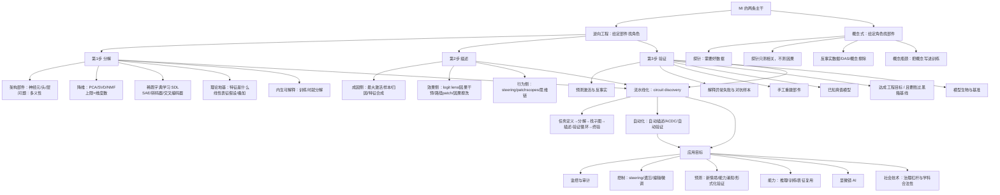

---
aliases:
  - "Open Problems in Mechanistic Interpretability"
  - "OPMI"
created: 2026-11-17
---
# Open Problems in Mechanistic Interpretability

> 这是一篇**前瞻性综述（forward-facing review）**，不是新方法论文。作者把机械可解释性（mechanistic interpretability, MI）的开放问题整理成三层结构：**方法与基础**（如何把网络分解成可解释部件、如何描述部件功能、如何验证描述、如何把三步流水线产品化并自动化）、**应用目标**（监控与审计、控制、预测、提升能力、显微镜式科学发现）、**社会技术议题**（治理接口、学科自我定义与传播风险）。它的核心主张可以概括成一句：MI 已经能在玩具任务上给出可信的机制故事，但距离「用机制知识对前沿模型做出可操作的保证」还差**分解方法的概念基础、验证标准的严格性、以及对训练动力学的理解**这三块基石；同时整个领域必须先把「什么算成功」定义清楚，否则技术进展会被误用为「黑箱问题已解决」的公关素材。

## 一句话定位

一篇 TMLR 预印本式的**议程论文（agenda paper）**：它不提出算法，而是把 MI 拆成「逆向工程三步循环」与「基于概念的探针路线」两条方法论主干，逐环节列出当前方法的失效模式，再把每条失效模式翻译成一个可执行的开放问题清单（正文 §2–§4 + 附录 A 汇总），并用「MI 的政策杠杆」与「MI 的学科合法性」两节把技术议程接到治理议程上（[§1.2](papers/可解释性/2501.16496/2501.16496.pdf#1.2)）。

## 问题与动机

**动机的三层。** 论文开头把 MI 的价值拆成互不相同的三类，这个拆分决定了后面所有「开放问题」的评判标准（[§1](papers/可解释性/2501.16496/2501.16496.pdf#1)）：

1. **工程价值**：人类对机制的理解不是模型能力的必要条件（开发者只设计训练过程），但它能增强**人类的能力**——更好的控制、部署期更好的监控、以及把模型放进安全关键与伦理敏感场景所需的信任。
2. **科学价值**：第一次可以以生物系统不可能达到的访问与控制粒度去研究「心智」；作者的问法是「我们从 AI 内部工作机制里能发现什么关于智能的自然规律」。
3. **跨学科价值**：如果 AI 在某科学领域超过人类设计的工具，说明它表征了某种我们尚未知晓的世界结构（蛋白质折叠、影像诊断），读懂这些表征就是把 AI 变成科学仪器。

**「理解」的操作性定义（全文最重要的一句定义）。** 论文明确把「理解一个网络的决策过程」定义为：**能够利用关于该决策过程背后机制的知识去成功预测它的行为（包括在任意输入上），或利用该知识完成关于该网络的其他实践目标**（[§1](papers/可解释性/2501.16496/2501.16496.pdf#1)）。这条定义把「解释」从「看起来合理的自然语言描述」挪到了「可预测性 + 可操作性」上，后面 §2.1.4 的验证清单（预测激活、预测反事实、解释异常失败、手工重建部件、在已知真值的模型上测试、达成工程目标、并要与黑箱基线竞争）全部是这条定义的展开。

**为什么必须是「mechanistic」而不是泛泛的 interpretability。** 论文用「三条历史线索」把术语钉住（[§1.1.1](papers/可解释性/2501.16496/2501.16496.pdf#1.1.1)）：

| 线索 | 驱动问题 | 代表方法 | 与 MI 的关系 |
|---|---|---|---|
| 可解释性设计（interpretable by design） | 能否造出天生可解释的模型 | 决策树、线性模型、GAM、概念瓶颈、Backpack、KAN | 目标不同：改架构而非读架构 |
| 局部归因（local attribution） | 模型为什么做了**这一次**决策 | grad-CAM、integrated gradients、SHAP、LIME、masking | 解释单个输入输出对，不承诺泛化机制 |
| **机制/泛化（mechanistic）** | 模型**如何解出这一类问题** | 特征可视化、network dissection、circuits、表征子空间、探针与稀疏字典学习 | 本文的讨论范围 |

这个划分的意义在于：它把「MI 的开放问题」限定为**关于泛化所依赖的共享计算**的问题。论文引用深度学习的基本假设——泛化来自共享计算——作为这条线索的合法性来源，并指出这也是为什么 MI 关心「circuits」而不是单个神经元（[§1.1.1](papers/可解释性/2501.16496/2501.16496.pdf#1.1.1)）。

**动机里被明确排除的东西。** 论文不讨论「解释以取悦用户」这一支（可解释 AI 的 HCI/合规文献），也不把「归因图好看」当作进展。取而代之，它给出五个具体目标作为评判坐标，后面 §3 的每一小节对应其中一个（[§1.2](papers/可解释性/2501.16496/2501.16496.pdf#1.2)）：

- 监控 AI 系统是否出现与危险行为相关的认知（→ §3.2）
- 修改内部机制与参数，让行为更符合需要（→ §3.3）
- 预测模型在未见情境下的行为、或预测某种能力何时出现（→ §3.4）
- 改进推理、训练与机制本身（→ §3.5）
- 从 AI 中抽取潜知识以更好地建模世界（→ §3.6）

**为什么现在写这篇综述。** 论文给出两个判断，构成它的「问题意识」：其一，尽管有令人鼓舞的进展，MI 距离「对大多数科学与工程目标都取得满意进展」还有相当距离；其二，现有综述（Rauker、Bereska、Ferrando、Mueller 等）多是**盘点现状**，而本文要回答的是**接下来该优先做什么**（[§1.1](papers/可解释性/2501.16496/2501.16496.pdf#1.1)）。因此它的组织单位不是「方法类别」，而是「方法链条上的环节 + 目标 + 社会条件」。

**一条容易被忽略的元论点。** 论文在 §4.2 承认：MI 迄今产出的工具**很少真正被用于让现实中的前沿系统更安全**；现代 AI 系统仍主要用不依赖内部理解的技术来训练、评测、监控和调试。「缺少范式共识」被点名为这件事的主要社会技术原因——领域该追什么目标、成功如何评级、「可解释性」该如何定义，都还没有比现状更认真的答案（[§4.2](papers/可解释性/2501.16496/2501.16496.pdf#4.2)）。这条自我诊断让本文区别于乐观的技术综述：它把「领域不知道自己要去哪」本身当成一个待解的开放问题（附录 A 的第一条就是 "What is interpretability?"）。

## 方法与机制（核心）

### 总览

**本文没有算法，「机制」就是它的分类学。** 要读懂它，需要抓住三层正交的切分：**(a) 两条方法论主干**、**(b) 逆向工程的三步循环**、**(c) 应用侧的四条进展轴**。三者叠起来才构成它的问题地图。

**(a) 两条主干：同一件事的两个方向。** 论文开篇即给出一个漂亮的对偶（[§2](papers/可解释性/2501.16496/2501.16496.pdf#2)，[图 1](papers/可解释性/2501.16496/2501.16496.pdf#figure=1)）：

- **逆向工程（reverse engineering）**：先分解网络，再识别部件的功能。方向是「**给定部件，找角色**」。
- **基于概念（concept-based）**：先提出一组人类概念，再找与之对应的部件。方向是「**给定角色，找部件**」。

这个对偶不是修辞。它决定了两个范式各自的失败模式：逆向工程的风险是**分解不成立**（部件不是计算的自然单位）；概念式路线的风险是**只能找到你已经在找的东西**（概念的定义先于发现，见 §2.2）。论文把两者放在同一节并列讨论，实际上是在说：MI 的两条腿一条向外（从结构到功能），一条向内（从功能到结构），而它们共享同一套验证标准。

**(b) 三步循环：全文的骨架。** 逆向工程被拆成三步，任何引擎、软件或神经网络都适用（[§2.1](papers/可解释性/2501.16496/2501.16496.pdf#2.1)，[图 2](papers/可解释性/2501.16496/2501.16496.pdf#figure=2)）：

1. **分解（decomposition）**：把研究对象切成更简单的部件；
2. **描述（description of components）**：对部件的功能角色与相互作用提出假设，这一步才叫「解释」；
3. **验证（validation）**：检验假设是否为真。

若假设被推翻，必须**回到前面**去改进分解或改进功能假设。用映射的语言写出来就是：

$$
\text{理解} \;=\; \text{在}\ \underbrace{\text{分解}}_{\text{选什么当单位}}\times\underbrace{\text{描述}}_{\text{给单位什么角色}}\times\underbrace{\text{验证}}_{\text{凭什么信}}\ \text{三轴上同时取得进展}
$$

这条式子的用处是：它解释了为什么论文对每个新方法都问同样三个问题。「SAE 找到了可解释的 latent」只回答第 1、2 步；「探针能预测概念」只回答第 2 步的一半；而绝大多数被批评的工作，问题都出在第 3 步（把假设当结论）。

**(c) 应用侧的四条轴：为什么同一项技术进步对不同目标价值不同。** 论文在进入应用章前先定义了四条正交轴（[§3.1](papers/可解释性/2501.16496/2501.16496.pdf#3.1)），这是全文最可复用的一张「判据表」：

| 轴 | 两端 | 谁需要哪一端 |
|---|---|---|
| 分解 vs 描述 | 分解好坏 / 描述深浅（因果-机制 vs 相关-浅表） | 监控只需浅描述；编辑需要深描述 |
| 范围（extent） | 单个部件或小 circuit / 整个模型 | 白盒评测只需局部；enumerative safety 需要全域 |
| 任务分布范围 | 窄子分布 / 全分布 | 监控某一种行为 vs 形式化验证 |
| 训练前 vs 训练中 | 固定模型的机制 / 机制如何随学习演化 | 预测能力涌现必须用后者 |

一个具体推论：论文认为**机制异常检测（mechanistic anomaly detection）主要卡在分解轴上**，因为要判断「异常」必须先确信「什么算一个独立机制」；而当前的 SDL 只能识别活跃的 latent，识别不了活跃的**机制**（机制由参数实现，不由激活实现）[§3.2](papers/可解释性/2501.16496/2501.16496.pdf#3.2)。

**(d) 三类问题：为什么它们不能被分开解决。** 论文的章节划分本身就是一种问题类型学：**方法/基础**（§2）、**应用**（§3）、**社会技术**（§4）。理解这三类的耦合方式，比记住任何单个问题都重要：

| 类型 | 判据（什么样才算解决） | 典型问题 | 与另两类的关系 |
|---|---|---|---|
| 方法/基础 | 有形式定义 + 可测量 + 可通过验证 | 特征是什么、如何分解、如何验证解释 | 是应用的前提；但它自身的优先级由应用目标倒推 |
| 应用 | 在具体目标上**优于替代方案**（含黑箱基线） | 白盒评测、编辑、形式化验证 | 给方法提供判据；失败会暴露方法的缺哪一环 |
| 社会技术 | 有制度接口 + 无误用 + 学科自我定义清楚 | 治理杠杆、选择性透明、成功如何评级 | 决定资源投向；误用会反过来污染方法的评价标准 |

这条耦合链解释了一个反直觉现象：论文在方法章反复要求「与黑箱基线竞争」，却在社会技术章承认「不必然要严格胜出」。两者不矛盾——**在安全相关应用上必须比较（否则结论不可信），但在学科建设上允许「同量级即可」（否则早期方法会被过早淘汰）**。这也是附录 A 把「What is interpretability?」「How should success be graded?」放在社会技术类而不是方法类的原因：它们不是技术问题，却决定了技术问题的答案是否被承认。

**地图长什么样。** 下面这张图把全文的模块关系画出来（节点编号对应后文小节）：

### 模块一：第 1 步「分解」——网络为什么不天然可切

**首先被否掉的是架构部件。** 论文用神经科学的「神经元学说」作类比：早期工作把单个神经元或卷积核当作结构-功能单位，结果发现单个神经元是**多义的（polysemantic）**——同时响应多类特征，人工网络与生物网络皆然；注意力头同样多义，且注意力图常常误导；表征还可能跨层分布（跨编码器的动机），而按层干预则说明层这个粒度太粗（[§2.1.2](papers/可解释性/2501.16496/2501.16496.pdf#2.1.2)）。这一连串否定给出了本节的核心问句：**如果不是神经元/头/层，那什么才是？**

**降维的上限被叠加假设击穿。** PCA/SVD/NMF 的做法是收集隐激活再做无监督降维，希望激活的结构对应计算的结构。但按「叠加假设」，网络可以在 $d$ 维空间里表示远多于 $d$ 个特征，只要每个特征稀疏激活；而降维方法**无法给出多于维数的方向**，这就是它不再是 SOTA 的根本原因（[§2.1.2](papers/可解释性/2501.16496/2501.16496.pdf#2.1.2)，[图 3](papers/可解释性/2501.16496/2501.16496.pdf#figure=3)）。

用一句话写出 SDL 的目标函数直觉：给定激活 $\mathbf{x}$，学一个宽隐藏层的二段网络，编码器给出稀疏的 latent 激活 $\mathbf{f}$，解码器矩阵的列构成字典方向 $\mathbf{D}$，训练目标是「重构误差 + 稀疏惩罚」：

$$
\min_{\mathbf{D},\mathbf{f}}\ \|\mathbf{x}-\mathbf{D}\mathbf{f}\|_2^2+\lambda\|\mathbf{f}\|_1
\quad\text{s.t.}\quad \mathbf{f}\ \text{稀疏}
$$

意义先于符号：第一项要求 latent 能还原原始激活（否则谈的不是这个模型），第二项要求同时激活的 latent 很少（否则字典方向无法与「特征」对应）。SAE、转码器（重构下一层）、交叉编码器（多层的输入输出）都是这套骨架的变体（[§2.1.2](papers/可解释性/2501.16496/2501.16496.pdf#2.1.2)）。

**SDL 的八条限制（本节最该背下来的清单）**。论文明确说 SDL 是当前最流行的无监督分解方法，但也有实质性的实践与概念问题（[图 4](papers/可解释性/2501.16496/2501.16496.pdf#figure=4)）：

1. **重构误差太大**。把 1600 万 latent 的稀疏字典塞进 GPT-4，语言建模损失相当于只有 GPT-4 预训练算力 **10%** 的模型；Makelov 等发现用 SAE 重构替换激活会让 GPT-2 small 在任务数据上掉 **10%**、在全分布上掉 **40%**。把字典做得更大更稀是可行但昂贵的解法，而其极限退化为「每个数据点一个 latent」，反而不可解释；「error node」能吸收残差但装的是「其余一切」，不是解法。Engels 等发现误差的方向与范数可从初始激活线性预测，这既说明 SDL 系统性漏掉了结构化成分，也暗示了修法（[§2.1.2](papers/可解释性/2501.16496/2501.16496.pdf#2.1.2)）。
2. **成本高**。每层都要训练一个小网络，字典参数往往比该层原模型还多；对全模型所有向量空间做 SDL 的公开尝试尚不存在，因此相对成本是亚线性还是超线性都还不清楚。
3. **在非线性模型里假设了线性表征**。线性表征假设有强弱两版：弱版说「有些概念是线性表示的」，强版说「所有概念都是」。论文指出强版对某些模型已被证伪，而弱版被线性探针、激活引导与 SAE 找到可解释 latent 的成功所支持；早期「一维特征」的附加假设也已被推翻。
4. **稀疏不是可解释性的好代理**。特征分裂、特征吸收、以及「组合」现象说明优化压力足够大时，稀疏→可解释的代理会失效（论文也承认分裂是否算问题仍有争议）；MDL 一类目标可能比稀疏本身更合适，也可能**没有任何代理指标是充分的**。
5. **特征几何被丢掉**。SDL 把网络分解成单方向，只有在把激活看成「特征袋」时才合理；但特征的几何排布似乎承载语义与功能结构（如「巴黎—法国—欧洲」的层级）。这里的开放问题是分水岭：**要理解全局几何（两两关系）还是只需局部几何**？若是前者，当前范式可能根本走不通。
6. **不能直接用于所有架构**。表征可能分布在多个注意力头之间、甚至跨层，而如何对跨头/跨层表征做 SDL 并不显然，把跨层表征翻译成因果机制描述更难。
7. **只分解机制的输入输出，不分解机制本身**。latent 是激活，激活只与机制交互，它不是机制；从 latent 到机制仍需事后分析（昂贵、依赖数据）。论文借此点出更普遍的偏向：**当前 MI 主要研究激活的结构，很少研究这个结构是如何由权重算出来的**。
8. **latent 未必包含下游要用的概念**。有时确实有单个 latent 对应目标任务（如 GLUE CoLA 上比官方标签更准的 latent），但更多时候找不到这样的稀疏 latent 集合；原因可能是「模型不是这么想的」、训练分布太窄（在预训练数据上训的 SAE 缺少「拒绝」概念，在对话数据上训的才有）、字典太小等等。更要命的是 latent 依赖训练数据分布——这对一个原本被期望给出「基本计算单元」的方法是不良性质。

**理论地基缺失。** 论文的判断是：在 SDL 上投入了大量努力之后，显然需要超越「叠加假设」的概念清晰度。最尖锐的开放问题是**特征（feature）到底是什么**——它至今没有令人满意的形式定义。但论文同时给出一个方法论上的宽慰：即使概念混乱，也可能在实用上有效（"even confused concepts can be pragmatically useful"）。若叠加只是实用而非根本为真，就可能存在更好的切法：考虑特征几何的切法，或采取「发育式」视角看机制结构如何在训练中涌现。另一条路是把 MI 建在因果性形式化上（因果抽象），但目前尚未产出可作为分解基础的**典范因果中介（canonical causal mediators）**；样条理论、 simplicity bias、NTK、奇异学习理论（SLT）都还没有给出可直接用于解释的数学对象（[§2.1.2](papers/可解释性/2501.16496/2501.16496.pdf#2.1.2)）。

**内生可解释（intrinsic interpretability）。** 与其事后分解，不如训练时就让模型可分解：离散码本、TopK/SoLU 稀疏激活、限制注意力叠加、MoE 专家、权重稀疏（L0/剪枝）、模块化（脑启发模块训练）、去掉 LayerNorm、双线性 MLP。论文的诚实评价是：**多数直接激励可解释激活的尝试性能不具竞争力，而且让「叠加偷偷溜过去」**，从而抵消了收益（[§2.1.2](papers/可解释性/2501.16496/2501.16496.pdf#2.1.2)）。

### 模块二：第 2 步「描述」——成因、效果、行为三条路

论文把「描述部件功能角色」定义为提出假设（不是结论），并规定好的描述应同时说明 **(1) 什么导致它激活** 与 **(2) 它激活后发生了什么**，最好两者兼有（[图 5](papers/可解释性/2501.16496/2501.16496.pdf#figure=5)）。

**成因侧的三类方法及其病灶。**

| 方法 | 做法 | 主要问题 |
|---|---|---|
| 最大激活样本（exemplar） | 取让部件最激活的输入，看共性 | 依赖人类先验（把人类概念投射到可能陌生的概念上）；数据集偏置造成**可解释性幻觉**（换数据集，BERT 同一方向的含义被标注成完全不同的东西）；**对任意方向都能编出看似合理的解释**；可造出故意误导的特征可视化 |
| 归因方法 | 梯度类（grad-CAM、IG、backprop）或扰动/消融类（masking、因果中介、激活 patch） | 梯度类只给一阶近似；有工作证明某些梯度归因与模型和数据生成过程**都无关**；对抗者可让任意归因图出现；扰动类把模型推离训练分布 |
| 特征合成 | 优化输入以最大化某部件激活，并加生成模型/全变差等正则 | 有研究认为自然数据样本反而更好解释；现有方法难以识别木马 |

结论句是：最大激活样本只给**相关**解释，要因果解释必须上归因；但归因本身的可解释性与稳健性都不合格（[§2.1.3](papers/可解释性/2501.16496/2501.16496.pdf#2.1.3)）。

**效果侧的三个粒度。**

1. **直接效果**：logit lens 把中间残差乘上 unembedding 得到词表分布；直接 logit 归因把它推广到任意合适大小的向量空间（MLP 输出、注意力块、梯度、SAE 解码权重）；tuned lens 加一个可训练仿射变换提升解码准确率，代价是**不再忠实反映「模型何时算完」**。用因果语言说：unembed 只测**直接效果**，测不到间接效果（对后续层隐激活的影响），后者必须靠干预（[§2.1.3](papers/可解释性/2501.16496/2501.16496.pdf#2.1.3)）。
2. **因果干预**：消融、激活 patch、因果中介、因果追踪、交换干预都属于这一类；更精细的是**路径 patch**（只隔离一个部件对另一个部件的影响）与**因果擦洗**（可检验任意部件集合之间连接的假设）。干预还能反过来当监督信号去学子空间：DAS 用「对概念做干预」的数据学一个线性子空间。成本是核心约束：每个部件一次前向，在大模型/长上下文/SAE latent 粒度上不可承受，于是有归因 patch、AtP*、integrated gradients 等梯度近似（一阶近似是否够用仍是开放问题）。
3. **行为侧**：steering（把假设的激活向量加进去看行为）、patchscopes（把一次前向的激活 patch 到另一次前向，让模型自己「读出」激活内容）、以及直接读思维链。论文对思维链的态度很明确：它不使用模型内部，近来的 faithfulness 研究也表明 CoT 并不完全忠实；有希望的方向是**把内部状态纳入 CoT 训练**以激励忠实，或**基于内部造监视器**去校验 CoT。

### 模块三：第 3 步「验证」——从「看起来对」到「能预测」

论文开篇就给出一句行业批评：**把假设当结论在 MI 里相当普遍**，因此验证是领域最该改进的地方。判据是单一问句——**这个假设对网络行为做出了好的预测吗**（[§2.1.4](papers/可解释性/2501.16496/2501.16496.pdf#2.1.4)）。它给出七级验证阶梯，从弱到强：

1. **预测激活与反事实**：用自然语言解释去预测部件在新输入上的激活水平（可人做也可 AI 做，如 autointerp）；更强的要求是预测干预后的下游效应。
2. **预测并解释异常失败/对抗样本**：能解释深度 RL 智能体为何没拿到最大回报、能解释幻觉、能用解释手工构造对抗样本。
3. **手工重建部件**：如果解释足够好，就应该能用简单手工替换件替掉原部件（曲线检测器的经典案例）。
4. **在已知真值上测试**：权重由人手工编写的玩具网络提供 ground truth；或用 Tracr 把程序编译成权重；或用交换干预训练（IIT）在常规模型里强制预定解释。
5. **用假设达成工程目标**。
6. **用假设达成工程目标且具竞争力**——与相关基线在真实任务上公平比较、不许挑数据。论文的判断是：**这类非挑选式评测在 MI 里仍相当罕见**，而已有的尝试没能稳定显示解释工具的用处；若不这样做，领域会被激励去开发只在最好情形和简单任务上有效的办法。
7. 为此论文推荐两种基础设施：**模型生物（model organisms）** 与 **基准（benchmarks）**。前者要回答「MI 的果蝇是什么」：理想模型生物应开源、便宜、能代表广泛系统与现象、训练过程与数据可复现、且有多个随机种子实例；目前常用的模块加法 transformer 与 GPT-2 只满足部分条件。后者要回答「如何评测整个方法而非单个假设」：以已知真值解释为金标准（Tracr 编译、IIT 强制），并分别评测流水线的各步（分解、描述、自然语言解释）。

### 模块四：概念式路线——探针能告诉你什么、不能告诉你什么

**定义与两个挑战。** 概念探针是一个用隐表征预测概念标签的分类器；线性探针成功，就把概念定位成隐空间中的一个向量。它要求一个**标注函数**（把输入映到概念取值）与一个简单参数模型。论文把挑战归为两条，后面各用一小节展开（[§2.2.1](papers/可解释性/2501.16496/2501.16496.pdf#2.2.1)）：

- **挑战一：需要精心挑选的数据。** 标注函数不总是显然的，为单个概念造数据集可能耗费大量人力；更根本的是，**你只能发现你定义得足够清楚的概念**——这使概念探针在结构上无法揭示网络中意外的特征。CCS（对比一致性搜索）试图更无监督地找「正/负命题轴」，但它仍需要清晰的正负例数据集。出路是自动化生成探针数据与概念定位。
- **挑战二：探针测的是相关，不是因果变量。** 从信息论看，任意强的探针测的是隐表征与概念之间的互信息；但训练成功不等于这些激活**因果地中介**了概念的使用，甚至不等于网络用了这个概念。探针可以在与输出毫无因果联系的激活上成功训练。因此探针只能用来**生成假设**，确认要靠因果干预或其他探针。提升因果相关性的手段是反事实数据：对概念本身做干预（把图里的狗换成猫）、DAS、因果探针、用归因衡量概念向量对预测的影响、概念擦除（LEACE 等）。代价是需要比普通探针更专门的数据。此外还有高维带来的**虚假相关**风险，必须在分布外、沿任务相关维度变化的测试集上验证探针的泛化；「如何用正则化取得好的探针泛化」被列为未解问题。
  
**概念式的内生版本。** 概念瓶颈模型把概念写进训练流程，使被分配到概念的部件更可能是因果相关的；也可以直接训练网络使用特定因果结构。论文的评述是：不可能预先指定所有相关概念或结构，因此这条路线需要与解耦方法结合（[§2.2.4](papers/可解释性/2501.16496/2501.16496.pdf#2.2.4)）。

### 模块五：把三步粘成流水线——circuit discovery 的五个步骤与六处失灵

这是全文唯一的「案例研究」式拆解：把主流 circuit discovery 流水线摊开，逐步检查它做了哪些隐含选择（[§2.3](papers/可解释性/2501.16496/2501.16496.pdf#2.3)）。

| 步骤 | 实际做法 | 隐含假设 |
|---|---|---|
| 1 任务定义 | 选一个模型能做、且有数据集的 task | **这一步本质是概念式的**：任务分布由人定义 |
| 2 分解 | 把网络看成 DAG，节点=激活、边=抽象权重；多数工作用注意力头/MLP 层，新近工作用 SDL latent | 架构部件或 SDL latent 是合适的节点 |
| 3 找任务相关子图 | 用 clean/counterfactual 数据做迭代激活 patch，或 integrated gradients | 因果重要性可由「对指标的影响」度量 |
| 4 描述-验证迭代 | 研究者凭直觉对节点/边提可检验假设，设计定制实验验证，多轮后才满意 | 迭代过程可省略不写（论文只呈现最终描述） |
| 5 终验 | faithfulness / minimality / completeness 三属性；外加临时方法（造对抗样本、形式化统计检验） | 这三个属性足以刻画「解释得好」 |

**六处失灵（每条都对应一个开放问题）：**

1. **任务定义是概念式的**。已有 circuit 都是相对人类定义的任务；有工作显示任务内方差很大——circuit 能很好近似数据集上的平均表现，却对任何**单个**数据点都很差。这暗示「先选任务再研究模型怎么解」可能不是实现逆向工程式理解的有效路径，也许应该反过来**学习任务分解**。
2. **分解方法本身有缺陷**。无论架构基还是 SAE latent 都不完美（见模块一），未来应在更好的分解里找 circuit，或**同时学习分解与 circuit**。
3. **circuit 忠实度低**。早期简单 circuit 被证明不忠实；现有 faithfulness 度量依赖具体干预实现，且在若干复杂端到端 circuit 上会误导；子空间激活 patch 可能产生可解释性幻觉（该结论仍有争议）。
4. **可扩展方法只是近似**。逐部件干预在大模型上不可行，归因 patch 用梯度只给一阶近似，是否足够仍不清楚。
5. **backup / negative 行为**。有些部件主动压制任务表现（备份、负向），最大化任务表现的度量抓不到它们，但它们对解释完整算法很重要。
6. **路灯式可解释（streetlight interpretability）**。被研究的任务都是**故意挑出来便于机制分析**的，这给人错误的难度印象；对任意任务的尝试明显更不成功。

### 模块六：自动化——已经能自动的部分与还不能自动的部分

**能自动的**：用最大激活样本 + 语言模型生成部件功能描述（神经元、SAE latent），并用「人或模型能否据描述预测该特征在某样本上是否激活」作为**可量化的可解释性度量**；改进方向是自动生成能激活被解释特征的测试输入、以及更严格的统计检验。**部分自动的**：ACDC 自动找任务相关子图，后续工作（归因 patch、AtP*、稀疏特征 circuit）加速了它——但 ACDC 类方法只替代第 3 步，不替代「描述子图部件功能」这一步（[§2.4](papers/可解释性/2501.16496/2501.16496.pdf#2.4)）。

**结论句很重要**：即使把当前流水线全自动跑通，也**不会**产出令人满意的行为解释；要产出达到目标的解释质量，还需要方法上的进一步进展。附录 A 里还留了一条常被忽略的问题：**是否应当防止「可能有错的 AI 系统」去破坏自动化的可解释性研究**——即把「被解释对象可能对抗解释」纳入威胁模型。

### 模块七：应用侧——五个目标各自卡在哪条轴上

这一节的价值不在结论而在**配对**：每个目标配一条最关键的进展轴（[§3](papers/可解释性/2501.16496/2501.16496.pdf#3)）。

| 目标 | 已有证据 | 最关键的轴 |
|---|---|---|
| **监控与审计**（§3.2） | 白盒评测在今天就可行：即便浅的、基于相关的描述也能标记可疑认知；「识别欺骗」与「产生欺骗」的特征难以区分，但能同时标记两者的相关方法可以兜住后者。机制异常检测、部署期被动监控、用「拒绝方向」加速红队 | 只要**局部**理解 + 浅描述；异常检测则主要卡在**分解**（要能定义「一个机制」）。论文判断这是 MI 相对其他 ML 领域**比较优势最大**的用途 |
| **控制**（§3.3） | 激活引导（源自线性表征假设，其成功又反过来当证据）；遗忘（改激活的方法目前不具竞争力）；知识编辑（ROME 是初步进展，但被指出缺陷，说明还没找对干预部件）；微调分析（现有微调多为**浅层改写既有表征与回路**，因此无害化训练可被廉价撤销） | 深描述 + 更细分解；「编辑某能力」比「删除某知识」难得多 |
| **预测**（§3.4） | 预测新情境行为：越狱路径、木马/后门、幻觉的内部签名、事实知识的探针；「枚举式安全」可用较弱描述完成特定主张；形式化验证只在玩具模型上做到（单层 transformer 的精度界、把训练好的网络转成程序） | 全域范围 + 深描述；验证还需要「环境可形式化」这个额外前提 |
| **能力**（§3.5） | 加速推理（跳过可跳的计算）、改进蒸馏、数据选择、训练监控、参数高效训练、模型合并与表征迁移 | 中等描述即可见效，是「低垂果实」 |
| **显微镜 AI**（§3.6） | AlphaZero 棋概念教给特级大师、用被告照片+法官判决的 CNN 揭示面部特征影响、把心理学文献转成因果图、免疫细胞蛋白表达的形态学特征 | 描述深度 + 可及性（需要 ML+MI+领域三重专长，是当前的采纳瓶颈） |

另有两节不属于五目标但同样是开放问题：**模型族覆盖**（研究几乎只集中在 CNN 图像、BERT、GPT 三类；SSM/RWKV/扩散/ViT 的方法迁移与结论迁移都未知，「普适性假设」——不同网络学到相似特征与 circuit——因此无法检验）与 **人机交互**（把内部表征做成审计员与终端用户可用的界面、实时仪表盘、直接操纵式控制）（[§3.7](papers/可解释性/2501.16496/2501.16496.pdf#3.7)、[§3.8](papers/可解释性/2501.16496/2501.16496.pdf#3.8)）。

### 模块八：社会技术——治理接口与学科合法性

**治理接口（§4.1）。** 论文逐条对应现行法规找接口：EU AI Act 要求系统性风险模型做评测与事件报告 → 解释工具可做持续监控与事件归因；GDPR 的「获得解释的权利」→ 用机制知识生成决策理由；美国版权法对「可被机器感知/复制」的定义 → 用解释工具检测并移除被逐字记忆的作品； preparedness framework 的生物风险承诺 → 用遗忘移除相应知识。论文的态度是谨慎的：技术进展能否转化为治理杠杆**高度不确定**，因为这些技术问题本身未解（[§4.1](papers/可解释性/2501.16496/2501.16496.pdf#4.1)）。

**学科合法性（§4.2）。** 三条批评被摆上台面：**(i)** 追求「理解」而不接下游应用，错过工程目标；反过来，只用可量化基准又会把解空间人为限制在工程问题上（引 Krishnan 的批评：把「可解释性」当成问题本身，会窄化解空间）。**(ii)** MI 尚未产出有竞争力的技术、常省略非可解释性基线、并在自己的曲线上给自己打分；论文的辩护是：不必然要严格胜出，只要在同一量级，进一步进展就可能带来优势——但在安全相关应用里必须与替代方法比较。**(iii)** 「选择性透明」可被用来主动误导；产业界对领域的支配带来发表选择性与利益冲突；已有把「黑箱问题已解决」当作游说论据的实例（[§4.2](papers/可解释性/2501.16496/2501.16496.pdf#4.2)）。

## 实验与对比

**本篇没有原始实验。** 它是一篇综述/议程论文，全部「实验证据」都是**对他人结果的引用与再解读**。因此本节不复述某张结果表，而是把文中被当成「量化锚点」使用的外部数字集中列出，并注明它们被用来支持哪条论断——这是读这篇综述时最该抄下来的部分（数字均取自原文转述）：

| 引用来源 | 量化结果 | 论文用它论证什么 |
|---|---|---|
| Gao 等 2024（1600 万 latent 字典插入 GPT-4） | 语言建模损失 ≈ 只有 GPT-4 预训练算力 **10%** 的模型 | SDL 重构误差过大，latent 对原模型不够忠实（[§2.1.2](papers/可解释性/2501.16496/2501.16496.pdf#2.1.2)） |
| Makelov 等 2024 | SAE 重构使 GPT-2 small 在任务数据上 **−10%**、全分布上 **−40%** | 同上；且误差随分布外推而放大 |
| Engels 等 2024 | 重构误差的方向与范数可从初始激活**线性预测** | 误差不是纯随机，SDL 系统性漏掉结构化成分（同时暗示修法） |
| Kissane 等 2024 | 预训练数据上训的 SAE 缺少「拒绝」概念，对话数据上训的才有 | latent 依赖训练分布，与「基本计算单元」的期望冲突 |
| Kantamneni 等 2024 | 单个 latent 的激活模式在 GLUE CoLA 上**比官方标签更准** | 反例：确实存在「一个 latent 对应一个概念」的情形 |
| Nanda 等 2023（模块加法） | 小型 transformer 学到**傅里叶变换**策略而非人类式进位 | 「人机用不同表征」的核心证据（[§2.1.1](papers/可解释性/2501.16496/2501.16496.pdf#2.1.1)） |
| Shlegeris 等 2024 | 仅 GPT-3 **1%** 规模的模型在下个 token 预测上超过人类 | 同上 |
| Kosoy 等 2023 | SOTA 多模态 LLM 在四岁儿童能做的因果任务上失败 | 同上 |
| Geirhos 2019 / Brendel 2019 | CNN 更依赖纹理（靠象皮认象）、依赖数据相关（靠渔夫手指认鱼） | 人类与模型即使水平相当，用的启发式也不同 |
| Bolukbasi 等 2021 | 换数据集后，BERT 同一激活方向被人标注出**截然不同**的含义 | 最大激活样本会制造可解释性幻觉（[§2.1.3](papers/可解释性/2501.16496/2501.16496.pdf#2.1.3)） |
| Miller 等 2024 | 任务内方差大：circuit 近似平均表现好、对单点差 | circuit 的「任务定义」本身是概念式的（[§2.3](papers/可解释性/2501.16496/2501.16496.pdf#2.3)） |

**两条对比性判断（不是实验，但对读者更有用）：**

- **方法对比的结论**：论文认为在分解侧，SDL 是当前最强但远未解决问题的一族；在描述侧，归因方法不可替代但一阶近似与稳健性不合格；在验证侧，领域整体最弱。这三条判断与 MIB 后来的实测结论方向一致（归因/patch 类方法领先，SAE 特征不优于神经元），见 [[papers/可解释性/2504.13151/NOTES|MIB]]。
- **目标对比的结论**：白盒评测/审计是 MI 比较优势最大的用途，因为其他 ML 子领域已经在做「控制输入输出行为」，而「理解认知机制」几乎是 MI 独占的（[§3.2](papers/可解释性/2501.16496/2501.16496.pdf#3.2)）。

## 归因分析

这里的「归因」有两层：**论文把领域困境归因于什么**，以及**我们该把这篇综述的判断归因于什么证据**。

**第一层：论文自己的因果归因链。** 它把「MI 至今未产生现实安全影响」归因到一条相当克制的链条上——不是「方法不够多」，而是：

$$
\text{缺少范式共识}\ \to\ \text{目标与成功标准不清}\ \to\ \text{方法在自定曲线上被评价}\ \to\ \text{工具不具竞争力}\ \to\ \text{现实系统仍靠黑箱手段运维}
$$

支撑这条链的三个具体归因值得记住：**(a)** 分解缺乏概念基础（「特征是什么」没有定义）是所有下游问题的上游；**(b)** 验证成本高（时间与认知劳动）导致假设被当结论，因此需要模型生物与基准这类**降低验证边际成本的基础设施**；**(c)** 目标侧的错配——把 MI 的力气花在「控制行为」上是与整个 ML 领域正面竞争，而花在「审计认知」上才是扬长避短。

**第二层：这篇综述的证据结构。** 它的每条判断都靠**二手文献的堆叠**而非新实验，这带来两个后果。好处是覆盖面极广（正文引文数百条，几乎每个论断都挂 1–5 篇具体工作），使它成为该领域最好的「问题索引」。代价是**它对被引工作的转述未经独立复核**，且部分判断在原文发表时点就已存在争议（论文自己标注了两处：特征分裂是否算问题、Makelov 的子空间可解释性幻觉结论是否成立）。

**第三层：立场归属。** 论文在首页明确声明这是「各作者观点的综合，由 Apollo Research 代表 Schmidt Sciences 整理，不一定反映任何单个作者或其机构的观点」。这句话很重要：它是**共识文档**而非某个实验室的方法论宣言，因此它在争议处的处理方式是「并列双方 + 指出未决」，而不是下判决。读者若想要某一学派的强主张，应回到被引的原始论文。

## 局限与未来工作

**原文未设「Limitations」节**（Not explicitly specified in text）。这与它的体裁一致：综述不承诺方法性能，因此没有需要自我限定的实验结论。但仍可从正文抽出它**自认的**边界与后续路线，以及我们作为读者应补上的两条限制。

**原文自认的边界（散落在各节）：**

- **概念基础未立**：特征没有形式定义；叠加假设可能只是实用而非为真；典范因果中介尚未找到。论文明确说「即使概念混乱也可能实用」，等于承认当前进展建立在未证地基上（[§2.1.2](papers/可解释性/2501.16496/2501.16496.pdf#2.1.2)）。
- **成本边界**：SDL 对全模型所有向量空间的相对成本未知（无公开尝试）；因果干预在大模型/latent 粒度上不可承受；形式化验证只在玩具模型上可行。
- **覆盖边界**：研究集中在三类模型族，方法向 SSM/扩散/ViT 的迁移只见到零星正面证据；多模态默认化后这一缺口会扩大（[§3.7](papers/可解释性/2501.16496/2501.16496.pdf#3.7)）。
- **治理边界**：技术进展能否转化为治理杠杆「高度不确定」；论文拒绝给出时间表。

**原文给出的优先路线（可当作 TODO 读）：** 建立更好的理论地基（把泛化理论接上可解释性）→ 造内生可分解模型 → 建立模型生物与标准化基准（含最坏情形/分布外）→ 把验证与工程目标对齐（与黑箱基线公平比较）→ 理解训练动力学（机制如何在训练中涌现）→ 再谈自动化整条流水线。

**我们应补的两条限制：**

1. **时点性**：本文写于 2025 年初，其「SDL 是主流」的判断随后被更强的批评与替代方案冲击（SAE 特征不优于神经元基线的实测、以及神经元基 circuit tracing 的复兴）。读它时应把「SDL 的八条限制」当作**当时最完整的批判清单**，而不是当前状态描述，参见 [[papers/可解释性/2601.22594/NOTES|Circuits Sparse in Neuron Basis]]。
2. **可操作性**：附录 A 的问题清单极长（数百条子问题），但没有给出优先级权重或依赖关系图。读者若要据此立项，需要自己补一层「哪些问题解了会解锁其他问题」的排序——本文只提供清单，不提供路线图的拓扑。

## 与其他工作的关系

**它是这个专题的「索引层」。** 下面按本库已有论文逐条接上，说明本文在每处提供了什么视角：

- **叠加与玩具模型**：[[papers/可解释性/2209.10652/NOTES|Toy Models of Superposition]] 是本文「叠加假设」一节的原始来源；本文对它的用法是**把它当成 SDL 的前提**，并追问「这个前提是否为真、以及网络是否在叠加下原生地做计算」（后者被列为独立开放问题）。
- **SAE 的两端**：[[papers/可解释性/2309.08600/NOTES|SAE features]] 是「SDL 能给出可解释 latent」的正面证据；[[papers/可解释性/2406.04093/NOTES|SAE scaling]] 对应本文引用的「1600 万 latent / 10% 有效算力」这一重构误差锚点。本文对二者的定位很清楚：**它们是分解方法的经验进展，但不解决「特征是什么」的概念问题**。
- **单点机制案例**：[[papers/可解释性/2202.05262/NOTES|ROME]] 在本文里被当作「基于解释的模型编辑」的初步进展，同时被指出缺陷（Thibodeau、Hase 等）——即「还没找对可干预的部件」，这正是第 1 步分解问题的下游症状（[§3.3](papers/可解释性/2501.16496/2501.16496.pdf#3.3)）。[[papers/可解释性/2211.00593/NOTES|IOI]] 则是 circuit discovery 流水线的范式案例，本文用它说明「路灯式可解释」与 faithfulness 争议。
- **验证工具**：[[papers/可解释性/2404.15255/NOTES|activation patching]] 属于本文第 2 步「因果干预」一族；本文对它的评价是「不可替代但成本高」，因此需要归因 patch 这类一阶近似，而近似的充分性是开放问题。
- **基准化**：[[papers/可解释性/2504.13151/NOTES|MIB]] 正是本文 §2.1.4「用基准验证整个方法」这条建议的落地物：两条 track、四个任务、跨方法比较、公开排行榜。本文提出「需要非挑选式的、与基线公平比较的评测」，MIB 给出了一种具体实现（并给出「SAE 不优于神经元」这类本文只能推测的结论）。
- **神经元基的回归**：[[papers/可解释性/2601.22594/NOTES|Circuits Sparse in Neuron Basis]] 直接挑战本文默认的「神经元不可解释、需换基」前提，指出 MLP 激活是特权基且与 SAE 同等稀疏。这与本文 §2.1.2 对「架构部件多义」的否定构成**有益的张力**：本文说单神经元多义，该文说 MLP 激活（而非 MLP 输出）在 circuit tracing 下足够稀疏——两者并不矛盾，但提示「多义」的判断依赖于你问的是「神经元编码什么」还是「神经元在 circuit 里贡献多少」。
- **同专题的两篇综述**：[[papers/可解释性/2601.14004/NOTES|Survey Actionable MI]] 与 [[papers/可解释性/2611.08438/NOTES|MI for AI Safety]] 与本文共享「MI 如何变得可用/可依赖」的问题，但本文的独特贡献是把**社会技术与治理**正式写进技术议程（§4），并用「四条进展轴」把技术选择与目标绑定；另两篇更偏向把 MI 作为安全工具箱来分类。三篇并读可以得到「问题清单（本文）—可操作化分类（2601.14004）—安全论证接口（2611.08438）」的完整链条。

