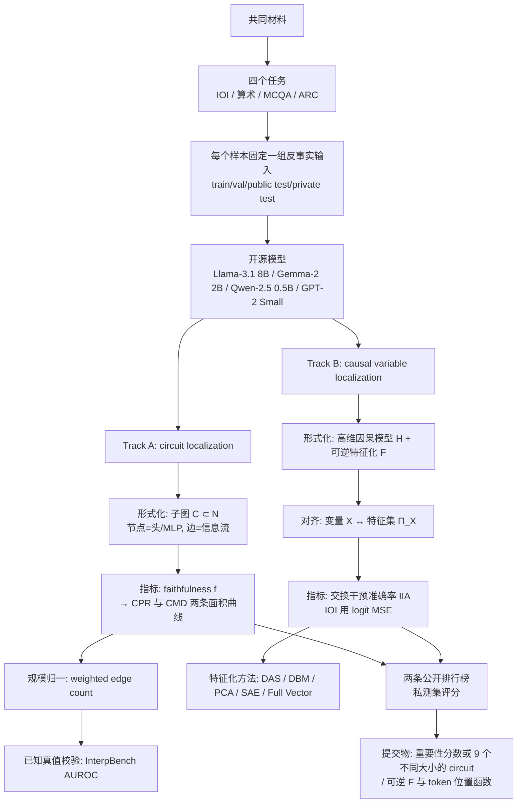

---
aliases:
  - "MIB: A Mechanistic Interpretability Benchmark"
  - "MIB"
created: 2026-11-17
---
# MIB: A Mechanistic Interpretability Benchmark

> 这篇论文要为机械可解释性（MI）造一把**可比的尺子**。作者认为领域的核心病症不是方法太少，而是**方法之间无法比较**：新方法常用自选的度量在自选的任务上打败旧方法，结论无法泛化。MIB 因此把「精确定位并对因果地验证模型中的任务机制或概念」立为基准所承诺的重要目标，用**两条 track**（circuit localization / causal variable localization）× **四个任务**（IOI、算术、MCQA、ARC）× **一组开源模型**搭起评测，关键设计是：固定每个样本到其反事实样本的映射、提供公开/私有两套测试集、把 faithfulness 拆成 $\mathsf{CPR}$（面积型「越多越好」）与 $\mathsf{CMD}$（面积型「越接近 0 越好」）两个新指标，并以 leaderboard 持续接收提交。三条实测结论是：**归因（EAP/EAP-IG）与 mask 优化（UGS）在 circuit 定位上最好；有监督的 DAS 在因果变量定位上最好；SAE 特征不优于神经元（即未特征化的隐藏向量的标准维度）**。

## 一句话定位

一篇 **ICML 2025 的基准论文**：它不提出新的解释算法，而是把 MI 的两个主流范式（找子图 / 找特征）各自定义成一个可打分的任务，用「**同一套反事实数据 + 与阈值无关的面积型指标 + 私有测试集 + 公开榜单**」把方法比较从「各说各话」变成「同一张表上排名」（[§1](papers/可解释性/2504.13151/2504.13151.pdf#1)，[图 1](papers/可解释性/2504.13151/2504.13151.pdf#figure=1)）。

## 问题与动机

**动机的一句话版本：** 我们怎么知道新方法真的带来了进步？（[§1](papers/可解释性/2504.13151/2504.13151.pdf#1)）论文把这个问句拆成三层，每层都指向一个具体缺陷。

**缺陷一：评测是 ad hoc 的，因此不可累积。** MI 方法增殖很快，也确实产出过深刻洞察（引 Rauker、Ferrando、Sharkey 的综述）有时甚至比标准训练/推理技术给出更细粒度的控制。但新方法往往只与少数先行方法比较，用的度量**不产生可泛化的结论**。于是「进步」无法被证实，也无法被证伪。

**缺陷二：已有基准的覆盖面是「类内」的，不是「类间」的。** 论文点名了几类先行工作并指出各自边界：有的只比较**同一类方法内部**（SAEBench 只评 SAE，FIND 只评解释智能体），有的只在**特定任务与模型**上比较（CausalGym、RAVEL、transformer circuit faithfulness、InterpBench）。它们能作为强概念验证，但限制了我们对该方法**泛化性与可扩展性**的认识（[§5](papers/可解释性/2504.13151/2504.13151.pdf#5)）。MIB 的定位因此是**跨方法类别**的比较：把「定位」与「特征化」两族放到同一套材料上。

**缺陷三：度量本身被过度载入（overloaded）。** 这一点是本文最锋利的方法论批评。faithfulness 是 circuit 评测的常用指标，但它在文献里被用于**两个不同的目的**（[§3.1](papers/可解释性/2504.13151/2504.13151.pdf#3.1)）：

- (i) 衡量 $\mathcal{C}$ 是否让任务**表现更高**（找「有益」部件）；
- (ii) 捕捉**任何**对任务有可测影响的部件，无论正负（找「完整算法」）。

大量工作混用两者——例如按 (ii) 找部件、却按 (i) 定义指标，或反之。论文的判断是：**两个目的都正当且互补**，因此不该二选一，而应该把它拆成两个指标。这个诊断直接生出了 $\mathsf{CPR}$ 与 $\mathsf{CMD}$（见方法节）。

**一条立场声明（决定了基准的合法性边界）。** 论文明确写道：**基准是关于「一个领域应当把什么视为重要」的主张（A benchmark is a claim as to what should be considered important to a field）**。MIB 的主张是：

$$
\text{MI 的关键目标（至少其中一部分）} \;=\; \text{精确定位并对因果地验证}\ \text{任务机制}\ \text{或}\ \text{特定概念}
$$

它为此引证：有作者认为**因果分析与定位**正是 MI 区别于其他可解释性工作的东西。这句话很重要——它意味着 MIB 不评测「解释文本是否好读」「特征描述是否准确」这类目标，落榜的方法不是「差」，而是「不在本基准承诺的目标内」。读榜单时必须记住这条边界（[§1](papers/可解释性/2504.13151/2504.13151.pdf#1)）。

**为什么要把任务选择写进动机里。** 论文对四个任务的选择给出了显式理由，这本身是基准设计的一部分（[§2.1](papers/可解释性/2504.13151/2504.13151.pdf#2.1)）：IOI 与算术被选是因为**已被大量研究**（便于把新基准与文献对齐）；MCQA 与 ARC 被选恰恰是因为**没被研究过**——理由是「研究同样的任务会导致在窄分布上爬坡（hill-climbing）」，只有新模型/新任务设定才能验证此前的进展是真的。ARC 被特别标注为「首次对 ARC 做因果研究」，且是「首次对 SOTA 模型使用的真实任务做 MI 研究」之一。

## 方法与机制（核心）

### 总览

**MIB 的「机制」是一套测量装置，而不是一个算法。** 它的构造逻辑可以读成四个同心层：**共同材料**（任务 + 固定反事实 + 模型 + 公私测试集）→ **两条 track 各自的形式化对象**（子图 $\mathcal{C}$ / 高维因果模型 $\mathcal{H}$ 与特征 $\Pi_X$）→ **与阈值无关的聚合指标**（$\mathsf{CPR}$/$\mathsf{CMD}$ / IIA）→ **提交协议与榜单**（私测集 + 排行榜）。任何一层松动，跨方法比较就不成立，因此论文在每一层都做了显式设计选择并说明理由。

两条 track 的分工是第一件要说清的事（[§1](papers/可解释性/2504.13151/2504.13151.pdf#1)）：

- **Circuit localization**：评的是方法能否找到「对完成某任务最重要的那部分组件**及其连接**」。对象是**行为**在**端到端通路**上的定位。典型方法：attribution patching、information flow routes、mask 学习。
- **Causal variable localization**：评的是方法能否把某个隐藏向量**特征化**（映射到另一个向量空间），并从中挑出实现某个**具体因果变量/概念**的那些特征。对象是**概念**在**因果活跃路径**上的定位。典型方法：SAE、PCA、DAS。

两者不是同一件事的粗细版本：前者问「这条行为走哪条路」，后者问「这条路里哪几个坐标装着这个概念」。论文在 Limitations 里承认这种切分是为了评测干净而**人为分开**的，而实际问题里两者相互影响（先用稀疏特征分解 MLP，可能在更好的单位上找到 circuit）[附录 B](papers/可解释性/2504.13151/2504.13151.pdf#appendix=B)。

**一个必须提前说的数字不一致。** 摘要称基准覆盖「four tasks and **five models**」，但正文 §2.3 明确写「we select **4 models**」，模型性能表也只列四行（Llama-3.1 8B、Gemma-2 2B、Qwen-2.5 0.5B、GPT-2 Small）。正文未解释第五个模型是谁；最可能的解释是把为 AUROC 而训练的 **InterpBench 6 层小模型**也算作被测模型，但**论文未明确说明（Not explicitly specified in text）**，引用时以正文的四个模型为准（[表 1](papers/可解释性/2504.13151/2504.13151.pdf#table=1)）。

### 模块一：材料层——任务、反事实、模型、榜单

**四个任务的定义与被选理由**（[§2.1](papers/可解释性/2504.13151/2504.13151.pdf#2.1)）：

| 任务 | 形式 | 规模 | 为什么选它 |
|---|---|---|---|
| IOI | 「When Mary and John went to the store, John gave an apple to ___」补间接宾语 | 生成 40,000 条 | 被研究最多、小模型也能高分、有已知算法（S-Inhibition heads） |
| 算术 | 两个至多两位数的操作数 + 运算符，答结果 | 约 75,000 条，加/减各半 | MI 常见任务；6 个自然语言模板以隔离稳健行为 |
| MCQA | 四选一、关于物体颜色，答案信息在 prompt 内 | 260 条 | 真实评测常见格式但 MI 几乎没研究；把「答题能力」与「任务知识」隔离 |
| ARC | 小学科学四选一 | Easy 5,000 / Challenge 2,500 | 首个对 ARC 的因果研究；真实任务、难度更高 |

**反事实输入是被基准「冻结」的核心资产。** 所有评测都建立在「把组件设成它在**反事实输入**下会取的值」之上（即 activation patching / interchange intervention）。论文强调：**反事实输入在很大程度上定义了任务**——同一个 IOI 样本，若反事实是「换成一个随机名字」，任务就变成「在随机名字中选对间接宾语」，与「生成正确间接宾语」不是同一件事。因此**样本→反事实的映射必须固定**，并且每个任务都定义了若干「有意义」的反事实，其中有些保持原答案、有些改变答案（ARC/MCQA 的反事实改答案符号或顺序；另一些改语义）[§2.2](papers/可解释性/2504.13151/2504.13151.pdf#2.2)。数据集规模与切分（train / val / public test / private test）：

| 数据集 | Train | Val | Test (Public/Private) |
|---|---|---|---|
| IOI | 10,000 | 10,000 | 1,000 / 1,000 |
| MCQA | 110 | 50 | 50 / 50 |
| 算术 ($+$) | 34,400 | 4,920 | 1,000 / 1,000 |
| 算术 ($-$) | 17,400 | 2,484 | 1,000 / 1,000 |
| ARC (Easy) | 2,251 | 570 | 1,188 / 1,188 |
| ARC (Challenge) | 1,119 | 299 | 586 / 586 |
| RAVEL | 100,000 | 16,000 | 1,000 |

（表 5，[附录 C](papers/可解释性/2504.13151/2504.13151.pdf#appendix=C)。）IOI 的切分策略值得一提：模板与属性（43 个模板、166 个名字、319 个物体、247 个地点）被分成四个**互斥**组，私测集含公开集里没有的名字与直接宾语，并验证所有名字对被测模型都是单 token——这既防泄漏也保证干预粒度一致。

**模型选择的两条标准。** 一是覆盖不同规模/家族/能力/在 MI 里的知名度；二是**任务可行性**——「要让机制分析有意义，模型一般应能做好这个任务（并在反事实上也做得好）」。表 1 的 0-shot 贪心准确率因此是读所有结果的**前置条件**：

| 模型 | IOI | MCQA | 算术($+$) | 算术($-$) | ARC(E) | ARC(C) |
|---|---|---|---|---|---|---|
| Llama-3.1 8B | 0.71 | 0.92 | 0.96 | 0.88 | 0.93 | 0.79 |
| Gemma-2 2B | 0.83 | 1.00 | 0.65 | 0.43 | 0.79 | 0.59 |
| Qwen-2.5 0.5B | 0.99 | 1.00 | 0.37 | 0.29 | 0.73 | 0.58 |
| GPT-2 Small | 0.92 | 0.06 | 0.00 | 0.10 | 0.03 | 0.03 |

（[表 1](papers/可解释性/2504.13151/2504.13151.pdf#table=1)。）这张表直接决定了后面结果表的空白格：GPT-2 在算术/ARC 上近乎 0 分，因此**不对它跑这些任务**；Gemma/Qwen 把数字按位分词，因此**不对它们跑算术**。

**榜单与私测集。** 两条 track 各一个 HuggingFace 榜单，用户提交后由组织方在**私测集**上评测；公开测试集用于快速迭代。榜单的聚合方式有讲究：每行显示 Average（该行所有分数的宏平均）与 Score（对每个分数**先取 sigmoid 再平均**），因为每个 faithfulness 值处在不同的量纲上，sigmoid 归一化可防止某一列主导总分；用户可按模型/任务筛选，Average 与 Score 动态重算（[附录 E](papers/可解释性/2504.13151/2504.13151.pdf#appendix=E)）。

### 模块二：Track A 的指标——faithfulness 为什么要拆成两条曲线

**先讲意义，再写式子。** circuit 评测的直觉是：如果 $\mathcal{C}$ 真是模型做这件事所依赖的子图，那么**把 $\mathcal{C}$ 之外的部件消融掉**，模型在这个任务上的指标应当基本不变。因此 faithfulness 被定义成「$\mathcal{C}$ 恢复了多少从空模型到完整模型之间的差异」：

$$
f(\mathcal{C},\mathcal{N};m)=\frac{m(\mathcal{C})-m(\varnothing)}{m(\mathcal{N})-m(\varnothing)}
$$

其中 $m$ 是**logit difference**（原输入下正确答案 $y$ 与反事实输入下正确答案 $y'$ 的 logit 之差），$\varnothing$ 是**所有部件都被消融**的空模型。这样定义的好处是 0 与 1 有意义：0 表示 $\mathcal{C}$ 相对空模型什么也没恢复，1 表示 $\mathcal{C}$ 与完整模型给出相同的概率差。论文明确说这比「差值」形式（Wang 等）更好，正是因为端点可解释（[§3.1](papers/可解释性/2504.13151/2504.13151.pdf#3.1)）。

**关键设计：把阈值超参数边际化掉。** 找 circuit 通常要给组件打重要性分数、再取超过阈值 $\lambda$ 的组件，而 $\lambda$ 会污染方法间的比较。MIB 的做法是**放弃「单个 circuit 的好坏」，改评「方法在 帕累托 意义下的好坏」**：同时看两个目标——定位任务行为、最小化 circuit 大小。于是得到两个面积型指标：

$$
\mathsf{CPR}=\int_{0}^{1} f(\mathcal{C}_k)\,\mathrm{d}k,\qquad
\mathsf{CMD}=\int_{0}^{1}\left|1-f(\mathcal{C}_k)\right|\mathrm{d}k
$$

其中 $\mathcal{C}_k$ 是「含模型 $k$ 比例边」的 circuit。$\mathsf{CPR}$（circuit performance ratio）是 faithfulness 曲线下的面积，**越大越好**，偏好能找到「有益」组件的方法；$\mathsf{CMD}$（circuit-model distance）是曲线与 $f=1$ 之间的面积，**0 最好**，偏好能找到「任何强影响（含负影响）」组件的方法。这条拆分的意义正是上面 (i)/(ii) 两种 faithfulness 用法的分离：想理解「什么在推动行为」看 $\mathsf{CPR}$，想解释「模型完整算法（包括不想要的行为）」看 $\mathsf{CMD}$（[§3.1](papers/可解释性/2504.13151/2504.13151.pdf#3.1)，[图 2](papers/可解释性/2504.13151/2504.13151.pdf#figure=2)）。

工程上，积分用黎曼和近似，$k$ 取十档 $\{.001,.002,.005,.01,.02,.05,.1,.2,.5,1\}$，每档找一个不超过该比例的 circuit，算 $f$，再用梯形法则求面积。**注意这里有一个隐性代价**：$\mathsf{CPR}$ 可以大于 1（当 $f>1$，即 circuit 在同向指标上比完整模型还强），实测表里确实出现了 2.30、3.20 这样的值，因此 $\mathsf{CPR}$ 不是有界指标，跨任务横向比较需谨慎。

**规模归一化：weighted edge count。** 不同方法给出的 circuit 粒度不同（整层 / 子模块 / 单个神经元），必须有统一的「大小」定义才能比较。论文把「包含一个节点」等价于「包含它的全部出边」，并把「包含某子模块 $u$ 的 $d_\text{model}$ 个神经元之一」折算成该子模块出边的 $1/d_\text{model}$：

$$
|\mathcal{C}|=\sum_{(u,v)\in\mathcal{C}}\left(\frac{|N_u\cap N_\mathcal{C}|}{|N_u|}\right)
$$

意义是：这是一张「按子模块内神经元占比加权的边数」，再除以模型可能边数得到百分比。这条定义使「节点级 circuit」在同等边预算下天然吃亏——因为包含一个节点就要付它全部出边的代价——这解释了实测中节点级方法（NAP）系统性差的原因（[§3.1](papers/可解释性/2504.13151/2504.13151.pdf#3.1)）。

**真值校验：InterpBench 模型 + AUROC。** 在真实网络里 $\mathsf{CPR}/\mathsf{CMD}$ 没有上下界，也无法算 precision/recall，因为不知道真 circuit。MIB 因此仿照 InterpBench 训练了一个**实现已知 ground-truth circuit** 的 IOI 模型（6 层、每层 4 头、$d_\text{model}=64$、$d_\text{head}=16$、单卡 H100 训练 70 小时），于是可以按边算 AUROC——这个指标**包含 completeness 信息**（[附录 G](papers/可解释性/2504.13151/2504.13151.pdf#appendix=G)）。这是本文在「只知道部分真值」与「完全不知道真值」之间的折中。

### 模块三：Track A 的方法——五族基线与三种消融

被比较的方法按「如何估计间接效应（IE）」分族（[§3.2](papers/可解释性/2504.13151/2504.13151.pdf#3.2)）：

| 族 | 方法 | 做法 | 成本 |
|---|---|---|---|
| 精确 IE | **EActP**（edge activation patching） | 逐边把激活换成反事实值，直接测 $m$ 变化 | $O(n)$ 次前向，$n$ 为边数 |
| 一阶近似 | **NAP / EAP**（node/edge attribution patching） | $\hat{\text{IE}}=(a_u-a_u')\left.\frac{\partial m}{\partial a_v}\right|_{x}$ | $O(1)$ 次前向 |
| 多步近似 | **NAP-IG / EAP-IG-inputs / EAP-IG-activations** | 在内插点上重复 AP 取平均（$Z=5$）；inputs 只在输入嵌入处插值一次，activations 每层各自插值 | $O(Z)$ / $O(Z\cdot L)$ |
| 非因果 | **IFR**（information flow routes） | 若 $u$ 的输出向量与 $v$ 的输入向量高度相似，则认为存在写入操作 | 无需反事实 |
| mask 优化 | **UGS**（uniform gradient sampling） | 学每条边的剪枝掩码，目标是 KL 保持行为 + $L_1$ 稀疏（$\lambda=10^{-3}$） | 训练型，显存需求大 |

两个实现细节决定了结果的可比性：**(1) 分数→circuit 的映射**有 top-$n$ 与贪婪搜索两种，贪婪搜索只在 IFR 上必需（因为它的分数逐节点归一化，无法直接 top-$n$）；**(2) 取高分还是取高绝对值**——报告 $\mathsf{CPR}$ 时用「高值」构图（易得到能完成任务的组件），报告 $\mathsf{CMD}$ 时用「高绝对值」构图（易得到有强影响的组件）[附录 D](papers/可解释性/2504.13151/2504.13151.pdf#appendix=D)。这条「指标决定构图规则」的耦合是本文最容易被忽略的技术贡献。

**消融类型**是第三个受控变量：反事实（CF）、均值（mean）、最优消融（OA，用梯度学一个与输入无关的消融向量以最小化交叉熵）。论文预期 CF 最接近评测设定，实测也确实如此（见实验节）。

### 模块四：Track B 的形式化——因果抽象、对齐、IIA

**基本假设与框架。** Track B 的出发点是「模型通过表征与操作概念来实现智能行为」，于是把推理过程写成一个**高维因果模型** $\mathcal{H}$（变量=概念），任务是把 $\mathcal{H}$ 的变量**对齐**到 LM 的**低维特征**上，使 $\mathcal{H}$ 成为 LM 的**因果抽象**（[§4.1](papers/可解释性/2504.13151/2504.13151.pdf#4.1)）。

**「特征」被定义成一个可替换的坐标系统。** 这是全节最关键的抽象：任何隐藏向量 $\mathbf{h}\in\mathbb{R}^d$ 都可以用**可逆**函数 $\mathcal{F}:\mathbb{R}^d\to\mathbb{F}^k$（例如乘一个正交矩阵）映到新特征空间，特征 $\Pi$ 就是 $\mathbb{F}^k$ 里的一组维度索引。这个框架同时容纳神经元、正交方向、SAE 特征、甚至非线性特征——也就是说，**MIB 不预设「特征是什么」**，而是把它变成被评测的对象。这正好接上综述里「特征缺少形式定义」的开放问题（见 [[papers/可解释性/2501.16496/NOTES|Open Problems in MI]] §2.1.2）。

**评测量：交换干预准确率。** 给定基输入 $b$ 与反事实 $c$，在高维模型上做交换干预 $\mathcal{H}_{X\leftarrow\mathsf{Get}(\mathcal{H}(c),X)}(b)$（把 $X$ 固定成它在 $c$ 下的值），在 LM 上做**分布式**交换干预 $\mathcal{N}_{\Pi_X\leftarrow\mathsf{Get}(\mathcal{N}(c),\Pi_X)}(b)$（把 $\mathbf{h}$ 经 $\mathcal{F}$ 后的特征 $\Pi_X$ 固定成 $c$ 下的值）。若两者的输出相同，就是「$\mathcal{H}$ 忠实抽象 $\mathcal{N}$」的一片证据：

$$
\mathsf{Faith}(X,\Pi_X,\mathcal{H},\mathcal{D})=\sum_{(b,c)\in\mathcal{D}}\left[\mathcal{H}_{X\leftarrow\mathsf{Get}(\mathcal{H}(c),X)}(b)=\mathcal{N}_{\Pi_X\leftarrow\mathsf{Get}(\mathcal{N}(c),\Pi_X)}(b)\right]
$$

即**交换干预准确率（IIA）**：对齐的干预在因果模型与深度模型上得到相同输出的比例。IOI 因为高维模型输出的是 logit difference，改用 logit 的**均方误差**（越小越好）。评测前会**过滤掉模型在基输入或任一反事实输入上答错的样本**——这是一个重要的口径选择：Track B 只解释「模型做对时」的机制，暂时不解释失败（论文指出扩展到失败会类似 Track A 的 $\mathsf{CMD}$）。

**四类任务的高维因果模型**（这是「机制」部分最该逐个读懂的地方）：

| 任务 | 变量 | 机制 | 反事实设计 |
|---|---|---|---|
| MCQA / ARC(E) | 文本 $T$、顺序 ID $X_{\text{Order}}$、答案 token $O_{\text{Answer}}$ | $X_{\text{Order}}$ 是从输入到答案位置的查表（1–4）；$O_{\text{Answer}}$ 解引用该索引取回选项值 | 改答案位置、随机化选项字母、或两者都改（此时「定位位置」与「定位答案」的期望输出不同） |
| 算术 | $T$、个位/十位分量、$X_{\text{Carry}}$、$O_{110}$、$O_1$ | $X_{\text{Carry}}=1$ 当个位和 $>10$；$O_{110}=X_{\text{Carry}}+X_{10}+Y_{10}$ | 一半随机反事实、一半「不改变进位」的反事实（如 $17{+}75$ vs $11{+}71$），后者保证低层干预少产生副作用 |
| RAVEL | $T$、$A_{\text{Country}}$、$A_{\text{Cont}}$、$A_{\text{Lang}}$、$A_{\text{Query}}$、$O$ | 按被查询的属性取回对应属性值 | 一半改成查询另一属性，一半换成含该城市的维基句子；评测时**平衡**「应改变输出」与「不应改变输出」两类 |
| IOI | $T$、$S_{\text{Tok}}$、$S_{\text{Pos}}$、$O_{\text{LogDiff}}$ | $S_{\text{Tok}}$/$S_{\text{Pos}}$ 取主体 token 身份与位置；$O$ 检查二者是否与输入一致、不一致就翻转信号，并按线性函数算 logit diff | 主体/间接宾语互换、位置反转、或两者皆变（分别检验 disentangle 能力） |

IOI 的高维模型是从数据里**拟合**出来的：论文复现 Wang 等的交换干预实验并自行回归，得到 $\text{bias}+\text{coef}_{\text{pos}}\cdot S_{\text{Pos}}+\text{coef}_{\text{tok}}\cdot S_{\text{Tok}}$ 形式的预测器（原论文报告的最优模型为 $2.31 S_{\text{Pos}}+0.99 S_{\text{Tok}}$）[附录 H](papers/可解释性/2504.13151/2504.13151.pdf#appendix=H)。

### 模块五：Track B 的五种基线——「特征化 + 特征选择」两件事

Track B 的方法必须同时解决两件事：**用什么空间表示隐藏向量**（featurizer $\mathcal{F}$）与**如何挑出对应某个因果变量的那些维度**（feature selection）[§4.2](papers/可解释性/2504.13151/2504.13151.pdf#4.2)。五个基线正好覆盖这条二维谱：

| 方法 | $\mathcal{F}$ | 是否用高维模型监督 | 选择方式 | 备注 |
|---|---|---|---|---|
| **Full Vector** | 恒等 | 否 | 取全部维度 | 最朴素的对照：干预整个未变换的 $\mathbf{h}$ |
| **DBM（标准维度）** | 恒等 | **是**（仅用于学掩码） | Desiderata-Based Masking 学二值掩码 | 「神经元也能当分析单位」的强基线 |
| **DBM + PCA** | 主成分正交阵 | 是 | DBM | 无监督降维 + 有监督选择 |
| **DBM + SAE** | GemmaScope / LlamaScope | 是 | DBM | 字典特征 + 有监督选择；因需可逆，干预须带上基输入的重构误差 |
| **DAS** | 学习 $k$ 个正交方向 $Q^\top\mathbf{h}$ | **是**（端到端） | 无需单独选择（特征就是为变量造的） | 唯一的监督式特征化，因此是「skyline」 |

DAS 的维度设置被论文明确列出：$X_{\text{Order}}$ 与 $X_{\text{Carry}}$ 用 16 维，$S_{\text{Tok}}/S_{\text{Pos}}$ 用 32 维，MCQA/ARC 的 $O_{\text{Answer}}$ 用**残差流的一半**（因为 token 嵌入活在更高维空间），RAVEL 用残差流的八分之一（沿用 RAVEL 原论文的经验）。**动态对齐**是所有 Track B 方法都要处理的现实问题：正确答案 token 的位置随问题长度变化，因此提交物里包含「在哪个 token 位置、哪一层应用」的函数；基线用暴力搜索若干手工选定的 token 位置，并报告「逐层平均」与「最好层」两个数。

### 模块六：六个受控变量，以及四处容易读错的口径

把上面五节压缩成一张「实验设计表」，就能看出 MIB 到底控制了什么、放松了什么：

| 受控变量 | 取值 | 为什么要控制 |
|---|---|---|
| 任务 | IOI / 算术 / MCQA / ARC(E) / ARC(C) | 覆盖不同推理类型、难度与答案格式；两个熟任务 + 两个新任务 |
| 反事实映射 | 每样本固定，随数据集一同发布 | 反事实**定义**任务，不固定就无法比较 |
| 消融类型 | CF / mean / OA | 消融语义改变「重要性」的含义 |
| 粒度 | 节点 / 边 / 神经元 | 决定了 weighted edge count 的折算方式 |
| 规模阈值 | $k\in\{.001,\dots,1\}$ 十档 | 把 $\lambda$ 边际化，避免「调阈值」当成方法进步 |
| 模型 | 四个开源模型，按任务可行性筛选 | 模型必须真的会做这个任务，机制分析才有意义 |

**口径一：反事实的选择在不同 track 里不一样。** IOI 每个样本有 **8 个**反事实（原论文的 6 个 + 三者复合 + 引入第三个随机名字的「ABC」）。**Track A 用 ABC 反事实**，**Track B 用 IO↔S1 翻转、IO↔S2 翻转、以及两者复合**——因为 Track B 要 disentangle token 与 position 两个信号，必须用分别只动其一的干预；Track A 只要「能push模型给出相反答案」的强扰动（[附录 C.1](papers/可解释性/2504.13151/2504.13151.pdf#appendix=C)）。

**口径二：贪心解码准确率 vs 排序打分准确率。** 表 1 用 0-shot 贪心生成；对 IOI/MCQA/ARC 这类「在固定选项里选」的任务，附录另给了 ranked-choice 准确率（在候选 token 中取概率最高者），它是贪心的上界（IOI 上四个模型全为 1.00，MCQA 上 GPT-2 从 0.06 升到 0.30）。论文解释了两者的用途差异：**ranked-choice 更贴近 Track A 的指标 $m$（logit difference），贪心更贴近 Track B 的前提（模型必须真能生成正确答案）**（[附录 C.5](papers/可解释性/2504.13151/2504.13151.pdf#appendix=C)）。这解释了为什么 GPT-2 在表 1 里 MCQA 只有 0.06，却仍出现在 Track A 的 MCQA 列中。

**口径三：$m$ 的选择本身定义任务。** 论文脚注承认「没有完美的 $m$」，并引 Zhang 等的经验建议选 logit difference。这意味着**换一个 $m$（例如答案概率、KL、rank）就会换一个任务**，跨论文比较 MIB 分数时必须核对 $m$。

**口径四：提交物形态决定了什么算「一个方法」。** Track A 接受 (i) 每个节点/边的实值重要性分数，或 (ii) **9 个不同大小的 circuit**（布尔成员表），且尺寸档位被强制（最小 ≤0.001，其后 ≤0.2、≤0.5……）；Track B 要求提交**可逆的 $\mathcal{F}$、逆 $\mathcal{F}$、以及 token 位置函数**（Python 脚本），由组织方在私测集上跑交换干预。这条设计使「只交一张图」和「交一个可复现流程」被区别对待——后者才是可被独立验证的（[附录 E](papers/可解释性/2504.13151/2504.13151.pdf#appendix=E)）。

## 实验与对比

**Track A 主结果：$\mathsf{CMD}$（越低越好），公开测试集，全部用反事实消融**（[表 2](papers/可解释性/2504.13151/2504.13151.pdf#table=2)；此处摘录代表性列，完整表含 12 列）：

| 方法 | InterpBench AUROC ↑ | IOI GPT-2 | IOI Llama-3.1 | MCQA Gemma-2 | ARC(E) Llama-3.1 |
|---|---|---|---|---|---|
| Random | 0.44 | 0.75 | 0.74 | 0.68 | 0.74 |
| EActP（精确 IE） | 0.28 | **0.02** | – | – | – |
| EAP（CF） | 0.73 | 0.03 | **0.01** | 0.08 | **0.04** |
| EAP-IG-inputs（CF） | 0.71 | 0.03 | **0.01** | **0.06** | **0.04** |
| EAP-IG-activations（CF） | **0.81** | 0.03 | **0.01** | 0.07 | **0.04** |
| UGS（mask 优化） | 0.74 | 0.03 | – | – | – |
| IFR（非因果） | 0.71 | 0.42 | 0.83 | 0.62 | 0.64 |

**Track A 的 $\mathsf{CPR}$（越高越好）与 $\mathsf{CMD}$ 结论一致但有偏移**（[附录 D](papers/可解释性/2504.13151/2504.13151.pdf#appendix=D)）。$\mathsf{CPR}$ 上差距被拉得更开：EAP-IG-inputs 在 Llama 的 IOI 上达 **2.08**、Gemma 的 IOI 上达 **3.20**，而 EAP（CF）只有 0.85 / 1.29；UGS 在 $\mathsf{CPR}$ 上明显变弱（Llama MCQA 1.17 之外多数列缺测），原因是它**直接优化「保持模型行为」**而不是「只找有正向影响的组件」。这正是 $\mathsf{CPR}/\mathsf{CMD}$ 拆分想要暴露的差异：一个方法可以在「恢复行为」上很强而在「只挑有益组件」上不合格。

**量化结论（按原文措辞逐条）：**

1. **EAP-IG-inputs 平均最好**：在 $\mathsf{CMD}$ 与 $\mathsf{CPR}$ 上平均表现最高；但 EAP-IG-activations、EAP、UGS **仍然有竞争力**（前者 $\mathsf{CMD}$ 更好但运行时更长，UGS 显存需求更大而 $\mathsf{CPR}$ 更差）。
2. **精确 IE 并不总是最好**：EActP 对每条边算的是**精确**间接效应，却只在 GPT-2 的 IOI 上占优，在 Qwen 的 IOI 与 InterpBench 上不如近似方法。论文给出两条解释：为控制运行时用了更少的样本；以及它**独立地**估计每条边，无法预测多条边同时被消融的联合效应。
3. **反事实消融 > 均值/最优消融**：CF 找到的 circuit 优于 mean 与 OA，后两者彼此接近。理由是 CF 的发现设定更接近评测设定，且更精确地定位了被反事实输入对刻画的那个差异。
4. **节点级 circuit 系统性失败**：NAP/NAP-IG 的 $\mathsf{CMD}$ 常在 0.3–0.7（接近随机），因为按 weighted edge count，包含一个节点就要付它全部出边的代价，节点级 circuit 无法像边级那样稀疏。
5. **非因果方法有信号但不够**：IFR 普遍差于归因方法，但在多数设定下显著好于随机 circuit（GPT-2 IOI 0.42 vs 随机 0.75；Llama IOI 0.83 vs 0.74——**注意 IFR 在 Llama IOI 上实际不如随机**，这是一个该被单独记下的异常）。
6. **算子与私测集稳健**：算术按加/减分开看，方法排序基本一致（例外是 EAP-IG-activations 的 $\mathsf{CPR}$ 差异明显）；私测集结果与公开集同向（[附录 D](papers/可解释性/2504.13151/2504.13151.pdf#appendix=D)）。

**Track B 主结果：交换干预准确率 IIA（%，括号内为所有层中的最好对齐）**（[表 3](papers/可解释性/2504.13151/2504.13151.pdf#table=3)）：

ARC (Easy)，高维模型为 $T\to X_{\text{Order}}\to O_{\text{Answer}}$：

| 方法 | Gemma-2 $O_{\text{Answer}}$ | Gemma-2 $X_{\text{Order}}$ | Llama-3.1 $O_{\text{Answer}}$ | Llama-3.1 $X_{\text{Order}}$ |
|---|---|---|---|---|
| DAS | 88 (**94**) | 76 (**88**) | 88 (**99**) | 74 (**84**) |
| DBM | 82 (**99**) | 63 (**80**) | 85 (**100**) | 69 (**82**) |
| DBM+PCA | 78 (**98**) | 64 (**81**) | 84 (**100**) | 72 (**83**) |
| DBM+SAE | 70 (**89**) | 54 (**70**) | 74 (**94**) | 55 (**67**) |
| Full Vector | 63 (**100**) | 43 (**74**) | 68 (**100**) | 47 (**72**) |

MCQA（低数据区，约 100 例）与算术、RAVEL、IOI 的同向结论：DAS 在 MCQA 上 Gemma 95(97)/77(93)、Llama 94(100)/77(91)、Qwen 86(95)/78(100)；DBM+SAE 分别为 73(90)/51(65)、80(99)/58(65)、Qwen 缺测。算术（carry 变量）**全线接近随机**：DAS 在 Gemma 只有 31(35)、Llama 54(65)，Full Vector 为 29(35)/35(45)。RAVEL 上 DAS 明显最好（Gemma：country 75(85)、continent 57(67)、lang 62(70)），且 **Full Vector 彻底失败**（因为必须「只改目标属性而不动其他属性」，整向量替换必然破坏）。IOI 用 logit MSE（越低越好）：DAS 2.20/2.08，DBM 2.22/2.35，PCA 2.24/2.33，Full Vector 2.45/2.82。

**Track B 的三条量化结论：**

1. **DAS 一致最好**。论文的解读很克制：DAS 是唯一**用高维因果模型监督**去学特征的方法，所以最好「不足为奇」；它的作用是为无监督特征化方法提供 **skyline**。
2. **标准隐藏维度上的 DBM 是强基线**。这说明**未变换的隐藏向量维度可以是有效的分析单位**；而 DAS 又优于 DBM，说明**非基对齐的方向通常是更好的分析单位**。
3. **DBM+PCA 与 DBM+SAE 都不优于 DBM（标准维度）**。这是全文传播最广的结论：SAE 与 PCA 特征**未能**改善「神经元」这一分析单位；DBM+SAE 除 Full Vector 外是全线最差的方法。唯一显著例外是 MCQA 上 PCA 极差，作者归因于约 100 例的低数据区损害了主成分质量；并指出这与 steering 基准 AxBench「SAE 打不过简单 steering 基线」的结论一致。

## 归因分析

**这些排名该归因于什么？** 论文给出的机制性解释与我们应保持的怀疑需要分开看。

**原文的解释（可接受的部分）：**

- **为什么反事实消融赢**：CF 的发现与评测使用同一种干预语义，且反事实对精确刻画了「任务相关的那个差异」，因此按 CF 打分的组件天然对齐评测口径。这不是方法优越性，而是**口径一致性**。
- **为什么 EAP-IG 赢 EAP**：AP 是间接效应的**一阶**线性近似，IG 通过在 $x'$ 到 $x$ 的插值路径上多步采样修正了斜率估计（$Z=5$，$O(Z)$ 或 $O(Z\cdot L)$ 次前向），因此对非线性更强的组件更准。EAP-IG-inputs 只在输入嵌入处插值一次，故比 activations 版本便宜。
- **为什么节点级输**：纯粹是**度量定义**的后果（weighted edge count 对节点罚全出边）。这提醒读者：节点级方法的真实价值不能从 $\mathsf{CPR}/\mathsf{CMD}$ 的绝对值读出，只能与同为节点级的方法横向比较。
- **为什么 SAE 输**：论文只给出两条**部分**解释——低数据区（MCQA）与 DBM 的有监督掩码选择可能不利于高维稀疏字典；并引 AxBench 作为外部一致性证据。**原文没有做「换一种 SAE 选择器」的消融**，因此「SAE 不优于神经元」这一结论的适用范围应被限定为「在本基准的 DBM 选择流程 + 指定宽度 SAE 下」。

**我们应补的三条怀疑（属于阅读判断，不是原文结论）：**

1. **SAE 的失败可能是「选择器」的失败，而非「特征」的失败**。DBM 在 SAE 的 $10^4$–$10^5$ 维空间上学二值掩码，其样本效率必然远低于在 $d_\text{model}$ 维上做同样的事；而 DAS（监督、连续、低维）拿到了最好成绩，恰恰说明**「有监督地学方向」比「无监督地学字典再有监督地选」更省样本**。这与「SAE 特征不好」不是同一个命题。
2. **算术任务的全线失败更可能是高维模型错了**，而不是所有方法都错。作者自己列出两条可能：模型里**可能不存在**「进位」变量；或该变量存在于**非线性特征空间**（如 onion 表示）。这意味着 Track B 的 IIA 低分同时惩罚「方法差」与「假设错」，两者在指标上不可区分——这是因果抽象式评测的结构性局限。
3. **跨 track 的结论不能互相搬运**：Track A 里「归因方法最好」与 Track B 里「DAS 最好」并不矛盾（前者找边、后者找方向），但如果读者把「EAP-IG 最好」误读成「梯度归因足以替代特征化」，就会得出基准不支持的结论。

**一条正向的归因**：MIB 之所以能给出可解释的排名，关键不在任务多，而在**把三个污染源同时控制住了**——阈值 $\lambda$（用面积边际化）、粒度（用 weighted edge count 归一）、干预语义（全基准统一用反事实消融）。这三项控制是它相对既往基准的真正增量。

**InterpBench 那一列值得单独读。** 它有真值，所以是唯一能算 AUROC（含 completeness 信息）的列，也因此暴露了其他列看不到的事：**精确 IE（EActP）的 AUROC 只有 0.28，低于随机 circuit 的 0.44**，而 EAP-IG-activations 达 0.81、EAP(mean) 0.78、UGS 0.74、EAP-IG-inputs 0.71、IFR 0.71。一个「算得更准」的方法在有真值的模型上排序能力**低于随机**，这与它在 GPT-2 的 IOI 上拿到全场最好成绩（$\mathsf{CMD}$ 0.02）形成尖锐对照。论文把前者归因于样本量（EActP 太慢，只能跑少量样本），但这条对照本身提示了一个更深的问题：**在无真值的真实模型上，「分数低」既可能是方法差，也可能是 $m$ 与任务不匹配**；只有带真值的小模型能把这二者分开。这也是为什么 MIB 保留一个 6 层玩具模型的价值远超它的规模。

## 局限与未来工作

**原文自述的局限**（[附录 B](papers/可解释性/2504.13151/2504.13151.pdf#appendix=B)）：

1. **两条 track 被人为分开，而它们相互影响**。分开是为了评测干净；但现实中「先把 MLP 分解成稀疏特征，再在更好的单位上找 circuit」可能是更优路径。未来应研究**联合问题**：在更有意义的单位（且单位可处于不同粒度）上构建因果依赖图。
2. **completeness 无法在无真值时计算**。这促成了 InterpBench 模型的引入（其 AUROC 含 completeness 信息）；有工作尝试用「circuit 补集的 faithfulness」近似 completeness，但「不消融完整 circuit 也能轻易降低性能」，该信号可能不可靠。作者承认对其余模型**没有**自动化的 completeness 分数。
3. **Track B 的指标只验证「变量—特征」对齐，不验证整个高维模型**。高维模型可能与假设不符，但只要行为能被可预测地改变，分数仍会反映出来；更根本的是，该范式**预设高维模型存在于计算图中**——作者承认这些图「在我们评测的模型里未必以所示形式存在」。
4. **只覆盖语言模型**。这与 MI 研究的实际分布一致，但扩展到其他模态是明确的未来工作。
5. **基线未做穷尽的超参搜索**，因此各任务的最好对齐与逐层平均都还有提升空间；作者明确邀请后续提交刷新 SOTA。

**Benchmark 特有的两条风险（原文未展开，但由设计可推出）：**

- **榜单的爬坡风险**：私测集缓解了过拟合，但任务集只有四个、模型只有四个，长期仍可能被「针对这四个任务调参」攻破。论文的自我定位是 **living benchmark**，靠持续接收新提交来延缓这一点。
- **指标可比性的边界**：$\mathsf{CPR}$ 无上界（实测出现 2.30、3.20），$\mathsf{CMD}$ 依赖 $m$ 的选择（论文用 logit difference 并引 Zhang 等的经验建议），因此**同一个方法在不同 $m$ 下的排名可能变化**。跨论文比较 MIB 分数时，必须核对 $m$ 与消融类型是否一致。

## 与其他工作的关系

- **它是 [[papers/可解释性/2501.16496/NOTES|Open Problems in MI]] 的建议的落地**：那篇综述在 §2.1.4 明确要求「建立与具体目标挂钩、非挑选式、与基线公平比较的基准」，并把「模型生物 + 基准」列为降低验证成本的基础设施。MIB 正是这条建议在 circuit/特征两条线上的具体实现，而且它的结论（SAE 不优于神经元）恰好回答了综述只能存疑的地方。
- **SAE 线的对照**：[[papers/可解释性/2309.08600/NOTES|SAE features]] 主张 SAE 能给出单义、可解释的特征；[[papers/可解释性/2406.04093/NOTES|SAE scaling]] 主张加大字典可持续改善。MIB 的 Track B 给出一个反向证据：在**已知因果变量**的任务上，SAE 特征不如标准维度。两者并不直接冲突——SAE 的目标是「无监督发现特征」，MIB 测的是「有监督对齐已知变量」——但并读可以看清「可解释」与「可用于定位」是两件事。
- **干预方法的谱系**：[[papers/可解释性/2404.15255/NOTES|activation patching]] 是 MIB 全部评测的干预语义来源；MIB 的增量是把「patch 什么」标准化（固定反事实）并把 patch 的**粒度**（边/节点/神经元）与**消融类型**（CF/mean/OA）都变成受控变量。
- **经典任务与案例**：[[papers/可解释性/2211.00593/NOTES|IOI]] 既是 MIB 的一个任务，也是 Track B 的高维模型来源（S-Inhibition heads、token/position 信号）；[[papers/可解释性/2202.05262/NOTES|ROME]] 所代表的「定位后编辑」应用，是 MIB 在 Related Work 里点到的另一类已有基准（模型编辑基准）的动机。
- **被后续工作直接使用**：[[papers/可解释性/2601.22594/NOTES|Circuits Sparse in Neuron Basis]] 把 MIB 的 circuit track 当作**验证新归因方法（RelP）的外部队列**，报告 RelP 在 Llama-3.1 上的 $\mathsf{CMD}$ 平均 **0.08**，与 EAP(CF) 并列最好、优于 EAP-IG-inputs 的 0.10。这说明 MIB 已经起到「公共标尺」的作用——同时也提醒：MIB 的组件粒度是头/MLP 级，神经元级的结论要靠 SVA 一类更细的基准补。
- **同专题另两篇**：[[papers/可解释性/2601.14004/NOTES|Survey Actionable MI]] 与 [[papers/可解释性/2611.08438/NOTES|MI for AI Safety]] 关心「MI 如何被安全实践采纳」；MIB 提供的是采纳前的前提——**先能测量进步**。三者的关系是「测量（MIB）→ 可操作化（2601.14004）→ 安全论证（2611.08438）」。
