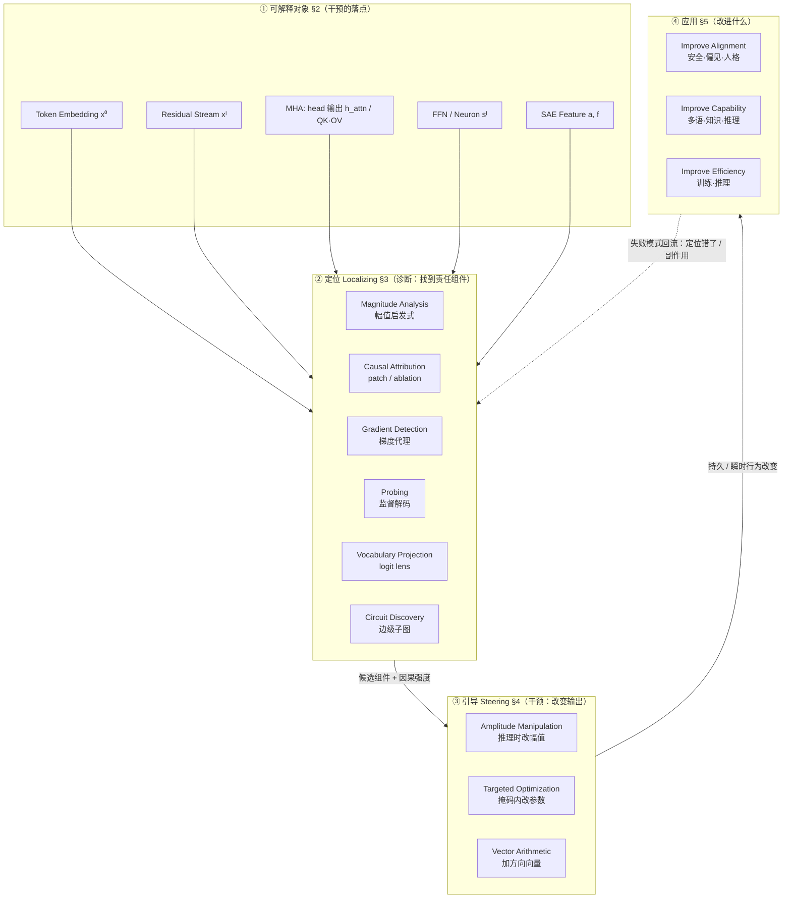

---
aliases:
  - "Locate, Steer, and Improve: A Practical Survey of Actionable Mechanistic Interpretability in Large Language Models"
  - "Locate, Steer, and Improve"
  - "Actionable MI Survey"
created: 2026-11-17
---
# Locate, Steer, and Improve: A Practical Survey of Actionable Mechanistic Interpretability in Large Language Models

> 这是一篇**方法学分类综述**（taxonomy-driven survey），不是 benchmark 综述。它的核心主张是：机械可解释性（MI）长期被当成「观察科学」来做——发现机制、写论文、结束；但要真正用起来，必须把它重构成一条**可执行的干预流水线**：先规定「对什么对象下手」（Interpretable Objects），再「定位」（Localizing / 诊断），再「引导」（Steering / 干预），最后落到「改进」（Improve：对齐、能力、效率）。围绕这条流水线，论文给出 5 类可解释对象、6 种定位方法、3 种引导方法、8 个应用场景的分类学，逐条给出数学形式、适用对象、成本与因果强度、失效模式，并附一个**最小评测框架**（三任务 × 主指标 × 副效应检查）。全文组织约 200 余篇文献，作者明确定位为「持续更新的活综述」。

## 一句话定位

一篇 2026 年 4 月版的**工程导向 MI 综述**，作者阵容为 HKU / Fudan / LMU Munich 等机构 29 人合作（[首页作者块](papers/可解释性/2601.14004/2601.14004.pdf#1)）。它写给两类人：想把 MI 结论真正拿去改模型的对齐/安全工程师，以及需要一张「方法-对象-场景」索引表来判断某篇 MI 论文能不能被自己复用研究员。它**不**试图回答「Transformer 里到底有什么机制」这类科学问题（那是 [2501.16496](papers/可解释性/2501.16496/2501.16496.pdf) 那类 open-problems 综述的活），也**不**从安全论证的规范性角度评估 MI 的证据效力（那是 [[papers/可解释性/2611.08438/NOTES|MI for AI Safety]] 的活）。它只回答一个很具体的问题：**给定一个我想改的行为，我该在哪个对象上、用哪种定位法找到它、再用哪种引导法动它、最后怎么证明我没把别的东西弄坏。**

一句话概括它的组织原则：**方法不是按「数学工具」分类的，而是按「它作用在哪个可解释对象上、产出什么强度的因果证据」分类的。**

## 问题与动机

### 领域为什么需要这份综述

论文的动机链很短，但每一步都点在痛处（[§1](papers/可解释性/2601.14004/2601.14004.pdf#1)）。

**第一环：LLM 是不透明的，而且这种不透明有实际代价。** 论文把代价拆成三条：安全关键场景下的风险、调试能力受限、优化能力受限。注意第三条——它把「不可解释」从一个伦理/合规问题重新表述成一个**工程效率问题**：你看不见内部，就只能靠外部试错来改模型。

**第二环：现有 MI 文献的重心偏了。** 论文把现有工作分成两支，并分别指出缺口：

| 支流 | 代表工作类型 | 论文承认的贡献 | 论文指出的缺口 |
|---|---|---|---|
| 理论与基础 | 拆解 Transformer 架构、寻找基本单元、给出技术路线图 | 提供了「怎么解剖」的方法论 | 把 MI 当 observational science，目标是 **scientific discovery**（为了理解而理解），「如何把这些微观洞见转化成实际模型改进」被系统性忽略了 |
| 应用桥接 | 讨论 MI 如何辅助下游任务或特定领域 | 承认了 MI 的实用潜力 | ①对 MI 方法**缺少充分分类与清晰定义**，诊断工具与干预技术的界线经常是糊的；②应用覆盖不全，方法讲得太泛，「高层抽象让研究者难以把理论机制洞见翻译成针对具体问题的可操作干预」 |

**第三环（全文的立论基座）：外部 scaling 正在遇到瓶颈。** 原文的说法是，LLM 的快速进步主要由**外部 scaling 因素**驱动（更大模型、更多数据、更多算力），而这个范式「increasingly encountering bottlenecks」；因此进一步的进步必须通过更深的内部机制理解来精炼——从「把外面做大」转向「从里面做手术」（[§1](papers/可解释性/2601.14004/2601.14004.pdf#1)）。

这一句是整篇综述的价值主张，也是最需要打问号的地方：它是一个**立场**，不是一个被本文证明的结论。论文没有给出任何 scaling 曲线饱和的实证，也没有论证「内部干预的边际收益 > 外部 scaling 的边际收益」。读者应把它当作作者的问题设定（problem framing），而不是本文的证据。

### 前人综述的缺口，被归纳成两条可检验的抱怨

这两条抱怨值得单独记住，因为它们恰好是评价任何一篇 MI 综述的判据：

1. **分类学缺失**：诊断（diagnosis）与干预（intervention）的界线模糊。后果是读者读完不知道某个方法「是拿来发现东西的，还是拿来改东西的」。
2. **颗粒度错位**：应用讲得太粗。后果是读者知道「MI 能提升安全性」，但不知道该定位哪个 head、用哪种干预、副作用怎么查。

本文的两个对应设计就是「对象层」和「应用场景的 paradigm 卡片」——每个应用小节开头都有一个 takeaway box，把该场景归纳成 2–3 个**范式（paradigm）**，而不是罗列论文。这是本文体例上最实用的发明。

### 三条自称的贡献（[§1](papers/可解释性/2601.14004/2601.14004.pdf#1)）

1. **流水线框架**：先定义核心可解释对象（neuron、attention head、residual stream 等），再按应用工作流把方法切成 **Localizing（诊断）** 与 **Steering（干预）** 两个阶段；对每个技术给出 Methodological Formulation（数学形式）+ Applicable Objects（适用对象）+ Scope（适用范围）。
2. **应用范式**：按 Improve Alignment / Improve Capability / Improve Efficiency 三主题、8 个具体场景组织，且每个场景提炼「representative MI application paradigms」，目的是让方法**可迁移**到新问题。
3. **资源与议程**：批判性讨论挑战与未来方向，并整理**200 余篇**论文的总表（附录 A），按 object / localizing method / steering method 三重打标签。

## 核心框架：分类与地图

### 四层结构总览

论文的结构不是「按时间」也不是「按数学工具」，而是四层递进：**对象（能对什么下手）→ 定位（怎么找到它）→ 引导（怎么动它）→ 应用（动完有什么用）**。

这张图里有三个必须在读原文时抓住的**接口**，本文的价值大半在这三个接口上：

- **对象→定位**：不是每种定位法对所有对象都成立。比如 Vocabulary Projection 需要「中间态与输出词表共享基底」，所以它对 residual stream 成立、对 FFN 内部成立性弱（见后文 §3.5 的 basis alignment 假设）。
- **定位→引导**：定位的**因果强度**决定了引导能有多大胆。用 Magnitude Analysis 找到的组件直接做 Targeted Optimization，是把强干预架在弱证据上。
- **引导→应用**：同一应用场景往往有两条互补路线——「改组件」（局部、可解释、易碎）和「改方向」（全局、平滑、易漂移）。论文在 8 个场景里几乎都给出了这一对。

### ① 可解释对象：五类落点及其符号系统

论文先把「能下手的东西」形式化，统一到 decoder-only Transformer 上（[§2](papers/可解释性/2601.14004/2601.14004.pdf#2)）。核心记号表见 [表 1](papers/可解释性/2601.14004/2601.14004.pdf#table=1)。这一节的作用不是教 Transformer，而是**建立一个所有后续方法都能引用的地址系统**——MI 论文之间难以比较，很大一部分原因就是「说 head 的时候指的到底是输出还是 attention pattern」都不同意。

| 对象 | 关键符号 | 形状 | 机制含义 | 后续被哪些方法使用 |
|---|---|---|---|---|
| Token Embedding | $\mathbf{W}_E$、$\mathbf{x}^0_i$ | $\mathbb{R}^{\lvert\mathcal{V}\rvert\times d_{\text{model}}}$、$\mathbb{R}^{d_{\text{model}}}$ | 离散 token → 连续向量；同时是 residual stream 的初始状态 | Gradient Detection（输入侧）、SAE（可挂） |
| Residual Stream | $\mathbf{x}^l$、$\mathbf{x}^{l,\text{mid}}$ | $\mathbb{R}^{T\times d_{\text{model}}}$ | 信息高速公路，各 block 以**加法**读写 | 几乎所有方法的主战场 |
| MHA | $\mathbf{W}_{Q,K,V,O}^{l,h}$、$\mathbf{A}^{l,h}$、$\mathbf{h}^{l,h}_{\text{attn}}$ | 见 [表 1](papers/可解释性/2601.14004/2601.14004.pdf#table=1) | QK 单元决定「看哪里」，OV 单元决定「搬什么」 | 全部六种定位法 + 全部三种引导法 |
| FFN / Neuron | $\mathbf{W}^l_{\text{in/out}}$、$\mathbf{s}^l$、$\mathbf{k}^l_j$、$\mathbf{v}^l_j$ | $\mathbb{R}^{d_{\text{ffn}}}$ | key-value 记忆；neuron = (key 权重行, value 权重列) 一对 | Magnitude、Gradient、Probing、Vocab Projection |
| SAE Feature | $\mathbf{a}$、$a_j$、$\mathbf{f}_j$ | $\mathbb{R}^{d_{\text{SAE}}}$ | 把多义（polysemantic）激活拆成单义特征的过完备字典 | 全部方法，且是「可引导词表」的来源 |

三个值得在讲义里点出来的技术细节：

**(a) 残差流的加法结构是全部 MI 的地基。** 论文把更新写成

$$
\mathbf{x}^{l,\text{mid}} = \mathbf{x}^l + \mathbf{h}^l_{\text{attn}}(\mathbf{x}^l),\qquad
\mathbf{x}^{l+1} = \mathbf{x}^{l,\text{mid}} + \mathbf{h}^l_{\text{ffn}}(\mathbf{x}^{l,\text{mid}})
$$

于是任意层的状态都可以写成**所有前序组件输出的线性组合**。这一步直接授权了三件事：把最终预测分解成各组件贡献（Logit Lens 的前提）、做因果中介分析（activation patching 的前提）、做加性 steering（vector arithmetic 的前提）。论文明确说这是「critical for MI analysis」（[§2.2](papers/可解释性/2601.14004/2601.14004.pdf#2.2)）。LayerNorm/RMSNorm 被有意省略，作者在脚注里承认这是为了「focus on the additive composition of features」——**这是一个会影响结论强度的简化，读者要知道**。

**(b) QK/OV 分解给了「head 的职能」一个可计算的定义。** $\mathbf{W}_{QK}=\mathbf{W}_Q\mathbf{W}_K^\top$ 决定 attention pattern（双线性型 $(\mathbf{x}_i^l)^\top \mathbf{W}_{QK}\mathbf{x}_j^l$），$\mathbf{W}_{OV}=\mathbf{W}_V\mathbf{W}_O$ 决定写入内容。有了这个分解，才能谈 Induction Head、Previous Token Head 这类**角色分类**，也才能谈「把这个 head 的输出置零」这种精确干预。

**(c) SAE 是把「不可干预的稠密向量」变成「可干预的稀疏词表」的关键转换器。** 动机是 superposition：网络用近正交方向编码的特征数多于物理神经元数，所以单个神经元会多义（[§2.5](papers/可解释性/2601.14004/2601.14004.pdf#2.5)，[图 3](papers/可解释性/2601.14004/2601.14004.pdf#figure=3)）。SAE 的前向与损失为

$$
\mathbf{a}=\sigma(\mathbf{x}^l\mathbf{W}_{\text{enc}}+\mathbf{b}_{\text{enc}}),\quad
\hat{\mathbf{x}}^l=\mathbf{a}\mathbf{W}_{\text{dec}}+\mathbf{b}_{\text{dec}},\quad
\mathcal{L}=\lVert \mathbf{x}^l-\hat{\mathbf{x}}^l\rVert_2^2+\lambda\lVert\mathbf{a}\rVert_1
$$

扩张因子 $d_{\text{SAE}}/d_{\text{model}}$ 通常取 **16×–128×**。这一步之所以对「actionable」至关重要，是因为它把「很难说清该加减什么的稠密激活」变成了「可以说清、可以逐个开关的特征维度」——引导方法里的 SAE 路线完全依赖这一点。

论文对 SAE 的**三类卡点**做了诚实清点，这段是全文少见的「不吹」段落：**dead latents**（大量特征训练中始终不激活，用 ghost gradients / resampling 缓解）、**feature absorption**（高频宽特征压制低频细特征，导致粒度变粗）、以及**忠实性（faithfulness）**——SAE 是原激活的替代/代理模型，重建误差会累积并使 SAE 重建后的动力学偏离原模型。此外还有纯工程上的成本壁垒：SAE 逐层训练，层数 × 隐藏维度 × 候选特征数一起涨，训练时间/显存/存储都被放大。

### ② 定位方法：六族分类学（本文主体之一）

论文把定位定义为「识别对某行为负责、或编码某信息」的对象（[§3](papers/可解释性/2601.14004/2601.14004.pdf#3)）。六族的划分标准不是数学工具，而是**证据类型**：相关性 / 因果性 / 一阶敏感性 / 可解码性 / 语义可读性 / 结构路径。这是全文最值得学的一处分类设计，因为「证据类型」直接决定了结论能推多远。

#### 3.1 Magnitude Analysis（幅值分析）

**形式**：给每个对象 $o_j$ 打一个标量重要性分

$$
s_j=f(o_j),\quad\text{如 } s_j=\lVert o_j\rVert_p \ \text{或}\ s_j=\max_k\lvert(o_j)_k\rvert
$$

再按阈值 $\tau$ 或 top-$k$ 取出显著集合 $\mathcal{O}_{\text{salient}}$。常见 $f$ 是 $L_2$（总能量）、$L_\infty$（峰值）、或频次类指标。

**适用对象**（三类，覆盖很广，这是它流行的原因）：

- **静态参数**：权重矩阵逐行/逐元素范数，找 outlier / heavy hitter，无需跑推理。
- **动态组件**：neuron 激活 $\mathbf{s}^l$、SAE 特征激活 $a_j$、attention score $\mathbf{A}^{l,h}$。代表案例：用 *ReasonScore*（聚合「推理时刻」的激活频次与幅值）定位 reasoning-relevant SAE 特征；用风格语料上的平均激活幅值定位 style-specific neurons（[图 4](papers/可解释性/2601.14004/2601.14004.pdf#figure=4)）；用 *Ships*（refusal token 上的注意力权重聚合）定位 safety heads；用 attention mass 在图像/文本 token 上的集中度定位跨模态 head。
- **层级表示**：层间距离。对比输入间的 $\lVert\mathbf{x}^l-\mathbf{x}'^{\,l}\rVert$ 定位任务信息分歧最大的层；相邻层的 $\lVert\mathbf{x}^l-\mathbf{x}^{l+1}\rVert$ 定位「几乎没更新」的冗余层。

**范围定性**：**training-free but data-dependent**。

**卡点**：它是 lightweight heuristic。高幅值只说明「在场」，不保证因果必要（高幅值特征可能被后续层抵消掉）；且完全依赖输入数据能否激发目标行为——数据不对，相关组件就继续休眠。所以论文给它的定位是「first-pass screening tool」，为更严格的方法筛候选。

#### 3.2 Causal Attribution（因果归因）

**形式**：MI 里定位的「金标准」。给定标量输出 $F$（目标 token 的 logit / 概率），对对象 $o$ 做反事实干预并测效应

$$
\operatorname{do}(o\leftarrow\tilde{o}):\ \Delta F(o)=F\big(\operatorname{do}(o\leftarrow\tilde{o})\big)-F(o)
$$

干预取两型：**Patching**（$\tilde{o}$ 取反事实输入的激活）与 **Ablation**（$\tilde{o}$ 取 0 或均值）。$\lvert\Delta F\rvert$ 大即认为 $o$ 是该行为的关键中介。代表流程是 Causal Tracing 三步：corrupted run（给 subject token 加高斯噪声，把知识「擦掉」）→ patched run（逐层逐位置把 clean 激活贴回去）→ 用 **Indirect Effect (IE)** 量化恢复量（[§3.2](papers/可解释性/2601.14004/2601.14004.pdf#3.2)，[图 5](papers/可解释性/2601.14004/2601.14004.pdf#figure=5)）。该流程给出的结论本身就是教学案例：事实召回依赖**早期 FFN 在 subject 位置的检索** + **晚期 MHA 在末 token 的搬运**两段机制。

Ablation 侧的复现清单也很整齐：ablation 隔离 IOI 与 in-context learning 的最小 head 集、pruning（永久 ablation）找算术推理关键 head、mask neuron 证明语言特异功能区、blocking intervention 拆解 FFN value 向量的角色。

**卡点**：贵。每个干预一次前向，成本随对象数线性增长，稠密全扫在大模型上直接不可行。这直接催生了下一族。

#### 3.3 Gradient Detection（梯度检测）

**形式**：用 $F$ 对 $o_j$ 的敏感性当代理分数，

$$
s_j(x)=\phi\big(\nabla_{o_j}F(x),o_j\big)
$$

常见取梯度范数 $\lVert\nabla_{o_j}F\rVert$ 或梯度-输入内积 $\nabla_{o_j}F^\top o_j$。之所以能当代理，是因为一阶 Taylor：

$$
F(o_j+\Delta o_j)-F(o_j)=\nabla_{o_j}F^\top\Delta o_j+\mathcal{O}(\lVert\Delta o_j\rVert^2)
$$

取「移除」代理 $\Delta o_j=-o_j$ 就得到 $\approx-\nabla_{o_j}F^\top o_j$，这正是把内积当有符号影响分的理由。为缓解饱和与「缺席」建模问题，用 **Integrated Gradients**：沿直线路径 $\gamma(\alpha)=\tilde{o}_j+\alpha(o_j-\tilde{o}_j)$ 积分，且满足完备性

$$
\mathrm{IG}_k=(o_j-\tilde{o}_j)_k\int_0^1\frac{\partial F(\gamma(\alpha))}{\partial\gamma_k}d\alpha,
\qquad \sum_k\mathrm{IG}_k=F(o_j)-F(\tilde{o}_j)
$$

实践中用 $m$ 步 Riemann 和近似，并在数据集上聚合（$\mathbb{E}[s_j]$ 或 $\mathbb{E}[\lvert s_j\rvert]$）以稳定排序。

**适用对象**：因为 $F$ 对任何内部对象可微，它均匀覆盖**输入**（$\mathbf{x}^0_i$，token 级影响）、**层状态**（$\mathbf{x}^l$，深度贡献）、**中间输出**（neuron $\mathbf{s}^l$、head 输出）、**参数**（$\mathbf{W}_{Q/K/V/O}$、$\mathbf{W}_{\text{in/out}}$，乃至单个权重或结构化 block）。

**范围定性**：data-dependent，且**相对于分析者选的 $F$ 而定义**——换目标函数排序就会变（$-\log p(y^\star\mid x)$、logit margin、对比/反事实 gap 三种设定结论未必一致）。这是一个很容易被忽略的脆弱性。

**卡点**：梯度是**局部**代理，不是因果必要性；下游计算可以抵消显著性，而非线性区里有限干预会偏离一阶效应。梯度显著性还会挂在标准 sanity check 上失败（论文引 Adebayo 等）。所以排序结果必须交给 Causal Attribution 验证。

#### 3.4 Probing（探针）

**形式**：冻结模型，训一个辅助预测器 $g_\psi$（常为线性）从内部向量 $\mathbf{z}$ 解码标签 $y$：

$$
\hat{y}=g_\psi(\mathbf{z})=\text{softmax}(\mathbf{W}_P\mathbf{z})
$$

序列模型上要先定义「取哪个向量」：token-wise（指定位置，如末 token）或 pooled（均值池化）。**探针测的是 decodability，不是 causality**——它在受限假设类下问「这个属性是否可被读出」。

**适用对象**：residual stream（$\mathbf{x}^l$、$\mathbf{x}^{l,\text{mid}}$，最常用；沿深度追踪语境知识、知识冲突、真实性信号在哪层最可解码）、block 输出（$\mathbf{h}^{l,h}_{\text{attn}}$、$\mathbf{h}^l_{\text{ffn}}$，用于在统一协议下比较 attention vs FFN 的定位）、SAE 特征激活（在稀疏坐标上训分类器，得到 concept-aligned 解码轴）。

**卡点**（论文写得很直）：可解码性 ≠ 因果性；高探针准确率既不说明模型「用了」该信息，也不说明该对象必要或充分；结果对数据集与设计选择（标注、取位）敏感，需要选择题（selectivity / control task）与后续因果检验。注意 [表 2](papers/可解释性/2601.14004/2601.14004.pdf#table=2) 把 Probing 的 Causal Strength 标为 **Weak**——比 Magnitude 的「Correlational」在表述上还低一档，这个细节常被误读成「Probing 比幅值分析强」。

#### 3.5 Vocabulary Projection（词表投影 / Logit Lens）

**形式**：拿预训练好的 unembedding 矩阵 $\mathbf{W}_U$ 当「通用解码器」，把任意中间态 $\mathbf{z}$ 直接投到词表：

$$
\mathbf{p}=\text{softmax}(\mathbf{z}\mathbf{W}_U)
$$

看 top 概率 token 就得到该状态「在输出语义空间里意味着什么」。

**适用对象**（四类，覆盖从全局到原子）：

- **Residual stream**：追踪预测的逐层演化，定位概念涌现的关键层。代表结论：多语模型中，浅层处理输入语言表面形式、中层在抽象的「英语中心」概念空间里推理、末层再旋回目标语言（[图 8](papers/可解释性/2601.14004/2601.14004.pdf#figure=8)(a)）。
- **Head 输出**：读出该 head 往 residual stream 写了什么。IOI 任务里的 Name Mover Heads（直接把正确名字投上去）与 Negative Name Mover Heads（压制它）就是靠这个发现的。
- **Neuron value 权重 $\mathbf{v}^l_j$**：把 FFN 当 key-value 记忆，投影 value 权重看「这个 neuron 在抬哪些 token」——常得到语义相关的一簇（如 press / news / media）。
- **SAE 特征 $\mathbf{f}_j$**：算 logits 贡献 $\mathbf{l}_j=\mathbf{f}_j\mathbf{W}_U$ 取 top token，把稀疏特征锚定到人类可懂语义（如「food」特征）。

**卡点**：核心假设是**基底对齐（basis alignment）**——中间态与输出词表处于同一向量空间。这在 residual stream 上因残差连接而大体成立，但对 sub-layer 内部（FFN/MHA 内部）或表示空间跨层大幅旋转的模型就不准。因此结论只能读作「末层可线性解码的信息的近似」。

#### 3.6 Circuit Discovery（电路发现）

**形式**：不再定位「点」，而定位「边」。设计算图 $(\mathcal{O},\mathcal{E})$，电路 $\mathcal{C}\subseteq\mathcal{E}$ 若把计算限制在 $\mathcal{C}$（把其余边 patch/ablate 掉）仍能保留目标输出 $F(x)$ 或任务性能，则称 **faithful**。于是问题变成**边级因果子图选择**：保留那些干预后会让指标 $\mathcal{R}$ 变差的边。

两条主流实现：

- **ACDC**（自动电路发现）：迭代测试并剪枝边，避免 $O(\lvert\mathcal{E}\rvert)$ 暴力枚举，能复原 GPT-2 的 greater-than 机制。
- **EAP（Edge Attribution Patching）**：用一阶展开近似 patching，两次前向（clean/corrupted）+ 一次反向即得边分：

$$
S_{\text{EAP}}(u\to v)\approx\underbrace{\big(\mathbf{a}_u(\mathbf{x}_{clean})-\mathbf{a}_u(\mathbf{x}_{corr})\big)}_{\Delta\mathbf{a}_u}\cdot\underbrace{\frac{\partial\mathcal{R}}{\partial\mathbf{z}_v}\Big|_{\mathbf{x}_{clean}}}_{\nabla_{\mathbf{z}_v}\mathcal{R}}
$$

  为缓解非线性/饱和，**EAP-IG** 用路径平均梯度替换局部梯度（代价是 $n$ 次反向）：

$$
S_{\text{EAP-IG}}(u\to v)=\Delta\mathbf{a}_u\cdot\int_0^1\frac{\partial\mathcal{R}}{\partial\mathbf{z}_v}\Big|_{\mathbf{x}_\alpha}d\alpha
\approx\Delta\mathbf{a}_u\cdot\frac{1}{n}\sum_{k=1}^{n}\frac{\partial\mathcal{R}}{\partial\mathbf{z}_v}\Big|_{\mathbf{x}_{k/n}}
$$

标准工作流是四步：收 sender delta → 算 receiver 梯度 → 按 $\lvert S\rvert$ 排序 → 剪枝/阈值得稀疏电路（可选做保留边上的定向干预验证）。

**适用对象**：**对象之间的边**。三种操作化路线：干预型边搜索（在候选依赖 $e_{u\to v}$ 上 patch/ablate 并测 $\mathcal{R}$ 变化，$O(\lvert\mathcal{E}\rvert)$ 逼得必须用结构化搜索或自动化）、归因型边打分（EAP/EAP-IG，以及对齐 token 级记账的位置感知改良）、特征级替代模型（把电路抬到 SAE/transcoder 的稀疏特征空间，得到 attribution graph 与 prompt-specific circuit tracing，通常比原始残差坐标更可读）。代表图景：GPT-2-Medium 里支撑「法国的官方语言是法语」的稀疏跨层知识电路（[图 9](papers/可解释性/2601.14004/2601.14004.pdf#figure=9)）。

**卡点**（两条，都很致命）：电路是**相对于特定行为、特定指标 $\mathcal{R}$、特定对比（clean vs corrupted）**定义的，所以结论 objective- and dataset-dependent；归因分数只是干预效应的近似，可能漏掉非线性交互，排序只能当「提案」，保留子图上还得做干预验证。

#### 六族的横向对比（本文最有用的一张表）

[表 2](papers/可解释性/2601.14004/2601.14004.pdf#table=2) 把六族压成四个维度（因果强度 / 成本 / 需要的访问权限 / 关键局限），下面照录并补上「典型用途」一列（该列是本笔记据 §3 各节归纳，非原表内容）：

| 方法 | 因果强度 | 成本 | 需要的访问 | 关键局限（原文） | 典型用途（笔记归纳） |
|---|---|---|---|---|---|
| Magnitude Analysis | Correlational | Low | Activations / Weights | 显著性未必反映因果必要性 | 第一轮筛候选；找 outlier / 冗余层 |
| Gradient Detection | Moderate | Medium | Gradients / Weights | 局部代理；可能挂 sanity check | 大规模排序，给因果验证排队 |
| Causal Attribution | Strong | High | Activations / Hidden States / Weights | 贵；干预本身可能引入伪影 | 定论级定位；安全 head / 事实通路 |
| Probing | Weak | Medium | Hidden States / Labeled Data | 可解码性不蕴含因果性 | 层级追踪；表征定位；监控器 |
| Vocabulary Projection | Correlational | Low | Hidden States / Unembedding | 依赖表示对齐 | 零样本语义读数；层演化可视化 |
| Circuit Discovery | Strong | High | Activations / Gradients / Hidden States / Weights | 对设置与对比输入敏感 | 多组件复合机制；知识电路 |

论文在 [§3](papers/可解释性/2601.14004/2601.14004.pdf#3) 的结尾 takeaway box 里给了一条几乎可以直接写进方法学教材的判据：

> 轻量方法最适合**假设生成与筛选**，更强的因果方法才是**定论级机制主张**的必要条件。

并且它把每种轻量方法的失效模式点名到位：patching 类可能引入伪影，Circuit Discovery 对对比输入与分析目标敏感；Magnitude / Vocabulary Projection 主要是相关性，且表示基底错位时忠实性下降；梯度是局部代理且可能在 sanity check 上失败；探针可能「学会了任务」而不是「揭示了表示」。

### ③ 引导方法：三族分类学（本文主体之二）

引导被定义为「操纵已定位的组件以改变输出」（[§4](papers/可解释性/2601.14004/2601.14004.pdf#4)）。三族的划分标准是**改动发生在哪里、能持续多久**：推理时改激活（瞬时）/ 改参数（持久）/ 加方向（介于两者之间的几何操作）。

#### 4.1 Amplitude Manipulation（幅值操纵）

**形式**：前向过程中直接改目标对象 $o$ 的激活幅值，$\tilde{o}=\mathcal{T}(o,\alpha)$。两型：

- **Ablation / Patching**：$\tilde{o}\in\{0,\ \mathbb{E}[o],\ o_{\text{tgt}}\}$。置零（zeroing）或均值中心化抹掉组件影响；$o_{\text{tgt}}$ 则注入另一语境的信息。
- **Scaling**：$\tilde{o}=\alpha\cdot o$，$\alpha>1$ 放大、$0<\alpha<1$ 衰减。

**这里有一个全文最值得记住的概念区分**：这些操作在**机制上**与 Causal Attribution 里的干预完全相同，区别只在**目的**——归因用它**诊断**因果，幅值操纵用它**控制**行为。论文原话是「the objective differs fundamentally」。这句话解释了一件常被误解的事：为什么「patching 实验」既可以是一篇机制论文的核心证据，也可以是一个工程干预手段。

**适用对象与案例**（三型都很具体）：

- **Ablation**：把「中文特异 neuron」置零，模型就生成不了中文，被迫切回英文（[图 10](papers/可解释性/2601.14004/2601.14004.pdf#figure=10)(a)）；language confusion 场景里 ablation 掉「错误语言的干扰 neuron」（英文任务里在开火的德语 neuron）恢复目标语言；安全/偏见场景里置零毒性或拒答相关 SAE 特征、置零编码社会偏见的 neuron 与电路边；效率场景里删冗余层/组件加速推理且性能不显著掉。
- **Patching**：注入「Male Patch」替换病人表征，不只把代词从 Ms. 改成 Mr.，还**因果地**把抑郁风险预测从 Yes 翻成 No（[图 10](papers/可解释性/2601.14004/2601.14004.pdf#figure=10)(b)）——这是「表征与决策之间存在因果链」的干净演示。
- **Scaling**：放大目标语言 neuron 稳定多语生成；缩放 hallucination neuron 调事实可靠性；缩放 SAE 特征做连续引导；放大 reflection 相关特征延长输出、提升推理表现；model merging 里优化 steering/task vector 的缩放系数以平衡能力。

**范围定性**：inference-time activation control。**优点**是 optimization-free、可逆、可做「外科手术式」编辑，适合实时控制。**卡点**是高度依赖定位准确性——特征没解耦（多义）时，ablate/scale 会带来意外副作用或整体性能退化；且最优 $\alpha$ 往往只能经验调。

#### 4.2 Targeted Optimization（定向优化）

**形式**：把「改模型」表述成**一个小范围、局部的参数更新**，在掩码内优化「目标 + 保持」的权衡：

$$
\theta'\leftarrow\theta+(M\odot\Delta\theta),\qquad
\Delta\theta^\star=\arg\min_{\Delta\theta}\ \mathcal{L}_{\text{tgt}}(f_{\theta'};\mathcal{D}_{\text{tgt}})+\lambda\,\mathcal{L}_{\text{pres}}(f_{\theta'},f_\theta;\mathcal{D}_{\text{pres}})
$$

三个部件各有明确语义：$\mathcal{D}_{\text{tgt}}$ 指定目标行为（改写事实、强制拒答），$\mathcal{D}_{\text{pres}}$ 把模型锚回原有能力，**掩码 $M$ 把「允许改动发生在哪里」变成一个显式设计变量**（层 / 模块 / neuron / head）。这个「locality 即正则」的写法，是把 MI 定位结果接进训练流程的最干净接口。

**适用对象**（两条线）：

- **局部参数做知识编辑**：秩一 / 层局部的知识编辑、跨模型局部 adapter 迁移、把适配约束到低维任务子空间或由粗到细的 masked tuning 以保保留率。
- **细粒度子集做专精**：neuron 级微调、识别核心参数区或语言无关事实 neuron、安全保持/安全感知的部分调参（冻结或限制敏感对象）、head 级分析支持把优化限制在关键计算通路（如算术相关 head）。代表流程 LANDeRMT：先定位语言对相关层 → 量化 neuron 语言意识 → 只在最相关 neuron 上路由梯度（[图 11](papers/可解释性/2601.14004/2601.14004.pdf#figure=11)）。

**范围定性**：**持久（persistence）+ 外科精度**。与幅值操纵的关键差别是：它在 $\mathcal{D}_{\text{tgt}}$ 上做参数优化，得到的行为**durable**，而幅值操纵是瞬时的。**优点**是精确、可控、持久；**卡点**是可靠性完全押在「定位对不对」和「监督写得好不好」上——若选中的子集没抓到因果机制，优化可能达不到目标、把行为转移到别的对象上，或产生脆的副作用。

#### 4.3 Vector Arithmetic（向量算术）

**形式**：假设高层概念/技能在表示空间里线性编码，于是往目标对象 $\mathbf{z}$ 里注入 steering 向量 $\mathbf{v}$：

$$
\hat{\mathbf{z}}\leftarrow\mathbf{z}+\alpha\cdot\mathbf{v}
$$

$\mathbf{v}$ 的来源有两条主流路线，本文把两条都写清了：

**(a) 对比激活均值（Contrastive Activation Means / Activation Addition / Mass-Mean Shift）**

$$
\mathbf{v}=\boldsymbol{\mu}^+-\boldsymbol{\mu}^-=\frac{1}{\lvert\mathcal{D}^+\rvert}\sum_{\mathbf{x}_i\in\mathcal{D}^+}\mathbf{x}^l_i-\frac{1}{\lvert\mathcal{D}^-\rvert}\sum_{\mathbf{x}_j\in\mathcal{D}^-}\mathbf{x}^l_j
$$

**(b) SAE 特征路线**：先算差分激活分 $\delta_j=\mathbb{E}_{\mathcal{D}^+}[a_j(\mathbf{x})]-\mathbb{E}_{\mathcal{D}^-}[a_j(\mathbf{x})]$，取高正 $\delta_j$ 的特征集 $\mathcal{J}$，再按得分加权合成

$$
\mathbf{v}=\sum_{j\in\mathcal{J}}\delta_j\cdot\mathbf{f}_j
$$

然后推理时注入 residual stream（[图 12](papers/可解释性/2601.14004/2601.14004.pdf#figure=12)）。SAE 路线的卖点是「用单义特征当基」，因此可以在大幅改变生成风格（Happiness / Confusion）的同时，尽量不干扰无关概念。

**静态参数侧**：$\mathbf{v}$ 就是 model merging 里的 **task vector**，$\mathbf{v}=\mathbf{W}_{\text{ft}}-\mathbf{W}_{\text{base}}$。近来的改良是用定位技术算自适应合并系数：Sens-Merging 用 Gradient Detection 的敏感性分析定参数重要性；Activation-Guided Consensus Merging 用 Magnitude Analysis（base 与 fine-tuned 激活间的互信息）导层特异缩放系数。

**范围定性**：**加性方向性（additive directionality）**。与 Targeted Optimization 的精确改写不同，它更像一股**引导力**：动态把模型推向目标属性，但不永久改权重。**优点**是轻量、可逆、不用梯度下降、只需调 $\alpha$。**卡点**是完全押在**线性表示假设**上：概念非线性编码，或 $\mathbf{v}$ 与其他概念纠缠（不正交）时，干预会因几何干涉引入意外副作用；反过来，方向高度正交时组合性与引导可靠性都好。

#### 三族的横向对比

[表 3](papers/可解释性/2601.14004/2601.14004.pdf#table=3) 的四个维度是引导强度 / 副作用 / 需要访问 / 成本 / 关键局限：

| 方法 | 引导强度 | 副作用 | 需要的访问 | 成本 | 关键局限（原文） |
|---|---|---|---|---|---|
| Amplitude Manipulation | Moderate | Moderate | Activations / Hidden States / Weights | Low | 多义特征会导致连带改变 |
| Targeted Optimization | High | Low | Weights / Gradients | High | 依赖准确定位 |
| Vector Arithmetic | Moderate | Moderate | Hidden States / Weights | Low | 假设方向线性且可分 |

takeaway box 里还有两条**带警告性质的实证判断**，比表格更值得引用：其一，Targeted Optimization 通常比推理时干预更鲁棒，且许多方法显式带保持目标以减轻无关行为退化；其二，近期证据显示某些 activation steering 方法能改善**表面行为**，但在鲁棒性/特异性上仍然不佳，**当干预保真度弱时甚至可能提高越狱易感性**。这一句是对「steering 很安全」这一直觉的直接反驳，也是本文少见的、把负面证据摆到台面上的地方。

### ④ 从方法到应用：三主题、八场景、约二十个范式

应用层（[§5](papers/可解释性/2601.14004/2601.14004.pdf#5)）是本文体例上最下功夫的部分：每个子小节开头一个 takeaway box，把该场景压成 2–3 个**范式**，范式 =(定位什么 + 用什么定位法 + 用什么引导法 + 保什么)。下表是全章的骨架复述（「代表定位/引导」一列是本笔记据各小节正文补的）：

| 主题 | 场景 | 范式 | 代表定位法 | 代表引导法 | 保什么 / 典型副作用 |
|---|---|---|---|---|---|
| Alignment | Safety & Reliability（[§5.1.1](papers/可解释性/2601.14004/2601.14004.pdf#5.1.1)） | ① 安全关键组件操纵 | Causal Attribution（safety heads）、Magnitude（safety neurons / H-neurons / SAE 毒性特征） | Amplitude Manipulation（推理时压制）、Targeted Optimization（持久改写） | 通用能力；风险是过度拒答 |
| | | ② 潜在安全/可靠性表征引导 | Causal Attribution（refusal 子空间）、Probing（truthfulness 方向、refusal cliff） | Vector Arithmetic | 真实拒答与非拒答的区分；风险是误伤 |
| | Fairness & Bias（[§5.1.2](papers/可解释性/2601.14004/2601.14004.pdf#5.1.2)） | ① 性别偏见定位 + 选择性去偏 | Causal Attribution（首例：causal mediation） | Amplitude（反事实替换）→ Targeted Optimization（只调责任 head / neuron） | 通用语言能力 |
| | | ② 分布式属性/文化偏见 | Magnitude、Gradient Detection（多社会属性 neuron） | 抑制激活 + 全局表示引导 | 不假设单一「偏见模块」 |
| | | ③ 评判与框架中的评测偏见 | Magnitude（重要性信号）、Causal Attribution 验证 | 位置重分配、定向缩放、patch 回 pretrain 状态 | 长上下文鲁棒性；风险是改坏证据路由 |
| | Persona & Role（[§5.1.3](papers/可解释性/2601.14004/2601.14004.pdf#5.1.3)） | ① 全局人格向量调制 | 对比激活均值、task vector 差 | Vector Arithmetic | 推理时开销几乎为零；风险是 traits 互相串扰 |
| | | ② 人格特异组件编辑 | Magnitude（personality neurons）、head 筛查 | Amplitude、Targeted Optimization（只调 ~4% head 治谄媚） | 通用推理能力 |
| | | ③ 心理画像与诊断（不干预） | Probing、Patchscopes、激活几何 | ——（纯诊断） | 用于预测行为、验证角色稳定性 |
| Capability | Multilingualism（[§5.2.1](papers/可解释性/2601.14004/2601.14004.pdf#5.2.1)） | ① 语言特异组件操纵 | Magnitude（LAPE、PLND 等） | Amplitude（置零/缩放）、Targeted Optimization（语言特异适配） | 其他语言能力；0.13% neuron 关闭即全线崩塌 |
| | | ② 跨语言表示引导 | Vocabulary Projection（英语中心瓶颈） | Vector Arithmetic | 语言忠实度；风险是语言混杂 |
| | Knowledge Management（[§5.2.2](papers/可解释性/2601.14004/2601.14004.pdf#5.2.2)） | ① 精确知识更新 | Causal Attribution（+Gradient/Vocab 辅助） | Targeted Optimization（持久）/ Amplitude（可逆）/ SAE 特征级 unlearning | locality、fluency |
| | | ② 知识保持与稳定 | Magnitude、Causal Attribution、Gradient Detection | 训练时约束 / 推理时抑制（冲突 head、entrainment head） | 抗遗忘；风险是压过头读不到上下文 |
| | | ③ 知识整合 | Gradient、Magnitude、Probing（找兼容子空间/可迁移特征基） | Vector Arithmetic（TIES / Sens-Merging / 激活引导合并） | 合并后能力不互相破坏 |
| | Logic & Reasoning（[§5.2.3](papers/可解释性/2601.14004/2601.14004.pdf#5.2.3)） | ① 数值/逻辑组件的定点强化 | Causal Attribution（reasoning-critical head/FFN）、电路分析 | Targeted Optimization（冻结其余，只训这些） | 算术精度；BuPO 只优化高熵浅层 |
| | | ② 推理轨迹引导 | 对比激活均值、SAE（reflection / backtracking 特征）、"wait" token 前潜状态 | Vector Arithmetic、Amplitude | 推理强度可连续调；风险是 over/under-thinking 摆动 |
| | | ③ 逐步诊断与纠错 | Probing（错误步检测）、Magnitude（entailment 不确定性） | 触发式回退重生成（自纠正） | 长链可靠性 |
| Efficiency | Efficient Training（[§5.3.1](papers/可解释性/2601.14004/2601.14004.pdf#5.3.1)） | ① 稀疏微调 | Gradient（SIFT：top 1% 梯度占 99% 范数）、Magnitude（NeFT 余弦相似度）、Causal（PLND） | Targeted Optimization（只更新内在子集，常匹配全参微调） | 参数干扰；0.01% 参数即可提升 |
| | | ② 训练动态监控 | Magnitude（Restricted Loss、FFD、router 通路指标）、LLC（奇异学习理论） | ——（决定继续训练 / 早停） | 算力；在验证 loss 平坦时仍能判断是否该等 |
| | Efficient Inference（[§5.3.2](papers/可解释性/2601.14004/2601.14004.pdf#5.3.2)） | ① 基于显著性的选择性计算 | Magnitude、Gradient、Circuit Discovery（Retrieval Heads） | token/KV 剪枝、层跳过、MoE expert 跳过 | 精度；Super Experts 一剪就崩 |
| | | ② 层特异自适应量化 | Magnitude（敏感度、kurtosis）、Gradient（LRP）、Vocabulary Projection（层间分布 Jaccard） | 混合精度位宽分配 | 显存—精度权衡 |

这张表是本文最可直接复用的产物：给定「我想干什么」，它同时给出「定位什么」「用什么找」「用什么动」「保什么」。

三个贯穿全表的规律，值得单独抽出来（这是笔记的归纳，不是原文的表述）：

1. **强定位配轻干预，或轻定位配强干预**——很少见到「轻定位 + 轻干预」还能给出可信因果主张的组合。安全场景里 safety heads 是用 Causal Attribution 找的，然后只做推理时压制；语言场景里 neuron 是用 Magnitude 找的，然后做 Targeted Optimization 解锁数据高效适配。
2. **「保什么」几乎总是通用能力**，而副作用检查几乎总是落在「过度拒答」「语言能力退化」「无关知识被改」这三类上。这直接对应 [表 4](papers/可解释性/2601.14004/2601.14004.pdf#table=4) 的 side-effect 列。
3. **效率应用是 MI 最被低估的落点**：它不要求解释「机制是什么」，只要求「哪个组件可以扔」，因此对定位的因果强度要求最低，落地阻力也最小。grokking 的训练动态监控甚至不需要干预，只需要一个能看见相变的内部指标。

## 关键论点与证据

本文是综述，没有自己的实验，所以「证据」主要由**被引工作的具体数字与案例**构成。以下逐条给出论文提出的判断及其支撑。

**论点 1：外部 scaling 已遇瓶颈，进步必须来自内部机制。** 这是全文的立论前提，但**没有给出任何实证**（[§1](papers/可解释性/2601.14004/2601.14004.pdf#1)）。它属于问题设定而非结论。读者若要引用，应引作「作者的判断」。

**论点 2：诊断与干预必须分家，否则方法学无法累积。** 支撑方式是分类学本身：把 6 种定位法与 3 种引导法分开，并给每种方法标注因果强度。最强的证据是 [表 2](papers/可解释性/2601.14004/2601.14004.pdf#table=2) 把 Probing 标为 Weak、Magnitude/Vocab 标为 Correlational——它迫使读者承认「我用 X 找到了它」这句话的信息量取决于 X。

**论点 3：同一操作可以承担两种角色，区别只在目的。** 原文对 patching/ablation 的这句辨析（[§4.1](papers/可解释性/2601.14004/2601.14004.pdf#4.1)）是全文概念上最锋利的一刀。它解释了为什么 MI 文献里同一个实验既被当作机制证据、又被当作工程手段。

**论点 4：干预的持久性与成本呈谱系关系。** 证据是 [表 3](papers/可解释性/2601.14004/2601.14004.pdf#table=3)：Amplitude 与 Vector Arithmetic 都是 low cost / moderate strength / moderate side effect，Targeted Optimization 是 high cost / high strength / low side effect。这条谱系有直接的工程含义——**部署时用推理时干预，修复时用权重更新**。

**论点 5：安全行为高度局部化，可用极小比例的组件承载。** 具体数字（均转引自被引工作，本文未复现）：

- 一小撮 attention head 在安全相关行为（尤其拒答/拒绝有害请求）中起不成比例的作用，压制它们会显著削弱安全能力，而只改动**可忽略比例的参数**（[§5.1.1](papers/可解释性/2601.14004/2601.14004.pdf#5.1.1)）。
- **safety neurons**：极小子集、主要位于**早期 self-attention 层**，集体支配安全行为；只调这些 neuron 就能显著提升安全且不退化通用性能。
- 谄媚（sycophancy）：约 **4%** 的 attention head 显著贡献「yes-man」行为；只微调这些 head 比标准指令微调更好地保住通用推理。
- 多语：关闭 **0.13%** 的 language-specific neuron 就导致多语生成**完全丧失**（[§5.3.1](papers/可解释性/2601.14004/2601.14004.pdf#5.3.1)）。
- 稀疏微调：只调最高影响层的 **0.01%** 参数即显著提升模型理解能力；SIFT 观察到预训练梯度的「准稀疏性」——top **1%** 分量占总梯度范数的 **99%**；多篇工作用 LAPE 找到语言敏感 neuron 后更新**不到 1%** 的参数即取得显著收益。

这些数字合起来支撑一个相当强的经验命题：**LLM 的许多能力由一个极小、可定位的组件子集承载**。但同时要注意它们的证据结构——多数是**单模型、单任务、单一干预设置**下的报告，没有跨模型/跨任务的置信区间，也没有多种子重复。

**论点 6：引导的副作用是系统性的，不是偶发的。** 论文在三处重复了这一判断：幅值操纵在多义特征上会连带改变；向量算术在概念不正交时会几何干涉；takeaway box 直接点出某些 activation steering **改善表面行为但鲁棒性/特异性不佳，干预保真度弱时甚至提高越狱易感性**。另有具体案例：人格 steering 里「joy」会降低隐私意识、「anger」会提高毒性；改极少量 neuron 就可能显著损伤整体语言表现（[§6](papers/可解释性/2601.14004/2601.14004.pdf#6)）。

**论点 7：MI 的有效性依赖「定位正确」，而定位正确性目前无法被独立验证。** 这是 [§6](papers/可解释性/2601.14004/2601.14004.pdf#6) 的核心忧虑：缺少稳健的评测框架来判断定位与解释方法的**忠实性**。虽然已有一些 benchmark（本文点名了若干），但「不存在关于指标的共识，能判断被识别的组件是否真的对应底层因果机制」。在没有机制级 ground truth 的情况下，严格验证与横向比较本质上是困难的。

## 对研究实践的启示

这一节是本文自称的「practical」所在，也是它区别于纯 taxonomy 综述的地方。作者的硬建议可以拆成四条。

### 启示 1：先定对象，再定方法，最后才谈应用

论文的操作顺序是反直觉的：不要从「我要提升安全性」出发去找方法，而要先回答「安全性在这个模型里由哪类对象承载」（head？neuron？SAE 特征？一个方向？）。这个顺序的价值在于——**对象决定了哪一族定位法在原则上可用，也决定了哪种引导法不会立刻违反前提假设**：

- 选 SAE 特征 → 天然适配 Vector Arithmetic（有单义基）与 Targeted Optimization（可只调相关特征）。
- 选 residual stream 方向 → 只能用 Vector Arithmetic，且必须接受线性假设。
- 选 head → 适配 Amplitude（置零/缩放）与 Targeted Optimization（只训这些 head）。

### 启示 2：把「因果强度」当预算来分配

论文的实际建议是一个**两级流程**：轻量法（Magnitude / Vocabulary Projection / Gradient）做第一轮筛候选，重法（Causal Attribution / Circuit Discovery）对少数候选做定论。原文的表述是轻量法用于 hypothesis generation and screening，强因果法用于 definitive mechanistic claims。这条建议的隐含成本模型是：因果归因的成本随对象数**线性**增长，而梯度/幅值的成本几乎与对象数无关，所以「全扫用轻法、定论用重法」在成本上是最优的。

### 启示 3：把副作用检查当第一等需求（本文最具体的工程建议）

[§6](papers/可解释性/2601.14004/2601.14004.pdf#6) 提出了一个**最小评测框架**（[表 4](papers/可解释性/2601.14004/2601.14004.pdf#table=4)），覆盖三个任务设置，每个设置显式定义四件事：要定位/引导的特征、主指标、**必要的副作用检查**、代表性数据集。

| 能力 | 要定位/引导的特征 | 主指标 | 副作用检查 | 示例数据集 |
|---|---|---|---|---|
| Math Reasoning | 算术与 reflection 特征 | 准确率、reflection token 比例 | 通用能力 | GSM8K、AIME25 |
| Safety | 拒答特征 | 拒答率、攻击成功率 | **过度拒答（over-refusal）** | SORRY-Bench、OR-Bench |
| Knowledge | 事实关联 | 编辑成功率 | **locality、fluency** | CounterFact、ZsRE |

配套的两个操作建议很实用：

- **同一批定位特征上横比不同引导法**：比如对同一个 reflection 特征，分别用 ① Amplitude 放大、② Vector Arithmetic 注入、③ Targeted Optimization 局部改权重，比任务准确率与行为偏移。这是控制「定位质量」这一混淆变量的唯一干净做法——因为定位被固定住了，差异只能归给引导法。
- **副作用检查要按场景定制**：数学推理场景下，干预 reflection/算术特征后必须同时在通用知识与安全 benchmark 上评测，确认广义能力没被打穿；安全场景下，目标不只是提高有害 prompt 上的拒答率，还要避免过度拒答（论文点名 OR-Bench 就是为此设计）；知识编辑场景下 locality 是首要副作用指标（改一个总统名字不能连带改掉无关知识），fluency 次之（编辑后可复性/语法是否退化）。

### 启示 4：把「可复现的最小报告集」固定下来

论文没有明说，但从它的表格结构可以反推出一个报告清单（本笔记归纳）：**定位法 + 对比输入（clean/corrupted 怎么构造）+ 指标 $\mathcal{R}$ 的定义 + 干预位置（层/位置/对象）+ 干预强度 $\alpha$ 或掩码 $M$ + 主指标 + 至少一项副作用指标 + 是否跨模型/跨任务复现**。缺任何一项，读者都无法判断结论的因果强度——这正是本文反复批评前人综述「方法讲得太泛」的实质。

## 局限与开放问题

作者在 [§6](papers/可解释性/2601.14004/2601.14004.pdf#6)（Discussion and Challenges）、[§7](papers/可解释性/2601.14004/2601.14004.pdf#7)（Future Directions）与独立的 Limitation 小节里列了四类挑战 + 四个方向 + 两条自陈局限。以下严格按原文顺序复述。

### 挑战 1：可扩展性与颗粒度（Scalability Constraints and Granularity）

原文的判断是 MI「仍然难以扩展到低层组件之外」。虽然单个 neuron 或学到的特征越来越被刻画清楚，**识别更高层计算结构仍严重依赖人工检查**；自动化虽有进展，但现有方法经常需要大量人工介入，且**不能稳健地跨 prompt / 任务 / 模型泛化**。更硬的约束是量级：**当模型规模超过 100B 参数，细粒度因果定位的计算成本增长到不可承受**，迫使「定位颗粒度」与「计算可行性」之间做根本权衡。SAE 这类方法靠训练代理模型，成本随模型规模与特征维度增长；而「把行为精确归因到单个组件」原则上需要穷举干预，现代 LLM 规模下不可行——所以多数分析只能停在更粗的颗粒度或依赖启发式近似。

### 挑战 2：分布式机制 vs 局部稀疏（Distributed Mechanisms vs. Localized Sparsity）

这是本文最诚实的自我怀疑。当前分析常在**表示的稀疏性与完整性之间**做权衡：为了可解释，方法倾向于把内部表示压进一小组单义组件；但**激进地强制稀疏，可能剪掉或遮蔽掉真实机制的一部分**——那些确实参与机制、却不符合稀疏模式的组件。于是出现一个张力：诱导稀疏能提升可解释性，却可能漏掉机制中分布式或「不活跃」的子成分。原文把「承认定位在原则上可能受限、并开发能平衡稀疏性与机制完整性的指标」列为开放问题。

这一条与同库的 [[papers/可解释性/2601.22594/NOTES|Circuits Sparse in Neuron Basis]] 正好构成对话：后者主张电路在 neuron 基底里其实是稀疏的，而本文把「稀疏是不是真的」当作未决问题。

### 挑战 3：干预鲁棒性与副作用（Intervention Robustness and Side Effects）

MI 驱动的干预（模型编辑、steering）常缺少鲁棒性与可预测性：意在改一个行为，却给其他任务/领域引入意外副作用。原文给了具体例证：**修改极少量 neuron 就可能导致整体语言性能显著退化**。因此「准确定位 + 不造成连带破坏的引导」仍是核心技术挑战。

### 挑战 4：可操作 MI 的评测协议（Evaluation Protocols）

这是把前三条串起来的那一条：缺少稳健的评测框架来评估定位与解释方法的忠实性。已有若干 benchmark，但**在「被识别的组件是否真的对应底层因果机制」上无共识指标**；没有机制级 ground truth，严格验证与比较就本质困难。作者的应对是提出前述最小评测框架（[表 4](papers/可解释性/2601.14004/2601.14004.pdf#table=4)），并明确说这是「preliminarily propose」——即它本身不是被验证过的标准，而是一个提案。

### 未来方向（[§7](papers/可解释性/2601.14004/2601.14004.pdf#7)）

1. **拓宽架构范围**：把 Locate-Steer-Improve 推广到非 decoder-only 架构。MoE 引入路由机制，于是 router 状态/路由激活/路由决策/expert 激活成为新的天然功能对象——Magnitude Analysis 可以从普通激活平移到 router 激活上，用来找有影响力的路由/expert，再通过干预对应 expert 模块来引导行为。MLLM 则把可解释对象扩到视觉 token 表示、image-patch attention map、跨模态 attention pattern、模态级信息流路径。
2. **与认知科学整合**：从孤立、低层的分析走向系统级解释。现有工作多是任务特定、局部化的机制（知识 neuron、安全 neuron、算术 head、任务电路），对「模型如何更广泛地组织计算」洞见有限；而认知科学用更高阶的组织概念（System 1/2、注意/记忆/语言/执行控制等子系统）。论文建议显式地在 MI 发现的机制与这些认知架构之间做类比（例如某个局部电路是否在功能上类似工作记忆或注意控制），并期待双向增益。
3. **理论基础**：把内部表示接上认知科学或信息论的原则，以统一零散的 MI 发现、减少对临时解释（ad-hoc interpretation）的依赖；并澄清「大规模模型里应当预期什么样的内部结构、为什么」。
4. **从解释到可解释设计**：从「解释—干预」走到「架构设计」。这条线与固有的可解释模型（Concept Bottleneck Models、weight-sparse transformers）相接——它们靠架构约束强制透明，但在大规模复杂任务上通常不如黑箱架构。关键挑战是设计出**既能作为 Transformer 可行替代、又能 by construction 可解释**的骨干架构。

### 作者自陈的两条 Limitation

1. **范围**：只系统覆盖 dense LLM，不系统覆盖其他架构与模态——MoE 有路由与稀疏激活 expert，视觉语言/纯视觉模型依赖模态特异表示与组件，都有独特的可解释性挑战。作者承认许多方法在概念上通用、适当改造后可用于 MoE（在 expert 级激活上操作）与多模态（在模态特异 residual stream 上操作），但系统性处理留给未来工作。
2. **评测**：领域缺少统一 benchmark 或标准化评测协议，难以严格比较方法、也难以评估被识别组件是否**因果最优**。这个局限也影响下游应用——干预常常只依赖单一一种定位法而**没有形式保证**。有些工作用「多种定位技术是否收敛到相似组件」来部分缓解，但建立有原则、可复现的评测框架仍是开放挑战。

## 与其他工作的关系

**与「问题导向」综述的分工。** [[papers/可解释性/2501.16496/NOTES|Open Problems in MI]] 问的是「这个领域还没解决什么」，本文问的是「已经能干什么、怎么干」。两者的分类学不共享：前者按科学问题（ superposition、circuits、 evaluation…）组织，本文按**干预流水线**组织。合读的办法是先读本文拿到方法-对象索引，再读前者判断这些方法各自卡在哪个未解问题上。

**与安全视角综述的分工。** [[papers/可解释性/2611.08438/NOTES|MI for AI Safety]] 关心的是「MI 的证据能不能支撑安全论证」，因此它对 MI 结论的**规范性效力**极为挑剔。本文恰好提供了那种综述所缺的东西：一张「什么方法给出什么强度的因果证据」的对照表（[表 2](papers/可解释性/2601.14004/2601.14004.pdf#table=2)）。两篇并读时，本文的「Causal Strength」列可以直接当作安全论证的输入分级——Correlational 级证据不足以支撑安全主张，Strong 级才有讨论资格。

**与具体机制论文的对应关系（本文的方法学祖先）。**

| 同库论文 | 它做了什么 | 在本文分类学里的位置 |
|---|---|---|
| [[papers/可解释性/2202.05262/NOTES]]（ROME） | Causal Tracing 定位事实召回通路（早期 FFN 检索 + 晚期 MHA 搬运），再做秩一权重编辑 | 定位：Causal Attribution（patching）；引导：Targeted Optimization（局部参数改写）→ 知识管理范式 ① |
| [[papers/可解释性/2211.00593/NOTES]]（IOI Circuit） | 用 ablation + 因果干预拆出 IOI 任务的完整电路 | 定位：Circuit Discovery + Causal Attribution；本文 §3.6、§5.2.3 的模板来源 |
| [[papers/可解释性/2209.10652/NOTES]]（Toy Models of Superposition） | 给出 superposition 的现象学与几何 | 本文 §2.5 的动机前提：为什么需要 SAE |
| [[papers/可解释性/2309.08600/NOTES]]（SAE Features） | 用 SAE 从不透明激活中提出可解释特征 | 本文 §2.5 的对象定义 + §4.3 的 steering 向量来源（路线 b） |
| [[papers/可解释性/2406.04093/NOTES]]（SAE Scaling） | SAE 的规模化训练与评测 | 本文 §2.5「computational cost 是主要壁垒」的直接证据 |
| [[papers/可解释性/2404.15255/NOTES]]（Activation Patching） | patching 的方法学规范（怎么设计 clean/corrupted、怎么读结果） | 本文 §3.2 的全部内容；也是本文 §4.1「同操作、不同目的」那一刀的前提 |
| [[papers/可解释性/2504.13151/NOTES]]（MIB） | 第一个系统比较电路发现方法的 benchmark | 本文 §6「评测协议缺失」的正面回应；本文只把它列为「已提出的 benchmark」之一，未展开 |
| [[papers/可解释性/2601.22594/NOTES]]（Circuits Sparse in Neuron Basis） | 主张电路在 neuron 基底里是稀疏的 | 直接冲撞本文 §6 的「分布式机制 vs 局部稀疏」张力：若稀疏性成立，本文的稀疏化假设就更安全 |

**与评测方法学的类比（跨专题）。** 本文 §6 抱怨「没有共识指标、没有机制级 ground truth」，这与模型评测专题里 [[papers/模型评测/2411.00640/NOTES|Adding Error Bars to Evals]] 的关切同构：都是在问「一个数字能不能支撑一个结论」。差别是评测领域已经有了统计工具（置信区间、配对检验），而 MI 连「被测量的量是什么」都还没统一——这正是本文说「没有机制级 ground truth」的意思。同理，[[papers/模型评测/2410.12784/NOTES|JudgeBench]] 揭示的「评测器本身不可靠」在 MI 里的对应物是「定位器本身不可靠」（探针可能学会了任务而非读出表示），本文对这一点有明确警告但没给出解决方案。

**与工程化路线的关系。** 本文的「Targeted Optimization + 掩码 $M$」在形式上就是 PEFT 的机制化版本：把「加一个外部模块」换成「在指定内部子集上更新」。这与本库 Agent 规划专题里 [[papers/Agent规划/2402.01817/NOTES|LLM-Modulo]] 的「定位责任边界」思路是同一个哲学——先确定「谁负责什么」，再决定「让谁去改」，而不是让一个不可靠的整体去自我修正。
