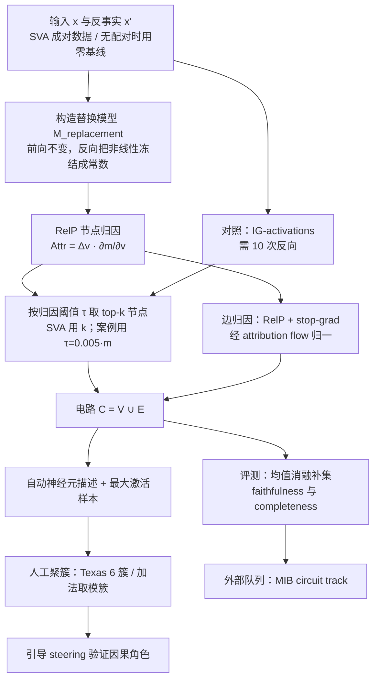

---
aliases:
  - "Language Model Circuits Are Sparse in the Neuron Basis"
  - "Circuits Sparse in Neuron Basis"
created: 2026-11-17
---
# Language Model Circuits Are Sparse in the Neuron Basis

> 主流做法认为单个神经元不构成可解释的分析单位（多义性、叠加），因此 circuit tracing 普遍要先训练稀疏字典（SAE、转码器、CLT）换一套基。这篇论文用实验反驳这个前提：**MLP 的 pre-down-projection 激活（而非 MLP 输出）本身就是与 SAE 同等稀疏的特征基**。作者靠两个改动把差距抹平——(1) 把节点放在 MLP **激活**这个「特权基」上而不是 MLP **输出**上，circuit 大小立刻缩小约 **100 倍**；(2) 用只需一次反向传播、且满足完备性的归因方法 **RelP** 取代 Integrated Gradients，剩余差距被补上：在 SVA 基准上约 **200 个神经元**就接近完美的 faithfulness/completeness。作者据此搭了一条端到端梯度归因流水线，在 Llama 3.1 8B 上复现了 CLT 的三项案例研究（州—首府多跳、加法、多语言反义词），并新增用户建模案例；其中「Texas 电路」里 **23 个关键神经元**聚成 6 个与 Lindsey 等 CLT 结果对应的功能簇，单个「说首府」神经元被引导后能把多数样本的输出从首府翻成州名。

## 一句话定位

一篇 **ICML 2026 的方法+实证论文**，其贡献是把「神经元基不可用」这一领域默认前提变成可检验的实证命题，并给出一个**不需要额外训练成本**的替代流水线：MLP 激活上的神经元级 circuit tracing + RelP 归因 + 自动神经元描述（[§1](papers/可解释性/2601.22594/2601.22594.pdf#1)，[§3](papers/可解释性/2601.22594/2601.22594.pdf#3)）。

## 问题与动机

**被挑战的前提。** 论文开篇复述了领域的标准叙事：要做 circuit，必须先有离散的分析单位（feature）；而「神经元本身不构成可解释的基、特征分布在多个神经元上」这一信念（引 Cunningham 等）催生了一整族**换基**技术——SAE、转码器（transcoder）、CLT（cross-layer transcoder），以及直接训练模型使其 circuit 稀疏的做法（[§1](papers/可解释性/2601.22594/2601.22594.pdf#1)）。作者的问题因此非常尖锐：**这个前提是经验事实，还是未被检验的习惯？**

**为什么这个问题值得问。** 论文给出三条成本论证（[§1](papers/可解释性/2601.22594/2601.22594.pdf#1)）：

1. **换基是对原模型的不完美近似**，会留下不可解释的误差项；误差不是小数（综述里已记录 10%–40% 量级的性能损失）。
2. **学出来的特征有分裂（splitting）与吸收（absorption）**，反而制造新的多义性。
3. **换基难以贯穿训练过程**——要对模型的每个训练阶段都重新训练字典，额外算力开销使其不现实；而神经元基天然随模型一起演进。

一句话：如果神经元基够用，那么整个「先训字典再解释」的范式就可以被省掉一大块成本。

**两项具体的技术诊断（本文最重要的「为什么之前没人做到」）。** 作者不是说前人没试过神经元，而是说前人**试错了位置、也用错了归因**：

- **位置错了**：以往把 **MLP 输出（post-down projection）** 当作与学到的特征对比的基线。但 MLP 输出已经过 $W_\text{down}$ 的线性混合，不再是任何特权基；真正带逐元素非线性、因而被架构「鼓励」对齐特征的，是 **MLP 的 pre-down 激活** $\mathbf{h}^{(i)}\in\mathbb{R}^{d_\text{ffn}}$。换成激活后，同样忠实度所需的 circuit 小两个数量级。
- **归因错了**：多数 circuit tracing 用 Integrated Gradients（IG），而 IG 在深模型上噪声大、要多次反向传播才准（引 Makino 等）。换成 **RelP**（只需一次反向传播，且通过「替换模型 + half rule」保住完备性）后，神经元与 SAE 之间剩下的差距被关上。

**主张的边界（作者自己划的）。** 论文明确说目的**不是**裁决「神经元与学到的稀疏基谁更好」：字典基在单义性与可解释性上**可能**确实更优（尤其因维度更高），作者不否认这一点；他们要反驳的只是「神经元**先验地（prima facie）** 是不可解释的基」这一假设，并证明过去从字典基获得的相当一部分理解**可以只用 MLP 神经元复现**（[§6](papers/可解释性/2601.22594/2601.22594.pdf#6)）。

## 方法与机制（核心）

### 总览

**整套方法是一条「归因 → 筛节点 → 算边 → 评电路 → 读描述 → 做干预」的流水线**，其中真正的新东西只有两处（换基位置、换归因方法），其余都沿用既有协议。这个「最小改动」的设计正是论文的说服力来源：如果结论在几乎不引入新超参的情况下成立，那就不能归因于调参。

把它摆成一条链更容易看清每个环节在做什么（节点编号对应后文小节）：

**先给符号与评测口径（后面所有数字都依赖它们）。** 一个 $L$ 层 transformer 在每个 token 位置给出：注意力输出 $\mathbf{a}^{(i)}$、**MLP 激活** $\mathbf{h}^{(i)}\in\mathbb{R}^{d_\text{ffn}}$、MLP 输出 $\mathbf{m}^{(i)}\in\mathbb{R}^{d_\text{model}}$、残差流 $\mathbf{r}^{(i)}=\mathbf{r}^{(i-1)}+\mathbf{a}^{(i)}+\mathbf{m}^{(i)}$。circuit 是计算图的一个稀疏子图 $C=(V,E)$：节点是单个计算单元（比如某个 token 位置上的一个 MLP 神经元 $h^{(i)}_{j,v}$），**同一单元在不同 token 位置被视为不同节点**，边是带方向与权重的因果影响（[§3.1](papers/可解释性/2601.22594/2601.22594.pdf#3.1)）。

评测用**均值消融**：把电路补集里的节点设成它们在数据集上的均值，其余计算照常。

$$
C(x):=M\!\left(x;\ \operatorname{do}\!\left(v=\mathbb{E}_{d\sim\mathcal{D}}[v(d)]\right)\ \text{for}\ v\in V\right)
$$

意义：这不是把节点置零（会造成分布外激活），而是用「它平均而言是多少」替换，从而尽量只破坏这个节点的信息而不破坏量纲。两个指标（[§3.2](papers/可解释性/2601.22594/2601.22594.pdf#3.2)）：

$$
\mathsf{Faithfulness}(C)=\frac{\mathbb{E}_x[m(C,x)-m(\varnothing,x)]}{\mathbb{E}_x[m(M,x)-m(\varnothing,x)]},\qquad
\mathsf{Completeness}(C)=\frac{\mathbb{E}_x[m(\overline{C},x)-m(\varnothing,x)]}{\mathbb{E}_x[m(M,x)-m(\varnothing,x)]}
$$

先讲意义：**faithfulness** 问「只留下电路、把其余全消融，指标还剩多少」——理想为 1；**completeness** 问「把电路本身消融，指标是否掉到全模型被消融的水平」——理想为 0。$m(\varnothing,\cdot)$ 是全消融基线。SVA 上 $m$ 取**对数几率差** $m(C,x)=[C(x)]_y-[C(x)]_{y'}$，即原答案 $y$ 与反事实答案 $y'$（如 *is* / *are*）的 logit 差。于是「好电路」= 既留下行为、又灭掉行为，这一对指标天然把「稀疏且完整」当作目标。

### 模块一：第一个改动——把节点放到 MLP 激活上

**做法**：在 SVA 基准上比较四种**表示**（残差流、注意力输出、MLP 激活、MLP 输出）× 两种**基**（神经元 / SAE），用同一套 IG-activations 归因与同一套评测，画「电路大小 vs faithfulness/completeness」曲线（[§4.1](papers/可解释性/2601.22594/2601.22594.pdf#4.1)）。

**结果**：MLP 激活所需的 circuit 比 MLP 输出**小约 100 倍**，并且显著缩小了与 SAE 的差距（[图 1](papers/可解释性/2601.22594/2601.22594.pdf#figure=1)）。

**为什么有效——特权基论证。** 作者给的解释是架构性的：MLP 激活坐标是**特权基（privileged basis）**，因为逐元素非线性（SiLU 门控）会作用于每个坐标，架构因此在「鼓励」特征对齐到基向量上；而 MLP 输出经过 $W_\text{down}$ 的任意线性混合，旋转不变，没有任何机制迫使特征落在坐标轴上（[§4.1](papers/可解释性/2601.22594/2601.22594.pdf#4.1)）。

**附录里的两条分布证据**（这两条比主结论更能说明「为什么稀疏」）[附录 H](papers/可解释性/2601.22594/2601.22594.pdf#appendix=H)：

- **归因分数分布更分散、尾部更重**：MLP 激活的归因分数在主体与尾部都比其他表示展得更开。因为电路是「按归因从高到低贪心取组件」，分布越分散，达到同样总效应所需的组件就越少——这是稀疏性的直接机制。
- **归因在深度上更均匀**：MLP 输出的高分归因**高度集中在最后两层**，残差流偏向靠后层，注意力输出则参差不齐、个别层异常突出；只有 MLP 激活的分数较均匀地铺在整个深度上。这解释了为什么 MLP 输出「看起来也能找到电路」，但一旦要求小电路就崩：它的信息几乎都在末端，前面几乎没有可省的。

### 模块一补：SVA 基准长什么样，为什么它适合检验「稀疏性」

要判断「神经元是否稀疏」，需要一个能精确控制「模型在算什么」的基准。论文选 Marks 等的 SVA（subject-verb agreement）基准，因为它把语言能力压到最小：输入是含主语的残句，输出是**与主语数一致的动词**；反事实输入只改主语的数，反事实输出只改动词的数（[表 2](papers/可解释性/2601.22594/2601.22594.pdf#table=2)）：

| 子任务 | 原输入 $x$ | 原输出 $y$ | 反事实 $x'$ | 反事实 $y'$ |
|---|---|---|---|---|
| \texttt{simple} | The **parents** | **are** | The **parent** | **is** |
| \texttt{within\_rc} | The athlete that the **managers** | **like** | The athlete that the **manager** | **likes** |
| \texttt{rc} | The **athlete** that the managers like | **does** | The **athletes** that the managers like | **do** |
| \texttt{nounpp} | The **secretaries** near the cars | **have** | The **secretaries** near the cars | **has** |

四个子任务的差别正是**干扰项的位置与类型**：\texttt{simple} 无干扰；\texttt{within\_rc} 的干扰在关系从句内部（`managers` 靠近动词但**不是**主语）；\texttt{rc} 的干扰是关系从句主语与主句主语竞争；\texttt{nounpp} 是「就近名词短语」（`cars`）与真主语（`secretaries`）竞争。**这套设计对「稀疏性」的意义在于**：一个忠实且完整的电路应当恰好刻画「数」这一特征从主语传到动词的路径；任何多余的节点都是可被检测的冗余。这也是为什么作者能在四条曲线上看到稳定排序——若换成开放式生成任务，就没有这样干净的对照了。

### 模块二：第二个改动——用 RelP 替代 IG

**先讲 IG 的问题与它的变体谱系。** IG 原本是「把输出归因到输入」的方法，用在内部激活上没有唯一正确的写法，于是出现了多个变体（[附录 A](papers/可解释性/2601.22594/2601.22594.pdf#appendix=A)）：

- **Conductance**：最讲道理的版本，沿 IG 路径积分时保留「流经内部组件 $y$ 的那部分梯度」；
- **IG-inputs**：几乎同 conductance，但路径积分**写错了**——先把 $y$ 的梯度平均、再在外面乘总步长；若 $y$ 的步长近似恒定，则是合理近似；
- **IG-activations**（Marks 等提出，本文主用）：把插值做在 $y$ 上而非输入 $x$ 上，本质是「假装 $y$ 是输入变量」。

**RelP 的做法：换一个反向传播模型，而不是换公式。** 核心构造是一个**替换模型** $M_\text{replacement}$：前向完全不变，反向时把非线性**冻结成该输入处的常数**。Llama 架构的三条替换规则（[表 1](papers/可解释性/2601.22594/2601.22594.pdf#table=1)）：

| 运算 | 定义 | 线性化处理 |
|---|---|---|
| RMSNorm | $x_i/\sqrt{\epsilon+\overline{x^2}}$ | $x_i/\mathrm{Freeze}(\sqrt{\epsilon+\overline{x^2}})$ |
| SiLU | $x_i\cdot\sigma(x_i)$ | $x_i\cdot\mathrm{Freeze}(\sigma(x_i))$ |
| Attention | $\sum_k A_{qk}v_k$ | $\sum_k \mathrm{Freeze}(A_{qk})v_k$ |

节点归因随之变成「激活 × 替换模型下的梯度」：

$$
\mathsf{RelP}_v(x;x')=\Delta v\,\frac{\partial\,m(M_\text{replacement},x)}{\partial\,v(x)},\qquad \Delta v=v(x)-v(x')
$$

意义：IG 要沿路径积分（本文用 10 次反向），RelP 只要在**一个点**上取梯度（1 次反向），代价降一个量级；而「前向不变、评测仍在原模型上做」这条纪律保证了它测的仍是原模型的行为（[§4.2](papers/可解释性/2601.22594/2601.22594.pdf#4.2)）。

**half rule：为什么必须把梯度除以 2。** 这是全文唯一需要证明的技术点（[附录 B](papers/可解释性/2601.22594/2601.22594.pdf#appendix=B)）。门控 MLP 被线性化后是**双线性**的：

$$
\mathrm{MLP}_j^{(i)}(\mathbf{x})=W_\text{down}\left(\mathbf{s}\odot W_\text{gate}\mathbf{x}\odot W_\text{up}\mathbf{x}\right)
$$

它是 $\mathbf{x}$ 的**二次齐次函数**（$\mathrm{MLP}(\alpha\mathbf{x})=\alpha^2\mathrm{MLP}(\mathbf{x})$）。对 $h=\mathbf{s}\odot W_\text{gate}\mathbf{x}\odot W_\text{up}\mathbf{x}$ 直接做「输入乘梯度」，由欧拉定理会得到 $2h(\mathbf{x})$ 而不是 $h(\mathbf{x})$：

$$
\frac{\partial h}{\partial\mathbf{x}}\mathbf{x}=\mathbf{s}\odot 2\,(W_\text{up}\mathbf{x}\odot W_\text{gate}\mathbf{x})=2h(\mathbf{x})
$$

所以凡路径经过门控 MLP，归因都会被**放大一倍**，完备性（总归因守恒）被破坏。解法是在乘性交互处把梯度除以 2（half rule，来自 LRP 的传统）。线性组件（注意力、RMSNorm）因为梯度是常数，IG 与 RelP 恒等，无需修正。**这一步是「一次反向就能替代 IG」的全部秘密**：完备性不是靠多步积分换来的，而是靠替换模型的齐次性 + half rule 解析地保住的。

**效果。** RelP 在几乎所有设定上优于 IG；MLP 激活上**约 200 个神经元**即达接近完美的 faithfulness/completeness；MLP 输出与残差流上的 faithfulness 也被改善；对 MLP 输出的 SAE 略有改善、残差流 SAE 无改善（[图 2](papers/可解释性/2601.22594/2601.22594.pdf#figure=2)）。

### 模块三：无配对数据时怎么办——零基线

真实场景里常常没有「成对的反事实」，因此论文专门做了**无配对（unpaired）**版本：把基线从 $x'$ 换成**零向量**，归因变为 $v(x)\int_0^1\frac{\partial m(\cdot;\operatorname{do}v=\alpha v(x))}{\partial v}\mathrm{d}\alpha$（IG）与 $v(x)\frac{\partial m}{\partial v(x)}$（RelP）；**评测口径保持不变**（仍用原/反事实 logit 差），并同时报告均值消融与零消融两种设置（[§4.3](papers/可解释性/2601.22594/2601.22594.pdf#4.3)，[附录 D](papers/可解释性/2601.22594/2601.22594.pdf#appendix=D)）。结论是无配对下**同样成立**：MLP 激活仍是最稀疏的表示，RelP 仍优于 IG。这一节的意义是**可扩展性**：若方法只能在模板化配对数据上工作，就无法用于「没有假设、没有反事实」的真实行为。

### 模块四：边——attribution flow 与 stop-grad

电路不只是节点集合，还包括**边**。作者先定义边归因（无配对形式）：

$$
\mathsf{RelP}_{v_s\to v_t}(x)=v_s(x)\,\frac{\partial\,v_t^\text{replacement}(x)}{\partial\,v_s^\text{replacement}(x)}
$$

再把它归一成**归因流（attribution flow）**，使边权重与「这个目标神经元的总归因」在同一量纲上：

$$
\mathsf{Flow}_{v_s\to v_t}=\frac{\mathsf{RelP}_{v_s\to v_t}(x)}{v_t(x)}\,\mathsf{RelP}_{v_t}(x)
$$

意义：它回答「最终 logits 里有多少可归因于从源神经元到目标神经元的这条路径」，并且对 $v_t(x)$ 的符号做了归一（因为激活符号与归因符号可以不一致）。

**direct effect vs total effect 的开关。** 论文比较三种边归因：IG-inputs（10 步）、RelP（对中间 MLP 加 stop-grad）、RelP（不加 stop-grad）。差别在语义：**不加** stop-grad 时，源神经元到目标神经元的路径可以穿过下游 MLP，算的是**总效应**；**加**了 stop-grad 则只看**直接效应**。实测 **RelP + stop-grad 最好**：只用约 $10^5$ 条边（候选边的 10%）就达到 **>80% faithfulness** 且保持高 completeness，并帕累托支配另外两者（[§4.4](papers/可解释性/2601.22594/2601.22594.pdf#4.4)，[图 3](papers/可解释性/2601.22594/2601.22594.pdf#figure=3)）。为控制规模，边实验先取 top $10^3$ 个神经元，候选边最多 $5\times10^5$ 条/样本。

### 模块五：案例研究流程——从 257 个神经元到 23 个功能簇

案例研究的协议与 SVA 那套不同：SVA 上比的是「曲线」，案例研究要的是「一张可读的图」，因此必须在**单样本**上给出电路、再跨样本聚合。五个环节如下（[§5](papers/可解释性/2601.22594/2601.22594.pdf#5)）：

1. **指标**：沿用 Ameisen 等的做法，从 **top-$k$ 个 next-token logits 之和**归因（$k=5$）：$m(M,x)=\sum_{i=1}^{5}[M(x)]_i$。这样归因目标是「模型最想说的那几件事」，而不是单个 token。
2. **筛节点**：算无配对 RelP 后，保留 $\mathsf{RelP}_v(x)\ge\tau\cdot m(M,x)$ 的节点，**$\tau=0.005$**；边用带 stop-grad 的 RelP。
3. **人工剔除**：手工排除 **12 个**「在任何数据集、任何位置都激活」的神经元（作者猜它们起 bias 或 attention sink 的作用），因为它们不携带任务特定信息。
4. **读描述**：用 Choi 等为 Llama 3.1 8B 生成的自动神经元描述（20 条候选里由模拟器挑出最能预测真实激活的一条），配合最大激活样本人工聚簇。
5. **因果验证**：对一簇神经元做引导 $M^{\text{Steer}(V,\alpha)}(x)=M(x;\operatorname{do}v=\alpha v(x)\ \forall v\in V)$，看输出是否按假设的角色改变。

**Texas 电路的具体结果**：对「What is the capital of the state containing Dallas?」（数据集含 50 道多跳州首府题），自动追踪得到 **257 个**高归因神经元，人工挑出 **23 个**描述特别有意义的，聚成 **6 簇**——Capital、State、Dallas、Texas、「say a capital」、「say Austin」，与 Lindsey 等用 CLT 得到的类别对应。引导每一簇时，**除 "state" 簇外全部改变模型的首选预测**，且改变方向符合假设（例如压制 "Texas" 簇后模型仍说州首府，但换成别的州）。

**单神经元验证**：「say a capital」簇里归因最高的 \texttt{L23/N8079}（描述：*指州首府时的 "is"*）被单独引导（$\alpha\in\{0,0.25,\dots,2\}$），作者在**全数据集**上测量它对三类输出的概率影响——首府（如 Austin）、州（Texas）、原非首府城市（Dallas）。结论是**这一个神经元就能在多数样本上把首选输出从首府翻成州名**，从而把「州→首府」这一步定位到隐藏状态而非显式 token 上（[图 6](papers/可解释性/2601.22594/2601.22594.pdf#figure=6)）。

**另外三个案例（附录）**：加法（1 万条、操作数 $[0,99]$，找 $(x+y)\ \mathrm{mod}\ 10$ 等特征）、多语言反义词（9 语言 × 6 概念 = 54 条 prompt）、用户建模（让模型为用户生成 Wikipedia infobox，从性别/国籍等 token 反向追踪）。它们的作用是证明方法**不依赖单一任务**，其中用户建模是此前 circuit tracing 未研究过的任务（[附录 G](papers/可解释性/2601.22594/2601.22594.pdf#appendix=G)）。

### 模块六：与 CLT 路线的分工，以及一处直接的方法论指控

**被复现的两项工作。** 本文的对照对象是两条 CLT 路线：Lindsey 等（生物学式 circuit tracing，跨层转码器，模型为 Claude 3.5 Haiku）与 Ameisen 等（attribution graph 方法，含一个 18 层玩具模型）。论文的自我定位很克制：**换了一个模型（Llama 3.1 8B Instruct）、换了一套表示（神经元基），看能否得到可比的电路**。Texas 案例正是这样一次对照：Lindsey 等的六类功能簇（Capital / State / Dallas / Texas / 「说首都是什么」/「说 Austin」）在神经元基上重现，作者用 "striking" 形容这一点——因为模型不同、基也不同（[§5.1](papers/可解释性/2601.22594/2601.22594.pdf#5.1)）。

**一处直接的方法论指控（本节最该记住的批评）。** 论文在讨论里写道：Ameisen 等**没有报告**「把 CLT 换回神经元、其余流水线不变」这一最小消融；他们报告的神经元对照是**按激活阈值筛掉的神经元**（thresholded neurons），而那条路径**根本不用梯度归因**。这个区别是致命的：它意味着此前文献中「神经元不行」的证据，实际比较的是「CLT + 梯度归因」与「神经元 + 无归因」，而不是同一台引擎换两种基。本文补上的正是这个缺失的对照，因此它的结论不是「神经元更好」，而是「**此前的比较不成立，重做之后差距消失**」（[§6](papers/可解释性/2601.22594/2601.22594.pdf#6)）。

**由此得到的一条领域规范建议**：新的稀疏字典方法**应当包含 MLP 神经元级的对照**。这条建议的力度不小——它要求每个提出新基的论文都证明自己相对「什么都不换、只把节点放到 MLP 激活上」有净增益，而当前多数论文的基线是 MLP **输出**（一个更弱、且非特权基的对照）。

## 实验与对比

**SVA 主实验设定**（[§3](papers/可解释性/2601.22594/2601.22594.pdf#3)、[§4](papers/可解释性/2601.22594/2601.22594.pdf#4)）：四个子任务（\texttt{simple}、\texttt{rc}、\texttt{within\_rc}、\texttt{nounpp}），每任务 300 对训练、40 对留出评测；模型为 **Llama 3.1 8B base**；SAE 用 Llama Scope 的 **8× 宽度**；每个设定都扫描电路大小 $k$ 并画曲线。

**怎么读这几张曲线（关键，否则数字会被误读）。** 横轴是电路大小（神经元个数，$x$ 轴为对数刻度），纵轴两条：faithfulness 应**上升**、completeness 应**下降**；好的方法是「在更小的 $k$ 上更早完成这个交叉」。因此所有比较都是**曲线之间的横向位移**，而「约 200 个神经元」这样的数字必须理解为「在这条曲线上达到接近 1/0 的拐点位置」，不是「随便取 200 个就一定好」。另外，四个子任务被**平均**后画成一条线，所以曲线掩盖了子任务差异（\texttt{nounpp} 常有更多噪声）；论文把逐任务的归因分布放在附录 H，正是为此。

**四条量化结论（按强度排序）：**

| 结论 | 量化证据 | 对照对象 |
|---|---|---|
| MLP 激活 ≫ MLP 输出 | 同等忠实度下电路**小约 100×** | 残差流、注意力输出、MLP 输出 |
| RelP 让神经元追上 SAE | MLP 激活上**约 200 神经元**即近完美 faithfulness/completeness；IG 需 10 次反向，RelP 只需 1 次 | 同架构下的 SAE 曲线（Llama Scope 8×） |
| RelP 的边最好 | **约 $10^5$ 条边（候选的 10%）→ >80% faithfulness** 且 completeness 高，帕累托支配 | IG-inputs（10 步）、RelP 无 stop-grad |
| 无配对数据下结论不变 | 零基线 + 均值消融/零消融两种设置都复现上述排序 | 配对设定自身 |

**外部验证：MIB circuit localization track（Llama 3.1，$\mathsf{CMD}$ 越低越好，三次随机种子平均）**（[附录 C](papers/可解释性/2601.22594/2601.22594.pdf#appendix=C)，原表引 MIB 基线值）：

| 方法 | IOI | 算术 | MCQA | ARC(E) | ARC(C) | 平均 |
|---|---|---|---|---|---|---|
| Random | 0.74 | 0.75 | 0.74 | 0.74 | 0.74 | 0.74 |
| EAP (mean) | 0.04 | 0.07 | 0.16 | 0.28 | 0.20 | 0.15 |
| EAP (CF) | **0.01** | 0.01 | **0.09** | **0.11** | 0.18 | **0.08** |
| EAP-IG-inp. (CF) | **0.01** | **0.00** | 0.14 | **0.11** | 0.22 | 0.10 |
| EAP-IG-act. (CF) | **0.01** | **0.00** | 0.13 | 0.30 | 0.37 | 0.16 |
| NAP (CF) | 0.29 | 0.28 | 0.32 | 0.69 | 0.69 | 0.45 |
| NAP-IG (CF) | 0.19 | 0.18 | 0.33 | 0.67 | 0.67 | 0.41 |
| IFR | 0.83 | 0.22 | 0.48 | 0.64 | 0.76 | 0.59 |
| **RelP（本文）** | **0.01** | **0.00** | 0.11 | 0.15 | **0.15** | **0.08** |

读法有三点要注意：**(1)** RelP 在五个任务里三个最好、两个第二，平均与 EAP(CF) 并列 0.08、优于 EAP-IG-inputs 的 0.10——**提升幅度很小**，论文的措辞是「验证 RelP 在更大模块粒度上也work」，没有宣称大幅领先。**(2)** 这是把 MIB 里两种最好方法的**梯度计算换成 RelP**（其余超参完全照搬），因此是一次干净的「同骨架换引擎」对照。**(3)** MIB 的粒度是**注意力头/MLP 级**，比 SVA 的神经元级粗得多，所以这张表证明的是**归因方法**的优越性，而不是「神经元基比 SAE 好」——后者只能由 SVA 那类特征级评测回答。

**案例研究的量化证据：**

| 案例 | 数字 | 说明 |
|---|---|---|
| Texas 多跳 | 257 → 23 个神经元 / 6 簇 | 自动追踪 257 个高归因节点，人工挑 23 个可解释的；6 簇与 CLT 结果类别对应 |
| 簇级引导 | 6 簇中 **5 簇**改变首选预测 | 唯一无效的是 "state" 簇；变化方向符合假设角色 |
| 单神经元引导 | \texttt{L23/N8079} 在**多数样本**上把首选从首府翻成州 | $\alpha\in\{0,0.25,\dots,2\}$，测三类输出概率 |
| 加法 mod-10 | 10 个余数**全部**找到 AUROC ≥0.9 或 ≤0.1 的神经元 | 归因热图呈干净对角线：只有当和同余于某值时才起因果作用 |
| mod-$n$ 稳健性 | $n=2$ 一个双极神经元、$n=5$ 末层一个神经元；与 10 互质的 $n$ 上 AUROC 多在 0.4–0.6 | 用于排除假阳性：$n=3,7,9$ 找不到强神经元 |
| 十位数字 | 高 AUROC 神经元数量可观但热图更噪 | 作者推测它们近似的是**整体和**而非十位数字 |
| 多语言反义词 | 语言神经元**数百**、概念与属性神经元**数十** | 阈值 AUROC ≥0.9 / ≤0.1；无单个「反义关系」神经元 |
| Gemma 家族 | 2B（16k 与 65k 宽）与 9B（16k 宽）复现同样排序 | MLP 激活仍比 MLP 输出稀疏约 100×，且与 SAE 相当；SAE 宽度不影响稀疏度 |

其中 mod-10 那组结果（[附录 G](papers/可解释性/2601.22594/2601.22594.pdf#appendix=G)）值得单独看：作者用「按标签分组的归因 AUROC」把「神经元是否编码某属性」变成一个可自动扫描的量——$\mathrm{AUROC}(v)=\mathbb{P}_{x^+\sim\mathcal{D}^+,x^-\sim\mathcal{D}^-}[\mathsf{Attr}_v(x^+)>\mathsf{Attr}_v(x^-)]$，然后按 $|0.5-\mathrm{AUROC}|$ 排序人工复核。这把「找有趣神经元」从手工活变成了**有监督的检索**，也是他们能系统复现 CLT 案例的原因之一。有意思的负面结果：自动描述**没有**指出这些神经元的 mod-10 角色，只说「数字/日期」这类泛化语境（唯一间接线索是 \texttt{L28/N10436} 的描述提到「年份格式，如 2017 或 1797」）。

**一张「神经元标签长什么样」的样本（\texttt{nounpp} 的 500 节点电路）**（[附录 I](papers/可解释性/2601.22594/2601.22594.pdf#appendix=I)）。作者逐个读了电路里神经元的描述与最大激活样本，得到一组与「数/时态/一致」相关的特征，下面五个是原文给出的代表：

| 神经元 | 行为（据描述与样本） |
|---|---|
| \texttt{L30/N11158} | 语言相关的**单数名词/第三人称代词**神经元：正例是英语无生命第三人称 *it*，负例是俄语名词与代词（*kotoraja*、*čelovek*、*jakyj*） |
| \texttt{L29/N10537} | 语言无关地**在 "be" 的各种形式前**激活：负例 *siano*（意大利语 are）、*'m*（英语 1sg），正例 *zijn*（荷兰语 is） |
| \texttt{L30/N13476} | 正向在**英语并列名词短语结尾**激活（*Chen and Sandino*），负向在非英语复数动词/名词上激活（德语 *werden*、乌克兰语 *vyboriv*） |
| \texttt{L19/N12056} | 负向在**英语复数主语**上激活（*they*、*The most common types...*），可能同时被限定性与主语性标记触发 |
| \texttt{L17/N4140} | 正向在**跨语言复数名词**上激活（英语复数缩写 *ADCs*、俄语 *sinimi*） |

这五个例子回答了一个具体疑问：「神经元基的电路是不是只能给出『第 30 层第 11158 号』这种无用坐标？」——不是。**它们承载的是可命名的语言特征，而且常常跨语言**（同一神经元对英语、俄语、荷兰语、意大利语的同一语法范畴响应），这与 CLT 特征的可解释度在同一量级。同时也要注意它们的**杂糅**：多数描述是「某语言某范畴 + 若干例外」，不是干净的单义特征——这正是作者说「描述方法仍需改进」的实证依据。

## 归因分析

**核心主张该归因于什么？** 论文的因果链是清清楚楚的两段式，但也留下了几处需要读者自己判断的地方。

**第一段（可接受，且有机制解释）**：MLP 激活之所以稀疏，是因为它是**特权基**——逐元素非线性迫使特征对齐坐标轴。三条独立证据支持这条机制而非巧合：(a) 归因分数分布更分散（尾部更重），因此贪心取 top-$k$ 更快达到效应；(b) 归因沿深度分布更均匀，而 MLP 输出集中在末端；(c) 换成无配对数据、零消融、Gemma 家族模型后排序不变。「架构在筛选稀疏性」这一解释还得到一条旁证：门控 MLP 相对 ReLU 家族能表达正负激活，可能让模型在保持稀疏的同时塞进更多特征；MoE 更是显式强制稀疏（[§6](papers/可解释性/2601.22594/2601.22594.pdf#6)）。

**第二段（技术性，可复核）**：RelP 关掉剩余差距，靠的是**解析地保住完备性**（替换模型 + half rule），从而用一次反向得到与多步 IG 相当甚至更好的斜率估计。这条是可证明的，附录 B 的推导只依赖齐次函数的欧拉定理，没有近似假设。

**需要读者自己补的三点怀疑：**

1. **人工剔除 12 个神经元是一个未量化的自由度**。这 12 个「总在激活」的神经元若被保留，会同时推高电路大小与（可能）faithfulness；剔除它们合理，但**剔除规则是事后的、按数据集观察得出的**，未来的复现需要把这条规则写死（例如按激活方差阈值自动判定），否则「稀疏度」有一部分来自人工裁剪。
2. **阈值 $\tau=0.005$ 与 top-$k$ 的选择仍是超参**。论文用相对阈值（归因 ≥ 总 logit 的 0.5%）而非绝对阈值，这是好设计；但曲线结论（「200 个神经元近完美」）本身是在扫描 $k$ 后取的点，不能读成「随便取 200 个就行」。
3. **「与 SAE 同等稀疏」的 SAE 只覆盖 Llama Scope 8× 与 Gemma Scope 16k/65k**。SAE 宽度与训练数据都会影响其稀疏-忠实前沿，因此这个等式应被读成「在公开可得的这几个字典上成立」，而不是对 SAE 的一般性判决。

**一处值得记录的自我张力**：论文开头承认字典基**可能**在单义性上更优，实验却只在「稀疏度 + 忠实度」这条轴上比较。也就是说，它击败的是「神经元不可用作 circuit 单位」这一**可用性**主张，而不是「SAE 特征更单义」这一**可解释性**主张。把两者混为一谈是引用本文时最常见的误读。

**"state" 簇为什么没被引导改变——一个未被回答的小问题。** 六簇里唯一对引导不敏感的是 State 簇。原文只陈述事实（其余五簇都改变首选预测），没有分析原因。可能的解释有三类：该簇的作用被其他簇**备份**（backup/冗余，正是综述 §2.3 点出的电路分析难点）；它的贡献是**抑制性**的（负归因，引导方向没覆盖到有效区间）；或它编码的是「州」这个概念的下游读出而非上游计算。论文没有区分这三者，因此这里应记为**开放问题**，而不宜当作方法缺陷。这个细节也说明：**引导是必要但不充分的因果验证**——簇级干预无效不等于该簇无关。

**与同类批评的一致性**：论文在 Related Work 与讨论里两处引用「SAE 常被监督方法击败」的外部证据（AxBench 的 steering 结果、Kantamneni 等），这与 MIB 在因果变量定位上「SAE 不优于神经元」的结论同向。两条独立证据线（特征级 SVA、基准级 MIB）指向同一个方向，使「SAE 的增量收益被高估」这一判断比任何单篇都更可信。

## 局限与未来工作

**原文自述的局限（[§6](papers/可解释性/2601.22594/2601.22594.pdf#6)）：**

1. **电路里的神经元仍然太多，人类读不动**。这是作者列在第一位的问题：即使电路已相当稀疏，一个「还算全面」的电路仍有远超人工阅读量的节点。需要的正是**有原则的聚簇方法**与**更好的自动自然语言描述**（含簇级描述）；作者提到可能需要把语言模型智能体接进 circuit tracing 流水线。
2. **实现效率低**：依赖对 \texttt{torch.autograd.grad} 的串行调用，GPU 利用率低；边计算无法跨样本批处理（只能在每个 token/层上按 batch 分组）。作者指出后续工作（Arora 等的工作）给出了端到端自动化流水线来大幅缓解这一点。
3. **一个正向的工程优点被明确写出**：因为不需要把 SAE 载入显存，该方法对**大模型**是可承受的——这直接对应 SAE 路线最难扩展的一环。

**原文未讨论但应补的局限：**

- **只覆盖 MLP 与注意力输出，未处理跨层叠加与注意力头内部的叠加**。MLP 激活是特权基，注意力输出不是（它是 $W_O$ 混合后的结果），所以论文对注意力只给出「不如 MLP 激活」的负面结论，没有给出「如何在注意力里找特权基」的方案。
- **评测依赖均值消融与 logit 差**。均值消融本身是分布外干预的一种妥协；若换零消融（附录 D 有做）或最优消融，稀疏度数值会变。跨论文比较「200 个神经元」这类数字时务必核对消融类型。
- **案例研究的可解释性依赖外部描述源**。所有「这簇神经元在做什么」的判断都建立在 Choi 等的自动描述 + 人工阅读上，而论文自己报告了描述在 mod-10 上**失效**的例子。这意味着流水线的最后一公里（把神经元变成人话）仍是外挂的，不是本文解决的。

**未来工作的三条自然延伸**（论文点到或可由其结构推出）：把 RelP 用到注意力头的特权基上；用聚簇 + 智能体把「257→23」这一步自动化；把该流水线用于训练过程中的模型（因为不需要为每个检查点重训字典，这是它相对 SAE 的结构性优势）。

**一条评测范围上的限制**：稀疏性主张的证据几乎全部来自 **SVA**（四个模板化子任务）。案例研究（Texas、加法、反义词、用户建模）只证明「能找到可解释电路」，**不提供稀疏度与忠实度的定量对照**。因此严格地说，「MLP 神经元的电路与 SAE 同等稀疏」这一命题的适用范围是**语法一致性类任务**；它能否外推到长文本推理、多语言生成或工具调用类行为，论文没有给数据（Not explicitly specified in text）。这是后续工作最该补的一块。

## 与其他工作的关系

- **与 SAE 路线**：[[papers/可解释性/2309.08600/NOTES|SAE features]] 主张 SAE 提供单义可解释特征，[[papers/可解释性/2406.04093/NOTES|SAE scaling]] 主张加大字典持续改善。本文的立场不是「SAE 无用」，而是「SAE 的**增量**在 circuit tracing 这一用途上未被证明，且成本为正」；它要求新字典方法**必须报告 MLP 神经元级基线**（[§6](papers/可解释性/2601.22594/2601.22594.pdf#6)）。这条要求如果被采纳，会改变该领域论文的标准配置。
- **与叠加理论**：[[papers/可解释性/2209.10652/NOTES|Toy Models of Superposition]] 说明网络会在稀疏压力下把特征塞进叠加、因而不对齐神经元——本文的经验发现（MLP 激活稀疏）与它并不矛盾：叠加说的是**容量**层面的可能性，本文说的是**特定架构位置上**实际呈现的稀疏性。两者合起来提示一个更有意思的问题：稀疏性是架构（逐元素非线性 + 门控）**选择**出来的，还是训练动力学**涌现**出来的。
- **与 circuit 传统**：[[papers/可解释性/2211.00593/NOTES|IOI]] 是「把头级组件手工串成算法」的范式；本文把这套工作推进到**神经元级 + 自动归因**，并用 23 个神经元复现了 CLT 的六簇结构。[[papers/可解释性/2404.15255/NOTES|activation patching]] 是本文评测的干预语义来源（均值消融 = 一种 patch），而 RelP 是它的**梯度近似**家族里最新的一员——本文与 MIB 的结论合起来说明：梯度近似只要做对（IG 多步或 RelP 单步），就能逼近甚至匹配精确干预。
- **与基准工作**：[[papers/可解释性/2504.13151/NOTES|MIB]] 既是本文的外部验证队列（附录 C），也是本文批评对象的来源之一——MIB 发现「SAE 不优于神经元」，本文给出了一个**机制解释**（MLP 激活是特权基）与一条**更好的实现**（RelP）。两者构成「基准发现问题 → 方法论文解释并改进」的良性循环。
- **与议程论文**：[[papers/可解释性/2501.16496/NOTES|Open Problems in MI]] 把「SDL 是主流但概念基础未立」「特征是什​么没有定义」「MI 主要研究激活而不研究权重如何算出这些激活」列为开放问题。本文恰好在这三点上各走了一步：给出一个不依赖字典的基、把「特征」问题操作化为「哪个基更稀疏更忠实」、并用边归因（attribution flow）开始触及「权重如何算」。
- **与同专题另两篇综述**：[[papers/可解释性/2601.14004/NOTES|Survey Actionable MI]] 与 [[papers/可解释性/2611.08438/NOTES|MI for AI Safety]] 关心 MI 的可操作化与安全论证；本文的贡献是**降低可操作化的成本门槛**（无需训练字典、无需载入 SAE、可用于大模型），这恰是「可操作」的前提条件之一。
