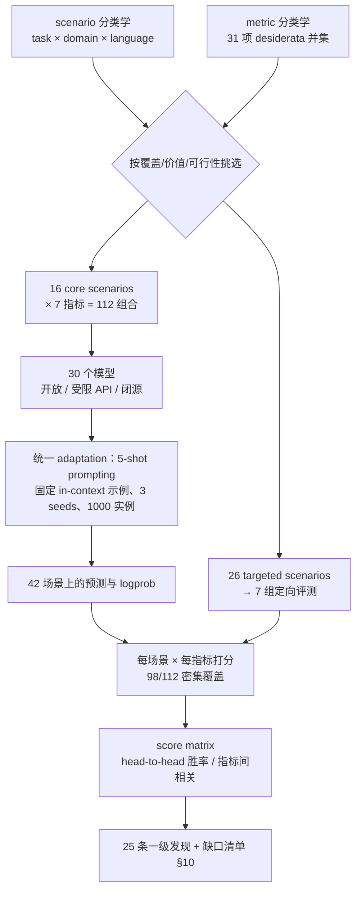

---
aliases:
  - "Holistic Evaluation of Language Models"
  - "HELM"
created: 2026-11-17
---
# Holistic Evaluation of Language Models

> HELM 是一个「先立法、再测量」的评测框架：它先把语言模型的评测空间拆成 scenario（要模型做什么）× metric（我们要求模型满足什么），做自上而下的分类学；再按覆盖面、价值与可行性挑选一个可实现的子集——16 个 core scenarios 与 7 类指标（accuracy、calibration、robustness、fairness、bias、toxicity、efficiency），在 $16\times 7=112$ 个（场景, 指标）组合里实测 98 个（87.5%），另加 26 个 targeted scenarios 组成的 7 组定向评测，共 42 个场景。然后用**同一套适配方式**（5-shot prompting、固定 in-context 示例、3 个随机种子、1000 条评测实例）评测 30 个模型（开放权重 / 受限 API / 闭源但授权三类），把「模型平均只在 17.9% 的 core 场景被评测过」提升到 96.0%，每个模型得到一个 **score matrix**（场景 × 指标）而非单一分数，并给出 25 条一级发现。全部原始 prompt 与 completion 公开，工具箱亦开源。

## 一句话定位

HELM 不提出新模型，它重写了「评测」这件事的对象定义：被评测的对象是**语言模型本身**（不是为某任务定制的系统），因此必须固定适配方式、共享同一批场景、并对同一批场景密集测量多个指标（[§1](papers/模型评测/2211.09110/2211.09110.pdf#1)）。它交付的不是一个排行榜，而是一张**可审计的 score matrix** 加一套承认自身缺口的分类学——「我们想评什么」与「我们实际评了什么」之间的差集被显式写出来（[§10](papers/模型评测/2211.09110/2211.09110.pdf#10)）。

## 问题与动机

HELM 针对的不是某个指标不够高，而是**当年评测实践的碎片化病灶**：模型、场景、指标三者的错位，使整个领域失去了可比性。作者把病灶拆成三层，每层都有实测量化的证据。

**病灶一：模型 × 场景错位——没有共同的场景集。** 作者手工标注了 40 多个模型的原始工作所评测过的数据集，发现 405 个数据集里，主流模型之间的重叠「低得惊人且极不均匀」：T5 与 Anthropic 的模型在各自原始论文里**没有一个共同的数据集**（[§1](papers/模型评测/2211.09110/2211.09110.pdf#1)）。把这件工作做完整后，作者得到一个更难看的数字：在 HELM 之前，即使把所有分散在不同论文里的评测都汇总起来，模型平均只在 17.9% 的 core 场景上被评测过（[§1](papers/模型评测/2211.09110/2211.09110.pdf#1)，[图 4](papers/模型评测/2211.09110/2211.09110.pdf#figure=4)）。若把「模型 $m$ 是否在场景 $s$ 上被评测过」记成 0/1 矩阵 $R$，那么被评测密度只是

$$
\mathrm{cov}(R) \;=\; \frac{1}{M\,S}\sum_{m=1}^{M}\sum_{s=1}^{S} R_{m,s} \;=\; 17.9\% \quad\longrightarrow\quad 96.0\%
$$

其中 $M$ 为模型数、$S$ 为 core 场景数。这两个数字就是 HELM 全部动机的量化形式：剩下的 4.0% 是特定模型的技术性问题（如某些 API 的分词异常导致 NaturalQuestions 闭卷无法报告），并非选择性省略（[§1](papers/模型评测/2211.09110/2211.09110.pdf#1)）。

**病灶二：同场景不可比——条件不统一。** 即便名义上「同一个场景」，条件也千差万别：HellaSwag 上有人说 fine-tuned 精度（T5），有人说 prompting 精度（davinci）；即便都是 few-shot prompting，示例数、示例选取、prompt 措辞、解码参数也不同。这种差异不是小数点级的：同一（模型, 场景）的精度可以在 **30% 到 80%** 之间摆动（[§1](papers/模型评测/2211.09110/2211.09110.pdf#1)），HELM 自己在消融中也复现了同等量级的摆动（[§8](papers/模型评测/2211.09110/2211.09110.pdf#8)）。这意味着「A 模型比 B 模型强」这类结论在当年的证据基础上大多不成立——差异可能完全来自适配条件而非模型。

**病灶三：指标错位——准确率一统天下。** 绝大多数 benchmark 只给一个 accuracy 分数（或一个 accuracy 向量），把公平性、鲁棒性、毒性等诉求下放到各自专属的数据集里去测（例如只在 RealToxicityPrompts 上测毒性）。作者认为这是设计错误：desiderata 必须在**我们真正要部署模型的那些语境**里测，否则它们永远是二等公民，而**权衡关系**（trade-off）根本无法暴露（[§1](papers/模型评测/2211.09110/2211.09110.pdf#1)，[图 3](papers/模型评测/2211.09110/2211.09110.pdf#figure=3)）。HELM 的反制是把密度写进设计指标：112 个（场景, 指标）组合中实测 98 个，即 $98/112=87.5\%$ 的密集覆盖（[§4.2](papers/模型评测/2211.09110/2211.09110.pdf#4.2)，[图 3](papers/模型评测/2211.09110/2211.09110.pdf#figure=3)）。

**方法论病灶（最深的一层）：没有声明「想评什么」，因此无法知道「漏了什么」。** 既有 benchmark 是数据集的集合——每个数据集自带一个标准任务框架和一个规范指标（通常是 accuracy），这是自下而上的拼装（[图 2](papers/模型评测/2211.09110/2211.09110.pdf#figure=2) 左）。其后果是：benchmark 的边界由「手上有什么数据集」决定，而不是由「我们关心什么」决定，于是缺口既看不见也无法被讨论。HELM 的做法是先写出一张覆盖 scenario 与 metric 的分类学（[图 2](papers/模型评测/2211.09110/2211.09110.pdf#figure=2) 右），再显式挑选——**分类学减实现就是缺口清单**，这就是 [§10](papers/模型评测/2211.09110/2211.09110.pdf#10) 存在的理由。

由此，论文给出「整体评测（holistic evaluation）」的三要素，这也是全文的组织骨架（[§1](papers/模型评测/2211.09110/2211.09110.pdf#1)）：

1. **广覆盖 + 承认不完整**：既要跨大量场景评测，又要给出自上而下的分类学，并把所有主要缺失（如被忽视的英语方言问答、可信度类指标）显式写出来；
2. **多指标测量**：每个被选中的场景都要测全部 desiderata，而不是只测 accuracy；
3. **标准化**：评测对象是**语言模型**而非场景定制系统，所以「把 LM 适配到场景」的策略必须被控制住，且所有模型尽可能跑同一批场景。

三要素各有代价：第一条要求设计者承认主观性（挑选本身就是价值判断），第二条导致结果维度爆炸（无法给出单一排名），第三条把「模型能力」与「适配策略的能力」绑在一起（HELM 只用了 prompting，这是它自己承认的最大局限之一，[§11.1](papers/模型评测/2211.09110/2211.09110.pdf#11.1)）。作者对这些代价的态度是显式承担而非回避——这一点决定了后面所有方法选择。

## 方法与机制（核心）

### 总览

把 HELM 看成一台「矩阵填充机器」会比看成一套指标集合更有用。它的基本单位是一次 **run**：由（scenario, adaptation method, metric）三元组确定（[§2.4](papers/模型评测/2211.09110/2211.09110.pdf#2.4)）。scenario 是「我们要模型做什么」，用（task, domain, language）三元组刻画，实例化为一批 train/test instances，每条含 input 字符串与带属性的 reference；adaptation 是「我们怎样让一个黑箱 LM 变成能预测的系统」；metric 是「结果有多好」。HELM 的全部设计可以概括为：**先把 scenario 轴与 metric 轴各自分类学化，再各自挑选子集，然后把两条轴的笛卡尔子矩阵尽可能填满**——填满的动作是把 30 个模型逐个适配到每个场景、用同一套指标打分，最后得到 $M\times S\times K$ 的结果张量（30 模型 × 16 core 场景 × 7 指标类别），并把它按「每个模型一张 score matrix」的形式交付。

矩阵填充有两个刻意的偏置。第一，**场景轴按「任务、领域、语言各自独立覆盖」而非「场景全覆盖」挑选**：论文明确承认这样做可能漏掉交互项（例如「边缘群体书写的文本上的毒性检测」正是他们最想要却未覆盖的点），但受数据集可得性、实现工作量与算力限制，这是自觉的取舍（[§3.2](papers/模型评测/2211.09110/2211.09110.pdf#3.2)）。第二，**指标轴上「只选能对全部 30 个模型都测的」**：先枚举 31 项 desiderata 的并集，再用三条准入条件过滤——不假设模型的构造/结构、不假设能拿到黑箱以外的访问、不假设知道更大的系统与社会语境（[§4.1](papers/模型评测/2211.09110/2211.09110.pdf#4.1)）。这三条把 causality、privacy、interpretability、explainability、legitimacy 等一大批 desiderata 全部排除，只留下 accuracy、uncertainty/calibration、robustness、fairness、bias、toxicity、inference efficiency 七项（另加 training efficiency 与 environmental impact，因其信息部分可从论文中获得）。**这个过滤规则是 HELM 最容易被误读的地方**：它不是因为不重要而排除，而是因为「对闭源模型不可测」而排除——可测性是硬约束，重要性不是。

这条流水线里真正承重的三个工程决定是：**(i) 适配方式被固定为 few-shot prompting**——这是为了让「模型」而非「针对某任务的系统」成为评测对象，代价是所有结论只对 prompting 成立（[§7](papers/模型评测/2211.09110/2211.09110.pdf#7)、[§11.1](papers/模型评测/2211.09110/2211.09110.pdf#11.1)）；**(ii) 示例固定而非逐实例重采样**——比 GPT-3 的做法更接近真实的 few-shot 使用，但代价是结果对示例的随机选择更敏感，故每个实验跑 3 次、只变 in-context 示例的随机性（[§7](papers/模型评测/2211.09110/2211.09110.pdf#7)）；**(iii) 每场景只取 1000 条评测实例**——这是为了在 4,939 个 run 的规模上可控，代价是部分比较的统计显著性存疑（[§11.2](papers/模型评测/2211.09110/2211.09110.pdf#11.2)）。这三条既是方法，也是后面所有局限的来源。

### 模块一：scenario 侧的标准化（分类学 → 挑选 → 实例化）

**分类学。** task 轴的做法是「编译既有来源」：取 ACL 2022 的各 track，把每个子领域映射到该领域的 canonical task（[§3.1](papers/模型评测/2211.09110/2211.09110.pdf#3.1)）。作者随即指出这个来源的两个不足：其一，任务内部结构被抹平了（QA 社区会把 QA 再切细，HELM 只把它当一个 task）；其二，NLP 传统任务不等于最有社会/经济影响的任务——OpenAI、Cohere、AI21 把 LM 当接口开放后，冒出了一批 NLP 从未研究过的用法，而这些用法「在技术出现之前无法被设想」，所以任务空间在原理上无法被穷举（[§3.1](papers/模型评测/2211.09110/2211.09110.pdf#3.1)）。domain 轴被拆成三个 W：**What**（体裁：维基、社交媒体、新闻、科学论文、小说）、**When**（时间：1980 年代、前互联网时代、当下）、**Who**（人口群体：种族、性别、年龄），并显式声明不覆盖 where（国别）与 how（书写/口述/转录）（[§3.1](papers/模型评测/2211.09110/2211.09110.pdf#3.1)）。language 轴没有做世界语言分类学，因为评测对象基本是英语模型，转而聚焦**英语变体**（非裔美国人英语 AAE、不同英语国家的变体）（[§3.1](papers/模型评测/2211.09110/2211.09110.pdf#3.1)）。

**挑选。** 先按「单模态英语可做」过滤掉多模态与机器翻译，再按「面向用户（user-facing）」这一价值判断选题，得到 6 个任务：question answering、information retrieval、summarization、sentiment analysis、toxicity detection，外加 miscellaneous text classification 以覆盖长尾（[§3.2](papers/模型评测/2211.09110/2211.09110.pdf#3.2)）。这个过滤明确排除了 NLI、NER、句法分析、信息抽取、对话等——理由是该文把 LM 视为接口，认为非用户直接使用的中间任务不代表直接社会影响；作者同时声明这不意味着这些任务不重要（[§3.2](papers/模型评测/2211.09110/2211.09110.pdf#3.2)）。

**实例化后的 16 个 core scenarios**（按任务分组）：QA 9 个——NaturalQuestions 开卷与闭卷、NarrativeQA、QuAC、BoolQ、HellaSwag、OpenBookQA、TruthfulQA、MMLU；IR 2 个——MS MARCO regular 与 TREC 版本；摘要 2 个——CNN/DM、XSum；情感分析 1 个——IMDb；毒性检测 1 个——CivilComments；杂项文本分类 1 个——RAFT（[§3](papers/模型评测/2211.09110/2211.09110.pdf#3)、[§4.2](papers/模型评测/2211.09110/2211.09110.pdf#4.2)）。另有 26 个 targeted scenarios 承载 7 组定向评测（语言理解、知识、推理、版权记忆、虚假信息、偏见、毒性生成），其中 21 个是 HELM 首次引入主流 LM 评测的场景（[§1](papers/模型评测/2211.09110/2211.09110.pdf#1)、[§5](papers/模型评测/2211.09110/2211.09110.pdf#5)）。core 与 targeted 的分工是刻意的：core 提供**整合视角**（同一模型在多指标上的画像），targeted 隔离**单项技能或风险**（[§1](papers/模型评测/2211.09110/2211.09110.pdf#1)）。

### 模块二：adaptation——把「模型」变成「系统」的那一步

LM 被定义为黑箱：输入 prompt 字符串 + 解码参数，输出 completion 字符串 + prompt/completion 的 log 概率；不假设能拿到内部激活、训练数据乃至构造方式（[§2.2](papers/模型评测/2211.09110/2211.09110.pdf#2.2)）。这个「text-to-text 抽象」有两个用处：一是能容纳 RAG、联网检索、人类偏好训练等不同实现而不偏袒某种架构；二是提供了统一接口，使同一套任务框架可覆盖所有纯文本任务（[§2.2](papers/模型评测/2211.09110/2211.09110.pdf#2.2)）。

HELM 的适配方式是 **5-shot prompting**（[§7](papers/模型评测/2211.09110/2211.09110.pdf#7)），其参数化程度比通常描述的更高，需要逐项固定：in-context 示例数 $k=5$（沿用 GPT-3，并在消融中扫 $k$）；示例按类别频率从高到低采样以保证类别覆盖；**所有评测实例共用同一组示例**（与 GPT-3 逐实例重采样不同，目的是做「真 few-shot」评测）；每个实验跑 3 次，只变示例选择；prompt 还包含 instructions、input/reference/output prefix、instance prefix 等槽位，以及 temperature、max tokens、stop sequence、num outputs 等解码参数——例如 CNN/DM 用 temperature $0.3$、max tokens $128$，TruthfulQA 用 temperature $0$、max tokens $5$（[§7](papers/模型评测/2211.09110/2211.09110.pdf#7)）。

对多选题，适配策略本身是一个可选的自由度，论文比较了两类（[§7](papers/模型评测/2211.09110/2211.09110.pdf#7)）：

- **separate**（GPT-3 式）：把每个选项与题干拼接，独立计算该选项的对数概率，可用「仅选项本身」的概率做长度校准；
- **joint**（MMLU 式）：把所有选项拼成一道「考试题」，让模型输出选项字母。

这不是细节：论文实测同一（模型, 场景）在两种策略下精度可从 79.1% 掉到 30.2%（[§1](papers/模型评测/2211.09110/2211.09110.pdf#1)、[§8](papers/模型评测/2211.09110/2211.09110.pdf#8)），且**最准的策略因场景与模型而异，不存在一致更优者**。这直接动摇了「标准化」的可行性：所谓公平的标准化，必须先选一种适配方式，而选哪种本身就在给某些模型加分（[§11.3](papers/模型评测/2211.09110/2211.09110.pdf#11.3)）。

### 模块三：7 类指标的定义与计算

**accuracy（[§4.3](papers/模型评测/2211.09110/2211.09110.pdf#4.3)）**：一个伞形术语，指每个场景的标准 accuracy 类指标——分类用 exact match、QA 用词重叠 F1、IR 用 MRR/NDCG、摘要用 ROUGE。关键限定：accuracy 是**在测试实例上取平均**，因此高均值可以掩盖少数子群体的低精度——这句话为后面的 fairness 埋下伏笔。

**calibration（[§4.4](papers/模型评测/2211.09110/2211.09110.pdf#4.4)）**：校准的含义是「模型给的概率是有意义的」——若它说 1000 个句子各有 0.7 概率有毒，就应有约 700 个真的有毒。用 ECE 量化预测概率与经验正确率的差：

$$
\mathrm{ECE}=\sum_{b=1}^{B}\frac{|B_b|}{n}\Bigl|\mathrm{acc}(B_b)-\mathrm{conf}(B_b)\Bigr|,\qquad B=10
$$

即把预测概率分 10 个等频桶，桶内「平均置信度」与「实际正确率」之差的加权和。另测 **selective classification**：只看模型最有信心的 $C$ 比例样本的精度（模型对其余 $1-C$ 弃答），报告 $C=0.1$ 的精度与 $C\in[0,1]$ 上 coverage–accuracy 曲线下面积。二者测的不是一回事：模型可以概率值本身不准、却仍能正确排序哪些样本更难。

**robustness（[§4.5](papers/模型评测/2211.09110/2211.09110.pdf#4.5)）**：在实例的变换上取**最坏情况**表现，因此要求模型在一组变换下都稳：

$$
\mathrm{Acc}_{\text{rob}}(m,s)=\min_{\tau\in\mathcal{T}}\ \mathrm{Acc}\bigl(m,\ \tau(x)\bigr)
$$

其中 $\mathcal{T}$ 是该实例的变换集合（本笔记按 §4.5 的「worst-case across transformations」表述整理）。两类变换：**invariance**（保语义的小扰动：大小写、常见拼写错误，取自 NL-Augmenter）与 **equivariance**（改变语义、因而应改变标签的扰动，用 Contrast Sets，仅 BoolQ 与 IMDb 有可用资源）。局限被明说：只测**局部**鲁棒性；分布偏移与对抗鲁棒性因需要特殊数据标注或大量自适应查询而无法在 30 模型规模上测（[§4.5](papers/模型评测/2211.09110/2211.09110.pdf#4.5)）。同理，invariance 只对分类、QA、IR 有意义（长文本生成无法统一定义「金标应如何变」）。

**fairness（[§4.6](papers/模型评测/2211.09110/2211.09110.pdf#4.6)）**：定义为**任务精度在不同社会群体间的不均等**（注意：与 bias 定义严格区分）。两种测法：**counterfactual fairness**——扰动测试样本中的群体相关词项（speaker 属性如 SAE vs AAE；subject 属性如种族、二元性别），看预测是否随之改变；**performance disparities**——对带群体元数据的测试集，直接报各群体子集上的精度。前者可扩展但有偏（扰动基于某一群体的数据分布，跨群体分布差异带来的不公平测不出来），后者准确但受元数据可得性限制（[§4.6](papers/模型评测/2211.09110/2211.09110.pdf#4.6)）。

**bias（[§4.7](papers/模型评测/2211.09110/2211.09110.pdf#4.7)）**：按 Blodgett 等的建议，把社会偏见定义为「语言选择上的系统性不对称」，因此它刻画的是**生成文本的分布性质**，与任务精度无直接关系。测两个量：**demographic representation**（不同群体被提及的比率是否偏离均匀分布——刻画 erasure 与过度代表）与 **stereotypical associations**（群体词与刻板词如职业的共现比率是否偏离均匀）。报告二元性别与种族两项，且只在涉及文本生成的 core 场景上测；作者同时提醒这类基于计数的度量很脆（如 "female nurse" 与 "male nurse" 的语言标记本身不对称）。

**toxicity（[§4.8](papers/模型评测/2211.09110/2211.09110.pdf#4.8)）**：与 bias 相对，毒性被视为**实例级**属性。用 Perspective API 在模型生成文本上检测，报毒性生成率（只在生成类 core 场景上测）。为什么用 Perspective 而不是榜首检测器？论文的回答是**可解释的已知缺陷优于未经验证的更强性能**——Perspective 被反复分析过、其局限是公开的；同时承认这个选择本身是 limitation，并靠公开全部生成文本来让后人换检测器复算（[§4.8](papers/模型评测/2211.09110/2211.09110.pdf#4.8)）。

**efficiency（[§4.9](papers/模型评测/2211.09110/2211.09110.pdf#4.9)）**：分训练与推理两侧。训练侧报能耗（kWh）与碳排放（kg CO$_2$）：有报告值就用报告值，缺失时按下式估算

$$
e=n_{\text{GPU}}\,W_{\text{GPU}}\,t_{\text{train}}\,\mathrm{PUE},\qquad e_{\text{CO}_2}=e\,c_{\text{region}}
$$

其中 $n_{\text{GPU}}$ 是分布式训练的 GPU 数、$W_{\text{GPU}}$ 是单卡平均功率（kW）、$t_{\text{train}}$ 是训练小时数、$\mathrm{PUE}$ 是数据中心冷却等额外开销（取 $1.1$）、$c_{\text{region}}$ 是所在区域碳强度（未知时用美国平均值）——意义是「把算力换算成能耗与碳排」，而非直接测电表。推理侧不报每请求耗时（受服务栈、硬件、排队噪声污染，模型间不可比），改报两个指标：**denoised runtime**（同原厂硬件软件、去掉性能抖动）与 **idealized runtime**（统一到 NVIDIA A100 + Megatron 的优化栈），后者还能导出理想能耗与碳排放；前者只在架构公开的模型上可得（[§4.9](papers/模型评测/2211.09110/2211.09110.pdf#4.9)）。

### 模块四：多指标汇总与排序——为什么拒绝单一排名

HELM 不给总分。它给每个指标一张 **head-to-head 胜率**图：对模型 $m$ 与指标 $k$，统计它与其余模型在所有 core 场景上两两比较的胜出比例（[§8.1](papers/模型评测/2211.09110/2211.09110.pdf#8.1)）

$$
w^{(k)}_{m}=\frac{1}{(M-1)\,S}\sum_{s=1}^{S}\sum_{m'\neq m}\mathbb{1}\Bigl[\mathrm{score}_k(m,s)>\mathrm{score}_k(m',s)\Bigr]
$$

胜率 1.0 表示该指标上每个场景都最高；0.5 表示随机挑一个场景与对手比较是掷硬币。另有两类聚合视角：**指标间相关**——在每个场景内算所有模型上两指标间的 Pearson 相关，再画成分布，用来看权衡是普适还是场景依赖；**accuracy vs. 各指标**的逐场景散点，用来暴露异质性（[§8.1](papers/模型评测/2211.09110/2211.09110.pdf#8.1)）。论文明确拒绝把多指标压成单一数值，理由是：几乎不存在严格 Pareto 占优，判定 A 优于 B 就必须显式或隐式地为「在哪些情形下更好」赋权，而这是价值判断不是测量（[§11.3](papers/模型评测/2211.09110/2211.09110.pdf#11.3)）。效率被排除在胜率比较之外——单看效率的对比无意义，必须与精度联合考虑（[§8.1](papers/模型评测/2211.09110/2211.09110.pdf#8.1)）。

### 模块五：人工评测与成本

自动指标无法覆盖的两类问题（虚假信息标题的说服力与文风、生成摘要的质量）交给人工评测，规模被成本硬性压缩到 **6 个模型**（[§8.5](papers/模型评测/2211.09110/2211.09110.pdf#8.5)）。协议要点：Amazon Mechanical Turk 招募，按加州最低工资 $15.00/小时 支付（依保守的标注时间估计）；每条生成由 **3 位标注者**评，取均分；用 5 点李克特或「是/否/不知道」量表；质量控制包括在指令中埋「暗号」以验证标注者确实读了说明、明确告知文本为机器生成且可能冒犯或不实；人工评测中的所有模型比较都做了 paired bootstrap 检验（[§8.5](papers/模型评测/2211.09110/2211.09110.pdf#8.5)、[§11.2](papers/模型评测/2211.09110/2211.09110.pdf#11.2)）。作者也承认标注者不是虚假信息专家，可能高估生成内容的真实危害。

## 实验与对比

**规模与成本（[§1](papers/模型评测/2211.09110/2211.09110.pdf#1)）。** 这批数字是 HELM「大规模」一词的实际含义，也是后续复现的成本门槛：

| 维度 | 数量 |
|---|---|
| 模型数 | 30（开放权重如 GPT-NeoX / OPT-175B / BLOOM；受限 API 如 davinci / Jurassic Jumbo / Cohere XL；闭源但授权如 Anthropic、MT-NLG 530B） |
| core scenarios | 16（QA 9、IR 2、摘要 2、情感分析 1、毒性检测 1、杂项分类 1） |
| 指标类别 | 7；112 个（场景, 指标）组合中实测 98 个（87.5%） |
| targeted evaluations | 7 组，基于 26 个 targeted scenarios；其中 21 个此前未用于主流 LM 评测 |
| 场景总数 | 42 |
| run 数 | 4,939 |
| token / query 总量 | 12,169,227,491 tokens / 17,431,479 queries |
| 商业 API 费用 | \$38,001 |
| 开放模型算力 | 约 19,500 GPU-hours |
| 一级发现 | 25 条 |

**关键结果。** 下表只摘能承重的数字（均出自 [§1](papers/模型评测/2211.09110/2211.09110.pdf#1) 的 25 条 findings 与 [§8](papers/模型评测/2211.09110/2211.09110.pdf#8) 的逐场景分析）：

| 现象 | 数字 |
|---|---|
| accuracy 头对头胜率 | instruct-davinci 超过 90%；MT-NLG 530B 第二；Anthropic 第三（规模小 10 倍以上） |
| 规模阈值 | accuracy 胜率明显高于随机（>55%）的模型全部 >50B 参数；唯一例外是 YaLM（<25%，疑因大量俄语训练） |
| 鲁棒性断崖（NarrativeQA） | MT-NLG 从 72.6% 标准精度跌到 38.9% 扰动后精度 |
| 方言差异（TwitterAAE） | OPT-175B 的 bits-per-byte：白人英语 1.506 vs AAE 2.114（越低越好） |
| 多选题适配策略 | OPT-175B 在 HellaSwag：separate 0-shot 79.1% → joint 5-shot 30.2%（近随机） |
| 知识（TruthfulQA） | instruct-davinci 62.0% vs 第二名 Anthropic 36.2% |
| 推理（GSM） | davinci-codex 52.1%、instruct-davinci 35.0%、其余模型无一超过 16% |
| 偏见（BBQ） | instruct-davinci 89.5%，其次 48.4% / 44.9%；而最准的三个模型恰是仅有的在歧义语境下偏见方向与社会偏见一致的模型 |
| 毒性检测（CivilComments） | OPT-175B 仅 50.1%（近随机）；鲁棒精度在 Black 子集从 51.3% 掉到 8.8%，White 子集 50.8%→24.3% |
| 知识（闭卷 NaturalQuestions / WikiFact） | MT-NLG 38.5% vs Anthropic 28.7%；34.3% vs 22.3% |
| 摘要（NarrativeQA ROUGE-L） | instruct-davinci 74.4%，超过专用 QA 模型 UnifiedQA-v2 的 67.4% |
| 校准的场景依赖 | OpenBookQA 上精度与校准相关 >0.8；HellaSwag 上精度与校准**误差**相关 >0.85（方向相反） |

**指标间关系（[§8.1](papers/模型评测/2211.09110/2211.09110.pdf#8.1)）。**

| 指标对 | 结论 |
|---|---|
| accuracy–robustness–fairness | 三者极强正相关，排序也高度一致（`BLOOM` 在鲁棒/公平上明显好于其精度排名；`GLM` 相对更鲁棒但更不准） |
| accuracy–calibration | 场景依赖，甚至两个同类常识 QA 场景方向相反 |
| fairness–gender bias | 相关 >0.5 但方向相反：公平性更好的模型性别偏见更重（作者称「出乎意料」） |
| bias–toxicity | 部分场景反相关：性别偏见更轻的模型在该场景更毒 |
| accuracy–efficiency | 未见强权衡，但每个模型族内「越大越准、越贵」，且只有部分模型位于各场景的精度–效率 Pareto 前沿 |

**排序结论。** 论文不给总排名，只给逐指标胜率；但有一条稳健的结构性结论：**instruction-tuning + 人类反馈比规模更能提升 accuracy**——Anthropic 的模型在精度、鲁棒性、公平性三项都进前三，规模却比第二准的 MT-NLG 小 10 倍以上（[§1](papers/模型评测/2211.09110/2211.09110.pdf#1)、[§8.1](papers/模型评测/2211.09110/2211.09110.pdf#8.1)）。此外「开卷/闭卷、生成/判别」造成的能力排序差异，比模型之间的整体差距更大——例如语言建模的 bits-per-byte 排名与 core 场景的 accuracy 排名几乎不相关。

## 归因分析

有四点可以把 HELM 的结论拆开归因，其中两点是作者自己点明的、可能被误读的反向归因。

**（1）标准化是「头对头可比」的唯一来源。** 17.9%→96.0% 的覆盖提升本身不产生科学结论，产生结论的是「同一适配、同一场景、同一指标」三者同时固定，才使 instruct-davinci >90% 胜率这类横向判断成立。反过来说，任何跨论文的模型对比在 HELM 之前都无法归因到模型本身（[§1](papers/模型评测/2211.09110/2211.09110.pdf#1)）。

**（2）多指标密度带来的是「权衡」而非「全面提升」。** 25 条发现里最有信息量的一类不是谁最准，而是 bias 与 toxicity 反向、fairness 与 gender bias 反向、accuracy 与 efficiency 弱相关——这些只可能在同一场景上同时测多个指标时才暴露（[§8.1](papers/模型评测/2211.09110/2211.09110.pdf#8.1)）。这也说明「只测一种危害」的政策取向可能产生副作用。

**（3）关键反归因：acc–robust–fair 的强相关部分来自度量方式。** 作者明确说，robustness 与 fairness 都被定义为「一组扰动下的最坏精度」，因此它们与 accuracy 的高相关**部分是测量定义的产物**——扰动后精度大致沿一条线随原精度下降（[§8.1](papers/模型评测/2211.09110/2211.09110.pdf#8.1)）。对 fairness 他们更谨慎：先前工作常报告公平–精度的权衡，HELM 不认为自己推翻了那些结论，因为度量方式与场景（few-shot prompting 而非微调）都不同。这是全篇最值得记住的方法论自觉。

**（4）结论的适用边界由适配策略划定。** 同一模型同一场景因多选题策略 79.1%→30.2%、因 prompt 格式与示例数在 30%–80% 间摆动（[§1](papers/模型评测/2211.09110/2211.09110.pdf#1)、[§7](papers/模型评测/2211.09110/2211.09110.pdf#7)），说明「模型能力」这个说法在 HELM 里必须读作「模型在 5-shot prompting 下的能力」。作者据此把「标准化到底该标准化什么」列为开放问题（[§11.3](papers/模型评测/2211.09110/2211.09110.pdf#11.3)）。

## 局限与未来工作

论文把局限分成三类（[§11](papers/模型评测/2211.09110/2211.09110.pdf#11)），另有专章写缺口（[§10](papers/模型评测/2211.09110/2211.09110.pdf#10)）。

**结果层。** ① 实用性：真实使用中模型会被进一步微调、接入更大系统，HELM 的 few-shot 结果不应被读成「好模型到处都好」（论文举例：GPT-J 整体不强，但体积小、易微调，在某些场景更合适）。② 泛化性：测试实例可能已在预训练数据里，而训练数据多源且不透明，污染程度「基本未知」，论文只能汇编已知的污染证据。③ 适配依赖：结论只在 prompting 下成立，微调或 prompt 优化后的趋势可能不同；连解码超参数这类低层选择的敏感性都因资源限制未考察（[§11.1](papers/模型评测/2211.09110/2211.09110.pdf#11.1)）。

**实现层（效度与信度）。** 效度：许多数据集都能「实例化」同一场景，但质量差异巨大，而领域内没有统一标准保证数据集真的反映目标构念；benchmark 一旦成为优化目标就会失真（Strathern / Goodhart 定律），故效度问题在 HELM 这类高影响力 benchmark 上尤其关键。信度：为控制成本只跑 3 个随机种子、每场景只用 1000 条实例，这可能使部分比较不具统计显著性；人工评测部分才做了 paired bootstrap 检验（[§11.2](papers/模型评测/2211.09110/2211.09110.pdf#11.2)）。

**设计层（聚合）。** 每模型给一张 score matrix，无法像 ImageNet/SQuAD 那样排全序；论文认为这正确反映了权衡，但代价是可能淹没结果使用者。作者明确把「聚合到单一数值」留给未来工作，并认为不存在满足所有偏好与情境的普适聚合（[§11.3](papers/模型评测/2211.09110/2211.09110.pdf#11.3)）。

**缺口（§10 的自我批判，值得单独记）。** 场景侧：非英语（尤其类型学多样语言）、垂直领域（生物医学、临床、金融、教育、客服）、时间维度（模型无法更新知识）、who 维度（年龄、社会经济地位；非美国情境的种姓等）、以及新出现的商业用例（文案、故事、邮件生成）；数据到文本生成被作者称为选题上的疏漏。指标侧：user experience、linguistic plausibility、provenance/credibility 三项被点名最该补；鲁棒性/公平性扰动的「何时该施加扰动」本身缺乏估计方法；社会偏见度量的效度基本未被验证；毒性只能靠 Perspective API；效率依赖厂商披露。定向评测侧：planning 未覆盖，垃圾信息/欺诈等恶意用途、dehumanization 等伤害类型未覆盖，语用与篇章层未覆盖。模型侧：PaLM、Gopher、LaMDA、RETRO 因无法访问而未评测，作者呼吁建立研究访问标准（[§6](papers/模型评测/2211.09110/2211.09110.pdf#6)、[§10](papers/模型评测/2211.09110/2211.09110.pdf#10)）。论文未明确说明 HELM 后续版本将如何演进，只把自己定位为持续更新的 living benchmark（[§1](papers/模型评测/2211.09110/2211.09110.pdf#1)）。

## 与其他工作的关系

HELM 在 [§9](papers/模型评测/2211.09110/2211.09110.pdf#9) 里把自己的位置讲得很清楚：benchmark 的演化是「单分数（SQuAD F1）→ 分数向量（GLUE/SuperGLUE、GPT-3 的 42 数据集套件）→ **分数矩阵（HELM）**」。这条线索的关键差别不是规模，而是**测量的对象从「任务系统」变成了「模型 × 场景 × 指标」的乘积空间**。

- 与 [[papers/模型评测/2206.04615/NOTES|BIG-bench]]：BIG-bench 是社区众包的任务集合，走的仍是自下而上拼装的路子；HELM 反过来先写分类学再挑选，两者的补集性质不同——BIG-bench 宽在任务数，HELM 宽在「每个任务上的指标数」与「缺口自知」。论文说明 HELM 代码库集成了全部 BIG-bench 场景并为其补上 accuracy 之外的指标（[§9](papers/模型评测/2211.09110/2211.09110.pdf#9)）。
- 与 EleutherAI LM Evaluation Harness、HuggingFace Evaluate：它们是执行基础设施，重心是高效跑大量 accuracy；HELM 的重心是「测什么指标」与「多指标如何共同解释」，前者可视为 HELM 的运行时下层。
- 与 CheckList、Dynabench、HANS、LMentry 一类「单元测试式」最小评测：方向相反但互补——HELM 是广而密，它们是窄而锐；论文自己指出，正因为有了 HELM 这种宽评测作为「神谕」，才可能反推出真正有判别力的最小评测集（[§11.3](papers/模型评测/2211.09110/2211.09110.pdf#11.3)）。
- 与人工评测及后来的模型评判：HELM 只在 6 个模型上做人工评测，成本（MTurk、3 标注者/条、\$15/小时）正是 [[papers/模型评测/2306.05685/NOTES|LLM-as-a-Judge]] 一类工作要解决的瓶颈；而 HELM 坚持公开全部生成文本，也正是为了让「换评判者复算」成为可能。
- 与统计可靠性：3 seeds、1000 实例、未做显著性检验是 HELM 自陈的信度短板，[[papers/模型评测/2411.00640/NOTES|Error Bars]] 一类工作补的正是这块——在 HELM 式的多模型多场景矩阵上给出置信区间与配对比较的正确做法。
- 与评测哲学：HELM 把「分类学减实现 = 缺口」当成一等公民，这一点比它的任何单个数字都更持久；它实际上提出了一条判据——**一个 benchmark 的可信度，取决于它能否清楚说出自己没测什么**。
