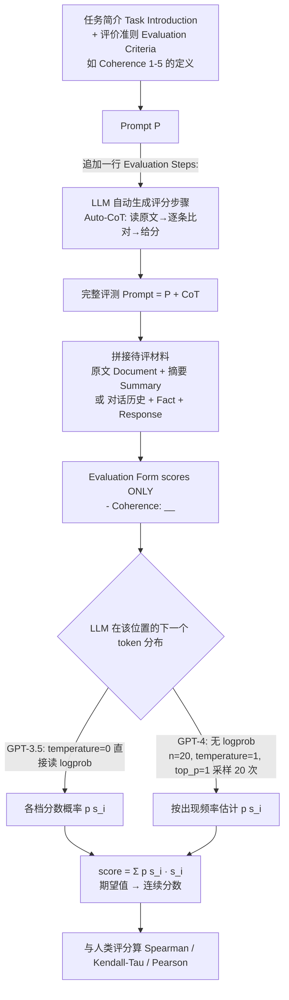

---
aliases:
  - "G-Eval: NLG Evaluation using GPT-4 with Better Human Alignment"
  - "G-Eval"
created: 2026-11-17
---
# G-Eval: NLG Evaluation using GPT-4 with Better Human Alignment

> 这篇论文要回答一个很朴素的问题：能不能不让 GPT-4 只输出一个整数分，而是让它先写评分步骤、再填一张评分表、最后用它给出的各档分数的**概率**做加权平均。答案是可以，而且效果出奇地好——在 SummEval 摘要元评测上，G-Eval-4 的平均 Spearman 相关达到 0.514，把当时最好的中型神经评测器 UniEval（0.474）和 BARTScore（0.385）都甩在身后；在 Topical-Chat 对话任务上平均 Spearman 为 0.588。但论文后半段的偏置分析是更值得记住的部分：G-Eval-4 在"人类评审也更喜欢人类摘要"的那一档里给出了正确的方向，却**在所有档位上都无条件地把 GPT-3.5 生成的摘要打到人类撰写的摘要之上**。作者把这一点明确标为风险：如果拿这种评测器当 RL 的奖励信号，模型会朝"自己那套评分偏好"收敛，而不是朝 NLG 任务真正想要的质量收敛。

## 一句话定位

一篇 ACL 2023 的方法论文，用**两件工程手段**（让 LLM 自动生成 Evaluation Steps 作为 CoT、用分数 token 的概率做期望值打分）把"用 GPT-4 当 NLG 评测器"这件事从"能跑"推到"能和人类判断对齐"，并顺手交出一份不太好看的**自我偏好（self-preference）偏置**体检报告 —— 后者比前者对后续 LLM-as-a-judge 研究的影响更长远（[§2](papers/模型评测/2303.16634/2303.16634.pdf#2)，[§4](papers/模型评测/2303.16634/2303.16634.pdf#4)）。

## 问题与动机

### 前人为什么不可靠

论文开篇把 NLG 自动评测切成三代，每一代都有一个致命的结构性缺陷，而不是"再调调参就能好"（[§1](papers/模型评测/2303.16634/2303.16634.pdf#1)，[§5](papers/模型评测/2303.16634/2303.16634.pdf#5)）：

1. **基于 n-gram 的参考度量（BLEU / ROUGE / METEOR）**：本质是字面重叠。它对开放式生成几乎无判别力 —— 同一份摘要换个同义改写，ROUGE 掉一大截，但质量没变；反过来，把原文片段堆成"一坨相关信息"能刷高 ROUGE，而这恰恰是连贯性最差的一类摘要。更麻烦的是它**必须有参考文本**，新任务上收集参考文本的成本很高。
2. **基于嵌入的相似度（BERTScore / MoverScore）**：换成语义相似度，缓解了同义改写问题，但仍然是在和"参考"比，因此**只能衡量"像不像参考"，不能衡量"本身好不好"**。而且在 SummEval 上它们几乎全线偏低（[表 1](papers/模型评测/2303.16634/2303.16634.pdf#table=1) 里 BERTScore 平均 $\rho=0.225$）。
3. **任务专用的神经评测器（FactCC / QAGS / USR）**：学会了人类评分，相关性明显上升，但每个只盯一个维度（事实一致性、或对话的某一个侧面），**换个任务就废**，也拿不出一个整体质量分。

真正和本文短兵相接的是第四类：**统一评测器**与**LLM 直接当度量**。UniEval 把"评测"改写成问答形式，用一个预训练 T5 打分，是当时的 SOTA；GPTScore 则换了个思路 —— 不直接问 LLM"这文本几分"，而是用 LLM 在给定指令与上下文条件下**生成这段文本的条件概率**当分数，隐含假设是"好文本在好模型眼里概率更高"。

论文对 GPTScore 这类路线的批评是很精准的一刀：**条件概率衡量的是"这段文本在该模型下的典型程度"，不是"这段文本好不好"**。典型性和质量在开放式生成上是两件事 —— 一段平庸但套话连篇的摘要，概率可以非常高。这也解释了为什么已有的元评测研究发现，这些 LLM-based 评测器的人类对应性**反而低于中型神经评测器**（[§1](papers/模型评测/2303.16634/2303.16634.pdf#1) 引 zhong2022towards 的结论）。本文的切入点就是：既然 GPT-4 已经能"读懂"评分标准，为什么不干脆让它**按标准打分**，而要绕道去算概率？

### 直接打分暴露出的两个工程故障

如果只是"写个 prompt 让 GPT-4 打 1–5 分"，效果并不好。论文诚实地列出了两个观察到的故障（[§2](papers/模型评测/2303.16634/2303.16634.pdf#2)），这两个故障直接催生了本文的核心公式：

- **分数塌缩（digit dominance）**：在 1–5 量表上，某一个数字会主宰整个分数分布 —— 最常见的是 3。后果是**分数方差极小**，与人类判断的相关性自然上不去。这不是模型"不懂"，而是自回归解码在低熵区的众数偏好。
- **只能出整数**：即使 prompt 里明确要求小数，LLM 依然倾向输出整数。后果是**大量并列（ties）**，捕捉不到生成文本之间细微的质量差异。而这批数据恰恰是"高质量系统之间互相比"的场景，差异本来就是小数点后的事。

这两个故障合起来说明：**"让 LLM 说一个数"这条通道的信息带宽太窄**。本文的解法是把带宽从"一个 token"扩到"整个分数词表上的分布"。

### 论文自己声明的四条贡献

原文 [§1](papers/模型评测/2303.16634/2303.16634.pdf#1) 列了四条，值得原样记下来当索引，因为后文的分析正好对应这四条：

1. LLM-based 度量在人类判断相关性上普遍优于基于参考与无参考的基线，**在开放式/创造性任务（如对话回复生成）上优势最大**；
2. LLM-based 度量**对指令与 prompt 高度敏感**，而 CoT 通过提供更多上下文与指引能提升表现；
3. 通过把离散分数按其 token 概率重新加权，可以得到**更细粒度的连续分数**；
4. LLM-based 度量存在**偏好 LLM 生成文本**的潜在问题，若被用作奖励信号，可能导致 LLM 的自我强化（self-reinforcement）。

## 方法与机制（核心）

### 总览

G-Eval 的骨架只有三段，但每一段都有一个"为什么必须这样设计"的理由，串起来是一条**先让模型自己把评分标准展开成可执行步骤、再让它填空、最后把填空处的概率分布取期望**的流水线（[图 1](papers/模型评测/2303.16634/2303.16634.pdf#figure=1)）：

**第一段，写 Prompt。** 输入只有两样东西：任务简介（Task Introduction，"你将会看到一篇新闻文章的摘要，任务是按一个指标给它打分"）和评价准则（Evaluation Criteria，例如 Coherence 的定义，直接引自 DUC 质量问题的原文表述）。这一步刻意**不写具体的评分步骤** —— 因为为每个任务、每个维度手写评分步骤极其耗时，而这正是本文想自动化掉的部分。

**第二段，让 LLM 自己生成 CoT。** 在 prompt 末尾加一行 "Evaluation Steps:"，然后把**同一份 prompt** 再喂给 LLM，让它续写出 1/2/3 三步的评分流程。得到的这段文字就是一个"自动 CoT"：它把抽象准则（"结构良好、组织清晰"）翻译成可操作的动作（"先读原文抓主题与要点 → 再读摘要逐条比对 → 最后按 1–5 给分"）。关键点是：**这段 CoT 是与具体待评文本无关的、任务级的**，生成一次即可复用到该任务该维度的所有样本上。

**第三段，Form-filling 打分。** 把 prompt、自动生成的 CoT、待评材料（原文 + 摘要，或对话历史 + 事实 + 回复）按顺序拼起来，末尾接一张表格骨架："Evaluation Form (scores ONLY): - Coherence:"。模型要做的不是自由生成，而是**填这一个空**。这就把开放式生成压成了受限填空。

**第四段，概率加权。** 模型在填空位置上的下一个 token 是一个分布，落在各档分数 token（如 "1"…"5"）上的概率就是 $p(s_i)$。最终分数取**期望值**而非众数，于是"3 分"这个整数被替换成一个实数，比如 3.42，ties 被打破，方差被恢复。

这四段里，第一、三段是"把任务塞进 LLM 能答的格式"，第二段是"把评分知识的组织工作外包给 LLM"，第四段是"把 LLM 的输出通道从 argmax 换成分布"。论文的方法章节篇幅很短（不到两页），但每一段都在解决一个具体的失败模式，没有装饰性组件。

### 模块一：Prompt —— 任务定义与准则，而不是"给个分"

Prompt 的设计原则是**把"什么叫好"写成可核对的条目，而不是留给模型的世界知识**。以摘要的 Coherence 为例，prompt 由三块组成（[附录 A](papers/模型评测/2303.16634/2303.16634.pdf#A)）：

- **任务声明**："You will be given one summary written for a news article. Your task is to rate the summary on one metric."——先把"你只有一篇摘要 + 一篇原文、只评一个维度"这个约束钉死，避免模型顺手把别的维度也评了。
- **仪式性指令**："Please make sure you read and understand these instructions carefully. Please keep this document open while reviewing, and refer to it as needed."——这句看起来像废话，但它是让模型停留在"审稿人"角色上的锚。
- **准则原文**："Coherence (1-5) - the collective quality of all sentences. We align this dimension with the DUC quality question…"，并且**直接引用了 DUC 对 coherence 的英文原句定义**。这一步的价值在于：它与 SummEval 里人类标注员被告知的定义来自同一套话语体系，等于**把标注指南搬进了 prompt**，从而减少了"模型理解的 coherence"与"人类标注的 coherence"之间的语义漂移。

对话任务的 prompt 进一步体现了"准则要写到能操作"的程度：Engagingness 用 1–3 三档，每一档都给了行为化描述（1 = generic and dull；2 = somewhat interesting，能引出观点或想法；3 = very interesting 或给出一个有趣事实）。这解释了后文一个重要现象：**在 Topical-Chat 上 GPT-3.5 与 GPT-4 打平** —— 因为准则已经把任务规约得太清楚，小模型照着做就够了（[§3.5](papers/模型评测/2303.16634/2303.16634.pdf#3.5)）。

### 模块二：Auto-CoT —— 让模型自己写评分细则

这是全文最"轻"但最关键的自动化设计。原文的动机陈述非常直白：某些准则仅靠一句定义不够，需要更细的评分指引，而**为每个任务手工设计这些步骤太费时间**；作者发现 LLM 自己就能写出这些步骤（[§2](papers/模型评测/2303.16634/2303.16634.pdf#2)）。

机制上它就是一个**两阶段同 prompt 调用**：

$$
\text{CoT} \sim \text{LLM}(\underbrace{\text{Prompt}}_{\text{任务简介} + \text{准则}} \;\Vert\; \texttt{"Evaluation Steps:"})
$$

其中 $\Vert$ 表示字符串拼接，采样得到的 CoT 是一串编号步骤。以摘要 Coherence 为例，模型自动写出（[附录 A](papers/模型评测/2303.16634/2303.16634.pdf#A)）：

1. 仔细读新闻原文，识别主题与要点；
2. 读摘要并与原文比对，检查是否覆盖主题与要点、是否以清晰合逻辑的顺序呈现；
3. 按 Evaluation Criteria 在 1–5 上打分。

值得强调的是这段 CoT 的**三重性质**，它们决定了这个设计为什么便宜又有效：

- **任务级而非样本级**：它不含具体文档，因此一次生成、全测试集复用，边际成本为零；
- **不泄漏答案**：步骤只描述"怎么查"，不预设"应该几分"，所以不会把某一档分数先验地钉死；
- **可解释**：CoT 本身就是一份人类可读的评分说明，这让 G-Eval 的分数具备一定的可审计性 —— 虽然论文并未对 CoT 质量做人工评估（这一点后文会作为局限提出）。

还有一个容易被忽略的设计细节：**幻觉（QAGS）任务上并没有用 CoT**。附录 A 里针对事实一致性的 prompt 是最简形式 —— 只有一句任务描述加一句二值问句 "Does the summary contain factual inconsistency? Answer:"，既没有评分准则分档，也没有 Evaluation Steps（[附录 A](papers/模型评测/2303.16634/2303.16634.pdf#A)）。这说明作者把 CoT 视为**"准则需要展开时才用"的条件性组件**，而不是无脑套在所有任务上的模板；同时也意味着 QAGS 一栏的数字与大框架的可比性要打个折扣。

### 模块三：Form-filling —— 把生成题改成填空题

Scoring function 的输入是 prompt、CoT、待评上下文与目标文本四者的拼接，输出是一张只填数字的表。与 GPTScore 的差别被论文明确点出：**GPTScore 把评测建模成条件生成问题（算目标文本的概率），G-Eval 把评测建模成表单填充问题（算分数 token 的概率）**（[§2](papers/模型评测/2303.16634/2303.16634.pdf#2)）。

这个转向的意义在于"概率算在谁头上"：

| 路线 | 概率算在什么上 | 隐含假设 | 失败模式 |
|---|---|---|---|
| GPTScore | 目标文本 $y$ 的 token 序列，$p(y\mid x,\text{instruction})$ | 好文本更"典型" | 套话文本概率高 |
| G-Eval | 分数 token $s_i$，$p(s_i\mid x,y,\text{prompt},\text{CoT})$ | 模型按准则判断档位 | 档位分布塌缩到某一档 |

也就是说，G-Eval 把"质量"这件事从**生成侧**挪到了**判断侧**。这一步是整篇论文有效性的根源：它让 GPT-4 的判别能力（读准则、找证据、比对）真正参与进来，而不是让它只当一个语言模型算似然。

Form-filling 还有两个副作用值得记录：一是它天然给出了**统一的输出接口**（都是"维度名: 数字"），使跨任务、跨维度的批量评测变得机械可重复；二是 "scores ONLY" 的约束会**压制解释性输出** —— 这既是它和后来 CoT-then-score 类工作的分野，也是它无法提供理由的代价（对比 [LLM-as-a-Judge](papers/模型评测/2306.05685/NOTES|LLM-as-a-Judge) 里要求模型先给理由再打分的设定）。

### 模块四：概率加权打分（核心公式）

论文先用自然语言把两个故障说清（众数主导、只能出整数），再给出解法：**用 LLM 输出 token 的概率对分数做归一化，并取加权和**。形式化地，设 prompt 中预定义的分数集合为 $S=\{s_1,\dots,s_n\}$（如 $S=\{1,2,3,4,5\}$），LLM 给出的每档分数概率为 $p(s_i)$，则最终分数为

$$
\text{score} \;=\; \sum_{i=1}^{n} p(s_i)\times s_i
$$

符号含义：$n$ 是分档数（摘要 1–5 时 $n=5$，对话 engagingness 1–3 时 $n=3$）；$s_i$ 是第 $i$ 档的数值；$p(s_i)$ 是模型在填空位置把下一个 token 生成为 $s_i$ 的概率。整个式子就是**以分数为取值、以模型信念为权重的期望值**：

$$
\text{score} = \mathbb{E}_{s\sim p}[s]
$$

为什么取期望而不是取众数（argmax），论文给出的理由有两条，且都能从这个式子直接读出来：

- **信息量**：argmax 只用了分布的一个点，把 $n-1$ 个概率全丢掉；期望值用上了整个分布。两个样本的众数都是 3，但一个分布是 $(0.1,0.1,0.6,0.1,0.1)$、另一个是 $(0.3,0.3,0.4,0,0)$，期望分别是 3.0 与 2.1 —— 差异被恢复了。
- **连续性**：$\text{score}$ 的取值是 $[s_1,s_n]$ 上的连续量，分辨率为 $\sum_i p(s_i)s_i$ 的组合精度，而不是整数格点。这直接消掉了 ties，也就直接提升了基于秩的 Spearman 相关。

代价也必须说清楚：**期望值对分布形状敏感，而这个分布未必校准**。如果模型其实"心里"只有 3 分，但把 4 分给了 0.2 的概率，期望会被机械地抬高。论文没有对 $p(s_i)$ 做校准（temperature scaling 之类），也没有讨论这一点 —— 这是本篇在方法论上留白的地方。另外原文并未说明是否在分数 token 子集上重新归一化（即是否强制 $\sum_{i\in S} p(s_i)=1$）；若不归一化，$\sum p(s_i)s_i$ 与真实期望之间会相差一个常数因子。论文未明确说明（Not explicitly specified in text）。

### 补充：分档数 $n$、量纲，以及期望值的"收缩"

有三个与这条公式直接相关、但论文没有展开的工程问题，读表时需要自己补上：

**（1）分档数 $n$ 决定了所有下游统计量的量纲。** 摘要的四个维度都用 1–5，对话的 naturalness / coherence / groundedness 也用 1–5，唯独 engagingness 用 1–3（[附录 A](papers/模型评测/2303.16634/2303.16634.pdf#A)）。而 [表 2](papers/模型评测/2303.16634/2303.16634.pdf#table=2) 把这四个维度一起平均成 AVG —— 这个平均在数学上是对**不同单位**的量求均值：1–5 量表上"1 分的差距"与 1–3 量表上"1 分的差距"语义完全不同，前者是五档中的一档，后者是三等分中的一等。所以表 2 的 AVG 只能当"同一批指标的相对排序"读，不能当"绝对质量"读。论文没有提示这一点（论文未明确说明，Not explicitly specified in text）。

**（2）期望值会把分布向中间"收缩"。** 因为 $\text{score}$ 是所有档位的加权平均，它必然落在最小档与最大档之间，且当概率质量集中在中档时会被拉向中心。效果是：**G-Eval 的分数方差系统性地小于人类评分的方差**。对 Spearman（只看秩）影响有限，但如果有人直接拿 G-Eval 的绝对分数设阈值（"低于 3 分就算不合格"），就会系统性地少判"极差"与"极好"两端的样本。论文没有讨论这一点，也没有报告 G-Eval 分数分布与人类分数分布的对比（例如均值、方差、直方图形状）。

**（3）概率质量落在分数集之外的情况未被处理。** 如果模型在填空位置输出的不是 1–5 中的一个裸数字（例如输出 `3.` 带句点、或输出 `Coherence: 3`），这些 token 的概率不会被计入 $\sum_i p(s_i)s_i$，期望就被"截断"了 —— 表现为分数向低档偏移。论文既没有说明它如何处理这类越界 token，也没有报告各档概率之和与 1 的偏差；论文未明确说明（Not explicitly specified in text）。这是复现这套方法时第一个会踩到的坑，也是"概率加权"看起来简单、实际却需要小心处理输出解析的原因。

### 模块五：GPT-4 上的概率估计代理

公式本身没问题，但落地时撞上一个硬约束：**GPT-4 不提供 token 概率**。作者的处理是把它变成一个蒙特卡洛估计（[§3.1](papers/模型评测/2303.16634/2303.16634.pdf#3.1)）：

- **GPT-3.5（text-davinci-003）**：设 `temperature=0` 提高确定性，**直接读输出 token 的概率**；
- **GPT-4**：因无法输出 token 概率，设 `n=20, temperature=1, top_p=1`，**采样 20 次，用各档分数的出现频率估计 $p(s_i)$**。

用频率替代概率，等价于

$$
\hat p(s_i) \;=\; \frac{1}{20}\sum_{j=1}^{20}\mathbf{1}[\,s^{(j)}=s_i\,]
$$

其中 $s^{(j)}$ 是第 $j$ 次采样的分数。这个估计的粒度被 $n=20$ 钉死：$p$ 只能是 $0,0.05,0.10,\dots$ 这些值，因此一个 5 档量表在理论上最多给出 $20+1$ 种不同的期望分数（实际更少，因为组合受限）。换句话说，**G-Eval-4 的"连续分数"其实是一个 20 粒度的离散分数** —— 这仍然远好于整数 5 档，但不是真正的连续，且 $\text{temperature}=1$ 意味着采样来自一个被刻意"加热"的分布，与 `temperature=0` 时读到的 logprob 不是同一个对象。论文没有讨论这一不一致，也没有报告 20 次采样的方差或置信区间；这一点在复现时需要注意。

成本上，GPT-4 的每一分要花 20 次调用，**最终指标的金钱成本是单次打分的 20 倍**。论文没有给出成本数字，只在实现细节里交代了采样设置。

### 一条完整的样例走查（摘要 Coherence）

把上面五个模块串起来，对一条 SummEval 样本（新闻原文 $D$ + 待评摘要 $Y$）的实际执行是：

1. 取任务级 prompt $P$（含 Coherence 的 DUC 定义）；
2. 调一次 LLM 生成 CoT（三步，见模块二），此后所有样本复用；
3. 拼成 $P \,\Vert\, \text{CoT} \,\Vert\, \texttt{Source Text: } D \,\Vert\, \texttt{Summary: } Y \,\Vert\, \texttt{Evaluation Form (scores ONLY): - Coherence:}$；
4. GPT-4 以 $n=20$ 采样 20 次，统计落在 {1,2,3,4,5} 上的次数，例如得到 $(0,1,12,6,1)/20$；
5. 代入公式：$\text{score}=0.05\cdot2+0.60\cdot3+0.30\cdot4+0.05\cdot5=3.25$；
6. 对全测试集算出这一列分数，与人类 coherence 均分做 **summary 级** Spearman / Kendall-Tau。

注意第 6 步的相关性层级：摘要任务是**以"系统"为单位取平均后再算相关**（summary-level），而对话任务是**逐轮算相关**（turn-level）。两者不可直接比较，这是读 [表 1](papers/模型评测/2303.16634/2303.16634.pdf#table=1) 与 [表 2](papers/模型评测/2303.16634/2303.16634.pdf#table=2) 时必须先分清的。

## 实验与对比

### 设置

- **元评测基准三个**（沿用 zhong2022towards 的设定）：**SummEval**（CNN/DailyMail 摘要，4 维度：fluency / coherence / consistency / relevance，summary 级相关）、**Topical-Chat**（知识 grounded 的对话回复生成，4 维度：naturalness / coherence / engagingness / groundedness，turn 级相关）、**QAGS**（摘要幻觉/一致性，两个子集 QAGS-CNN 与 QAGS-XSUM）（[§3.2](papers/模型评测/2303.16634/2303.16634.pdf#3.2)）。
- **指标**：Spearman $\rho$（主指标）、Kendall-Tau $\tau$、部分表用 Pearson $r$。
- **基线**：ROUGE-1/2/L、BERTScore、MoverScore、BLEU-4、METEOR、BARTScore、FactCC、QAGS、CTC、USR、UniEval、GPTScore。
- **两个配置**：G-Eval-3.5（text-davinci-003，`temperature=0` 读概率）与 G-Eval-4（`n=20, temperature=1, top_p=1` 采样估概率）（[§3.1](papers/模型评测/2303.16634/2303.16634.pdf#3.1)）。

### 主结果一：SummEval 摘要（summary 级）

[表 1](papers/模型评测/2303.16634/2303.16634.pdf#table=1) 的关键数字（$\rho$ / $\tau$）：

| 指标 | Coherence | Consistency | Fluency | Relevance | AVG $\rho$ | AVG $\tau$ |
|---|---|---|---|---|---|---|
| ROUGE-1 | 0.167 / 0.126 | 0.160 / 0.130 | 0.115 / 0.094 | 0.326 / 0.252 | 0.192 | 0.150 |
| ROUGE-2 | 0.184 / 0.139 | 0.187 / 0.155 | 0.159 / 0.128 | 0.290 / 0.219 | 0.205 | 0.161 |
| BERTScore | 0.284 / 0.211 | 0.110 / 0.090 | 0.193 / 0.158 | 0.312 / 0.243 | 0.225 | 0.175 |
| MoverScore | 0.159 / 0.118 | 0.157 / 0.127 | 0.129 / 0.105 | 0.318 / 0.244 | 0.191 | 0.148 |
| BARTScore | 0.448 / 0.342 | 0.382 / 0.315 | 0.356 / 0.292 | 0.356 / 0.273 | 0.385 | 0.305 |
| UniEval | 0.575 / 0.442 | 0.446 / 0.371 | 0.449 / 0.371 | 0.426 / 0.325 | 0.474 | 0.377 |
| GPTScore | 0.434 / – | 0.449 / – | 0.403 / – | 0.381 / – | 0.417 | – |
| G-Eval-3.5 | 0.440 / 0.335 | 0.386 / 0.318 | 0.424 / 0.347 | 0.385 / 0.293 | 0.401 | 0.320 |
| G-Eval-4 | **0.582** / **0.457** | **0.507** / **0.425** | **0.455** / **0.378** | **0.547** / **0.433** | **0.514** | **0.418** |

三个必须点出来的读法：

1. **平均 0.514 是对的，但"大幅超越"要看维度**。相对 UniEval 的平均增益是 $+0.040$ $\rho$（约 +8.4% 相对），可拆开看：coherence 只领先 $0.007$（0.582 vs 0.575，几乎在噪声内），consistency 领先 $0.061$，relevance 领先 $0.121$，fluency 领先 $0.006$。**平均增益几乎全部来自 consistency 与 relevance**——也就是最需要"读原文做比对"而不是"比对措辞"的两个维度。这与 G-Eval 的机制解释完全吻合：form-filling + CoT 让它真的去原文里找证据。
2. **GPT-3.5 版本不是"稍弱"，而是"不及中型神经评测器"**。0.401 低于 UniEval 的 0.474，coherence 上甚至低于 BARTScore（0.440 vs 0.448）。这一点直接削弱了"框架本身带来了收益"的说法 —— **框架 + 弱模型 ≈ 旧 SOTA，框架 + 强模型 ≫ 旧 SOTA**。
3. **GPTScore 的 AVG（0.417）比它的单维度分数看起来更体面，但它缺 $\tau$**：原文表中 GPTScore 的 $\tau$ 全是 "–"，因此它的 AVG $\tau$ 也缺省，跨方法的 $\tau$ 比较对它不成立。

### G-Eval-4 与 UniEval 的逐维度差值（本笔记据表 1 计算）

把"平均领先 0.040"拆成本笔记自己算的差值，能更清楚地看到增益的来源分布：

| 维度 | UniEval $\rho$ | G-Eval-4 $\rho$ | 差值 | UniEval $\tau$ | G-Eval-4 $\tau$ | 差值 |
|---|---|---|---|---|---|---|
| Coherence | 0.575 | 0.582 | **+0.007** | 0.442 | 0.457 | +0.015 |
| Consistency | 0.446 | 0.507 | **+0.061** | 0.371 | 0.425 | +0.054 |
| Fluency | 0.449 | 0.455 | **+0.006** | 0.371 | 0.378 | +0.007 |
| Relevance | 0.426 | 0.547 | **+0.121** | 0.325 | 0.433 | +0.108 |
| 平均 | 0.474 | 0.514 | +0.040 | 0.377 | 0.418 | +0.041 |

两个维度的增益（+0.007 / +0.006）已经小到不该被称为"超越"，尤其考虑到元评测的相关性本身带有不可忽略的抽样误差（这一点见 [Error Bars](papers/模型评测/2411.00640/NOTES|Error Bars)）。真正稳的只有 consistency 与 relevance —— 它们的共同点是**必须打开原文逐条核对**，而这恰好是 UniEval 那套"把评测改写成 QA"的范式最吃力、G-Eval 那套"给准则 + 给步骤 + 让 GPT-4 自己比对"最擅长的动作。

### 主结果二：Topical-Chat 对话（turn 级）

[表 2](papers/模型评测/2303.16634/2303.16634.pdf#table=2) 用 Pearson $r$ 与 Spearman $\rho$：

| 指标 | Naturalness | Coherence | Engagingness | Groundedness | AVG $r$ | AVG $\rho$ |
|---|---|---|---|---|---|---|
| METEOR | 0.212 / 0.191 | 0.250 / 0.302 | 0.367 / 0.439 | 0.333 / 0.391 | 0.290 | 0.331 |
| BERTScore | 0.226 / 0.209 | 0.214 / 0.233 | 0.317 / 0.335 | 0.291 / 0.317 | 0.262 | 0.273 |
| USR | 0.337 / 0.325 | 0.416 / 0.377 | 0.456 / 0.465 | 0.222 / 0.447 | 0.358 | 0.403 |
| UniEval | 0.455 / 0.330 | 0.602 / 0.455 | 0.573 / 0.430 | 0.577 / 0.453 | 0.552 | 0.417 |
| G-Eval-3.5 | 0.532 / 0.539 | 0.519 / 0.544 | **0.660** / **0.691** | **0.586** / 0.567 | 0.574 | 0.585 |
| G-Eval-4 | **0.549** / **0.565** | **0.594** / **0.605** | 0.627 / 0.631 | 0.531 / 0.551 | **0.575** / **0.588** | |

这里的结论和摘要任务**不一样，而且是论文自己承认的**：G-Eval-3.5 与 G-Eval-4 打平（平均 $\rho$ 0.585 vs 0.588），并且在 **engagingness（0.660/0.691 vs 0.627/0.631）与 groundedness（0.586/0.567 vs 0.531/0.551）两个维度上 GPT-3.5 版本反而更高**。作者的解释是"这个 benchmark 对 G-Eval 来说相对容易"（[§3.5](papers/模型评测/2303.16634/2303.16634.pdf#3.5)）。本笔记认为更精确的读法是：**该任务的准则被写得太具体**（1–3 三档全部行为化描述），任务被规约成一个近乎模式匹配的判断，模型容量不再是瓶颈 —— 这反而是"prompt 质量 > 模型规模"的一个正面证据，同时也提醒：**当 prompt 已经足够好时，加模型规模不会带来增益**。

另一个有趣的反差是 UniEval 在对话的 coherence 上 $r=0.602$ 高于 G-Eval-4 的 0.594，但 $\rho$ 只有 0.455 vs 0.605。这说明 G-Eval 的优势主要在于**排序**而非线性拟合 —— 对"哪个系统更好"这种排序型结论，$\rho$ 更贴近实际用途。

### 主结果三：QAGS 幻觉/一致性

[表 3](papers/模型评测/2303.16634/2303.16634.pdf#table=3)（$r$ / $\rho$ / $\tau$）：

| 指标 | QAGS-CNN $\rho$ | QAGS-XSUM $\rho$ | 平均 $\rho$ | 平均 $\tau$ |
|---|---|---|---|---|
| ROUGE-2 | 0.418 | 0.083 | 0.250 | 0.200 |
| BERTScore | 0.505 | 0.008 | 0.256 | 0.202 |
| FactCC | 0.484 | 0.259 | 0.371 | 0.294 |
| BARTScore | 0.680 | 0.159 | 0.420 | 0.343 |
| CTC | 0.564 | 0.295 | 0.430 | 0.346 |
| UniEval | 0.662 | 0.488 | 0.575 | 0.465 |
| G-Eval-3.5 | 0.516 | 0.406 | 0.461 | 0.377 |
| G-Eval-4 | **0.685** | **0.537** | **0.611** | **0.525** |

要点：G-Eval-4 平均领先 UniEval 0.036 $\rho$，但**在更抽象的 XSum 子集上领先 0.049**（0.537 vs 0.488），而 BARTScore 在 XSum 上直接掉到 0.159。这条对比是本文关于"抽象式幻觉更难测"最有力的证据 —— 基于似然的度量在抽取式数据上还能靠字面重合混过关，到了抽象式就崩了。同时 **G-Eval-3.5 在这个任务上严重失手**（平均 $\rho$ 0.461，低于 UniEval 的 0.575），作者据此判断"consistency 维度对 LLM 容量敏感"（[§3.6](papers/模型评测/2303.16634/2303.16634.pdf#3.6)）。再叠加前面提到的"QAGS 用的是无 CoT 最简 prompt"，可以推断：**这个任务上 G-Eval 的收益主要来自 GPT-4 的世界知识与推理，而不是来自 CoT 或概率加权这两个"框架"组件**。

### 量化结论（三句话总结）

- 在摘要上，G-Eval-4 把平均 Spearman 从 0.474（UniEval）提到 **0.514**，提升 $+0.040$；在幻觉上从 0.575 提到 **0.611**，提升 $+0.036$；在对话上从 0.417 提到 **0.588**，提升 $+0.171$（这是三任务中最大的一次跃升，因为对话维度上"参考相似度"最没用）。
- 同框架换 GPT-3.5，摘要掉到 0.401、幻觉掉到 0.461，**均低于 UniEval**；只有对话还能保持 0.585。→ 框架的收益高度依赖骨干模型的判别力。
- 在全部 10 个「任务×维度（子集）」格子里（摘要 4 + 对话 4 + QAGS 两个子集），G-Eval-4 拿下 **7 个第一**；丢掉的 3 个全部在对话上：coherence 以 0.594 输给 UniEval 的 0.602，engagingness 与 groundedness 输给自己的 GPT-3.5 版本（0.627 / 0.531 vs 0.660 / 0.586）。

## 归因分析

论文的 ablation 只在 SummEval 上做（[表 1](papers/模型评测/2303.16634/2303.16634.pdf#table=1) 末三行），但足够回答"提升来自哪个设计"。下面把三组对照的**本文计算**的差值列出来（原始数字取自表 1）：

| 对照 | 平均 $\rho$ | 平均 $\tau$ | 最大单维度变化 |
|---|---|---|---|
| G-Eval-4（完整） | 0.514 | 0.418 | – |
| G-Eval-4 − Probs（去掉概率加权） | 0.502 | 0.446 | consistency $\rho$ 0.507→0.501 |
| G-Eval-4 − CoT（去掉自动步骤） | 0.500 | 0.407 | **fluency $\rho$ 0.455→0.403（−0.052）** |
| G-Eval-3.5（换小模型） | 0.401 | 0.320 | consistency $\rho$ 0.507→0.386（−0.121） |

**归因一：CoT 贡献 +0.014 平均 $\rho$，但它不是均匀贡献的。** 它在 fluency 上带来 $+0.052$，在 relevance 上只有 $+0.009$（0.547→0.538）。这是可解释的：fluency 是最"没有客观锚点"的维度，人类标注员靠的是整体阅读感受，模型没有几步固定的检查动作就容易漂；而 relevance 有"摘要是否覆盖原文要点"这个天然的比对动作，即使不给 CoT，form-filling 本身也会引导模型去做。所以 **CoT 的价值是"给主观维度补上可执行动作"，而不是"全面提升推理能力"**。

**归因二：概率加权的贡献在 GPT-4 上很小（+0.012），在 GPT-3.5 上很大（+0.055）。** 这个反差是最有信息量的一条：GPT-4 即使用整数打分，分布也足够分散（不容易塌缩到同一档），所以把它连续化的边际收益有限；GPT-3.5 的整数分严重塌缩，概率加权等于把它从"只会说 3"里救出来。所以**概率加权的本质是"低容量模型的方差补偿"**，模型越强越可有可无。

**归因三：模型规模是最大的一项（+0.113 平均 $\rho$）。** 0.401→0.514 的跨度是 CoT（0.014）与概率（0.012）之和的近 4 倍。把这三项粗略相加得 $\approx 0.139$，与"从 G-Eval-3.5 无 CoT 无概率（$\approx 0.34$–$0.35$）到 0.514"的量级是自洽的。**诚实的结论是：这篇论文的 headline 数字主要由 GPT-4 贡献，两个"框架"组件的边际贡献加起来约 0.025。**

**归因四：Kendall-Tau 上的"反向 ablation"是个统计假象，不能当成"概率加权有害"。** 表 1 里 G-Eval-4 − Probs 的 $\tau$（0.446）高于完整版（0.418），看起来去掉概率加权反而更好。论文对此的解释是明确且正确的：$\tau$ 只统计 concordant / discordant 对，**并列对（ties）既不算一致也不算不一致，等于被从分母里剔除**；整数打分产生大量 ties，把分母缩小，$\tau$ 就被机械抬高。表 caption 因此把这几行的 $\tau$ 用斜体标出并声明"不应视为公平比较"（[表 1](papers/模型评测/2303.16634/2303.16634.pdf#table=1) 的 caption，[§4](papers/模型评测/2303.16634/2303.16634.pdf#4)）。这是一个方法论上值得记住的坑：**在大量并列的评分上报告 Kendall-Tau，会系统性奖励"粗粒度打分器"**。

**归因五：偏置不是 ablation 能修的东西。** 见下一节，它属于机制层面的缺陷。

### 偏置分析（本文最重要的部分）

论文用一份独立收集的数据做了一次"三方对照"（[§4](papers/模型评测/2303.16634/2303.16634.pdf#4)，[图 2](papers/模型评测/2303.16634/2303.16634.pdf#figure=2)）：该数据集先请自由撰稿人写高质量摘要，再让标注员把人类摘要与 GPT-3.5（text-davinci-003）摘要做偏好比较，于是样本被分成三档 —— 人类更好 / 人类更差 / 打平。然后用 G-Eval-4 给两边的摘要各打分，比较平均分。

结论有两层，必须分开看：

- **第一层，方向是对的**：当人类评审认为人类摘要更好时，G-Eval-4 给人类摘要的分数也更高；当人类评审认为 GPT-3.5 更好时，G-Eval-4 同样转向。也就是说**在"相对比较"这一层，它跟得上人类的偏好方向**。
- **第二层，绝对水平是偏的**：在**所有三档**里，G-Eval-4 给 GPT-3.5 摘要的绝对分数都高于人类摘要，**包括人类评审明确更喜欢人类摘要的那一档**。这说明存在一个系统性的、与内容质量无关的加分项，专门加在 LLM 生成的文本上。

作者给出两条可能的原因，并且明确把它们标为"potential"：

1. **任务本身难到人类都测不准**：引用了原数据集论文的发现 —— 判断"人类写的摘要 vs LLM 写的摘要哪个更好"的**标注者间一致性极低，Krippendorff's $\alpha = 0.07$**。既然人类自己都达不成一致，"与人类对齐"这个目标本身就模糊，评测器偏离也可能只是偏离了一个噪声标签。
2. **模型共享了生成时与评测时的同一套"好"的概念**：LLM 生成摘要时用的隐含偏好，和它评测摘要时调用的隐含准则，来自同一套训练分布，因此它对"自己这类文本"有系统性亲和。

第 2 条是本文对后续研究影响最大的判断，作者把它推到应用层：**如果拿 LLM-based 评测器的分数当奖励信号去微调模型，模型会过拟合到"评测器自己的评分准则"，而不是 NLG 任务真正的人类准则**（[§4](papers/模型评测/2303.16634/2303.16634.pdf#4)）。用一句话概括这个反馈回路的形态：

$$
\text{policy} \xrightarrow{\ \text{生成}\ } y \xrightarrow{\ \text{G-Eval 打分}\ } r \xrightarrow{\ \text{RL 更新}\ } \text{policy}'\ \text{更擅长取悦 G-Eval，而非更擅长写好摘要}
$$

这条警告后来在 [LLM-as-a-Judge](papers/模型评测/2306.05685/NOTES|LLM-as-a-Judge) 里被系统化成 self-enhancement bias，在 [JudgeBench](papers/模型评测/2410.12784/NOTES|JudgeBench) 里被进一步证明"强 judge 在难样本对上会失效"。G-Eval 是这条研究线的起点之一。

## 局限与未来工作

严格按原文能读到的内容列，并标注哪些是原文说的、哪些是本笔记的观察。

**原文明确承认的局限：**

1. **偏置只做了初步研究**。原文措辞是 "Our work should be considered as a preliminary study on this issue, and more research is needed to fully understand the behavior of LLM-based evaluators to reduce its inherent bias towards LLM-generated text"（[§4](papers/模型评测/2303.16634/2303.16634.pdf#4)）。即：机制没查清，缓解方法没给出。
2. **自我强化的风险只是警示，未做实验验证**。原文只说"若把评测分数当奖励信号，可能导致 LLM 过拟合到自己的评测准则"，没有跑任何 RL 实验来量化这个效应。
3. **任务覆盖面窄**。只做了摘要（SummEval、QAGS）与对话（Topical-Chat）两类任务、共三个基准，且全部是英文。原文没有讨论跨语言、跨模态、或需要长文档推理的任务（[§3](papers/模型评测/2303.16634/2303.16634.pdf#3)）。
4. **对 prompt / 指令高度敏感**（这是原文列为贡献第 2 条的性质，反过来就是局限）：论文没有做 prompt 敏感性分析，没有报告多个 prompt 变体下的方差，因此**表 1–3 里的数字在多大程度上依赖那一份特定 prompt 的措辞，论文未明确说明**。
5. **CoT 的质量未被评估**。论文只说自动生成的 CoT "能提供更多上下文与指引"，但没有人工检查这些步骤是否合理、是否有系统性错误，也没有做"人工写 CoT vs 自动 CoT"的对照。

**原文提出的未来方向：**

- 更深入地理解 LLM-based 评测器的行为，以**降低其对 LLM 生成文本的固有偏置**（[§4](papers/模型评测/2303.16634/2303.16634.pdf#4)）；
- 作者在结论里表达的希望是"启发更多关于用 LLM 做 NLG 评测的研究，并提高对把 LLM 当评测器的风险与挑战的认识"（[§6](papers/模型评测/2303.16634/2303.16634.pdf#6)）。这是一个方向性呼吁，而不是具体的研究路线。

**本笔记补充的观察（原文未讨论，明确标注为外部判断）：**

- **成本**：GPT-4 每打分一次需 20 次采样，成本是单次调用的 20 倍；GPT-3.5 因为能直接读 logprob 只需 1 次。论文给出了采样设置但**未报告成本对比或延迟数字**（论文未明确说明）。
- **概率未被校准**：$\mathbb{E}_p[s]$ 的合理性依赖 $p$ 是校准的，而论文没有做任何校准检验；在 `temperature=1` 下采样的 20 次尤其不是模型"真实信念"的无偏估计。
- **$n=20$ 的分辨率上限**：期望分数的取值粒度被 20 次采样限死，这使"连续分数"的说法应理解为"比整数细"而非"真连续"。
- **ties 与 Kendall-Tau 的耦合**：论文正确诊断了这个问题，但没有给出替代方案（如用 tie-aware 的 $\tau_b$ 或直接只报 Spearman）。后续工作若沿用 Kendall-Tau 做元评测，需要注意这个陷阱。

## 与其他工作的关系

**向下（它批评/取代的）：**

- **GPTScore**：同样用 LLM，但把概率算在目标文本上（条件生成），G-Eval 把概率算在分数 token 上（form-filling）。这个"概率算在谁头上"的差别是两篇论文的分水岭（[§2](papers/模型评测/2303.16634/2303.16634.pdf#2)）。
- **UniEval / BARTScore**：中型统一评测器的代表，也是本文最主要要超越的对象。它们证明"从人类评分里学"有效，本文证明"不学、直接问 GPT-4"更有效 —— 但代价是**把可复现的固定模型换成了一个会漂移的 API**。
- **BLEU / ROUGE / BERTScore / MoverScore**：本文用它们来展示"参考相似度"这条路的收益上限。

**向上（继承它的）：**

- [[papers/模型评测/2306.05685/NOTES|LLM-as-a-Judge]]（MT-Bench / Chatbot Arena）把 G-Eval 的"单答案打分"扩展成 pairwise 比较与多轮对话评判，并系统化了 position / verbosity / self-enhancement 三类偏置 —— 它引用的正是 G-Eval 这套"LLM 当评测器 + 与人类相关"的范式。**G-Eval 提供了偏置的第一次观测，MT-Bench 提供了偏置的系统分类。**
- [[papers/模型评测/2410.12784/NOTES|JudgeBench]] 换了个角度追问"judge 到底会不会判难样本"，可以看作对 G-Eval 时代"平均相关性"指标的一次反拨：**平均相关高不代表在难例上靠得住**。
- [[papers/模型评测/2407.18370/NOTES|Trust or Escalate]] 直接接住了 G-Eval 的偏置问题：既然单个 judge 会错，那就让它**在没把握时弃权**，并用 conformal 保证把"有把握的那部分"的准确率钉在目标水平上。这是把 G-Eval 的"平均相关"目标改写成"条件准确率 + 覆盖率"目标。
- [[papers/模型评测/2411.00640/NOTES|Error Bars]] 针对的正是本文这类"报一个 Spearman 就算完"的做法：元评测的相关性本身有置信区间，0.514 与 0.474 的差距在统计上未必显著 —— 这是读本文表 1 时最该补的一课。
- **评测基准侧**：[[papers/模型评测/2206.04615/NOTES|BIG-bench]] 与 [[papers/模型评测/2211.09110/NOTES|HELM]] 代表了"用固定题目测模型"的传统路线；G-Eval 代表"用模型测模型"的路线。两条路线的合法性争论（谁来评评测者）在 [[papers/模型评测/2407.01502/NOTES|AI Agents That Matter]] 里被推到 agent 场景。
- **与可解释性工具的连接**：G-Eval 的 auto-CoT 本质是"用自然语言把评分函数写出来"，这与 [[papers/可解释性/2309.08600/NOTES|SAE features]] 一类"把内部计算翻译成人类可读单元"的动机相通，但 G-Eval 的可解释性停留在**输出侧的文字说明**，没有触及模型内部 —— 两者不可混为一谈。
