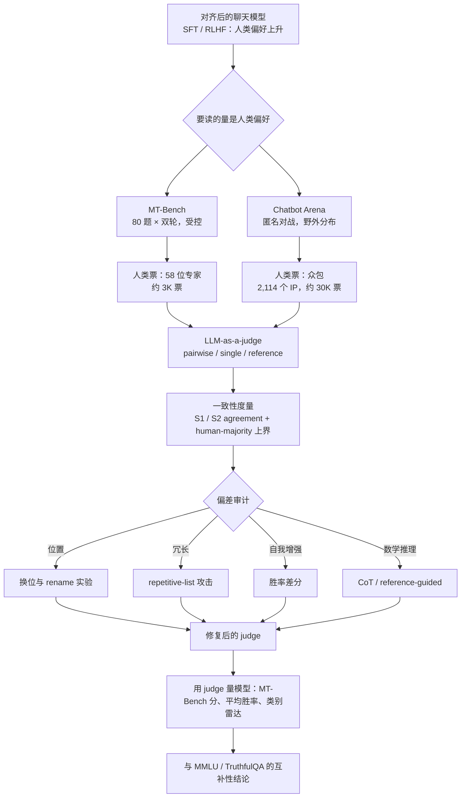

---
aliases:
  - "Judging LLM-as-a-Judge with MT-Bench and Chatbot Arena"
  - "JLAJMBCA"
  - "LLM-as-a-Judge (MT-Bench / Chatbot Arena)"
created: 2026-11-17
---
# Judging LLM-as-a-Judge with MT-Bench and Chatbot Arena

> 用强 LLM 当裁判来评聊天助手，到底靠不靠得住？这篇论文把问题拆成两半。第一半是造尺子：一套 80 题双轮受控题集 MT-Bench，和一个众包匿名对战平台 Chatbot Arena（运行一个月约 30K 票）。第二半是把「裁判」本身当作被测对象：用 58 位研究生级专家在 MT-Bench 上给出的约 3K 票，以及 Arena 里 2,114 个独立 IP 的众包票，去反验 LLM judge 与人类偏好的一致程度。结论是 GPT-4 judge 的一致率在 80% 以上，与人类彼此之间的一致率（81%–82%）同量级；同时论文系统列出三类偏置（位置、冗长、自我增强）与数学/推理评分短板，并给出换位、few-shot、CoT、参考答案引导四类缓解手段。因此 LLM-as-a-judge 被定位成「可扩展、可解释地逼近人类偏好」的替代读数器，而不是「超越人类」的裁判。

## 一句话定位

一篇实证性的**测量学**论文：它不提出新模型，而是交付「两把尺子 + 一份裁判偏差审计报告」——MT-Bench 提供受控、可复现的偏好信号，Chatbot Arena 提供野外分布上的偏好信号，LLM-as-a-judge 则是把这两种信号低成本放大读出的仪器；论文的核心主张不是「GPT-4 比人准」，而是「在给定偏置可度量的前提下，强 LLM 与人类的一致率已达到人类彼此一致率的量级，因此可以作为偏好评估的规模化代理」（[§1](papers/模型评测/2306.05685/2306.05685.pdf#1)、[§7](papers/模型评测/2306.05685/2306.05685.pdf#7)）。

## 问题与动机

**动机一：对齐后的模型在传统基准上「看不见」。** 论文开篇的观察很尖锐：经过 SFT/RLHF 对齐的聊天模型被人类用户强烈偏好，但这种偏好提升并不对应 MMLU、HELM 一类基准上的分数提升。文中给的引例是 LLaMA-13B（未微调基座）与 Vicuna-13B（在其上用高质量对话微调）就一道 MMLU 题目展开的两轮对话：基座模型在 MMLU 上并不差，但在开放式追问下明显更不讨人类喜欢（[图 1](papers/模型评测/2306.05685/2306.05685.pdf#figure=1)）。这就把「用户感知的可用性」与「基准采用的判据」之间的裂缝摊在桌面上：现有评测主要测核心能力（多选知识、检索式问答），没有测开放式任务中的指令遵循与多轮对话能力（[§1](papers/模型评测/2306.05685/2306.05685.pdf#1)）。

**动机二：人工评测是金标准，但贵到无法规模化。** 论文明确把人类偏好称为 gold standard，同时指出它「exceptionally slow and costly」（[§1](papers/模型评测/2306.05685/2306.05685.pdf#1)）。成本可以量化：MT-Bench 数据采集付给标注者 \$20 评 20 道题，折算时薪约 \$35，参与者主要是十余所高校的研究生（[§C.1](papers/模型评测/2306.05685/2306.05685.pdf#C.1)）。Arena 侧虽然免费众包，但一个月也只积累约 30K 票（[§3.3](papers/模型评测/2306.05685/2306.05685.pdf#3.3)）。也就是说，「每换一版模型就重跑一遍人类评测」在经济上不成立，这正是自动化裁判的需求来源。

**动机三：能自动算的指标在这类问题上全都失灵。** 论文把「为什么不能写规则」说得很干脆：MT-Bench 与 Arena 的绝大多数问题没有标准答案，写规则程序去判定几乎不可行；基于与参考答案相似度的传统指标（ROUGE、BLEU）对这类开放式回答同样无效（[§2](papers/模型评测/2306.05685/2306.05685.pdf#2)）。这条否定性论证很关键——它排除了「把评测做得更工程化」的路线，只剩「用一个已经与人类对齐的模型去当裁判」这一条路。

**动机四：已有做法是技巧，缺的是系统研究。** 论文承认 LLM-as-a-judge 此前已在 Vicuna 博客、AlpacaFarm、Bard 报告等工作中被零散使用，但「there has not been a systematic study of this approach」（[§1](papers/模型评测/2306.05685/2306.05685.pdf#1)）。所以本文的贡献被明确定义为两条：对 LLM-as-a-judge 做系统研究；以及发布两套带人类偏好标注的数据（80 道 MT-Bench 题、3K 专家票、30K 带偏好对话）（[§1](papers/模型评测/2306.05685/2306.05685.pdf#1)）。

**这套动机在方法论上意味着什么。** 一旦把「LLM 当裁判」当成一个测量仪器来论证，就必须同时回答三个问题，而这三问正好对应论文的三条线：(a) 仪器读数与真实量（人类偏好）的一致程度有多高？(b) 仪器有哪些系统性偏差，幅度多大？(c) 在什么条件下这种替代是划算的？论文的答案分别是 80%+ 的一致率、三类可量化的偏置、以及「单答评分 + 换位」这条性价比最高的配置。后文所有实验都可以挂到这三问上读。

## 方法与机制（核心）

### 总览

论文的三条线——人类对齐研究、MT-Bench、Chatbot Arena——不是三个并列贡献，而是一条「造尺子 → 造仪器 → 标定仪器 → 用仪器量模型」的链。链条的起点是论文开篇的那个错位：对齐把模型变得「人类更爱用」，但 MMLU/HELM 这类能力基准读不出这个变化（[§1](papers/模型评测/2306.05685/2306.05685.pdf#1)）。既然要读的量是**人类偏好**，就必须先有能稳定产生偏好信号的数据源，于是有了两把尺子：MT-Bench 是**受控尺子**（80 道人工设计的双轮题，规模小、可复现、连「人类彼此之间的一致率」都能算），Chatbot Arena 是**野外尺子**（无预设问题、匿名对战、一个月约 30K 票，规模大但没人能控制提问分布）。两把尺子回答的是不同问题：前者能给出偏好信号的**噪声底**（人与人的一致率），后者能给出偏好的**真实分布**。

接着才是仪器：LLM-as-a-judge 把「人类读一遍打分」换成「强 LLM 读一遍打分」。仪器要能用，必须先被标定，所以论文的第三条主线是**反验**——在所有人类已经投过票的同一批样本上，计算 judge 与人类的一致率，并与「人类彼此的一致率」比较。反验发现仪器有系统性偏差，于是进入第四条主线：**偏差审计与修复**（位置、冗长、自我增强、数学/推理），修复手段（换位、few-shot、CoT、参考答案）随后被回灌到默认配置里。最后一步才是**使用**：用修好的 judge 去给模型打 MT-Bench 分、算胜率、画类别雷达，并得出「偏好基准与能力基准互补」的结论（[§5](papers/模型评测/2306.05685/2306.05685.pdf#5)）。

### 模块一：judge 的三种形态与提示设计

论文提出三种可单独或组合使用的判别形态（[§2.1](papers/模型评测/2306.05685/2306.05685.pdf#2.1)）：**pairwise comparison**（给问题 + 两个答案，判哪个更好或平局）、**single answer grading**（给单个答案直接打分）、**reference-guided grading**（在适用时额外提供参考答案，例如数学题）。论文自己点明三者的取舍：pairwise 在选手数量增加时组合数平方增长、不可扩展；single 难以分辨细微差别且绝对分不稳定（换裁判模型时漂移比相对结果更大）。这条取舍解释了后文为什么主实验用 pairwise 做标定、却在 MT-Bench 打分上改用 single——后者才是能算「分数」的那一种。

提示模板在附录 A 以图给出（[§A](papers/模型评测/2306.05685/2306.05685.pdf#A)）。从正文对提示的引用可以反推出四类要素：交代任务与评分维度；显式写入「避免任何位置偏置」一类约束（原文在讨论 short 变体时明确说删掉的是 "Avoid any position bias.." 这类指令）[§D.1](papers/模型评测/2306.05685/2306.05685.pdf#D.1)；要求裁判**先给一句简短解释再给判定**（"Begin your evaluation ... and provide a short explanation"），这正是论文所称 explainability 的来源——裁判输出不只是分数，还有理由（[图 1](papers/模型评测/2306.05685/2306.05685.pdf#figure=1)）；以及规定可自动解析的输出格式，因为表 1 专门有一列 `Error` 统计格式错误率，说明「输出能不能被程序读」本身就是可用性前提。

提示变体的谱系（[§2.3](papers/模型评测/2306.05685/2306.05685.pdf#2.3)、[§D.1](papers/模型评测/2306.05685/2306.05685.pdf#D.1)、[§D.2](papers/模型评测/2306.05685/2306.05685.pdf#D.2)）：

| 变体 | 相对 default 的改动 | 想验证什么 |
|---|---|---|
| default | pairwise 基准提示 | 主实验配置 |
| rename | 把 Assistant A/B 改成别的名字 | 偏置来自「位置」还是「名字」 |
| score | 改为让裁判输出两个绝对分 | 打分式是否更稳定 |
| short | 删掉「避免位置偏置」「先解释再判定」等指令 | 指令本身是否起作用 |
| few-shot | 3 个示例（A 更好 / B 更好 / 平局各一） | 示例能否提升一致性 |
| CoT | 要求裁判先独立解题、再评分 | 修数学/推理评分 |
| reference | 先独立作答，再把自己的答案作为参考答案展示 | 同上，更强干预 |

多轮场景的提示设计单独讨论（[§2.5](papers/模型评测/2306.05685/2306.05685.pdf#2.5)）：比较两个助手时要同时摆出 2 个问题、4 个回答，论文试了「拆成两个 prompt」与「整段对话放一个 prompt」两种。前者会让裁判**指错上一轮的回答**——附录给了一个案例，A 明明按要求改了上一轮自己的第二个例子，GPT-4 却去引用了 B 的回答从而误判（[§B](papers/模型评测/2306.05685/2306.05685.pdf#B)）。结论是必须把完整对话放进单个提示、并要求裁判聚焦第二轮。

### 模块二：三类偏置的量化方式

**位置偏置（position bias）**：裁判倾向于偏爱某个位置。量化方法是构造一对**几乎同样好**的答案——对 MT-Bench 每道第一轮题用 GPT-3.5 以温度 0.7 采样两次，然后正反两个顺序各判一次（[§2.3](papers/模型评测/2306.05685/2306.05685.pdf#2.3)）。定义两个指标：

$$
\text{Consistency}=\Pr\left[\,v(A,B)=v(B,A)\,\right],\qquad
\text{Bias}_{\text{first}}=\Pr\left[\,v(A,B)=A\,\right]
$$

其中 $v(A,B)$ 是「A 放第一位、B 放第二位」时裁判给出的判定（A / B / 平局），$v(B,A)$ 是交换后的判定。前者度量**稳定性**，后者度量**方向**；两个数要一起看——裁判可能既稳定又偏爱第一位。结果见[表 1](papers/模型评测/2306.05685/2306.05685.pdf#table=1)：Claude-v1 的 default 一致性只有 23.8%、偏向第一位 75.0%；GPT-3.5 为 46.2% / 50.0%；只有 GPT-4 超过 60%（65.0% / 30.0%）。rename 变体说明 Claude 还有**名字偏置**（换名后一致性 56.2%，但 28.7% 偏向第二位）。论文还按题目类别与模型对拆解：写作 42%、人文 36% 这类开放题最容易偏，数学/编码则高达 86%；而模型对越接近越容易偏（GPT-3.5 vs Claude 67.5%，GPT-3.5 vs LLaMA-13B 98.8%）[§D.1](papers/模型评测/2306.05685/2306.05685.pdf#D.1)。

**冗长偏置（verbosity bias）**：裁判偏爱更长、更啰嗦的答案。量化用「repetitive list 攻击」：从 MT-Bench 取 23 个含编号列表的回答，让 GPT-4 在不添加任何新信息的前提下把这些条目改写一遍，插到原列表前面，于是 5 条变 10 条、内容等价（[§2.3](papers/模型评测/2306.05685/2306.05685.pdf#2.3)）。若裁判认为变长后的回答更好，攻击即成功。结果见[表 2](papers/模型评测/2306.05685/2306.05685.pdf#table=2)：Claude-v1 与 GPT-3.5 的失败率都高达 91.3%，GPT-4 只有 8.7%。论文还做了校准实验：三个裁判对**完全相同**的两个答案都能稳定判平局，但过不了这个升级版攻击——「能判等」与「能判等价」是两回事。

**自我增强偏置（self-enhancement bias）**：裁判偏爱自己生成的答案。这一条论文用的是**统计而非受控实验**：直接看六模型在不同裁判与人类下的胜率曲线（不含平局），若某裁判给自己打出的胜率系统性偏高即为证据（[§2.3](papers/模型评测/2306.05685/2306.05685.pdf#2.3)）。观察到 GPT-4 给自己高出约 10% 胜率、Claude-v1 高出约 25%，但 GPT-3.5 并不偏爱自己，且它们同时也偏爱别的模型；论文据此明确写下结论：数据量有限、差异太小，**本文无法判定自我增强偏置是否存在**，并解释受控实验难做的原因——很难在不改变质量的前提下把一段回答改写成另一个模型的风格。

**第四类短板：数学与推理评分能力。** 这与前三类偏置性质不同，是能力上限问题。论文指出 LLM 本身数学/推理能力有限，因此判不对；更值得警惕的是，**即使题目模型自己能解对，评分时也会被给出的答案带偏**（附录给了 GPT-4 在小学算术与推理题上误判的案例）[§2.3](papers/模型评测/2306.05685/2306.05685.pdf#2.3)。量化方式：10 道数学题 × 2 个顺序 = 20 次判定，统计「把错误答案判成正确」的失败率，default 提示下为 14/20（70%）[表 3](papers/模型评测/2306.05685/2306.05685.pdf#table=3)。

### 模块三：人类一致性如何度量

这是全文方法论上最值得学的一段。论文把「一致率」定义成一个**抽样概率**而不是逐题准确率（[§4.1](papers/模型评测/2306.05685/2306.05685.pdf#4.1)、[§D.3](papers/模型评测/2306.05685/2306.05685.pdf#D.3)）：

$$
\mathrm{Agr}(J_1,J_2)=\Pr\left[\,v_{J_1}(q)=v_{J_2}(q)\,\right],\qquad q\sim\text{随机题},\; J_1\neq J_2
$$

即「从两类判官中各随机抽一个（且不同一）、再随机抽一道题，二者判定相同」的概率。这样定义的好处是三类比较可以放在同一把尺子上：judge vs 人类、judge vs judge、人类 vs 人类。

两个配套设计让这个数字可解释：

- **两套口径 S1 / S2。** S1 把平局与「因位置偏置而前后不一致」的票都计入（不一致按平局算），随机基线 $R=33\%$；S2 只保留非平局票，随机基线 $R=50\%$。同一对判官在两套口径下的数字差别极大（GPT-4 vs 人类：66% vs 85%），所以引用一致率必须同时报口径。
- **human-majority 上界。** 论文敏锐地指出「人类彼此的一致率」会被投票分散**低估**：三个人分别投 A、A、B 时，人类两两一致率只有 $1/3$，而 GPT-4 若投 A 则与这三人的一致率是 $2/3$。因此单独报「GPT-4 vs 人类 85% > 人类 vs 人类 81%」会误导。论文引入 human-majority（每题取人类多数票）作为新判官，并给出可证明的界：**GPT-4 与人类一致率的上界 = human-majority 与单个人类的一致率**；没有多数票时按对半计（[§D.3](papers/模型评测/2306.05685/2306.05685.pdf#D.3)）。

需要说明的是：论文**没有**使用 Cohen's $\kappa$ 一类 chance-corrected 统计量（Not explicitly specified in text），而是用「随机基线 $R$ + human-majority 上界」把偶然一致显式扣掉；我把这理解为同一目的下的另一种做法，而非 κ 的替代品。

### 模块四：MT-Bench 的双轮设计

MT-Bench 是 80 道高质量多轮题：先定 8 个用户提示类别——写作、角色扮演、抽取、推理、数学、编码、知识 I（STEM）、知识 II（人文社科），每类**人工设计** 10 道双轮题（[§3.2](papers/模型评测/2306.05685/2306.05685.pdf#3.2)，样例题见[表 4](papers/模型评测/2306.05685/2306.05685.pdf#table=4)）。双轮的关键在于**第二轮依赖第一轮**：写作题第一轮写夏威夷旅行博客、第二轮要求「改写上一段，每句都以字母 A 开头」；数学题先求 $f(2)$、再求 $f(x)=0$ 的根；知识题先讲 GDP/通胀/失业的关系、再要求「像对五岁小孩那样重讲一遍」。这种设计同时压测两件事：模型能不能记住并改写**自己**上一轮的输出，以及能不能执行新的格式/受众约束——这正是单轮基准测不到、而人类用户最在意的能力。论文的实证呼应：在第二轮上 Claude 与 GPT-3.5 相对人类的被偏好程度高于第一轮，说明多轮基准更能区分先进模型（[§4.3](papers/模型评测/2306.05685/2306.05685.pdf#4.3)）。

打分方式是 GPT-4 **单答评分**：每轮给 1–10 分，最终报告 $160=80\times2$ 轮的平均分；数学/推理等题另配 reference-guided 单答模板（[§5](papers/模型评测/2306.05685/2306.05685.pdf#5)）。选单答而非 pairwise 的理由是 §4 已证明单答与人类一致得同样好，但更可扩展、更简单。关于「题目是否由 GPT-4 生成」：本版正文只写「人工设计」，未见 GPT-4 起草题目的表述（Not explicitly specified in text），此处不做补写。

### 模块五：Chatbot Arena 的采样与胜率估计

Arena 的机制是**匿名对战**：用户同时与两个匿名模型对话、问同一个问题，投票选更好的一个，投完才揭示身份（[§3.3](papers/模型评测/2306.05685/2306.05685.pdf#3.3)）。由于平台不预设问题，收集到的是用户真实兴趣驱动的开放式用例；免费、无需注册，运行一个月积累约 30K 票（[§C.2](papers/模型评测/2306.05685/2306.05685.pdf#C.2)）。研究用法上有两处采样：一致性评估从 30K 中**随机抽 3K 单轮票**（覆盖 GPT-4、GPT-3.5、Claude、Vicuna-7B/13B、Koala-13B、Alpaca-13B、LLaMA-13B、Dolly-12B 等 9 个模型），对照 2,114 个独立 IP 的众包人类票（[§4.1](papers/模型评测/2306.05685/2306.05685.pdf#4.1)）；微调开源裁判时另抽 22K 单轮票（20K 训练 / 2K 验证），覆盖当时平台上的 15 个模型（[§F.2](papers/模型评测/2306.05685/2306.05685.pdf#F.2)）。

论文实际使用的排序量是**平均胜率**（average win rate）——对每个对手算胜率再取平均，可含平局或不含平局：

$$
\text{WinRate}(m)=\frac{1}{|\mathcal{M}|-1}\sum_{m'\in\mathcal{M}\setminus\{m\}}\frac{n_{m\succ m'}}{n_{m\ \text{vs}\ m'}}
$$

其中 $\mathcal{M}$ 是参与比较的模型集合，$n_{m\prec m'}$ 表示 $m$ 战胜 $m'$ 的票数，分母是两者对战的全部票数。这个量直观、无需拟合，但对**对手抽样分布**敏感，也不能给出跨样本可比的「实力分」。

作为背景补充（**非本文内容**）：Arena 后续的排行榜用 Bradley–Terry 模型把成对比较拟合成强度参数，再用 Elo 尺度展示，即设

$$
\Pr(m\succ m')=\sigma(\theta_m-\theta_{m'}),\qquad \sigma(x)=\frac{1}{1+e^{-x}},\qquad R_m=\frac{400}{\ln 10}\,\theta_m
$$

其意义是：每个模型一个隐变量 $\theta_m$，两两胜率只取决于强度差，$R_m$ 只是把 logit 差换算成「差 400 分约等于 10:1 胜率」的常用刻度。本文正文与附录都没有给出该估计式（Not explicitly specified in text），只用了平均胜率——这也正好是后续工作可以接手改进的地方。

### 模块六：协议里那些不显眼但决定成败的设计

把论文当「测量协议」读，会看到几个容易被略过、但直接决定数字可信度的细节：

**平局的处理方式贯穿全篇。** pairwise 判官输出的是三分类（A 更好 / B 更好 / 平局），而一致率与胜率都可以「含平局」或「不含平局」计算。S1 更进一步：换位后前后不一致的票也按平局计（[表 5](papers/模型评测/2306.05685/2306.05685.pdf#table=5) 的注释）。这不是琐碎的记账细节，而是本文最容易被误引的地方——同一对判官在 S1 与 S2 下的数字相差近 20 个百分点。论文在附录里明确交代：不含平局的口径只回答「当双方都愿意下判断时是否一致」，它系统性地**高估**一致率。

**输出必须可被程序解析。** 表 1 专门设了 `Error` 列统计格式错误；附录 F 给出更极端的例子——Vicuna-13B 零样本当裁判时一致性只有 11.2%–16.2%，格式错误率高达 22.5%–78.8%，经常输出「Answer A is better than answer B」这类自然语言而不遵守模板，导致无法自动解析（[§F.1](papers/模型评测/2306.05685/2306.05685.pdf#F.1)）。这正是作者把微调方案改成**三分类序列标注**（直接预测 A / B / tie）的原因：把「生成」换成「分类」，格式错误率归零。这个细节说明，LLM-as-a-judge 的可用性有一半是**接口工程**问题，而不是判断力问题。

**人类侧的数据采集协议本身带偏。** MT-Bench 采集时每人至少评 20 题、每题最多可跳过 5 题、数学/推理题可查看参考解；更关键的是，当人类投票与 GPT-4 不一致时，界面会**展示 GPT-4 的判断**并询问是否合理（[§C.1](papers/模型评测/2306.05685/2306.05685.pdf#C.1)）。后者是本文最值得追问的设计：34% 的改票率既可以读成「人类认可裁判的信息量」，也可以读成**锚定效应污染了人类金标准**——论文未讨论这个方向（Not explicitly specified in text）。我在引用 85% 这个数字时会记住：它是在「人类可能已被裁判影响过」的条件下得到的。

**成本决定了形态选择，而不是偏好。** pairwise 的组合数随选手数平方增长（[§2.1](papers/模型评测/2306.05685/2306.05685.pdf#2.1)），few-shot 提示使 API 调用成本约 ×4（[§2.4](papers/模型评测/2306.05685/2306.05685.pdf#2.4)），换位投票使调用次数 ×2。于是论文的默认配置实际是一个**成本最优点**：zero-shot 提示 + 换位两次 + 主实验用 pairwise 标定、规模化打分用 single。理解这一点，才能解释为什么「明显更好」的 few-shot 与 CoT 没有进入默认设置。

### 小结：这套协议的四个设计原则

把上面五节压缩，本文的方法论可以提炼成四条可迁移的原则，它们比具体数字更耐用：

1. **输出结构化**：判定必须是可解析的有限标签（A/B/tie 或 1–10 分），否则无法规模化，也无法统计错误率。
2. **交换对称**：凡涉及两个对象的比较，都要正反各判一次，把「位置」这个与内容无关的变量消掉；不一致就降级为平局。
3. **口径显式**：报一致率必须同时报随机基线（$R=33\%$ 或 $50\%$）与是否含平局，否则数字不可比。
4. **给人类噪声建模**：不把「人类一致率」当天花板，用 human-majority 给出上界，避免把「与多数派一致」误读成「超越人类」。

这四条原则合起来，就是把「LLM 当裁判」从经验技巧变成可审计协议的最小充分集；后续工作（更强的裁判、带保证的委托、更难的题库）都可以挂在这套协议上迭代。

## 实验与对比

### 设置

MT-Bench 侧是**受控小样本**：6 个模型（GPT-4、GPT-3.5、Claude-v1、Vicuna-13B、Alpaca-13B、LLaMA-13B）回答全部 80 题；判官有两类——LLM 判官与 58 位专家级人类标注者（多为研究生，论文认为其水平高于普通众包工人）；LLM 判官评所有配对，每位人类至少评 20 道随机题，汇总约 3K 票（[§4.1](papers/模型评测/2306.05685/2306.05685.pdf#4.1)）。Arena 侧是**大规模野外样本**：从 30K 票中随机抽 3K 单轮票，对照 2,114 个 IP 的众包票。指标为一致率与平均胜率，均分含平局 / 不含平局两种口径。

### 关键数字一：GPT-4 与人类的一致率

| 判官对（MT-Bench） | 第一轮 S1（含平局） | 第一轮 S2（非平局） | 第二轮 S1 | 第二轮 S2 |
|---|---|---|---|---|
| GPT-4 pairwise vs 人类 | 66% | **85%** | 66% | **85%** |
| GPT-4 单答 vs 人类 | 60% | **85%** | 59% | 84% |
| 人类 vs 人类 | 63% | 81% | 67% | 82% |
| GPT-4 pairwise vs GPT-4 单答 | 70% | 97% | 70% | 95% |

数据取自[表 5](papers/模型评测/2306.05685/2306.05685.pdf#table=5)。读法上必须注意：S1 口径下随机基线是 33%、S2 是 50%，所以「66%」与「85%」不是同一个难度的问题；论文的核心论断「超过 80%、与人类彼此一致率同量级」只在 S2 口径下成立。另一个常被忽略的数字是 GPT-4 pairwise 与 GPT-4 单答在 S2 上高达 95%–97%，说明同一个模型的两种提问形态内部高度自洽，即论文所说「GPT-4 有一套相对稳定的内部评分标准」。

Arena 侧趋势相同但数字更高：[表 6](papers/模型评测/2306.05685/2306.05685.pdf#table=6) 中 GPT-4 vs 人类为 64%（S1）/ **87%**（S2），GPT-4 单答 60% / 85%，GPT-3.5 54% / 83%，Claude 53% / 84%。论文对「为什么 GPT-4 更好」的解释不是它更准，而是**它更敢下判断**：非平局票数远多于其他裁判，因此受位置偏置拖累更少；而其他模型一旦给出明确判断，非平局一致率也不差（83%–84%）。这对工程选型很关键——便宜裁判的主要损失是「说得少」，不是「说错得多」。

### 关键数字二：三类偏置的幅度对比

| 判官 | 位置一致性（default） | 偏向第一位 | 冗长攻击失败率 | 数学评分失败率（default） |
|---|---|---|---|---|
| Claude-v1 | 23.8% | 75.0% | 91.3% | 同类弱点（论文未给单独数字） |
| GPT-3.5 | 46.2% | 50.0% | 91.3% | 同类弱点（论文未给单独数字） |
| GPT-4 | **65.0%** | 30.0% | **8.7%** | 14/20（70%） |

数据取自[表 1](papers/模型评测/2306.05685/2306.05685.pdf#table=1)与[表 2](papers/模型评测/2306.05685/2306.05685.pdf#table=2)。三种偏置的严重程度并不一致：位置偏置是**全体裁判**的普遍病（连 GPT-4 也有一致性问题），冗长偏置则是**能力分水岭**（GPT-4 与另两者差一个数量级），自我增强偏置则**证据不足**（论文自认无法判定）。同一批模型在三种偏置上的排序并不相同，说明「裁判好坏」不是单一标量。

### 关键数字三：修复手段的收益

| 干预 | 效果 | 代价 / 副作用 |
|---|---|---|
| 换位投票（swap，保守式） | 消除位置偏置，成为主实验默认 | 调用次数 ×2 |
| few-shot（3 例） | GPT-4 一致性 65.0% → 77.5%；Claude 23.8% → 63.7% | 提示变长，API 成本约 ×4；一致率提升但**与人类一致率无提升** |
| CoT（先解题再评） | 数学失败率 14/20 → 6/20 | 仍会被给定答案带偏，出错方式与答案**同错** |
| reference-guided | 数学失败率 14/20 → 3/20（70% → 15%） | 需要裁判能先独立解出题目 |
| 微调 Vicuna-13B（Arena 22K 票） | 一致性 16.2% → 65.0%，格式错误率 → 0；非平局一致率 85.5% | 需人工票作监督，且只是「接近」GPT-4 的 87% |

数字分别取自[§2.4](papers/模型评测/2306.05685/2306.05685.pdf#2.4)、[表 3](papers/模型评测/2306.05685/2306.05685.pdf#table=3)、[§D.2](papers/模型评测/2306.05685/2306.05685.pdf#D.2)、[§F.2](papers/模型评测/2306.05685/2306.05685.pdf#F.2)。**few-shot 这一行是全文最锋利的方法论结论**：它把「换位一致性」从 65% 抬到 77.5%，却没能抬高与人类的一致率——一致性（self-consistency）与正确性（validity）是两件事，只优化前者可能只是训练出一个更稳定的偏置。

### 关键数字四：与 MMLU 等能力基准的互补性

| 模型 | 训练 token | MMLU（5-shot） | TruthfulQA（0-shot） | MT-Bench 分（GPT-4 判） |
|---|---|---|---|---|
| LLaMA-13B | 1T | 47.0 | 0.26 | 2.61 |
| Alpaca-13B | 4.4M | 48.1 | 0.30 | 4.53 |
| Vicuna-7B（selected，3K 序列） | 4.8M | 37.3 | 0.32 | 5.95 |
| Vicuna-13B（all） | 370M | **52.1** | **0.35** | **6.39** |
| GPT-3.5 | – | 70.0 | – | 7.94 |
| GPT-4 | – | **86.4** | – | **8.99** |

数据取自[表 8](papers/模型评测/2306.05685/2306.05685.pdf#table=8)。这张表是论文「两把尺子互补」论断的全部证据，读法有三层：其一，LLaMA-13B 的 MMLU（47.0）高于 Alpaca-13B（48.1 附近、同量级），但 MT-Bench 分只有 2.61 vs 4.53，**基座模型的「知识」不转化为「可用性」**；其二，Vicuna-7B（selected）只用 4.8M token 就把 MT-Bench 从 2.61 拉到 5.95，同时 MMLU 反而掉到 37.3——少而精的对话数据能快速教会模型「GPT-4 喜欢的风格」，却教不会知识；其三，没有任何单一基准能定模型优劣，因此论文主张混合评测框架：能力基准 + 偏好基准 + LLM-as-a-judge（[§5](papers/模型评测/2306.05685/2306.05685.pdf#5)）。

另有两个值得记住的辅助数字：论文按类别拆解胜率，GPT-4 在 STEM 76.6%、人文 72.2% 上优势最大，推理只有 49.3%（[§4.3](papers/模型评测/2306.05685/2306.05685.pdf#4.3)）；以及数据采集时若人类投票与 GPT-4 不一致，就向人类展示 GPT-4 的判断，结果人类认为其判断**合理**的比例为 75%，并愿意**改票**的比例为 34%（[§4.2](papers/模型评测/2306.05685/2306.05685.pdf#4.2)）——这是论文为「judge 不只是拟合多数票，还能提供有效信息」给出的最直接证据。

### 关键数字五：类别维度上裁判的判别力

| 模型 | 写作 | 角色扮演 | 推理 | 数学 | 编码 | 抽取 | STEM | 人文 |
|---|---|---|---|---|---|---|---|---|
| GPT-4 | 61.2% | 67.9% | 49.3% | 66.1% | 56.3% | 66.2% | **76.6%** | **72.2%** |
| GPT-3.5 | 50.9% | 60.6% | 32.6% | 63.8% | 55.0% | 48.8% | 52.8% | 53.8% |
| Vicuna-13B | 39.7% | 39.2% | 20.1% | 18.0% | 36.9% | 29.2% | 47.0% | 47.5% |
| LLaMA-13B | 15.1% | 15.1% | 7.8% | 7.5% | 2.1% | 9.3% | 6.8% | 10.1% |

数据取自[§4.3](papers/模型评测/2306.05685/2306.05685.pdf#4.3)（分类别平均胜率）。这张表回答的是「MT-Bench 到底能不能区分模型」：LLaMA-13B 在编码上只有 2.1%、数学 7.5%，而 GPT-4 在 STEM/人文上超过 70%，区分度充分；同时它也暴露了 judge 与题型的结构性关系——开放题（写作、角色扮演、人文）上四个模型都被压在 40%–70% 的窄带里，说明**没有客观对错时，胜率天然被压缩**；而数学/编码这类有客观正确性的类别上区间被拉得很开（2.1%–66.1%），但论文自己提醒：GPT-3.5 与 GPT-4 在数学类别的总体胜率相近（63.8% vs 66.1%），原因是两者都在一批难题上失败，一旦直接 pairwise 比较或做单答评分，GPT-4 的优势立刻显现。这句提醒很关键——**类别胜率的接近不等于能力接近**，它是「双方都失败」造成的伪接近，与前面「模型差距越大一致率越高」的结论互为镜像。

## 归因分析

**归因一：高一致率主要来自任务可分性与模型差距，而非裁判全能。** 论文按模型对拆解一致率，发现随两模型胜率差增大，GPT-4 与人类一致率从约 70% 单调升到接近 100%（[§4.2](papers/模型评测/2306.05685/2306.05685.pdf#4.2)）。这条曲线是全文最重要的限定条件：80%+ 的一致率是**在整个模型池上平均**的结果，其中包含大量「谁明显更好」的容易题；在最难的、两模型势均力敌的样本上，裁判可靠性显著下降。工程含义是：judge 适合做**排序与筛选**，不适合在强模型之间做**细微差别的定论**。

**归因二：修复手段的收益可以按「是否作用于判别机制」排序。** 换位直接消除了位置这个**与内容无关的混淆变量**，因此成为默认且零信息损失；reference-guided 把裁判从「被答案带偏的评分者」变成「先独立求解、再对照的评分者」，所以对数学题收益最大（70% → 15%）；CoT 只改变了推理顺序、没有切断答案对推理的污染，因此只到 30%，并出现「与所评答案同错」的失败模式（[图 15](papers/模型评测/2306.05685/2306.05685.pdf#figure=15) 一类的案例）；few-shot 增加的是**格式示范**而非判别能力，所以只提升自一致性。这一梯度说明：对 judge 有效的是**改变信息结构**，不是增加提示长度。

**归因三：GPT-4 的优势集中在「抗冗长」与「敢判」两点上。** 冗长攻击失败率 8.7% vs 91.3% 的差距无法用提示差异解释（三者用同一 default 提示），只能归因于模型能力；而 Arena 上 GPT-4 的非平局票更多、非平局一致率与其他裁判相近，说明它的增益来自**减少弃权**而非提高单次判断质量。两点合起来意味着：用便宜裁判替代 GPT-4 时，最大的损失是覆盖率（大量平局/格式错误），而这恰好可以用「微调成三分类」来补——Vicuna-13B 微调后格式错误率归零、非平局一致率 85.5% 就是这条路径的验证（[§F.2](papers/模型评测/2306.05685/2306.05685.pdf#F.2)）。

**归因四：人类一致性数字本身需要打折。** 由于 human-majority 上界的存在，「GPT-4 85% > 人类彼此 81%」不能解读为「超过人类」；更保守的解读是：GPT-4 接近**人类多数意见**，而人类个体之间的分歧中有相当部分来自投票噪声与题目歧义（[§D.3](papers/模型评测/2306.05685/2306.05685.pdf#D.3)）。这一条同时也解释了为什么 75% 的人类认为 GPT-4 的异议「合理」——裁判常常站在多数派一侧，而单个人类未必。

**归因五：数字的统计功效要按票数折算（我的评注）。** 上面所有一致率都建立在几百到两千票的量级上：[表 5](papers/模型评测/2306.05685/2306.05685.pdf#table=5) 里非平局单元格是 474–864 票，[表 6](papers/模型评测/2306.05685/2306.05685.pdf#table=6) 里是 1,475–1,967 票。在这个量级上，「85% vs 81%」这类 4 个百分点的差距对应几十票的差异，论文既没有给置信区间也没有给误差棒（Not explicitly specified in text）。因此更稳妥的读法是：**GPT-4 与人类的一致率与人类彼此的一致率同量级**，而不是「谁比谁高」。这也是我把本文的定位写成「同量级」而不是「超过人类」的原因。

## 局限与未来工作

**论文明确承认的局限：**

1. **只评 helpfulness，回避 safety。** 论文自述「强调 helpfulness，但很大程度上忽略了 safety」，而 honesty 与 harmlessness 对聊天助手同样关键；作者预计改提示可把方法迁移到这些维度，但未做实验（[§6](papers/模型评测/2306.05685/2306.05685.pdf#6)）。
2. **多维度被压成单一标量。** 即使在 helpfulness 内部，准确性、相关性、创造性等多个维度也被合并成一个分数；论文认为更完整的评测应把这些维度拆开分析（[§6](papers/模型评测/2306.05685/2306.05685.pdf#6)）。
3. **偏置修复只是初步方案。** 换位、few-shot、CoT、reference 都是「preliminary solutions」，作者预期会有更高级的方法（[§6](papers/模型评测/2306.05685/2306.05685.pdf#6)）。
4. **位置偏置的成因未研究。** 论文只能猜测它源于训练数据或因果 Transformer 从左到右的架构，把机理研究留作未来工作（[§2.3](papers/模型评测/2306.05685/2306.05685.pdf#2.3)）。
5. **自我增强偏置无法定论。** 数据量有限、差异小，且受控实验在方法上不可行（难以只改风格不改质量），因此论文不下结论（[§2.3](papers/模型评测/2306.05685/2306.05685.pdf#2.3)）。
6. **裁判的数学/推理评分能力构成硬上限。** 连 CoT 都会被给出的错误答案污染，说明「用 judge 评它自己都不擅长的题」存在原理性风险（[§2.3](papers/模型评测/2306.05685/2306.05685.pdf#2.3)）。

**作者给出的未来方向**（[§6](papers/模型评测/2306.05685/2306.05685.pdf#6)）：(1) 在更广类别上规模化评测聊天机器人；(2) 训练与人类偏好对齐的**开源** LLM judge；(3) 提升开源模型的数学/推理能力（因为这会直接抬高裁判能力的天花板）。

**作为读者我补充的两点观察（非论文原文）：** 其一，Arena 免费、免注册、无强制注意力检查，众包票的质量控制未在文中量化；3K 抽样虽随机，但论文正文与附录都未给出一致率的置信区间或误差棒，而 85% 与 81% 的差距在 479–864 票量级上未必显著。其二，提示变体（rename / score / short / few-shot）更像是**敏感性分析**而非严格消融：没有逐项拆解 default 提示里哪条指令贡献了多少。

**可复现性与数据发布的实际安排。** 论文在附录里把采集过程交代得比多数评测论文更细：MT-Bench 的标注者通过申请表签署同意书，按 \$20 评 20 题计酬（折合时薪约 \$35），主要是十余所高校的研究生；Arena 要求用户接受使用条款，由此取得发布对话数据的权利，平台免费、无需注册、不给报酬（[§C.1](papers/模型评测/2306.05685/2306.05685.pdf#C.1)、[§C.2](papers/模型评测/2306.05685/2306.05685.pdf#C.2)）；发布前会清洗 PII，并用 OpenAI 的 moderation 接口标注有毒对话（[§C.3](papers/模型评测/2306.05685/2306.05685.pdf#C.3)）。这些细节在方法论上不显眼，却是「80 道题 + 3K 专家票 + 30K 带偏好对话可公开」这一承诺的前提；也正因为数据与提示模板（FastChat 仓库）同时开源，本文才成为后续 LLM-as-a-judge 研究的事实标准数据源与对照基线。顺带一提，Arena 的「免费、免注册、不给报酬」也意味着人类侧没有强制注意力检查，这与专家票的受控性形成明显落差——这一点论文没有展开，但使用 Arena 票做标定时应当计入。

## 与其他工作的关系

**与 HELM 一类整体性基准。** 论文在引言里点名 MMLU 与 HELM 无法区分对齐模型与基座模型（[§1](papers/模型评测/2306.05685/2306.05685.pdf#1)）。HELM 的思路是把多场景、多指标的整体性评测做成规范，但仍以**能力**为轴；本文补的是**偏好**这一轴，并主张二者混合使用。差别在于评价对象：HELM 评模型在任务上的表现，本文还额外评「评测器本身」可不可信。

**与 G-Eval（[[papers/模型评测/2303.16634/NOTES|G-Eval]]）。** G-Eval 把「评分细则 + CoT」形式化为 judge 提示，在 NLG 评测上追求与人类更高相关；本文与之共享「用强 LLM + 思维链打分」的技术底座，但问题意识不同：G-Eval 关心「怎么让 judge 打得准」，本文关心「judge 这个仪器本身有哪些系统偏差、偏多少、能不能修」，并且用受控专家票 + 众包票两种人类信号做标定。本文的 CoT 与 reference-guided 两节可以看作对 G-Eval 式做法的一次**失效模式审计**。

**与 JudgeBench（[[papers/模型评测/2410.12784/NOTES|JudgeBench]]）。** JudgeBench 专测裁判在「有客观正确答案」的难题（知识、推理、数学、代码）上的判别力，报告强模型在难题上接近随机。这与本文 §2.3 的「数学/推理评分短板」是同一现象的放大版：本文给出的是机制解释（裁判会被给定答案带偏、会复制答案里的算术错误），JudgeBench 给出的是规模化的量化。二者合起来说明：开放式偏好题上 judge 可用，客观正确性题上 judge 仍不可靠——这正是「按题型分派裁判」这条设计原则的来源。

**与 Trust or Escalate（[[papers/模型评测/2407.18370/NOTES|Trust or Escalate]]）。** 本文的一致率是**平均意义**上的统计量，没有任何单次判断的保证；Trust or Escalate 走的正是本文留下的缺口——用评审团 + 弃权/升级机制，把「平均 85% 一致」换成「在给定置信水平下才委托、否则转人工」的可证明保证。本文的 human-majority 上界分析可以视为这条路线的前置工作：先承认人类本身有噪声，才谈得上「对人类的保证」。

**与 AlpacaFarm 一类「用 LLM 当反馈」的工作。** AlpacaFarm 用 GPT-4 模拟人类偏好来产生 RLHF 训练信号（本文引言引用了它）；本文则严格站在**评测**一侧：不把 judge 当奖励源，而把它当测量仪器，并且要求先做偏差审计。这条分工差异很重要——训练信号可以容忍偏置（模型会学偏），评测信号不能。

**与 Chatbot Arena 排行榜（作为后续系统）。** 本文给出的是平台机制与平均胜率；把成对比较拟合为 Bradley–Terry/Elo 实力分是排行榜侧后来的做法（论文正文未给出该估计，见前文背景补充）。从这个角度看，本文更像「平台 + 协议 + 标定方法」的三件套，而实力分估计器是可替换的下游组件。
