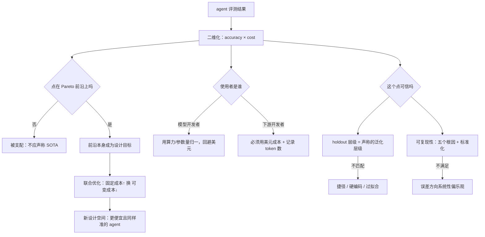

---
aliases:
  - "AI Agents That Matter"
  - "AATM"
created: 2026-11-17
---
# AI Agents That Matter

> 这是一篇立场/方法论论文（NeurIPS 2024 Datasets & Benchmarks）。它不提出新的 agent 架构，而是对「当前 agent 评测实践」做一次系统体检，并给出五条治理处方：**评测必须控制成本**（否则「重试」这种毫无科学含量的手段就能刷榜）；**准确率与成本应联合优化**（Pareto 前沿本身就是一个新的设计空间）；**模型评测与下游评测是两种不同的问题**（前者应回避美元成本、后者必须以美元成本为核心构念，代理指标会系统性误导）；**holdout 必须与基准声称的泛化层级匹配**（否则 agent 会走捷径，甚至不是故意的）；**评测必须标准化**（否则结果不可复现，且误差方向系统性地偏向乐观）。论文用 HumanEval、HotPotQA、NovelQA、WebArena 四个案例把五条处方各自落到具体数字上，其中最具杀伤力的一组数字是：三个「简单基线」（retry / warming / escalation）在 HumanEval 上的准确率不输甚至超过 LATS、Reflexion、LDB 等 SOTA 复杂架构，而成本低一到两个数量级。

## 一句话定位

一篇**评测方法学批判 + 处方**论文：它把「agent 排行榜上的准确率」拆成四个可分别问责的失效面——成本不受控、评测目的混同、holdout 层级错配、标准化缺失——并用可复现的实测数字证明，在这四个面上当前的 SOTA 声明大多是**测量伪影**而非能力进步（[§2](papers/模型评测/2407.01502/2407.01502.pdf#2)、[§5](papers/模型评测/2407.01502/2407.01502.pdf#5)、[§6](papers/模型评测/2407.01502/2407.01502.pdf#6)）。

## 问题与动机

论文的出发点是一句很朴素的话：benchmark 有用，前提是它给出的准确率能估计**真实世界**的准确率（[§5](papers/模型评测/2407.01502/2407.01502.pdf#5)）。围绕这个前提，论文列了五类具体病灶；每一类都不是「大家不够努力」，而是**结构性错配**。

### 病灶一：只看 accuracy，不看 cost，导致「无成本上限的军备竞赛」

LLM 是随机的，因此「多调用几次」本身就能提高准确率——这一步不需要任何架构创新。论文把这条路径的极端形态摆了出来：AlphaCode 的准确率从 zero-shot 的接近 0%，在 1000 次重试下升到 15% 以上，在百万次重试下升到 30% 以上（准确率按「模型生成的前 10 个答案中是否有一个正确」计）（[§2.1](papers/模型评测/2407.01502/2407.01502.pdf#2.1)）。也就是说，**推理算力对准确率的边际收益看不到上界**。

在编程任务上这一点被放大：HumanEval 这类任务自带 example test，agent 可以一直采样、一直调试，直到通过测试为止。于是「排行榜第一」可以在完全不改进任何设计的情况下被买到。论文的核心指控是：如果评测不控制成本，那么它奖励的不是「更聪明的 agent」，而是「更愿意烧钱的 agent」，而且——更糟的是——研究者会因此**错误归因**，把「多试几次」的收益记在 planning / reflection / debugging 这些「System 2」机制头上（[§2.3](papers/模型评测/2407.01502/2407.01502.pdf#2.3)）。

### 病灶二：模型评测与下游评测被混为一谈

论文区分了两种评测目的，并指出它们的**最优度量方式相反**（[§4](papers/模型评测/2407.01502/2407.01502.pdf#4)）：

- **模型评测**（model evaluation）是科学问题：想知道「改数据、改架构」是否带来改进。此时应当**远离美元成本**，因为报告成本会破坏 benchmark 的两条基本性质——测量不随时间漂移（而价格一直在降）、不同模型在同一水平面上比较（而大厂有规模经济带来的低价）。
- **下游评测**（downstream evaluation）是工程问题：要为「我该选哪个模型/agent 上生产」提供采购依据。此时成本**就是**目标构念本身，价格随时间下降恰恰是下游开发者最关心的事。

混淆的后果是具体的：代理指标（proxy）被拿来替代成本。论文举了 Mistral 为 Mixtral 8x22B 画的图——用「活跃参数量」作为成本代理；但从下游视角这是误导的：2024 年 6 月，Mixtral 8x7B 在 Anyscale 上的实际价格是 Llama 2 13B 的两倍，而按活跃参数看两者「差不多」（[§4](papers/模型评测/2407.01502/2407.01502.pdf#4)）。论文还补了一句很尖锐的话：如果每个模型开发者都挑一个让自己好看的代理指标，多维评测就失去了意义。

### 病灶三：holdout 缺失，而且「缺哪一层」没人说清

agent benchmark 通常只有几百个样本，规模小，因此过拟合的收益极高、成本极低。论文指出这比 LLM 训练数据污染**更严重**：对测试样本的知识可以被直接**编程进** agent，而不只是「训练时见过」（[§5](papers/模型评测/2407.01502/2407.01502.pdf#5)）。极端情形是一张查表就能在多数 agent benchmark 上拿到 100%；查表很好识别，但其它过拟合形式极其隐蔽。

更根本的问题是：**「过拟合到任务」算不算问题，取决于这个 benchmark 想要多通用的 agent**。论文据此提出泛化层级的四分法（distribution-specific / task-specific / domain-general / general-purpose），并给出核心原则：**agent 声称的泛化层级越高，holdout 与训练集的差异就必须越大**（[表 1](papers/模型评测/2407.01502/2407.01502.pdf#table=1)）。

### 病灶四：人类在环（human-in-the-loop）被从评测里抹掉了

现有评测几乎只覆盖两个极端：聊天机器人答题是否正确（如 MMLU），或 agent 能否在**零监督**下完成任务。但真实使用介于两者之间——用户会纠正、会确认高风险动作。论文引用 Shi et al. 的结果：仅仅是「简单反馈」就把 GPT-4 在困难编程题上的表现从 0% 拉到 86% 以上（[§5.2](papers/模型评测/2407.01502/2407.01502.pdf#5.2)）。于是出现一对方向相反的偏置：**holdout 缺失导致过度乐观，人类在环缺失导致过度悲观**。

### 病灶五：标准化缺失 → 不可复现，且误差方向系统性偏乐观

论文按「论文所附代码与数据应足以复现其结果」这一通行定义来检查，发现 HumanEval 与 WebArena 上的评测普遍不可复现。它归纳了五条根因，全部源于 LLM 评测与 agent 评测的差异（[§6](papers/模型评测/2407.01502/2407.01502.pdf#6)）：

1. **评测脚本对 agent 设计做了假设**，而并非所有 agent 都满足；agent 开发者于是各写一套，结果不可比。
2. **把 LLM 评测 benchmark 挪用作 agent 评测**会引入不一致。HumanEval 的 164 题里有 3 题没有 example test，且 example test 写在 docstring 里而非机器可读——这对「提示模型」无害，但对「靠 example test 决定是否重试」的 agent 是致命的；于是 LATS/Reflexion 删题、LDB 补题，各自评测在**不同子集**上，却被 PapersWithCode 混在同一张榜单里。
3. **评测成本高到无法估计置信区间**。SWE-bench 有 2000+ 任务，SWE-Agent 每次运行上限 4 美元，单次全量评测就可能超过 8000 美元——因此 agent 论文极少带 error bar。作者复现时发现，不少论文报告的准确率**高于他们五次运行的最大值**，而报告的部分 baseline **低于五次运行的最小值**。
4. **agent 评测依赖外部环境**，会产生细微错误。典型是「任务顺序无关」这一假设：WebArena 的 Reddit 克隆站点有发帖频率限制，连续评测发帖任务会显著提高失败率。
5. **标准化缺失直接导致 bug**。LATS 与 STeP 都把一些**做错的任务标成了正确**；两者还各自删掉了少量任务（LATS 1 个、STeP 8 个）。

这五条病灶合起来构成本文的动机：如果不修这些，排行榜上的「SOTA」无法区分真实进步与炒作（[§7](papers/模型评测/2407.01502/2407.01502.pdf#7)）。

### 一个前置清理：什么叫「agent」

论文拒绝再给一个新定义，而是列出让系统「更像 agent」的三簇因素（[§1.1](papers/模型评测/2407.01502/2407.01502.pdf#1.1)）：**环境与目标**（任务/领域跨度、多利益相关方、长时程、意外变化；以及「只给目标不给方法」）、**用户接口与监督**（自然语言指令、自主代理用户行事、所需监督越少越 agentic）、**系统设计**（工具使用、规划/反思/子目标分解；控制流由 LLM 动态驱动）。这三簇不是装饰——它们直接决定了后文「该 holdout 什么」以及「人类在环该怎么进评测」的具体主张。

## 方法与机制（核心）

### 总览

这篇论文没有算法主线，它的「方法」是一套**把评测从一维标量改成可问责的多维测量**的装置。整篇的骨架可以读成一条流水线：先把评测结果从「一个准确率数字」升级为「准确率–成本平面上的一个点」，于是「谁更好」变成「谁在 Pareto 前沿上」；然后在这个平面上反过来做**设计**（联合优化固定成本与可变成本，买更便宜的推理）；再把「成本」这个概念按使用者的目的分成两类（模型评测看算力、下游评测看美元），从而说明为什么**同一个 benchmark 不能同时服务两种目的**；接着处理「这个点是否可信」——即 holdout 与泛化层级的匹配，防止 agent 通过捷径把点推到左上角；最后处理「这个点是否可复现」——标准化，否则连点本身都是噪声。

这条流水线的关键洞察是**「准确率」不是一个充分统计量**：它对「怎么得到的」完全不敏感。论文反复用的一个类比是——如果用「重试」就能提升准确率，那么准确率无法识别进步，因为重试是「scientifically meaningless」的（[§2.3](papers/模型评测/2407.01502/2407.01502.pdf#2.3)）。把成本加进来，等于给准确率加了一个**必要条件的约束**：真实的设计进步应当在前沿上推进，而不是靠增加预算沿曲线滑动。

下面按五个模块拆开讲。

### 模块一：Pareto 前沿作为评测的第一性对象

**物理意义先说。** 一个 agent 的评测结果不是一个数，而是一个二元组 $(\text{cost}, \text{accuracy})$。当两个 agent 的成本与准确率**同时**可比时，才存在「谁更好」的偏序；一旦一方更准但更贵，就不存在全序，只能说「互不支配」。Pareto 前沿就是这个偏序的极大元集合。

论文的定义（[§2.2](papers/模型评测/2407.01502/2407.01502.pdf#2.2)、附录实现细节）：前沿是**不被任何其它 agent 在平均成本与准确率上同时严格占优**的点集。设 agent $i$ 的均值为 $(c_i, a_i)$，则

$$
i \in \mathcal{P} \iff \nexists j:\ c_j \le c_i \ \wedge\ a_j \ge a_i \ \wedge\ (c_j,a_j)\neq(c_i,a_i)
$$

其中 $c_i$ 是**总 API 成本**（美元，五次运行的均值），$a_i$ 是 164 题上的准确率均值，$\mathcal{P}$ 是前沿。

**为什么要凸化。** 论文额外做了一个约束：前沿取**凸包**。理由是概率混合论证——若 $A,B$ 都在前沿上，则可以构造一个新「agent」：以概率 $p$ 调用 $A$、以 $1-p$ 调用 $B$。它的期望成本与期望准确率是两者的线性插值：

$$
c(p) = p\,c_A + (1-p)\,c_B,\qquad a(p) = p\,a_A + (1-p)\,a_B
$$

所以凸包上任意一点都是**可达的**，而位于凸包上方的点（例如 zero-shot GPT-4 在某些视图下）虽然本身不被支配，却可以被混合策略严格改进，因此不应算作前沿（[§2.2](papers/模型评测/2407.01502/2407.01502.pdf#2.2) 脚注）。这一步很重要：它把「排行榜排名」替换成「可行域的边界」，从而让「混合两个便宜 agent」这种工程上极其常见的做法也进入评测视野。

**为什么成本必须真的有上界约束。** 论文没有写公式，但它的论证等价于下面这个观察（本笔记的记号）：若单次采样的成功率是 $p>0$，预算 $B$ 次独立采样、任一次成功即算通过，则通过率为

$$
a(B) = 1-(1-p)^{B}
$$

它对 $B$ 单调递增且当 $B\to\infty$ 时趋于 1。也就是说，**只要评测不惩罚 $B$，任何准确率都可以被买到**。这正是「cost-controlled evaluation」的 formal 理由，而不只是「省钱」的道德劝说。

### 模块二：三个简单基线——用「最笨的方法」给复杂架构定标

这是全文最具实验杀伤力的设计。论文构造了三个刻意「不含智能」的基线（[§2.2](papers/模型评测/2407.01502/2407.01502.pdf#2.2)）：

| 基线 | 机制 | 关键超参（附录实现细节） |
|---|---|---|
| **Retry** | 失败就重问同一个模型，最多 5 次 | temperature = 0；即便 T=0 也不确定，故仍有收益 |
| **Warming** | 同 Retry，但逐次升温：0 → 0.3 → 0.3 → 0.5 → 0.5 | 用升温制造多样性，提高「至少一次命中」的概率 |
| **Escalation** | 先用便宜模型，测试失败就升级：Llama-3-8B → GPT-3.5 → Llama-3-70B → GPT-4 | temperature = 0，模型链按成本升序 |

三个基线共有一个设计哲学：**把「智能」替换成「预算分配」**。Retry 是纯重复，Warming 是纯随机性调节，Escalation 是纯价格套利。如果 SOTA 架构打不过这三者，那么架构的复杂度就没有被证明是必要的。

这里有一个容易被忽略的实现细节，但它决定了结论的可靠性：Retry 与 Warming 的**停止准则是 example test**（题目描述里给的示例测试），而**评分用的是全部真测试**。这个不对称是故意的，也是 Escalation 准确率略低于 GPT-4 的原因——便宜模型给出的解可能过得了 example test、却过不了真测试（[§2.2](papers/模型评测/2407.01502/2407.01502.pdf#2.2)）。换句话说，这套基线模拟的正是「有弱验证信号的真实部署场景」。

### 模块三：联合优化——把「便宜」当成一个可搜索的目标

**物理意义。** agent 的总成本不是一个数，而是两部分之和：**固定成本**（一次性，花在搜索 prompt、few-shot 示例、温度等超参上）与**可变成本**（每次调用都付，正比于输入输出 token 数）。传统做法只优化准确率，因此把可变成本推高；联合优化的思路是**用固定成本去买低可变成本**——多花一点钱搜索「更短的 prompt + 更少的示例」，换取此后每一次调用的便宜。

写成式子（论文的文字描述，本笔记形式化）：

$$
C_{\text{total}}(n) \;=\; C_{\text{fix}} \;+\; n\cdot c_{\text{var}}
$$

其中 $n$ 是任务调用次数，$C_{\text{fix}}$ 是优化阶段一次性支出，$c_{\text{var}}$ 是单次任务的可变成本。两种设计的盈亏平衡点由下式给出：

$$
n^{*} \;=\; \frac{C_{\text{fix}}^{\text{joint}}-C_{\text{fix}}^{\text{default}}}{c_{\text{var}}^{\text{default}}-c_{\text{var}}^{\text{joint}}}
$$

含义很直白：联合优化的固定成本更高（要跑 Optuna 搜索）、可变成本更低，所以只有调用次数超过 $n^{*}$ 才划算。论文实测 $n^{*}$ 在 1275 到 1332 次之间（GPT-3.5 与 Llama-3-70B），并在正文里取整说「1,350 tasks 之后更便宜」（[附录 B](papers/模型评测/2407.01502/2407.01502.pdf#B)）。对真实部署（百万级调用）来说这个门槛可以忽略，因此论文的结论是：**联合优化在实践上几乎总是值得的**。

**实现：DSPy + Optuna 的多目标搜索。** 论文改造 DSPy 的 `BootstrapFewShot`，让它不在「攒够示例数」时停止，而是遍历整个训练集、把所有成功的 trace 收集成一个**候选示例池**；然后用 Optuna 做多目标（准确率最大、prompt token 数最小）参数搜索，搜索空间是四维（[§3.1](papers/模型评测/2407.01502/2407.01502.pdf#3.1)、[附录 B.1](papers/模型评测/2407.01502/2407.01502.pdf#B.1)）：

1. agent 内每个模块的温度（候选值 0.0 / 0.2 / 0.4 / 0.6）；
2. few-shot 示例的**数量**；
3. 具体选**哪几条**示例；
4. 是否加格式化指令。

试验次数 16，每 prompt 最多 8 条示例。最后从 Optuna 返回的 Pareto 集里挑**开发集准确率最高**的那个。这里有一个方法论上的诚实之处：作者明说「更复杂的联合优化方法会远超我们的做法」，本实验只是**存在性证明**（[§3](papers/模型评测/2407.01502/2407.01502.pdf#3)）。

**为什么要设五个对照。** 为了把「收益来自哪里」切开，论文设了 Uncompiled（无示例无格式指令）、Formatting only（只加格式指令）、Few-shot（DSPy 默认 BootstrapFewShot）、Random search（BootstrapFewShotWithRandomSearch，16 个候选程序），以及 Joint optimization。这条梯度设计使得「加格式指令值多少」「加示例值多少」「省钱值多少」可以分别读数——这一点在后面的归因分析里会用到。

### 模块四：模型评测 vs 下游评测——一条判据，两个推论

**判据。** 论文给出的判别不是「谁更严格」，而是**「成本在这个问题里是干扰变量还是目标构念」**（[§4](papers/模型评测/2407.01502/2407.01502.pdf#4)）：

| | 模型评测 | 下游评测 |
|---|---|---|
| 问题类型 | 科学问题（哪种改动带来提升） | 工程问题（采购哪个系统） |
| 成本的正确角色 | 干扰变量，应归一化（算力/参数量） | 目标构念本身（美元） |
| 时间漂移 | 有害（测量必须稳定） | 有益（降价正是要测的东西） |
| 水平面 | 必须公平（避免规模经济扭曲） | 允许不等（真实报价就是不等的） |

**推论一：代理指标会误导采购。** 活跃参数量、训练算力这些代理与美元价格的相关性在真实报价下会断裂（Mixtral 8x7B vs Llama 2 13B 的例子）。因此下游评测应当**同时报告美元成本与输入/输出 token 数**，这样任何人在任何时间都能用当期价格重算（论文还做了一个可交互的 webapp 原型）。

**推论二：一个 benchmark 可能对一种目的有效、对另一种有害。** NovelQA 案例是这条推论的实证（[§4.1](papers/模型评测/2407.01502/2407.01502.pdf#4.1)）。NovelQA 的做法是把一部小说的**全部内容**塞进上下文，然后一次性问该小说的 5–100 个问题。对「测长上下文能力」这是合理设计；但它与真实使用形态不符——用户会**逐个**提问，每次都要重新处理整部小说。于是两种主流方案（长上下文 vs RAG）的成本比被严重扭曲：实测两者准确率几乎相同（67.89 vs 67.81），而 RAG 便宜 20 倍以上；但在 NovelQA 的计费方式下 RAG 只便宜一半，即**成本被高估了约一个数量级**。论文因此主张：下游评测的 benchmark 必须与模型评测的 benchmark 分离，或至少做成其变体。

### 模块五：holdout 框架——把「该保留什么」变成可判定的问题

这是本文最像「规范」的部分。核心原则一句话：**holdout 与训练集的差异程度，必须与 benchmark 声称的泛化层级相匹配**（[表 1](papers/模型评测/2407.01502/2407.01502.pdf#table=1)）。

| 泛化层级 | 定义 | 该 holdout 什么 | 抽查结果（合适/总数） |
|---|---|---|---|
| Distribution-specific | 单一任务、单一分布（如美国小学数学） | 同分布样本 | 1 / 1 |
| Task-specific | 单一任务但考虑分布漂移（如订机票） | 分布外样本（含 drift） | 3 / 6 |
| Domain-general | 某领域内**任意**任务（如网页操作、工具使用） | **任务**（未见过的任务） | 1 / 8 |
| General-purpose | 跨领域（同一 agent 既能网页又能机器人） | **领域** | 0 / 2 |

三个值得讲透的机制点：

1. **为什么传统 ML 的 holdout 不够。** 图像分类、垃圾邮件分类的模型只服务一个任务，因此同分布/OOD 样本级 holdout 就够。但 LLM 与 domain-general agent 被期望处理**事先不知道、且可能用自然语言临时指定**的任务，所以必须 holdout **任务**（[§5](papers/模型评测/2407.01502/2407.01502.pdf#5)）。这是本文对「agent 评测与模型评测的本质差异」最凝练的表达。
2. **责任归属：这是 benchmark 开发者的责任，不是 agent 开发者的责任。** 论文的理由是效率论证——「设计一个不允许捷径的 benchmark」比「逐个检查每个 agent 是否走了捷径」容易得多（[§5](papers/模型评测/2407.01502/2407.01502.pdf#5)）。这条责任划分直接对应后面「可复现性也是 benchmark 开发者的责任」。
3. **holdout 还应当保密。** 否则既可能被 LLM 训练数据污染，也可能被 agent 硬编码（[§5](papers/模型评测/2407.01502/2407.01502.pdf#5)）。配套的补充手段是 **sim2real 迁移评测**：除 benchmark 任务外，还在对应的真实世界上测（如网页购物 benchmark 之外真去 Amazon 下单），但这不总是可行。

**WebArena / STeP 案例：捷径长什么样。** WebArena 有 812 个任务、6 个网站克隆 + 2 个工具，其卖点是「真实」，因此理应难以走捷径。榜首 STeP 的准确率是 35.8%，是 WebArena 原论文最佳基线的两倍多、比次优 agent 高 10 个百分点以上（[§5.1](papers/模型评测/2407.01502/2407.01502.pdf#5.1)）。论文拆开看发现：STeP **为 WebArena 里的具体任务硬编码了策略**——例如 Reddit 类任务要访问用户主页，策略就是「取当前 base URL 加上后缀 `/user/user_name`」。这在网站改 URL 结构（drift）时立刻失效。

这里有一个漂亮的定量论证（本笔记形式化）：若单个硬编码策略的失败概率为 $q$，一个任务需要串联调用 $k$ 个策略，则任务成功率随 $k$ 呈**复利式衰减**：

$$
P(\text{success}) = (1-q)^{k}
$$

代进去就明白为什么「单点失败概率很小」不构成辩护：$q=2\%$、$k=30$ 时成功率只剩约 55%。这也解释了为什么一旦 holdout 换成**没见过的网站/任务**，STeP 这类 agent 的准确率会「drastically lower」——因为它的策略库里没有一条能用（[§5.1](papers/模型评测/2407.01502/2407.01502.pdf#5.1)）。

论文同时给了一个克制的判断：STeP 作者的目标（为**已知固定任务**构造可组合策略）与 benchmark 的目标是正交的，因此其设计在其自身目标下是合理的；问题只在于**排行榜准确率会被下游开发者误读**（[§5.1](papers/模型评测/2407.01502/2407.01502.pdf#5.1)）。

### 模块六：可复现性——从「五个根因」到「谁该修」

**为什么 agent 评测比 LLM 评测更难复现。** 论文的判断是：LLM benchmark 是「字符串进、字符串出」，而 agent 涉及与环境的动态交互，无法归约为静态输入输出（[§6](papers/模型评测/2407.01502/2407.01502.pdf#6)）。这解释了五个根因里的第 4 条（外部环境）与第 3 条（成本高到跑不起多次）。

**三类根因的归并。** 论文把五条根因归成三个来源，并各自指向责任方（[§6](papers/模型评测/2407.01502/2407.01502.pdf#6)）：

| 来源 | 对应根因 | 责任方 |
|---|---|---|
| 没有「随 benchmark 一起发布评测脚本」的标准 | 根因 1 | benchmark 开发者 |
| 模型 benchmark 与 agent benchmark 的差异未被认识 | 根因 1–3 | benchmark 开发者 |
| 社区缺少评测规范，bug 得以滋生 | 根因 5 | 社区/评审 |

**结论性主张：需要 agent 版 HELM。** 论文指出 HELM 与 LM Evaluation Harness 通过「提供标准化评测结果」解决了**模型**评测的复现问题，但它们不足以评测 agent，因为 agent 需要与环境交互、需要多次运行、需要成本核算。因此「开发一个 agent 评测框架」被点名为成熟可做的未来工作（[§6](papers/模型评测/2407.01502/2407.01502.pdf#6)）。

**误差的方向性（本文最该记住的一句）。** 论文反复强调：holdout 缺失与不可复现都让数字**偏乐观**（报告值高于复现的五次运行最大值，见 [§6](papers/模型评测/2407.01502/2407.01502.pdf#6)），而人类在环缺失让数字**偏悲观**。也就是说，当前 agent 评测的偏差不是随机的，而是有符号的——这决定了「修正评测」不是学术洁癖，而会实质改变结论的方向。

## 实验与对比

### 设置

论文是方法论论文，但四个案例各自有独立实验。共同的实验纪律是：**每个 agent 跑 5 次**，报告 5 次的均值与最小/最大值；可靠性度量用 Student's $t$ 分布的 95% 置信区间（因为每格只有 5 个样本）（[附录 A](papers/模型评测/2407.01502/2407.01502.pdf#A)）。这一条本身就是在实践它自己的处方。

- **HumanEval（编程）**：164 题，使用 LDB 作者发布的「补齐 example test」版本；GPT-3.5 = `gpt-3.5-turbo-0125`、GPT-4 = `gpt-4-turbo-2024-04-09`；2024 年 4 月价格下 GPT-3.5 为 0.5\$/1.5\$（输入/输出每百万 token）、GPT-4 为 10\$/30\$。另做 2023 年 6 月版本模型的鲁棒性检查。
- **HotPotQA（多跳检索问答）**：DSPy 的 Baleen 式流程（查询生成 → ColBERTv2 检索 → 答案生成），检索段落数 2、跳数 2、最多 8 条示例；100 条训练样本做优化、200 条评测样本；指标是**是否检索到全部 ground-truth 文档**；GPT-3.5 与 Llama-3-70B 各一套。
- **NovelQA（长上下文）**：取多选题子集，对比「整本小说入上下文」与「RAG（text-embedding-3-large，每题检索 10 个 1000 字符块）」。**只跑了一次**——成本太高，这是全文唯一没有 error bar 的实验。
- **WebArena（网页操作）**：只做案例解剖（STeP 的策略硬编码）与复现问题统计，不重跑 agent。

### 关键数字一：三个「笨基线」追平/超过 SOTA 架构

HumanEval 全量 164 题、5 次运行均值（最小值–最大值）：

| 类别 | Agent | 准确率 | 总成本（USD） |
|---|---|---|---|
| SOTA 架构 | LATS (GPT-4) | 88.0 (82.3–91.5) | **134.50** (123.98–147.13) |
| SOTA 架构 | LDB (Reflexion, GPT-4)\* | 92.9 (91.5–95.1) | 7.26 (6.19–9.63) |
| SOTA 架构 | LDB (GPT-4)\* | **93.3** (92.1–94.5) | 6.36 (5.11–7.08) |
| SOTA 架构 | Reflexion (GPT-4) | 87.8 (86.0–90.9) | 3.90 (3.76–4.13) |
| 单模型 | GPT-4（zero-shot） | 89.6 (87.8–90.9) | 1.93 (1.91–1.95) |
| 单模型 | GPT-3.5（zero-shot） | 73.9 (72.0–76.2) | 0.05 (0.05–0.05) |
| **本文基线** | **Warming (GPT-4)** | **93.2** (92.1–93.9) | **2.45** (2.36–2.54) |
| **本文基线** | Retry (GPT-4) | 92.0 (91.4–92.7) | 2.51 (2.46–2.56) |
| **本文基线** | Escalation | 85.0 (84.1–85.4) | **0.27** (0.25–0.28) |

\* 表示原论文没做过的 agent 配置（如 LDB 原论文没用 GPT-4 做 debugger），由本文补测。数据取自附录表（[附录 A](papers/模型评测/2407.01502/2407.01502.pdf#A)）。

三条量化结论：

1. **Warming 93.2 与最佳架构 LDB (GPT-4) 93.3 在统计上不可区分**（区间 [92.1, 93.9] 与 [92.1, 94.5] 大幅重叠），而成本是 2.45 vs 6.36，即**约 2.6 倍**。
2. **同准确率下成本可差近两个数量级**：LATS (GPT-4) 134.50 vs Warming 2.45，约 **55 倍**；相对 LDB (GPT-3.5) 的 0.63，差 **213 倍**。论文的表述是「Reflexion 与 LDB 比 warming 贵 50% 以上，LATS 贵 50 倍以上」——这与表格一致（3.90/2.45 ≈ +59%，6.36/2.45 ≈ +160%，134.50/2.45 ≈ 55×）。
3. **Escalation 是「严格支配」的样本**：准确率 85.0 高于 LDB (GPT-3.5) 的 80.2，成本 0.27 低于其 0.63——准确率更高、成本更低，同时赢两维。

### 关键数字二：报告值 vs 复现值，误差偏向乐观

| Agent | 论文报告 | 本文复现（5 次均值，最小–最大） | 差异 |
|---|---|---|---|
| LATS (GPT-4) | 94.4 | 88.0 (82.3–91.5) | **−6.4** |
| LATS (GPT-3.5) | 83.8 | 80.4 (78.7–83.5) | −3.4 |
| LDB (Reflexion, GPT-3.5) | 95.1 | 88.9 (86.6–91.5) | **−6.2** |
| LDB (GPT-3.5) | 82.9 | 80.2 (78.7–82.9) | −2.7 |
| LDB (GPT-4, GPT-3.5) | 89.6 | 91.0 (89.0–92.1) | +1.4 |
| Reflexion (GPT-4) | 91.0 | 87.8 (86.0–90.9) | −3.2 |
| GPT-4（作为 baseline 被 LDB 报告） | 75.0 | **89.6** (87.8–90.9) | **+14.6** |

最后一行的方向相反且幅度最大：LDB 论文把 GPT-4 zero-shot 的 baseline 报成 75.0，而本文复现是 89.6——这属于**基线被低报**（论文自己指出这一条，[附录 E](papers/模型评测/2407.01502/2407.01502.pdf#E)）。而 LATS 的 −6.4 里，作者定位到约 **3 个百分点**来自「只在部分真测试上判分」（错的解也能通过），其余来自删题与随机性。

### 关键数字三：联合优化省 41%–53% 的可变成本

HotPotQA（200 题，5 次均值；可变成本按每 100 次推理计）：

| 模型 | Agent 设计 | 准确率 | 可变成本 | 固定成本 |
|---|---|---|---|---|
| GPT-3.5 | DSPy random search | 0.495 | 0.376 | 2.696 |
| GPT-3.5 | DSPy few-shot | 0.470 | 0.384 | 0.029 |
| GPT-3.5 | **联合优化** | **0.509** | **0.174** | 2.714 |
| GPT-3.5 | 仅格式指令 | 0.377 | 0.071 | — |
| GPT-3.5 | Uncompiled | 0.436 | 0.095 | — |
| Llama-3-70B | DSPy random search | **0.617** | 0.643 | 4.820 |
| Llama-3-70B | DSPy few-shot | **0.622** | 0.661 | 0.028 |
| Llama-3-70B | 联合优化 | 0.601 | **0.374** | 3.844 |
| Llama-3-70B | 仅格式指令 | 0.527 | 0.111 | — |
| Llama-3-70B | Uncompiled | 0.448 | 0.194 | — |

- GPT-3.5：0.174 vs 0.376 → 可变成本降 **53%**，准确率反而略升（0.509 vs 0.495）。
- Llama-3-70B：0.374 vs 0.643 → 降 **41%**（论文说「maintaining accuracy」，实际准确率从 0.617 掉到 0.601，仍落在 [0.59, 0.62] 的区间内，属于噪声范围）。
- 论文还解释了为什么 DSPy 默认实现这么贵：它**总是**塞进最多 8 条 few-shot 示例且不做成本优化，而联合优化会**变**示例数（[图 2](papers/模型评测/2407.01502/2407.01502.pdf#figure=2) 说明文字）。

### 关键数字四：NovelQA 上成本被高估约十倍

| 方案 | 准确率 | 总成本 | 单题成本（新小说场景） |
|---|---|---|---|
| RAG（10×1000 字符） | 67.89 | \$52.80 | **\$0.051** |
| 长上下文（整本入 prompt） | 67.81 | \$99.80 | \$1.115 |

成本比（长上下文 / RAG）≈ **21.86**。而在 NovelQA 的实际计费方式下（每本小说只算一次长上下文），RAG 只便宜一半，即**成本被高估约 10 倍**。论文还反推：如果严格按「一题一调用」实现长上下文，要问约 2300 次（题数）而非 88 次（小说数），成本约 \$2590——这个数字反过来证明了 NovelQA 的设计对**模型评测**是合理的、对**下游评测**是灾难性的。

### 关键数字五：holdout 抽查

17 个 agent benchmark 被分入四个泛化层级：**7/17 完全没有 holdout 且未表示会加**；有 holdout 的 10 个里**只有 5 个**在合适的层级上（[表 1](papers/模型评测/2407.01502/2407.01502.pdf#table=1)、[附录 C](papers/模型评测/2407.01502/2407.01502.pdf#C)）。分层的合适率是 1/1（distribution-specific）、3/6（task-specific）、1/8（domain-general）、0/2（fully general）——**层级越高，缺得越狠**，而这恰恰是最需要 holdout 的地方。

### 关键数字六：复现问题的清单化统计

| Benchmark | 涉及论文 | 具体问题 |
|---|---|---|
| WebArena | WebArena 原论文 | Reddit 频率限制影响 2/129 个 Reddit 子集任务；Reddit 自动登录未正确实现（代码里留着 TODO），导致 agent 静默失败 |
| WebArena | STeP | 无理由删掉 8 个任务；原日志把失败任务标成成功；频率限制影响 30/129 个 Reddit 任务 |
| HumanEval | LATS | 删掉 4 题（3 题因无 example test、1 题原因未说明）；只在部分真测试上判分 |
| HumanEval | LDB | 低报 baseline（75.0 vs 复现 89.6）；为 3/164 题补 example test；声称用 GPT-3.5 做 Reflexion，实际代码用 GPT-4 |
| HumanEval | Reflexion | 删掉 3 题（未在论文中说明），实评 161/164 |

来源：[附录 E](papers/模型评测/2407.01502/2407.01502.pdf#E)。这张表的意义不在于「抓错」，而在于证明**误差不是随机的**：删题、判分不严、低报 baseline 三者都朝「让 SOTA 更 SOTA」的方向偏。

## 归因分析

论文没有传统的 ablation，但它的四个案例各自完成了归因任务，而且归因方式是**反事实**的：把复杂机制替换成简单机制，看数字是否变化。

**归因一：HumanEval 上「System 2 机制」的收益未被证明。** 把 LATS 的树搜索、Reflexion 的自我反思、LDB 的调试循环全部换成「重问 + 升温」，准确率从 88.0/87.8/93.3 变成 93.2，成本从 134.50/3.90/6.36 变成 2.45。因此**可归因于架构的增益接近零**，可归因于「多次采样 + 弱验证信号」的增益是全部。论文据此明确把「debugging/reflection 是否对代码生成有用」列为**开放问题**，并引 Verma et al.、Huang et al. 的类似发现（[§2.3](papers/模型评测/2407.01502/2407.01502.pdf#2.3)）。它还留了一个体面的出口：这些技术在 HumanEval 之外的更难任务（如 SWE-bench）上**可能**有用。

**归因二：联合优化的省钱来自「少而短的示例」，不是来自「更聪明的搜索」。** 对照表里可控的分解是：Uncompiled 0.436 → 仅格式指令 0.377（加格式指令**反而降**了 6 个点）→ few-shot 0.470（示例带来 +9 点）→ 联合优化 0.509。也就是说，DSPy 的准确率收益主要来自 few-shot 示例，而联合优化在**不减少示例信息量**的前提下把示例数与长度压下来，从而把可变成本从 0.376 压到 0.174。这一条把「成本优化」与「准确率优化」解耦了——它证明两者**不是**零和的。

**归因三：STeP 的高分归因于策略库与 benchmark 任务的**共址**（co-location），而非网页操作能力。** 证据是「策略即 URL 拼接」这种形态：`base URL + /user/user_name` 只对特定站点结构成立。反事实很清楚：把 holdout 换成新网站/新任务，策略库命中率归零，准确率崩塌（[§5.1](papers/模型评测/2407.01502/2407.01502.pdf#5.1)）。这也解释了为什么「模型 drift」这一层 holdout 对 task-specific web benchmark 是必需的。

**归因四：复现差异里可分离出「评测 bug」这一项。** LATS 的 −6.4 中约 3 个百分点被明确归因于「只在部分测试用例上判分」，这是**唯一一条被定量拆开的**误差来源。其余（删题、随机性、模型版本）未逐项拆解——这是本文归因上的一个空白，论文也没有声称做过完整方差分解。

**归因五：NovelQA 的成本差异归因于「提问批次化」。** 长上下文方案把「一本小说 N 题」压成一次调用，于是每题的边际成本被摊薄；RAG 必须逐题检索。这不是模型能力差异，而是**计费粒度**差异。因此论文的处方不是「RAG 更好」，而是「下游评测要按真实调用形态计费」。

## 局限与未来工作

论文在[附录 G（Limitations）](papers/模型评测/2407.01502/2407.01502.pdf#G)里明确列了三条，另在正文散落若干「未来工作」指向：

1. **成本模型是时变的。** cost-controlled evaluation 与联合优化都依赖当期价格与技术约束；价格一变，结论就变。作者的对策是提供可交互 webapp，让用户改输入/输出 token 单价后重算，并主张**所有下游评测都应内建这个能力**。
2. **覆盖不穷尽。** 研究跨了多个 benchmark 与 agent 设计，但没有穷尽所有任务环境与 agent 变体。作者的自辩是：构念效度不足与不可复现这两个发现在多 benchmark、多设计上一致，因此具有跨任务/跨领域的稳健性。
3. **只算了美元，没算别的成本。** 环境影响、数据标注的人力成本、系统维护成本均未深入分析，而这些在规模化部署下会越来越重要。

正文里的未来工作指向（作者明写为「ripe area for future work」或「important direction」）：

- **agent 评测框架**：HELM / LM Evaluation Harness 的 agent 版本（[§6](papers/模型评测/2407.01502/2407.01502.pdf#6)）。
- **human-in-the-loop 评测**：承认贵且难（准确率同时依赖系统与人的水平），但不可缺少；并引 Ibrahim et al. 的安全评测实践作为参考（[§5.2](papers/模型评测/2407.01502/2407.01502.pdf#5.2)）。
- **sim2real 迁移评测**：把 benchmark 任务与对应真实任务一起测（[§5](papers/模型评测/2407.01502/2407.01502.pdf#5)）。
- **更强的联合优化**：作者自陈本实现只是起点，更复杂的方法会远超它（[§3](papers/模型评测/2407.01502/2407.01502.pdf#3)）。

需要指出的一处**内容缺口**：本笔记所据的 tex 源（`body_source: latex`，与 PDF 同源）中**没有**专门讨论「微调/在测试集上训练会损害泛化」的独立小节或实验；与之最接近的论述是 §5 开头那句「知识可以被直接编程进 agent，而不只是在训练中见过」，以及 §5.1 的 STeP 硬编码案例。若某版预印本含此类实验，本笔记未覆盖——按实读范围记为「论文（本版本）未明确给出微调–泛化的定量实验」。

## 与其他工作的关系

- **与评测基础设施**：[HELM](papers/模型评测/2211.09110/NOTES.md) 与 BIG-bench 解决的是「模型评测的标准化与多维报告」，本文的论点是**它们不够**——agent 多了环境交互、多次运行、成本核算三个维度，因此需要新的框架（[§6](papers/模型评测/2407.01502/2407.01502.pdf#6)）。本文可以读成「HELM 的 agent 版宣言」。
- **与统计严谨性**：[Adding Error Bars to Evals](papers/模型评测/2411.00640/NOTES.md) 处理的是「给定评测数据，如何给出置信区间与样本量」。本文处理的是**上游**问题：即使你会算 error bar，如果 holdout 缺失、成本不受控、评测脚本有 bug，那个区间估计的是**错误的量**。两篇合起来构成「agent 评测的测量误差预算」：本文管系统性偏差（bias），2411.00640 管随机误差（variance）。本文自己也点出了这一层——它说高成本导致「无法重复运行、因而极少有 error bar」，并发现报告值常超出五次运行的极值（[§6](papers/模型评测/2407.01502/2407.01502.pdf#6)）。
- **与 agent 失败分析**：[MAST](papers/模型评测/2503.13657/NOTES.md) 从「系统为什么会失败」的侧面进入同一问题；本文从「评测为什么会说谎」的侧面进入。两者的交汇点是：MAST 的 failure mode 分类可以被读成一份「agent 能力的构念清单」，而本文的 holdout 框架则要求 benchmark 的 holdout 覆盖这些 failure mode 的触发条件。
- **与 agent 评测基准本身**：AgentRewardBench、TRAIL 等工作处理「如何判定 agent 的一条轨迹对不对」，本文处理「判定完之后怎么报告、怎么比较、怎么防止被刷」。本文关于「判定标准不一致会系统性抬高准确率」（LATS 的 3 个百分点）的发现，是这类工作的直接动机之一。
- **与 LLM-as-a-Judge 一脉**：本文没有深入 judge 的偏差问题，但它的处方（成本受控、holdout、标准化、error bar）对 judge 评测同样适用；JudgeBench 一类工作则补上了「judge 本身准不准」这一维。
- **对本文自身历史地位的一个观察**：论文的「成本–准确率二维评测」现在已成为 agent 评测的默认呈现方式之一（Pareto 图 + 美元成本），而它点名的「agent 评测框架」空缺在此后一年里被多个 harness 部分填补——这可以看作本文处方被验证的间接证据，但论文本身没有提供这一后续证据。
