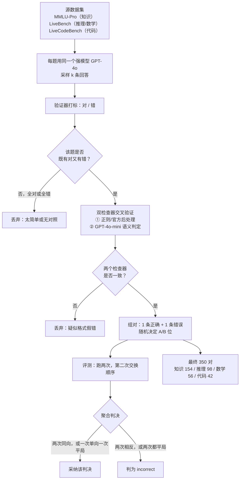

---
aliases:
  - "JudgeBench: A Benchmark for Evaluating LLM-based Judges"
  - "JudgeBench"
created: 2026-11-17
---
# JudgeBench: A Benchmark for Evaluating LLM-based Judges

> 这篇论文对"用 LLM 当裁判"这件事本身提出一个很尖锐的质疑：**当裁判的可靠性从来没人认真审过**。已有的 judge 基准（MT-Bench、LLMEval、FairEval、AlpacaEval 一类）都把"与人群偏好一致"当作金标准，但它们隐含假设"众包标注员会客观地、不犯错误地评价"——这个假设在简单问题上成立，在需要验证代码是否正确、证明是否严密的题目上直接崩掉。于是作者先给出一套三层判据框架（指令遵循 > 事实与逻辑正确性 > 风格），再给出一条**可复用、可扩展的流水线**：拿任何"有标准答案 + 有自动验证器"的难题集，用**同一个强模型**采样 $k$ 条回答、标出对错，只保留"既有对又有错"的题目组成答案对。这样造出的标签是**客观正确性**而不是人类偏好，且因为两条回答都出自同一模型，风格差异与自我偏好偏置被压到最小。用这条流水线造出的 **JudgeBench** 有 350 对，覆盖知识、推理、数学、代码四类。结果是：GPT-4o 用最朴素的 prompt 只有 **50.86%**（几乎等于抛硬币），换成 Arena-Hard 的强 prompt 也只到 56.57%；多个微调 judge（PandaLM 13.14、JudgeLM-7B 25.14）甚至**远低于随机**；真正的分水岭出现在推理型模型上——o3-mini (high) 拿到 **80.86%**，DeepSeek-R1 拿到 73.14%。

## 一句话定位

一篇 ICLR 2025 的**基准论文**，但它真正的贡献不是那 350 对数据，而是**一条把"有客观验证器的数据集"自动转成"judge 评测集"的流水线**，以及一个判据：judge 该被考的不是"像不像人类偏好"，而是"能不能在事实与逻辑层面分出对错"。它用这条流水线证明了一件事：**判对的难度与解出的难度几乎一样**（同模型 solver 与 judge 的总体准确率相差不到 1 个百分点），所以"验证比生成容易"这个流传很广的直觉，在当代 judge 上并不成立（[§1](papers/模型评测/2410.12784/2410.12784.pdf#1)，[§4.4](papers/模型评测/2410.12784/2410.12784.pdf#4.4)）。

## 问题与动机

### 前人做法：把"与人类偏好一致"当成金标准

论文把已有的 judge 基准归成一条谱系，并指出它们共享一个未被检验的假设（[§1](papers/模型评测/2410.12784/2410.12784.pdf#1)，[§2](papers/模型评测/2410.12784/2410.12784.pdf#2)）：

- **MT-Bench / LLMEval / FairEval / AlpacaEval**：测的是 judge 的判决与**人群偏好**的一致率。核心假设是"众包标注员会客观评价且不犯错"。
- **LLMBar**：往前走了一步，改用"指令遵循"作为有明确标准答案的判据，构造出偏好标签明确的样本对。这是本文最近的前身，但它只考**指令遵循**。
- **RewardBench**：面向 reward model 的综合基准，含推理子集（PRM Math、HumanEvalPack），但**已经饱和**——最强的模型能到 97%。

论文对这个谱系的批评可以浓缩成一句话：**它们都在测"像不像人",而不是"对不对"**。而在需要真正推理的任务上，"人"恰恰是最不可靠的参照系。

### 人类偏好为什么在难题上不可靠

作者的论证不是"人类不行"这种笼统说法，而是给出了一个**结构性的机制**：人类标注员在时间压力下会滑向**看起来更可信**或**更长**的回答，也就是**用风格替代正确性**。这个滑移不是随机噪声，而是有方向的系统偏差 —— 所以它不能被"多标几个人取多数"消掉。

为了把"为什么会滑移"讲清楚，论文提出了一个三层判据框架（[§1](papers/模型评测/2410.12784/2410.12784.pdf#1)），这是全文的理论骨架。一个强 judge 在选择回答时应当**按顺序**满足三条原则：

1. **指令遵循**：回答必须忠实地遵循人类指令；
2. **事实与逻辑正确**：在遵循指令的前提下，答案必须事实上与逻辑上正确；
3. **风格契合**：只有在前两条都满足时，风格差异才可以影响判断。

论文给了一个极简但锋利的例子：问题是"西班牙的首都是哪里？"。回答 `1+1=2` 在事实上永远正确，但它**不应该**胜过回答 `Barcelona` —— 后者试图回答问题但答错了。这说明**原则 (2) 的前提是原则 (1)**：一个不针对问题的正确答案，在指令遵循这一层就已经出局。反过来，当两条回答都遵循了指令（都在回答"首都是哪里"），正确的那个必须胜出；风格比较只能放在最后。

这个框架的价值在于它把"评价"从**单一标量**拆成了**有优先级的字典序**，从而让"客观性"有了可操作的定义：越靠前的原则，越可以用验证器判定；越靠后的原则，才需要人来判。而人类标注员恰恰最容易在第 1、3 层做得好、在第 2 层做得差 —— 于是"与人类偏好一致"这个指标，在难题上测的其实是 judge 与**人类在第 2 层的错误**的一致程度。这就是本文要绕开的东西。

用形式化的说法（本笔记的记号），理想 judge 的判决应当是一个字典序比较：

$$
a_1 \succ a_2 \iff (\text{IF}(a_1)>\text{IF}(a_2))\ \lor\ (\text{IF}(a_1)=\text{IF}(a_2)\ \land\ \text{Corr}(a_1)>\text{Corr}(a_2))\ \lor\ \cdots
$$

其中 $\text{IF}$ 是指令遵循程度，$\text{Corr}$ 是事实/逻辑正确性，省略号代表风格项。JudgeBench 的设计实质上是**把 $\text{IF}$ 固定成相等、把 $\text{Corr}$ 固定成二值（一对一错）、把风格项固定成不可用**，从而让判决唯一确定 —— 于是"准确率"这个指标才有意义。

### 关键洞察：判不出来 ≈ 做不出来

整篇论文最核心的一句话是（[§1](papers/模型评测/2410.12784/2410.12784.pdf#1)）：

> 如果一个模型难以对某个难题**稳定地生成**正确、连贯的回答，那么它同样难以**区分**自己那些正确与错误的回答。

这句话的分量在于它同时是**构造原理**和**难度保证**：因为难到让 GPT-4o 自己都会做错的题，它的错误回答必然带有"看起来很像对的"的细节；而区分这种细节所需要的推理能力，与一开始做对这道题所需要的能力是同一种。所以这个基准天然是"难"的，不需要人工去调节难度。

而它也是本文对"验证比生成容易"这一经典直觉的**经验反驳**：如果验证真的更容易，judge 的准确率应当显著高于 solver。第 4.4 节的 ablation 显示两者几乎持平（[表 4](papers/模型评测/2410.12784/2410.12784.pdf#table=4)）。

## 方法与机制（核心）

### 总览

JudgeBench 的构造可以拆成"**一条流水线 + 一道过滤器 + 一套评测协议**"，每一段都在消除一种特定的混淆因素（[图 2](papers/模型评测/2410.12784/2410.12784.pdf#figure=2)）：

**第一段，选源数据。** 源数据集必须同时满足两个条件：**足够难**（否则造出来的对太容易分）、**有客观验证器**（否则标签不客观）。作者选了三个：MMLU-Pro（知识，14 个学科的选择题）、LiveBench（推理与数学，含 Big-Bench Hard、Zebra Puzzles、AMC12/USAMO 类竞赛题，且按月更新以防污染）、LiveCodeBench（代码，来自 LeetCode / AtCoder / Codeforces 的竞赛题，无污染）。

**第二段，单模型采样。** 对每道题，用**同一个强模型**（GPT-4o）采样 $k$ 条回答。这一步是全篇最关键的工程决策：**不用多个模型各采一条**。理由有三条（下一节详述），但结果只有一句：让两条候选在**风格上属于同一个分布**，唯一的差异只剩"对/错"。

**第三段，判对错并过滤。** 用源数据集自带的验证器给每条回答打上"正确/错误"标签，然后**丢掉所有回答全对或全错的题目**，只保留"至少一条对、至少一条错"的题目。形式上，设题目集 $\mathcal{Q}$，第 $q$ 题的第 $i$ 条回答为 $r_i$，验证器为 $\mathrm{Verify}(q,r_i)\in\{\mathrm{True},\mathrm{False}\}$，保留集为

$$
\mathcal{Q}_{\text{keep}}=\{q\in\mathcal{Q}\ \mid\ \exists\,i,j:\ \mathrm{Verify}(q,r_i)=\mathrm{True},\ \mathrm{Verify}(q,r_j)=\mathrm{False}\}
$$

这一步同时干了两件事：**保证标签客观**（对错由验证器定，不由人定），**保证难度**（全对说明这题对该模型太简单，全错说明连对照都没有）。

**第四段，双检查器去噪。** 很多回答其实是对的，只是格式不合规（例如要求连续输出 5 次选项字母 `IIIII`，模型输出了 `IIIIi`），被正则判成错。这种"假错"会给 judge 一个**作弊捷径**：只要发现格式怪就判错，不需要真推理。于是作者再加一个 LLM 检查器（GPT-4o-mini）独立判一次，**只保留两个检查器一致的样本**。

**第五段，组对。** 从保留的题目里取一条正确回答与一条错误回答组成一对，随机决定谁在 A 位。

**第六段，评测协议。** 每对跑**两次**，第二次交换 A/B 顺序，用一条聚合规则把两次判决合成最终判决 —— 这是为了消掉 position bias。

### 模块一：为什么必须"单模型采样"——三条被排除的替代方案

这是方法章节里论证最细的一处，值得完整复述，因为它解释了整个数据集的性质从哪来（[§3](papers/模型评测/2410.12784/2410.12784.pdf#3)）。

最直观的造对方法是：**让多个不同的 LLM 各生成候选，再挑一对一对一错**。论文明确列了它的三个致命问题：

1. **难度失控。** 不同模型能力差距大，能力弱的模型给出的错误回答往往**错得太明显**（比如直接答非所问、算错基础算术），judge 一眼就能看出来。这样的对不构成挑战，基准会失去区分度。
2. **风格成为混杂变量。** 不同模型有不同的"文风"——有的爱用 markdown 列表，有的爱写长段落，有的啰嗦有的简省。judge 完全可以靠这些表层特征判对，而不做任何事实核查。这直接违背"考推理能力"的目标，等于在测"风格识别"。
3. **自我偏好偏置无法测量也无法缓解。** 已知 LLM judge 会偏好自己生成的回答（self-enhancement bias）。一旦一对里的两条回答来自不同模型，judge 的判决就同时混入了"内容对错"与"来源偏好"两个因素，且**无法分离**。

单模型采样一次性把这三个问题都解掉了：同源 → 风格分布相同（问题 2 消）、同源 → 强弱差距为零、错误只能来自"这道题这个模型没做对"（问题 1 消）、同源 → 没有"跨模型偏好"可言（问题 3 消）。

**但作者诚实地承认它引入了新的偏置**：既然所有回答都由 GPT-4o 生成，那么这些对**对 GPT-4o 特别难**（因为它自己会做错的题才被保留），而对别的模型可能没那么难。这是一个**只针对生成模型本身**的偏置，对其他所有模型是"公平竞技场"。第 4.4 节专门做了 ablation 来量化它（见后文）。

### 模块二：双检查器 —— 把"格式噪声"从"真实错误"里剥出来

这一步看起来是数据清洗的杂活，但它是整个基准可信度的基石，理由如下。

源数据集的自带验证器大多是**字符串匹配**：MMLU-Pro 用正则。问题在于 LLM 的输出格式高度不稳定。论文举的真实例子是：模型推理完全正确，最后一步写"the correct answer is: **IIIIi**"（应该是 `IIIII`）—— 正则匹配不到，判错。如果不处理，这条回答就会以"错误回答"的身份进入数据集，而它实际上是对的。judge 若判它错，是**因为格式而不是因为推理**，得分虚高。

处理方式是**双检查器取交集**（[附录 A.5](papers/模型评测/2410.12784/2410.12784.pdf#A.5)）：

- **检查器一**：正则/官方后处理。MMLU-Pro 被改造成与 LiveBench 相同的格式，要求模型把最终选项字母**连续重复 5 次**（如 `AAAAA`），然后用正则提取最后那个重复 5 次的 A–J 字母。
- **检查器二**：GPT-4o-mini，输入题目 + 回答 + 标准答案，让它在**忽略格式**的前提下判断回答是否正确，输出 `{"is_correct": bool}` 的 JSON。

**只保留两者一致的样本。** 论文报告两者的一致率很高：GPT-4o 的回答上 97.7%，Claude-3.5-Sonnet 的回答上 99.5%。也就是说被丢掉的只有 0.5%–2.3%，但被丢掉的恰好是**最危险的那一类**（格式假错）。这个设计的好处是：它不是靠"相信 LLM 判官"，而是靠**两个独立机制的交集**来降低假阳性 —— 正则不会漏掉格式规整的错答，LLM 检查器能兜住格式不规整的对答，两者都同意的样本才被认为是干净的。

### 模块三：数据来源与配比——四类任务各自考什么

四个类别不是随意分的，它们对应**四种不同的推理负担**（[§3](papers/模型评测/2410.12784/2410.12784.pdf#3)）：

| 类别 | 源数据集 | 题目性质 | 对数 | 考什么 |
|---|---|---|---|---|
| **Knowledge** | MMLU-Pro | 大学水平选择题，14 学科（物理、化学、法律…），最多 10 个选项 | 154 | 领域知识 + 排除近义干扰项 |
| **Reasoning** | LiveBench（Big-Bench Hard、Zebra Puzzles 等） | 逻辑谜题、多步约束满足 | 98 | 长链条逻辑一致性 |
| **Mathematics** | LiveBench Math（AMC12、USAMO 等竞赛题，**排除 olympiad 子集**） | 竞赛数学 | 56 | 数值/符号推导的中间步骤 |
| **Coding** | LiveCodeBench（LeetCode / AtCoder / Codeforces） | 竞赛编程 | 42 | 代码语义等价性（而非字面） |

总数 350，配比明显偏向 Knowledge（44%），论文的解释是为了与其他基准的规模可比（FairEval 80 题、MT-Bench 80 题、LLMBar 419 题），并在附录里做了"扩到 770 对后排名不变"的稳健性检验（[表 8](papers/模型评测/2410.12784/2410.12784.pdf#table=8)）。

### 模块四：评测协议 —— 两次交换 + 一条聚合规则

这一节是整个基准能否用"准确率"衡量的技术前提（[§4](papers/模型评测/2410.12784/2410.12784.pdf#4)）。

**问题**：judge 有 position bias，A/B 顺序会改变判决。只跑一次顺序，测到的准确率里混了位置偏好。

**做法**：每对跑两次，第二次交换。于是每对产生两个判决，可能落在 $\{A\succ B,\ A\prec B,\ A=B\}$ 上。

**聚合规则**：由于每对里有且仅有一条客观正确的回答，**唯一合法的判决只有 $A\succ B$ 与 $A\prec B$**。平局选项本不该存在，但现实中有些 judge 支持它。规则是：

$$
\hat y=\begin{cases}
\text{采纳该偏好} & \text{两次判决同向（如都是 } A\succ B\text{）}\\
\text{采纳该偏好} & \text{一次 } A\succ B\text{、一次 } A=B\\
\text{incorrect} & \text{两次相反（如 } A\succ B \text{ 与 } A\prec B\text{）}\\
\text{incorrect} & \text{两次都是 } A=B
\end{cases}
$$

**这条规则的三个后果值得单独讲清**，因为它们解释了后面所有"低于随机"的数字：

1. **一致性成为硬门槛。** 一个判官必须在两种顺序下都指向同一条回答，才算答对。这等于把"位置鲁棒性"直接纳入准确率，而不是当成一个单独的分析指标。
2. **永远选 A 的判官得 0 分。** 若判官恒定输出 "A"，第一次它选了位置 A 上的那条，第二次顺序交换后它仍选 A，但 A 位上已经是另一条回答 —— 两次指向的是**相反**的底层偏好，按规则判 incorrect。所以这条规则**极其严厉地惩罚位置偏好**，远严于"取平均"或"取多数"。
3. **因为用了 `temperature=0` 贪心解码，"两次不一致"不可能是采样噪声。** 这一点论文在 [附录 A.1](papers/模型评测/2410.12784/2410.12784.pdf#A.1) 明确交代：所有 judge 统一改为贪心解码以保证可复现。于是两次判决的唯一差异来源就是**输入顺序**，所以"不一致率"是位置敏感性的**纯净度量**，不含随机性。这个设计让表 6 的不一致率数字变得可解释。

一个诚实的例外：附录 A.1 承认 o1-mini 与 o1-preview 的 Arena-Hard 结果"可能没有遵守这些 token 限制，也没有遵守零温度"。也就是说这两个模型的数字带有已知的方法学瑕疵，作者标了出来。

### 模块五：被判的对象 —— 四类判官，覆盖整条技术路线

论文的评测面铺得很宽，这是它作为"基准"而非"方法"的体现（[§4.1](papers/模型评测/2410.12784/2410.12784.pdf#4.1)）：

- **Prompted judges（提示式）**：Vanilla（AlpacaFarm 式，直接要一个标签，不许解释，无平局选项）、Arena-Hard Judge（先**自己生成一份参考答案**，再拿两份候选与自己的答案比对，最后在 $A\!\gg\!B / A\!>\!B / A\!=\!B / B\!>\!A / B\!\gg\!A$ 五档中选，本文把前两档与后两档合并）、Google VertexAI Evaluation（Gemini-1.5-pro 的托管服务，几乎无法设生成参数）。
- **Fine-tuned judges（微调式）**：PandaLM（LLaMA-7B）、Prometheus2（Mistral-7B / Mixtral-8×7B，含再经 BiGGen Bench 训练的 bgb 变体）、JudgeLM（Vicuna-7B/13B/33B）、Auto-J（LLaMA-2-13B-chat）、Skywork Critics（Llama-3.1-8B/70B）。
- **Multi-agent judges（多智能体式）**：ChatEval，两个 agent（一个扮"公众"、一个扮"批评者"）轮流讨论最多 4 轮，再各自打 1–10 分，取两人均分。
- **Reward models（奖励模型）**：Skywork-Reward（Gemma-2-27B、Llama-3.1-8B）、InternLM2-Reward（7B/20B）、GRM-Gemma-2B。

**这里有一个关键的工程细节**：JudgeLM 与 Prometheus 系列都是"先打分再解释"的格式，而 `temperature=0` 下模型会先吐出决定性内容，因此可以减少截断；PandaLM 与 JudgeLM 的上下文只有 2048 token，而 JudgeBench 的回答经常超限，作者用**从左侧截断**（保留末尾的最终答案），并说明实验上左截断优于右截断。这些细节不是琐碎 —— 它们直接决定了表 1 里那些"低于随机"的数字有多少是**判官能力问题**、有多少是**评测脚手架问题**（[附录 A.2](papers/模型评测/2410.12784/2410.12784.pdf#A.2) 专门讨论了这一点）。

## 实验与对比

### 设置

| 项目 | 设定 |
|---|---|
| 数据规模 | 350 对（GPT-4o 版）；Claude-3.5-Sonnet 生成的对照版 270 对 |
| 类别分布 | Knowledge 154 / Reasoning 98 / Math 56 / Coding 42 |
| 随机基线 | **50%**（每对恰有一条对、一条错） |
| 评测协议 | 每对两次、交换顺序、按聚合规则判决 |
| 解码 | 统一 `temperature=0` 贪心（o1 系列为例外，见附录 A.1） |
| 主要指标 | 各类别与总体的判决准确率（%） |

### 表 1：三类判官（prompted / fine-tuned / multi-agent）

[表 1](papers/模型评测/2410.12784/2410.12784.pdf#table=1) 是全篇的核心数字：

| 判官 | Knowledge | Reasoning | Math | Coding | Overall |
|---|---|---|---|---|---|
| **Prompted** | | | | | |
| Vanilla (GPT-4o) | 44.16 | 47.96 | 66.07 | **61.90** | **50.86** |
| Arena-Hard Judge (GPT-4o) | 50.65 | 54.08 | **75.00** | 59.52 | **56.57** |
| VertexAI Evaluation (Gemini-1.5-pro) | 45.45 | 44.90 | 53.57 | 28.57 | 44.57 |
| **Fine-tuned** | | | | | |
| PandaLM | 9.09 | 21.43 | 7.14 | 16.67 | **13.14** |
| Prometheus2-7b | 38.31 | 25.51 | 35.71 | 42.86 | 34.86 |
| Prometheus2-8x7b | 41.56 | 39.80 | 50.00 | 23.81 | 40.29 |
| Prometheus2-bgb-8x7b | 45.45 | 30.61 | 46.43 | 28.57 | 39.43 |
| JudgeLM-7B | 23.38 | 29.59 | 32.14 | 11.90 | 25.14 |
| JudgeLM-13B | 26.62 | 29.59 | 28.57 | 19.05 | 26.86 |
| JudgeLM-33B | 32.47 | 48.98 | 33.93 | 19.05 | 35.71 |
| AutoJ | 40.26 | 29.59 | 44.64 | 28.57 | 36.57 |
| Skywork-LLaMA-3.1-8B | 51.30 | 54.08 | 73.21 | 33.33 | 53.43 |
| Skywork-LLaMA-3.1-70B | **55.84** | **55.10** | 73.21 | 47.62 | **57.43** |
| **Multi-agent** | | | | | |
| ChatEval | 32.47 | 31.63 | 44.64 | 30.95 | 34.00 |

### 表 2：固定 prompt（Arena-Hard）、只换底层模型

这张表把 JudgeBench 当成"底层模型推理能力的探针"来用（[表 2](papers/模型评测/2410.12784/2410.12784.pdf#table=2)）：

| 模型 | Knowledge | Reasoning | Math | Coding | Overall |
|---|---|---|---|---|---|
| GPT-4o | 50.65 | 54.08 | 75.00 | 59.52 | 56.57 |
| GPT-4o-mini | 48.05 | 43.88 | 69.64 | 45.24 | 50.00 |
| o1-preview | 66.23 | 79.59 | 85.71 | 85.71 | 75.43 |
| o1-mini | 58.44 | 62.24 | 82.14 | 78.57 | 65.71 |
| **o3-mini (high)** | **67.53** | **89.80** | **87.50** | **100.0** | **80.86** |
| o3-mini (medium) | 62.34 | 86.73 | 85.71 | 92.86 | 76.57 |
| o3-mini (low) | 62.99 | 69.39 | 83.93 | 83.33 | 70.57 |
| Claude-3.5-Sonnet | 62.34 | 66.33 | 66.07 | 64.29 | 64.29 |
| Claude-3-Haiku | 35.06 | 34.69 | 33.93 | 21.43 | 33.14 |
| Llama-3.1-405B-Instruct | 55.84 | 54.08 | 69.64 | 50.00 | 56.86 |
| Llama-3.1-70B-Instruct | 51.30 | 48.98 | 60.71 | 52.38 | 52.29 |
| Llama-3.1-8B-Instruct | 38.31 | 45.92 | 44.64 | 33.33 | 40.86 |
| Gemini-1.5-pro | 49.35 | 42.86 | 64.29 | 26.19 | 47.14 |
| Gemini-1.5-flash | 42.86 | 36.73 | 50.00 | 21.43 | 39.71 |
| Deepseek-R1 | 59.09 | 82.65 | 80.36 | 92.86 | 73.14 |

### [表 3](papers/模型评测/2410.12784/2410.12784.pdf#table=3)：奖励模型

| 奖励模型 | Knowledge | Reasoning | Math | Coding | Overall |
|---|---|---|---|---|---|
| Skywork-Reward-Gemma-2-27B | 59.74 | 66.33 | 83.93 | 50.00 | **64.29** |
| Skywork-Reward-Llama-3.1-8B | 59.09 | 64.29 | 76.79 | 50.00 | 62.29 |
| InternLM2-20B-Reward | 62.34 | 69.39 | 66.07 | 50.00 | 63.43 |
| InternLM2-7B-Reward | 56.49 | 61.22 | 71.43 | 50.00 | 59.43 |
| GRM-Gemma-2B | 62.99 | 53.06 | 64.29 | 54.76 | 59.43 |

一个非常醒目的现象：**五个 reward model 在 Coding 上的得分全部落在 50.00–54.76**，几乎完全贴在随机线上。这不是偶然——reward model 是**判别式打分**（对每条回答独立给分，分高者胜），它没有"读代码、跑逻辑"的机制，只能靠表面模式；而代码对错恰恰最不能靠表面模式判断。

### 表 4：solver vs judge —— 同一个模型，做题与判题哪个更难

这是全文最有洞察力的一个 ablation（[表 4](papers/模型评测/2410.12784/2410.12784.pdf#table=4)）：

| 配置 | Knowledge | Reasoning | Math | Coding | Overall |
|---|---|---|---|---|---|
| GPT-4o Solver | 48.70 | 53.06 | 58.93 | 73.81 | 54.57 |
| GPT-4o Judge | 50.65 | 54.08 | 75.00 | 59.52 | 56.57 |
| Claude-3.5-Sonnet Solver | 61.04 | 62.24 | 60.71 | 88.10 | 64.57 |
| Claude-3.5-Sonnet Judge | 62.34 | 66.33 | 66.07 | 64.29 | 64.29 |
| Llama-3.1-405B Solver | 48.05 | 67.86 | 63.27 | 66.67 | 57.71 |
| Llama-3.1-405B Judge | 55.84 | 54.08 | 69.64 | 50.00 | 56.86 |
| Gemini-1.5-pro Solver | 33.12 | 42.86 | 37.50 | 64.29 | 40.29 |
| Gemini-1.5-pro Judge | 49.35 | 42.86 | 64.29 | 26.19 | 47.14 |

三个结论：

1. **总体几乎持平**（54.57 vs 56.57；64.57 vs 64.29；57.71 vs 56.86；40.29 vs 47.14）。所以"验证比生成容易"在这批模型上**不成立** —— judge 的能力与 solver 的能力高度相关。
2. **Math 上 judge 系统性优于 solver**（GPT-4o 75.00 vs 58.93；Gemini 64.29 vs 37.50；Claude 66.07 vs 60.71）。数学错误在"看别人写好的推导"时更容易被抓住——因为错误往往表现为某一步不合理，而不需要你自己从头构造解法。
3. **Coding 上 judge 系统性劣于 solver**（GPT-4o 59.52 vs 73.81；Claude 64.29 vs 88.10；Llama 50.00 vs 66.67；Gemini 26.19 vs 64.29）。代码正好相反：读一段代码判断"它能不能过这组测试"需要**在心里执行**，而生成代码时可以靠模式匹配写出常见解法。这是一个非常有价值的、可迁移的观察：**判题难度并不均匀地低于做题难度，它依赖任务的验证形态**。

### 跨基准对比：JudgeBench 到底更难吗

论文用同一套评测协议（Arena-Hard prompt + 两次交换）在五个基准上跑了五个模型（[图 3](papers/模型评测/2410.12784/2410.12784.pdf#figure=3)，[§4.3](papers/模型评测/2410.12784/2410.12784.pdf#4.3)）：

| 基准 | 最强模型准确率 | 最好–最差差距 |
|---|---|---|
| **JudgeBench** | **64%（最低）** | **31%** |
| LLMBar: Adversarial | — | 33% |
| MT-Bench / LLMEval / FairEval | 均高于 JudgeBench | — |

两个要点：(1) JudgeBench 上**最强模型（Claude-3.5-Sonnet）只有 64%**，是五个基准里最低的；(2) 它的**区分度（31% 的极差）与 LLMBar: Adversarial 的 33% 相当**，说明它不只是"难"，而且是"能把模型分开"的难 —— 一个所有模型都拿 40% 的基准没有价值，一个从 33% 铺到 64% 的基准才有。

与 RewardBench 的对比更尖锐：RewardBench 的推理子集（PRM Math、HumanEvalPack）最强模型能到 **97%**，已经饱和；论文把饱和归因于**数据污染**（PRM-800k 这类数据被广泛用于训练 reward model）。而 JudgeBench 上最好的 reward model 只有 64%。这构成"互补而非替代"的定位。

### 量化结论（四句话）

- **随机线附近**：GPT-4o + 最朴素 prompt = 50.86%，几乎等于抛硬币；换强 prompt 也只 +5.7pt（56.57%）。
- **微调普遍有害**：除 Skywork 外，全部微调 judge 低于 50%（PandaLM 13.14、JudgeLM-7B 25.14、AutoJ 36.57），最低的只有随机线的四分之一。
- **推理型模型是当前唯一有效路径**：o3-mini (high) 80.86%、DeepSeek-R1 73.14%、o1-preview 75.43%，与通用模型（Claude-3.5-Sonnet 64.29%、GPT-4o 56.57%）拉开 16–24 个百分点。
- **reward model 意外地强且齐**：五者集中在 59.43–64.29，与 Claude-3.5-Sonnet 同级，且明显超过其 base model（Skywork-Llama-3.1-8B 62.29% vs base 40.86%，+21.4pt）。

## 归因分析

### 归因一：难度来自"单模型采样 + 只留有对有错的题"

这是构造层面的设计，没有直接 ablation 表，但有两条间接证据：

- **Coding 全类别 42 对、Math 56 对**，都是"该模型自己做错了"的题，因此必然落在模型的弱区。若换成多模型采样，就无从保证这一点。
- **表 4 的 solver 数字给出了难度标定**：GPT-4o 自己在这些题上的 solver 准确率只有 54.57%，即"约一半的题它做不对"。judge 的 56.57% 与这个数字几乎相同，说明题目确实落在了模型能力边界上，而不是远低于或远高于它。

### 归因二：偏置确实存在，但方向与幅度都被量化了

这是本文最诚实的一个实验（[§4.4](papers/模型评测/2410.12784/2410.12784.pdf#4.4)，[图 4](papers/模型评测/2410.12784/2410.12784.pdf#figure=4)）。作者用 **Claude-3.5-Sonnet 重新生成一整套对照集**（270 对：Knowledge 154 / Reasoning 51 / Math 34 / Coding 31），然后在两套对上分别测同样的模型：

- Claude-3.5-Sonnet 在 GPT-4o 的对照集上 **64.3%**，在自己生成的对照集上掉到 **44.8%**（−19.5pt）。
- 反过来，GPT-4o 在 Claude 的对照集上拿 **53.9%**，比它在自己那套上的 56.6% 还略低。

这两个数字合起来说明三件事：(1) 偏置**真实存在且幅度很大**（近 20 个百分点）；(2) 偏置**只惩罚生成者自己**，其他模型的相对位置基本保持；(3) **Claude-3.5-Sonnet 生成的对照集整体更难**（连 GPT-4o 都掉分），这与"Claude 是更强的推理模型、它的错误更隐蔽"的解释一致。

这个实验的设计值得学习：它没有试图"消除"偏置，而是**用换生成器的方式把偏置变成一个可测量的量**。诚实的结论是：JudgeBench 的绝对分数对生成模型（GPT-4o）有系统性低估，但**跨模型的排序**是稳健的。

### 归因三：长度偏置被构造方式直接消掉了

长度偏置是 judge 最著名的偏置之一。JudgeBench 的构造天然抑制它，而且论文给了数字（[附录 A.4](papers/模型评测/2410.12784/2410.12784.pdf#A.4)）：350 对里，**正确回答平均 562.29 token、错误回答平均 561.16 token**（GPT-4o 分词器），差 1.13 token，可以忽略。

这一点是"同源采样"的直接副产品：两条回答来自同一个模型、回答同一个问题，长度自然同分布。相比之下，多模型采样或人机对比的数据集里，长度差异往往是最强的混杂因素。这也回应了 [Trust or Escalate](papers/模型评测/2407.18370/NOTES|Trust or Escalate) 里那个反直觉的发现（被弃权样本的 ROUGE-L 反而更高）：**当长度与重合度被控制住之后，剩下的难度才是真难度。**

### 归因四：微调 judge 的惨败，一半是能力、一半是脚手架

表 1 里 PandaLM 13.14%、JudgeLM-7B 25.14% 这种数字不能直接读成"微调没用"。论文在 [附录 A.2](papers/模型评测/2410.12784/2410.12784.pdf#A.2) 自己拆了三个原因，并给了逐项计数（[表 5](papers/模型评测/2410.12784/2410.12784.pdf#table=5)、[表 6](papers/模型评测/2410.12784/2410.12784.pdf#table=6)）：

| 判官 | $A\succ B$ | $A\prec B$ | $A=B$ | 无效输出 | 两次不一致率 |
|---|---|---|---|---|---|
| PandaLM-7B | 45 | 114 | **479** | 62 | 29.14% |
| Prometheus2-7b | 395 | 232 | 0 | 73 | 52.29% |
| Prometheus2-8x7b | 331 | 328 | 0 | 41 | 40.00% |
| Prometheus2-bgb-8x7b | 239 | 215 | 0 | **246** | 43.71% |
| JudgeLM-7B | 399 | 229 | 72 | 0 | **59.71%** |
| JudgeLM-13B | 355 | 312 | 33 | 0 | 54.57% |
| JudgeLM-33B | 344 | 264 | 92 | 0 | 38.00% |
| AutoJ | 289 | 378 | 33 | 0 | 43.71% |
| Skywork-8B | 346 | 354 | 0 | 0 | **18.86%** |
| Skywork-70B | 390 | 310 | 0 | 0 | **18.29%** |

（700 次判决 = 350 对 × 2 次。）

三个失效模式的量化读数：

1. **弃权成瘾**：PandaLM 在 700 次里选了 **479 次平局**（68%），并按我们的聚合规则必然判错。这不是"不会判"，而是"拒绝判"。
2. **格式崩坏**：Prometheus2-bgb 有 **246 次**判决无法用正则提取结论，输出过 `10/10`、`Neither A nor B`、`3` 这类东西。这属于 judge 的**接口不稳定性**，与推理能力无关。
3. **位置不稳**：JudgeLM-7B 在 **59.71%** 的对上两次判决相反。在 `temperature=0` 下，这只可能来自位置敏感性。而 Skywork 系列只有 18.29%–18.86%，是所有被测 judge 里最稳的 —— 这也解释了它为什么能在表 1 里拿到最高分（57.43%）：**它不是"更聪明"，而是"更稳"**。

更有说服力的是同底座的对照（[表 7](papers/模型评测/2410.12784/2410.12784.pdf#table=7)）：Prometheus2-7b 得 38.31%，而它的底座 Mistral-7B-v0.1-Instruct 用 Vanilla prompt 只有 7.43%、用 Arena-Hard prompt 只有 6.57%。后者的失败原因很具体：Vanilla prompt 下它在 700 次里选了 **624 次 A**（89% 的位置偏好），Arena-Hard prompt 下选了 **618 次平局**。**所以"微调"确实能救一个不会判的底座，但救不到能用的水平。** 这一点论文的表述是"看起来微调 judge 在使用同一底座时往往优于提示式 judge" —— 而数字说的是：从 7% 提到 38%，仍然低于随机线的影子之外。

### 归因五：Skywork 的 "+12.57 / +5.14" 说明微调不是无用，而是数据决定上限

Skywork 是唯一一个在表 1 里不被随机线羞辱的微调家族。与同底座（Llama-3.1-8B-Instruct / 70B-Instruct）的 Arena-Hard 提示版相比，它分别高出 **12.57** 与 **5.14** 个百分点（[附录 A.2](papers/模型评测/2410.12784/2410.12784.pdf#A.2)）。

这个对照的价值在于它排除了"微调一定压制推理"的误解：**同样是把 judge 微调出来，Skywork 赢了底座，Prometheus/JudgeLM 输给了随机线。** 差别不在"是否微调"，而在训练数据 —— 论文对 reward model 的分析给了同向的证据："reward model 之间的性能差异很小（59%–64%），模型规模的影响有限，**训练数据的质量比模型规模更关键**。"

### 归因六：数据规模不是瓶颈（但只是弱证据）

[表 8](papers/模型评测/2410.12784/2410.12784.pdf#table=8) 把 Knowledge 子集从 154 对扩到 770 对，六个模型的**排名完全不变**（1st Claude-3.5-Sonnet、2nd Llama-70B、3rd GPT-4o、4th GPT-4o-mini、5th Llama-8B、6th Claude-3-Haiku），只是分数有 ±1–4pt 的浮动。这说明 350 对的规模足够支撑**排序结论**，但需要注意：这个检验**只在 Knowledge 一个类别上做**，其他三类（尤其只有 42 对的 Coding）的统计噪声可能远大于此，论文未明确说明这三类的置信区间。

## 局限与未来工作

**原文明确写出的：**

1. **构造偏置**：因为所有对照由 GPT-4o 生成，数据集**对 GPT-4o 特别难**；作者用换生成器的 ablation 量化了它（Claude 在自己生成的对上掉 19.5pt），并承认这个偏置"只限于生成模型本身"（[§3](papers/模型评测/2410.12784/2410.12784.pdf#3)，[§4.4](papers/模型评测/2410.12784/2410.12784.pdf#4.4)）。**这是本文自己最强调的局限。**
2. **不改判官，只造基准**：论文在"下一步"那一节明确把"提升 LLM judge 的推理能力"留作 future work —— "While we leave improving the LLM-based judges as future work, JudgeBench provides a robust test bed for evaluating future reasoning-enhanced judges"（[§4.2](papers/模型评测/2410.12784/2410.12784.pdf#4.2)）。
3. **判官可能成为瓶颈**：引 brown2024monkeys 的结论 —— 有 oracle 级验证器时重复采样能提升覆盖率，但**验证器不够强时它就成了限制因素**。所以 judge 的推理能力是"继续 scale"的前置条件（[§4.2](papers/模型评测/2410.12784/2410.12784.pdf#4.2)）。
4. **微调 judge 的数字带脚手架噪声**：截断、平局、无效输出三个因素被明确列出并量化（[附录 A.2](papers/模型评测/2410.12784/2410.12784.pdf#A.2)）。作者没有声称表 1 的微调分数是"纯粹的能力度量"。
5. **部分模型的解码未完全受控**：o1-mini / o1-preview 的 Arena-Hard 结果"可能没有遵守 token 限制，也没有遵守零温度"（[附录 A.1](papers/模型评测/2410.12784/2410.12784.pdf#A.1)）。

**本笔记识别出的、原文未讨论的局限（明确标注为外部判断）：**

6. **标签的"客观性"依赖验证器，而验证器本身未被审计。** 全文的立论是"标签来自客观正确性而非人类偏好"，但实际链路是"源数据集验证器 + GPT-4o-mini 取交集"。**两个检查器的错误并不独立**（都用同一套对"正确答案"的理解，且 GPT-4o-mini 与生成回答的 GPT-4o 同源），所以"取交集"降低的是随机噪声，不必然降低系统性偏差。论文报告了 97.7%/99.5% 的一致率，但**没有报告人工抽检这 350 对的正确率**。
7. **没有任何人类基线。** 论文的核心论点是"这类题人类也判不准"，但它**没有在 JudgeBench 上收集人类标注**，因此"人类上限在哪"是推论而非测量。这在逻辑上留下一个缺口：如果人类在这批对上其实能到 70%，那"人类偏好不可靠"的动机就弱了一半。论文用"众包标注员在时间压力下会错"的定性论证替代了测量。
8. **类别不均衡，Coding 只有 42 对。** 42 对的二项标准误约 $\pm7.7$ 个百分点，因此表里 Coding 列的排序（如 Claude 64.29 vs GPT-4o 59.52）在统计上并不可靠。论文只对 Knowledge 做了规模检验，未对 Coding 做。
9. **"两次交换"的聚合规则把位置鲁棒性与推理能力混在一个数字里。** 这对"选 judge"是有用的（你确实想要一个稳的 judge），但对"诊断 judge 为什么弱"是不利的：一个推理很强但位置敏感的判官，得分会与一个推理很弱但位置稳定的判官相同。论文用表 6 单独报告了不一致率来缓解这个问题，但主表没有做分解。
10. **只覆盖二值偏好、四类客观任务。** 开放式写作、长文摘要、多轮对话质量、安全性、有用性这些"没有验证器"的维度完全不在覆盖范围内。JudgeBench 是**补充**而非替代人类偏好类基准 —— 论文自己也是这么定位的（"complement to RewardBench"），但读者容易把"60% 就接近 SOTA"误读成"所有 judge 都不可用"。

## 与其他工作的关系

**与它直接对话的基准：**

- **MT-Bench / [[papers/模型评测/2306.05685/NOTES|LLM-as-a-Judge]]**：那篇建立 pairwise 评测协议并把"与人类偏好一致"立为标准，JudgeBench 直接质疑这个标准在难题上的有效性。值得注意的是 JudgeBench **沿用了 MT-Bench 的 position-bias 诊断方法**（交换顺序），只是把它的处理从"分析指标"升级成"聚合规则"。所以两者的关系是**继承协议、反驳目标**。
- **LLMBar**：最直接的前身。LLMBar 用"指令遵循"构造客观标签，JudgeBench 用"事实与逻辑正确性"构造 —— 后者在难度上更高一档（指令遵循可以靠表层模式判断，正确性不行）。论文明确把自己定位在 LLMBar 的下一层。
- **RewardBench**：面向 reward model 的基准。JudgeBench 的优势是**没有饱和**（RewardBench 推理子集最强 97%，JudgeBench 最好 64%），并指出饱和的原因是训练数据污染（PRM-800k 被广泛使用）。两者的关系是互补。
- [[papers/模型评测/2303.16634/NOTES|G-Eval]]：G-Eval 用 GPT-4 给单条生成打 1–5 分，JudgeBench 考的是"能不能给两条打对顺序"。G-Eval 的 SummEval 是**摘要**任务（开放式、无客观答案），JudgeBench 的四类任务**全部有验证器** —— 这正好构成"主观 vs 客观"两端。G-Eval 的偏置分析（偏好 LLM 生成文本）在 JudgeBench 里被**构造性消解**（同源生成），这是两种完全不同的应对策略：一个警示、一个消除。

**与统计保证路线的互补：**

- [[papers/模型评测/2407.18370/NOTES|Trust or Escalate]]：两者几乎是同一问题的"诊断"与"处方"。JudgeBench 说"judge 在难例上会崩，GPT-4o 只有 50.86%"，Trust or Escalate 说"那就让它在崩之前弃权、把剩下的 escalate 给更强的模型，并用 conformal 式的检验把风险钉住"。**JudgeBench 的难例画像恰好是后者的弃权对象**：Trust or Escalate 表 4 显示被弃权样本的人类一致性更低、两条候选更相似 —— 这正是 JudgeBench 用"同源采样 + 只留有对有错"刻意造出来的形态。两者叠起来是一条完整路线：用 JudgeBench 定位能力边界，用 selective evaluation 把边界之外的样本挡掉。
- [[papers/模型评测/2411.00640/NOTES|Error Bars]]：JudgeBench 报的是点估计（准确率），而 350 对、42 对的子集，其二项误差不可忽略。Error Bars 提供的正是"这个 64.29 与 59.52 到底差不差得动"的统计工具。**JudgeBench 的数字应当配 Error Bars 的方法来读。**

**与"评测 agent / 系统"的关系：**

- [[papers/模型评测/2407.01502/NOTES|AI Agents That Matter]]：共享"评测要严谨、要考虑成本"的立场，但落点不同 —— AATM 关心 agent 评测的成本与统计设计，JudgeBench 关心"谁来评判"。两者可以拼成一个完整评测栈：AATM 管"怎么测 agent"，JudgeBench 管"测完谁来判"。
- [[papers/模型评测/2206.04615/NOTES|BIG-bench]] 与 [[papers/模型评测/2211.09110/NOTES|HELM]]：这两个是"考模型"的基准，JudgeBench 是"考裁判"的基准。有意思的是它们的方法论同源 —— JudgeBench 的源数据直接取自 BIG-bench Hard 与 LiveBench，相当于**把考卷改造成评分标准的考卷**。
- [[papers/模型评测/2503.13657/NOTES|MAST]]：MAST 用人工标注给多智能体系统的失败分类，JudgeBench 则证明多智能体判官（ChatEval 34.00%）在客观正确性上并不占优。两者从不同侧面说明了"多 agent 不等于更强"。

**与下游"用 judge 当奖励"的关系：**

论文在开篇就指出 judge 不只是评测工具，还当 reward model 用（引 yuan2024selfreward、luo2024wizardlm2）、当推理时的 verifier 用（引 cobbe2021verify、lightman2023verify）。这让 JudgeBench 的结论有了超出"排行榜"的后果：**如果 judge 的判对能力与 solver 的解题能力几乎一样（表 4），那么"用 judge 做 best-of-N 选择"的收益上限就被 solver 本身的能力锁死了** —— 这与 [Trust or Escalate](papers/模型评测/2407.18370/NOTES|Trust or Escalate) 引用的"验证器成为瓶颈"是同一个判断，只是 JudgeBench 用 350 对数据把它测了出来。
