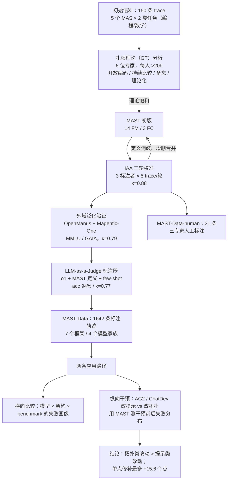

---
aliases:
  - "Why Do Multi-Agent LLM Systems Fail?"
  - "WDMALSF"
created: 2026-11-17
---
# Why Do Multi-Agent LLM Systems Fail?（MAST / MAST-Data）

> 这是一篇「先造尺子、再量病灶」的论文。作者不问「哪个模型更强」，而问一个更基础的问题：多智能体 LLM 系统（MAS）到底以什么方式失败？他们的做法是先把失败变成可标注的对象——用扎根理论（Grounded Theory）从 150 条 MAS 执行轨迹里自下而上归纳出 **MAST**（Multi-Agent System Failure Taxonomy）：14 种细粒度 failure mode（FM），归入 3 大类——系统设计问题（FC1）、智能体间失配（FC2）、任务验证（FC3）；再用三轮标注者间一致性研究（平均 $\kappa=0.88$）把定义磨到可复用，最后训练一个 o1 版 LLM-as-a-Judge 把标注规模化（准确率 94%、$\kappa=0.77$），产出 **MAST-Data**：7 个主流框架、4 个模型家族、1642 条标注轨迹。论文最有说服力的部分不是分类本身，而是它用分类法反推出的结论：**同一底层模型下，仅改系统工作流就能让 ChatDev 在自建编程集上从 25.0% 提到 40.6%（+15.6 个点）**，所以 MAS 的失败有相当一部分不是「模型不够强」，而是「组织设计不对」；但同时也只到 +15.6%，说明单点战术修补远不足以让 MAS 可靠。

## 一句话定位

一篇 NeurIPS 2025 Datasets & Benchmarks 论文（UC Berkeley 等）：它不提出新架构，而是交付三件可复用基础设施——**MAST 分类法（14 FM / 3 FC）**、**MAST-Data（1642 条带失败标注的执行轨迹）**、**与人类专家 $\kappa=0.77$ 一致的开源 LLM 标注器**，并用 AG2 与 ChatDev 两个干预案例证明「失败主要落在系统设计与验证环节，且可以用 MAST 量化干预前后的收益与副作用」（[§3](papers/模型评测/2503.13657/2503.13657.pdf#3)、[§4](papers/模型评测/2503.13657/2503.13657.pdf#4)）。

## 问题与动机

**现象：MAS 的收益配不上它的热度。** 论文开篇的对照很直白：MAS 被用来做任务分解、并行化、上下文隔离、专门化模型集成与多视角讨论，但相比单 agent 框架或 best-of-N 采样这类简单基线，性能提升往往很小（[§1](papers/模型评测/2503.13657/2503.13657.pdf#1)）。作者实测 7 个 SOTA 开源 MAS 的端到端**失败率区间是 41%–86.7%**——注意这是「任务没达成」的失败率，不是某个子步骤的出错率（[§1](papers/模型评测/2503.13657/2503.13657.pdf#1)）。更刺眼的是难度校准：ProgramDev（30 题）是作者特意设计成「网上有大量现成实现」的编程题（井字棋、国际象棋、数独一类），而 ChatDev 在同类自建集 ProgramDev-v0（32 题）上的 baseline 只有 **25.0%** 成功率（[表 4](papers/模型评测/2503.13657/2503.13657.pdf#table=4)）。也就是说，失败不是「题太难」，而是系统本身在简单题上就塌。

**为什么这个问题此前答不上来？** 论文把障碍拆成三层，这个拆法基本定义了全文的方法论（[§3](papers/模型评测/2503.13657/2503.13657.pdf#3)）：

1. **根因是复合的。** 传统软件失败通常有可定位的 root cause；MAS 的失败则来自「agent 之间的曲折交互」与「个体模型行为 × 整体系统设计」的叠加效应。要判定一段轨迹为什么失败，需要理解系统动力学，而不只是做错误检测（error detection）。
2. **没有共享的失败词汇。** 缺少标准失败框架时，不同人对同一段轨迹会用不同的词描述同一个病，跨系统比较因此不成立——这直接卡死了「大规模标注」这条路。
3. **轨迹极长。** 初始分析里每条轨迹**平均超过 15,000 行文本**（[§1](papers/模型评测/2503.13657/2503.13657.pdf#1)），且人工标注 150 条就需要每位专家 20 小时以上（[§3.1](papers/模型评测/2503.13657/2503.13657.pdf#3.1)）。纯人工不可扩展，纯自动又无 ground truth。

**前人工作的缺口在哪。** 论文的 Related Work 把已有努力分成三类，并逐类说明它们为什么不够（[§2](papers/模型评测/2503.13657/2503.13657.pdf#2)）：

- **自上而下的评测**：SWE-bench、AgentBench 一类 benchmark 给的是聚合性能或信任/安全这类高层目标，能看到「分数低」，看不到「低在哪一步、属于哪一类」；各类 MAS 综述给的是高层风险清单，颗粒度不够。
- **单 agent 的设计原则**：Anthropic 的「模块化、避免过度复杂框架」、以及 Kapoor 等人「复杂性反而拖累落地」的论证，都是在单 agent 语境下提出的，本文把它推广到多 agent 组织层面——但推广本身需要证据，而证据正是本文要造的东西。
- **相邻的分类法/工具**：已有的分类法面向多轮对话质量或代码生成能力，不针对 agent 间交互与协调；AgentEval 用 LLM 定义多维效用准则、AGDebugger 让人工检查并编辑消息历史、Who&When（[[papers/模型评测/2505.00212/NOTES|Which Agent Causes]]）把失败归因到「哪个 agent、哪一步」——这些工作都**预设了失败已经可被描述**，而本文要提供的恰恰是「描述失败的那套语言」。

**本文的切入点（一句话）。** 先用定性研究方法从数据里「长」出一套失败语言（GT → MAST），再用一致性研究把这套语言校准到多人可复现（IAA，$\kappa=0.88$），再用 LLM 把它放大到千条规模（LLM annotator，$\kappa=0.77$），最后用这套语言做「干预前后」的差分诊断，证明它不只是描述工具、还是调试工具（[图 2](papers/模型评测/2503.13657/2503.13657.pdf#figure=2)）。这条链条的每一步都为下一步的前提服务，是本文最值得学的方法论骨架。

## 方法与机制（核心）

### 总览

全文的方法链条可以画成一条单向流水线，但阅读时要注意每一环的**输入/输出契约**——这正是它能被复用的原因（[图 2](papers/模型评测/2503.13657/2503.13657.pdf#figure=2)）：

这条 pipeline 的关键设计是**「分类法不是结果，而是标注协议」**：MAST 的 14 个 FM 每一个都配了明确 definition 与正反例（正文 §4 给定义骨架，附录给逐条示例），因此它既是人类标注者的手册，也是 LLM 标注器的 prompt 规格，还是干预实验的因变量坐标系。三者共用同一套标签，才使得「干预前 ΔFM → 干预后 ΔFM」这种差分叙述成立。

**为什么这个顺序不能颠倒。** 四个环节互为前提，缺一环整条链就失效：(1) 没有 GT 阶段的开放编码，14 个 FM 就只是先验分类，无法保证「是从数据里长出来的」；(2) 没有 IAA 校准，judge 就没有可信的 ground truth——few-shot 示例本身可能带着个人化的定义；(3) 没有外域验证（OpenManus + Magentic-One），无法排除「分类法只适配最初 5 个系统」这一致命替代解释；(4) 没有干预实验，MAST 就只是「描述性标签集」，无法证明它作为调试工具的实用性。换句话说，这篇论文的贡献不是「一张树状图」，而是**一条把定性研究转化为可复用测量工具的完整流程**——这也是它作为 D&B track 论文而非方法论文的定位。读的时候要特别注意每一环的「验证动作」（理论饱和、$\kappa$、外域 $\kappa$、干预前后 A/B），这是判断这类「分类法论文」可信度的四个检查点。

下面按五个模块拆开讲：(1) 数据集与系统构成；(2) 标注流程与一致性；(3) 14 种 failure mode；(4) LLM-as-a-Judge 标注器；(5) 干预实验设计。

### 模块一：数据集与系统构成

**为什么要「理论抽样」而不是随机抽样。** 初始 150 条轨迹的目标不是代表性，而是**覆盖度**：尽量把不同系统目标、不同交互模式下的失败都看到，从而让归纳出的 FM 不是某一个系统的实现怪癖（[§3.1](papers/模型评测/2503.13657/2503.13657.pdf#3.1)）。因此作者用 theoretical sampling 选定 5 个框架与 2 类任务：HyperAgent、AppWorld、AG2、ChatDev、MetaGPT，任务限定编程与数学解题——这两类任务有可判定的正确性，便于确定「失败」的外部标准。

**7 个系统的构成与各自的失败画像来源。** MAST-Data 的主表（[表 1](papers/模型评测/2503.13657/2503.13657.pdf#table=1)）值得逐行读，因为它同时暴露了「哪些数据是人工评的、哪些只是 LLM 标的」：

| MAS | 基准 | 底层 LLM | 标注方式 | trace 数 |
|---|---|---|---|---|
| ChatDev | ProgramDev | GPT-4o | 人工评 + 人工标 + LLM 标 | 30 |
| MetaGPT | ProgramDev | GPT-4o | 人工评 + 人工标 + LLM 标 | 30 |
| HyperAgent | SWE-Bench Lite | Claude-3.7-Sonnet | 人工评 + 人工标 + LLM 标 | 30 |
| AppWorld | Test-C | GPT-4o | 人工评 + 人工标 + LLM 标 | 30 |
| AG2 (MathChat) | GSM-Plus | GPT-4 | 人工评 + 人工标 + LLM 标 | 30 |
| Magentic-One | GAIA | GPT-4o | 人工评 + 人工标 + LLM 标 | 30 |
| OpenManus | ProgramDev | GPT-4o | 人工评 + 人工标 + LLM 标 | 30 |
| ChatDev / MetaGPT | ProgramDev-v2 | GPT-4o | 仅 LLM 标 | 100 × 2 |
| MetaGPT | ProgramDev-v2 | Claude-3.7-Sonnet | 仅 LLM 标 | 100 |
| ChatDev / MetaGPT | ProgramDev-v2 | Qwen2.5-Coder-32B、CodeLlama-7b | 仅 LLM 标 | 100 × 4 |
| AG2 (MathChat) | OlympiadBench / GSM-Plus / MMLU | GPT-4o / Claude-3.7 / GPT-4o-mini | 人工评 + LLM 标 | 206 / 193 / 168 |
| Magentic-One | GAIA | GPT-4o | 人工评 + LLM 标 | 165 |

合计正好 1642 条（210 + 200 + 100 + 400 + 567 + 165），与正文数字自洽。这张表透露了两个设计取舍：

- **人工标注只覆盖每个系统的前 30 条**（共 210 条），其余靠 LLM 标注器放大。这是全文最诚实也最脆弱的折衷：横向比较的结论（[图 4](papers/模型评测/2503.13657/2503.13657.pdf#figure=4)）明确只基于这 210 条，且作者在 caption 里主动声明「各系统的任务与 benchmark 不同，此图只用于展示系统各自的失败画像，**不构成性能比较**」。
- **模型维度是受控的**：在 ProgramDev-v2（100 题）上固定框架比模型（MetaGPT × GPT-4o / Claude-3.7 / Qwen / CodeLlama），固定模型比框架（GPT-4o × ChatDev / MetaGPT），这样才能把「模型效应」与「架构效应」分开（[附录 F](papers/模型评测/2503.13657/2503.13657.pdf)）。

**基准的选择也有讲究。** ProgramDev 只有 30 题，作者明说有意选「相对直白、网上有大量现成答案」的题，目的是**隔离失败动力学而不是制造难度压力**——如果题本身就超出能力，失败会被「能力不足」淹没，看不到系统设计的问题（[附录 D](papers/模型评测/2503.13657/2503.13657.pdf)）。ProgramDev-v2 扩到 100 题，专供模型/架构对比。AG2 一侧则用 GSM-Plus（GSM8K 的对抗扰动版）、OlympiadBench、MMLU 三个难度带，用来观察「基准难度」这个变量的影响。另外还自建了 32 题的 ProgramDev-v0 作为 ChatDev 干预实验的主战场，并用 HumanEval 作为第二个基准（[附录 H](papers/模型评测/2503.13657/2503.13657.pdf)）。

**闭源系统为什么没进数据集。** Manus 一类平台的底层模型不公开，更致命的是**拿不到完整执行轨迹**——没有 trace 就无法做细粒度失败标注。作者只对它做了任务正确性的人工评估（ProgramDev 上 60% 成功率），拒绝把它塞进 MAST-Data（[附录 B](papers/模型评测/2503.13657/2503.13657.pdf)）。这个取舍说明本文的「可标注性」门槛其实是「可观测性」门槛：凡是不透明的系统，无论多流行都进不了这张表。

### 模块二：标注流程与一致性

**第一步：扎根理论把「失败」从数据里长出来。** 作者明确不用预设立场，而是用 GT 的四件标准工具（[§3.1](papers/模型评测/2503.13657/2503.13657.pdf#3.1)）：open coding（给观察到的失败行为打标签）、constant comparative analysis（比较同一失败行为在不同系统里的复现形态）、memoing（记录判断依据）、theorizing（把观察结构化为带定义的 FM）。整个迭代持续到**理论饱和**——再分析新数据也不再产生新的 FM 洞见为止。

**第二步：IAA 把定义磨到「多人可复现」。** 这是全文最容易被低估的一环。做法是：三人独立标注同一批随机抽取的 5 条轨迹，然后开会**集体裁决分歧**，并据此修改定义（改措辞、加新 FM、删除或合并已有 FM），如此三轮（[§3.2](papers/模型评测/2503.13657/2503.13657.pdf#3.2)）。最终平均 $\kappa=0.88$，仅用于「解决分歧」的讨论就花了约 10 小时，不含标注本身时间。一致性用 Cohen's Kappa 度量：

$$
\kappa = \frac{p_o - p_e}{1 - p_e}
$$

其中 $p_o$ 是标注者实际一致率，$p_e$ 是随机一致率。这个指标的意义在于扣掉了「靠猜也能一致」的部分——对 14 个互斥性不完美的标签来说，原始一致率会系统性高估标注质量。需要注意一个数字上的小出入：正文 §1 说三人共标注 15 条轨迹（三轮 × 5 条），同段又说放出的 MAST-Data-human 含 **21 条**三专家标注轨迹（[§1](papers/模型评测/2503.13657/2503.13657.pdf#1)）；最合理的解释是后一轮外域验证（OpenManus + Magentic-One 的 6 条）被并入了 human 集，但原文未明确说明（Not explicitly specified in text）。

**第三步：外域泛化验证，防止分类法只适配原始 5 个系统。** 在正式放量前，作者拿两个**未参与分类法构建**的系统（OpenManus、Magentic-One）与两个未见基准（MMLU、GAIA，其中 GAIA 属于全新的通用 agent 任务域）再做一轮人工 IAA，得到 $\kappa=0.79$，且**没有修改任何定义**（[§3.4](papers/模型评测/2503.13657/2503.13657.pdf#3.4)）。这一步是「分类法可迁移」的直接证据，也是它区别于「事后编一张好看的树状图」的地方。

**第四步：先用定义，再用分布检验分类法的独立性。** 附录 E 报告了失败类别之间的相关性只有 **0.17–0.32**，说明三大类确实在捕捉不同的失败面向；但细粒度 FM 之间的相关性最高可达 **0.63**，这说明两件事：分类法有区分度，但「症状相似、根因不同」的 FM 对自动标注器仍然困难（[附录 E](papers/模型评测/2503.13657/2503.13657.pdf)）。作者自己把这称为 fine-grained 的代价，并在后文用「成功/失败轨迹对照表」去验证这些标签与真实结果的关联（见「实验与对比」）。

### 模块三：14 种 failure mode 逐条讲清

先说三个阅读要点，否则容易读错这张表：

1. **三大类的名字在版本间改过。** 早期 arXiv 版 FC1 叫 *Specification Issues*，NeurIPS 终稿改名为 **System Design Issues**（`macros.tex` 里仍保留被注释掉的旧名）。所以「specification / inter-agent misalignment / task verification」与「system design / inter-agent misalignment / task verification」指的是同一套东西（[§4](papers/模型评测/2503.13657/2503.13657.pdf#4)）。
2. **每个 FM 还带一个「执行阶段」坐标。** MAST 把 FM 映射到 Pre-Execution / Execution / Post-Execution，一个 FM 若跨越多个阶段，表示该根因在这些阶段都会显现或产生后果（[图 1](papers/模型评测/2503.13657/2503.13657.pdf#figure=1) caption）。FC1 的失败**发生在执行期，但根因在预执行的设计**——这是理解 FC1 的关键。
3. **下表百分比是「失败份额」，不是「trace 出现率」。** 14 项之和约 100%（44.2 + 32.4 + 23.5 ≈ 100.05），说明它统计的是「所有被标注失败事件中，该类占多少」；而 [表 6](papers/模型评测/2503.13657/2503.13657.pdf#table=6) 里的百分比是「某框架的 trace 中出现该 FM 的比例」。两组数字量级差一位，不可混用。

| 编号 | 名称（术语 / 中文） | 类 | 占全部失败 | 机制一句话 |
|---|---|---|---|---|
| FM-1.1 | Disobey task specification / 不遵守任务规格 | FC1 | 11.8% | 未满足任务硬约束，产出偏离要求 |
| FM-1.2 | Disobey role specification / 不遵守角色规格 | FC1 | 1.5% | 越界扮演别的 agent，破坏分工 |
| FM-1.3 | Step repetition / 步骤重复 | FC1 | 15.7% | 重复已完成阶段，状态追踪失效 |
| FM-1.4 | Loss of conversation history / 对话历史丢失 | FC1 | 2.80% | 上下文被截断，回退到更早状态 |
| FM-1.5 | Unaware of termination conditions / 不知何时终止 | FC1 | 12.4% | 没有识别终止条件，无谓续聊 |
| FM-2.1 | Conversation reset / 对话重置 | FC2 | 2.20% | 对话被无理由重启，丢失进度 |
| FM-2.2 | Fail to ask for clarification / 不主动澄清 | FC2 | 6.80% | 信息不足仍按错误假设推进 |
| FM-2.3 | Task derailment / 任务脱轨 | FC2 | 7.40% | 偏离原目标，做无关动作 |
| FM-2.4 | Information withholding / 信息扣留 | FC2 | 0.85% | 掌握关键信息却不共享 |
| FM-2.5 | Ignored other agent's input / 忽略他方输入 | FC2 | 1.90% | 无视其他 agent 的建议与约束 |
| FM-2.6 | Reasoning-action mismatch / 推理-行动不一致 | FC2 | 13.2% | 说一套做一套，推理与动作脱钩 |
| FM-3.1 | Premature termination / 过早终止 | FC3 | 6.20% | 信息未交换完就结束 |
| FM-3.2 | No or incomplete verification / 无验证或验证不全 | FC3 | 8.20% | 省略检查，错误静默传播 |
| FM-3.3 | Incorrect verification / 验证错误 | FC3 | 9.10% | 做了检查但判错，放过真错误 |

**FC1（5 个 FM）：根因在设计，不在执行。** 作者对「不遵守规格」这类看似「指令跟随能力差」的失败做了重新归因，拆成三个更深的原因：MAS 的角色与工作流设计有缺陷、用户 prompt 规格写得差、底层模型能力有限；并主张好的 MAS 应当能用**最少但清晰**的用户输入去解释高层目标，从而压住后两个原因（[§4](papers/模型评测/2503.13657/2503.13657.pdf#4)）。最能说明问题的是 Wordle 例子：ChatDev 生成固定词库而不是每日随机词，即便作者把 prompt 改成明确要求「不要固定词库、每天随机选新词」，ChatDev 仍然产出固定列表并引入新错误——失败不在指令理解，而在**系统解释规格的方式**。这也解释了为什么 FM-1.3（15.7%）是最高频 FM 之一：它更像工作流状态管理的病，而不是模型笨。而 FM-1.5 与 FM-3.1 是一对镜像：前者「不知道何时该停」（过度续），后者「提前停了」（不及）。

**FC2（6 个 FM）：信息流在 agent 之间断裂。** 这一类的诊断价值最高，因为**表面症状相同、根因不同**：同样是「信息缺失」，可能是 FM-2.4 扣留、FM-2.5 忽略、FM-1.4 上下文管理失败三者之一，只有细粒度标签才能把根因分开（[§4](papers/模型评测/2503.13657/2503.13657.pdf#4)）。论文的 Insight 2 是全文最尖锐的判断：**靠通信协议解决不了 FC2**。理由是 MCP、A2A 这类协议标准化的是消息格式与工具接口，而作者观察到的 FC2 失败发生在**同一个框架内、agent 之间本来就用自然语言通信**的场景——这说明病因是更深层的 theory of mind 崩塌：agent 无法准确建模「对方需要什么信息」。因此论文认为结构改进（消息内容设计）与模型侧能力（上下文推理、推断他人信息需求，可能需要专门训练）必须一起上。FM-2.6 推理-行动不一致（13.2%）是 FC2 里最高频的，它的隐蔽性最强：轨迹文本读起来头头是道，动作却不匹配。

**FC3（3 个 FM）：最后一道防线失效。** FM-3.2 + FM-3.3 = 17.3%，加上 FM-3.1 共 23.5%。Insight 3 是「需要多级验证」：现有 verifier 大多只做**表层检查**（代码能否编译、有没有遗留 `TODO` 注释），即便 prompt 明确要求彻底验证。典型例子是 ChatDev 生成国际象棋程序，通过编译与静态检查，但运行时棋规错误、接受非法走法，产出不可用（[§4](papers/模型评测/2503.13657/2503.13657.pdf#4)）。有显式 verifier 的系统（MetaGPT、ChatDev）总失败数确实更少（[图 4](papers/模型评测/2503.13657/2503.13657.pdf#figure=4)），但「有 verifier」不是银弹：真正的缺口是**低层正确性与高层目标的一致性没有被同时检查**。

### 模块四：LLM-as-a-Judge 标注器

**设计。** 输入是「一条执行轨迹 + MAST 全部 14 个 FM 的定义 + 从人工标注集中抽的 few-shot 正反例」，模型是 OpenAI 的 o1，输出是该轨迹命中的 FM 集合与理由（[§3.3](papers/模型评测/2503.13657/2503.13657.pdf#3.3)）。一个关键细节值得记住：标注时**不把任务成功/失败的结果喂给 judge**（[附录 J](papers/模型评测/2503.13657/2503.13657.pdf)），这样后文「失败 FM 是否预示真实失败」的相关性分析才不是自证。校准数据来自 IAA 研究的 held-out 集，即与人工专家逐条比对。

| 标注器 | Accuracy | Recall | Precision | F1 | Cohen's $\kappa$ |
|---|---|---|---|---|---|
| o1（zero-shot） | 0.89 | 0.62 | 0.68 | 0.64 | 0.58 |
| o1（few-shot） | 0.94 | 0.77 | 0.833 | 0.80 | 0.77 |

（[表 2](papers/模型评测/2503.13657/2503.13657.pdf#table=2)）few-shot 的价值主要体现在 recall 上：0.62 → 0.77，说明零样本时模型倾向于「不敢报」，给了示例后才敢下判断。

**怎么读这张表。** 准确率 0.94 听起来很高，但这是**多标签**任务，单看 accuracy 会被大量「本来就没失败的模式」稀释。真正该看的是 precision 0.833 与 recall 0.77：报出来的失败里约 **1/6 是误报**，真实失败里约 **1/4 被漏报**。所以这个标注器适合做**组间/组内比较**（同一误差偏置下，A 系统与 B 系统的相对差异仍然可信），不适合对单条 trace 做「是否失败」的裁决。作者对此的定位也是「规模化分析工具」而非「替代专家」。

**成本。** 全部轨迹的平均标注成本为 **\$1.8**，且**强依赖轨迹长度**：AppWorld（工具调用型、轨迹较短）为 0.374，HyperAgent 0.970，AG2 1.166，ChatDev 2.127，MetaGPT 2.446，Magentic-One 1.306，OpenManus（长轨迹）高达 **4.141**（[附录 K](papers/模型评测/2503.13657/2503.13657.pdf)）。对照人工成本（150 条即需每位专家 20+ 小时），这就是「可扩展」三个字的具体含义：把「千条级」从不可行变成几十到几千美元。

### 模块五：干预实验设计

干预实验的目的不是刷点，而是回答「MAST 找到的失败，能不能被改动设计修掉」。作者设计了两组三臂/两臂对照，均在**固定底层模型**的前提下改系统（[附录 H](papers/模型评测/2503.13657/2503.13657.pdf)）。

**Case 1：AG2 MathChat（数学）**。baseline 是 Student + Assistant（能执行 Python）两 agent。三个配置：
- baseline；
- **improved prompt**：把 prompt 结构化，并新增一个专门的 verification 段落；
- **new topology**：拆成三个角色——Problem Solver（纯 CoT、不用工具）、Coder（写并执行 Python）、Verifier（审查讨论、确认答案或要求继续辩论），且**只有 Verifier 能终止对话**。

评测用 GSM-Plus 随机 200 题，GPT-4 与 GPT-4o 各跑一遍，每个配置**重复 6 次**给标准差，用 Wilcoxon 检验判断显著性（[附录 H](papers/模型评测/2503.13657/2503.13657.pdf)）。这个设计的严谨点在于：单次跑分差异很容易被采样噪声吃掉，6 次重复 + 非参数检验才让「+5 个点」站得住。

**Case 2：ChatDev（编程）**。两个干预：
- **角色/提示强化**：强制层级——只有上级 agent 才能结束对话（原文观察到 CPO 未经 CEO 同意就终止讨论，正是 FM-1.2），并强化 verifier 的角色说明，要求关注任务特定的 edge case；
- **拓扑改造**：把 DAG 改成**有环图**，只有当 CTO 确认所有 review 都满足要求才终止，同时设最大迭代上限防死循环。

基准是自建的 ProgramDev-v0（32 题）与 OpenAI HumanEval（[附录 H](papers/模型评测/2503.13657/2503.13657.pdf)）。

**双轨评估。** 除了 task success（[表 4](papers/模型评测/2503.13657/2503.13657.pdf#table=4)），作者还用 LLM 标注器对干预前后的轨迹分别打 MAST 标签，画成对比图（[附录 H.3](papers/模型评测/2503.13657/2503.13657.pdf)）。这一步才是「MAST 作为调试工具」的实证：它不只知道「变好了」，还知道**哪些 FM 消失了、哪些没动、有没有引入新 FM**。结论是两种干预都让多个 FM 下降，且**按失败分布看，拓扑类改动普遍优于提示类改动**。

## 实验与对比

论文没有「主结果表」式的 SOTA 对比（它比的不是分数），实验分成四条互不重叠的证据线：**标注器可靠性**、**失败分布画像**、**干预效果**、**失败模式与真实成败的相关性**。前两者已在上面给过表（[表 2](papers/模型评测/2503.13657/2503.13657.pdf#table=2) 与失败份额表），这里补齐后两者。

### 干预前后：成功率变化

AG2 侧同时用 GPT-4 与 GPT-4o，ChatDev 侧固定 GPT-4o；只改 prompt 或改拓扑（[表 4](papers/模型评测/2503.13657/2503.13657.pdf#table=4)）：

| 配置 | AG2 / GSM-Plus（GPT-4） | AG2 / GSM-Plus（GPT-4o） | ChatDev / ProgramDev-v0 | ChatDev / HumanEval |
|---|---|---|---|---|
| Baseline | 84.75 ± 1.94 | 84.25 ± 1.86 | 25.0 | 89.6 |
| Improved prompt | 89.75 ± 1.44（**+5.00**） | 89.00 ± 1.38（+4.75） | 34.4（**+9.4**） | 90.3（+0.7） |
| New topology | 85.50 ± 1.18（+0.75） | 88.83 ± 1.51（+4.58） | 40.6（**+15.6**） | 91.5（+1.9） |

（AG2 为 6 次重复的均值 ± 标准差；ChatDev 为单次结果、无方差，原文未报告重复次数，Not explicitly specified in text。）

三条读法值得注意：

1. **显著性并不对称。** AG2 用 GPT-4 时，「新拓扑」相对 baseline 的增益只有 +0.75，Wilcoxon 检验 $p=0.4$，**不显著**；换 GPT-4o 后，improved prompt 与 new topology 相对 baseline 都是 $p=0.03$，显著（[附录 H](papers/模型评测/2503.13657/2503.13657.pdf)）。也就是说「同一套架构改动在强模型上才兑现」——这本身就是「模型与系统设计耦合」的证据。
2. **同一个 +15.6 有两种归因口径。** 正文 §4 把它写成「给 ChatDev 增加一个高层任务目标验证步骤」带来的提升，而附录 H 把这一臂描述为「DAG 改环形拓扑 + 只有 CTO 确认评审全部通过才终止」。两者其实指向同一处改动（拓扑里内嵌了更强的验证闭环），但叙述口径不同，引用时建议同时标出。
3. **天花板效应很明显。** HumanEval 上 baseline 已经 89.6，三臂差异只有 0.7–1.9 个点；ProgramDev-v0 从 25.0 起跳才有空间。这说明 MAST 引导的干预在「系统明显有病」的场景收益最大，在「模型本来就熟」的场景几乎无效。

### 失败模式与真实成败的相关性

这是全文最容易被忽略、但方法论价值最高的一节：把 judge 的 FM 标注与**未喂给 judge** 的真实任务成败交叉统计（[表 6](papers/模型评测/2503.13657/2503.13657.pdf#table=6)，ChatDev / MetaGPT 各 30 条）：

| 框架 / 结果 | 1.1 | 1.3 | 1.5 | 2.3 | 2.4 | 2.6 | 3.1 | 3.2 | 3.3 |
|---|---|---|---|---|---|---|---|---|---|
| ChatDev 成功（n=10） | 20.0 | 20.0 | 0.0 | 10.0 | 0.0 | 10.0 | 0.0 | 10.0 | 20.0 |
| ChatDev 失败（n=20） | 25.0 | 20.0 | 10.0 | 5.0 | 5.0 | 15.0 | 5.0 | 10.0 | 25.0 |
| MetaGPT 成功（n=12） | 33.3 | 16.7 | 0.0 | 8.3 | 0.0 | 8.3 | 0.0 | 16.7 | 16.7 |
| MetaGPT 失败（n=18） | 16.7 | 22.2 | 11.1 | 5.6 | 5.6 | 16.7 | 5.6 | 5.6 | 27.8 |

（此处百分比是「该类 trace 中出现该 FM 的比例」；为节省篇幅略去 1.2、1.4、2.1、2.2、2.5 五行，它们多数接近 0。）

作者从中读出三条结论（[附录 J](papers/模型评测/2503.13657/2503.13657.pdf)）：

- **成功轨迹并非无失败。** 成功轨迹里也有 FM，只是失败轨迹的 FM 总数更高——「FM 越多，最终失败概率越高」这一单调关系成立。
- **有些 FM 近乎致命。** FM-1.5（不知终止条件）与 FM-2.4（信息扣留）几乎**只出现在失败轨迹里**（成功行均为 0.0），这类 bug 一旦出现基本就把任务带走了。
- **有些 FM 是非致命的。** FM-3.2 / FM-3.3（验证缺失或验证错误）在**成功轨迹里也高频出现**（ChatDev 成功轨迹中 FM-3.3 达 20.0%，MetaGPT 成功轨迹中 FM-3.2 与 FM-3.3 均达 16.7%）。这是全文最有价值的诊断：系统可以在「验证有缺陷」的状态下碰巧交付正确结果，说明这部分失败是**潜伏的技术债**，平时不表现为分数下降，直到某个边界条件触发。

### 基准难度、模型与架构的效应

固定 AG2 + GPT-4o，只换基准，三大类失败的**平均每 trace 出现次数**如下（[表 7](papers/模型评测/2503.13657/2503.13657.pdf#table=7)）：

| 基准 | FC1 系统设计 | FC2 智能体间失配 | FC3 任务验证 |
|---|---|---|---|
| GSM | 0.53 | 1.33 | 0.37 |
| MMLU | 1.06 | 1.01 | 0.60 |
| Olympiad | 1.19 | 1.21 | 0.67 |

结论是「基准越难，失败率越高」，且**分布会变形**：MMLU 与 Olympiad 的画像接近，而 GSM 的 FC1/FC2 明显更低（[附录 J.2](papers/模型评测/2503.13657/2503.13657.pdf)）。这提醒使用者：MAST 的失败画像不是系统常量，而是「系统 × 任务难度」的函数，跨基准比较必须固定基准。

模型与架构的对照（ProgramDev-v2，100 题，[附录 F](papers/模型评测/2503.13657/2503.13657.pdf)）：

| 对照 | 结论（原文口径） |
|---|---|
| MetaGPT 内 GPT-4o vs Claude-3.7 | GPT-4o 整体更好，且 **FC1 失败少 39%**；两者 FC3 都高，验证是共同瓶颈 |
| GPT-4o 下 MetaGPT vs ChatDev | MetaGPT 的 **FC1 与 FC2 少 60–68%**，但 **FC3 多 1.56 倍** |

第二条尤其重要：它说明架构不是「全面更好/更差」，而是**把失败预算从设计/协调挪到了验证**。MetaGPT 靠 SOP 式流程把规格遵守做得好（FC1 低），ChatDev 靠测试与评审阶段把验证做得好（FC3 低），两者是互补而非替代关系（[附录 F](papers/模型评测/2503.13657/2503.13657.pdf)）。

开源模型侧（400 条 trace，[附录 I](papers/模型评测/2503.13657/2503.13657.pdf)）结论只有两句但很硬：Qwen2.5-Coder-32B 明显强于 CodeLlama-7b（同样 100 条 trace 下多数 FM 计数低一个量级，例如 FM-1.1 为 35/12 vs 76/94，FM-3.3 为 12/32 vs 69/56）；**两个开源模型的总失败频次都高于 GPT-4o / Claude-3.7**，开源与闭源在多 agent 协作场景存在明显能力差。

## 归因分析

把上面的证据串起来，可以得到五条可迁移的归因判断，这也是本文真正的「论点」：

**1. 失败不是底层模型的单调函数。** 最直接的证据是固定 GPT-4o、只改提示与拓扑就能让 ChatDev 从 25.0 提到 40.6（+15.6 个点）。更细的证据是「同一套拓扑改动在 GPT-4 上 $p=0.4$ 不显著、在 GPT-4o 上 $p=0.03$ 显著」——收益取决于模型与设计的匹配，而不是单方面的能力。作者据此提出 Insight 1：**同样底层模型下，好的 MAS 设计本身就能带来收益**（[§4](papers/模型评测/2503.13657/2503.13657.pdf#4)）。

**2. 验证的失败是「层级缺失」而不是「没有验证」。** 有 verifier 的 MetaGPT / ChatDev 总失败数确实更少，但 FC3 占比仍高（MetaGPT 甚至比 ChatDev 多 1.56 倍）。原因是 verifier 只做低层检查（编译、遗留注释），缺**高层目标级验证**。这解释了为什么「加一个验证步骤」能拿到 +15.6：它补的是抽象层级，不是检查数量（[§4](papers/模型评测/2503.13657/2503.13657.pdf#4)）。

**3. FC2 不能靠协议解决。** 同框架内自然语言通信照样失败，说明病因是 agent 无法推断「对方需要什么信息」（theory of mind 崩塌），而非消息格式不统一。这条归因直接否掉了「上 MCP / A2A 就好了」的工程直觉（[§4](papers/模型评测/2503.13657/2503.13657.pdf#4)）。

**4. 失败有「致命 / 非致命」之分，因此聚合指标会骗人。** FM-1.5、FM-2.4 几乎只在失败轨迹出现（致命），FM-3.2、FM-3.3 在成功轨迹里也常见（非致命）。所以「成功率没降」不等于「系统健康」：验证缺陷会以技术债形式潜伏。这条也解释了为什么作者坚持用 MAST 做干预评估，而不只看 task success。

**5. 杠杆排序：按失败分布看拓扑 > 提示，但按成功率看并不总成立。** 作者在附录 H.3 明确写「两种干预都让多数 FM 下降，且拓扑类改动对两个系统都更有效」；但换成 task success 指标，AG2 + GPT-4 上反而是提示类更大（+5.00 显著）而拓扑类不显著（+0.75，$p=0.4$）。**同一份数据在两个指标下排序不一致**，这本身是本文一个诚实的张力：MAST 能看见「失败结构改善」，却不一定兑现为分数。更硬的结论是干预之后成功率仍然低（ProgramDev-v0 最好也只有 40.6%），说明残余失败需要组合式改造：验证、通信内容、模型侧社会推理、记忆/状态管理一起上（[§5.3](papers/模型评测/2503.13657/2503.13657.pdf#5.3)、[表 3](papers/模型评测/2503.13657/2503.13657.pdf#table=3)）。

## 局限与未来工作

**论文明确承认的局限：**

- **分类法不穷尽。** 作者明确声明不主张 MAST 覆盖所有失败模式，它只是「第一个经验归纳的结构化框架」（[§4](papers/模型评测/2503.13657/2503.13657.pdf#4)）。附录 E 的相关性分析也显示细粒度 FM 之间最高相关 0.63，说明边界仍有模糊地带。
- **只描述「正确性/完成度」类失败。** 论文把「失败」定义为「MAS 未达成预期任务目标」，因此标签体系天然只覆盖 correctness/completion；效率、成本、延迟等维度不在其中。正文没有说明这是否为有意取舍（Not explicitly specified in text）。
- **可观测性门槛带来生态偏置。** 闭源平台（Manus 等）因拿不到完整 trace 被排除，数据集里的 7 个系统全为开源。Manus 只做了人工正确性评估（ProgramDev 60%），无失败标注（[附录 B](papers/模型评测/2503.13657/2503.13657.pdf)）。
- **人工标注规模小。** 每系统只有 30 条人工标注（共 210 条），横向比较的统计功效有限，作者在图 4 caption 里主动声明该图不构成性能比较（[图 4](papers/模型评测/2503.13657/2503.13657.pdf#figure=4)）。
- **自动标注器有精度上限。** precision 0.833 / recall 0.77 / $\kappa=0.77$，且细粒度 FM 相关性高（最高 0.63）会加剧混淆；作者自己指出这对自动评估器是持续挑战（[表 2](papers/模型评测/2503.13657/2503.13657.pdf#table=2)）。
- **干预实验规模小、外部效度有限。** ChatDev 只跑 32 题自建集与 HumanEval，且为单次结果；AG2 是 200 题数学。跨到真实长程任务（Web、多工具、企业流程）是否成立，论文未验证（Not explicitly specified in text）。

**作者指出的未来方向**（[§6](papers/模型评测/2503.13657/2503.13657.pdf#6)、[表 3](papers/模型评测/2503.13657/2503.13657.pdf#table=3)）：

- **多级验证（multi-level verification）**：低层正确性 + 高层目标一致性同时检查，引入外部知识、生成过程中的持续测试、单元测试生成；
- **标准化通信协议与消息内容设计**：让人与 agent、agent 与 agent 的意图与参数可被形式化检查；
- **模型侧能力**：针对 agent 间社会推理的定向训练（这是 FC2 的根本解）；
- **置信度量化与门控**：低置信时暂停补信息，高置信才行动（引自 Horvitz 的传统不确定性框架）；
- **记忆与状态管理**：把单 agent 的 context 管理（MemGPT、TapeAgents 一类）扩展到多 agent 共享状态；
- **RL/角色专用微调**：如 MAPPO、SHPPO、Optima 一类方法，让 agent 学会守角色、少低效交互。

一句话总结局限：**本文把「为什么失败」做成了可测量问题，但把「怎么修」只推进到「方向清单 + 小规模验证」**。

## 与其他工作的关系

- [[papers/模型评测/2505.00212/NOTES|Which Agent Causes]]（Who&When）：把失败归因到**具体 agent 与具体步骤**（instance 级定位），而 MAST 给的是**失败类型体系**（pattern 级分类）。二者是正交的两层：MAST 回答「这属于哪类病」，Who&When 回答「哪个 agent 在哪一步犯的」。本文在 Related Work 里把 Who&When 列为同期工作并明确区分：它「为具体任务项总结失败、归因到特定 agent 与错误步骤」，而本文关注跨系统可复用的失败模式（[§2.3](papers/模型评测/2503.13657/2503.13657.pdf#2.3)）。实践上最自然的组合是：先用 MAST 分类做系统级诊断，再用 Who&When 式方法做单条 trace 的定位。
- [[papers/模型评测/2505.08638/NOTES|TRAIL]]：轨迹级错误定位基准，评的是「模型能不能在长轨迹里找到错误位置」。MAST 提供的是标签本体与定义，TRAIL 提供的是**定位任务与评测协议**；MAST 的 14 FM 可以直接当作 TRAIL 式定位任务的标签空间，而 TRAIL 的结论（长轨迹定位仍很难）反过来解释了为什么 MAST 需要 judge 而不是纯人工规模化。
- [[papers/模型评测/2608.14588/NOTES|Hallucination Snowball]]：把幻觉在多 agent 流水线中的传播建模为四状态马尔可夫过程（Raw Fact → Derived → Narrative → Invisible），测出「越往后越不可检测」。它给 MAST 的 FC1/FC2 提供了**动力学解释**：MAST 观察到的 FM-2.4（信息扣留）→ FM-2.3（任务脱轨）→ FM-3.2/3.3（验证失效）并不是三个独立 bug，而可能是同一条错误链在不同阶段的三个快照。两篇合读的启示是：MAST 的「多级验证」主张，在传播模型下等价于「在每次状态转移处设检查点」。
- [[papers/模型评测/2504.08942/NOTES|AgentRewardBench]]：专门评估「LLM 裁判评 web agent 轨迹有多可信」，发现最好的 GPT-4o simplified judge 也只有 69.8% precision、官方 rule-based 评测 recall 仅 55.9%。这与本文 judge 的 precision 0.833 / recall 0.77 是同一类结论的两个数据点：**LLM-as-judge 适合做相对比较，不适合做绝对裁决**。若把 MAST 标注器当成「失败检测器」上线，需要按 AgentRewardBench 的方式先测 precision/recall 再定阈值。

**在同一条研究脉络上的位置。** 本文属于「agent 评测基础设施」这一支：它不造更强的 agent，而是造**可复用的诊断语言 + 数据集 + 自动标注器**。这也是它能在一年内被大量后续工作引用为 failure taxonomy 基准的原因——它把「MAS 为什么失败」从轶事讨论变成了可以算比例的实证问题。
