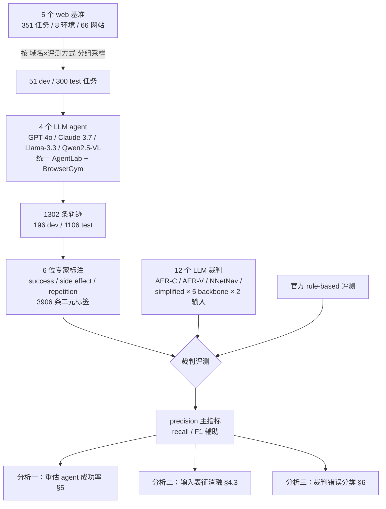

---
aliases:
  - "AgentRewardBench: Evaluating Automatic Evaluations of Web Agent Trajectories"
  - "AgentRewardBench"
created: 2026-11-17
---
# AgentRewardBench: Evaluating Automatic Evaluations of Web Agent Trajectories

> 这是一篇「给裁判打分」的基准论文。作者不去造更强的 web agent，而是先回答一个更底层的问题：**当 LLM 充当 web agent 轨迹的裁判时，它到底有多可信？** 为此他们收集了 1302 条由 4 个 LLM agent 在 5 个 web 基准（WebArena / VisualWebArena / AssistantBench / WorkArena / WorkArena++）上产生的轨迹，由 6 位熟悉 web agent 的专家逐条标注三个维度——是否成功、是否产生副作用、是否陷入重复循环——共 3906 条二元标注。然后用这批专家标签去考核 12 个 LLM 裁判（AER-C、AER-V、NNetNav，以及作者提出的 simplified judge 的 5 个 backbone × 2 种末状态输入的组合），并顺带把各基准官方使用的 rule-based 评测也拉进来对照。核心结论有三条：(1) 没有任何一个裁判在所有基准上都好，最好的 GPT-4o simplified judge 也只有 69.8% precision，即约三成失败轨迹会被误判为成功；(2) 官方 rule-based 评测的 recall 只有 55.9%，系统性地**低估** agent 的真实成功率（GPT-4o agent 在 WebArena 上被低估 16.7 个点、在 VisualWebArena 上被低估 18.5 个点），甚至把 agent 之间的排序都排反了；(3) 给裁判更多信息（同时喂 accessibility tree 和截图）反而更差，说明当前裁判的瓶颈不是信息量而是判别力。

## 一句话定位

AgentRewardBench 是第一个用**专家标注**（而非 rule-based 标签或下游训练收益）来度量「LLM 能否判定 web agent 轨迹成败」的基准，它把「自动评测」本身当成被评测对象，用 precision 作为主指标，给出了「12 个裁判全部不可用于生产」这一否定性结论，并顺带暴露了官方 rule-based 评测对 agent 能力的系统性低估（[表 1](papers/模型评测/2504.08942/2504.08942.pdf#table=1)、[表 3](papers/模型评测/2504.08942/2504.08942.pdf#table=3)）。

## 问题与动机

### 问题一：轨迹成功判定是 agent 研究的基础设施，但它本身没有可信的度量

Web agent 的能力数字完全建立在「这条轨迹算不算成功」之上。论文把这件事的三种做法摆在一起（[§1](papers/模型评测/2504.08942/2504.08942.pdf#1)）：

1. **rule-based 评测**（各环境官方的做法）：为每个任务手写字符串匹配、URL 匹配、HTML 程序或页面图像查询规则。痛点是双重的——写规则的成本高（要专家为每个任务单独设计），而覆盖面窄（规则只认它想到的那一种成功路径）。
2. **人工标注**：准确，但慢且贵，无法随 agent 数量扩展。
3. **LLM judge**：看起来可以同时避开上面两个痛点，成本低、无需为新任务写规则，还能顺带产出 RL 的 reward。**但它是否真的能替代前两者，此前没有任何直接证据。**

论文用一个具体例子把 rule-based 的脆性讲清楚了：WebArena 里问「缅因州最大城市附近最近的国家公园是哪个」，agent 回答 "The closest national park to Portland [...] is Acadia National Park"，语义完全正确，但规则配置要求精确匹配 "Acadia National Park"，于是被判为失败（[§4.3](papers/模型评测/2504.08942/2504.08942.pdf#4.3)）。这类「多说了半句话就失败」的假阴性在长轨迹里会累积成系统偏差——这正是后面 [表 3](papers/模型评测/2504.08942/2504.08942.pdf#table=3) 里 rule-based 把成功率普遍压低十几个点的机制来源。

### 问题二：已有工作用「与规则一致」冒充「与专家一致」

这是本文在方法论上最锋利的一刀。相关工作里 AER（Pan et al.）确实评过 4 个 LLM judge，但它的评价标准是**以 WebArena 的 rule-based 评测为金标**，报告「最好的裁判达到 80.6% accuracy」（[§2](papers/模型评测/2504.08942/2504.08942.pdf#2)）。这就构成了一个循环：用有系统性假阴性的规则去考核裁判，裁判只要学会模仿规则的偏执就能拿高分，而「裁判比规则更接近人类」这一真正有价值的能力反而会被扣分。本文把金标换成专家标注，于是同一个裁判的分数含义完全不同——从「像不像规则」变成「像不像专家」。

同理，轨迹合成方向（BAGEL、NNetNav、AgentQ、AutoWebGLM、Insta）都在用 LLM judge 造训练数据或偏好对，但「它们都缺少直接判断裁判质量的办法，只能靠下游性能提升来间接验证」（[§2](papers/模型评测/2504.08942/2504.08942.pdf#2)）。下游提升是一个高度混杂的信号：裁判偏宽松会放大数据量、偏严格会提纯数据，两种偏差都可能让下游指标变好。所以本文要提供一个**不经过下游训练**的直接度量。

### 问题三：judge 的输入表征其实是一个未经验证的设计选择

已有 judge 的实现差异极大：AER 要求裁判看最终状态的截图（或把截图转成 caption），NNetNav 要求裁判读「所有观测之间的变化摘要」，两者都需要**额外的 LLM** 做 caption 或摘要。这些中间环节究竟是必要的脚手架，还是纯粹在引入误差？论文的假设是后者——把中间 LLM 去掉、直接把原始末状态交给裁判，可能既不损失能力又更便宜。这构成了他们 simplified judge 的设计动机（[§4.1](papers/模型评测/2504.08942/2504.08942.pdf#4.1)），也构成了 [表 2](papers/模型评测/2504.08942/2504.08942.pdf#table=2) 那个「信息越多反而越差」的反直觉结果的伏笔。

### 为什么这件事值得单独写一篇论文

因为它是**评测的评测**。如果裁判不可信，那么三件事会同时失效：新任务上的 agent 进度无法测量；用裁判筛轨迹做 rejection finetuning 会把失败轨迹喂进训练集（这正是 precision 而非 accuracy 被选为主指标的原因）；用裁判当 reward model 做 RL 时，假阳性会把噪声直接注入 loss。这三条下游用途在 [§4.2](papers/模型评测/2504.08942/2504.08942.pdf#4.2) 里被明确写成指标选择的依据，也解释了为什么本文的结论虽然是「全部不合格」，却依然有很强的实践价值：它给出了「在达到什么 precision 之前不要用裁判」这条门槛。

## 方法与机制（核心）

### 总览

整篇论文可以读成一条**五段式流水线：筛任务 → 跑轨迹 → 专家标注 → 裁判评分 → 三重分析**（[图 2](papers/模型评测/2504.08942/2504.08942.pdf#figure=2)）。它和普通 benchmark 论文的关键差别在于「被评测对象」的位置：普通论文里 agent 是被测者、基准是尺子；这里 agent 只是**生产轨迹的工人**，真正的被测者是那个坐在评测位置上的 LLM 裁判，而尺子是 6 位专家。

第一段是任务筛选。作者从 5 个 web 基准里挑出 351 个任务，覆盖 8 个环境、66 个真实网站。筛法不是随机抽样，而是按「域名 × 原基准的评测方式」分组后再组内采样——这一步是为了让评测集在**评测方式**这个维度上也均衡，避免某一种规则类型（比如纯 URL 匹配）主导结果。351 个任务再切成 51 个 dev / 300 个 test（[§3.2](papers/模型评测/2504.08942/2504.08942.pdf#3.2)）。

第二段是轨迹生成。4 个 LLM backbone（GPT-4o、Claude 3.7 Sonnet、Llama-3.3-70B、Qwen2.5-VL）跑同一个 AgentLab/BrowserGym 栈，输入表征函数 $R$ 与动作解析函数 $E$ 被统一固定，因此不同 backbone 之间的差异只来自模型本身，而非 prompt 或表征的定制化——这是让「轨迹多样性」可控的前提（[§3.3](papers/模型评测/2504.08942/2504.08942.pdf#3.3)）。

第三段是专家标注，也是本基准真正的「数据资产」。6 位长期做 web agent 研究的专家用一个自建 Gradio 界面对每条轨迹回答三个问题：成功与否、有无副作用、有无重复循环。前一半标注是**所有人同时在场**完成的，目的不是效率而是对齐——遇到拿不准的轨迹当场讨论到共识，剩余标注就沿着这个共识走。

第四段是裁判评分。12 个裁判各自实现一个表征函数 $R_j$（从「只给动作列表」到「给末状态 accessibility tree」到「给末状态截图」），输出对三个问题的判断 $\hat{\mathcal{A}}$，再与专家标签 $\mathcal{A}^*$ 比 precision / recall / F1。

第五段是三重分析，这也是本文超出「发个榜」的部分：用专家标签重估各 agent 的真实成功率并与 rule-based 对比（[§5](papers/模型评测/2504.08942/2504.08942.pdf#5)）；对裁判的输入表征做消融，看信息量是否等于判别力（[§4.3](papers/模型评测/2504.08942/2504.08942.pdf#4.3)）；最后做定性错误分类，解释裁判为什么会错（[§6](papers/模型评测/2504.08942/2504.08942.pdf#6)）。

### 模块一：轨迹的形式化定义（后面所有指标的前提）

论文先把「轨迹」写成可操作的序列，因为不同裁判的差别本质上只是**看这个序列的哪一部分**（[§3.1](papers/模型评测/2504.08942/2504.08942.pdf#3.1)）。设 $o_i$ 是第 $i$ 步浏览器观测，$a_i$ 是可在网页上执行的动作，$B$ 是浏览器导航引擎，$r_i$ 是 agent 选择该动作的推理文本，则

$$
\mathcal{T} = \{\,o_1,(r_1,a_1),\,o_2,(r_2,a_2),\,\dots,\,o_{n-1},(r_{n-1},a_{n-1}),\,o_n\,\}
$$

其中每个观测 $o_i$ 打包了三样东西：截图 $s_i$、DOM 树、以及由 DOM 渲染出的 accessibility (A11Y) 树。这三样对应三种不同的「看网页」方式——像素、结构、语义角色——也正是后面裁判输入表征之争的物理基础。

要让 LLM 能吃下这个序列，需要一个**表征函数** $R$ 把前缀压成提示：

$$
p_i = R(o_1, r_1, a_1, \dots, o_i), \qquad c_i = \mathrm{LM}(p_i) \ \text{或}\ \mathrm{VLM}(p_i, s_i), \qquad (a_i, r_i) = E(c_i)
$$

$E$ 是执行函数，把模型输出解析成「动作 + 推理」二元组。这套记号的价值在于它把「agent 设计」和「judge 设计」放到了同一个抽象层：agent 用 $(R, E)$ 生成轨迹，judge 用另一个 $R_j$ 读取轨迹。**裁判之间的全部差异，被压缩成了 $R_j$ 的选择。**

### 模块二：任务与环境的选取（为什么是这 5 个）

选取逻辑是「覆盖 agent 会被部署到的场景谱系」，而不是「挑分数好看的」（[§3.2](papers/模型评测/2504.08942/2504.08942.pdf#3.2)）：

| 基准 | 性质 | 关键设计 | 任务数 |
|---|---|---|---|
| WebArena (WA) | 自托管，6 个网站 | CRM、地图、百科、购物、论坛、GitLab，均来自真实开源项目 | 100 |
| VisualWebArena (VWA) | 自托管，偏视觉 | 目标含图片或需视觉属性判断（如「边框最宽的电视」），新增 Classifieds | 100 |
| AssistantBench (AB) | 真实互联网 | 从搜索引擎出发，用其 validation 集（test 私有） | 33 |
| WorkArena (Work) | 企业 SaaS | ServiceNow 上的 18 个基础任务 | 18 |
| WorkArena++ (Wk++) | 企业 SaaS，更难 | 需规划多个子任务；只取 Level 2，因 Level 3 对当前 agent 过难 | 100 |

两个值得记的工程细节。其一，AssistantBench 原本的默认搜索引擎会**屏蔽浏览器自动化**，导致任务在物理上不可完成，作者换成 DuckDuckGo 才让这一栏有意义（[附录 A.1](papers/模型评测/2504.08942/2504.08942.pdf#A.1)）。其二，任务分组用的是「域名 × 原基准评测方式」，评测方式被明确列为四类：字符串匹配、基于 HTML 的程序、网页图像查询、最终 URL 匹配；每个组内最多采 8 个（WA）或 9 个（VWA）任务。这意味着 test 集里每一种「规则类型」的样本量都被拉平，后面 [表 1](papers/模型评测/2504.08942/2504.08942.pdf#table=1) 里 rule-based 在不同基准上 precision 从 25.0 跳到 100.0 的剧烈波动，就不能被解释成「任务构成偏了」。

### 模块三：agent 侧的统一化（让轨迹差异只来自模型）

4 个 backbone 的选择有明确理由：两个商业旗舰（GPT-4o 与 Claude 3.7 Sonnet，两家都各自有 computer-use 产品线，即 Operator 与 Computer use），两个开源强模型（Llama-3.3-70B、Qwen2.5-VL），且都取 instruction-tuned 版本（经过 tool-use 或 UI 导航的后训练）。Llama-3.3 是纯文本模型，因此被排除在 VWA 之外——这也解释了为什么 VWA 只有 3 个 agent 的轨迹、而总数是 1302 而非 351×4=1404（[§3.3](papers/模型评测/2504.08942/2504.08942.pdf#3.3)、[附录 A.2](papers/模型评测/2504.08942/2504.08942.pdf#A.2)）。

统一化的具体手段是 AgentLab 的开关集：打开的包括 `use_screenshot`、`use_som`（set-of-marks 标注）、`use_thinking`、`use_concrete_example`、`use_abstract_example`、`use_hints`、`be_cautious`；关闭的包括 `use_html`、`use_diff`、`use_past_error_logs`、`use_think_history`、`use_plan`、`use_criticise`、`use_memory`、`enable_chat` 等。token 预算被固定为输入上限 40K、输出上限 8192。这个开关表的实际含义是：**所有 agent 都是「单轮思考 + SoM 截图 + 提示」的同构体**，没有 plan、没有 memory、没有 self-critique。所以本文的轨迹天然偏向「短视、易陷入循环」的失败模式，这既是局限也是特色——它让 repetition 这一类标注有了足够的正例。

### 模块四：标注规范（本基准最需要被复现的部分）

**问题集。** 对每条轨迹，专家看目标 $g$ 与序列 $\{s_1,(r_1,a_1),\dots,s_n\}$，回答 $\mathcal{Q}=\{q_1,\dots,q_m\}$，得到 $\mathcal{A}^*=\{a^*_1,\dots,a^*_m\}$ 作为金标（[§3.1](papers/模型评测/2504.08942/2504.08942.pdf#3.1)）：

1. **Success**：这串动作是否达成了目标？（主指标）
2. **Side Effect**：agent 是否执行了可能导致非预期副作用的、不必要的动作？
3. **Repetition Cycle**：agent 是否在循环执行不推进目标的动作？

三个问题的分工很清楚：success 判定「结果」，后两个判定「过程病理」。论文给了具体锚例——用户只要一件商品而 agent 买了好几件无关商品，就标 side effect（与 success 独立）；agent 反复点击一个禁用按钮，就标 repetition。这两个信号的价值在论文里被写成两种下游用法：训练时作为惩罚项，推理时用于把 agent 从当前动作上拨开。

**标注流程。** 6 位专家；自建 Gradio 界面，按 agent 与任务展示目标、每一步的推理与动作、以及**带动作元素高亮的截图**；截图不够时可以回到环境里看 A11Y 树。分歧处理有三级：允许标 uncertain 并交他人复核；分歧由讨论解决直到对模糊轨迹产出明确标注；对「买一件黑色 T 恤」这类指令歧义，明确要求**取最宽松的解释**（[附录 A.2](papers/模型评测/2504.08942/2504.08942.pdf#A.2)）。「取最宽松」这一条很重要：它意味着金标在边界情形上偏向「算成功」，因此裁判若比专家更严格，会被记成假阴性而非「判得更对」。

**专家共享知识被显式声明。** 附录列出三条专家共识：(1) 知道 agent 由 LLM 驱动、会幻觉、会重复；(2) 知道哪些网站来自既往论文、哪些是真实网站；(3) 知道环境用字符串/URL 匹配做自动评测，因此「agent 早停也可能拿不到奖励」。第三条直接影响了标注口径——专家不会因为「任务提前结束」就判失败，只看目标是否达成。

**规模与一致性。** 1302 条轨迹（196 dev / 1106 test），3906 条二元标注（1302×3，数字自洽）。一致性检验的做法是把 GPT-4o agent 在 WebArena 上的轨迹**另找第二位标注者重标一遍**，得到 success 维度的 inter-annotator agreement 为 89.3%（[§3.3](papers/模型评测/2504.08942/2504.08942.pdf#3.3)）。这个数字是理解全文的标尺：**人类天花板约 89%，而最好的 LLM 裁判 precision 只有 69.8%**——差距不是靠「专家也会错」就能解释掉的。

### 模块五：12 个裁判的实现细节

论文刻意把候选裁判收窄到「覆盖轨迹表征的主要策略」这一条线上，并明确排除了 Agent-as-a-Judge，理由很硬：它假设裁判能在 agent 执行完后**继续与环境交互**，而当环境状态无法保存或无法在 agent 之间共享时这一条不成立（[§4.1](papers/模型评测/2504.08942/2504.08942.pdf#4.1)）。12 个裁判分三族：

**族一：AER（Agent Eval Refine）。** 输入是 agent 的 thoughts + actions 序列，加上**最终浏览器状态**；最终状态要么作为截图直接给视觉模型（AER-V），要么由 captioner 模型先转成文字描述再给（AER-C）。裁判先输出推理再判成败。原论文用 GPT-4，这里统一升级成 GPT-4o（裁判与 captioner 都是），这是一个对 baseline 有利的改动。

**族二：NNetNav。** 由一个 Llama 70B 裁判读取「所有观测之间的变化摘要」，先给思考过程，再打 1–5 分，按原实现以 4 为阈值二值化。摘要由另一个 LLM 基于 **A11Y 树**（不是截图）逐对观测生成，backbone 从 Llama 3.1 70B 升级到 Llama 3.3 70B。

**族三：simplified judge（作者提出）。** 三条设计主张：直接在**一次 completion 内**回答三个问题（而不是每个维度单独跑一次）；把系统提示与推理链同「末状态表征」解耦，因此末状态可以是 A11Y 树（后缀 A）也可以是截图（后缀 S）；不需要额外的 LLM 做 caption 或变化摘要，因此纯文本模型与多模态模型都能当裁判。

**prompt 设计。** 系统提示固定、无模型特定指令，输出用显式标签包裹以便解析（`<reasoning>`、`<success>`、`<side>`、`<optimal>`、`<loop>`）；用户消息模板按步拼接 `step_number / url / action / reasoning`，末尾附末状态 A11Y 树与末步截图（[附录 A.3](papers/模型评测/2504.08942/2504.08942.pdf#A.3)）。这里有一个值得点出的**内部不一致**：正文说裁判回答的是给标注员的那三个问题，但实际系统提示里有**四个**问题，多出来的是「agent 是否以最优方式完成任务」的四级评分（1. Complete Failure / 2. Suboptimal / 3. Somewhat Optimal / 4. Completely Optimal），而这一维度并没有对应的专家标注。也就是说 optimality 这一问在提示里被问了，但没有金标可对——论文未说明它的用途与评估方式（Not explicitly specified in text）。

### 模块六：为什么主指标是 precision 而不是 accuracy 或 F1

这一节是全文的指标哲学，也是很多读者会误读的地方（[§4.2](papers/模型评测/2504.08942/2504.08942.pdf#4.2)）。裁判的用途被拆成两种，两种都怕假阳性：

$$
\text{Precision} = \frac{TP}{TP+FP}, \qquad \text{Recall} = \frac{TP}{TP+FN}, \qquad F_1 = \frac{2PR}{P+R}
$$

在 rejection finetuning（RFT）里，裁判的任务是从大量轨迹中挑出「成功的」拿去微调。假阳性（把失败轨迹当成功）会直接把错误行为写进训练集，而且是被当作**正确示范**写进去——这比少收几条数据严重得多。在 reward modeling / RL 里，true positive 是主要信号，假阳性则是往 loss 里注入噪声。所以 precision 是「能不能用」的门槛指标；recall 只影响样本效率（丢掉多少本来可用的轨迹），作为辅助指标报告。

这个选择有一个必须被读者接住的推论：**precision 与 recall 之间存在结构性权衡，单独比较某一侧会骗人。** rule-based 的 precision 高达 83.8%，但那是因为它极度保守（recall 55.9%）；如果只看 precision，会得出「规则比 LLM 裁判更可靠」的错误结论。本文的完整判断必须同时看两侧：规则**准但漏**，裁判**全但松**，两者都不满足「既准又全」的可用标准。

### 一个容易被忽略的设计取舍：dev split 到底给谁用

论文把 1302 条轨迹切成 196 条 dev / 1106 条 test，但**没有说明 dev 的用途**（Not explicitly specified in text）——它既没有被用来调 prompt（simplified judge 的提示是通用的、无模型特定指令），也没有被用来做裁判的模型选择（12 个裁判都是零样本）。一个合理的推断是：dev 留给后续工作做「在 dev 上选裁判、在 test 上报告」的协议，以避免用 test 选型带来的乐观偏差。这个安排本身是好的实践，但因为论文自己没有用上它，读者需要意识到本文报告的 12 个裁判成绩**全部是零样本、零调优**的——这对结论是有利的（没有过拟合风险），但也意味着这些数字不是「裁判能做到的上限」，而是「开箱即用的水平」。

## 实验与对比

### 设置

评测对象是 12 个裁判在 1106 条 test 轨迹上的判断，金标是专家标注。主表按「整体 + 5 个基准分列」报告，主指标 precision，recall 与 F1 为辅助（[表 1](papers/模型评测/2504.08942/2504.08942.pdf#table=1)）。对照有三条线：官方 rule-based 评测（仅作参考）、两个前作裁判（AER 的两个变体、NNetNav）、作者的 simplified judge（5 个 backbone × 2 种末状态输入，其中 Llama-3.3 只有 A 版，因为它不吃截图）。

### 主结果：没有一个裁判过 70% precision

| 类别 | 裁判 | Precision | Recall | F1 | AB | VWA | WA | Work | Wk++ |
|---|---|---|---|---|---|---|---|---|---|
| 官方 | Rule-based* | 83.8 | 55.9 | 67.1 | 25.0 | 85.2 | 79.0 | 100.0 | 83.3 |
| 前作 | AER-C | 67.7 | 71.9 | 69.7 | 83.3 | 56.0 | 68.8 | 100.0 | 66.7 |
| 前作 | AER-V | 67.6 | 71.5 | 69.5 | 83.3 | 61.2 | 67.6 | 96.4 | 59.3 |
| 前作 | NNetNav | 52.5 | 82.4 | 64.1 | 20.8 | 54.5 | 54.3 | 77.3 | 43.2 |
| 本文(A) | Claude 3.7 S. | 68.8 | 81.6 | 74.7 | 87.5 | 61.0 | 69.3 | 85.0 | 66.7 |
| 本文(A) | **GPT-4o** | **69.8** | 83.1 | **75.9** | 77.8 | 63.0 | 70.2 | 94.6 | 63.0 |
| 本文(A) | GPT-4o Mini | 61.5 | 86.1 | 71.7 | 80.0 | 57.9 | 63.5 | 84.2 | 49.4 |
| 本文(A) | Llama 3.3 | 67.7 | 79.0 | 72.9 | 75.0 | 59.6 | 68.2 | 94.3 | 62.7 |
| 本文(A) | Qwen2.5-VL | 64.3 | 89.8 | 75.0 | 72.7 | 59.3 | 63.6 | 87.2 | 60.3 |
| 本文(S) | Claude 3.7 S. | 69.4 | 76.3 | 72.7 | 71.4 | 64.8 | 69.3 | 85.3 | 66.7 |
| 本文(S) | GPT-4o | 68.1 | 80.3 | 73.7 | 77.8 | 60.7 | 69.9 | 93.8 | 59.6 |
| 本文(S) | GPT-4o Mini | 64.5 | 78.3 | 70.8 | 80.0 | 57.4 | 66.9 | 90.3 | 54.8 |
| 本文(S) | Qwen2.5-VL | 64.5 | 86.1 | 73.7 | 70.0 | 58.5 | 62.9 | 93.8 | 64.4 |

*Rule-based 仅作参考，不参与排名。

四条可量化的结论：

1. **上限很硬。** 没有裁判超过 70% precision，最好的是 GPT-4o(A) 的 69.8%，F1 最好也是它（75.9）。作者据此直接下判断：约 30% 的轨迹会被错误地标为成功，而这批数据若用于 RFT，agent 会在相当一部分任务上「学会生成错误轨迹」（[§4.3](papers/模型评测/2504.08942/2504.08942.pdf#4.3)）。
2. **没有通吃的 backbone。** Claude(A) 在 AssistantBench 拿到 87.5、GPT-4o(A) 只有 77.8；到了 VisualWebArena，Claude(S) 的 64.8 又略高于 GPT-4o 的两个变体。同一 backbone 在不同基准上摇摆 20 个点以上，说明「选一个最强 LLM 当裁判」这个做法本身不成立，必须按任务族选（[§4.3](papers/模型评测/2504.08942/2504.08942.pdf#4.3)）。
3. **去掉中间 LLM 不吃亏。** 两个前作都需要额外的 LLM（AER-C 要 captioner，NNetNav 要变化摘要器），而 simplified judge 什么都不需要，precision 反而更高（69.8 vs 67.7/67.6/52.5）。这是对「脚手架越多越可靠」这一直觉的直接否定。
4. **NNetNav 是「宽而松」的极端。** 52.5 precision / 82.4 recall：它把大量轨迹判成成功，因此几乎不漏（recall 仅次于 Qwen(A) 的 89.8），但近一半的正判是错的。它的 1–5 打分阈值化在 4 这一设定，从结果看是偏松的。

### 辅助维度：副作用几乎不可判，重复性可以判

| 裁判 | Side Effect P | SE R | SE F1 | Repetition P | Rep R | Rep F1 |
|---|---|---|---|---|---|---|
| Claude 3.7 S. (A) | 14.0 | 34.7 | 20.0 | 82.8 | 94.9 | 88.4 |
| GPT-4o (A) | 7.7 | 91.7 | 14.2 | 80.4 | 96.9 | 87.9 |
| GPT-4o Mini (A) | 7.2 | 70.8 | 13.0 | 78.6 | 46.4 | 58.3 |
| GPT-4o Mini (S) | 6.6 | 31.9 | 11.0 | 92.3 | 18.5 | 30.8 |
| Llama 3.3 (A) | 6.9 | 79.2 | 12.7 | 80.1 | 91.6 | 85.5 |
| Qwen2.5-VL (A) | 9.0 | 55.6 | 15.4 | 88.1 | 72.6 | 79.6 |

这组数字的信息量比主表更大：**side effect 维度的 precision 全部落在 6.6–14.1 之间**。也就是说裁判只要说「有副作用」，九成以上是误报。GPT-4o(A) 的 recall 高达 91.7% 但 precision 只有 7.7%，说明它的策略是「几乎全标有副作用」。相比之下 repetition 维度是可用的（F1 在 58–88 之间），因为「重复点同一个按钮」是视觉上极易识别的模式。这条结果对下游有直接含义：可以把 repetition 当在线检测信号，但**不能**把 side effect 当自动惩罚项（[附录 A.3](papers/模型评测/2504.08942/2504.08942.pdf#A.3)）。

### 消融：输入表征——信息越多，判得越差

对 GPT-4o Mini 裁判做四格消融（喂不喂 A11Y 树 × 喂不喂截图）（[表 2](papers/模型评测/2504.08942/2504.08942.pdf#table=2)）：

| A11Y | 截图 | Success P | Success R | Success F1 | SE P | SE F1 | Rep P | Rep R | Rep F1 |
|---|---|---|---|---|---|---|---|---|---|
| ✓ | ✓ | 62.1 | 81.7 | 70.6 | 6.5 | 10.8 | 92.5 | 16.8 | 28.4 |
| ✓ | ✗ | 61.5 | 86.1 | 71.7 | 7.2 | 13.0 | 78.6 | 46.4 | 58.3 |
| ✗ | ✓ | 64.5 | 78.3 | 70.8 | 6.6 | 11.0 | 92.3 | 18.5 | 30.8 |
| ✗ | ✗ | 60.7 | 73.9 | 66.7 | 7.2 | 13.2 | 78.1 | 59.1 | 67.3 |

三点：只给截图时 success precision 最高（64.5），只给 A11Y 时 recall 最高（86.1）——截图帮助「确认结果」，结构树帮助「不漏判」；**两者都给反而比只给截图更差**（62.1 < 64.5）；repetition 维度在「只给截图」时 precision 飙到 92.5 但 recall 崩到 16.8，在「什么都不给」时反而最均衡（67.3 F1）。作者的解读是「更多信息是在分散而不是帮助裁判的注意力」（[§4.3](papers/模型评测/2504.08942/2504.08942.pdf#4.3)）。这条结论的实践价值是反直觉的：裁判的瓶颈在判别力，不在信息带宽。

### 重估成功率：rule-based 把 agent 的能力系统性压低

这是全文对社区影响最大的部分（[表 3](papers/模型评测/2504.08942/2504.08942.pdf#table=3)）：

| Agent | 专家 VWA | 专家 WA | 专家 Wk++ | GPT-4o 裁判 VWA | 裁判 WA | 裁判 Wk++ | 规则 VWA | 规则 WA | 规则 Wk++ |
|---|---|---|---|---|---|---|---|---|---|
| Claude 3.7 S. | 28.3 | 55.1 | 18.4 | 34.8 | 64.1 | 20.7 | 23.9 | 30.8 | 8.1 |
| GPT-4o | 35.9 | 42.3 | 18.4 | 47.8 | 50.0 | 11.5 | 17.4 | 25.6 | 4.6 |
| Llama 3.3 | 0.0 | 22.4 | 9.2 | 0.0 | 27.6 | 5.8 | 0.0 | 18.4 | 3.5 |
| Qwen2.5-VL | 21.7 | 33.3 | 13.8 | 34.8 | 52.6 | 14.9 | 17.4 | 29.5 | 11.5 |

- **方向性偏差。** LLM 裁判对每个 agent 都**高估**（Wk++ 有两处例外：GPT-4o 11.5 < 18.4、Llama 5.8 < 9.2），rule-based 对每个 agent 都**低估**。两种偏差方向相反，且都不是小量：GPT-4o agent 在 WebArena 上被规则低估 16.7 个点（42.3→25.6），在 VWA 上被低估 18.5 个点（35.9→17.4）。
- **排序被推翻。** 规则口径下，Qwen2.5-VL 在 WebArena（29.5 vs 25.6）与 WorkArena++（11.5 vs 4.6）上都排在 GPT-4o **之前**，VWA 上并列（17.4 vs 17.4）；而专家口径下 GPT-4o 在**所有**基准上都优于 Qwen2.5-VL，VWA 上领先 14.2 个点。这不是「分数偏低」的问题，而是「结论方向错了」——按规则排名会选出更差的那个 agent。
- **总体均值。** 附录给出的总体成功率：Claude 33.0（专家）/38.0（裁判）/20.4（规则），GPT-4o 31.3/35.3/16.3，Llama 17.0/17.5/13.3，Qwen 22.3/31.7/19.5（[附录 A.3](papers/模型评测/2504.08942/2504.08942.pdf#A.3)）。规则平均把能力压掉 10–15 个点。

### 细粒度：同一个裁判在不同基准上能差 50 个点

把主表按基准拆开看，会发现「裁判好坏」这个说法本身是不稳定的（[附录 A.3](papers/模型评测/2504.08942/2504.08942.pdf#A.3)）：

| 裁判 | AB | VWA | WA | Work | Wk++ | 极差 |
|---|---|---|---|---|---|---|
| Rule-based（Functional） | 25.0 | 85.2 | 79.0 | 100.0 | 83.3 | **75.0** |
| NNetNav | 20.8 | 54.5 | 54.3 | 77.3 | 43.2 | **56.5** |
| AER-C | 83.3 | 56.0 | 68.8 | 100.0 | 66.7 | 44.0 |
| Claude 3.7 S. (A) | 87.5 | 61.0 | 69.3 | 85.0 | 66.7 | 26.5 |
| GPT-4o (A) | 77.8 | 63.0 | 70.2 | 94.6 | 63.0 | 31.6 |
| Qwen2.5-VL (A) | 72.7 | 59.3 | 63.6 | 87.2 | 60.3 | 27.9 |

三点值得记：

1. **rule-based 的波动最大（75 个点）。** AssistantBench 上只有 25.0——因为那是**真实互联网**，任务的正确答案可能藏在任意网站上，规则只能匹配一个它预设的形式，几乎是盲猜；而 WorkArena 上是 100.0——只有 18 个任务，且都是 ServiceNow 上的结构化表单操作，规则可以把每一种完成状态写死。
2. **裁判的排名会翻转。** AssistantBench 上 Claude(A) 的 87.5 明显高于 GPT-4o(A) 的 77.8；到了 WebArena，GPT-4o(A) 的 70.2 反超 Claude(A) 的 69.3；WorkArena 上 GPT-4o(A) 的 94.6 又高于 Claude(A) 的 85.0。**「哪个 LLM 最适合当裁判」没有全局答案，只有在某个任务族内的答案。** 这也是作者在结论里说「按任务类别选裁判」的依据。
3. **小样本基准上的高分不可信。** WorkArena 只有 18 个任务，单条轨迹就占 5.6 个百分点；rule-based 的 100.0 与 AER-C 的 100.0 都建立在这个基数上。把它们当「这两种方法在 WorkArena 上完美」来读会严重误导。

## 归因分析

本文没有传统的「去掉某模块看掉多少分」式消融，它的因果论证是**对照实验 + 误差解剖**式的。四条可归因的结论：

**其一，结论「裁判不可用」主要归因于金标的选择，而不是裁判的 backbone 太弱。** 证据是同一批裁判在 AER 原论文（以规则为金标）里能拿到「80.6% accuracy」的观感成绩，而在专家金标下 precision 不到 70%。两个数字之间的落差不是模型变差了，而是**考核标准换了**。这条归因决定了本文的方法论地位：它证明了「用 rule-based 当金标评测 LLM 裁判」是一个会自我确认的实验设计。

**其二，「simplified judge 优于前作」可以归因于去掉了中间 LLM。** 不是因为它用了更强的 backbone（三族都用 GPT-4o 级别或更强），而是因为 captioner（AER-C）与变化摘要器（NNetNav）会把信息**有损压缩后再交给裁判**：captioner 丢结构，摘要器丢细节。支持这一归因的旁证是 AER-V（直接给截图，不经 captioner）比 AER-C（经 captioner）在 VWA 上高 5.2 个点（61.2 vs 56.0），说明 caption 这一步确实在损失信息。

**其三，「信息越多越差」可归因于裁判缺乏注意力选择能力。** [表 2](papers/模型评测/2504.08942/2504.08942.pdf#table=2) 里 A11Y+截图同时给时 success precision 掉到 62.1，而单给截图是 64.5。若裁判真能把两类信号正确融合，加信息不该变差。作者的定性错误分析（[§6](papers/模型评测/2504.08942/2504.08942.pdf#6)）给出了机制解释：裁判会**跟着 agent 的推理链走**，而 agent 的推理链里写满了「我成功了」——信息越多，可供它「顺着说」的文本越多。

**其四，side effect 维度的崩坏可归因于标签本身的长尾性。** 6.6–14.1 的 precision 不是某个模型的偶发失败，而是所有 12 个裁判的一致表现，且 recall 从 31.9 到 91.7 剧烈摆动。这说明模型对「哪些动作算副作用」没有稳定的内部定义，只能靠阈值化的宽松/严格策略碰运气。论文未对该维度给出专门的改进方案。

**误差分类（[§6](papers/模型评测/2504.08942/2504.08942.pdf#6)）是归因的另一半。** 四类错误，每一类都对应一种「裁判被文本骗」的具体形态：

| 错误类型 | 机制 | 原文实例 |
|---|---|---|
| Grounding mismatch | agent 误解屏幕，裁判没有截图就无法发现 | Qwen2.5-VL 把「第二行第二列」的商品点成了第一行第二个，推理链里却写「第二行第二列是 energy Drink」，裁判照抄其推理判定成功 |
| Misleading agent reasoning | agent 在推理里宣称成功 | WorkArena++ 中 agent 明明没应用筛选器，却自称成功，裁判跟着写「成功应用了筛选器」 |
| Missed instruction details | 裁判漏读指令里的关键动词 | 用户要求「买」最便宜的谷物，agent 只加入购物车并汇报，裁判写成「成功识别并购买了」 |
| Misunderstanding action intents | 裁判不追究动作语义 | 用户问最短驾车时间，Qwen2.5-VL 做完所有动作后把任务报告为不可行，裁判只说「所有动作都围绕找时间」，不指出「报告不可行」是错的 |

这四类共同指向同一个根源：**裁判对 agent 的推理链存在谄媚式采信（sycophancy）**，论文在结尾明确把它与前人对 LLM 谄媚的观察联系起来。这条归因很关键——它意味着提升裁判的路线不是「给更多输入」，而是「让裁判学会不信任 agent 的自述」。

## 局限与未来工作

论文**没有设独立的 Limitations 章节**（Not explicitly specified in text）。以下严格区分「原文写了的」与「从原文事实推出的」。

**原文明确写的：**

1. 裁判需要达到更高的 precision 才谈得上有用；这一门槛同时限制它们在 RFT 与 RL 中的下游价值（[§4.3](papers/模型评测/2504.08942/2504.08942.pdf#4.3)）。
2. 当前裁判的局限在于**检测轨迹中细微问题的能力**，并且会「在 agent 推理错误时依然同意它」；作者把这一点列为未来研究方向（[§6](papers/模型评测/2504.08942/2504.08942.pdf#6)）。
3. 需要开发更灵活、能更精确反映专家判断的成功率计算方法，替代现有 rule-based（[§5](papers/模型评测/2504.08942/2504.08942.pdf#5)、[§8](papers/模型评测/2504.08942/2504.08942.pdf#8)）。
4. Agent-as-a-Judge 一类需要裁判与环境交互的方法被排除，因为在环境状态不可保存/不可共享时不成立（[§4.1](papers/模型评测/2504.08942/2504.08942.pdf#4.1)）。

**原文事实层面的边界（据正文与附录整理，非推测）：**

- 任务与 agent 覆盖是 5 个基准 × 4 个 backbone，其中 VWA 只有 3 个 agent（Llama 缺位），WorkArena 仅 18 个任务、Wk++ 仅取 Level 2（Level 3 被判为对当前 agent 太难）。
- AssistantBench 用的是 validation 集而非 test 集（test 私有），且默认搜索引擎被替换为 DuckDuckGo。
- 一致性检验只覆盖 success 一个维度（GPT-4o agent 在 WebArena 上的双标），**side effect 与 repetition 的 inter-annotator agreement 未报告**。
- 系统提示里实际问了四个问题，其中 optimality（1–4 级）没有对应的专家标注，论文未说明其用途。
- 标注口径在指令歧义时规定「取最宽松选项」，这会使金标在边界上偏向判成功，从而对偏严格的裁判不利。

**三处未被报告的实验条件。** 这三点会影响复现，原文均未交代（Not explicitly specified in text）：其一，**裁判的解码参数**——温度、top-p、是否多次采样取多数，均未给出；其二，**prompt 敏感性**——提示模板是固定的、明确「无模型特定指令」，但没有做「换个说法会不会掉十个点」的消融，而这类消融对 LLM judge 的结论稳健性至关重要；其三，**成本**——论文为「LLM judge 比人工便宜」这一动机背书，但没有报告任何 token 消耗或单位评测成本，读者无法验证这个前提在 1302 条轨迹的规模上是否成立。这三点与 [[papers/模型评测/2407.01502/NOTES|AI Agents That Matter]] 主张的「报成本、报方差」直接相关，也是本文最容易被后续工作补上的空白。

## 与其他工作的关系

**与「基准的基准」这一谱系的关系。** [[papers/模型评测/2206.04615/NOTES|BIG-bench]] 展示了「把大量任务汇成一个基准、用聚合分数刻画能力」的范式，[[papers/模型评测/2211.09110/NOTES|HELM]] 则把这件事做成「多场景 × 多指标」的矩阵化评测，并强调**评测要透明、要可复现、要覆盖多个维度**。本文站在这条谱系的下一层：它不评测模型，而是**评测「评测者」**——被评分对象是 LLM judge 本身。这个位置使它的方法论要求比 BIG-bench/HELM 更严，因为它必须回答「金标从哪来」；而它的答案是专家标注 + 一致性检验（success 维度 89.3%），这比聚合分数更难做、更难扩展，但也更接近「真实能力」。

**与 LLM-as-a-Judge 主线的关系。** [[papers/模型评测/2306.05685/NOTES|LLM-as-a-Judge]] 确立了「用 GPT-4 判对话优劣、与人类投票一致率超 80%」这一范式，[[papers/模型评测/2303.16634/NOTES|G-Eval]] 把它推进到 NLG 指标（用 CoT 与概率加权打分），[[papers/模型评测/2410.12784/NOTES|JudgeBench]] 则开始系统性地检验裁判在「难样本」上的可靠性。本文是这条线在**agent 轨迹**这一新对象上的延伸，且把检验标准推到最硬的一档：不用 LLM 生成的金标，不用规则金标，只用专家。它给出的结论（precision < 70%）与 JudgeBench 的悲观基调一致，但失败机制不同：JudgeBench 里裁判输在推理难度，这里裁判输在**对 agent 自述的采信**。

**与 agent 评测方法论批判的关系。** [[papers/模型评测/2407.01502/NOTES|AI Agents That Matter]] 批评 agent 论文的评测实践（不报成本、不做统计检验、基准饱和），本文补上了另一块：**连「success」这个标签本身都不可靠**。两篇合起来构成一个完整批评：即使你报了成本、做了误差棒，如果 success 是规则算出来的，结论仍可能是错的——本文用「Qwen 被规则排在 GPT-4o 之前」这个排序反转给出了实证。

**与失败分析类工作的关系。** [[papers/模型评测/2503.13657/NOTES|MAST]] 提供多智能体系统的失败分类法，[[papers/模型评测/2505.08638/NOTES|TRAIL]] 把 trace 级错误做成带分类法的标注基准，[[papers/模型评测/2505.00212/NOTES|Who&When]] 把失败归因到具体 agent 与具体步骤。本文与它们的分工是：本文只判「这条轨迹成不成功、有没有副作用」，**不定位错误发生在哪一步**——它的三个标注维度是过程病理的粗粒度标签，不是错误定位。这也解释了为什么它的 repetition 维度可用而 side effect 不可用：前者是轨迹级模式，后者需要步级因果判断。

**与「用裁判造数据」这条工程线的关系。** BAGEL、NNetNav、AgentQ、AutoWebGLM、Insta 都在用 LLM judge 做轨迹合成或偏好对构造。本文对它们的直接含义是：以当前裁判的 precision，用裁判筛出的「成功轨迹」里约三成是假的，而这批假数据会被当作正样本喂进 DPO/RFT 流程。这也是本文最实用的一句话——**在裁判 precision 越过某个门槛之前，先别把它接进训练回路**。

**与统计学视角的关系。** [[papers/模型评测/2411.00640/NOTES|Error Bars]] 讨论的是「评测结果的置信区间」，本文讨论的是「评测标签的正确性」。两者是不同层次的误差：前者是抽样误差，后者是测量误差。本文的 1302 条轨迹如果按二项分布算，69.8% 的 precision 置信区间并不宽——所以「裁判不够好」不是样本量不足导致的结论，而是系统性的能力缺口。
