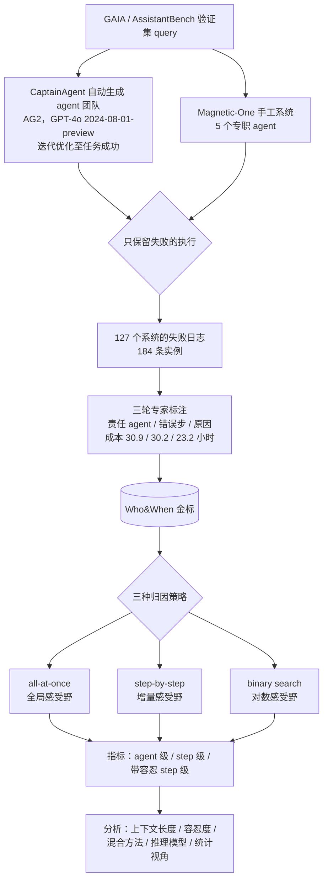

---
aliases:
  - "Which Agent Causes Task Failures and When? On Automated Failure Attribution of LLM Multi-Agent Systems"
  - "Zhang 2025"
created: 2026-11-17
---
# Which Agent Causes Task Failures and When? On Automated Failure Attribution of LLM Multi-Agent Systems

> 这篇论文做的事情可以一句话概括：**把「多智能体系统为什么失败」从人工看日志变成一个有金标、有指标、有 baseline 的自动任务**。作者先把「决定性错误」用反事实干预严格定义——如果修正 agent $i$ 在第 $t$ 步的动作能让整条轨迹从失败翻成成功，那么 $(i,t)$ 就是决定性错误；若存在多个，取时间最早的那个。围绕这个定义，他们构造了 **Who&When** 数据集：来自 127 个 LLM 多智能体系统（126 个由 CaptainAgent 自动生成 + 1 个手工打造的 Magnetic-One）的失败日志，覆盖 GAIA 与 AssistantBench 两个真实任务集，共 184 条带标注的失败实例，每条都标出「责任 agent + 决定性错误步 + 自然语言原因」。然后他们把 LLM-as-a-judge 的思路搬过来，提出并对比三种归因方法：**all-at-once**（一次看完整个日志）、**step-by-step**（逐步推进，发现错误即停）、**binary search**（不断二分缩小错误所在区间）。结论是一个相当悲观的二分格局：**agent 级最好 53.5%，step 级最好 14.2%**，all-at-once 的 step 级准确率甚至低于随机猜；而 agent 级与 step 级的最优方法恰好相反——要看全局才认得出「谁」，要逐段看才找得准「哪一步」。连 OpenAI o1 与 DeepSeek R1 也没能把这件事做到可用。

## 一句话定位

这篇论文开辟了一个新研究问题（automated failure attribution），并给出了它的「定义 + 第一个基准 + 三个 baseline + 一条负面结论」：在多智能体系统里定位「哪个 agent 的哪一步导致了失败」，用 GPT-4o 级别的模型当前只能做到 agent 级约 53%、step 级约 14%，任务远未可用（[表 1](papers/模型评测/2505.00212/2505.00212.pdf#table=1)）。

## 问题与动机

### 动机：多智能体系统的开发循环卡在「人工归因」这一步

论文开篇描述了一个所有做 agent 系统的人都熟悉的循环：构造系统 → 在基准上评测 → **人工做失败归因** → 改系统 → 再评测，如此往复直到达标（[§1](papers/模型评测/2505.00212/2505.00212.pdf#1)）。这个循环里，前三步都已经有工具化方案（AutoGen、CAMEL、MetaGPT 之类的框架负责构造，GAIA、AssistantBench 之类的基准负责评测），唯独「失败归因」还停留在人肉阶段——要读复杂的历史日志，要理解系统内部的技术细节，还要有领域专长才能把「基准分数不行」映射到「具体哪个组件要改」。

随着系统变复杂，这件事只会更难：组件数量增长，需要考虑的候选责任方随之增长。论文因此把问题提到「评测与归因应当紧耦合」的原则上，引用了 Scriven 那句被反复引用的话——**评测不是目的，而是改进的手段**。如果评测结果无法转化成「改哪里」的信息，那么再细的指标也只是参考点。

### 前人方案的局限：更细的 benchmark 并不能替代归因

论文对既有努力的评价很直接：过去提高归因效率的办法是**做更细粒度的基准**（例如 DevAI 在 SWE-Bench 只报最终解决率的基础上加了多种交付要求），希望「更多指标 = 更快的归因」。但这只是提供了更多参考点，没有触及根本问题（[§1](papers/模型评测/2505.00212/2505.00212.pdf#1)）。用一个更尖锐的问法就是：即使你有 20 个指标，**「系统的哪个组件需要改进」这个问题依然没有被回答**。

### 为什么这个问题技术上很难（这是本文最重要的动机论证）

论文在数据集分析一节把难处讲得非常具体（[§3.3](papers/模型评测/2505.00212/2505.00212.pdf#3.3)），值得逐条列出，因为这三条难度正是后面所有实验结果的解释来源：

1. **错误不等于失败。** 一条轨迹里可能有多个错误，但只有一部分真正导致整体失败。有些错误会被后续 agent 兜住（比如 WebSurfer 抓错了页面，但 Orchestrator 又让它重试），有些则一步错步步错。归因要找的是**决定性**的那一个，这需要一个反事实判断，而不是「找一个看起来不对的步骤」。
2. **责任可能分散在多个 agent 上。** 很多实例里不止一个 agent 犯错，人需要在这些错误里挑出「最严重、能直接导致失败」的那个。而「严重程度」有时是微妙的、甚至主观的——这就是为什么三位标注专家的不确定率高达 15%–30%。
3. **核实成本极高。** 论文给了一个很传神的例子：如果 agent 用浏览器搜集信息，标注员必须去查浏览器历史、逐个访问网站，才能判断失败到底是因为「网站上根本没有这个信息」还是「agent 没找到」。这意味着归因不是纯文本理解任务，而是需要**外部世界核验**的任务——这一点对「用 LLM 读日志自动归因」的可行性构成了根本性质疑。

### 形式化：什么叫「决定性错误」

为了把上面的直觉变成可标注、可评测的对象，论文给出了全文最核心的定义（[§2](papers/模型评测/2505.00212/2505.00212.pdf#2)）。先设定一个轮转式（turn-based）多智能体系统：

$$
\mathcal{M} = \langle \mathcal{N},\, S,\, A,\, P,\, \phi \rangle
$$

其中 $\mathcal{N}=\{1,\dots,N\}$ 是 agent 集合，$S$ 是状态集，$A$ 是全局动作集（agent $i$ 只能用子集 $A_i\subseteq A$），$\phi(t)$ 指出第 $t$ 步由哪个 agent 行动（轮转规则的载体），$P(s_{t+1}\mid s_t,a_t,\phi(t))$ 是状态转移。一条轨迹写成 $\tau=(s_0,a_0,s_1,a_1,\dots,s_T)$。

在这个记号下，一个「错误」被写成 agent-时间二元组 $(i,t)$：第 $t$ 步由 agent $i$ 行动，且它的动作 $a_t$ 是错的。关键在于**如何判定这个错误是不是决定性的**。论文用干预（intervention）来定义：把 $a_t$ 替换成一个「正确」的动作 $\tilde a_t$，第 $t$ 步之前保持不变，之后的动作相应调整以保证正确性，得到修改后的轨迹

$$
\tau^{(i,t)} = \mathcal{I}_{(i,t)}(\tau)
$$

于是决定性错误指示函数为

$$
\Delta_{i,t}(\tau) =
\begin{cases}
1, & \text{若 } Z(\tau)=1 \text{ 且 } Z\bigl(\tau^{(i,t)}\bigr)=0,\\
0, & \text{其他},
\end{cases}
$$

其中 $Z(\tau)=1$ 表示轨迹最终失败、$0$ 表示成功。用自然语言说就是：**只改这一步（以及为保持正确性而连带调整的后续步骤），整条轨迹就从失败翻成成功**——这一步才叫决定性错误。

一条轨迹里可能有多个决定性错误，论文的处理是取时间最早的那个，于是责任对为

$$
\mathcal{C}(\tau) = \{(i,t) \mid \Delta_{i,t}(\tau)=1\}, \qquad
(i^*,t^*) = \arg\min_{(i,t)\in\mathcal{C}(\tau)} t
$$

$i^*$ 叫 failure-responsible agent（谁），$t^*$ 叫 decisive error step（何时）。**「取最早」这一条约定非常重要**，它决定了标注口径，也决定了后续 step-by-step 方法（天然偏向早停）在指标上是否占便宜：如果一个实例里有多个等价的决定性错误，而金标只认最早那个，那么任何「先找到就返回」的策略都会系统性地向早期步骤偏移——这一点在后面 step-by-step 的表现里会看到痕迹。

### 为什么值得单独立一个研究领域

作者的论证是「替代人工」而非「辅助人工」：他们要的是一个**无需人类介入**就能指出责任组件的方法，从而把人从「耗时的诊断工作」转移到「改进系统功能」上（[§1](papers/模型评测/2505.00212/2505.00212.pdf#1)）。这个定位使本文的贡献不止是一个数据集，而是一个可被后人攻打的**任务定义**：有形式化的金标、有明确的输入输出、有随机基线、有可复现的评测脚本。

## 方法与机制（核心）

### 总览

本文的机制可以拆成三段式流水线：**造系统 → 标注 → 三种归因策略的对照实验**（[图 1](papers/模型评测/2505.00212/2505.00212.pdf#figure=1)）。

第一段是造系统，目标是「攒出足够多、足够真实的失败日志」。做法有两条腿：一条是自动化——用 AG2 库里的 CaptainAgent 算法，对 GAIA 与 AssistantBench 验证集里的每个 query 现场生成一支 agent 团队（自动分配 agent 名字、系统提示、所需工具），并迭代优化配置直到任务成功；然后**只保留那些最终仍然失败的系统的最终配置与执行历史**。另一条是手工——把 Microsoft 的 Magnetic-One（5 个专职 agent 组成的通用系统）跑在 AssistantBench 全量验证集与 GAIA 随机 30 条上，收集它的失败日志。两条腿合起来是 127 个系统、184 条带标注的失败实例（[§3.1](papers/模型评测/2505.00212/2505.00212.pdf#3.1)）。

第二段是标注，目标是产出「决定性错误」的金标。三位 AI agent 领域的专家按标准化指南做三轮：第一轮均分日志、各自标出「责任 agent + 错误步 + 自然语言原因」并把每条标注分成「确信」与「不确定」两堆；第二轮只针对不确定项做**共识讨论**（明确声明不用多数票，要说服到所有人同意）；第三轮交叉验证，每人再审另一人的标注，发现标准不一致就讨论、必要时重标（[§3.2](papers/模型评测/2505.00212/2505.00212.pdf#3.2)）。

第三段是归因实验，把 LLM-as-a-judge 的思路套到「读日志找错」上，设计三种**感受野不同**的策略：all-at-once（一次给全部日志）、step-by-step（逐步增量给，一旦判定当前步有错就停并返回）、binary search（每次只问「错误在上半段还是下半段」，二分到单步）。三者在 agent 级与 step 级两个指标上呈现**完全相反的排序**，这个反差是全文最核心的实证发现。

### 模块一：算法生成的系统（数据量从哪里来）

自动生成这一支解决的是「样本量」问题——手工造 100 个多智能体系统不现实。CaptainAgent 的用法是：对每个 query 生成一支与任务匹配的团队，赋予 agent 名字、提示与工具，**并迭代优化配置直到任务被成功解决**；数据集只取「最终多智能体配置 + 对应执行历史」，因为这才是每个 query 的优化解。这里有一个容易被忽略的设计后果：因为系统是「为这个 query 定制并调优过」的，所以剩下的失败不是「配置太差」，而是**在已经尽力优化之后仍然失败**——这让失败日志的难度显著高于随机系统。

所有 agent 与 CaptainAgent 本身都基于 `GPT-4o` 的 `2024-08-01-preview` 版本。超参上，CaptainAgent 的最大迭代轮数被限制为 10，这是算法生成系统日志长度上限只有 10 步的直接原因（[附录 D](papers/模型评测/2505.00212/2505.00212.pdf#D)、[附录 E](papers/模型评测/2505.00212/2505.00212.pdf#E)）。**这个 10 步上限后来变成了一个必须反复声明的实验约束**：凡是涉及「随长度变化」和「带容忍度」的分析，算法生成系统都被排除，否则容忍度一放宽，准确率就会被步数太少这一点人为抬高。

### 模块二：手工系统（保证「真实成熟系统」的覆盖）

只有自动生成的系统会有一个偏差：它们都是同一个算法造出来的，可能共享同一种失败风格。为此论文加入 Magnetic-One 作为「成熟、精修过的通用系统」的代表。它由 5 个精心设计的 agent 组成，各自负责不同能力（操作浏览器、浏览本地文件等）。评测范围是 AssistantBench 全量验证集 + GAIA 随机 30 条；GAIA 其余部分被排除，理由写得很坦白：**Magnetic-One 产生的长上下文日志标注起来太复杂**（[§3.1](papers/模型评测/2505.00212/2505.00212.pdf#3.1)）。Magnetic-One 允许最多 30 轮，agent 的思考过程不计入轮数，因此日志长度能到 130 步。

### 模块三：数据规模与形态（184 这个数字怎么来的）

| 类别 | GAIA | AssistantBench | 说明 |
|---|---|---|---|
| 算法生成 | 98 | 28 | 合计 126 个系统，即 126 条失败实例 |
| 手工打造 | 30 | 28 | Magnetic-One，合计 58 条 |
| 总计 | 128 | 56 | **184 条失败归因实例** |

| 统计项 | 算法生成 GAIA | 算法生成 AB | 手工 GAIA | 手工 AB |
|---|---|---|---|---|
| agent 数（最大 / 最小） | 4 / 1 | 4 / 3 | 5 / 1 | 4 / 2 |
| 日志长度（最大 / 最小） | 10 / 5 | 10 / 6 | 130 / 5 | 129 / 8 |

（数字取自 [附录 C](papers/模型评测/2505.00212/2505.00212.pdf#C) 的数据集详情表。）注意「126 个系统」并不等于「126 种架构」：算法生成部分的系统是**逐 query 定制**的，所以系统数与实例数一一对应；而手工部分只有 Magnetic-One 一个系统，58 条实例共享同一套 agent 结构。这造成了一个方法学后果：手工子集上的「agent 级」任务实际上退化成了「五选一」的分类题，随机基线因此只有 12.00%，而算法生成子集因为每个实例的 agent 集合不同，随机基线是 29.10%（[表 1](papers/模型评测/2505.00212/2505.00212.pdf#table=1)）。

每条实例包含四个字段（[§3](papers/模型评测/2505.00212/2505.00212.pdf#3)）：**(1) Query**（来自 GAIA 或 AssistantBench 的真实问题）；**(2) Failure log**（某系统失败的完整对话日志）；**(3) Agentic system information**（对算法生成系统，包含该系统专属的系统提示、工具、agent 名）；**(4) Annotations**（责任 agent、错误步、自然语言原因）。

### 模块四：标注规范（本文最需要被复现的部分）

**标注对象有三个要素**：唯一一个对失败负主要责任的 agent、该错误发生的具体步、以及用自然语言写下的出错原因（[§3.2](papers/模型评测/2505.00212/2505.00212.pdf#3.2)）。三者缺一不可：只标 agent 无法指导改进，只标步无法定位组件，没有原因则人类无法据此修改 prompt 或工具。

**三轮流程的设计意图值得细看**，因为它针对的正是「主观性」这个死穴：

- 第一轮的价值在于**分区标注 + 置信度二分**。均分日志避免了「一个人标完所有实例导致标准漂移」；要求标注者自己声明「确信 / 不确定」，把主观性显式化，而不是让它隐藏在一致性数字里。
- 第二轮的价值在于**共识而非多数票**。论文特意写明「我们不只是遵循多数决原则，而是确保每个人都被说服、最终达成共识」。这句话对应的是归因任务的一个特性：多数票会在「两个人都觉得是 A、一个人觉得是 B」时直接压掉 B，但 B 可能恰恰是对的——因为归因依赖对系统行为的深度理解，而不是常识投票。
- 第三轮的价值在于**标准对齐**。交叉验证不是重新标一遍求平均，而是让每个人去审别人的标注，检查「标准是否一致」；不一致就回到指南重标。

**成本与分歧的量化**（[图 2](papers/模型评测/2505.00212/2505.00212.pdf#figure=2)）给出三个很有说服力的数字：三位标注者分别花了 **30.9、30.2、23.2 个人工时**；第二轮中不确定标注占比在 **15%–30%** 之间；互相投票时仍存在分歧（论文以「初始分歧率」呈现，并说明分歧都经由讨论与投票达成共识）。这三个数字共同支撑了本文的立论：**人工归因既贵又不一致**，所以才值得自动化。

### 模块五：三个指标与随机基线

三个指标层层加严（[§3](papers/模型评测/2505.00212/2505.00212.pdf#3)）：

1. **Agent-Level Accuracy**：预测的责任 agent 是否等于金标 agent。这是「谁」的问题，也是最低要求，因为 agent 是多智能体系统的基本单元。
2. **Step-Level Accuracy**：预测的决定性错误步是否精确等于金标步。这要求模型不仅认出「谁错了」，还要在长日志里定位到具体那一步，难度显著更高。
3. **Step-Level Accuracy with Tolerance**：允许预测步落在金标步的 $\pm k$ 范围内即算正确。这个指标的动机很实际——在实践中往往不需要精确到某一步，给一个「可能出错的区间」就够人去查了。

随机基线的处理需要留意：论文按两个子集分别给出（算法生成 agent 级 29.10%、step 级 19.06%；手工 agent 级 12.00%、step 级 4.16%），但**没有说明基线的具体生成方式**（例如是均匀随机猜 agent 名称，还是按 agent 出现频率加权）。从数值反推，手工子集 12.00% 对应约 8.3 个等概率选项，而 Magnetic-One 只有 5 个 agent，因此基线很可能是按 agent 在日志中的出现分布加权得到的——但这只是推测，论文未明确说明（Not explicitly specified in text）。这一点很重要，因为后面「all-at-once 的 step 级低于随机」这个结论的强度，取决于基线是怎么算的。

### 模块六：三种归因方法（感受野的三种取值）

这是本文的方法核心，三种方法本质上是**同一个 LLM 判定器在不同感受野下的三次实例化**（[§4.1](papers/模型评测/2505.00212/2505.00212.pdf#4.1)、[附录 A](papers/模型评测/2505.00212/2505.00212.pdf#A)）。

**（1）all-at-once：一次看全。** 输入是 query + 完整失败日志，输出责任 agent 与错误步。感受野 $=n$（全部 $n$ 条日志），推理次数 $=1$。

**（2）step-by-step：逐步推进。** 输入是 query + 前 $i$ 条日志，问「最新这一步是否包含会妨碍问题解决的错误」；若判定有错，立即终止并返回当前步号与该步的执行 agent。感受野 $=i$（随步数增长），推理次数最多 $=n$。

**（3）binary search：二分收敛。** 先给完整日志，问「错误更可能在上半段还是下半段」；然后把选中那一半作为新日志重复，直到区间缩到单步。感受野 $=\lceil n/2^{k}\rceil$（对数收缩），推理次数 $=\lceil\log_2 n\rceil$。

三者的伪代码在附录里给出了明确写法。step-by-step 的关键行是「若 LLM 指出第 $i$ 步有错 → $s^*\leftarrow i$，并在 $l_i$ 中识别责任 agent，返回」；binary search 的关键行是当 LLM 指出错误在 $L'=\{l_{low},\dots,l_{mid}\}$ 中时令 $high\leftarrow mid$，否则 $low\leftarrow mid+1$，循环结束时 $s^*\leftarrow low$。

**prompt 设计上有三处细节，直接决定了后面的成败格局**（[附录 F](papers/模型评测/2505.00212/2505.00212.pdf#F)）：

- all-at-once 的 prompt 明确要求输出三样东西：agent 名、步号、原因，并且用了一个**步号计数约定的例子**（`{"agent a": "xx", "agent b": "xxxx", ...}`，若错误在 agent c 的发言则步号是 2）来消除歧义。更关键的一句是：「如果没有 agent 犯了明显错误，就在心里决定一个 agent」——**这是一条强制选择指令**，它保证了模型永远会给出答案，但也意味着模型在「其实找不到错」时会被逼着编一个，这对 step 级准确率是致命的。
- step-by-step 的 prompt 末尾有一句「注意：请在评估时避免过于苛刻」（Please avoid being overly critical）。这条指令的作用是把判定阈值往「宽松」推，减少早停误判——但它同时也可能让真正的错误被放过，导致一直跑到最后一步都没报错。
- binary search 的 prompt 只问「上半段还是下半段」，并明确要求「不要输出任何其他内容」。**它被刻意设计成纯分类任务，不带推理链**——这也是后面「推理 prompt 消融」实验把 binary search 排除在外的原因。

### 模块七：两种评测场景与模型设置

**场景**（[§4.2](papers/模型评测/2505.00212/2505.00212.pdf#4.2)）：(1) **With Ground Truth**——把 query 的最终答案也给判定模型，模拟「开发阶段有开发集金标」的常见情形；(2) **Without Ground Truth**——不给答案，只给日志，模拟「只有运行日志」的线上情形。后者的能力也被作者类比为一种 self-reflection（Reflexion 一类工作的视角），即系统能否靠自己的日志发现问题。注意论文有一句容易漏读的约定：**除非特别说明，全文报告的结果是这两种场景的平均**——所以读表时要清楚每个数字都是两栏平均后的产物。

**模型**：主实验用 GPT-4o；为验证结论稳健性，又跑了开源（Llama、Qwen 系列）与闭源（GPT 系列）多个模型，但因为算力与 token 成本，**多模型实验只在实例更少的手工系统子集上做**。此外单独测了两个强推理模型 OpenAI o1 与 DeepSeek R1。

### 模块八：成本模型（为什么「便宜的方案」很重要）

附录 D 给出了三种方法的输入 token 成本闭式表达，这是理解后面「混合方法」取舍的基础。设 $C$ 为 query 与指令的成本，$n$ 为日志条数，每条日志平均 $T_l$ 个 token，$i^*$ 为真实的决定性错误步：

$$
\mathrm{Cost}_{\text{all-at-once}} = C + n\cdot T_l
$$

$$
\mathrm{Cost}_{\text{step-by-step}} = \sum_{i=1}^{i^*}\bigl(C + i\cdot T_l\bigr) = i^*\cdot C + T_l\cdot\frac{i^*(i^*+1)}{2}
$$

$$
\mathrm{Cost}_{\text{binary search}} = \sum_{i=1}^{\lceil\log_2 n\rceil}\Bigl(C + \frac{n\cdot T_l}{2^{i-1}}\Bigr) = \lceil\log_2 n\rceil\cdot C + \sum_{i=1}^{\lceil\log_2 n\rceil}\frac{n\cdot T_l}{2^{i-1}}
$$

三个式子的意义很清楚：all-at-once 是**线性一次付清**，最便宜；step-by-step 是**二次增长**（每步都要重发一遍前文），最贵且随错误位置恶化（最坏情况 $i^*=n$）；binary search 是**对数次乘以衰减的上下文**，介于两者之间。这套成本模型在 [表 4](papers/模型评测/2505.00212/2505.00212.pdf#table=4) 里得到了实测印证：all-at-once 用 17,106 token，step-by-step 用 87,720 token，binary search 用 34,659 token。

## 实验与对比

### 设置

主实验在 Who&When 全量 184 条实例上跑三种方法，判定模型为 GPT-4o，报告 with/without ground truth 两栏以及两个子集（算法生成 / 手工打造）的结果（[表 1](papers/模型评测/2505.00212/2505.00212.pdf#table=1)）。随机基线按子集分别给出，作为「这些方法到底有没有用」的参照。

### 主结果：agent 级与 step 级的最优方法完全相反

| 方法 | 带金标 agent 级（算法/手工） | 带金标 step 级（算法/手工） | 无金标 agent 级 | 无金标 step 级 |
|---|---|---|---|---|
| Random | 29.10 / 12.00 | 19.06 / 4.16 | 29.10 / 12.00 | 19.06 / 4.16 |
| **All-at-Once** | **54.33 / 55.17** | 12.50 / 5.26 | **51.12 / 53.44** | 13.53 / 3.51 |
| **Step-by-Step** | 35.20 / 34.48 | **25.51 / 7.02** | 26.02 / 32.75 | 15.31 / **8.77** |
| **Binary Search** | 44.13 / 51.72 | 23.98 / 6.90 | 30.11 / 36.21 | **16.59** / 6.90 |

四条量化结论：

1. **「谁」要看全局。** all-at-once 的 agent 级准确率在带金标时比 step-by-step 高 19.13（算法生成）与 20.69（手工）个点；无金标时高 25.10 与 20.69 个点。排序稳定为 all-at-once > binary search > step-by-step。
2. **「哪一步」要逐段看。** step-level 上排序完全反转：step-by-step 在 4 个格子里的 3 个最好（25.51、15.31、8.77），binary search 居中，all-at-once 最差。
3. **all-at-once 的 step 级低于随机。** 四个格子平均为 $(12.50+5.26+13.53+3.51)/4=8.70$，而随机基线平均为 $(19.06+4.16)/2=11.61$。作者据此直接判定该方法在 step 级上「实践上不可行」。
4. **金标普遍有用。** 三种方法在所有指标、所有子集上，带金标都比不带金标好，没有例外。

注意摘要里的两个数字（53.5% 与 14.2%）需要正确解读：它们不是同一个方法的成绩。53.5% 是 all-at-once 的 agent 级四格平均 $(54.33+55.17+51.12+53.44)/4=53.52$，14.2% 是 step-by-step 的 step 级四格平均 $(25.51+7.02+15.31+8.77)/4=14.15$。也就是说「最好成绩」是按指标分别取不同方法得到的，论文正文对此有说明（[§4.3](papers/模型评测/2505.00212/2505.00212.pdf#4.3)），但摘要的写法容易让人误读成单一方法。

### 上下文长度：越长越差，且 step 级更脆弱

把手工系统的日志按长度分成 5 档：Level 1 为 5–17 步，Level 2 为 19–29，Level 3 为 31–49，Level 4 为 51–91，Level 5 为 93–130（[§4.4](papers/模型评测/2505.00212/2505.00212.pdf#4.4)、[图 4](papers/模型评测/2505.00212/2505.00212.pdf#figure=4)）。三条现象：三种方法在两个指标上都随长度下降；step 级比 agent 级对长度更敏感；step-by-step 的下降尤其陡。到了最长一档，三种方法全部收敛到接近 0%。作者用「大海捞针」（space-in-the-needle）解释这一格局：LLM 难以从长上下文里检索特定信息，因此**信息给得越全，反而越定位不准**。

### 容忍度：放宽一步，胜负易手

| 容忍度 | All-at-Once | Step-by-Step | Binary Search |
|---|---|---|---|
| $\pm 1$ | 12.07 | **14.66** | 13.79 |
| $\pm 2$ | **19.83** | 16.38 | 18.97 |
| $\pm 3$ | **30.17** | 18.10 | 22.41 |
| $\pm 4$ | **37.07** | 31.90 | 31.89 |
| $\pm 5$ | **43.10** | 33.62 | 36.21 |

（[表 2](papers/模型评测/2505.00212/2505.00212.pdf#table=2)，仅手工系统，因算法生成系统最长仅 10 步，放宽容忍度会人为抬分。）容忍度为 0 或 $\pm1$ 时 step-by-step 最好；从 $\pm2$ 起 all-at-once 反超，且优势随容忍度扩大（$\pm5$ 时 43.10 vs 33.62）。这个交叉点非常有信息量：**all-at-once 并不是「找不到错误」，而是「找不准」**——它的预测经常落在真实错误步附近，但差了几步。这也解释了为什么它在严格 step 级上低于随机而在宽容忍下反超。

### 混合方法：用 all-at-once 缩小搜索范围

既然 all-at-once 擅长认「谁」、step-by-step 擅长找「哪一步」，最自然的想法是串联：先让 all-at-once 定出责任 agent，再用 step-by-step **只在该 agent 的行动步上**逐步检测（[§4.7](papers/模型评测/2505.00212/2505.00212.pdf#4.7)）。

| 方法 | Token 数 | Agent 级 | Step 级 |
|---|---|---|---|
| Binary Search | 34,659 | 43.97 | 6.90 |
| All-at-Once | **17,106** | **57.02** | 4.39 |
| Step-by-Step | 87,720 | 35.96 | 7.90 |
| Hybrid（all-at-once + step-by-step） | 149,177 | **57.02** | **12.28** |

混合方法在两个指标上都不低于任一单方法（agent 级与 all-at-once 持平，因为第一步就是它），step 级从 7.90 提到 12.28，提升 4.38 个点。代价是 token 涨到 149,177，约为 all-at-once 的 8.7 倍。这个实验的机制解释很干净：**all-at-once 排除了其他 agent 的行动步，把 step-by-step 的候选集从 $n$ 缩到该 agent 自己的步数**，搜索难度显著下降。

### 推理模型：更强的基础模型没有救回这件事

| 模型 | All-at-Once agent / step | Step-by-Step agent / step |
|---|---|---|
| GPT-4o | 54.31 / 4.39 | 33.62 / 7.90 |
| OpenAI o1 | 41.38 / 10.34 | 36.21 / 13.79 |
| DeepSeek R1 | **56.90** / 3.45 | 32.76 / 6.90 |

（[表 3](papers/模型评测/2505.00212/2505.00212.pdf#table=3)，仅手工系统；未含 binary search，因为它的 prompt 不含推理机制。）读法要注意：o1 在 step 级上确实比 GPT-4o 好（13.79 vs 7.90，10.34 vs 4.39），但它的 agent 级全线更差（41.38 < 54.31，36.21 略高于 33.62）；DeepSeek R1 在 agent 级上略胜（56.90），step 级更差（3.45 vs 4.39，6.90 vs 7.90）。作者的结论是「更强的推理模型不一定优于标准模型」，DeepSeek R1 在四个格子里有三个不如 GPT-4o。还有一个必须记录的执行细节：**原始 prompt 被 OpenAI 的内容策略判定为违反使用指南，因此对 o1 做了「保留原意的小幅修改」**；DeepSeek R1 则沿用原 prompt（[§4.8](papers/模型评测/2505.00212/2505.00212.pdf#4.8)）。这意味 o1 那一栏与其它栏并非完全同条件，跨模型比较需要留余地。

## 归因分析

本文没有「模块消融」式的表格，它的归因来自七条被单独框出的 Finding 与三组对照实验。逐条拆解如下。

**其一，agent 级性能归因于感受野大小，而不是模型能力。** 证据是三种方法用同一模型、同一 prompt 风格，唯一差别是「一次能看到多少日志」，结果 all-at-once 领先 19–25 个点。机制解释是：判断「谁该负责」需要比较多个 agent 的行为，只有全局视角才能做这种比较；step-by-step 在早期步骤做决定时信息不全，容易把「第一个看起来可疑的 agent」当成责任人（[§4.3](papers/模型评测/2505.00212/2505.00212.pdf#4.3)）。这条归因得到了跨模型验证：在 Llama、Qwen、GPT 各系列上排序一致（[图 3](papers/模型评测/2505.00212/2505.00212.pdf#figure=3)）。

**其二，step 级性能归因于「上下文是否被增量切分」，而不是「上下文有多长」。** 若只是长度问题，binary search 每次只看一半、应该比 all-at-once 好很多，但实际只从 12.50 提到 23.98，仍不如每次只看前缀的 step-by-step（25.51）。真正的差别在于**判定时的局部性**：step-by-step 问的是「当前这一步错了吗」这个二元问题，binary search 问的是「错误在这一半还是那一半」这个需要全局比较的问题。前者把定位任务转化成了逐点分类，后者仍然是检索任务。

**其三，「推理模型无效、推理 prompt 有效」这组反差是全文最强的归因证据。** 把 all-at-once 与 step-by-step 的 prompt 里「要求说明理由」的部分删掉后，性能显著下降：算法生成系统上 all-at-once 的 agent 级掉 7.4 个点，step-by-step 的 step 级掉 4.4 个点（[附录 B](papers/模型评测/2505.00212/2505.00212.pdf#B)、[图 7](papers/模型评测/2505.00212/2505.00212.pdf#figure=7)）。而换成 o1 / R1 这样的强推理模型，收益反而不稳定。两者合起来指向一个结论：**受益于「被要求解释」这一输出结构，而非受益于模型的推理算力**。这是一个很有实践价值的洞察——在预算有限时，改 prompt 比换模型划算。

**其四，金标的作用可以归因于「方向性警示」。** 论文给出的机制是：如果某个 agent 把系统带向了完全错误的方向、根本没有可能到达正确答案，那么标签信息能直接提示判定模型这一点；没有标签时，整个系统可能在错误方向上一路走到底而没有任何外部警告（[§4.3](papers/模型评测/2505.00212/2505.00212.pdf#4.3)）。这也解释了为什么金标对 all-at-once 的 agent 级帮助最小（54.33→51.12 只掉 3.2，而 step-by-step 掉 9.2）——全局视角本身已经能看出方向偏离，金标的信息是冗余的；而增量视角缺的正是这种方向感。

**其五，混合方法的增益可归因于候选集缩减。** 12.28 与 7.90 的差距（+4.38）来自一个纯粹的搜索空间缩小：把 $n$ 步缩成「责任 agent 自己的步数」。这个归因的可检验推论是——责任 agent 的行动步占比越低，混合方法的相对收益应该越大。论文未做这一检验。

**其六，统计层面优于实例层面。** 在 Magnetic-One 的失败日志上汇总预测分布（agent 0=Assistant、1=FileSurfer、2=Orchestrator、3=WebSurfer）：三种方法预测的**第一大责任 agent 都是 agent 3，与金标一致**；前三方法里有两种方法的 top-2 也与金标一致（[图 6](papers/模型评测/2505.00212/2505.00212.pdf#figure=6)、Finding 6）。这条结果的含义很实际：单条实例上 14% 的 step 级准确率听起来毫无用处，但如果用来回答「这套系统里哪个角色最容易出错」，三种方法给出的答案都是对的。作者据此主张**统计层面的归因比实例层面更可操作**。

**关于位置偏差：原文提供了什么、没提供什么。** 论文**没有**专门的位置偏差分析章节（Not explicitly specified in text），但有三组间接证据值得放在一起看：

1. **金标定义本身带位置偏好。** 当一条轨迹存在多个决定性错误时，金标取**时间最早**的那个（[§2](papers/模型评测/2505.00212/2505.00212.pdf#2)）。这使「早期步骤」系统性地更可能是正确答案，任何偏向早停的策略（step-by-step 一旦发现错误就返回）都会因此受益。
2. **距离分布给的是「偏了多少」，不是「偏向哪边」。** [图 5](papers/模型评测/2505.00212/2505.00212.pdf#figure=5) 用箱线图给出人标步与预测步之间的距离分布（算法生成与手工系统各一幅），结论是 step-by-step 的距离分布最优；配合容忍度实验可以看出，all-at-once 的误差是**分散在两侧的**（放宽到 $\pm5$ 时反超，说明大量预测落在真实步附近而非远端）。
3. **step-by-step 的早停机制与「避免过于苛刻」的指令叠加，构成一个明确的偏差方向。** prompt 要求「别太苛刻」，算法要求「发现即停」，两者共同把预测往**更早**的位置推。这一点是我基于原文给出的算法与 prompt 文本所作的机制推断，论文未做定量验证。

综上，若要检验位置偏差，最直接的实验是画出「预测步号 − 金标步号」的带符号分布（而不是距离绝对值），并按方法分列。论文把这一步留空了。

## 局限与未来工作

论文**没有独立的 Limitations 章节**（Not explicitly specified in text），未来工作也只在结论里以一句话带过（「该领域亟需进一步研究」）。以下把「原文明确写到的事实性边界」与「原文的表述」分开列。

**原文明确写的：**

1. 三个 baseline 在实例级的表现都不足以实用：最好的 agent 级 53.5%、step 级 14.2%，部分方法的 step 级低于随机；即使是 o1 与 R1 也「远未达到可用性」（[摘要](papers/模型评测/2505.00212/2505.00212.pdf#page=1)、[§4.8](papers/模型评测/2505.00212/2505.00212.pdf#4.8)）。
2. 手工系统上的 step 级最好成绩只有 8.77%（[§1](papers/模型评测/2505.00212/2505.00212.pdf#1)），说明成熟精修系统的归因更难。
3. 三种方法各有明确优劣，且可单独或组合使用；组合虽好但成本最高（Finding 7、[表 4](papers/模型评测/2505.00212/2505.00212.pdf#table=4)）。
4. 归因性能随日志长度下降，最长一档三种方法几乎归零（Finding 4）。
5. 人工归因本身耗时且不确定：三位专家共约 84 人时，不确定率 15%–30%（[图 2](papers/模型评测/2505.00212/2505.00212.pdf#figure=2)）。

**原文事实层面的边界（据正文与附录整理）：**

- **数据规模小。** 184 条实例、127 个系统，其中 126 个算法生成系统的日志长度上限只有 10 步，这使一半的数据在「长日志定位」这个核心难点上几乎是空白。
- **手工子集只有一个系统。** 58 条实例全部来自 Magnetic-One，所以「手工系统」上的结论实际上是「Magnetic-One 上的结论」，agent 级任务退化为五选一。
- **任务来源只有两个基准**（GAIA、AssistantBench）的验证集，且都是「有唯一答案的问答型任务」，不覆盖编程、具身等其它多智能体场景。
- **多模型实验只在手工子集上做**，原因是算力与 token 成本；因此「结论跨模型一致」这一说法覆盖面有限。
- **o1 的 prompt 被修改过**（因 OpenAI 策略判定原 prompt 违规），o1 那一栏与其它模型不同条件。
- **binary search 被设计成无推理的分类任务**，因此不参与推理消融与推理模型对比；这既是设计选择，也让三方法对比在「是否带推理」这一维度上不完全对等。
- **算法生成系统的构造依赖 CaptainAgent 的默认设置**（最大 10 轮），Magnetic-One 用默认设置（最多 30 轮），思考过程不计入轮数。
- **金标的「取最早」约定**使评测偏向早期步骤；论文未讨论这一约定对方法排序的影响。
- **with/without ground truth 两场景的平均值被作为默认报告口径**，这会让读者难以从单个数字看出模型对金标的依赖程度。

**未来工作的缺口（据上述边界推出，非原文表述）：** 更长的日志与更多样的系统（尤其多系统族的对比）、带符号的位置偏差分析、把「决定性」判定从「最早」改为「因果贡献排序」、以及把归因结果反馈到系统改进的闭环验证（论文只做了归因，没有做「按归因改系统后是否变好」的实验）。

## 与其他工作的关系

**与 LLM-as-a-Judge 主线的关系。** [[papers/模型评测/2306.05685/NOTES|LLM-as-a-Judge]] 用 LLM 替代人类做**偏好判定**，本文把同一个思路从「判优劣」推进到「判哪里错了」——任务从排序变成定位。这一步跨度的代价在结果里体现得很清楚：偏好判定的与人类一致率能到 80% 以上，而在长日志里定位错误步只有 14%。相关工作一节也明确把这条线接到 Reflexion（用 LLM 分析任务反馈指导纠错）与 Agent-as-a-Judge（DevAI）上，并指出它们的共同局限：**归因仍然是人工的，评测结果只是参考**。

**与「过程级」reward model 的关系。** Math-Shepherd、ProcessBench、Let's Verify Step by Step 一类工作同样在找「第一个出错的步骤」，但对象是**单个 LLM 的解题步骤**。本文的对象是多智能体系统的对话轮次，两者在形式上有相似之处（都是序列上的错误定位），差别在于：单模型解题的步骤有强因果链（前一步错了后一步必然受影响），而多智能体对话里错误可以被其它 agent 兜住，因此必须引入「决定性」这个反事实判据。这也是本文的形式化贡献所在。

**与 AgentRewardBench 的关系。** [[papers/模型评测/2504.08942/NOTES|AgentRewardBench]] 判的是**轨迹级**的成败（成不成功、有没有副作用、有没有循环），本文判的是**步级/agent 级**的责任归属。两者构成一条清晰的分工：前者回答「这条轨迹行不行」，后者回答「不行的话怪谁」。把两篇放在一起读，可以得到一个完整的评测栈——先用轨迹级裁判筛掉失败，再用归因方法定位失败原因。AgentRewardBench 的结论（side effect 维度 precision 只有 6%–14%）对本文也是一个警示：**步级的细粒度判断比轨迹级的粗粒度判断更难，本文 14% 的 step 级准确率与前者 7% 的 side-effect precision 处在同一个悲观区间**。

**与 TRAIL 的关系。** [[papers/模型评测/2505.08638/NOTES|TRAIL]] 做的是「trace 里的错误定位 + 错误分类法」，与本文最接近。差别有三：TRAIL 的标注单位是「错误条目 + 类别」（带 20 余类的分类法），本文的标注单位是「单一责任 agent + 单一步号」；TRAIL 的 trace 来自单 agent 的 web/GAIA 任务，本文来自多智能体协作；TRAIL 更强调「错误类型的分布」，本文更强调「谁负责」这个组织性问题。两篇的负面结论一致：当前 LLM 在细粒度错误定位上都远不可用。

**与 MAST 的关系。** [[papers/模型评测/2503.13657/NOTES|MAST]] 提供多智能体系统失败的**分类法**（把失败归入若干模式），本文提供**定位**（把失败归到某个 agent 的某一步）。两者是「分类」与「定位」的互补：MAST 告诉你「这是规格不清型失败」，本文告诉你「这是 Orchestrator 在第 7 步造成的」。一个自然的后续是把两者结合——先分类再定位，或用分类法约束定位的搜索空间。

**与错误传播类工作的关系。** [[papers/模型评测/2608.14588/NOTES|Hallucination Snowball]] 把多智能体流水线里的错误传播建模成状态转移，关注「错误如何被放大/衰减」。本文关注的是同一现象的**逆向问题**：既然错误会传播，那么「最早的那个决定性错误」就是最有干预价值的位置——本文的「取最早」约定正是这一直觉的形式化。两篇合起来构成一对：一个研究错误怎么传，一个研究错误从哪来。

**与 agent 评测方法论批判的关系。** [[papers/模型评测/2407.01502/NOTES|AI Agents That Matter]] 主张评测要服务于改进、要报成本；本文把成本显式建模成闭式公式（[附录 D](papers/模型评测/2505.00212/2505.00212.pdf#D)）并在混合方法一节把 token 成本与准确率并列报告，这是对「只报分数」这一陋习的直接回应。它也印证了那篇论文的一个判断：agent 评测的瓶颈往往不在模型能力，而在**评测信号本身的可用性**。
