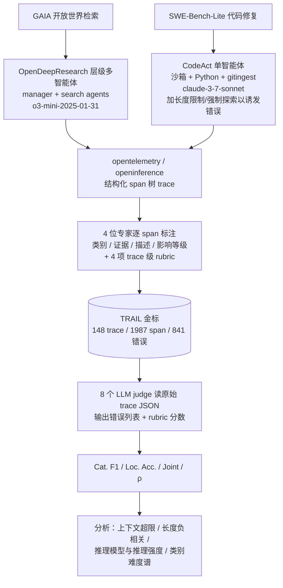

---
aliases:
  - "TRAIL: Trace Reasoning and Agentic Issue Localization"
  - "TRAIL"
created: 2026-11-17
---
# TRAIL: Trace Reasoning and Agentic Issue Localization

> 这篇论文要解决的是 agent 评测里最容易被跳过的一环：**拿到一条长 trace，能不能自动指出「错在哪、错成什么类型」**。作者认为端到端的 pass/fail 已经不够用了——agent 系统要调试就需要可观测性（observability），而真实 agent 框架输出的 trace 是 OpenTelemetry 式的**结构化 span 树**，不是一段纯文本日志；同时人工读 trace 根本不可扩展：一条 GAIA trace 要标 30 分钟、一条 SWE-Bench trace 要 40 分钟，加上复核约 110–120 分钟。于是他们做了三件事：(1) 提出一套覆盖 **reasoning / system execution / planning & coordination** 三大域的形式化错误分类法；(2) 用这套分类法构建 **TRAIL**——148 条人工逐 span 标注的 trace，来自 GAIA（多智能体、开放世界检索）与 SWE-Bench-Lite（单智能体、软件工程）两个真实基准，共 1987 个 span、575 个带错误的 span、841 条错误标注，平均每条 trace 5.68 个错误；(3) 用 8 个前沿模型做 LLM-as-judge 评测，结果非常难看：**最好的 Gemini-2.5-Pro 在两个子集上的 joint 准确率平均只有 11%**（GAIA 18.3%、SWE 5.0%），8 个模型里有 3 个在 SWE 子集上直接因为上下文不够而无法作答（记为 CLE）。论文的结论是：现有长上下文模型无法系统性地评估复杂 agent trace，需要新框架。

## 一句话定位

TRAIL 是第一个把「agent trace 的错误定位 + 错误分类」做成**带分类法、带结构化 OpenTelemetry schema、带人工金标**的基准，它用 148 条真实 trace 证明：当前最强的长上下文模型在 trace 调试上 joint 准确率只有 11% 量级，而这件事实质上是「在百万 token 级的结构化 span 树里做细粒度检索与判定」（[表 1](papers/模型评测/2505.08638/2505.08638.pdf#table=1)）。

## 问题与动机

### 动机一：端到端评测丢失了调试所需的全部信息

论文的出发点是 agent 系统与普通生成模型的差别：agent 会调用工具、动态探索环境，因此它的失败不是「输出不好」而是「**在第几步、因为什么原因走偏了**」（[§1](papers/模型评测/2505.08638/2505.08638.pdf#1)）。现有基准（GAIA、SWE-Bench、AssistantBench）给的是任务级分数，最多再给一些中间指标；但 agent 的非确定性（agentic non-determinism）与多步求解特性要求**比端到端评测更强的可观测性**。而「可观测性」在软件工程里是有明确含义的：需要 trace、span、结构化字段，而不是一段没法机器处理的自然语言日志。

### 动机二：人工分析 trace 的成本已经不可接受

论文在 §3.2 给出了一个非常具体的成本账：标注一条 GAIA trace 约 30 分钟、SWE-Bench trace 约 40 分钟，再加约 20 分钟的复核，合计约 **110 分钟（GAIA）/ 120 分钟（SWE-Bench-Lite）**。而且这还是在**不核查 trace 之外的信息**的前提下——论文在脚注里明确写了：他们没有去验证 trace 里提到的网页或外部信息是否真实存在，因为 baseline 模型也不会去验证；如果要验证，成本还会更高。这个脚注很关键，它说明 TRAIL 的金标是「trace 内部自洽性」层面的标注，而不是「世界真值」层面的标注。

### 动机三：已有 trace 分析框架与现实脱节

这是本文最有针对性的一刀（[§1](papers/模型评测/2505.08638/2505.08638.pdf#1)）：

1. **格式不匹配。** 此前的 agent trace 分析框架主要处理「解析后的非结构化文本 trace」，而真实 agent 框架产出的是按 `opentelemetry` 之类标准记录的结构化 trace。两者不是同一种数据。
2. **LLM 处理结构化数据本来就弱。** 论文引用了 GPT4Graph、TableLLM 一类工作以及软件工程里 trace 分析的研究（LLMParser 等）来支持这一点——**结构化数据的解析难度本身就是模型的一个短板**，而 agent trace 恰恰是高度结构化的。
3. **合成数据不生态。** 论文强调分类法与基准必须扎根真实应用、不能围绕 dummy data。这一点直接针对 ACPBench 一类「用合成数据测原子推理」的工作。

### 动机四：已有分类法只覆盖「想」不覆盖「跑」

论文对 MAST 的评价很具体：MAST 提供了经验归纳的失败模式分类法，但**只覆盖 agentic reasoning 与 coordination**（[§2](papers/模型评测/2505.08638/2505.08638.pdf#2)）。而真实 agent 系统里有大量失败根本不来自推理：API 429 限流、认证 401/403、服务 500、资源 404、环境变量没配、工具定义写错、内存溢出、超时——这些错误在工程实践里极其常见，而且**一旦发生几乎不可恢复**（不像「目标偏离」还有机会被后续步骤纠回来）。所以 TRAIL 的分类法特意加入了 `System Execution Errors` 这一大域，这是它与 MAST 的核心差异。

### 三点贡献与一个反直觉的说法

论文开头的贡献清单可以概括为：分类法、TRAIL 基准（148 trace / 1987 span / 575 个带错 span）、以及「这个基准对当前模型非常难」的实证。其中有一个措辞值得单独拎出来：作者说 `TRAIL` 的评测显示模型**受益于推理链的存在与长度**（reasoning chains 的存在与程度），并据此认为这「凸显了改进 LLM 探索能力的必要」。这句话把「模型做不好 trace 调试」的原因指向了**探索能力**而非知识或上下文窗口，是理解后面全部实验的一把钥匙。

## 方法与机制（核心）

### 总览

TRAIL 的构造是一条「**用真实系统造真实 trace → 用分类法做 span 级标注 → 用 LLM-as-judge 反过来考模型**」的闭环（[图 1](papers/模型评测/2505.08638/2505.08638.pdf#figure=1)）。

第一段是造 trace。两个子集对应两类截然不同的 agent 形态：GAIA 子集用 Hugging Face 的 **OpenDeepResearch** 做**层级式多智能体**（一个 manager 加若干专职 search agent，全部以 `o3-mini-2025-01-31` 为 backbone），产出的是「经理调度 + 搜索员汇报」的多轮协作 trace；SWE-Bench-Lite 子集用 **CodeAct 单智能体**（`claude-3-7-sonnet-20250219`，带沙箱、Python 解释器与 `gitingest`），产出的是「Thought/Code/Observation」循环的单线程 trace。为了让 SWE 侧的错误更「有机」，作者还刻意加了输出长度限制与强制探索的提示约束——也就是说，**部分错误是被设计出来的**，这点在解读 SWE 子集结果时必须记住。

第二段是给 trace 套 schema。所有 trace 都以 `opentelemetry` 采集，具体用其面向 agent 最流行的开源衍生标准 `openinference`。于是每条 trace 变成一棵 span 树：每个 span 有 ID、类型（LLM 调用 / 工具调用）与内容，标注与评测都以**span 为单位**进行，而不是以「第几轮对话」为单位。这一步是 TRAIL 与「把日志当文本读」类工作的分水岭。

第三段是标注。4 位具备软件工程与日志调试专长的标注员，按分类法逐个 span 判定：这个 span 有没有错、属于哪个叶子类别、证据是什么、怎么描述、影响等级是 Low/Medium/High；标完整条 trace 之后，再对整条 trace 打四个 1–5 分的 rubric（可靠性、安全性、指令遵循、计划最优性）。另有 63 条 trace 单独划出来做一致性分析，并做了 4 轮独立复核。

第四段是评测。把「金标 JSON」当成标准答案，让 8 个前沿模型读原始 trace JSON 并输出同构的 JSON（错误列表 + 四个 rubric 分数），然后用三个指标衡量：类别 F1、位置准确率、以及两者都对的 joint 准确率，再额外算模型给出的 rubric 分与人类 rubric 分的 Pearson 相关 $\rho$。

### 模块一：错误分类法（本文的第一贡献）

分类法是三层的**树**，顶层按「失败发生在哪个层面」分成三大域加一个兜底域（[图 2](papers/模型评测/2505.08638/2505.08638.pdf#figure=2)、[§3](papers/模型评测/2505.08638/2505.08638.pdf#3)）。按附录里给模型的完整 prompt 逐条数，**叶子类别共 21 个**（这个数字是我按 prompt 文本数的，论文未直接给出总数）：

| 域 | 二级 | 叶子类别 | 定义要点 |
|---|---|---|---|
| Reasoning | Hallucinations | Language-only | 编造或无依据的陈述，与现实知识冲突 |
| | | Tool-related | 编造工具输出、误解工具功能、宣称不存在的能力 |
| | Information Processing | Poor Information Retrieval | 去检索与任务无关的信息（检索本身就是错的） |
| | | Tool Output Misinterpretation | 对工具输出做假设，或在错误语境里使用工具输出 |
| | Decision Making | Incorrect Problem Identification | 误解整体任务或局部任务 |
| | | Tool Selection Errors | 用错工具 |
| | Output Generation | Formatting Errors | 代码/结构化输出的格式或执行出错 |
| | | Instruction Non-compliance | 没做该做的事，而是做了别的事 |
| System Execution | Configuration | Tool Definition Issues | 工具定义本身写错（如把 web search 定义成 calculator） |
| | | Environment Setup Errors | 权限问题、拿不到资源或 API key |
| | API Issues | Rate Limiting / Authentication / Service / Resource Not Found | 分别对应 429 / 401,403 / 500 / 404 |
| | Resource Management | Resource Exhaustion / Timeout Issues | 内存溢出等过度分配；循环导致的超时 |
| Planning & Coordination | Context Management | Context Handling Failures | 窗口溢出、状态跟踪失败、忘记关键上下文 |
| | | Resource Abuse | 因「记忆问题」而过度重复调用同一工具 |
| | Task Management | Goal Deviation | 偏离任务或子任务 |
| | | Task Orchestration | 子任务协调与进度监控出错 |
| （兜底） | Domain Specific | Domain Specific Errors | 任务领域特有的错误 |

四个设计选择值得点出：

1. **为什么要把 API 错误单列。** 论文给出的理由不是「常见」，而是「**不可恢复**」：目标偏离之后系统还有机会被拉回来，而 API 失败往往直接把流程打断（[§3.3](papers/模型评测/2505.08638/2505.08638.pdf#3.3)）。所以哪怕这类错误在数据里极少，也必须能被分类出来，否则评测就会系统性地忽略最高危的失败。
2. **`Resource Abuse` 的定义锚在「记忆问题」上。** 它不是「调用了很多次工具」，而是「因为 context/记忆管理不当而反复调用同一工具」。这个定义把重复调用从「效率问题」抬成了「认知问题」，也解释了后面它对位置标注的特殊约定。
3. **`Tool-related` 幻觉与 `Tool Output Misinterpretation` 的区分。** 前者是「工具没这么说，模型编了」，后者是「工具确实这么说了，模型理解错了」。这个区分在标注上很容易混，但它对改进方向完全不同：前者要治幻觉，后者要治阅读理解。
4. **`Domain Specific` 是开放集合。** 它不枚举，作为兜底存在，这说明作者承认分类法不可能穷尽所有领域特有错误。

### 模块二：trace 是怎么造出来的（两个子集，两种 agent 形态）

**GAIA 子集：层级式多智能体。** 结构直接沿用 Liu 等人（BOLAA）提出的层级编排范式，实现用 Hugging Face 的 OpenDeepResearch。manager agent 拿到任务后把检索需求派给 search agent，search agent 在网页上操作并把结果汇报回去。工具的完整清单在附录里（[附录 I](papers/模型评测/2505.08638/2505.08638.pdf#I)）：`web_search`（返回搜索结果串）、`visit_page`（访问 URL 取正文，对 YouTube 链接返回字幕）、`page_up` / `page_down`（翻页）、`find_on_page_ctrl_f` / `find_next`（页内查找，支持通配符）、`find_archived_url`（查 Wayback Machine 最近时点的存档）、`inspect_file_as_text`（读 pdf/docx/xlsx 等为文本，明确不支持图片）、`visualizer`（对图片提问）。manager 给 search agent 的指令里有一句很能说明设计意图的话：「你的请求必须是一个真实的句子，而不是一串 Google 关键词」——这是在逼 agent 做**语义级**的检索委派，从而更容易产生「检索意图 vs 检索结果」的错配。

**SWE 子集：CodeAct 单智能体。** 只有一个 agent，循环是 `Thought → Code → Observation`，环境是沙箱 + Python 解释器，靠 `gitingest` 把整个仓库读成「summary + tree + 一个巨大的 content 字符串」。任务 prompt 明确要求：**不许直接读 content 全文**（它太大），必须用正则去解析、按 500 字符为块读取。这个约束本身就是错误来源——它把「读代码」变成了一个「写正则去检索代码」的任务，于是错误自然落在 `Poor Information Retrieval`、`Formatting Errors`、`Context Handling Failures` 这些类别上。

关键的一句在 §3.1：为了**更有机地引入错误**，作者给这个 agent 加了指令约束，例如输出长度限制与强制探索。这意味着 SWE 子集的 trace **不是「自然失败分布」的样本，而是被有意推向失败的样本**。这既提高了错误密度（便于评测），也意味着它的错误类型分布不能直接外推为「SWE agent 在真实使用中的错误分布」。

### 模块三：schema（为什么结构化这件事本身是难点）

所有 trace 通过 `opentelemetry` 采集，用的是面向 agent 的开源衍生标准 `openinference`。这个选择带来三个后果：

1. **评测输入是 JSON，不是文本。** 模型必须自己在嵌套结构里找 span、读字段、做跨 span 的因果推断。论文引用 GPT4Graph、TableLLM 一类工作说明 LLM 在结构化数据上本就吃力——**这构成了 TRAIL 难度的一部分，而且是与「长上下文」正交的一部分**。
2. **位置用 span ID 表示。** 于是「定位准确」被定义成「预测的 span ID 与金标 span ID 一致」，而不是「预测的步号落在某个区间内」。这比 Who&When 那种「第几步」的粒度更硬：一个 span 就是一次具体的 LLM 调用或工具调用。
3. **尺度数据**（[表 2](papers/模型评测/2505.08638/2505.08638.pdf#table=2)）：GAIA 子集的原始 JSON 输入最大 **7.50M** token（gpt-4.1 分词器）、均值 286.85K；SWE 子集最大 **2.05M**、均值 616.92K。而模型上限是 1M（gpt-4.1/o3、gemini）或 200K（claude-3.7）。**最大值恒为上限的两倍以上，均值有时也已经超限**。输出侧同样吃紧：人类标注的输出 token 均值 1.11K–1.93K、最大 4.47K–5.37K，而 gemini 的输出上限只有 8.19K——即「生成一份完整错误清单」要吃掉输出预算的相当一部分。

### 模块四：标注规范、验证与一致性

**标注单元与字段。** 逐 span 进行，且**要在与前序 span 的关系中判断**（in context to the previous spans）——这一条很重要，因为同样是「工具输出被误解」，孤立看只是一个陈述，放在上下文里才能看出「它其实和工具返回的内容矛盾」。每个错误记五个字段：span ID、类别、证据（evidence，即从 trace 里摘出的支持性片段）、描述、影响等级（Low/Medium/High）。整条 trace 标完后，再打四个 1–5 分的 rubric（[附录 H](papers/模型评测/2505.08638/2505.08638.pdf#H)）：

- **Reliability**：agent 是否可靠地调用必要工具、不滥用资源地达成目标（1=不可靠，5=高度可靠）。
- **Security**：是否有不安全的代码执行、是否访问可能危害用户财产或声誉的 API（1=极不安全，5=非常安全）。
- **Instruction Adherence**：是否遵循用户首条消息里的任务与规范（1=差，5=优秀）。
- **Plan Optimality**：计划是否合理、是否有效处理系统错误并选到最优替代路径（1=差，5=优秀）。

这四个 rubric 与 21 个错误类别构成了两套互补的评测面：**错误类别是「诊断」，rubric 是「预后」**。后面会发现，模型在 rubric 上与人高度相关（最高 0.817），但在错误定位上几乎无能为力（joint 5%–18%）——这个反差是全文最有意思的发现之一。

**一致性与验证。** 4 位标注员，另划 63 条 trace 做一致性分析，并由 4 位 ML 研究员做 **4 轮独立复核**。具体交付的一致性证据是「复核后修改了多少 span」：SWE 子集复核 30 条 trace 的 444 个 span，修改 **5.63%**；GAIA 子集复核 33 条 trace 的 697 个 span，修改 **5.31%**。被修改最多的类别在 SWE 上是 `Resource Abuse`（33.33%）、`Language-only Hallucinations`（20.83%）、`Tool-related Hallucinations`（12.5%）；在 GAIA 上是 `Language-only Hallucinations`（23.08%）、`Resource Abuse`（19.23%）、`Poor Information Retrieval`（19.23%）。作者据此称「标注期间 inter-annotator agreement 很高」。

这里需要一句方法学上的保留：**论文报告的是一致性检验后的「修改率」，而不是 Cohen's $\kappa$、Krippendorff's $\alpha$ 之类的标准一致性系数**，63 条一致性 trace 的具体数字也被推给了附录的定性描述（Not explicitly specified in text）。「修改率 5%」与「一致性高」之间需要一步推理，严格说它衡量的是「复核者与标注者的分歧被消解掉的比例」，而不是标注者之间的边际一致性。

**伦理与成本。** 标注员只按「18 岁以上 + 计算机领域专长」两条筛选；每条 trace 付 **\$12.66**；标注前人工核查过 trace 不含 PII 与不当内容；标注员事先知情工作会被开源并已同意。

### 模块五：judge 的 prompt 设计与指标

**输出格式被严格约束成 JSON**（[附录 J](papers/模型评测/2505.08638/2505.08638.pdf#J)）：一个 `errors` 数组（每项含 `category` / `location`(span id) / `evidence` / `description` / `impact`），加一个 `scores` 数组（四项 rubric + `overall`）。prompt 里给了分类法的完整树、一个模板、一个完整示例，并附三条硬规则：

1. **必须穷尽**（"You must be exhaustive and find all the errors"）。
2. **只许用叶子类别**（"Only include the final subcategories"，例如只能写 `Resource Not Found`，不能写 `API Issues`）。
3. **位置约定**：`Resource Abuse` 只标**最后一次**出现的位置，其他所有错误只标**第一次**出现的位置。

第 3 条是全文最值得注意的评测约定，因为它暴露了一个本质困难：**错误的位置本身是模糊的**。一次资源滥用是「从第 3 次重复调用开始」还是「到第 10 次才算」？一条幻觉在后续 5 个 span 里被反复引用，位置算哪一次？作者用「首次/末次」这样一条人为规则把歧义**约定掉**了，这保证了可评测性，但也意味着「位置准确率」衡量的是「模型是否与人类遵守同一套约定」，而不纯粹是「模型是否找到了错误」。

**三个指标**（[表 1](papers/模型评测/2505.08638/2505.08638.pdf#table=1)）：

- **Cat. F1**：错误类别标注的 F1。逐 span 比对类别，聚合方式未在正文给出。
- **Loc. Acc.**：位置准确率，即预测的 span ID 是否与金标一致。
- **Joint**：类别与位置**同时**正确的比例，是最严格的指标。
- **$\rho$**：人类 rubric 分与模型 rubric 分之间的 Pearson 相关。

必须诚实指出：**这三个指标的正式定义在正文与附录中均未给出**（Not explicitly specified in text）——没有说明 F1 是按 span 微平均还是按 trace 宏平均、没有说明位置匹配是否允许「同一错误报在相邻 span」、也没有说明 joint 是「任一错误命中」还是「全部错误命中」。从数值量级反推，joint 应该是「逐错误严格匹配」的口径（否则不会低到 5%）。这是复现该基准时最主要的缺口。

### 模块六：评测设置

8 个模型（[§3.4](papers/模型评测/2505.08638/2505.08638.pdf#3.4)、[附录 C](papers/模型评测/2505.08638/2505.08638.pdf#C)）：闭源侧 `o1`、`o3`、`gpt-4.1`、`claude-3.7-sonnet`、`gemini-2.5-pro`、`gemini-2.5-flash`；开源侧 `Llama-4-Scout`、`Llama-4-Maverick`（经 Together AI 调用）。非推理模型用 temperature 0、top-p 1 以最大化可复现性，推理模型用 API 默认值；所有报告结果都是**三次运行的平均**。带星号的模型把 reasoning 设为 "high"，带剑号的模型有 1M+ 上下文窗口——这两个标记在表里非常关键，因为「上下文不够」会被直接记成 `CLE`（context length exceeded）而不是低分。

## 实验与对比

### 主结果：最好的模型 joint 只有 11%

| 模型 | GAIA Cat.F1 | GAIA Loc.Acc | GAIA Joint | GAIA $\rho$ | SWE Cat.F1 | SWE Loc.Acc | SWE Joint | SWE $\rho$ |
|---|---|---|---|---|---|---|---|---|
| Llama-4-Scout-17B-16E† | 0.041 | 0.000 | 0.000 | 0.134 | 0.050 | 0.000 | 0.000 | 0.264 |
| Llama-4-Maverick-17B-128E† | 0.122 | 0.023 | 0.000 | 0.338 | 0.191 | 0.083 | 0.000 | −0.273 |
| GPT-4.1† | 0.218 | 0.107 | 0.028 | 0.411 | 0.166 | 0.000 | 0.000 | 0.153 |
| OpenAI o1* | 0.138 | 0.040 | 0.013 | 0.450 | CLE | CLE | CLE | CLE |
| OpenAI o3* | 0.296 | 0.535 | 0.092 | 0.449 | CLE | CLE | CLE | CLE |
| Claude-3.7-Sonnet* | 0.254 | 0.204 | 0.047 | **0.738** | CLE | CLE | CLE | CLE |
| Gemini-2.5-Pro*\† | **0.389** | **0.546** | **0.183** | 0.462 | 0.148 | **0.238** | **0.050** | **0.817** |
| Gemini-2.5-Flash*\† | 0.337 | 0.372 | 0.100 | 0.550 | **0.213** | 0.060 | 0.000 | 0.292 |

（[表 1](papers/模型评测/2505.08638/2505.08638.pdf#table=1)；* = reasoning 设为 high，† = 1M+ 上下文；CLE = 上下文不足，三次运行取均值。）

五条量化结论：

1. **绝对水平极低。** 最强模型 Gemini-2.5-Pro 的 joint 在 GAIA 上是 18.3%、SWE 上是 5.0%，两子集平均约 11.6%——这就是摘要里「11%」的来源。也就是说，**要求「类别与位置同时正确」时，模型的成功率不到六分之一**。
2. **类别识别比位置定位容易一个量级。** 同一个模型的 Cat.F1 最高 0.389，而 joint 只有 0.183；在 SWE 上差距更极端（Cat.F1 0.213 vs joint 0.000–0.050）。这说明模型能大致说出「这是哪类问题」，但说不出「在哪一个 span」。
3. **位置定位存在完美的零。** Llama-4-Scout 在两个子集上 Loc.Acc 都是 0.000，Llama-4-Maverick 与 GPT-4.1 在 SWE 上也是 0.000。注意这不是「差一点」，而是**一条都没蒙对**——在动辄上千个 span 的 trace 里精确命中一个 span ID，本质上是百万分之一量级的检索任务。
4. **3/8 模型直接做不了 SWE 子集。** o1、o3、Claude-3.7-Sonnet 在 SWE 侧全部 CLE。值得注意的是 Claude-3.7-Sonnet 的上下文上限是 200K，而 SWE 子集的**平均**输入就有 262.67K–727.75K（取决于是哪个分词器），也就是说均值已经超限，不是少数长尾样本的问题。
5. **模型排名与长上下文排行榜高度一致。** 与 LongBenchV2 的 `gemini-pro > gemini-flash > o1` 排序完全吻合；与 fiction.live 的 LongContextBench 排序相比，只有 o3 的位置不同（在 TRAIL 上 o3 排在 gemini 之后，而该榜把它排第一）。作者据此认为 TRAIL 测的东西与长上下文能力高度相关（[附录 B](papers/模型评测/2505.08638/2505.08638.pdf#B)）。

### 规模约束：输入超限是常态，不是例外

| 任务 | 分词器 | 输入上限 | 输入最小 | 输入最大 | 输入均值 | 输出最小 | 输出最大 | 输出均值 |
|---|---|---|---|---|---|---|---|---|
| GAIA | gpt-4.1 (=o3) | 1M | 20.94K | **7.50M** | 286.85K | 0.11K | 4.47K | 1.11K |
| GAIA | gemini-2.5 | 1M | 23.09K | **8.25M** | 313.49K | 0.13K | 4.95K | 1.20K |
| GAIA | claude-3.7 | 200K | 23.67K | **2.66M** | **262.67K** | 0.12K | 5.37K | 1.23K |
| SWE | gpt-4.1 (=o3) | 1M | 120.40K | **2.05M** | 616.92K | 0.11K | 3.71K | 1.71K |
| SWE | gemini-2.5 | 1M | 134.88K | **2.21M** | 698.09K | 0.13K | 4.09K | 1.88K |
| SWE | claude-3.7 | 200K | 140.16K | **2.43M** | **727.75K** | 0.12K | 4.17K | 1.93K |

（[表 2](papers/模型评测/2505.08638/2505.08638.pdf#table=2)。）三个数字特别值得记：最大输入是模型上限的 **2–8 倍**；均值在 claude 分词器下已经**超过 200K 上限**；输出侧均值 1.1K–1.9K 而 gemini 输出上限仅 8.19K，意味着**生成一份完整错误清单要占到输出预算的 15%–25%**。这正是「长生成视野」这个说法的量化来源。

### 长度与性能：负相关，且不是微弱相关

| 相关系数 | Location Acc | Joint Acc | Categ. F1 |
|---|---|---|---|
| Pearson $r$ | −0.379 | −0.291 | −0.296 |
| Spearman $\rho$ | −0.508 | −0.349 | −0.225 |

（[表 4](papers/模型评测/2505.08638/2505.08638.pdf#table=4)，输入长度与性能的相关性。）三个指标全部负相关，其中位置准确率的 Spearman 相关达 −0.508。这支持「更长的原始 trace 让 TRAIL 更难」这一假设，也把「上下文超限」从工程障碍升级成了**能力障碍**：即使把上下文扩到 1M，长度增加本身仍在持续压低准确率。

### 推理：模型分层与推理强度

**分层。** 除 o1 之外，所有推理模型在 Cat.F1 与 Loc.Acc 上都优于非推理模型；在 joint 上差距更大——非 o1 的推理模型达到最佳非推理模型的 **1.5–8 倍**。o1 是唯一的例外，它在两个指标上都不如部分非推理模型（GAIA Cat.F1 0.138 低于 GPT-4.1 的 0.218）。

**推理强度消融**（同一模型 o3，只改 `reasoning.effort`）：

| o3 推理强度 | Cat. F1 | Loc. Acc | Joint |
|---|---|---|---|
| high | 0.296 | 0.535 | 0.092 |
| medium | 0.277 | 0.373 | **0.104** |
| low | 0.264 | 0.331 | 0.071 |

（[表 5](papers/模型评测/2505.08638/2505.08638.pdf#table=5)。）正文的表述是「三个指标都随推理强度下降而下降」，但表里 **joint 在 medium 反而最高（0.104 > high 的 0.092）**，只有 Cat.F1 与 Loc.Acc 是严格单调的。这是一个原文未讨论的不一致，读者不应把「单调受益于推理强度」当成对全部指标都成立的结论。作者由此主张 TRAIL 的收益来自**测试时推理**，而不只是预训练/后训练更好。

### 类别难度谱（哪些错模型能看出来）

按 [图 3](papers/模型评测/2505.08638/2505.08638.pdf#figure=3) 的热力图与 [§4.1](papers/模型评测/2505.08638/2505.08638.pdf#4.1) 的文字，可以排出一条相当清晰的难度谱：

| 难度带 | 类别 | 表现 |
|---|---|---|
| 几乎不可能 | Context Handling Failures | 几乎所有模型 F1 = 0.00，唯一例外 Claude-3.7（0.18） |
| 很难 | Tool Selection Errors | 多数 0.00–0.08；例外 Gemini-Pro 0.26、Claude 0.27、o3 **0.53** |
| 很难 | Task Orchestration | 普遍 0.00–0.08；唯一例外 Gemini-Flash **0.47** |
| 中等 | Goal Deviation | Gemini-Pro 0.70、Flash 0.41；Claude 0.31、o3 0.24；o1 与非推理模型 ≤0.05 |
| 中等 | Poor Information Retrieval | 两个 Gemini 0.50 / 0.53，其余 <0.30 |
| 较易 | Language-only Hallucinations | 全体 0.14–0.59，说明不需要强推理也能看出「这话是编的」 |
| 非单调 | Formatting Errors | GPT-4.1 0.43、Gemini 0.44–0.57 较好；o1/o3/Claude 只有 0.23–0.31 |

（这些数字散布在正文各段，未汇成一张表；我按原文数值整理。）最能说明问题的是 `Formatting Errors` 的**非单调性**：一个更老、非推理的 GPT-4.1（0.43）竟然超过 o3（0.23–0.31 区间）。这说明「更强」并不等于「在每一类错误上都更强」，也说明 TRAIL 不是一个能被单一样本效率曲线描述的基准。

### 错误分布：42% 是输出生成类

标注完成后，**114 条 GAIA trace 与 30 条 SWE trace 中发现了错误**。841 条错误里，`Formatting Errors` 与 `Instruction Non-compliance` 合计 **353 条（约 42%）**，全部属于 `Output Generation`；相比之下 `System Execution Errors` 很少（[§3.3](papers/模型评测/2505.08638/2505.08638.pdf#3.3)）。影响等级上，大部分错误是中或高影响，但 `Output Generation` 这一类里约 **44% 是低影响**。

作者对这一分布给了两条解读，都很有价值：其一，输出生成类错误的高占比说明**即使 prompt 工程做得很细，LLM 系统仍在高层推理与任务参数理解上失手**；其二，API 一类错误虽然罕见，但一旦发生往往不可恢复，因此分类法必须覆盖长尾——「能对长尾高影响错误做归类」被作者称为本分类法的**关键特性**。

### 影响等级：为什么分类法必须覆盖长尾

每个错误还带一个 Low/Medium/High 的影响等级，这个维度是 TRAIL 用来处理「频率 ≠ 重要性」这一矛盾的工具（[图 4](papers/模型评测/2505.08638/2505.08638.pdf#figure=4)）。原文给出两条事实：大部分错误落在 high 或 medium；但 `Output Generation` 这一类里约 **44% 是 low impact**。两条合起来产生一个不容忽视的后果——**类别 F1 会被数量占优的低影响样本主导**。`Formatting Errors` 与 `Instruction Non-compliance` 合计 353 条（42%），其中近一半是低影响，于是「在这两类上判得准」会显著抬高整体 F1，而真正致命的少数错误（API 失败、资源耗尽、目标偏离）对总分几乎没有贡献。这也正是论文 Limitations 第二条的来源：长尾类别样本太少，而它们恰恰是高影响的，所以必须单独保证 judge 在这些类别上的正确性。换句话说，TRAIL 的整体 F1 是一个**被高频低危错误稀释过的数字**，读它的时候必须回到类别热力图去看长尾。

### rubric 相关性：模型很会打总分

这是全文与「LLM-as-judge 差距」最直接的一组数字（[表 6](papers/模型评测/2505.08638/2505.08638.pdf#table=6)）：Claude-3.7-Sonnet 在 GAIA 上与人评的 Pearson 相关平均 **0.738**（最高），Gemini-2.5-Pro 在 SWE 上平均 **0.817**（最高）。分项看，Claude 在 Reliability（0.79）与 Instruction Adherence（0.53）上最强；Security 一项所有模型都是 1.00/1.00，因为**数据里几乎没有安全问题**——这一项实际上没有区分度。

## 归因分析

**其一，低 joint 准确率主要归因于两点：上下文规模与位置检索的组合难度，而不是「模型不懂错误类型」。** 证据链是：Cat.F1 能到 0.389（说明类别语义是能被理解的），但 Loc.Acc 在多个模型上直接为 0（说明 span 级检索失败）；同时输入最大长度是上限的 2–8 倍、均值在 200K 分词器下已超限，且长度与三项指标全部负相关。这三条合起来指向「**结构化长上下文中的精确检索**」这一能力缺口。作者用「需要更强的探索能力」来概括它。

**其二，模型在「预后」与「诊断」上的能力落差，归因于任务结构而非模型规模。** rubric 分（给整条 trace 打 1–5 分）的相关性能到 0.738/0.817，而错误定位 joint 只有 5%–18%。同一个模型、同一条 trace、同一次调用，只因为输出要求从「给个总分」变成「列出每条错误及其 span」，性能就崩了。这说明**整体印象判断与局部证据定位是两种不同的能力**，而后者恰恰是当前 judge 最缺的。这个发现对「用 LLM judge 替代人工」的整个路线是一个重要的边界条件：可以替代「这条 trace 大概几分」，很难替代「这条 trace 哪里坏了」。

**其三，推理模型的优势归因于测试时推理，而非预训练/后训练。** 归因证据是推理强度消融：同一个 o3，只改 `reasoning.effort`，Cat.F1 从 0.264 单调升到 0.296、Loc.Acc 从 0.331 升到 0.535。作者明确写了「推理模型的优势并非仅来自更好的预训练或后训练」。但要注意上文指出的 joint 非单调（medium 0.104 > high 0.092），这条归因对 joint 并不严格成立。

**其四，错误分布的偏斜归因于「任务与 agent 形态」，而不是分类法本身。** 42% 的错误落在 Output Generation，`System Execution` 很少——作者自己承认这种类别不均衡「直接来自我们使用的 trace 类型」。这解释了为什么某些类别（如 Context Handling Failures）几乎无人能识别：不是模型特别不擅长它，而是**它本来就没几个正例**，F1 天然被压到 0。这一点在读类别热力图时必须牢记：**零 F1 有可能是「不会」，也有可能是「没有样本」。**

**其五，`Resource Abuse` 成为最常被复核修改的类别，归因于它的定义边界。** 它在 SWE 上占被修改 span 的 33.33%、在 GAIA 上占 19.23%，两个子集都排前二。这与它的定义（「因记忆问题过度调用工具」）直接相关：**多少次算「过度」、什么算「因记忆问题」都没有硬阈值**。同一个边界问题也体现在 judge prompt 里必须专门为它定一条位置规则（标最后一次），而其他错误标第一次。也就是说，这一类错误的「位置」在语义上就与其它类不同，作者只能用约定来消解。

**其六，模型排名与长上下文排行榜一致，说明 TRAIL 与「长上下文能力」共享方差，但不完全等价。** 归因证据是排序对比中唯一的不一致点是 o3。这既是 TRAIL 的有效性证据（它测的东西确实是社区公认的一项能力），也是一个隐含的警告：**如果 TRAIL 的分数主要被长上下文能力解释，那么改善长上下文就会顺带改善 TRAIL，而不一定改善真正的「trace 调试能力」。** 论文没有做这个区分实验（例如在同一上下文长度下比较不同模型）。

## 局限与未来工作

论文有独立的 **Limitations** 段落（在 future work 之前），这是四篇里少数明确写局限的。原文共列两条，并给出一个未来方向：

1. **只覆盖纯文本输入输出。** TRAIL 的数据与分类法都针对 text-only，而多模态 agent 系统正在兴起，需要把分类法扩展去覆盖「多模态工具使用」等新错误类别。
2. **长尾类别样本极少。** 有大量类别只有很少的例子，而这些类别的失败往往是高影响的，因此必须保证 LLM judge 在这些类别上的正确性。
3. **未来方向（原文明确给出）**：用合成数据生成来补「高影响、低出现率」的类别——具体做法是**系统性地修改现有 trace，在 LLM 上下文内诱发灾难性且不可恢复的失败**。

**原文事实层面的其它边界（据正文与附录整理，非推测）：**

- **数据集规模口径有三处不一致**：摘要与结论说 148 条 trace，但 §3.3 说「114 条 GAIA + 30 条 SWE」＝144 条，附录 span 统计表却说 GAIA 118 条 + SWE 31 条＝149 条；错误总数在正文说 841，附录表里 579 + 256 = 835。这些差异未被解释，复现时需以官方数据文件为准。
- **指标无形式化定义**（Cat.F1 / Loc.Acc / Joint 的聚合方式、匹配容差、joint 的命中判定均未给出）。
- **一致性用「修改率」代理**（SWE 5.63%、GAIA 5.31%），未报告 $\kappa$ / $\alpha$ 等标准系数；63 条一致性 trace 的具体数字被推到附录定性描述。
- **SWE 子集的错误是被诱导的**（加输出长度限制与强制探索），因此其错误分布不代表自然分布。
- **o1/o3/Claude 在 SWE 上全部 CLE**，意味着 SWE 子集上的模型对比实际只有 5 个模型参与，且其中两个是 Llama-4。
- **Security rubric 无区分度**（所有模型 1.00/1.00），该维度实质上未被评测。
- **不核查 trace 之外的世界真值**（原文脚注明确说明），所以「幻觉」的判定依赖 trace 内部证据，而非外部事实核查。

## 与其他工作的关系

**与 LLM-as-a-Judge 主线的关系。** [[papers/模型评测/2306.05685/NOTES|LLM-as-a-Judge]] 与 [[papers/模型评测/2303.16634/NOTES|G-Eval]] 建立了「让强模型当裁判」的范式，并报告与人类 80% 量级的一致率。TRAIL 的贡献是把这条范式推到**它目前失效的边界**：同样是用 LLM 当裁判，判「哪条回答更好」能做，判「这条 trace 的哪个 span 错了」做不到。相关工作里作者也点明了 LLM judge 的两个已知弱点在这里被放大——偏见传播与对长输入的不鲁棒。[[papers/模型评测/2410.12784/NOTES|JudgeBench]] 用「难样本」检验裁判，TRAIL 用「长结构化 trace」检验裁判，两者是同一批判性路线在不同难度轴上的延伸。

**与 AgentRewardBench 的关系。** [[papers/模型评测/2504.08942/NOTES|AgentRewardBench]] 判轨迹**成败**（粗粒度、单一标签、专家金标），TRAIL 判 trace **内部错误**（细粒度、多标签、span 级金标）。两者的结论在方向上一致但在幅度上递进：前者最好裁判 precision 69.8%，后者最好模型 joint 11%。把它们排成一条难度阶梯可以看出一个规律——**评测粒度越细，LLM judge 的可靠性下降得越快**。这也解释了为什么 AgentRewardBench 里「repetition 可判、side effect 不可判」：前者是轨迹级模式，后者需要步级因果。

**与 MAST 的关系。** [[papers/模型评测/2503.13657/NOTES|MAST]] 是 TRAIL 最直接的前作与对照。作者对它的定位非常明确：MAST 的分类法是经验归纳的失败模式，但**只覆盖 reasoning 与 coordination**；TRAIL 补上了 `System Execution`（API、配置、资源）这一整域，并强调「单 agent 与多 agent 都要覆盖」。两者的方法学差异也值得注意：MAST 更关注「失败模式有哪些」，TRAIL 更关注「能不能自动定位到 span」。可以理解为 MAST 提供了「病症学」，TRAIL 提供了「影像学 + 诊断考题」。

**与 Who&When 的关系。** [[papers/模型评测/2505.00212/NOTES|Who&When]] 做的是多智能体系统的失败归因，与 TRAIL 的问题几乎同构，但三个关键选择不同：(1) 归因单位是「agent + 步号」，TRAIL 是「span ID + 类别」；(2) Who&When 要求选出**唯一**责任 agent（单标签），TRAIL 要求**穷尽**所有错误（多标签）；(3) Who&When 的金标由 3 位专家三轮共识产出，TRAIL 由 4 位标注员 + 4 轮复核产出。结果上的对照很有意思：Who&When 的 step 级最好 14.2%，TRAIL 的 Loc.Acc 最好 0.546（o3）但 joint 只有 0.183——**位置对了不代表类别对了，类别对了也不代表位置对了**。两篇合起来说明：细粒度失败定位这条线上，没有任何一个指标能单方面说明「模型会调试」。

**与 AI Agents That Matter 的关系。** [[papers/模型评测/2407.01502/NOTES|AI Agents That Matter]] 批评 agent 评测只报分数、不报成本与方差；TRAIL 在「可观测性」这个方向上给出了正面建设：它把 trace 做成结构化标准格式、把错误做成可分类对象、把标注成本（110–120 分钟/trace、\$12.66/trace）公开。这实际上是在回答那篇论文的一个隐含问题——**如果评测要服务于改进，那么评测的输出必须是可被改进的东西**（哪个 span、哪类错误），而不是一个标量。

**与错误传播类工作的关系。** [[papers/模型评测/2608.14588/NOTES|Hallucination Snowball]] 把多智能体流水线里的错误传播建模成状态转移，关心「一个错误如何被下游放大」。TRAIL 提供的是这条链路另一端的**观测基础设施**：它把每个 span 的错误类型与影响等级标出来，正好是研究传播所需的「状态序列」。一个自然的后续是：用 TRAIL 的 span 级错误序列去估计传播矩阵——但这需要跨 trace 的对齐，目前的数据规模（148 条）还不足以支撑。

**与「用 judge 造数据」这条工程线的关系。** TRAIL 的结论对这条线是最强的警告：如果 judge 连「错在哪个 span」都说不准，那么用它筛出来的「干净 trace」很可能只是「看起来没问题的 trace」。这与 AgentRewardBench 的「三成失败轨迹被误判为成功」形成互补——**一个说裁判会漏判失败，一个说裁判会说不清失败在哪**。两者叠加的实践含义是：在当前阶段，LLM judge 适合做「粗筛」与「整体打分」，不适合做「细粒度归因」与「训练数据的唯一把关者」。
