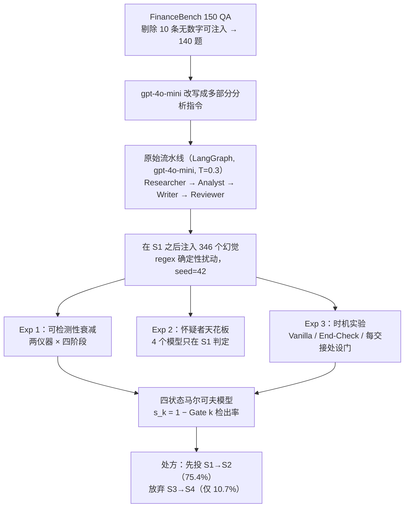

---
aliases:
  - "The Hallucination Snowball: Modeling Error Propagation as State Transitions in Multi-Agent LLM Pipelines"
  - "Hallucination Snowball"
created: 2026-11-17
---
# The Hallucination Snowball: Modeling Error Propagation as State Transitions in Multi-Agent LLM Pipelines

> 这篇论文提出一个很好记的失败模式：**幻觉在顺序多智能体流水线里不会「停留」，它会「变形」**。一个在第 1 阶段被注入的原始数字（比如把 Boeing 的 COGS 从 \$63.1B 改成 \$71.2B），到第 2 阶段被分析师算成「同比增长 8.3%」，到第 3 阶段被写手写成「成本逆风、COGS 上升 8.3% 至 \$71.2B，反映供应链扰动」，到第 4 阶段被审稿人评价为「结构良好、推理扎实」——而审稿人拿不到任何源文档，只能查内部一致性。**每变形一次，可检测性就下降一截，而且几乎不可逆。** 作者把这件事形式化成一个四状态的一阶马尔可夫过程（Raw Fact → Derived → Narrative → Invisible），用 FinanceBench 上 140 个问题、346 次自动注入的幻觉测出三个边界逃逸概率 **24.6% / 48.3% / 89.3%**；gpt-4o 作为裁判的检出率从第 1 阶段的 72.0% 掉到第 4 阶段的 50.9%，**23.7% 的幻觉在最终输出里完全没被发现**。最强的模型（Qwen3.5-397B-A17B）在最优位置也只有 87.0%，按测得的衰减外推到第 4 阶段只剩约 60–65%。最后一个关键实验给出全文的口号：**用同样的 RAG 校验工具，把门放在每个交接处能把幻觉存活率从 58.4% 压到 16.2%（Cohen's $h=-0.911$，$p<0.000001$），而只在流水线末端检查相对不检查只改善 2.3 个点**——「何时验证」比「是否验证」更重要。

## 一句话定位

这是一篇「**把评测问题重新定义成传播控制问题**」的论文：它不去造更强的幻觉检测器，而是证明在顺序多智能体架构里检测能力会随状态变形而衰减（$S_1$ 72.0% → $S_4$ 50.9%），并用一个四状态马尔可夫模型 + 门控位置实验论证「在变形发生前拦截」是唯一有效的资源分配方式（[表 1](papers/模型评测/2608.14588/2608.14588.pdf#table=1)、[表 4](papers/模型评测/2608.14588/2608.14588.pdf#table=4)）。

## 问题与动机

### 问题一：顺序流水线在架构层面就放弃了纠错

论文开篇点出的架构事实很朴素但后果严重（[§1](papers/模型评测/2608.14588/2608.14588.pdf#1)）：LangGraph、AutoGen、CrewAI 这类框架让「Researcher → Analyst → Writer → Reviewer」的串联变得极其容易，而**每个 agent 只接收前一个 agent 的文本输出，没有 provenance 元数据、没有置信度、没有源文档访问权限**。每个 agent 完全信任它的上游。这不是某个 prompt 写坏了，而是架构里**没有任何纠错机制**。

作者用一个贯穿全文的例子把这套机制演了一遍：

| 阶段 | 输出 | 发生了什么 |
|---|---|---|
| $S_1$ Researcher | "COGS was \$71.2B"（真值 \$63.1B） | 注入原始数字错误 |
| $S_2$ Analyst | "an 8.3% YoY increase" | 在一个伪造的基数上做**派生计算** |
| $S_3$ Writer | "成本逆风，COGS 上升 8.3% 至 \$71.2B，反映供应链扰动" | 数字被**因果叙事化** |
| $S_4$ Reviewer | "结构良好、推理扎实" | 只有内部一致性可查，**批准** |

四步之后，一个原本可以直接查表核对的数字，变成了一个看起来自洽、有因果解释、且被「审稿」背书的结论。论文的判断是：这个幻觉被**洗白（laundered）**了。

### 问题二：既有工作把问题框错了

这是本文最核心的动机论证（[§2](papers/模型评测/2608.14588/2608.14588.pdf#2)）。作者把前人工作分成四类，逐一说明它们为什么覆盖不到这个失败模式：

1. **单 agent 幻觉检测**（FActScore、CoVe、VeriScore、SAFE）：这些工作把幻觉当成「孤立模型输出的属性」，做法是把生成拆成原子断言再逐条核验，或者让模型自查，或者用搜索增强的事实评估。作者的批评很锋利——它们**全部只在 $S_1$ 上操作**：一个输出、孤立评估。没有任何一个工作建模「一个 agent 的幻觉输出变成下一个 agent 的输入」之后会发生什么。
2. **多智能体辩论与协作**（Du et al.、MAD）：这些工作确实是多智能体，但拓扑是**并行**的——所有 agent 同时共享同一个事实基础，靠互相质疑提升推理。而**顺序传播**（每个 agent 只看到上一个 agent 变形后的输出）在这条线里结构性缺席。
3. **多智能体信任与安全**（TrustAgent、rogue agents）：这些研究的是恶意 agent 的**故意**操纵。本文的失败模式**不需要任何对手**：完全善意、完全按指令行事的 agent 也会造出雪球，因为架构在交接处没有纠错机制。作者据此认为雪球比对抗威胁更普遍——对抗需要「被攻陷的意图」，而雪球只需要「正常的意图」。
4. **RAG 与检索增强验证**：本文的门控灵感来自这条线，但部署在**不同的层**——不是用来增强生成，而是在交接点**验证 agent 输出**、然后再交给下一个 agent。作者还特意澄清：他们的门控其实是一个**确定性数值匹配器（零 LLM 调用）**，保留「RAG」这个标签只是为了表达「接地」的意图，不是指机制。

### 问题三：为什么必须换成「传播控制」的框法

论文用一组数字把「检测器路线」的极限摆出来（[§1](papers/模型评测/2608.14588/2608.14588.pdf#1)）：gpt-4o 的检出率从 $S_1$ 的 72.0% 掉到 $S_4$ 的 50.9%，**这 21.1 个点的衰减与检测器有多先进无关**；而末端验证相对不验证只改善 2.3 个点（存活率 60.7% → 58.4%），因为**验证原始断言所需的信息已经被上游的变形结构性销毁了**。所以正确的框法不是「怎么检测得更准」，而是「怎么控制传播」。这句话是全文的枢轴，后面所有实验都是它的证据。

### 问题四：为什么选金融分析做实验场

作者对这一点的自觉很强：选金融不是因为它最重要，而是因为**它有毫不含糊的数值真值**——SEC 文件里的数字可以被精确比对，幻觉可以被自动注入、自动核对。同时他们明确承认这是**外部效度**的代价：变换机制（$S_1\to S_4$）是领域无关的，但**具体速率不是**；医疗摘要、法律审阅、研究自动化流水线都共享同一结构缺陷，但逃逸率需要按领域重新标定（[§1](papers/模型评测/2608.14588/2608.14588.pdf#1)、[§5](papers/模型评测/2608.14588/2608.14588.pdf#5)）。

## 方法与机制（核心）

### 总览

全文的实验骨架可以概括成「**一条流水线 + 两种检测器 + 三个实验 + 一个模型**」（[图 1](papers/模型评测/2608.14588/2608.14588.pdf#figure=1)）。

**一条流水线**是 LangGraph 实现的 4 个 agent 严格串联：Researcher（从 SEC 文件抽取精确数字）→ Analyst（只用 Researcher 的输出算 YoY 与比率）→ Writer（写 300–500 词的专业叙述）→ Reviewer（**只做内部一致性检查，拿不到源文档**）。全部 agent 用 gpt-4o-mini、温度 0.3、各自的角色提示。

**两种检测器**分别代表两种极端。第一种是 **gpt-4o Judge**：一个「取证型财务审计员」人设，**不给真值**，只能靠内部推理指出可疑断言——它代表**真实部署场景**。第二种是 **Retrieval Checker**：一个完全确定性的数值匹配器，**零 LLM 调用**，把 agent 输出与 FinanceBench 的真值、证据串、以及注入前的 Researcher 输出做数值比对（1% 容差）——它代表**理论检测上限**。两个仪器独立作用于四个阶段的输出。

**三个实验**各回答一个问题。Exp 1 测可检测性如何随阶段衰减（跨全部 346 次注入，两个仪器 × 四个阶段）。Exp 2 测「模型能力天花板」——把四个更强的模型放在**最优位置 $S_1$**（此时幻觉还是原始数字）当怀疑者，看能不能靠模型变强突破结构上限。Exp 3 用一条完整的 gemini-2.5-flash 流水线做三条件对照（Vanilla / End-Check / 每个交接处都设门），**工具完全相同，只改时机**，从而把「位置」隔离成唯一变量。

**一个模型**是把上述现象形式化的四状态一阶马尔可夫过程：$S_1 \xrightarrow{s_1} S_2 \xrightarrow{s_2} S_3 \xrightarrow{s_3} S_4$，其中 $s_k$ 是每个边界上的逃逸概率，取值为 $1-\text{Gate }k\text{ 的检出率}$。模型给出线性 $n$ agent 流水线的存活率公式 $\prod_k s_k$，并据此推出「先投 $S_1{\to}S_2$、不投 $S_3{\to}S_4$」的资源分配处方。

### 模块一：流水线与角色分工（错误是被结构逼出来的）

四个角色的提示是刻意设计成「信息逐级丢失」的：Researcher 能看 SEC 文件原文，Analyst **只能**用 Researcher 的输出（不能回原文），Writer 只能看 Analyst 的派生结果，Reviewer **完全拿不到源文档**。这条信息链的后果是：**越往下游，可核对的东西越少**。到 Reviewer 手上时，唯一可做的检查就是「这段话内部是否自洽」——而一个被洗白的幻觉恰恰是高度自洽的。

这一点解释了为什么 $S_3\to S_4$ 这个边界在数据上是「惰性」的：Reviewer 不是变换型 agent（它不改写内容，只做评价），所以它既不会进一步销毁信息，也不会恢复信息。

### 模块二：数据与预处理

数据用 **FinanceBench**：150 条专家标注的金融问答，来自真实 SEC 文件，带精确数值真值。处理分两步（[§3.1](papers/模型评测/2608.14588/2608.14588.pdf#3.1)）：

1. **剔除 10 条**输出为定性、没有可注入数值的题，得到 **140 条可用问题**。
2. **改写输入**：用 gpt-4o-mini 把所有问题转成「复杂多部分分析指令」，以贴近真实流水线的输入形态。

这两步的代价要说清楚：改写输入意味着**评测的不是 FinanceBench 原始任务**，而是「由 gpt-4o-mini 重写过的版本」；而剔除定性题意味着**所有结论都只适用于「有明确数值可注入」的任务**——这恰好是金融领域最有利的部分，也是外推时最需要小心的地方。

### 模块三：注入协议（可复现性的核心）

注入是整篇论文的测量基础，所以作者写得很细（[§3.1](papers/模型评测/2608.14588/2608.14588.pdf#3.1)、[附录 B](papers/模型评测/2608.14588/2608.14588.pdf#B)）：

- **数量**：140 题共注入 **346 个幻觉**（每题 2–3 个）。
- **位置**：注入发生在 **$S_1$ 之后、任何下游 agent 之前**——这是关键设计，它强制幻觉走完整个变形链，而不是在末端被塞进去。
- **三类目标表达式**（按优先级、大小写不敏感匹配）：美元金额（`$` 开头、逗号分隔数字、可选小数、可选 million/billion/mn/bn/k/MM/trillion 等后缀）、百分比（`%`、`percent`、`percentage points`、`bps`）、大数字（非美元非百分比的 5 位以上数字序列）。
- **扰动幅度**：美元金额与大数字做 **15%–40% 的乘性偏移**；百分比做 **3–12 个百分点的加性偏移**；方向（增/减）逐次随机。
- **年份排除规则**（这条很体现工程细致度）：1900–2099 的值，若前后 20/10 字符内出现 FY、FISCAL、YEAR、Q1–Q4、10-K、10-Q、ANNUAL、QUARTER 就排除；1950–2030 的四位数一律当年份处理。
- **种子结构**：`RANDOM_SEED=42`；每题主种子 $=$ `RANDOM_SEED + abs(hash(question_id)) % 10000`；每次注入的子种子再加 `abs(hash(question_id)) % 100000 + i × 7919`；若扰动后数值未变则用子种子 $+999983$ 重试。所有注入带完整元数据记录，可精确复现。

**注入幅度的选择本身就是一条隐含假设**：15%–40% 的偏移模拟的是「听起来合理但错误」的幻觉（plausible-but-wrong）。作者在局限性里明确承认：低于 5% 的细微扰动没有被测，而真实场景中这类扰动可能更常见，且因为匹配容差是 2%，它很可能带来更低的门控检出率。

### 模块四：两种检测仪器（上限与现实的对照）

| 仪器 | 机制 | 是否用真值 | 容差 | 代表什么 |
|---|---|---|---|---|
| gpt-4o Judge | 取证型财务审计员人设，靠内部推理指出可疑断言 | 否 | — | 真实部署场景 |
| Retrieval Checker | 确定性数值匹配，零 LLM 调用，比对真值/证据串/注入前输出 | 是 | **1%** | 理论检测上限 |

注意两个容差不是同一个数：**Exp 1/2 的 Retrieval Checker 用 1%**（比 Exp 3 的 2% 更严），而 **Exp 3 的 RAG 门用 2%**——理由是门要容忍 agent 自己做的数值改写形（例如把 \$71.2B 四舍五入成 \$71B）。这个差异不是笔误，而是两种用途的不同要求：**测量上限时要严，落地门控时要容忍格式变换**。它也顺带说明了一个容易被忽略的事实：**「同一个数字」在文本里的表示形式会变**，而这本身就是检测的一个误差源。

### 模块五：三个实验的设计逻辑

**Exp 1（可检测性衰减）** 的设计要点是「同一批幻觉、同一套仪器、四个位置」。它测的不是「幻觉有没有被修好」，而是「**在四个阶段上，还能不能看出来**」。这个设计的美妙之处在于：它把「检测器能力」固定住，让「位置」成为唯一变量，于是任何下降都只能归因于**状态变形**。

**Exp 2（怀疑者天花板）** 的设计要点是「把最强的模型放在最有利的位置」。四个模型（Llama-3-70B、gemini-2.5-flash、DeepSeek-V3.2、Qwen3.5-397B-A17B）与 gpt-4o 参照一起，全部只在 $S_1$ 上判定，prompt 与协议完全一致。若模型能力是瓶颈，就应该看到某个模型接近 100%；如果没有，就说明瓶颈在**结构**（没有真值就判不出量级合理的错误值）。统计上用 5,000 次重采样的 bootstrap 置信区间 + 六组两两 McNemar 检验。

**Exp 3（时机实验）** 的设计要点是「工具相同、只改时机」，三个条件：

- **Vanilla**：完全不验证。
- **End-Check**：只在 Agent 4 之后放一个确定性数值门——**能检测，但无法纠正**（下游没有 agent 能接收修正）。
- **Ours**：在**每个** agent 交接处放同样的确定性门，并把修正标注传给下游。

这个三条件设计让「2.3 个点的改善」这个结果变得极有说服力：它不是「末端检查没用」，而是「末端检查在架构上**不可行动**（unactionable）」——因为没有下游消费者。

### 模块六：马尔可夫形式化

状态不是按「内容主题」划分的，而是按**幻觉的形态**划分，且定义的关键是**不可逆性**（[§4](papers/模型评测/2608.14588/2608.14588.pdf#4)）：

- $S_1$ **Raw Fact**：原始事实，可直接与参考值匹配。
- $S_2$ **Derived**：派生计算。一旦原始断言被嵌入一个派生式（如「同比增长 8.3%」），原来的可核对断言就被**结构性销毁**了——要验证它必须做逆运算。
- $S_3$ **Narrative**：叙事化。数字被嵌进因果解释（「反映供应链扰动」），此时它与周围文本已经不可分离。
- $S_4$ **Invisible**：被编辑性批准。审阅者用「内部一致性」盖章。

转移写成

$$
S_1 \xrightarrow{\,s_1\,} S_2 \xrightarrow{\,s_2\,} S_3 \xrightarrow{\,s_3\,} S_4
$$

其中 $s_k$ 是第 $k$ 个边界上的**逃逸概率**（在该边界没有被抓住的概率）。对线性 $n$ agent 流水线，存活率就是连乘：

$$
P(\text{survival}) = \prod_{k=1}^{n-1} s_k
$$

代入实测值：$0.246 \times 0.483 \times 0.893 \approx 10.6\%$，而 Exp 3 实测存活率是 16.2%，差 5.6 个点。作者对这个差距的解释是门控的假阴性——数值被改写形（"\$71.2 billion" → "71.2B"）、四舍五入、单位换算都会让匹配失败，因此**马尔可夫模型描述的是变换动力学，而实测检出概率给的是存活率的下界**。

**参数是怎么来的**（这一点必须记住）：论文明确写 $s_k = 1 - \text{gate detection}_k$，即逃逸概率**直接由 Exp 3 的每门检出率取补得到**（[§4](papers/模型评测/2608.14588/2608.14588.pdf#4)、[表 5](papers/模型评测/2608.14588/2608.14588.pdf#table=5)）。这意味着模型不是用一套独立数据拟合出来的，而是对 Exp 3 结果的重述——我在「归因分析」一节会展开这条的方法学后果。

### 模块七：门控机制与统计检验

门控是**完全确定性**的：不调用任何 LLM，只做数值匹配；被驳回的数值会被标注出来，并**指示下游 agent 使用修正后的数字**。工程开销实测约 **0.9 秒**（三个门合计，主要来自限流），相对于 gemini 每个 agent 3–5 秒的延迟可以忽略。

统计验证用了**五种独立检验**（McNemar、置换检验 10,000 次、Cohen's $h$、非配对 $\chi^2$、Fisher 精确检验），两两对比（Ours vs Vanilla、Ours vs End-Check）各做一遍，所有 $p$ 值都在 $10^{-6}$ 以下，远低于任何 Bonferroni 校正阈值。这种「多检验互相印证」的做法在方法学上是加分项——它防的是「换一种检验就不显著」的情况。

## 实验与对比

### Exp 1：可检测性衰减（四个阶段 × 两种仪器）

| 阶段 | gpt-4o Judge | Retrieval | 任一仪器 |
|---|---|---|---|
| $S_1$ Researcher | 72.0% | 91.9% | 97.7% |
| $S_2$ Analyst | 60.4% | 73.1% | 84.4% |
| $S_3$ Writer | 53.2% | 65.0% | 76.3% |
| $S_4$ Reviewer | 50.9% | 67.1% | 76.3% |
| **$S_1\to S_4$ 落差** | **−21.1 pp** | **−24.8 pp** | **−21.4 pp** |

（[表 1](papers/模型评测/2608.14588/2608.14588.pdf#table=1)，$n=346$。）

五条量化结论：

1. **衰减是真实的、单调的、跨仪器的。** 三个检测方式都在掉，gpt-4o 掉 21.1 个点，确定性检索掉 24.8 个点。**连理论上限也在掉**——这一点非常重要，它说明衰减不是「裁判不够聪明」，而是「可核对的信息本身在减少」。
2. **23.7% 完全逃逸。** 82/346 个幻觉在最终输出里没有被任何一个仪器发现。
3. **零个「全程漏检」。** 轨迹分布里 $\times\to\times\to\times\to\times$ 的计数**恰好为 0**——每一个注入的幻觉在 $S_1$ 都能被至少一个仪器发现。作者据此下了一个很强的判断：**不可见性是流水线造出来的，幻觉本身到来时并不隐形。**
4. **衰减集中在边界上，不是均匀的。** $S_1\to S_2$ 掉得最多（gpt-4o −11.6 pp，Retrieval −18.8 pp）；$S_2\to S_3$ 次之（−7.2 / −8.1 pp）；$S_3\to S_4$ 基本惰性（−2.3 / **+2.1** pp，检索侧甚至回升）。
5. **轨迹是系统性的，不是随机的。** 两种主导轨迹合计占 23.4%：$\checkmark\to\times\to\times\to\times$ 占 10.7%（在 $S_1$ 可检出，之后永久丢失），$\checkmark\to\checkmark\to\times\to\times$ 占 9.0%（在 $S_2\to S_3$ 边界丢失）。而「始终可检出」（$\checkmark\checkmark\checkmark\checkmark$）占 70.5%——也就是说**大部分幻觉其实一直能被抓到，问题出在剩下的三成上**。

| 轨迹 | 数量 | 占比 | 解释 |
|---|---|---|---|
| ✓✓✓✓ | 244 | 70.5% | 全程可检出 |
| ✓××× | 37 | 10.7% | 在 $S_1\to S_2$ 完全衰减，永久丢失 |
| ✓✓×× | 31 | 9.0% | 在 $S_2\to S_3$ 衰减 |
| ✓×✓× | 11 | 3.2% | 间歇 |
| ✓✓×✓ | 8 | 2.3% | 晚期恢复 |
| ×✓✓✓ | 4 | 1.2% | 晚期检出 |
| ✓××✓ | 4 | 1.2% | 部分恢复 |
| ××✓✓ | 2 | 0.6% | 很晚检出 |
| ✓✓✓× | 2 | 0.6% | 末阶段洗白 |
| ×××✓ | 1 | 0.3% | 仅末阶段检出 |
| ×××× | **0** | 0.0% | **从不发生** |

（[表 6](papers/模型评测/2608.14588/2608.14588.pdf#table=6)。）

### Exp 2：更强模型也突破不了的天花板

| 模型 | 检出率 | 95% CI | 存活率 |
|---|---|---|---|
| Meta-Llama-3-70B-Instruct | 51.4% | [46.2–56.6%] | 48.6% |
| gemini-2.5-flash | 72.5% | [67.6–77.2%] | 27.5% |
| gpt-4o（Exp.1 参照） | 72.0% | [67.1–76.6%] | 28.0% |
| DeepSeek-V3.2 | 75.7% | [71.1–80.3%] | 24.3% |
| Qwen3.5-397B-A17B | **87.0%** | [83.2–90.5%] | **13.0%** |

（[表 2](papers/模型评测/2608.14588/2608.14588.pdf#table=2)，全部在 $S_1$ 这一最优位置判定。）

统计上呈现三个清晰分层：Llama-3-70B 单独垫底（与所有其他模型 $p<0.000001$）；gemini-flash、DeepSeek-V3.2、gpt-4o 三者互相不可区分（例如 flash vs DeepSeek 的 $p=0.289$）；Qwen3.5 显著高于所有（两两 $p<0.001$），但**其置信区间上界也只有 90.5%**。没有任何模型接近 100%。

**为什么这是结构性的天花板？** 按注入类型分解就能看明白（[表 8](papers/模型评测/2608.14588/2608.14588.pdf#table=8)）：百分比错误的检出率是 71.4–98.0%（因为 3–12 个点的加性偏移往往一眼就不合理），而美元金额只有 49.3–85.6%、大数字只有 37.0–85.2%（对波音 COGS 做 12.8% 的扰动完全落在行业合理区间内）。作者的结论很硬：**没有真值访问时，合理性推理抓不住「量级合理但数值错误」的断言**。把最强的 Qwen3.5（87.0%）按测得的衰减率投到 $S_4$，检出率掉到 60–65%，仍有 35–40% 逃逸。

### Exp 3：同一个工具，位置不同，差 42 个点

| 指标 | Vanilla | End-Check | Ours |
|---|---|---|---|
| 幻觉存活率 | 60.7% | 58.4% | **16.2%** |
| 可行动检出率 | 0.0% | 0.0% | **76.9%** |
| 无幻觉报告占比 | 18.6% | 20.0% | **68.6%** |
| 纠正率 | 26.6% | 26.3% | **54.0%** |
| 输出质量（1–5） | 4.16 | 4.44 | **3.93** |

（[表 3](papers/模型评测/2608.14588/2608.14588.pdf#table=3)，$n=346$ 幻觉、$n=140$ 问题。）

- **End-Check 相对 Vanilla 只改善 2.3 个点**（60.7% → 58.4%），且「可行动检出率」是 0.0%——不是它没检出，而是**它检出了也没人能接收修正**。
- **Boundary gates 相对 Vanilla 降 44.5 个点、相对 End-Check 降 42.2 个点**，五种独立检验全部 $p<10^{-6}$（McNemar $\chi^2=122.24$、置换检验、Cohen's $h=-0.911$、非配对 $\chi^2=129.94$、Fisher OR $=0.138$）。
- **无幻觉报告从 28/140 提到 96/140**（18.6% → 68.6%），这是最直观的落地收益。
- **质量分从 4.44 掉到 3.93**（−0.51），这是全文最诚实的部分，作者没有藏。

### 门控逐层拆解：第一个门吃掉绝大部分收益

| 门 | 位置 | 检出率 | 95% CI |
|---|---|---|---|
| Gate 1 | $S_1\to S_2$ | **75.4%** | [71.1–80.1%] |
| Gate 2 | $S_2\to S_3$ | 51.7% | [46.2–57.2%] |
| Gate 3 | $S_3\to S_4$ | 10.7% | [7.5–13.9%] |
| 任一门 | — | 76.9% | [72.3–81.2%] |

（[表 4](papers/模型评测/2608.14588/2608.14588.pdf#table=4)。）**Gate 1 单独就抓到 75.4%，三门合计 76.9%，Gate 3 的边际贡献只有 1.5 个点。** 阶段存在率曲线也印证「早拦截」：三条件在 $S_1$ 起点相同（96.8%），从 $S_2$ 开始分岔（Ours 70.2% vs Vanilla 92.2%），到 $S_3$ 差距拉大（24.6% vs 65.9%）。那 3.2% 的起点缺口（96.8% 而非 100%）来自单位不匹配——注入日志里的 `71200` 与文本里的 `$71.2B` 在 2% 容差下匹配不上。

### 两两对比：三档分离与效应量

Exp 2 的六组两两 McNemar 检验（[表 7](papers/模型评测/2608.14588/2608.14588.pdf#table=7)）值得单列，因为它决定了「模型能力」这条解释能走多远：

| 对比 | $\Delta$ (pp) | $\chi^2$ | $p$ | Cohen's $h$ |
|---|---|---|---|---|
| Llama-3-70B vs gemini-2.5-flash | −21.1 | 44.31 | <0.000001 | −0.439 |
| Llama-3-70B vs DeepSeek-V3.2 | −24.3 | 63.79 | <0.000001 | −0.511 |
| Llama-3-70B vs Qwen3.5-397B-A17B | −35.5 | 108.64 | <0.000001 | −0.804 |
| gemini-2.5-flash vs DeepSeek-V3.2 | −3.2 | 1.12 | **0.289** | −0.073 |
| gemini-2.5-flash vs Qwen3.5-397B-A17B | −14.5 | 30.01 | <0.000001 | −0.365 |
| DeepSeek-V3.2 vs Qwen3.5-397B-A17B | −11.3 | 18.28 | 0.000019 | −0.293 |

读法有三层。第一层：**唯一不显著的一对是 flash 与 DeepSeek（$p=0.289$、$h=-0.073$）**，其余五对都显著——这说明「中等能力档」内部确实分不出高下，模型规模在这一档上不是有效变量。第二层：**与 Llama-3-70B 的三组对比效应量都很大（$|h|=0.44$–$0.80$）**，说明「弱模型」这一档是真实存在且可区分的。第三层：**最强与次强之间的差距（DeepSeek→Qwen，−11.3 pp，$h=-0.293$）虽然显著，但效应量只是中等**，而 Qwen 的置信区间上界也只有 90.5%。换句话说，**从 51.4% 到 87.0% 是一段真实的提升，但这段提升花掉了「把模型换到最大」的全部预算，却仍然没到可用线**——这正是作者说「天花板是结构性的，不是模型质量问题」的量化依据。

## 归因分析

**其一，衰减的根源归因于「信息形态改变」，而不是「模型变懒」。** 证据是 $S_1\to S_2$ 掉得最多（−11.6 / −18.8 pp），而这一步恰好是「原始数字 → 派生计算」：要验证「同比增长 8.3%」必须做**逆运算**回到两个原始基数，而下游 agent 只拿到了派生结果。$S_3\to S_4$ 几乎不掉（−2.3 / +2.1 pp），因为 Reviewer 不改写内容，只做内部一致性评价——**边界越具变换性，衰减越大**。这条归因把「位置」和「损失」直接连了起来，也让后面的处方有了依据。

**其二，「23.7% 完全逃逸 + 零全漏轨迹」这组数字，把责任明确归给流水线而非幻觉。** 这是全文最干净的因果论证：既然每个幻觉在 $S_1$ 都可检出，那么它在 $S_4$ 不可见这件事**只能由中间三次变换解释**。这也顺带否定了一种常见的辩解——「这些幻觉本来就很隐蔽」。数据说不是。

**其三，天花板归因于「无真值 + 量级合理」的组合。** 按注入类型的检出率分解提供了直接证据：能靠「荒谬性」判的（百分比，大偏移）检出高；只能靠「准确性」判的（美元金额在合理区间内的偏移）检出低。而访问真值不是「能力」，是「权限」——所以模型再强也突破不了。**这条归因的含义是：把幻觉检测当成模型能力问题会走错方向，它一部分是信息可得性问题。**

**其四，时机效应的机制可以精确归因到「下游可行动性」。** End-Check 与 Ours 用的是**同一套确定性工具、同一个容差级别**，唯一差别是位置；而 End-Check 的「可行动检出率」是 0.0%，Ours 是 76.9%。这个 76.9% 与 0.0% 的对比，比存活率的对比更能说明机制：**末端门能看见，但没有人能执行它的判决。**

**其五，质量下降 −0.51 归因于「压制而未恢复」，而非误报。** 后验分析给了两个数字：门控的误报率只有 **0.4%（1/266）**——它几乎从不驳回正确的参考值；而在被抓到的案例里有 **32.7%（87/266）** 出现了「门正确压制了注入值，但下游 agent 没有把标注的修正传播下去」，于是留下一个数值空缺。作者据此把责任归给「指令遵循」而非「门控精度」，并把修复方向指向**源接地纠正**（直接把正确值注入 agent 上下文），而不是让 agent 从标注里自己推断。

**其六，Gate 1 独大归因于「可匹配性」。** 75.4% vs 三门合计 76.9% 说明边际收益急剧递减，原因是幻觉一旦离开 $S_1$，它就不再是一个「可被数值匹配的断言」，而是一个「嵌在派生式或叙事里的值」。这条归因同时解释了为什么 $S_3\to S_4$ 的门不值得投：那里已经几乎没有可匹配对象。

**其七（我的批评）：马尔可夫模型的参数不是独立证据。** 论文明确写 $s_k = 1-\text{gate detection}_k$，即三个逃逸概率**直接由 Exp 3 的每门检出率取补**得到。这带来两个后果：

1. **公式的「预测」与「实测」不独立。** $0.246\times0.483\times0.893\approx10.6\%$ 与实测 16.2% 的对比，本质上是在检验「各边界独立」这一假设是否成立（若独立应得 10.6%，实测更高说明边界间存在相关性或检出率被低估），而不是在独立数据上验证一个模型。
2. **$s_3=89.3\%$ 的分母存疑。** 若 $s_k$ 是条件逃逸概率，应写成「1 − Gate $k$ 检出数 / 到达 Gate $k$ 的幻觉数」；而论文用的是「1 − Gate $k$ 相对全部 346 次注入的边际检出率」。按论文自己的数字做算术：Gate 3 检出 10.7% × 346 ≈ 37 个，而在 Ours 条件下 $S_3$ 的存在率是 24.6% × 346 ≈ 85 个，条件检出率约 43.5%，条件逃逸约 **56.5%**，而不是 89.3%。这与 §3.2 的观察一致——论文自己说 $S_3\to S_4$ 边界「基本惰性」，那么 89.3% 就不该被解释成「叙事嵌入近乎不可逆」，而更像是「到那时剩下的样本已经很少」。

这两点不否定论文的主结论（时机 > 工具，这条有五种检验支撑、且不依赖马尔可夫参数），但**削弱了「模型」这一层的形式化贡献**：它目前更像一个把实测结果重新参数化的记账工具，而不是一个能做出独立预测的理论。作者在讨论里其实也留了口子——对非线性拓扑他们只主张「洞见可推广，公式不可直接套用」。

## 局限与未来工作

论文有**明确的 Limitations 段落**（[§5](papers/模型评测/2608.14588/2608.14588.pdf#5)），列了四条，另有两条在讨论里单独展开。

**原文明确写的四条局限：**

1. **域限制。** 实验在金融域完成，选它是因为数值真值最清晰。在事实不那么可精确核验的领域（医疗摘要、法律审阅），检出率与衰减斜率都可能不同。变换机制（$S_1\to S_4$）是领域无关的，**具体速率不是**。
2. **拓扑限制。** 只测了严格线性的 4 agent 拓扑。分支、并行、循环架构有不同传播动力学，当前马尔可夫形式化捕捉不到；非线性拓扑的扩展转移矩阵是未来工作。
3. **扰动幅度限制。** 15%–40% 模拟的是「合理但错」的幻觉；**低于 5% 的细微扰动没有测**，而这类在真实场景中可能更常见，且在 2% 匹配容差下会带来更低的门控检出率。
4. **未评估 structured-handoff 基线。** 类型化 JSON 字段、引用传递、保留 provenance 的程序化状态（如 CaveAgent）可能通过「避免有损的自由文本变换」独立地减少洗白——它们拦的是**变换这一步本身**，而边界门是在变换开始后才拦。两者谁更好、代价多大，是明确的开放问题。

**讨论中单独展开的两条：**

5. **质量指标结构性看不见干预的主要收益。** 评测器只查内部一致性、没有真值，因此**结构上无法奖励「事实准确性」**。一份建立在伪造 \$71.2B 上的流畅报告会得到比「正确压制了该数字但留下空缺」更高的分。作者认为正确做法是「联合评事实准确性与叙事连贯性」的指标（例如先按检索核验每个数值断言、再评分析质量），并预期这样的指标不仅会消除质量差，还会**反转**它。
6. **基于标注的纠正 vs 源接地纠正。** 当前门控只标注被驳回的值并指示下游使用修正值，这产生了 76.9% 可行动检出与 54.0% 完整纠正之间 22.9 个点的缺口。更强的干预是**检索并直接把正确值注入 agent 上下文**，作者预期这既能补上纠正缺口，也能减轻质量惩罚。

**原文事实层面的其它边界（据正文与附录整理）：**

- 流水线全用 **gpt-4o-mini**（Exp 1/2），而 Exp 3 换成 **gemini-2.5-flash** 全流水线——跨实验比较时模型不同。
- Exp 2 的「天花板」只在 **$S_1$** 测过，$S_2$–$S_4$ 的高能力模型表现是**外推**而非实测（作者自己也写「projected」）。
- 起点存在率 96.8% 而非 100%，缺口来自单位表示不匹配（`71200` vs `$71.2B`），这部分注入实际上从未被有效追踪。
- 数据经 gpt-4o-mini 重写为「多部分分析指令」，评测对象不是 FinanceBench 原始问题形态。
- 3.2% 的轨迹是「间歇」型（✓×✓×），说明检出并非单调，单点测量有噪声。

**复现性方面，本文比多数同类论文做得好，但仍有三处缺口。** 做得好的三样：注入协议给到了正则类别、扰动幅度、年份排除规则、种子结构与「重试直到数值改变」的完整规则；基础设施给到了框架（LangGraph StateGraph）、各模型的具体 API 提供方、限流（实验三每次调用间隔 0.3 秒）与重试（3 次、2 秒基数）；统计给到了 McNemar 的完整四格列联表（例如 Ours vs End-Check 的 both_survived=43 / only_End=13 / only_Ours=159 / both_caught=131），使任何人都能独立复算 $\chi^2$。仍缺的三样（据正文与附录整理）：其一，**未报告总 API 成本**（140 题 × 4 agent × 三条件 × 五种模型的调用量是可估算的，但论文没给）；其二，**未说明 FinanceBench 的使用许可与再分发方式**；其三，**未报告 gpt-4o-mini 改写问题这一步的失败率**——若某些问题在改写时丢掉了可注入的数值，它们会静默退出统计，而论文只说了「剔除 10 条定性题」，没说改写环节有没有二次流失。

## 与其他工作的关系

**与 LLM-as-a-Judge 主线的关系。** 本文的 gpt-4o Judge 就是一个标准的 [[papers/模型评测/2306.05685/NOTES|LLM-as-a-Judge]] 实例：给定一段输出、不给真值、要求它判断「有没有问题」。本文对这个范式做了一个非常有价值的补充——**judge 的可靠性不是模型的常数属性，而是「被 judge 的对象处于什么状态」的函数**。同一个 judge、同一批幻觉，在 $S_1$ 上 72.0%、在 $S_4$ 上 50.9%。这意味着以往所有「judge 在某个数据集上达到 X%」的报告，都必须补充一句「在什么形态的输入上」。这条洞察与 [[papers/模型评测/2410.12784/NOTES|JudgeBench]] 的「难样本」视角互补：JudgeBench 说 judge 在难题上不行，本文说 judge 在**被洗白过的题**上不行。

**与 AgentRewardBench 的关系。** [[papers/模型评测/2504.08942/NOTES|AgentRewardBench]] 判的是**轨迹级成败**，并发现约三成失败轨迹被误判为成功；本文的 23.7% 完全逃逸率与之惊人地接近，但机制解释不同——前者归因于裁判对 agent 自述的谄媚式采信，后者归因于**信息在交接处被结构性销毁**。两者合起来给出了「为什么 LLM judge 不可靠」的两条独立通路：一条是**社会性**的（裁判信了 agent 的话），一条是**信息论**的（裁判想核对也没得核对）。

**与 TRAIL 的关系。** [[papers/模型评测/2505.08638/NOTES|TRAIL]] 提供的是**静态**的 trace 错误标注（哪个 span、哪类错误、什么影响等级），本文提供的是**动态**的传播模型（错误在阶段间如何变形、检出率如何衰减）。两者几乎是天然互补的：TRAIL 的 span 级错误序列正好可以作为估计传播矩阵的观测数据，而本文的四状态划分可以给 TRAIL 的错误类别加上一个「可检测性」维度。目前两者的数据规模与标注粒度都还不足以直接对接。

**与 Who&When 的关系。** [[papers/模型评测/2505.00212/NOTES|Who&When]] 问「哪个 agent 的哪一步导致失败」，本文问「错误在哪个边界变得不可检测」。两者都指向「越早越关键」这一结论，但论证方式不同：Who&When 的形式化用**反事实干预**（修好这一步能不能救回整条轨迹），本文用**逃逸概率**（在这个边界没被抓住的概率）。前者给出「责任」，后者给出「干预价值」——在工程上后者更可操作，因为逃逸概率可以直接换算成「把门放在这里的期望收益」。

**与 MAST 的关系。** [[papers/模型评测/2503.13657/NOTES|MAST]] 是失败模式的分类学，本文是单一失败模式的动力学。可以把本文看成 MAST 里某一类失败（信息在 agent 间传递时的失真）的**深挖**：不满足于「这是哪一类失败」，而是给出「它在第几个边界衰减多少」的定量曲线。

**与 AI Agents That Matter 的关系。** [[papers/模型评测/2407.01502/NOTES|AI Agents That Matter]] 要求 agent 评测报成本、报方差、做统计检验。本文在这三点上都做得比同类论文扎实：门控开销明确报（0.9 秒）、统计用五种检验 + bootstrap CI、并**主动报告了自己方法的质量代价**（−0.51）。它对那篇论文的一个补充是：**评测不仅要知道「多少钱换多少分」，还要知道「在哪一步花这笔钱」**——同样的工具放在不同位置，收益差 42 个点。

**与 Error Bars 的关系。** [[papers/模型评测/2411.00640/NOTES|Error Bars]] 讨论评测结果的置信区间与显著性。本文的小样本处理是这条主张的一个正例：$n=346$ 的注入、5,000 次 bootstrap、McNemar 配对检验、Cohen's $h$ 效应量、以及多种检验的一致性——这套做法比「报一个准确率」要可靠得多。反过来说，它也暴露了另一个层级的误差：**测量工具的容差（1% vs 2%）会直接改变结论**，这类「仪器误差」不在 Error Bars 的框架里。

**与 Trust or Escalate 的关系。** [[papers/模型评测/2407.18370/NOTES|Trust or Escalate]] 讨论的是「什么时候该信任小模型、什么时候该升级到大模型」，本质上是**路由**。本文的门控在形式上也是一种路由（通过 / 驳回并纠正），但判决依据是**确定性数值比对**而非模型置信度。这提示了一条有意思的组合：把「确定性门控」用作路由的廉价前置过滤，只在门控无法判定时才升级到（昂贵的）LLM judge——这正好对应本文「Verification is cheap, timing is expensive」的隐含结论。
